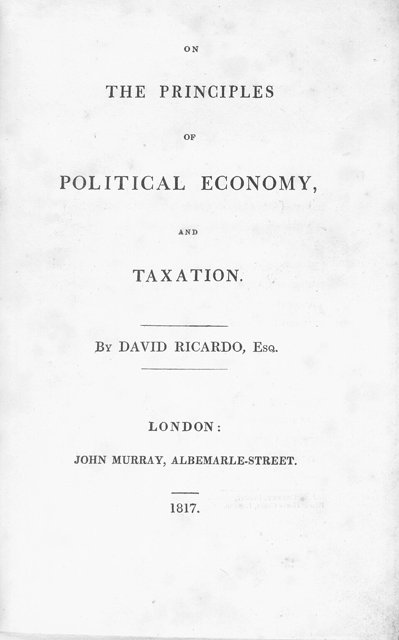

<!--
內容整理自 D:\Books\md\歷史\人物\思想家\李嘉圖生平大事記.md（Books 的人物頁為 D:\Books\html\4-1-2.經濟學家\李嘉圖(1772~1823).html），並整合中文維基百科〈大衛·李嘉圖〉條目，以自己的話改寫。
時期依筆記的生平時間軸歸納：家世與證券交易、金價論戰、經濟學家、國會議員。
兩份資料出入與處理方式：
- 家世：維基百科補充他是塞法迪猶太裔股票經紀人亞伯拉罕的十七個孩子中的第三個，1793年12月20日與貴格會信徒普莉西拉·威爾金森結婚後與家族疏遠，母親可能從此不再與他說話，他也改信一位論派，照此。
- 筆記1797年英格蘭銀行停止兌換黃金、1807年加入地質學會，寫進相鄰事件。
- 滑鐵盧之役前後購買政府公債致富，是常見的說法，細節有誇大的成分，內文照此說明。
- 人名與其他時間軸一致：亞當·斯密（AdamSmith）、馬爾薩斯（Malthus）、約翰·斯圖亞特·彌爾（JohnStuartMill）；古典學派的整體發展見 ClassicalEconomics。
圖片來源（皆為 Wikimedia Commons 公有領域／CC0 作品，縮成最長邊 640px）：
- ce-ricardo.jpg：Portrait of David Ricardo by Thomas Phillips.jpg（湯瑪斯·菲利普斯所繪李嘉圖像（與古典經濟學派時間軸共用））
- ri-principles.jpg：David Ricardo - On the principles of political economy and taxation (1817, title).jpg（《政治經濟學及賦稅原理》1817年初版書名頁）
-->

# Periods
- 1772 ~ 1798 | 證券交易所的少年 | #868e96
  生於倫敦的塞法迪猶太家庭，十四歲隨父親進入證券交易所；為娶貴格會女子與家族決裂，獨立經營證券買賣而致富。
- 1799 ~ 1813 | 從讀者到論戰者 | #1971c2
  偶然讀到《國富論》而迷上經濟學，在拿破崙戰爭的通膨中發表金價論，成為「金塊主義」的代表，並與馬爾薩斯結為論友。
- 1814 ~ 1818 | 古典經濟學的高峰 | #2b8a3e
  退出交易所、買下蓋特科姆莊園，專心著述；提出地租理論，1817年出版《政治經濟學及賦稅原理》，建立嚴密的古典經濟學體系。
- 1819 ~ 1823 | 國會議員 | #5f3dc4
  進入下議院，倡導自由貿易、恢復金本位與廢除穀物法；五十一歲突然病逝。

# Events

## 1772-04-18 | 出生於倫敦
大衛·李嘉圖生於倫敦，是塞法迪猶太裔股票經紀人亞伯拉罕·李嘉圖十七個孩子中的第三個。家族從荷蘭移居英國，他十一歲時被送到阿姆斯特丹的親戚家讀書兩年，沒有受過大學教育。

## 1786 | 進入證券交易所
十四歲的李嘉圖跟隨父親在倫敦證券交易所工作，學習公債與匯票的買賣，培養出對數字與市場的敏銳判斷。

## 1793-12-20 | 與家族決裂
二十一歲的李嘉圖與貴格會信徒普莉西拉·威爾金森私奔結婚，放棄了猶太教信仰，後來成為一位論派信徒，與父母決裂，母親可能從此不再與他說話。失去家族支持的他自立門戶，憑著過人的判斷在證券交易中迅速致富。1797年英格蘭銀行因戰爭停止紙幣兌換黃金，貨幣問題成為他日後研究的起點。

## 1799 | 讀到《國富論》
李嘉圖在巴斯陪妻子養病時，偶然在圖書館讀到亞當·斯密的《國富論》，從此對政治經濟學產生濃厚興趣。他也熱愛科學，1807年是倫敦地質學會的創始會員之一。

## 1810 | 《金價高漲論》
1809年李嘉圖在《晨報》匿名發表文章，討論金價上漲的原因；1810年出版《金價高漲論》，指出拿破崙戰爭期間金價與物價上漲，是英格蘭銀行停止兌換後發行過多紙幣所致，主張恢復兌換。他的論點影響了國會的「金塊委員會」報告，「金塊主義」成為貨幣理論的重要傳統。馬爾薩斯讀後主動寫信給他，兩人從此通信論戰十多年。

## 1814 | 退出交易所
滑鐵盧之役前後，李嘉圖大量承銷政府公債，在戰爭結束後獲利豐厚（相傳他賭對了戰局，細節有誇大的成分）。四十二歲的他退出證券業務，買下格洛斯特郡的蓋特科姆莊園，成為富有的地主，專心研究經濟學。

## 1815 | 《論低價穀物對資本利潤的影響》
英國通過保護地主的穀物法，李嘉圖發表〈論低價穀物對資本利潤的影響〉，提出差額地租理論：人口增加迫使人們耕種較差的土地，較好土地的地主因此坐收愈來愈多的地租，糧價上漲推高工資、壓縮利潤，阻礙資本累積。他由此反對穀物法，認為地主的利益與社會其他階級相衝突。1816年他又發表〈建立穩健而節約的貨幣制度之建議〉。

## 1817-04-19 | 《政治經濟學及賦稅原理》

在好友詹姆斯·穆勒的再三鼓勵下，李嘉圖出版代表作《政治經濟學及賦稅原理》，以抽象演繹的方法建立古典經濟學最嚴密的體系：商品的價值取決於生產所需的勞動量，社會的產品在地主、資本家與勞工之間分配，長期利潤率會趨於下降。書中第七章提出「比較利益」：即使英國生產布與酒都不如葡萄牙有效率，只要兩國各自專門生產相對最擅長的商品再互相貿易，雙方都能得利。比較利益至今仍是國際貿易理論的基石，他的勞動價值論則被馬克思繼承並推向相反的結論。

## 1819 | 當選下議院議員
李嘉圖買下愛爾蘭波特靈頓選區的席位（當時常見的「口袋選區」），進入下議院。他在國會中主張自由貿易、廢除穀物法、恢復金本位與議會改革，以清晰的經濟論證受到重視，但當時有人嘲笑他像「從另一個星球來的人」。英國在1821年正式恢復黃金兌換。

## 1821 | 政治經濟學俱樂部
李嘉圖與馬爾薩斯、詹姆斯·穆勒等人在倫敦創立政治經濟學俱樂部，定期聚會辯論經濟問題。他的學說吸引了麥卡洛克、詹姆斯·穆勒等追隨者，形成主導英國經濟學數十年的「李嘉圖學派」。同年出版《原理》第三版，新增〈論機器〉一章，承認機器可能在短期內造成工人失業。

## 1822 | 《論農業保護》
李嘉圖出版《論農業保護》，再度反對以關稅保護農業，主張逐步降低穀物進口關稅。他也開始撰寫以國家銀行取代英格蘭銀行發行貨幣的計畫，在身後才發表。

## 1823-09-11 | 逝世於蓋特科姆莊園
李嘉圖因耳部感染引發的併發症突然去世，年僅五十一歲。他最後的書信之一是寫給論敵兼摯友馬爾薩斯：「如果你同意我的觀點，我不會更愛你。」他的勞動價值論、地租理論與比較利益，影響了彌爾、馬克思與後來的國際貿易理論；1846年英國廢除穀物法，實現了他生前的主張。
