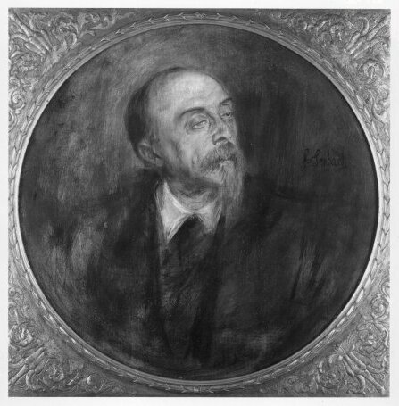
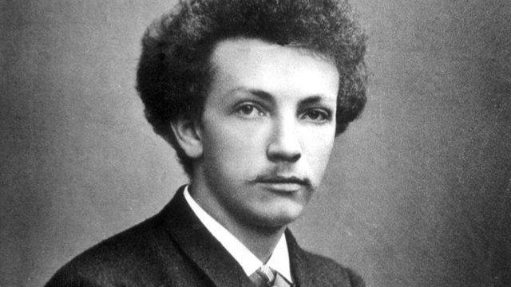
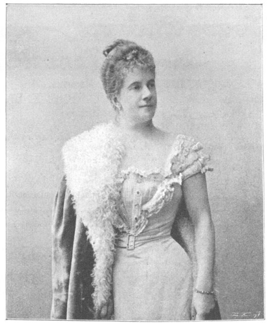
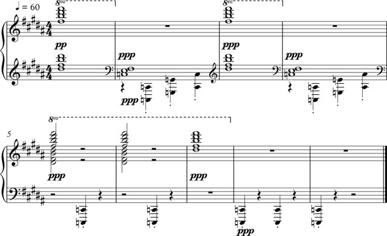
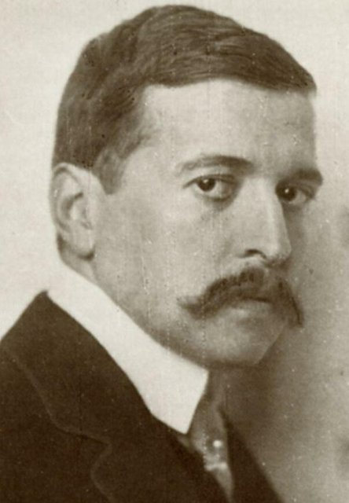
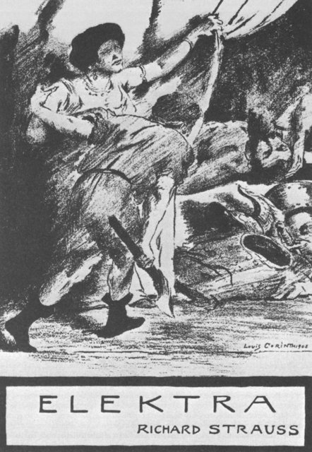
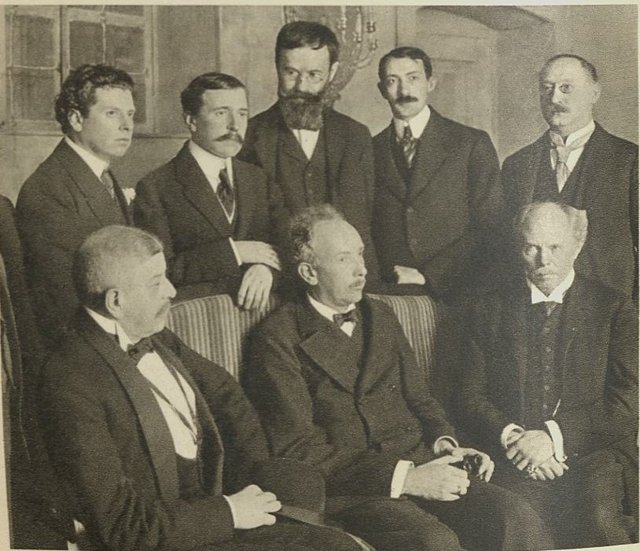
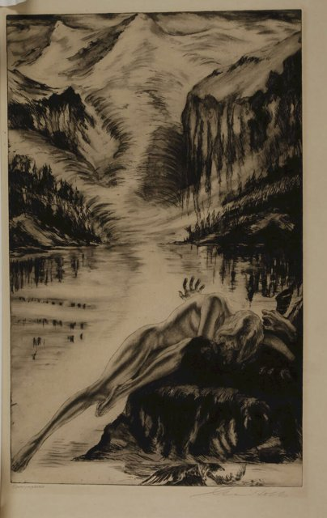

<!--
內容整理自本機筆記〈理查史特勞斯（Richard Strauss）生平大事記〉（D:\Books\md\音樂\理查史特勞斯（Richard Strauss）生平大事記.md），以自己的話改寫。
時期依筆記的五個創作分期；筆記的「歌劇突破期」作1905—1911年，這裡從1904年起算，以接上前一期的1903年。
處理方式：
- 筆記提醒他與圓舞曲作曲家小約翰·史特勞斯沒有親屬關係，寫進出生事件。
- 筆記列為「約」的年份（約1868、約1870）以顯示文字標明。
- 納粹時期出任帝國音樂局局長一事，依筆記並陳他的妥協與後來被迫辭職，不作單方面評斷。
- 劇作家史蒂芬·褚威格、指揮家畢勤的譯名與其他時間軸一致（筆記作茨威格、比徹姆）。
圖片來源（皆為 Wikimedia Commons 公有領域作品）：
- strauss-1888.jpg：Richard Strauss-1888.jpg（24歲的理查·史特勞斯，1888）
- strauss-bulow.jpg：Franz von Lenbach (1836-1904) - Porträt Hans von Bülow - 0593 - Führermuseum.jpg（倫巴赫所繪漢斯·馮·畢羅像）
- strauss-pauline.jpg：Pauline Strauss de Ahna.jpg（女高音寶琳·德·阿赫納）
- strauss-zarathustra.jpg：Strauss "Also Sprach Zarathustra" ending.png（《查拉圖斯特拉如是說》的結尾樂譜）
- strauss-hofmannsthal.jpg：Nicola Perscheid - Hugo von Hofmannsthal 1910 (cropped).jpg（佩爾沙伊德拍攝的霍夫曼斯塔爾，1910）
- strauss-elektra.jpg：Richard Strauss - Elektra - titlepage of the libretto - drawing by Lovis Corinth - 1909.png（科林特為《厄蕾克特拉》劇本所繪的封面，1909）
- strauss-rosenkavalier.jpg：Zander Labisch Rosenkavalier Uraufführung 1911.jpg（《玫瑰騎士》1911年德勒斯登首演的製作群合影，前排中為理查·史特勞斯）
- strauss-alpine.jpg：Alois Kolb Alpensymphonie Radierung.jpg（阿洛伊斯·科爾布為《阿爾卑斯交響曲》所作的蝕刻版畫）
-->

# Periods
- 1864 ~ 1885 | 慕尼黑的音樂家庭與古典訓練@慕尼黑 | #868e96
  父親是慕尼黑宮廷樂團的法國號名家，他從小在樂團排練中長大，受莫札特、貝多芬、布拉姆斯的傳統薰陶；指揮家畢羅賞識他，讓他進入邁寧根樂團當助理指揮。
- 1886 ~ 1903 | 交響詩的成熟 | #1971c2
  受里特、李斯特與華格納影響，以管弦樂描寫文學人物、哲學與人生：《唐璜》、《蒂爾的惡作劇》、《查拉圖斯特拉如是說》、《唐吉訶德》、《英雄生涯》，配器技巧登峰造極。
- 1904 ~ 1911 | 歌劇的突破 | #c92a2a
  《莎樂美》與《厄蕾克特拉》以大膽的和聲與極端的心理描寫震撼樂壇，《玫瑰騎士》卻轉回圓舞曲與懷舊的優雅，他與霍夫曼斯塔爾成為歌劇史上著名的搭檔。
- 1912 ~ 1932 | 成熟歌劇與戰後轉型@維也納 | #5f3dc4
  在現代主義與古典傳統之間尋找平衡，寫出《納克索斯島的阿麗雅德妮》與《阿爾卑斯交響曲》，主持維也納國家歌劇院；1929年霍夫曼斯塔爾去世，失去最重要的合作者。
- 1933 ~ 1949 | 納粹時期與晚年@加米施 | #495057
  出任納粹的帝國音樂局局長，又因與猶太作家褚威格合作被迫去職；戰爭與歐洲文化的毀壞，化為《變形》的哀悼與《最後四首歌》的沉靜告別。

# Events

## 1864-06-11 | 出生@慕尼黑
生於慕尼黑。父親法蘭茲·史特勞斯是慕尼黑宮廷樂團著名的法國號演奏家，他從小就接觸管弦樂團與歌劇。他和寫圓舞曲的小約翰·史特勞斯並沒有親屬關係。

## 1868 | 開始學鋼琴 {label=約1868年}
四歲左右開始學鋼琴，很早就展現音樂天賦；約六歲時開始作曲。整個1870年代，他接受鋼琴、小提琴、樂理與作曲訓練，也有機會旁聽宮廷樂團的排練，奠定了對樂器音色與配器的深厚理解。

## 1874 | 接觸華格納
十歲時接觸到華格納的歌劇。父親雖是保守的古典派，華格納的戲劇觀念日後卻深刻影響了他的歌劇創作。

## 1875 ~ 1880 | 師從邁耶
向慕尼黑音樂家弗里德里希·威廉·邁耶學習樂理、作曲與配器，建立完整的古典作曲訓練。

## 1881 | 《D小調交響曲》演出
十七歲寫的《D小調交響曲》在慕尼黑演出，早期作品開始受到注意，展現他對傳統交響曲形式的掌握。

## 1882 | 慕尼黑大學與拜羅伊特
進入慕尼黑大學修讀哲學、美學與藝術史，後來把重心轉回音樂；文學與哲學成為他日後創作的重要背景。同年首次到拜羅伊特，聆賞華格納的《帕西法爾》。

## 1884 | 畢羅指揮《管樂小夜曲》

指揮家漢斯·馮·畢羅指揮他的《降E大調管樂小夜曲》，畢羅成為他早期事業的重要支持者。

## 1885 | 邁寧根助理指揮
出任邁寧根宮廷樂團助理指揮，從作曲新秀走入專業指揮。在邁寧根，他結識小提琴家亞歷山大·里特，進一步接觸李斯特與華格納的音樂美學，里特對他走向交響詩影響很大。

## 1886 | 義大利之旅與《義大利》
到義大利旅行，寫成《義大利》，開始以音樂描寫景物、旅途印象與情境。

## 1887 ~ 1888 | 《馬克白》與《唐璜》
寫下《馬克白》與《唐璜》等管弦樂作品，確立以文學題材與戲劇情境為基礎的交響詩路線。

## 1889 | 《唐璜》一鳴驚人

在拜羅伊特音樂節擔任助理指揮，《唐璜》首演大受矚目，成為他早期最重要的突破之作。1890年代初，他在慕尼黑、威瑪等地擔任指揮，作曲與指揮的聲望同步上升。

## 1894 | 《貢特拉姆》與結婚

第一部歌劇《貢特拉姆》上演；同年與女高音寶琳·德·阿赫納結婚。妻子的歌聲影響了他大量的藝術歌曲與歌劇。

## 1895 | 《蒂爾的惡作劇》
交響詩《蒂爾的惡作劇》完成並首演，以幽默諷刺與靈活的管弦樂描寫一位民間惡作劇者，法國號與木管把角色寫得活靈活現。

## 1896 | 《查拉圖斯特拉如是說》

交響詩《查拉圖斯特拉如是說》首演，以宏大的音響與哲學構想著稱；開場的日出樂段後來因電影《2001太空漫遊》而家喻戶曉。

## 1897 | 《唐吉訶德》
完成《唐吉訶德》，以大提琴刻畫唐吉訶德、中提琴描繪桑丘·潘薩，充分展現他的配器技巧。

## 1898 | 《英雄生涯》
完成《英雄生涯》，把英雄形象、衝突與自我反思融入交響詩，是他晚期浪漫主義管弦樂風格的高峰。

## 1900 | 結識霍夫曼斯塔爾

與詩人、劇作家雨果·馮·霍夫曼斯塔爾建立關係，兩人後來合作多部歌劇，成為二十世紀歌劇史上最著名的搭檔之一。

## 1901 | 《火荒》
第二部歌劇《火荒》上演，他繼續探索德語歌劇的可能性。

## 1903 | 《家庭交響曲》
完成《家庭交響曲》，以交響樂描寫日常家庭生活，擴大了交響詩的題材。

## 1905 | 《莎樂美》首演
歌劇《莎樂美》在德勒斯登首演，大獲成功，也因題材與音樂的強烈表現引起爭議，成為他國際歌劇聲望的轉捩點，音樂語言也更具現代感。

## 1908 | 遷居加米施
遷居巴伐利亞的加米施，同時在柏林擔任重要指揮職務，此時他已是歐洲最具影響力的作曲家兼指揮家之一。

## 1909 | 《厄蕾克特拉》首演

與霍夫曼斯塔爾合作的《厄蕾克特拉》首演，以高度緊張的和聲、強烈的戲劇衝突與龐大的管弦樂編制，把音樂推向更激進的表現。

## 1911 | 《玫瑰騎士》首演

《玫瑰騎士》首演，以圓舞曲、懷舊氣氛與細膩的喜劇手法，展現與《厄蕾克特拉》截然不同的面貌，成為他最受歡迎的歌劇。

## 1912 | 《納克索斯島的阿麗雅德妮》
《納克索斯島的阿麗雅德妮》首演，1916年推出修訂版；作品把義大利即興喜劇、古典神話與「歌劇如何演出」這件事本身結合在一起，結構獨特。

## 1915 | 《阿爾卑斯交響曲》首演

以大型管弦樂描寫一日登山、自然景觀與暴風雨的《阿爾卑斯交響曲》首演，是他最後的大型交響詩式作品。

## 1919 | 維也納國家歌劇院
與指揮家法蘭茲·沙爾克共同主持維也納國家歌劇院，在戰後歐洲的音樂機構中持續發揮影響力。1920年代他仍持續創作歌劇、歌曲與管弦樂，1924年後逐漸減少固定的指揮工作，重心轉回作曲。

## 1929 | 霍夫曼斯塔爾去世
霍夫曼斯塔爾逝世，史特勞斯失去合作近三十年的劇作家，對他的歌劇創作是一大打擊。

## 1933 | 出任帝國音樂局局長
納粹上台後，他出任帝國音樂局局長。這段經歷成為他晚年最具爭議的政治與道德問題。

## 1935 | 《沉默的女人》與去職
歌劇《沉默的女人》首演，劇本出自猶太作家史蒂芬·褚威格之手。他因與褚威格合作等政治問題，被迫辭去帝國音樂局局長。這顯示他想維持藝術合作的立場與納粹文化政策之間的衝突，但也不能因此抹去他曾接受納粹職務的事實。

## 1936 | 《奧林匹克讚歌》
為柏林奧運創作並指揮《奧林匹克讚歌》，他的音樂活動仍與德國官方的文化場合有所交集。

## 1938 | 《和平日》與《達芙妮》
歌劇《和平日》與《達芙妮》相繼首演，繼續探索道德抉擇、神話與人性。

## 1942 | 《隨想曲》首演
最後一部歌劇《隨想曲》首演，以「在歌劇中，音樂與文字何者重要」為核心，是他歌劇創作的晚期代表作。

## 1945 | 《變形》與雙簧管協奏曲
第二次世界大戰結束。他寫下弦樂作品《變形》，以深沉的哀悼回應戰爭與德國文化世界的毀壞；同年的雙簧管協奏曲則呈現清澈、古典化的晚期風格。

## 1947 | 倫敦回顧演出
應指揮家畢勤之邀前往倫敦，參與他的作品回顧演出，戰後他的作品仍受國際樂壇重視。

## 1948 | 《最後四首歌》
完成《最後四首歌》，以成熟內斂的抒情，思索生命、黃昏與死亡，成為晚期浪漫藝術歌曲的代表作。這組歌在他去世後的1950年才首演，成為他晚年最受歡迎的作品之一。

## 1949-09-08 | 逝世@加米施
在加米施去世。他從古典交響曲出發，走過交響詩與現代歌劇，最後回到懷舊的晚期浪漫風格，留下交響詩、歌劇、協奏曲與藝術歌曲等大量經典；當二十世紀音樂走向無調性時，他始終在調性音樂中開拓新的表現。
