<!--
內容整理自中文維基百科「尼古拉·林姆斯基－高沙可夫」與英文維基百科「Nikolai Rimsky-Korsakov」條目（CC BY-SA 4.0），並以台灣用語改寫摘要。
https://zh.wikipedia.org/zh-tw/尼古拉·里姆斯基-科萨科夫
https://en.wikipedia.org/wiki/Nikolai_Rimsky-Korsakov
中文條目較簡略，生平細節主要參考英文條目。日期採新曆。
《西班牙隨想曲》、《天方夜譚》、《雪姑娘》、《薩爾坦沙皇的故事》（〈大黃蜂的飛行〉）、《金雞》等作品的首演年份與日期，係依一般公認的史實補充。
圖片皆為 Wikimedia Commons 上的公有領域作品（封面：列賓1893年所繪肖像）。
-->

# Periods
- 1844 ~ 1862 | 童年與海軍學校
  生於貴族世家，受航海家哥哥沃因的影響，從小就嚮往「從沒見過的大海」，12歲進入聖彼得堡的海軍學校。課餘學鋼琴，被引見給巴拉基列夫。
- 1862 ~ 1865 | 環球航行
  搭乘快速帆船「鑽石號」遠航兩年八個月，在船上寫交響曲、研讀白遼士的《配器法》，到過倫敦、尼加拉瀑布與里約熱內盧，卻一度失去了作曲的熱情。
- 1865 ~ 1871 | 「俄國五人組」
  回國後在巴拉基列夫指導下完成第一號交響曲，與居伊、穆索斯基、鮑羅定並稱「強力集團」。以《薩德柯》、《安塔爾》奠定配器大師的名聲。
- 1871 ~ 1888 | 教授與海軍軍樂隊督察
  幾乎不懂樂理卻當上聖彼得堡音樂學院教授，邊教邊苦學，成為出色的教師。擔任海軍軍樂隊督察、整理葛令卡與穆索斯基的作品，並在別利亞耶夫圈子中寫出《西班牙隨想曲》與《天方夜譚》。
- 1889 ~ 1908 | 歌劇時期與晚年
  受華格納《指環》震撼，此後幾乎專心寫歌劇，平均每一年半就完成一部。1905年因支持學生運動被音樂學院開除，最後一部歌劇《金雞》在他死後才上演。

# Events

## 1844-03-18 | 出生@季赫溫
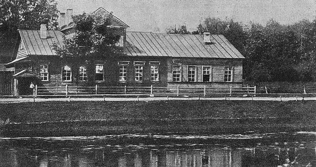
生於聖彼得堡以東200公里的季赫溫，出身俄國貴族世家。家族歷代多在政府與軍隊任職，一位先祖還是凱薩琳大帝的情人；「林姆斯基」意為「羅馬的」，因為家族自稱源自神聖羅馬帝國境內。父親曾任諾夫哥羅德副省長。比他大22歲的哥哥沃因是著名的航海家與探險家，對他一生影響很大。

## 1850 | 6歲學鋼琴
母親會彈一點鋼琴，父親會憑耳朵彈幾首歌。他6歲開始跟當地老師學琴，聽力很好，但他自己說當時彈得「很差、很隨便……節拍也抓不準」。10歲開始作曲，但比起音樂，他更喜歡文學。

## 1856 | 進入海軍學校
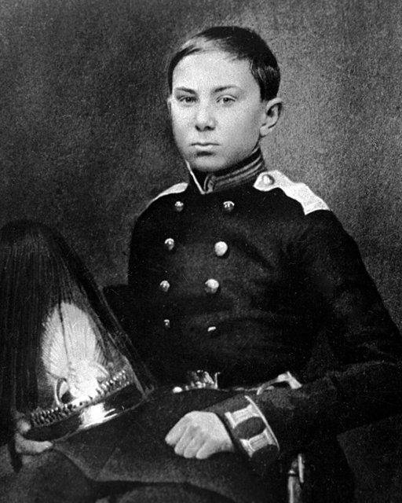
從書本和哥哥的冒險故事中，他對「從沒見過的大海」產生了詩意的嚮往，在哥哥的鼓勵下，12歲進入聖彼得堡的數學與航海科學學校。哥哥當時是校長，讓他課餘學鋼琴，希望能幫助他克服害羞。

## 1859 | 拜卡尼勒為師
鋼琴老師烏利赫發現他的音樂天分，推薦他跟卡尼勒學鋼琴與作曲，他後來說卡尼勒是讓他決心一生作曲的人。卡尼勒帶他認識了葛令卡與舒曼的音樂。他17歲時，哥哥覺得音樂課沒有實際用處而停掉了，卡尼勒卻要他每個星期天繼續來一起四手聯彈、討論音樂。

## 1861-11 | 結識巴拉基列夫
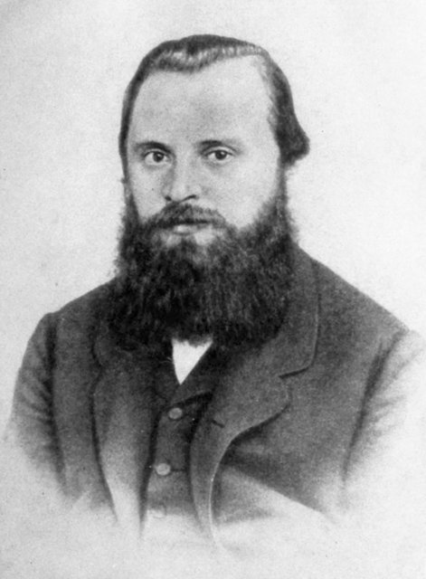
卡尼勒把18歲的他介紹給巴拉基列夫，又認識了居伊與穆索斯基。他回憶：「我聽著他們認真討論配器、聲部寫作，多麼高興！我一下子被投入一個全新的世界。」巴拉基列夫鼓勵他寫交響曲，雖然他沒受過正規的音樂訓練。

## 1862-04 | 海軍學校畢業
18歲通過畢業考試。年底他已完成並配器了交響曲的三個樂章。

## 1862-12 | 搭「鑽石號」遠航
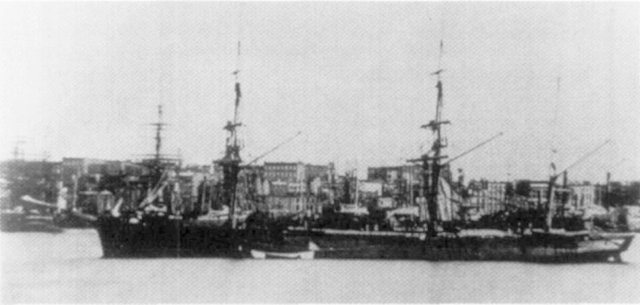
搭乘快速帆船「鑽石號」展開兩年八個月的航行。在英格蘭停靠時寫下交響曲的慢樂章，寄給巴拉基列夫。他每到一個港口就買樂譜，還買了一台鋼琴，閒暇時研讀白遼士的《配器法》，也讀荷馬、莎士比亞、席勒、歌德。他到過倫敦、尼加拉瀑布與里約熱內盧，但兩年後他坦承：「想當音樂家、作曲家的念頭漸漸完全離開了我。」

## 1865-12 | 第一號交響曲首演
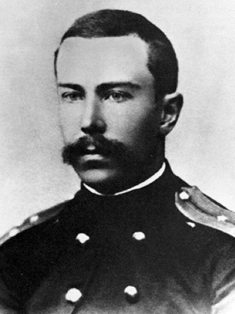
5月回到聖彼得堡，9月再見到巴拉基列夫後重燃作曲熱情。在巴拉基列夫指點下補寫、重新配器的第一號交響曲，12月由巴拉基列夫指揮首演。巴拉基列夫常常不只修改學生的作品，而是乾脆在鋼琴上重寫。

## 1867 | 「強力集團」
他的《塞爾維亞主題幻想曲》在斯拉夫大會的音樂會上演出，樂評家斯塔索夫在樂評中稱巴拉基列夫一派為「強力集團」，也就是後來的「俄國五人組」。同年他寫了交響音畫《薩德柯》的初版，1868年又寫了《安塔爾》，奠定了管弦樂作曲家的名聲。

## 1868 | 為五人組配器
他特別以配器才能受到五人組成員推崇，巴拉基列夫請他為舒伯特的進行曲配器，居伊請他為歌劇配器，病重的達爾戈梅日斯基也請他為歌劇《石客》配器。

## 1871 | 與穆索斯基同住；音樂學院教授
年底他搬進哥哥的舊公寓，邀穆索斯基當室友：早上穆索斯基用鋼琴，他抄譜配器；中午穆索斯基去上班，換他用鋼琴。這段期間穆索斯基寫了《鮑里斯·戈杜諾夫》的部分場景，他則完成了歌劇《普斯科夫的姑娘》。同年27歲的他成為聖彼得堡音樂學院作曲與配器教授，仍保留海軍身分，穿著軍服上課。

## 1871 | 邊教邊學
他其實沒寫過對位，不會為簡單的聖詠配和聲，甚至不知道和弦的名稱，也從沒指揮過樂團。他向受過學院訓練的柴可夫斯基請教，柴可夫斯基建議他好好學習。他三年不寫新作品，在家苦讀教科書、寫賦格與對位習題，後來說自己是音樂學院「可能最好的學生」。

## 1872-07 | 與娜傑日達結婚
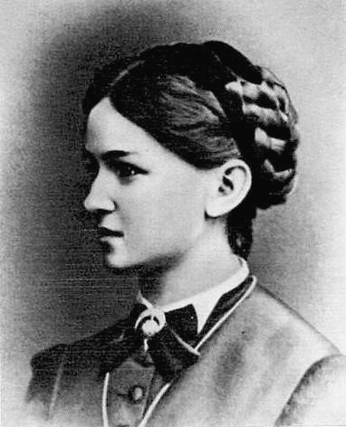
與在五人組聚會中結識的鋼琴家娜傑日達·普爾戈德結婚，穆索斯基擔任伴郎。娜傑日達受過的音樂訓練比他扎實，是嚴格的批評者，也像克拉拉之於舒曼一樣，是他音樂上的夥伴。兩人生了七個孩子。

## 1873 | 海軍軍樂隊督察
海軍為他設立軍樂隊督察的文職，他得以脫下軍服：「從此我正式、無可爭議地成為音樂家。」他走訪全俄國的海軍樂隊，研究各種樂器的構造與演奏技巧，這些經驗促使他寫配器法教科書。

## 1874 | 民歌集與指揮首演
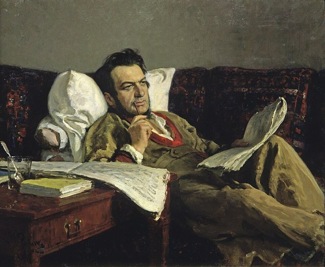
他的第三號交響曲塞滿對位技巧，鮑羅定挖苦說像「德國教授戴上眼鏡要寫一首偉大的C大調交響曲」，五人組覺得他走上了「下坡路」；柴可夫斯基則私下說，他要不是成為大師，就是會陷在對位技巧裡。這一年他第一次公開指揮，並整理了兩本共140首的俄國民歌集，這些民歌後來成為他創作的寶庫。他也和巴拉基列夫一起編輯出版葛令卡的總譜。

## 1878 | 歌劇《五月之夜》
根據果戈里的小說寫成，妻子在訂婚那天就和他一起讀過這篇故事，一直鼓勵他寫。他說這部歌劇讓他「擺脫了對位的枷鎖」。

## 1881 | 穆索斯基去世；《雪姑娘》
穆索斯基去世後，他整理、修訂了穆索斯基的遺作。1881到1888年間他常陷入創作瓶頸，卻寫出了歌劇《雪姑娘》（1882年首演）。

## 1884 | 宮廷合唱團副指揮
海軍取消了軍樂隊督察一職，他到巴拉基列夫主持的宮廷合唱團擔任副指揮到1894年，研究東正教聖樂，並寫了和聲學教科書。

## 1886 | 俄國交響音樂會
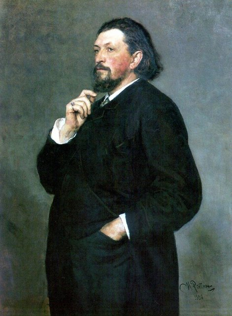
富商別利亞耶夫成為俄國音樂的贊助人，他是每週「四重奏星期五」聚會的常客，並和利亞多夫一起指揮新創的「俄國交響音樂會」，開幕音樂會上演出他修訂的穆索斯基《荒山之夜》。他成為「別利亞耶夫圈」的領袖，和格拉祖諾夫、利亞多夫一起審核、推薦值得資助的作曲家。

## 1887 | 鮑羅定去世；《西班牙隨想曲》
鮑羅定去世後，他和學生格拉祖諾夫一起補完鮑羅定未完成的歌劇《伊果王子》。為俄國交響音樂會寫的《西班牙隨想曲》也在這一年首演。11月柴可夫斯基來聽音樂會，兩人從此往來更密切，雖然他私下對柴可夫斯基愈來愈受自己學生歡迎感到有些嫉妒。

## 1888 | 《天方夜譚》
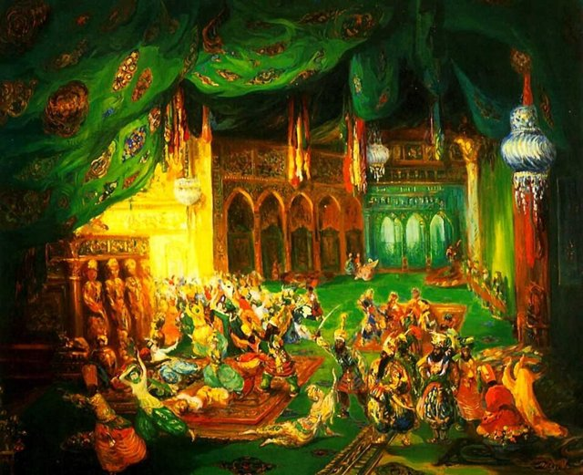
取材自《一千零一夜》的交響組曲，以小提琴獨奏代表說故事的王妃莎赫札德，色彩絢爛，是他最著名的作品。同時期他也寫了《俄國復活節序曲》。他說這些作品減少了對位手法，改以各種華麗的音型展現技巧。

## 1889-03 | 華格納《指環》的震撼
華格納劇團到聖彼得堡演出四輪《指環》，五人組一向忽視華格納，他卻對華格納的配器功力大為驚嘆，跟著格拉祖諾夫一起看排練、對照總譜。此後他幾乎專心寫歌劇。同年他也率團到巴黎萬國博覽會指揮俄國音樂會。

## 1892 | 第二次創作瓶頸
妻子與兒子染上白喉、母親與么兒去世、另一個孩子久病不癒，他陷入憂鬱，出現頭部充血、意識混亂、記憶衰退等症狀，被診斷為神經衰弱，一度考慮永遠放棄作曲。

## 1893 | 柴可夫斯基去世後的新生
柴可夫斯基原本答應下個樂季指揮四場音樂會，曲目還包括他的第三號交響曲，卻在年底驟逝。柴可夫斯基之死反而讓他重新振作：他能為皇家劇院寫作，並以柴可夫斯基也寫過的果戈里《聖誕夜》為題材寫了新歌劇。此後到1908年，他幾乎每一年半就完成一部歌劇，共寫了11部。

## 1896 | 修訂《鮑里斯·戈杜諾夫》
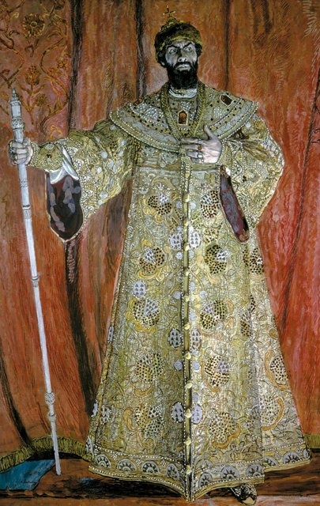
為穆索斯基的歌劇整理出完整的演出版本，雖然今天學者對這個版本有所保留，但在恢復原作之前，這部歌劇一直靠他的版本流傳。他這時愈來愈保守，說：「真難相信我曾經喜歡過這種音樂。」

## 1900 | 《薩爾坦沙皇的故事》
歌劇中描寫王子變成大黃蜂的段落〈大黃蜂的飛行〉，後來成為家喻戶曉的炫技曲。他對理查·史特勞斯和德布西等新潮音樂始終無法接受，聽了德布西的《版畫》後氣了好幾天，在日記裡寫道：「貧乏到了極點，沒有技巧，更沒有想像力。」

## 1902 | 收史特拉汶斯基為學生
法律系學生史特拉汶斯基到海德堡拜訪他，他勸史特拉汶斯基不要進音樂學院，答應親自指導。他在音樂學院35年教過約250位學生，加上私人學生，包括格拉祖諾夫、利亞多夫、普羅高菲夫、雷史畢基、史特拉汶斯基等人。他的教學法是：「我說，你們聽。然後我少說一點，你們開始做。最後我完全不說，你們做。」

## 1905 | 支持學生，被音樂學院開除
1905年革命期間音樂學院發生學生示威，一向政治自由派的他公開寫信支持學生、要求院長下台，結果約100名學生被開除，他也被解除教職。學生在演出他的歌劇後舉行政治示威，警方隨即禁演他的作品，引發國內外輿論譁然，連沒聽過他音樂的農民都寄來小額捐款。格拉祖諾夫、利亞多夫等教授辭職抗議，三百多名學生罷課聲援。12月格拉祖諾夫出任新院長，他也復職，1906年退休。

## 1907-04 | 巴黎的俄國音樂會
應狄亞基列夫之邀在巴黎指揮兩場俄國民族樂派的音樂會，大受歡迎，讓俄國古典音樂在歐洲流行起來，拉赫曼尼諾夫也參與了這次音樂季。隔年他的歌劇《薩德柯》與《雪姑娘》在巴黎上演。他聽了理查·史特勞斯的《莎樂美》當場噓聲連連，聽了德布西的《佩利亞與梅莉桑》則對狄亞基列夫說：「別讓我聽這些恐怖的東西，不然我會喜歡上它們！」

## 1908-06-21 | 逝世@盧本斯克
約從1890年起他就患有心絞痛，1905年革命的壓力讓病情急速惡化，1907年12月後已無法工作。他在呂加附近的盧本斯克莊園去世，享年64歲，安葬於聖彼得堡亞歷山大·涅夫斯基修道院的季赫溫公墓，與鮑羅定、葛令卡、穆索斯基、斯塔索夫為鄰。不久前，學生史特拉汶斯基寄給他的管弦樂《煙火》總譜被退回，上面寫著「收件人已逝，無法投遞」。

## 1909-10-07 | 《金雞》首演
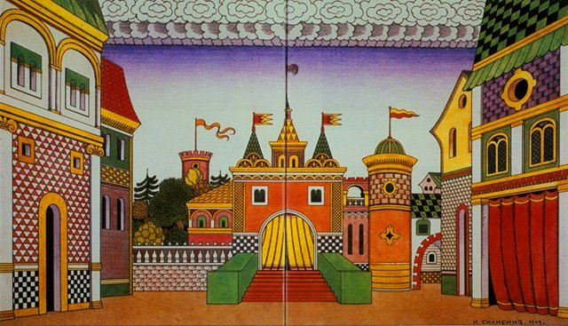
最後一部歌劇隱含對君主制、俄國帝國主義與日俄戰爭的批評，審查官不准上演，直到他死後才以刪改的版本在莫斯科首演。他未完成的配器法教科書由女婿施坦伯格在1912年補完出版，書中附有三百多個取自他自己作品的譜例，樹立了這類教科書的新標準。
