<!--
內容整理自中文維基百科「焦阿基諾·羅西尼」與英文維基百科「Gioachino Rossini」條目（CC BY-SA 4.0），並以台灣用語改寫摘要。
https://zh.wikipedia.org/zh-tw/焦阿基諾·羅西尼
https://en.wikipedia.org/wiki/Gioachino_Rossini
中文條目較簡略且未列來源，細節主要參考英文條目；兩者不一致處（如結婚年份、1815年就任地點）以英文條目為準。
圖片皆為 Wikimedia Commons 上的公有領域（含CC0）作品（封面：艾蒂安·卡爾雅1865年所攝）。
-->

# Periods
- 1792 ~ 1806 | 童年@佩薩羅、盧戈
  父親是小號手，母親後來成為喜歌劇歌手，家計主要靠母親撐起。父親因支持拿破崙的共和派而兩度入獄。在盧戈跟一位神父學音樂，從他的藏書接觸到當時在義大利還很少見的海頓與莫札特，12歲就寫出六首弦樂奏鳴曲。
- 1806 ~ 1810 | 波隆那音樂學院
  進入新成立的波隆那音樂學院，學唱歌、大提琴與鋼琴，很快加入作曲班。學院嚴格的訓練給了他紮實的技巧，但他兩年後婉拒繼續深造，寧願到真實的劇場世界學習。
- 1810 ~ 1815 | 初登歌劇舞台@威尼斯、米蘭
  18歲在威尼斯推出第一部歌劇，之後在米蘭斯卡拉劇院、威尼斯鳳凰劇院接連成功，《湯克雷地》讓他名揚國際。
- 1815 ~ 1822 | 拿坡里時期@Naples
  出任拿坡里皇家劇院音樂總監，第一次能為一流的駐團歌手與樂團寫作。七年間寫了十八部歌劇，包括《塞維亞的理髮師》、《奧賽羅》、《灰姑娘》等最受歡迎的作品。
- 1822 ~ 1824 | 維也納與倫敦
  隨劇團到維也納演出，掀起「羅西尼熱」，並拜訪了貝多芬。之後寫下最後一部義大利歌劇《賽米拉米德》，再前往倫敦，受到英王喬治四世款待。
- 1824 ~ 1829 | 巴黎：最後的歌劇@Paris
  與法國政府簽下優渥合約，學習法語、改寫舊作以迎合巴黎品味，最後寫出法語大歌劇《威廉泰爾》。這是他的最後一部歌劇，當時他才37歲。
- 1830 ~ 1855 | 提早退休@波隆那、佛羅倫斯
  此後25年幾乎不再寫歌劇，原因至今眾說紛紜，現代研究多認為與健康有關：他長期受病痛與憂鬱所苦。這段期間完成了《聖母悼歌》，與妻子分居，再娶奧蘭普，1848年因革命動亂遷居佛羅倫斯。
- 1855 ~ 1868 | 晚年巴黎沙龍：「老年之罪」
  回到巴黎就醫後恢復了健康與生活樂趣，週六晚間的沙龍成為巴黎最炙手可熱的聚會。他為沙龍寫了150多首小品，戲稱為「老年之罪」。

# Events

## 1792-02-29 | 出生@佩薩羅
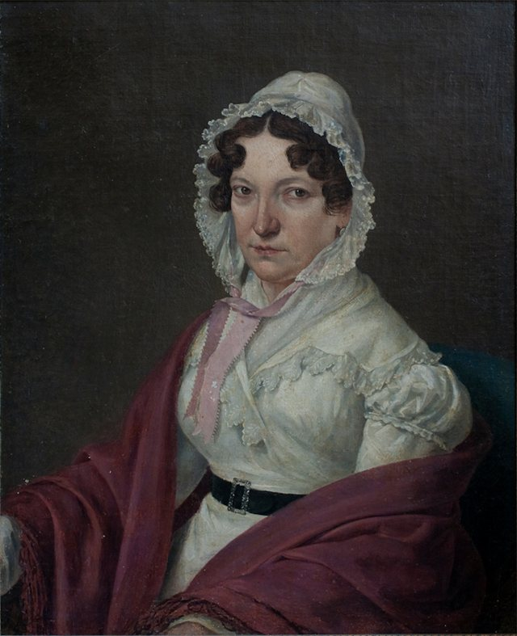
出生在亞得里亞海邊、當時屬於教宗國的佩薩羅，是家中獨子，生日剛好是閏日。父親是小號手兼法國號手，母親原本是裁縫，也是麵包師的女兒。

## 1799 | 父親因支持拿破崙入獄
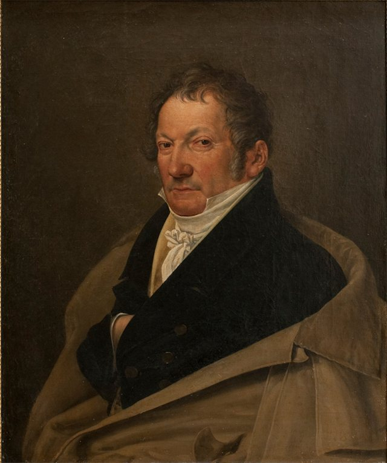
父親是熱烈的共和派，支持拿破崙的軍隊對抗教宗的奧地利盟軍，奧軍重新占領後被關進監獄。前一年起母親開始以歌手身分演出喜歌劇，在的里雅斯特、波隆那等地頗受歡迎。

## 1802 | 遷居盧戈，接觸海頓與莫札特
在盧戈接受良好的基礎教育，隨父親學法國號，並跟一位神父學音樂。神父的藏書裡有海頓與莫札特的作品，這兩位在當時的義大利還鮮為人知，卻深深啟發了年輕的羅西尼。

## 1804 | 12歲寫下六首弦樂奏鳴曲
為四件弦樂器所寫的六首奏鳴曲，在一位富有贊助人的支持下演出。他13歲時還以歌手身分參加過一次歌劇演出。

## 1806 | 進入波隆那音樂學院
學習歌唱、大提琴與鋼琴，不久加入作曲班，學生時期就寫了彌撒曲與清唱劇。據中文條目所述，他的作曲知識主要是靠演奏海頓、莫札特的四重奏自己琢磨出來的。

## 1810-11 | 第一部上演歌劇《婚姻契約》
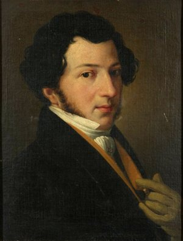
在威尼斯的小劇院聖莫伊塞劇院首演獨幕喜劇《婚姻契約》，大獲成功。他說拿到的40斯庫多酬勞，是他「從沒見過聚在一起的一筆錢」。

## 1811 | 在波隆那指揮海頓《四季》
指揮海頓的神劇《四季》獲得成功，但他的第一部完整長度歌劇卻在波隆那失敗。

## 1812 | 《試金石》在斯卡拉劇院連演53場
應米蘭斯卡拉劇院委託寫成的喜劇連演53場，讓他名利雙收，還因此免服兵役，並成為「票房保證」的作曲家。

## 1813-02 | 《湯克雷地》首演
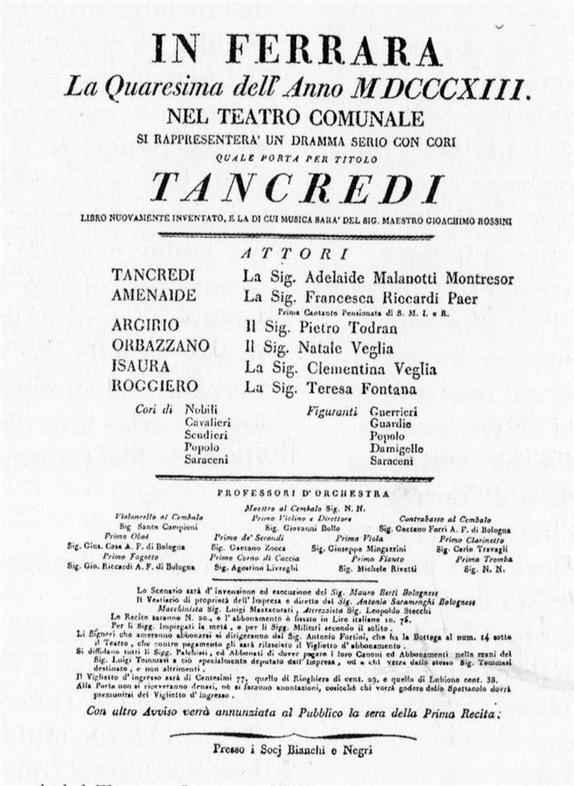
他的第一部正歌劇，在威尼斯鳳凰劇院首演，其中的詠嘆調〈如此激動〉成為他最著名的詠嘆調。這部作品讓他名揚國際，之後在倫敦與紐約都有演出。

## 1813-05 | 《阿爾及爾的義大利女郎》首演
《湯克雷地》之後幾週，又以這部倉促寫成的喜劇締造票房佳績。

## 1815-05 | 出任拿坡里皇家劇院音樂總監
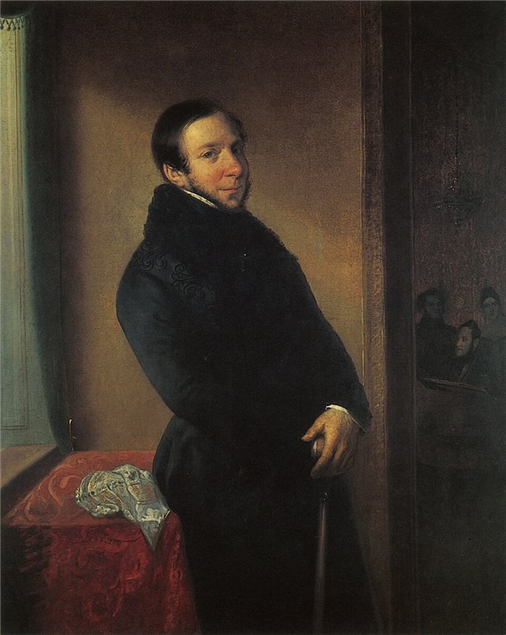
拿坡里音樂界起初視他為外來者，但他的第一部作品《英格蘭女王伊莉莎白》大受歡迎，很快贏得觀眾與樂評。

## 1816-02-20 | 《塞維亞的理髮師》在羅馬首演
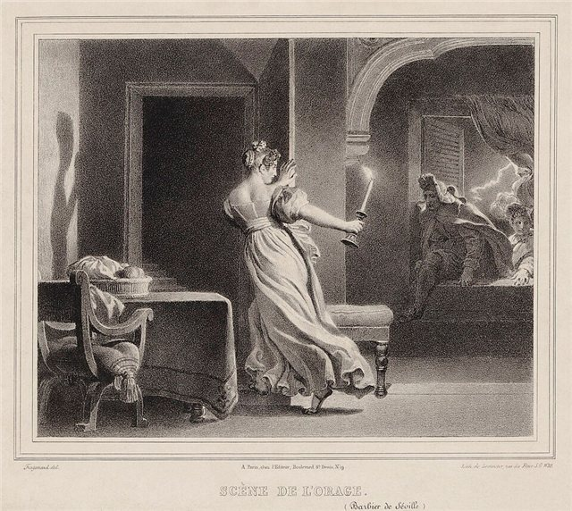
當時已有派西埃洛的同名名作，他的版本原本以主角名字《阿瑪維瓦》為名。首演之夜意外連連，又有派西埃洛的支持者鬧場，但很快就大受歡迎，成為他最著名的歌劇，也取代了派西埃洛的版本。序曲其實是從他更早的歌劇沿用過來的。

## 1816-12 | 《奧賽羅》首演
在拿坡里首演，詩人拜倫抱怨歌詞把《奧賽羅》「釘上了十字架」，但這部作品長年受歡迎，直到七十年後才被威爾第的同名歌劇取代。

## 1817 | 《灰姑娘》與《鵲賊》
《灰姑娘》只用了三個多星期就寫完，在羅馬首演；《鵲賊》則在米蘭斯卡拉劇院首演。同年他的《阿爾及爾的義大利女郎》在巴黎義大利劇院上演成功，為日後的巴黎合約鋪路。

## 1818 | 《摩西在埃及》
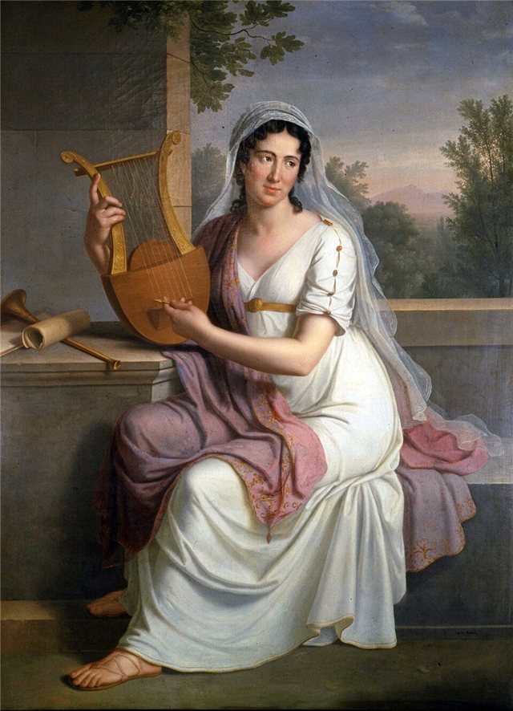
取材自聖經出埃及記，在拿坡里聖卡洛劇院首演。他為劇院的首席女高音伊莎貝拉·柯爾布蘭寫了一系列重要角色，兩人日久生情。

## 1819 | 《湖上少女》
改編自華特·史考特的長詩，在拿坡里首演。

## 1822-03 | 與柯爾布蘭結婚
前往維也納途中，在波隆那附近的小教堂成婚，新娘37歲、新郎30歲。（中文條目寫作1823年，此處依英文條目。）

## 1822-04 | 維也納的「羅西尼熱」；拜訪貝多芬
三個月內演出六部歌劇，觀眾狂熱到貝多芬的助手辛德勒稱之為「偶像崇拜的狂歡」。他聽了《英雄》交響曲後深受感動，設法拜訪了貝多芬。據他日後回憶，貝多芬認為他的才華不適合正歌劇，勸他「多寫幾部《理髮師》」。

## 1823-02 | 《賽米拉米德》：最後一部義大利歌劇
在威尼斯鳳凰劇院首演，為他的義大利生涯畫下輝煌的句點。柯爾布蘭的嗓音已明顯衰退，這也是她在義大利的最後演出。

## 1823-12 | 前往倫敦
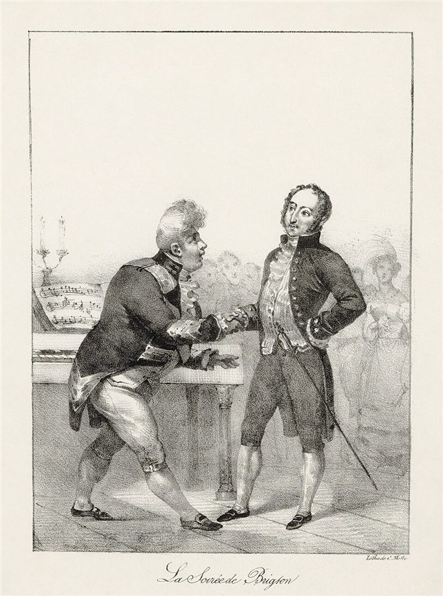
途經巴黎時受到熱烈歡迎，年底抵達倫敦，受到英王喬治四世款待。在倫敦賺了超過三萬英鎊，但他不喜歡英國的天氣和食物，很高興地簽下前往巴黎的合約。

## 1824 | 與法國政府簽約
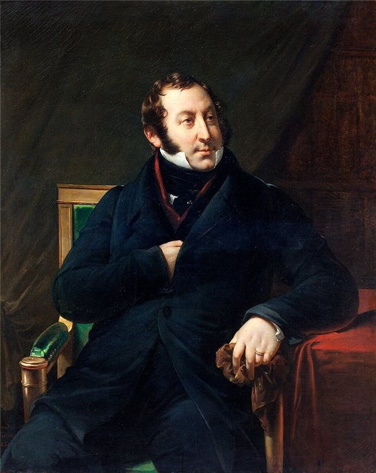
簽下優渥的合約，為巴黎歌劇院與義大利劇院寫作，並協助經營義大利劇院。

## 1825-06 | 《蘭斯之旅》：慶祝查理十世加冕
他最後一部義大利語歌劇。他只准演出四場，打算把最好的音樂留給更長久的作品；後來《歐利伯爵》約有一半音樂取自這部作品。

## 1827 | 母親去世
他與母親感情深厚，母親的死帶給他很大的打擊。母親與妻子柯爾布蘭一直處不來，有傳記作者認為他在母親死後漸漸對妻子心生不滿。

## 1828 | 《歐利伯爵》
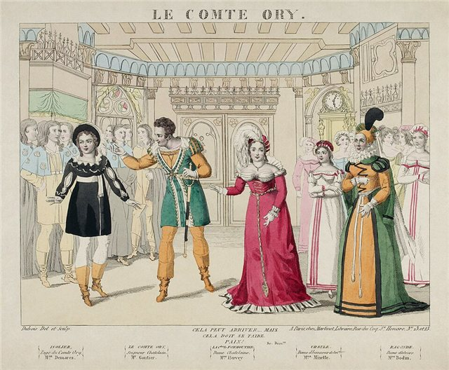
他唯一一部法語喜歌劇，半年內就在倫敦上演，1831年也在紐約演出。

## 1829-08 | 《威廉泰爾》：最後一部歌劇
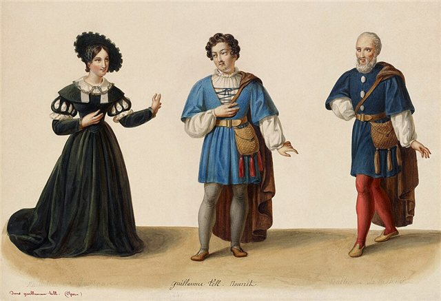
根據席勒的劇本寫成的法語大歌劇，長達三小時四十五分。首演後樂團與歌手到他家門外演奏第二幕終曲向他致敬；董尼采第說這部歌劇的第一和第三幕是羅西尼寫的，中間那一幕是上帝寫的。當時沒有人想到，這會是37歲的他最後一部歌劇。

## 1830-07 | 七月革命，年金被取消
查理十世被推翻，新政府刪減開支，連羅西尼辛苦談來的終身年金也被取消。他回到巴黎爭取年金，也是為了新情人奧蘭普·佩里西耶，從此與柯爾布蘭分居兩地。

## 1835 | 贏得年金官司，定居波隆那
離開巴黎回到波隆那。據中文條目，他也擔任了母校波隆那音樂學院的名譽校長，此後主要創作宗教音樂與室內樂。

## 1837 | 與柯爾布蘭正式分居
柯爾布蘭留在波隆那近郊的卡斯特納索。1839年他的父親以80歲高齡去世。

## 1842-01 | 《聖母悼歌》首演
1831年開始創作，1841年才完成，是他退出歌劇舞台後少數的大型作品。

## 1845 | 柯爾布蘭去世
9月得知她病重前往探望，一個月後她便去世。

## 1846 | 與奧蘭普結婚
在波隆那與長年的伴侶奧蘭普·佩里西耶成婚。

## 1848 | 遷居佛羅倫斯
1848年革命動亂讓他在波隆那感到威脅，遷居佛羅倫斯直到1855年。1850年代初他的身心狀況惡化到妻子與朋友都擔心他的生命安危。

## 1855-04 | 返回巴黎
為了尋求當時最先進的醫療，63歲的他最後一次離開義大利，在巴黎度過餘生。在巴黎他重新恢復了健康與生活樂趣，有學者說他「在巴黎重獲新生」。

## 1857-04 | 《無害的音樂》獻給妻子
重新開始作曲，第一部作品是獻給妻子奧蘭普的歌曲集，感謝她在他「漫長而可怕的病中」細心照顧。

## 1858-12 | 週六沙龍開始
在市中心公寓與帕西的別墅舉辦週六晚間沙龍，一張邀請函成為巴黎社交界的最高榮譽。常客包括李斯特、安東·魯賓斯坦、威爾第、梅耶貝爾，以及小提琴家薩拉沙泰與約阿希姆。他為沙龍寫了150多首小品，戲稱為「老年之罪」。

## 1860 | 華格納來訪
經由朋友介紹，華格納到巴黎拜訪羅西尼，兩人相談甚歡。這次對話後來由引介的朋友寫成回憶錄。

## 1864 | 《小莊嚴彌撒》；獲頒榮譽軍團勳章
他晚年少數準備公開演出的作品。同年拿破崙三世授予他榮譽軍團大軍官勳章。

## 1868-11-13 | 逝世@帕西
腸癌手術失敗後去世，享年76歲。葬禮有四千多人參加，安葬於巴黎拉雪茲神父公墓。遺產在妻子去世後捐給故鄉佩薩羅創辦音樂學院，也在巴黎資助了一所退休歌劇歌手之家。

## 1887 | 遷葬佛羅倫斯聖十字聖殿
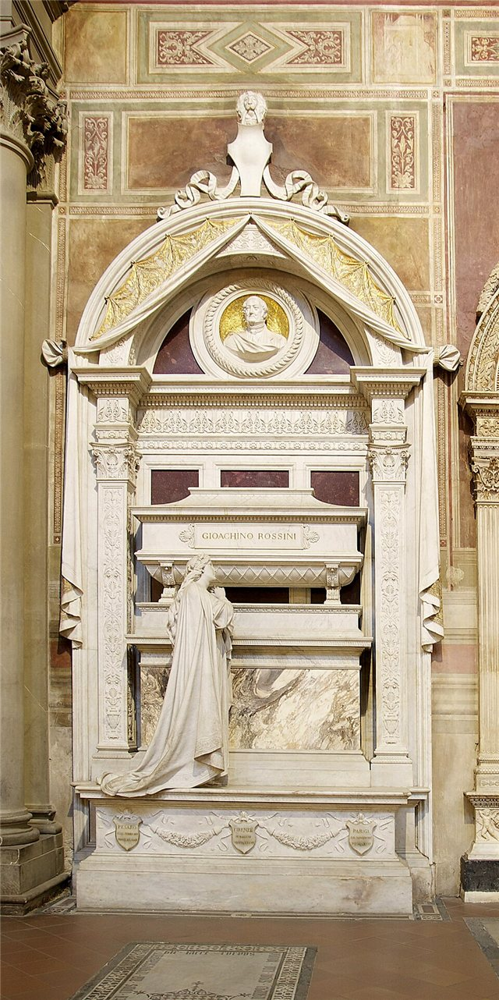
應義大利政府要求，他的靈柩從巴黎移葬到佛羅倫斯聖十字聖殿。據中文條目記載，六千多名群眾靜默送行，在他自己歌劇《摩西》中的祈禱歌聲裡下葬。
