<!--
內容整合自兩份資料，以自己的話改寫：
- 知識圖譜「羅斯柴爾德家族傳記——銀行王朝」（D:\Books\html\1-1.西方歷史\羅斯柴爾德家族.html；md 原稿在 D:\Books\md\歷史\人物\羅斯柴爾德家族，五章十五節）
- 中文維基百科「羅斯柴爾德家族」（https://zh.wikipedia.org/zh-tw/罗斯柴尔德家族）
時期依傳記的五章。人名採傳記的譯法（梅耶·阿姆謝爾、詹姆斯），維基作邁爾、詹姆士。
資料出入的處理：
- 封爵：傳記作1817年封貴族、1822年晉男爵；維基作1816年四兄弟受封、內森1818年受封、1822年9月29日五兄弟同晉男爵。這裡採維基較細的說法。
- 內森到英國：傳記說1798年到曼徹斯特、1804年移居倫敦；維基說英國分支1798年建於曼徹斯特，另一處說1806年在曼徹斯特建立業務後轉往倫敦，1809年買下新院（New Court），1811年成立 N·M·羅斯柴爾德銀行。這裡以1798年到曼徹斯特、1809–1811年在倫敦立足呈現。
- 滑鐵盧：傳記引弗格森的考證，說內森約早一天得知消息、大舉買進公債，獲利約60萬英鎊，「先拋售再掃貨」的情節沒有實證；維基說他先把消息通報政府，大筆買進公債是在勝利公開之後，並在1817年高點賣出，獲利約四成。兩說並陳，共同點是流傳的「一天賺進百萬」傳說誇大不實。
- 法蘭克福總行：傳記說19世紀末絕嗣，維基說1901年因無男性繼承人結束，這裡採1901年。
- 那不勒斯分行：傳記說19世紀中葉關閉，維基說義大利統一（1861）後業務衰退終至關閉，沒有確切年份，這裡併入1861年事件。
- 維也納分行的危機：維基寫「1929年的危機」中路易斯試圖支撐信貸銀行（Creditanstalt）；信貸銀行實際在1931年倒閉，這裡列在1931年。
- 巴黎重建：傳記說1987年大衛·羅斯柴爾德重建，維基只說1982年國有化後他從3名職員重新開始，沒有年份；這裡併入1982年事件。
- 英法合併：維基說2003年起各家銀行由羅斯柴爾德持續控股集團控制、英法機構在大衛·勒內領導下合併；傳記說2012年合併為 Rothschild & Co.、2023年下市私有化。兩者都列入。
- 傳記中「歌德說羅斯柴爾德比路易十四更有權」一語找不到出處，未採用；維基中「東印度公司控股家族」的說法出自陰謀論色彩濃厚的網站，也未採用。
圖片來源（皆為 Wikimedia Commons 公有領域／CC0 作品）：
- ro-elector.jpg：Moritz Daniel Oppenheim (1800-1882) - The Elector of Hesse Entrusting Mayer Amschel Rothschild (1743–1812), with His Treasure - 1535170 - National Trust.jpg（奧本海默〈黑森選帝侯把財寶託付給梅耶·阿姆謝爾〉，描繪拿破崙戰爭時替選帝侯藏匿資產的傳說）
- ro-judengasse.jpg：Haus der Rothschilds in der Frankfurter Judengasse.jpg（法蘭克福猶太巷的羅斯柴爾德老宅，老明信片）
- ro-coat.jpg：Rotschilds arms.jpg（羅斯柴爾德家族紋章，中央是緊握五支箭的手，下方箴言「團結、正直、勤勉」）
- ro-nathan.jpg：Nathan Mayer Rothschild by Moritz Daniel Oppenheim 1853.jpg（奧本海默所繪內森·梅耶·羅斯柴爾德像，1853）
- ro-mayer.jpg：Meier (Mayer) Amschel Rothschild Begrünf. des Welthauses, Frankfurt a. M. 1743-1812.jpg（梅耶·阿姆謝爾·羅斯柴爾德像（版畫））
- ro-waterloo.jpg：Battle of Waterloo 1815.PNG（描繪滑鐵盧之役的油畫）
- ro-metternich.jpg：Prince Metternich by Lawrence.jpeg（勞倫斯所繪奧地利首相梅特涅像）
- ro-salomon.jpg：Edvard von Heuss - Salomon von Rothschild.jpg（維也納的所羅門·羅斯柴爾德男爵像）
- ro-nord.jpg：Inauguration du chemin de fer du nord, juin 1846, NJ10304(1).jpg（1846年6月北方鐵路通車紀念章）
- ro-lionel.jpg：Lionel de Rothschild HOC.jpg（1858年萊昂內爾宣誓進入英國下議院）
- ro-mouton.jpg：Pauillac - château Mouton-Rothschild 3.jpg（波亞克的木桐·羅斯柴爾德酒莊，老明信片）
- ro-carl.jpg：Carl Mayer Rothschild.jpg（那不勒斯分行的卡爾·梅耶·羅斯柴爾德像）
- ro-james.jpg：James de Rothschild (1792-1868).jpg（巴黎的詹姆斯·羅斯柴爾德像）
- ro-suez.jpg：Opening of the Suez Canal, Port Said, 1869.jpg（1869年蘇伊士運河在塞得港通航）
- ro-natty.jpg：Nathan Mayer Rothschild, Vanity Fair, 1888-06-09.jpg（《浮華世界》1888年刊出的首任羅斯柴爾德男爵 Natty 漫畫）
- ro-kimberley.jpg：Bultfontein Kimberley Diamondfields 1873.jpg（1873年南非金伯利鑽石礦區的布爾特方丹營地）
- ro-drumont.jpg：France juive (affiche édition illustrée).jpg（德呂蒙《猶太法國》插圖普及版的海報）
- ro-dreyfus.jpg：Dégradation d'Alfred Dreyfus - Le Petit Journal (janvier 1895).jpg（《小日報》描繪1895年1月德雷福斯被當眾剝奪軍階）
- ro-amschel.jpg：Anselm Meier von Rothschild (Amschel Mayer Rothschild), Frankfurt a. M. 1773-1855.jpg（法蘭克福總行的阿姆謝爾·梅耶·羅斯柴爾德像（版畫））
- ro-protocols.jpg：The Protocols of the Elders of Zion by Nilus (1912) - cleaned.jpg（1912年俄文版《錫安長老會紀要》的封面）
- ro-balfour.jpg：Balfour declaration unmarked.jpg（貝爾福致羅斯柴爾德勳爵的信，即貝爾福宣言）
- ro-edmond.jpg：Baron Edmund von Rothschild (Edmond James de Rothschild), Paris.jpg（埃德蒙·詹姆斯·德·羅斯柴爾德男爵像（版畫））
- ro-creditanstalt.jpg：Creditanstalt (Am Hof 6, Vienna), ca. 1900 (1).jpg（維也納霍夫廣場的信貸銀行，約1900年的明信片）
- ro-anschluss.jpg：Anschluss Heldenplatz1.jpg（1938年3月德奧合併時維也納英雄廣場上的群眾）
- ro-banque.jpg：Rothschild Lafitte.png（巴黎拉菲特街的羅斯柴爾德宅邸，羅斯柴爾德兄弟銀行的所在地，19世紀版畫）
-->

# Periods
- 1744 ~ 1800 | 法蘭克福猶太巷 | #b08900
  梅耶·阿姆謝爾生於法蘭克福的猶太人隔離區，從古錢幣商做起，成為黑森-卡塞爾王儲威廉的宮廷代理人，再把五個兒子送往歐洲五大城市。
- 1800 ~ 1815 | 拿破崙戰爭 | #c92a2a
  內森在倫敦崛起，五城網絡替英國與反法同盟籌款、運送軍餉；滑鐵盧之役讓家族財富與傳說同時爆發。
- 1815 ~ 1868 | 金融帝國 | #1971c2
  戰後羅斯柴爾德成為各國的「編外央行」，承銷公債、投資鐵路與礦業；兄弟晉封奧地利男爵，倫敦的萊昂內爾為猶太人爭得進入英國國會的權利。
- 1868 ~ 1945 | 鼎盛與挑戰 | #862e9c
  家族資助英國買下蘇伊士運河股份、投資力拓與戴比爾斯，同時成為反猶宣傳與陰謀論的靶子；家族支持錫安主義，最後在納粹手中失去維也納分行與大批收藏。
- 1945 ~ 2026 | 現代轉型 | #0c8599
  戰後在倫敦與巴黎重建，巴黎銀行一度被收歸國有；家族轉向併購顧問、私人銀行與酒莊，2023年控股公司下市，回到家族手中。

# Events

## 1744-02-23 | 梅耶·阿姆謝爾出生於法蘭克福猶太巷
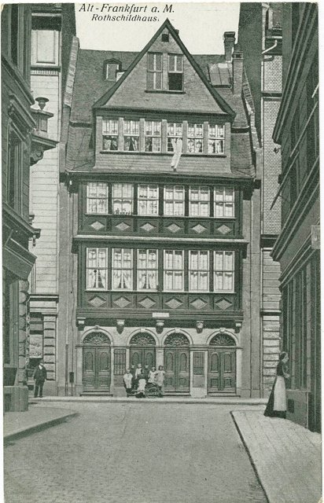
梅耶·阿姆謝爾·羅斯柴爾德生於美茵河畔法蘭克福的猶太巷（Judengasse），這是歐洲最擁擠的猶太人隔離區之一：夜裡大門上鎖，猶太人不得務農、不得加入行會，只能走向放貸與錢幣兌換。父母在他11歲時相繼過世，他後來到漢諾威的奧本海默銀行當學徒，學會替王公理財、承包軍費的宮廷金融。姓氏 Rothschild 來自德文「紅色盾牌」，原是祖先所住房屋的標記。

## 1760 ~ 1769 | 古錢幣商與宮廷代理人 {label="1760年代"}
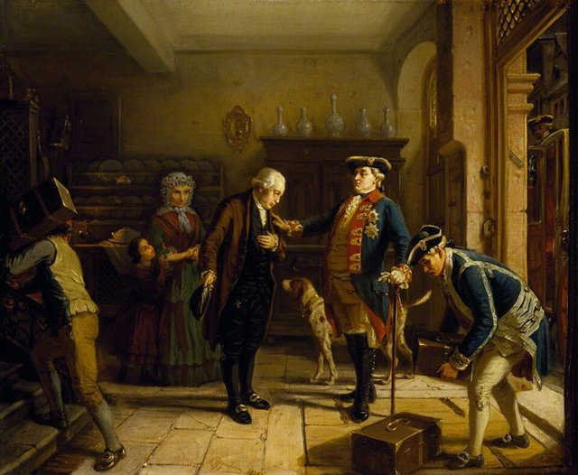
1760年代梅耶回到法蘭克福開設古錢幣店，編寫錢幣目錄，賣給熱衷收藏的黑森-卡塞爾王儲威廉——歐洲最富有的王公之一，靠出租傭兵給英國致富。古錢幣成了敲門磚，1769年梅耶成為威廉的「宮廷代理人」，替他打理資產、代收稅款，也因此比別人更早知道誰要打仗、誰缺錢。

## 1790 ~ 1810 | 五支箭分赴五城
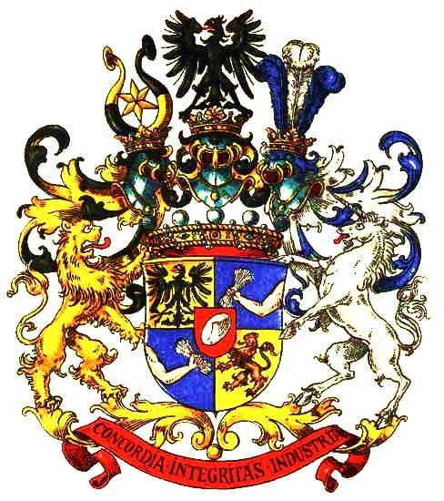
梅耶與妻子古特勒育有五子五女。五個兒子陸續分赴歐洲五大城市：長子阿姆謝爾守法蘭克福總行，所羅門到維也納，內森到倫敦，卡爾到那不勒斯，么子詹姆斯到巴黎。家族紋章是一隻手緊握五支箭，象徵五兄弟合而為一；箴言是「團結、正直、勤勉」。五城之間以信差、快馬與密碼通信，消息往往比各國政府還快。

## 1798 | 內森到曼徹斯特
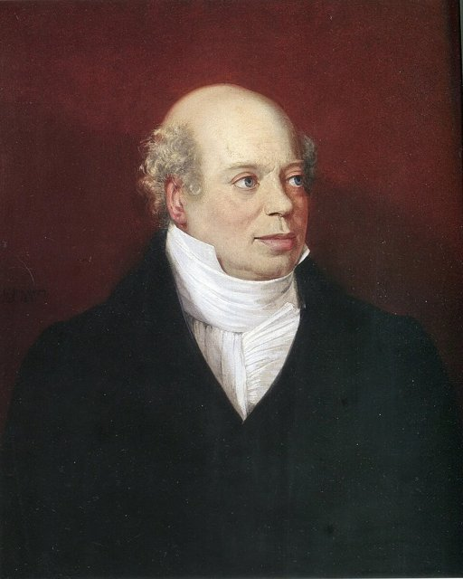
21歲的內森先到英國曼徹斯特經營紡織貿易，賺到第一桶金，之後轉往倫敦從事金融。1809年他買下倫敦聖斯威辛巷的新院（New Court），1811年成立 N·M·羅斯柴爾德父子銀行，這處辦公地至今仍在使用。

## 1808 ~ 1815 | 替反法同盟籌措戰費
半島戰爭期間，英軍軍餉如何運到西班牙、葡萄牙是一大難題。內森在倫敦籌款，透過巴黎的詹姆斯兌換，再支付給威靈頓的部隊；家族由代理人、運貨商與情報員組成的網絡，在戰火中替英國運送黃金、支付給歐陸盟國的補助。1813至1815年間，內森幾乎獨力承擔英國的戰費調度，光是1815年就經手約980萬英鎊的補助貸款。

## 1812-09-19 | 梅耶去世與遺囑
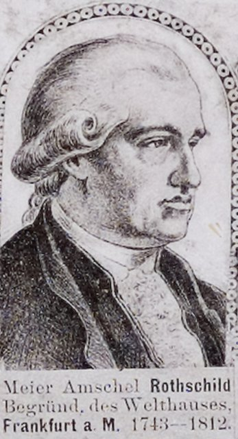
梅耶在法蘭克福去世，沒能看到滑鐵盧。他的遺囑規定銀行只能由家族男性繼承、重大決策由五房共議，並以表親通婚把財富留在家族內。這套制度維繫了一百年的團結，也讓家族的總資產始終保密。

## 1815-06-18 | 滑鐵盧
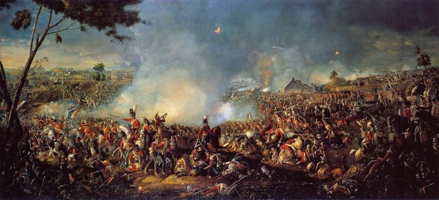
透過家族網絡，內森比政府的官方信使約早一天得知威靈頓在滑鐵盧獲勝。流行的傳說是他先拋售公債製造恐慌、再低價掃貨，一天賺進百萬英鎊——這個說法並無實證，後來還被反猶小冊子加油添醋。史家的考證是：他確實大舉買進英國公債（一說他先把消息通報政府，在勝利公開後才進場），並在1817年的高點賣出，獲利約四成。真正的關鍵是情報網與敢下重注，這個傳說也成了日後羅斯柴爾德陰謀論的源頭之一。

## 1815 ~ 1830 | 歐洲的「編外央行」
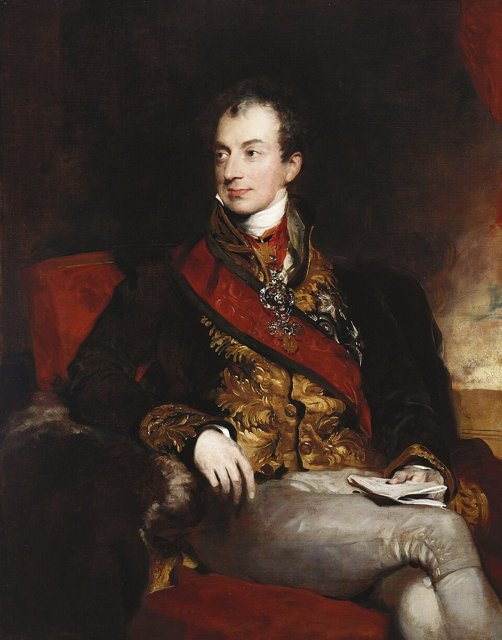
拿破崙戰爭結束後，各國發行公債都先找羅斯柴爾德：英國公債、法國的戰爭賠款、奧地利、普魯士、那不勒斯。所羅門在維也納與首相梅特涅往來密切，金融與外交密不可分。1818年內森替普魯士政府安排500萬英鎊貸款，1824至1825年又為新成立的巴西帝國籌款，支付葡萄牙承認巴西獨立的賠償。

## 1816 ~ 1822 | 奧地利男爵
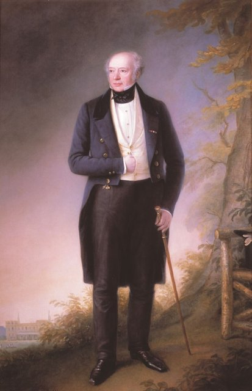
奧地利皇帝法蘭茲一世在1816年授予四兄弟世襲貴族頭銜，內森在1818年受封；1822年9月29日五兄弟同晉奧地利男爵。猶太巷的後代，七十多年後成了世襲貴族，家族成員從此在姓氏前加上 de 或 von。

## 1825 ~ 1826 | 解救英格蘭銀行
倫敦爆發流動性危機，N·M·羅斯柴爾德銀行提供足夠的貨幣，讓英格蘭銀行度過難關。

## 1830 | 七月革命兩邊下注
法國七月革命推翻查理十世，巴黎的詹姆斯與新國王路易-菲利普同樣維持良好關係，繼續承銷法國公債。

## 1836 | 內森去世
內森在法蘭克福參加長子婚禮期間去世，倫敦分行由長子萊昂內爾接掌，巴黎的詹姆斯則成為家族的實際領袖。

## 1830 ~ 1860 | 鐵路與礦山 {label="1830–1860年代"}
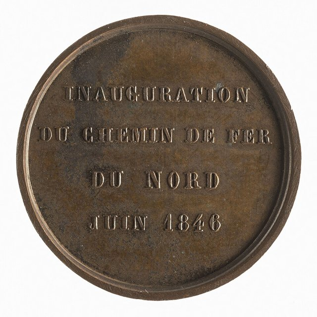
家族從借錢給國家轉向投資實業：詹姆斯在法國投資鐵路，1845年參與成立北方鐵路公司（巴黎通往比利時）；所羅門投資奧地利鐵路；家族還取得西班牙阿爾馬登水銀礦的經營權，掌握煉銀所需的水銀。鐵路投機也讓他們虧過大錢。

## 1847 | 萊昂內爾當選國會議員
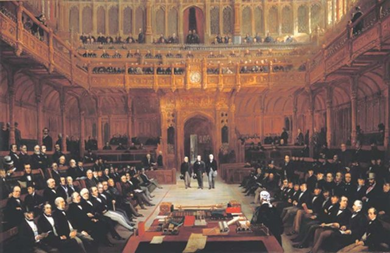
內森之子萊昂內爾當選英國下議院議員，但因不肯以基督徒的形式宣誓，十一年無法就座，直到1858年國會修改誓詞，他才成為第一位進入英國國會的猶太議員。同年，他的弟弟安東尼獲封英國從男爵。

## 1853 | 木桐酒莊
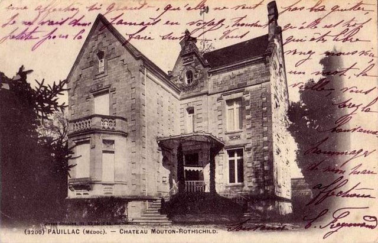
內森的兒子納撒尼爾在波爾多的波亞克買下葡萄園，改名為木桐·羅斯柴爾德酒莊；1868年詹姆斯又買下鄰近的拉菲酒莊。

## 1861 | 義大利統一與那不勒斯分行沒落
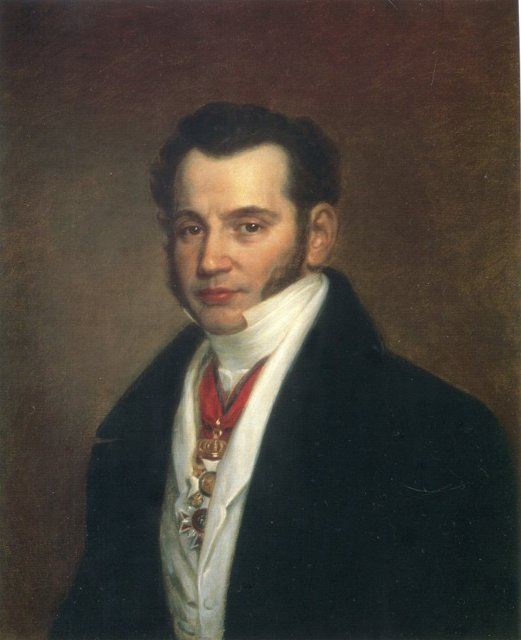
那不勒斯分行曾借錢給教廷、兩西西里王國、帕爾馬與托斯卡尼。義大利統一後，原本的主要客戶——各邦王室與貴族——大量消失，加上公債發行減少，分行業務日漸衰退，終至關閉。

## 1868 | 詹姆斯去世
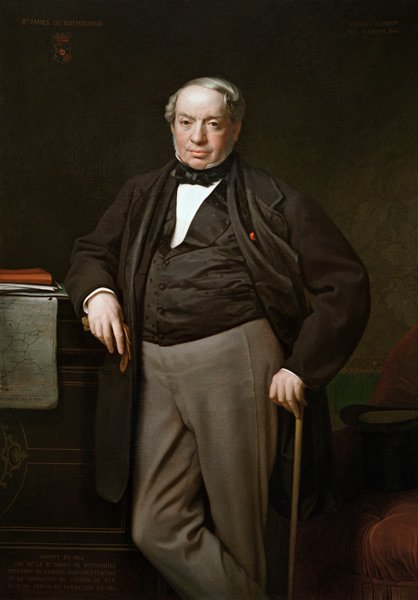
巴黎的詹姆斯去世，長子阿方斯接掌法國銀行。詹姆斯在鐵路與礦業融資上扮演要角，助法國成為工業強國。

## 1873 | 力拓
英法兩家分行與其他投資人收購西班牙政府虧損的力拓銅礦，重組後轉虧為盈；到1905年家族持有力拓三成以上的股份。

## 1875-11 | 蘇伊士運河股份

埃及總督因債務被迫出售蘇伊士運河公司約44%的股份。英國首相迪斯雷利想買，但國會休會、撥不出錢，萊昂內爾一口答應先墊付400萬英鎊，運河控制權因此落入英國手中，直到1956年蘇伊士危機。

## 1885 | 英國男爵
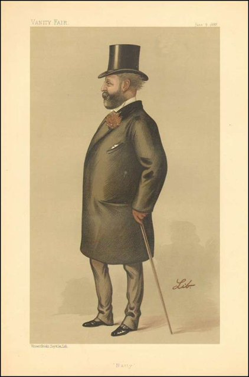
倫敦分行的內森·梅耶（人稱 Natty）獲維多利亞女王封為羅斯柴爾德男爵，成為英國世襲貴族中的第一位猶太人。1909年財政大臣勞合·喬治稱他是英國最有權勢的人。

## 1887 ~ 1888 | 戴比爾斯與塞西爾·羅茲
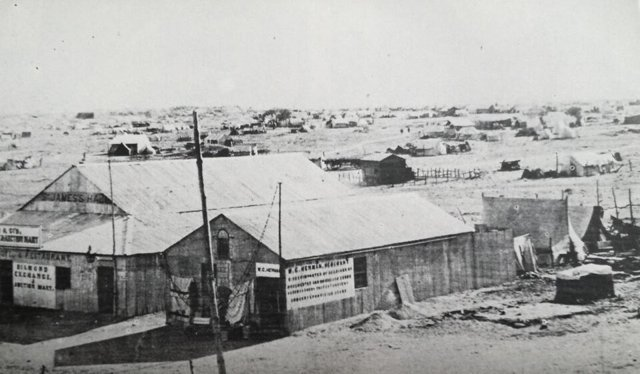
英法兩家分行投資南非的戴比爾斯鑽石礦業，成為最大股東；家族也資助塞西爾·羅茲擴張南部非洲的事業。

## 1886 | 《猶太法國》
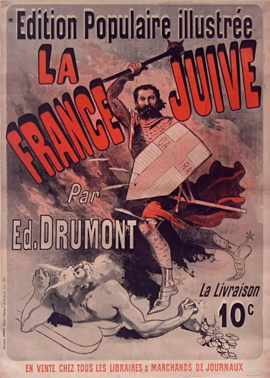
德呂蒙出版反猶暢銷書《猶太法國》，把羅斯柴爾德當成「猶太征服」的象徵。滑鐵盧傳說、蘇伊士運河，加上後來的德雷福斯事件，成為羅斯柴爾德陰謀論的支柱。

## 1894 ~ 1906 | 德雷福斯事件
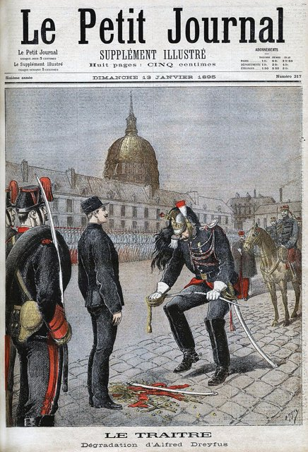
猶太裔軍官德雷福斯被誣陷叛國，法國社會撕裂。法國的羅斯柴爾德處境兩難，最後低調支持翻案。這起事件讓許多人認為，融入社會保護不了猶太人，間接催生了錫安主義。

## 1901 | 法蘭克福總行結束
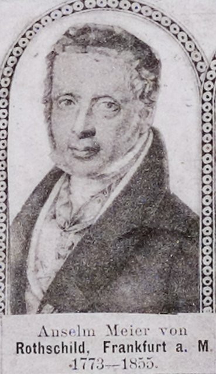
法蘭克福分行因沒有男性繼承人，在經營一百多年後結束；直到1989年，家族才重新在法蘭克福設立辦事處。

## 1903 | 《錫安長老會紀要》
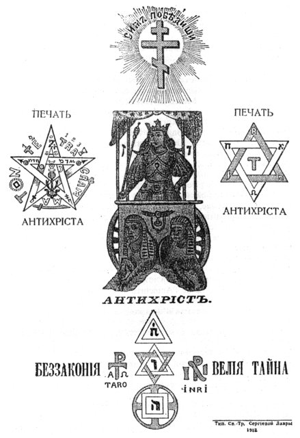
俄國流傳偽造的《錫安長老會紀要》，宣稱猶太人密謀統治世界，羅斯柴爾德被描繪成「世界政府」的金主。這份文件早已被證明是偽造，卻流傳了一百多年。

## 1904 ~ 1907 | 日俄戰爭債券
日俄戰爭期間，日本政府向倫敦與巴黎的羅斯柴爾德尋求資金，倫敦財團替日本發行了1,150萬英鎊的戰爭債券。

## 1917-11-02 | 貝爾福宣言
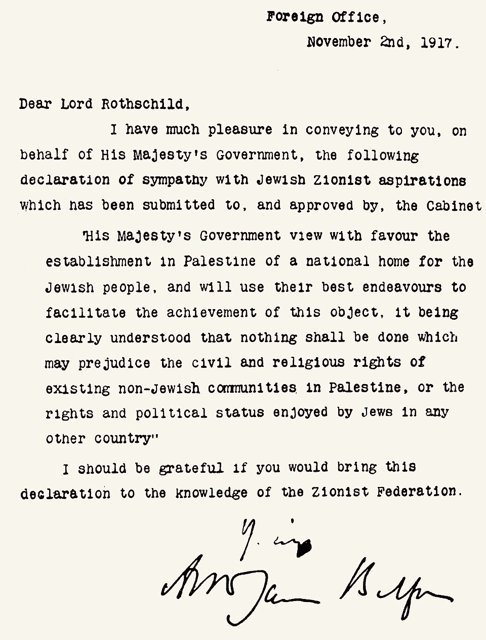
英國外相貝爾福致信第二代羅斯柴爾德男爵華特，表示英國政府支持在巴勒斯坦建立猶太人的「民族之家」，這封信就是貝爾福宣言。

## 1924 | 巴勒斯坦猶太移民協會
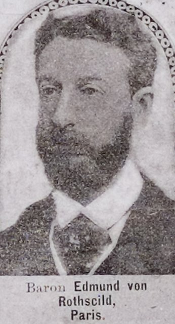
詹姆斯的么子埃德蒙長期資助猶太人到巴勒斯坦屯墾，里雄萊錫安等早期聚居地都靠他出資建立，特拉維夫的羅斯柴爾德大道就以他為名。1924年他成立巴勒斯坦猶太移民協會，收購超過12.5萬英畝的土地。後來家族還捐建以色列國會大廈與最高法院大樓。

## 1931 | 信貸銀行危機
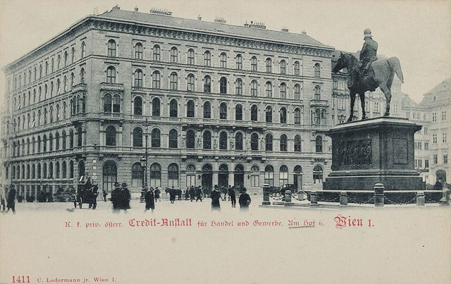
經濟大恐慌中，維也納的路易斯男爵試圖支撐奧地利最大的銀行信貸銀行，仍無法阻止它倒閉。

## 1938 | 納粹劫掠維也納分行
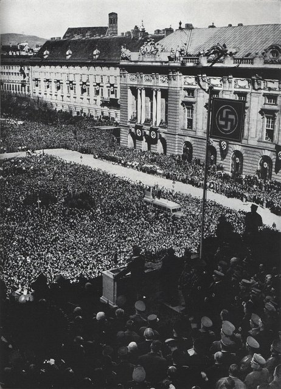
德奧合併後，納粹沒收維也納分行與「羅斯柴爾德宮」的全部資產，包括大批油畫、盔甲、掛毯與雕像，宮殿遭洗劫後被拆毀；路易斯男爵被捕，囚禁一年，家族付出鉅額代價才換回他的自由。1940年巴黎淪陷，法國分支流亡英美，資產多被侵吞。家族成員都逃過了大屠殺，但五支箭只剩倫敦與巴黎兩支。

## 1953 | 埃德蒙·德·羅斯柴爾德集團
詹姆斯的曾孫埃德蒙·阿道夫成立私人銀行埃德蒙·德·羅斯柴爾德集團，後來還買下地中海俱樂部與加州銀行，旗下擁有多座酒莊。

## 1973 | 木桐升為一級酒莊
在菲利普男爵經營下，木桐·羅斯柴爾德酒莊升格為波爾多一級酒莊；它每年邀請畫家設計酒標，畢卡索、達利都曾參與。

## 1982 | 巴黎銀行被收歸國有
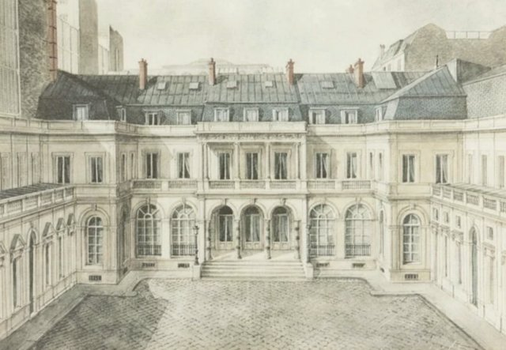
密特朗的社會黨政府把巴黎的羅斯柴爾德銀行收歸國有。這是家族在法國第二次失去銀行（第一次在1940年）。39歲的大衛·勒內男爵選擇留下，從3名職員、約83萬歐元資本重新創立羅斯柴爾德銀行。

## 1999 | 奧地利歸還藏品
奧地利政府同意歸還250件當年被納粹掠走、戰後被收進國家博物館的羅斯柴爾德藏品。

## 2003 | 英法業務合併
倫敦的伊夫林·羅斯柴爾德爵士退休，英法兩家機構在大衛·勒內的領導下合併，由羅斯柴爾德持續控股集團統籌。倫敦分行主持黃金定價的角色也在2004年結束。

## 2012 | Rothschild & Co.
英法業務整合為 Rothschild & Co.，主業是併購顧問與財富管理，在英、法、義的併購交易中始終名列前茅。

## 2023 | 下市回歸家族
家族控股公司 Concordia 將 Rothschild & Co. 私有化並下市。兩百多年後，羅斯柴爾德又回到家族企業的形態；今天的家族事業在全球銀行業中只是中型規模，與陰謀論中「操控世界」的形象相去甚遠。
