<!--
內容整理自本機筆記〈盧梭生平大事記〉（圖表\盧梭生平大事記.md）與中文維基百科「讓-雅克·盧梭」條目（CC BY-SA 4.0），以台灣用語改寫摘要。
https://zh.wikipedia.org/zh-tw/让-雅克·卢梭
史料與日期說明：
- 筆記寫「狄戈第尼學院」舉辦徵文，應為第戎學院（Académie de Dijon），此處改正。
- 維基百科稱盧梭「發明了簡譜」；他在1742年向法國科學院提出以數字記譜的方案，未獲採納，後世的數字簡譜是經其他人發展而成，此處寫作「提出數字記譜法」。
- 維基百科寫1749年以《論科學與藝術》參加徵文「獲得名次」；他是在1750年7月獲得首獎，此處依此。
- 前往英國：維基百科寫1765年，他是1765年底離開瑞士、1766年1月抵達倫敦，此處依筆記採1766年。
- 1728年因城門關閉而離開日內瓦、1736年沙爾梅特的田園生活、1749年前往萬塞訥途中的「頓悟」、1752年拒絕晉見國王、1756年隱居退隱廬、1763年放棄日內瓦公民權、1764年伏爾泰匿名揭露他遺棄孩子、1765年莫蒂埃住處遭投石與聖皮埃爾島、1768年與泰蕾絲正式成婚、1776年被大狗撞倒受傷等細節，係依《懺悔錄》《遐想》與一般公認的史實補充。
- 五個孩子被送進育嬰堂一事，依盧梭自述與一般說法陳述，不另加評斷。
圖片來源（皆為 Wikimedia Commons 公有領域／CC0 作品）：
- rou-cover.jpg：Rousseau in later life.jpg
- rou-house.jpg：Rousseau Geneve House.JPG
- rou-warens.jpg：FrancoiseLouiseWarens.jpg
- rou-therese.jpg：Levasseur1.jpg
- rou-latour.jpg：Maurice Quentin de La Tour - Portrait of Jean-Jacques Rousseau - adjusted.jpg
- rou-devin.jpg：Le Devin du Village — Rousseau.png
- rou-inegalite.jpg：DOI Rousseau.jpg（只保留右半邊的書名頁）
- rou-ermitage.jpg：ErmitageRousseau.jpg
- rou-contrat.jpg：Rousseau pirated edition.jpg
- rou-emile.jpg：EmileTitle.jpeg
- rou-ramsay.jpg：Allan Ramsay - Jean-Jacques Rousseau (1712 - 1778) - Google Art Project.jpg
- rou-herbier.jpg：J. J. Rousseau herborisant - estampe - Laurent Guyot - btv1b104624821.jpg
- rou-tomb.jpg：Jean-Michel Moreau - Tombeau de Jean-Jacques Rousseau - 1778.jpg
-->

# Periods
- 1712 ~ 1728 | 日內瓦的鐘錶匠之子 | #f08c00
  生於日內瓦共和國，出生九天母親就去世，由鐘錶匠父親撫養；父親出走後寄人籬下、當學徒，16歲離開日內瓦。
- 1728 ~ 1742 | 華倫夫人與漂泊的青年 | #2f9e44
  投靠薩伏依的華倫夫人，改信天主教，當過僕役、家庭教師與樂譜抄寫員，在沙爾梅特的田園中大量自學。
- 1742 ~ 1756 | 巴黎與兩篇論文 | #1c7ed6
  帶著數字記譜法來到巴黎，結識狄德羅等百科全書派，以《論科學與藝術》與《論人類不平等的起源》一舉成名。
- 1756 ~ 1762 | 隱居與三部巨著 | #a61e4d
  離開巴黎隱居鄉間，與百科全書派決裂，接連寫出《新愛洛伊絲》《社會契約論》《愛彌兒》。
- 1762 ~ 1770 | 流亡歲月 | #495057
  著作遭焚、被通緝，流亡瑞士、英國，與休謨反目，以化名返回法國。
- 1770 ~ 1778 | 晚年的自我辯護與遐想 | #862e9c
  回到巴黎抄樂譜、採集植物，寫作《懺悔錄》與《一個孤獨漫步者的遐想》，最後病逝於埃爾芒翁維爾。

# Events

## 1712-06-28 | 出生@日內瓦
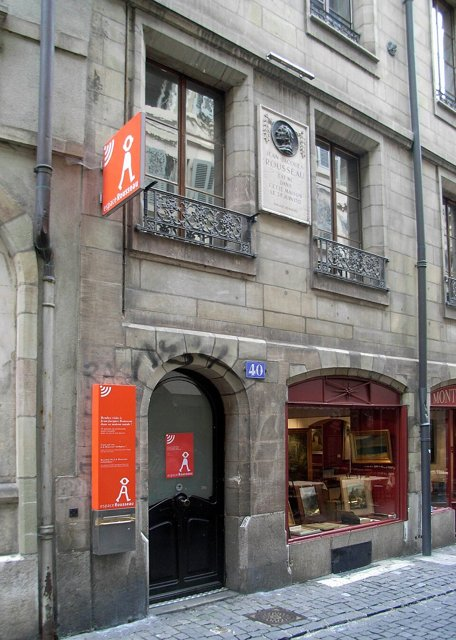
生於日內瓦共和國的一個鐘錶匠家庭。他後來寫道：「我出生時幾乎奄奄一息，很少人認為能把我救活。」出生九天後，母親蘇珊娜因產褥熱去世，他稱之為「我的第一個不幸」。父親艾薩克常和他通宵讀小說，又帶他讀普魯塔克的《希臘羅馬名人傳》，古代共和國的英雄故事讓他一生嚮往。他終生以「日內瓦公民」自稱。

## 1722-10 | 父親出走，寄人籬下
父親與人爭執後為了避免入獄而離開日內瓦，10歲的他被送到鄉下博塞的牧師家寄養讀書。他在《懺悔錄》中回憶，在這裡因為一把梳子被冤枉而受到懲罰，第一次嚐到不公平的滋味。

## 1725-04 | 雕刻師學徒
被送到一位雕刻師傅家當學徒，師傅粗暴，他常挨打，染上了說謊與偷竊的習慣，唯一的慰藉是從租書店借書來讀。

## 1728-03 | 城門關閉，離開日內瓦
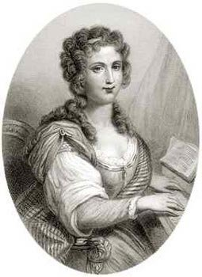
16歲那年，他和朋友到郊外遊玩，回來時城門已經關閉，這已是第三次，他怕受罰，索性不回去了，從此離開日內瓦。他流浪到薩伏依的安訥西，結識了比他大十三歲的華倫夫人，她安排他到杜林改信天主教。他在杜林當過貴族家的僕役，曾偷了一條絲帶卻誣賴給一名女僕，這件事讓他愧疚一生，後來在《懺悔錄》中坦白招認。

## 1736 | 沙爾梅特的田園時光
與華倫夫人住到尚貝里附近的沙爾梅特農莊，他稱她為「媽媽」，兩人的關係既像母子又是戀人。在這段他一生最幸福的日子裡，他沒有受過正規教育，卻如飢似渴地自學哲學、數學、歷史、拉丁文與音樂，奠定了日後寫作的基礎。

## 1740-04 | 里昂的家庭教師
到里昂替馬布利家的孩子當家庭教師，卻發現自己不適合這份工作。這段經驗讓他開始思考教育的問題，日後寫成《愛彌兒》。

## 1742-08 | 巴黎與數字記譜法
帶著自己設計的以數字代替五線譜音符的記譜法來到巴黎，向法國科學院提出，未被採納，但因此結識了巴黎的文人圈，與狄德羅成為好友，並開始為《百科全書》撰寫音樂條目。

## 1743-09 | 威尼斯使館秘書
擔任法國駐威尼斯大使的秘書，處理外交文書，卻與傲慢無能的大使不斷衝突，一年後被解職。他在威尼斯迷上了義大利歌劇，也在此親眼觀察共和國政府的運作，萌生寫一部政治制度論著的念頭。

## 1745-03 | 認識泰蕾絲
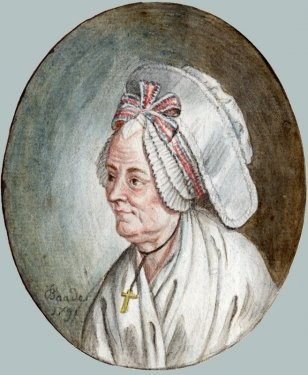
在巴黎的旅館認識了洗衣女工泰蕾絲·勒瓦瑟，她不識字，卻從此陪伴他一生。據他自述，1746至1752年間兩人生的五個孩子都被他送進了巴黎的育嬰堂，他說是因為無力撫養，也是為了泰蕾絲的名聲。這件事後來成為敵人攻擊他最有力的把柄，也讓這位寫出教育名著《愛彌兒》的作者備受爭議。

## 1749-10 | 萬塞訥途中的頓悟
好友狄德羅因著作入獄，被關在巴黎近郊的萬塞訥城堡。他步行前往探監，途中在報紙上讀到第戎學院的徵文題目：「科學與藝術的復興，是否有助於淨化風俗？」據他自述，那一刻「我看見了另一個宇宙，成了另一個人」，激動得在路邊樹下坐了半小時，淚流滿面。

## 1750-07 | 《論科學與藝術》獲獎
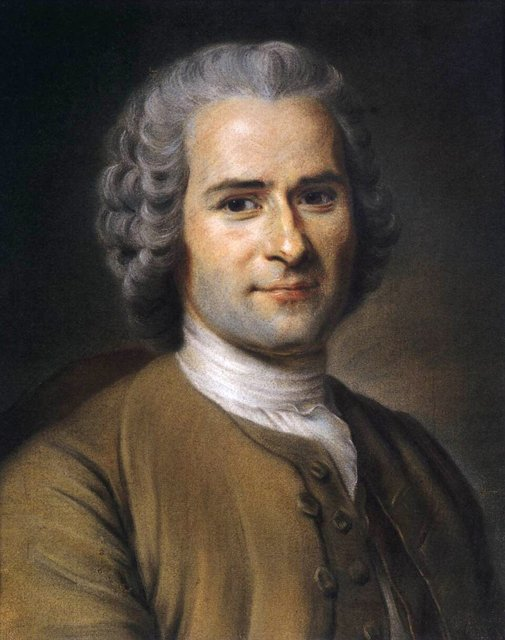
以《論科學與藝術》獲得第戎學院徵文首獎，主張科學與藝術的進步非但沒有讓人更有德行，反而助長了虛榮、奢侈與偽善。這與啟蒙運動相信進步的樂觀主流背道而馳，引起熱烈爭論，38歲的他一夕成名。

## 1752-10 | 歌劇《鄉村占卜師》
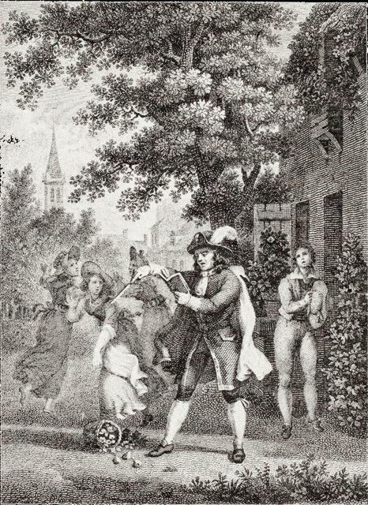
獨幕歌劇《鄉村占卜師》在楓丹白露宮御前演出，大獲成功，國王路易十五還哼著其中的曲調。國王原本要召見他並賜予年金，他卻不願為此束縛自己的自由，沒有前去晉見。他也投入當時法國與義大利歌劇的論戰，力挺旋律優美、情感自然的義大利音樂，後來還編了一部《音樂辭典》。

## 1754-08 | 重回日內瓦
回到日內瓦，重新改信喀爾文宗，恢復日內瓦公民的身分，在獻詞中把故鄉讚美為理想的共和國。

## 1755 | 《論人類不平等的起源》
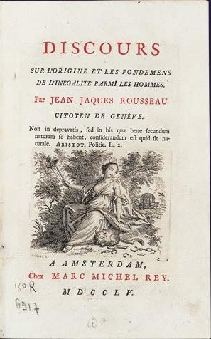
出版《論人類不平等的起源和基礎》，區分自然的不平等與社會造成的不平等：在自然狀態中，人是自由、自足而有同情心的；「第一個圈起一塊地、說『這是我的』，而且找到一些頭腦簡單的人相信他的人，就是文明社會真正的奠基者。」私有財產、比較與依賴，使人類陷入不平等與奴役。伏爾泰讀後寫信諷刺說，讀了這本書，讓人想用四隻腳走路。

## 1756-04 | 隱居退隱廬
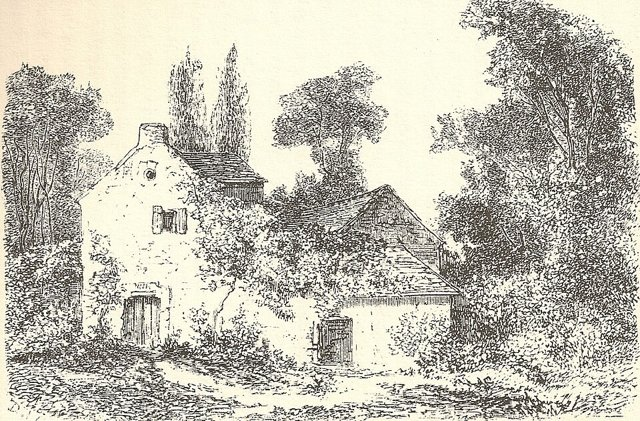
厭倦了巴黎的沙龍生活，接受埃皮奈夫人的邀請，搬到巴黎北郊蒙莫朗西森林邊的小屋「退隱廬」隱居寫作。隔年他與埃皮奈夫人、狄德羅等人因誤會與猜疑而決裂，搬到附近的蒙路易，從此與百科全書派漸行漸遠。

## 1758-10 | 《致達朗貝爾論戲劇的信》
達朗貝爾在《百科全書》的〈日內瓦〉條目中建議日內瓦開設劇院，他公開發表長信反對，認為劇院只會敗壞共和國公民的樸素風俗，主張以公民同樂的節慶取代。這封信也使他與伏爾泰從此成為死敵。

## 1761-01 | 《新愛洛伊絲》
出版書信體小說《朱莉，或新愛洛伊絲》，描寫貴族少女朱莉與家庭教師聖普樂之間的愛情，以及她婚後在責任與情感之間的掙扎。小說轟動全歐，書店供不應求，甚至有人按小時租書來讀，成為十八世紀最暢銷的小說，也開啟了浪漫主義文學的先河。

## 1762-04 | 《社會契約論》
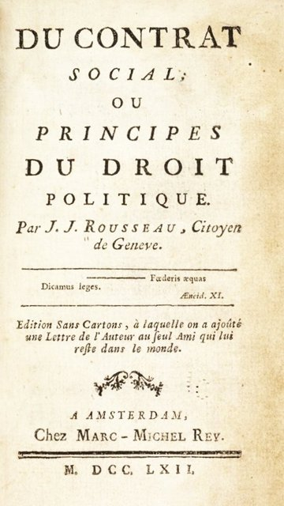
在阿姆斯特丹出版《社會契約論》，開頭便說：「人生而自由，卻無往不在枷鎖之中。」他主張正當的政治共同體來自每個人把自己完全交給全體，形成「公意」；人民才是主權者，法律是公意的表現，服從自己參與制定的法律，才是真正的自由。這部書在當時讀者不多，卻成為法國大革命的聖經。

## 1762-06-09 | 《愛彌兒》遭禁，被迫逃亡
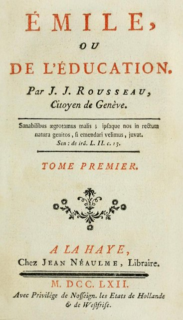
5月出版教育小說《愛彌兒》，主張教育應順應兒童的自然天性成長，讓孩子從經驗中學習，而不是灌輸書本知識。書中〈一位薩伏依牧師的信仰自白〉否定啟示宗教與教會權威，引起天主教與新教兩方的憤怒。6月巴黎高等法院下令焚書並逮捕他，他在朋友通風報信下連夜逃離法國；幾天後，連他引以為傲的故鄉日內瓦也焚燒了他的書。

## 1762-07 | 流亡莫蒂埃
在普魯士國王腓特烈二世治下的納沙泰爾找到庇護，住在山村莫蒂埃，穿起亞美尼亞式的長袍。隔年他憤而放棄日內瓦公民權，並寫作《山中書簡》，猛烈抨擊日內瓦的寡頭政府與教會。

## 1764-12 | 伏爾泰揭露他遺棄孩子
伏爾泰匿名出版小冊子《公民們的意見》，公開揭露他把五個孩子送進育嬰堂的往事，猛烈攻擊他的人格。這成為他決心寫作自傳、向世人說明自己的直接原因之一。

## 1765-09 | 投石與聖皮埃爾島
莫蒂埃的牧師在講壇上煽動居民反對他，一天夜裡，村民向他的住處投擲石頭。他逃到比爾湖中的小島聖皮埃爾島，在島上划船、採集植物，度過了一生中最寧靜的六個星期，後來在《遐想》中深情回憶；但不久又被當局驅逐。

## 1766-01 | 流亡英國，與休謨反目
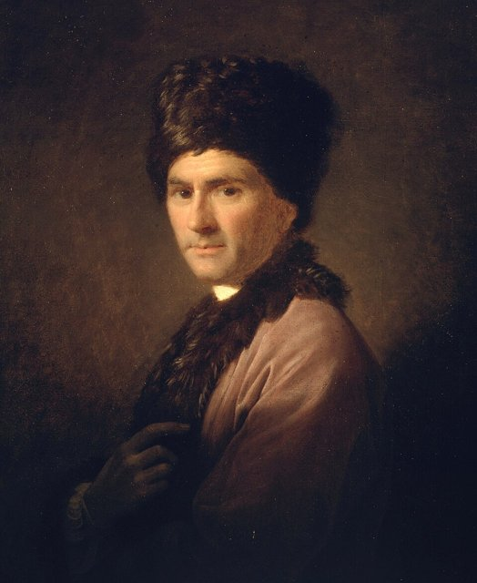
在蘇格蘭哲學家休謨的安排下抵達倫敦，受到熱烈歡迎，後來住到德比郡的伍頓。他不懂英語、孤立無援，逐漸懷疑休謨與巴黎的哲學家們合謀陷害他。7月兩人公開決裂，彼此在報刊上互相指控，轟動整個歐洲。

## 1767-05 | 化名返回法國
以「勒努」為化名悄悄返回法國，在幾位貴族的保護下輾轉各地。他在這段期間持續寫作《懺悔錄》。

## 1768-08-30 | 與泰蕾絲正式成婚
在法國東南部的布爾關與相伴二十多年的泰蕾絲舉行簡單的婚禮，此前他一直稱她為自己的「管家」。

## 1770-06-24 | 回到巴黎
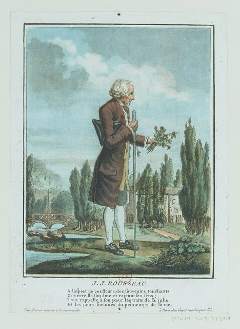
獲准回到巴黎，條件是不得再出版著作。他住在一條小街的公寓，靠抄寫樂譜為生，每天到郊外散步、採集植物。他在私人聚會上朗讀《懺悔錄》，因為內容涉及許多仍在世的人，被警方禁止再朗讀。《懺悔錄》開頭寫道：「我要把一個人的真實面目，赤裸裸地展示在世人面前；這個人就是我。」被視為現代自傳的開端。

## 1772-04 | 《論波蘭政府》
應波蘭貴族之邀，寫成《論波蘭政府》，為波蘭的政治改革提出建議，強調以教育與節慶培養公民的愛國心。這是他最後一部政治著作。同一時期他也寫了一系列植物學書信，教一位小女孩認識植物。

## 1776 | 《一個孤獨漫步者的遐想》
完成自我辯護的《對話錄：盧梭評判讓－雅克》，他一度想把手稿放上巴黎聖母院的祭壇，卻發現圍欄的門鎖著。此後他開始寫作《一個孤獨漫步者的遐想》，以十篇「漫步」回憶與沉思自然、記憶與孤獨，寧靜而優美，是他最後的作品。同年秋天，他在散步時被一隻狂奔的大狗撞倒受傷，這件事也寫進了〈第二次漫步〉。

## 1778-07-02 | 逝世@埃爾芒翁維爾
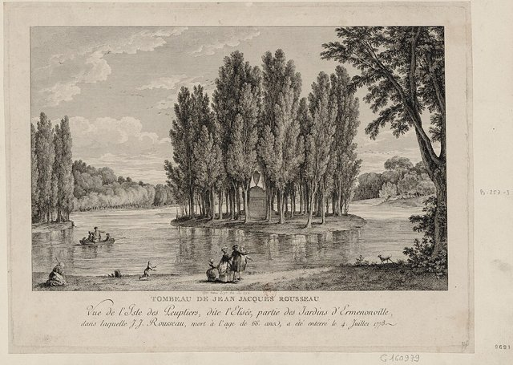
5月應吉拉爾丹侯爵之邀，搬到巴黎北方埃爾芒翁維爾的莊園小屋居住，7月2日早上散步回來後突然病逝，享年66歲，可能死於中風。他被安葬在莊園湖中的白楊島上，成為歐洲人朝聖的地點。他死後，《懺悔錄》與《遐想》陸續出版。1794年法國大革命期間，國民公會把他的遺骸隆重遷入巴黎先賢祠，與他生前的死敵伏爾泰比鄰而葬；康德說，是盧梭教會了他尊重人。
