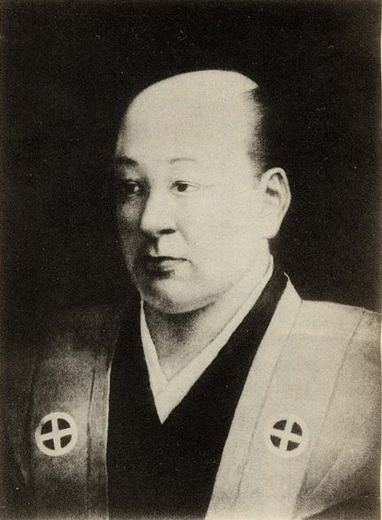
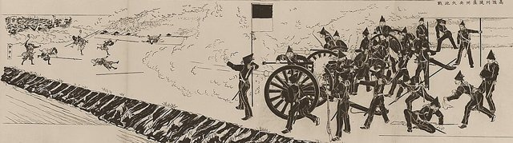
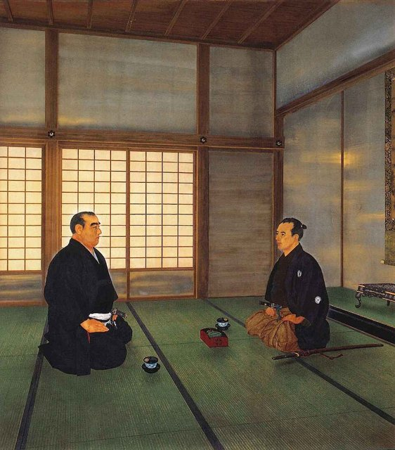
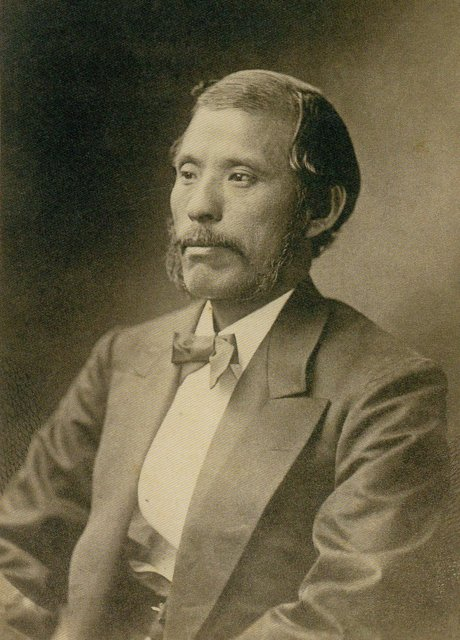
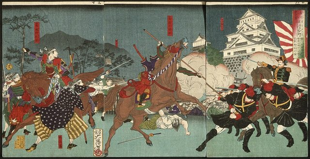
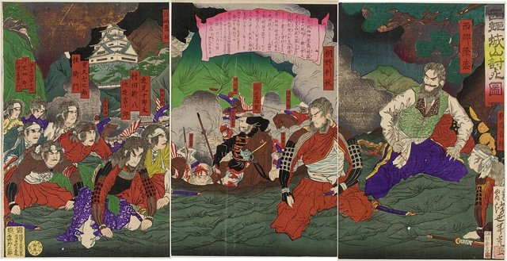

<!--
內容整理自 D:\Books\html\1-3-1.日本歷史人物\西鄉隆盛(1828~1877).html（沒有對應的 md 筆記），並整合中文維基百科〈西鄉隆盛〉條目，以自己的話改寫。
時期依頁面的八個階段歸納：出身與青年、受齊彬賞識與第一次流放、再度流放與復出、薩長同盟與倒幕、戊辰戰爭、明治政府與征韓論、私學校與西南戰爭。
兩份資料出入與處理方式：
- 生卒：文政十年十二月七日（西曆1828年1月23日）生於鹿兒島下加治屋町；1877年9月24日死於城山，實歲49歲（虛歲51），兩份一致。
- 和曆與西曆：1872年以前的日期原為和曆，這裡與〈明治維新大事記〉時間軸一致，有月日的改用西曆：薩長同盟1866年3月7日、鳥羽伏見之戰1868年1月27日、與勝海舟會談1868年4月6日、江戶開城1868年5月3日、廢藩置縣1871年8月29日。
- 流放：頁面寫1859—1861年流放奄美大島、1862年再度流放；維基百科補充在奄美與愛加那結為島妻，1862年先到德之島、再移沖永良部島，取兩份合併。
- 1864年：頁面寫獲赦復出；維基百科補充2月召回、7月禁門之變指揮薩摩軍、參與第一次長州征伐，合併成一則。
- 1873年：頁面與維基百科都寫10月因征韓論被否決而辭職；維基百科補充他當時是陸軍大將，併入同一則。頁面說西鄉「主張派遣使節赴朝鮮」，這裡照此寫法，不簡化為「主張出兵」。
- 西南戰爭：維基百科補充薩軍1877年2月15日出發、2月25日政府褫奪其官位；頁面寫熊本城攻防與退守城山。死因：維基百科說他在城山總攻擊中負傷後切腹（介錯），頁面只說身受重創身亡，這裡寫負傷後由部下介錯。
- 身後：1879年遷葬南洲墓地、1889年2月11日憲法頒布時特赦並追贈正三位、1898年上野銅像揭幕，取自維基百科。
- 人名與其他時間軸一致：島津齊彬、島津久光、大久保利通、木戶孝允（桂小五郎）、坂本龍馬、勝海舟、德川慶喜、岩倉具視、月照、井伊直弼。
圖片來源（皆為 Wikimedia Commons 公有領域／CC0 作品；註明「共用」者沿用其他時間軸已有的圖片）：
- sai-cover.jpg：Saigo Takamori Portrait by Ishikawa Shizumasa.jpg（石川靜正所繪西鄉隆盛像）
- sai-nariakira.jpg：Shimazu Nariakira.jpg（島津齊彬）
- japan-toba-fushimi.jpg（1868年描繪鳥羽伏見之戰的錦繪（與日本歷史時間軸共用））
- meiji-edo-castle.jpg（明治神宮聖德記念繪畫館的〈江戶開城談判〉，後世所繪（與明治維新大事記時間軸共用））
- sai-okubo.jpg：Ōkubo Toshimichi 1872.jpg（大久保利通，1872）
- sai-kumamoto.jpg：Battle before Kumamoto Castle LACMA M.84.31.315a-c.jpg（錦繪〈熊本城前之戰〉，洛杉磯郡立美術館藏）
- sai-shiroyama.jpg：Saigō, Shiroyama uchijini-zu by Toshimitsu.jpg（浮世繪〈西鄉城山討死之圖〉）
-->

# Periods
- 1828-01-23 ~ 1851 | 出身與青年 | #868e96
  生於鹿兒島下加治屋町的下級武士家庭，少年右臂受傷改習相撲，從藩的基層農政職務做起，在由羅騷動中轉而支持島津齊彬。
- 1851 ~ 1864 | 齊彬的提拔與兩度流放 | #e8590c
  隨藩主齊彬赴江戶參與將軍繼承問題；齊彬死後與月照投海獲救，被流放奄美大島，又因違逆島津久光再被流放到德之島、沖永良部島。
- 1864 ~ 1868 | 薩長同盟與倒幕 | #c92a2a
  獲赦復出，在禁門之變指揮薩摩軍，與木戶孝允締結薩長同盟，推動王政復古。
- 1868 ~ 1873 | 戊辰戰爭與明治政府 | #1971c2
  鳥羽伏見之戰後率東征軍逼近江戶，與勝海舟談判，江戶無血開城；任參議推動廢藩置縣，岩倉使節團出國期間主導留守政府。
- 1873 ~ 1877-09-24 | 下野與西南戰爭 | #495057
  征韓論爭論失敗後辭職返鄉，設立私學校；士族不滿升高，私學校學生襲擊火藥庫，西鄉成為反政府軍的領袖，兵敗死於城山。

# Events

## 1828-01-23 | 出生於鹿兒島
西鄉隆盛生於薩摩藩鹿兒島城下的下加治屋町，父親西鄉吉兵衛是武士，但西鄉家不是藩內有權勢的高級武士。他在薩摩嚴格的武士社會中成長，接受讀書、武藝與武士倫理的教育。1839年他在一次勸架中右臂受傷，從此改習相撲；1841年元服，取名隆永。

## 1844 | 郡方書役助
西鄉擔任郡方書役助，從事地方行政與農村事務的基層工作，接觸民生、財政與藩政的運作。1847年他擔任鄉中組織的二才頭，帶領青年武士。

## 1850 | 由羅騷動
薩摩藩內圍繞藩主繼承與改革方向爆發「由羅騷動」，支持島津齊彬的赤山靭負等人被迫切腹。西鄉轉而支持齊彬，並與大久保利通等青年武士結成政治聯繫。1851年，齊彬繼任薩摩藩主，重視西方科技與軍事改革，推動集成館事業。

## 1854 | 隨齊彬赴江戶

西鄉隨島津齊彬到江戶，任御庭方役，負責機密事務與政治聯絡，了解幕府中央政治的運作，並與其他藩的政治人物建立聯繫。1857到1858年，他支持齊彬推舉一橋慶喜繼任將軍，與越前藩的橋本左內等人奔走。

## 1858 | 齊彬去世，與月照投海
7月，島津齊彬突然病逝，西鄉失去最重要的支持者；大老井伊直弼推動安政大獄，鎮壓反對派。西鄉保護與尊王派往來密切的僧侶月照，兩人逃到薩摩後一同投海求死，月照身亡，西鄉獲救。

## 1859 | 流放奄美大島
藩為了庇護他，把西鄉送到奄美大島隱居，遠離政治中心。他在島上與愛加那結為島妻，重新思考自己的政治立場與人生方向。

## 1862 | 再度流放
島津久光準備率藩兵上京介入政局，西鄉被召回薩摩，但他對久光的能力與策略有所保留，又違令先行上京而被捕，先被流放到德之島，再移往條件更嚴苛的沖永良部島。1863年，英國艦隊因生麥事件砲擊鹿兒島（薩英戰爭），薩摩從此認識到西方軍事力量的威脅，並逐漸轉向與英國接觸。

## 1864 | 獲赦復出，禁門之變
2月，西鄉獲赦召回，赴京都負責軍事與諸藩交涉，成為薩摩在京都政局的代表人物。7月禁門之變，長州藩攻入京都，西鄉指揮薩摩軍擊退長州；朝廷隨即下詔討伐長州，他參與第一次長州征伐，主張以寬大條件收場。這一年他也初次會見勝海舟。

## 1866-03-07 | 薩長同盟
西鄉與長州藩的木戶孝允（桂小五郎）在坂本龍馬等人的斡旋下締結薩長同盟。兩藩原本在京都政局中敵對，從此建立政治與軍事合作。同年，幕府的第二次長州征伐失利，權威進一步削弱。

## 1867 | 大政奉還與王政復古
11月，德川慶喜宣布大政奉還，希望在新體制中保留德川家的地位；西鄉等倒幕派認為這不足以改變幕府主導政治的局面，12月推動王政復古，宣布建立以天皇為中心的新政府。

## 1868-01-27 | 鳥羽伏見之戰

舊幕府軍與新政府軍在京都郊外的鳥羽、伏見交戰，新政府軍取勝，戊辰戰爭爆發。西鄉在新政府軍中扮演重要角色，隨後擔任東征大總督府參謀，率軍向江戶推進。

## 1868-04-06 | 與勝海舟會談

新政府軍準備總攻江戶。幕府方的勝海舟希望避免戰火，西鄉在江戶的薩摩藩邸與他會談兩天，在新政府的軍事要求、政治立場與避免流血之間作出判斷，同意以和平方式接收江戶城，並把結果帶回新政府。

## 1868-05-03 | 江戶無血開城
江戶城和平交給新政府軍，避免了人口眾多的江戶發生大規模攻城戰，這是西鄉一生最著名的政治成就之一。戊辰戰爭隨後延伸到東北與北海道，到1869年箱館戰爭結束。

## 1871-08-29 | 參議與廢藩置縣
戰後西鄉一度回到鹿兒島，對是否留在新政府猶豫。1871年他受邀回到中央任參議，率領各藩兵組成的御親兵作為後盾，新政府推行廢藩置縣，廢藩設府縣，把地方行政權收歸中央。同年11月岩倉使節團出國，西鄉主導留守政府，持續推動軍制、教育、財政與行政改革，同時面對大量失去地位與收入的武士。

## 1873-10 | 征韓論政變

朝鮮拒絕承認明治政府的國書，西鄉主張由自己出使朝鮮交涉。岩倉具視、大久保利通、木戶孝允等歸國的使節團成員認為應優先完成國內改革，避免捲入對外衝突，阻止了他的方案。西鄉辭去參議與陸軍大將，11月回到鹿兒島，許多立場相近的薩摩出身官員與軍人也隨之離開（明治六年政變）。

## 1874 | 設立私學校
西鄉返鄉後受到眾多追隨者敬重，他與支持者在鹿兒島設立私學校，教育青年並進行軍事訓練。明治政府廢除武士俸祿、禁止佩刀，許多士族失去生活保障與社會地位，1876年神風連之亂、秋月之亂、萩之亂接連發生。

## 1877-02-15 | 西南戰爭爆發
明治政府警戒鹿兒島的私學校，想把當地的軍火移走；1月底，私學校學生襲擊政府的火藥庫，衝突一觸即發。西鄉在部眾推動下成為反政府軍的領袖，2月15日率薩摩士族組成的軍隊離開鹿兒島，向熊本進軍；2月25日政府褫奪他的官位。

## 1877-03 | 熊本城攻防戰

薩軍圍攻熊本城，久攻不下，政府軍持續增援，雙方在熊本一帶激戰，田原坂之戰尤為慘烈。薩軍雖有許多作戰經驗豐富的武士，兵員補充、裝備與持續作戰能力卻逐漸落居下風；政府軍依靠徵兵制建立的近代軍隊與後勤，逐步取得優勢。

## 1877-09-24 | 城山之死

薩軍轉戰宮崎等地後退回鹿兒島的城山，被政府軍包圍。9月24日政府軍總攻，西鄉負傷後由部下介錯身亡，享年49歲（虛歲51）。他的死標誌西南戰爭結束，明治政府消除了以士族武裝挑戰中央政權的主要威脅。

## 1889-02-11 | 特赦與追贈
大日本帝國憲法頒布之日，西鄉獲得特赦，追贈正三位；1879年他的遺體已遷葬鹿兒島南洲墓地，1898年東京上野公園的西鄉隆盛銅像揭幕。他從推翻幕府的功臣、新國家的建設者，最後成為新政府的反抗者，一生集中體現了明治維新的成就與代價。
