<!--
內容整理自本機筆記〈坂本龍馬大事記（1835–1867）〉（圖表\坂本龍馬大事記.md）與中文維基百科「坂本龍馬」條目（CC BY-SA 4.0），以台灣用語改寫摘要。
https://zh.wikipedia.org/zh-tw/坂本龙马
日期說明：
- 生卒依公曆：天保6年11月15日生（公曆1836年1月3日），慶應3年11月15日遇害（公曆1867年12月10日）。筆記標題的「1835年」是舊曆年份；依周歲享年31歲，傳統虛歲常稱33歲。
- 其餘事件的月日多為日本舊曆，時間軸只標公曆年份，內文以「舊曆○月」註明。
- 薩長同盟並非龍馬一人促成，中岡慎太郎、小松帶刀等人也居中斡旋；「船中八策」的原始文本並未留存，內容主要依後世史料，其構想也受橫井小楠〈國是七條〉影響。
- 暗殺的執行者以京都見迴組說較有力，但幕後主使與動機至今仍有爭議。
- 薩長同盟、寺田屋事件、大政奉還的公曆換算日期，龍馬聽聞大政奉還時的感嘆，三岡八郎即由利公正，岩崎彌太郎與三菱、司馬遼太郎《龍馬來了》等細節，係依一般公認的史實補充。
- 圖片皆為 Wikimedia Commons 上的公有領域作品（封面：1866或1867年在長崎所攝的龍馬立像）。武市半平太為其獄中自畫像；薩長同盟配1869年的桂小五郎（木戶孝允）、第二次長州征伐配1865年高杉晉作與伊藤博文等人的合影、薩土盟約配1866年的中岡慎太郎、大政奉還配後世所繪的二條城大政奉還圖、近江屋事件配京都靈山的龍馬墓（2009年攝）。
-->

# Periods
- 1836-01-03 ~ 1853 | 土佐的少年 | #8d6e63
  生於土佐藩高知城下的富裕鄉士之家，小時候愛哭又不愛讀書，由三姊乙女嚴格教養；14歲開始學劍，劍術日漸出色。
- 1853 ~ 1862 | 江戶劍術修行與土佐勤王黨 | #2b8a3e
  兩度到江戶的北辰一刀流千葉道場修行，親眼目睹黑船來航；回鄉後聽河田小龍講世界大勢，又加入武市半平太的土佐勤王黨。
- 1862 ~ 1865 | 脫藩與勝海舟門下 | #1864ab
  脫離土佐藩成為浪士，拜幕臣勝海舟為師，接觸開國論與海軍，參與籌建神戶海軍操練所。
- 1865 ~ 1867 | 龜山社中與薩長同盟 | #c92a2a
  在薩摩藩支持下於長崎創立龜山社中，以貿易斡旋水火不容的薩摩與長州，促成倒幕的關鍵——薩長同盟。
- 1867 ~ 1867-12-10 | 海援隊與大政奉還 | #862e9c
  與土佐藩和解，龜山社中改組為海援隊；提出「船中八策」，推動德川慶喜大政奉還，卻在一個月後於京都近江屋遇刺。

# Events

## 1836-01-03 | 出生@高知
天保6年舊曆11月15日，生於土佐藩高知城下本町筋一丁目，是坂本家的次男，上有一個哥哥權平和三個姊姊。坂本家是城下富商「才谷屋」的分家，身分雖是下級武士「鄉士」，生活卻相當富裕。相傳出生前一晚，父親夢見金馬從天而降、母親夢見金龍升天，因此取名「龍馬」。

## 1846 | 私塾退學；母親去世
10歲時進入楠山庄助的私塾，卻因與上士家的孩子打架而退學，從此不再上私塾。同年母親幸去世。據說他小時候愛哭、尿床又常被欺負，由大他三歲的三姊乙女教他讀書、劍術甚至游泳。他後來說：「姊姊對我的恩情比父母還要大。」

## 1848 | 小栗流日根野道場
14歲聽從父親建議，到小栗流日根野弁治的道場學劍。他練劍如魚得水，據說連尿床的毛病也因此治好了，五年後取得初級的「目錄」。

## 1853 | 江戶劍術修行與黑船來航
舊曆3月帶著父親寫的〈修行中心得大意〉前往江戶，進入北辰一刀流千葉定吉的道場，跟隨其子千葉重太郎學劍，並與重太郎的妹妹千葉佐那訂下婚約。6月培里率黑船來航，他被徵調到品川擔任海岸警備，寫信給父親說：「不久即將有戰事，屆時我將取下外國人的首級。」年底又入佐久間象山門下學習西式砲術。

## 1854 | 河田小龍的世界觀
回到土佐後，向熟悉西洋事務的畫家河田小龍請教世界局勢。小龍告訴他：「要經商籌措資金，購買外國船、招募同志，運送旅客與貨物，賺取利潤後才能重整這個國家。」他回答：「請你在內招募和培育人才，我去外面想辦法弄來船隻。」這番對話成為日後龜山社中與海援隊的源頭。

## 1856 | 第二次江戶修行
前一年父親八平去世，哥哥權平繼承家業。他再度前往江戶的千葉道場修行，1858年取得北辰一刀流長刀兵法目錄後返回土佐。

## 1861 | 加入土佐勤王黨
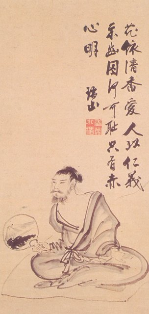
武市半平太組成主張尊王攘夷的土佐勤王黨，他以血書署名，成為第九位成員。同年發生上士斬殺下士的「永福寺事件」，土佐藩內上士與下士的對立更加尖銳。

## 1862 | 脫藩
舊曆1月受武市之託前往長州萩城，長州的久坂玄瑞對他說：「在斤斤計較土佐或長州的時候，國家就要滅亡了。」舊曆3月24日，他與澤村惣之丞一起脫離土佐藩，成為不受藩籍約束的浪士。據說三姊乙女瞞著哥哥，把家傳名刀送給他。脫藩後他與武市的路線分道揚鑣。

## 1862 | 拜勝海舟為師
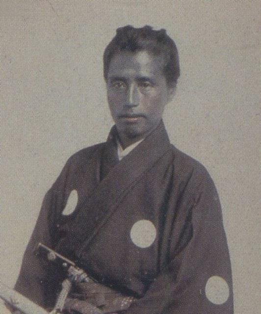
舊曆10月前後，帶著松平春嶽的介紹信拜訪幕府軍艦奉行勝海舟，被他的開國論與海軍構想折服，成為門生。他寫信給乙女說：「我現在已成為天下第一軍事學家勝麟太郎老師的門生。」

## 1863 | 脫藩罪獲赦；「日本一定要再革新一次」
勝海舟在下田向前藩主山內容堂求情，容堂赦免他的脫藩之罪。他奔走籌措神戶海軍操練所的資金，到福井向松平春嶽借得一千兩，並在寫給乙女的信中立誓：「日本一定要再革新一次。」舊曆10月出任神戶海軍塾的塾頭。

## 1864 | 神戶海軍操練所；與阿龍相識
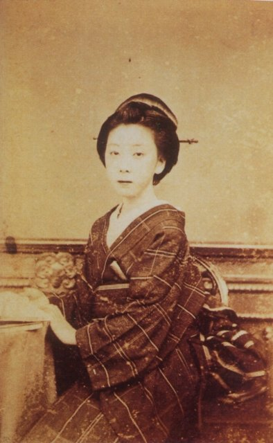
神戶海軍操練所成立，他也結識了楢崎龍（阿龍），兩人在舊曆8月舉行簡單的婚禮，他把阿龍託付給伏見寺田屋的老闆娘阿登勢。舊曆8月他在京都與薩摩的西鄉隆盛首次會面。年底勝海舟被召回江戶並遭罷免，臨行前把龍馬等人託付給薩摩藩家老小松帶刀。

## 1865 | 創立龜山社中
神戶海軍操練所廢止後，他隨西鄉、小松前往鹿兒島。舊曆閏5月，在薩摩藩出資下於長崎創立「龜山社中」，從事航運與貿易，被稱為日本最早的股份公司之一。舊曆5月，他的老友武市半平太在土佐被迫切腹。

## 1865 | 以薩摩之名替長州買武器
長州藩被幕府禁止購買武器，薩摩藩則缺少軍糧。他提出由龜山社中以薩摩藩的名義向英國商人哥拉巴購買武器與蒸汽船，再轉賣給長州，長州則以稻米回報薩摩，讓兩藩在交易中逐漸和解。

## 1866-03-07 | 薩長同盟
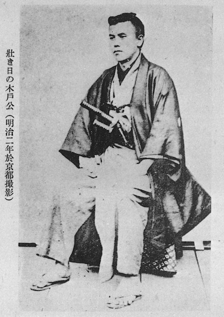
慶應2年舊曆1月21日或22日（公曆約3月7日或8日）。長州的桂小五郎（木戶孝允）在京都薩摩藩邸等了十多天，雙方都不肯先開口提結盟，桂一度準備回長州。他怒斥西鄉不該為面子問題錯失機會，西鄉終於讓步，雙方在他列席下締結薩長同盟，約定長州與幕府開戰時薩摩將出兵支援。事後他在桂寄來的盟約內容背面以紅筆簽名作保。

## 1866-03-09 | 寺田屋遇襲
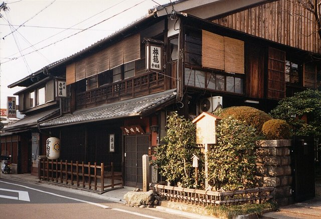
慶應2年舊曆1月23日深夜（公曆3月9日），他與長州的三吉慎藏在伏見寺田屋慶祝時，遭伏見奉行所的捕吏包圍。阿龍及時察覺示警，他以高杉晉作所贈的手槍突圍，雙手受傷，躲在木材場後由薩摩藩邸派人救出。

## 1866 | 霧島溫泉之旅
為療養傷勢，他在西鄉建議下帶著阿龍前往薩摩，在鹽浸溫泉休養，並登上霧島山的高千穗峰，被稱為日本最早的蜜月旅行之一（其實小松帶刀更早十年）。

## 1866 | 第二次長州征伐
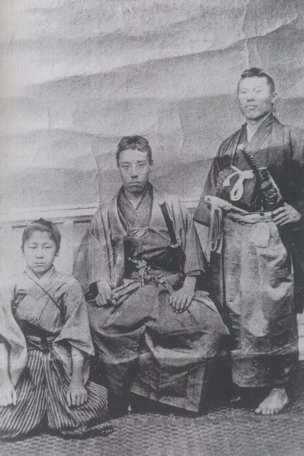
幕府出動大軍第二次討伐長州，薩摩依照同盟拒絕出兵。他駕駛龜山社中的乙丑丸（原櫻島丸）協助高杉晉作在下關海峽砲擊幕府軍。將軍德川家茂病逝後，幕府撤兵，討伐失敗，幕府的威信大受打擊。

## 1867 | 與後藤象二郎和解
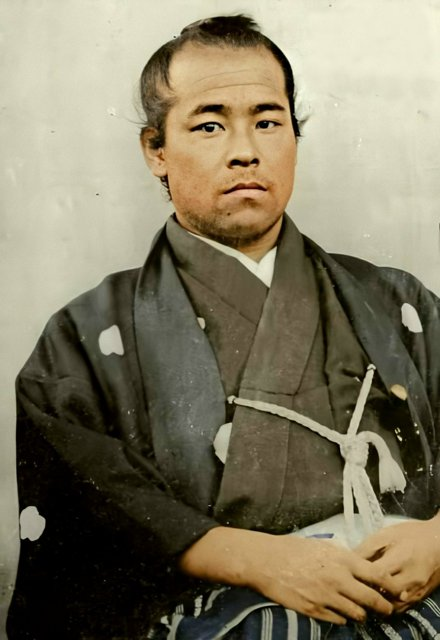
舊曆1月在長崎清風亭，與土佐藩參政後藤象二郎會面。後藤正是當年鎮壓土佐勤王黨的上士一派，兩人卻為了日本的前途而攜手合作，他的脫藩罪也再度獲赦。

## 1867 | 海援隊
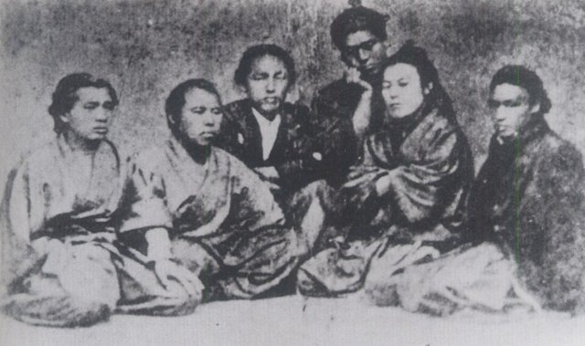
舊曆4月，龜山社中改由土佐藩支持，改組為「海援隊」，由他擔任隊長，從事海運、貿易，也出版書籍、教授航海與語學。他起草的隊規規定「不論出身」，只要對海外事務有興趣都能加入。

## 1867 | 伊呂波丸事件
海援隊租用的蒸汽船伊呂波丸，在瀨戶內海被紀州藩的大船明光丸撞沉。他依據「萬國公法」（國際法）向紀州藩索賠，還請長崎的藝妓傳唱「撞沉了我的船，就要付出代價」的歌謠爭取輿論同情，最後紀州藩賠償了七萬兩，是日本最早以國際法解決海事糾紛的例子之一。

## 1867 | 船中八策
舊曆6月，他與後藤象二郎搭乘土佐藩船夕顏丸從長崎前往京都，在船上提出新國家的八項構想，由海援隊書記長岡謙吉寫下，史稱「船中八策」：大政奉還、開設上下議政局、延攬人才、修訂條約、制定新法典、擴張海軍、設置御親兵、統一幣制。其中許多構想後來在明治政府中實現。

## 1867 | 薩土盟約
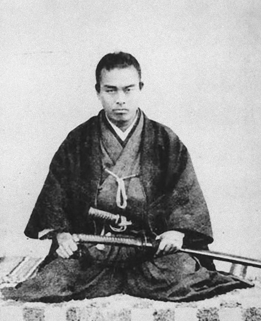
舊曆6月，薩摩的西鄉隆盛、大久保利通、小松帶刀與土佐的後藤象二郎等人在京都締結薩土盟約，他與中岡慎太郎以浪士代表身分列席，共同推動以和平方式讓將軍交出政權。

## 1867 | 最後一次回鄉
舊曆9月，為了把海援隊購買的一千三百支步槍運交土佐藩，他在脫藩後第一次、也是最後一次回到高知老家，與哥哥權平、姊姊乙女團聚了兩晚。

## 1867-11-09 | 大政奉還

土佐藩前藩主山內容堂採納他與後藤的構想，向將軍德川慶喜提出大政奉還建白書。慶喜在京都二條城召集各藩重臣後，於舊曆10月14日（公曆11月9日）上奏將政權交還朝廷，隔天獲得受理，延續260多年的江戶幕府結束。據說他聽到消息時，感嘆慶喜的決斷：「我願為這位將軍捨命。」

## 1867 | 新政府綱領八策
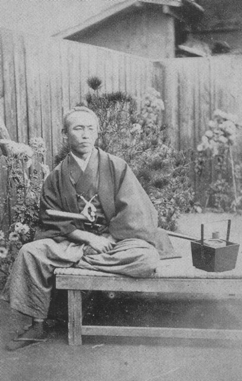
大政奉還後，他前往福井與財政家三岡八郎（後來的由利公正）討論新政府的財政，舊曆11月在京都起草《新政府綱領八策》。傳說西鄉看到他擬定的新官制名單裡沒有他自己的名字，他回答：「我搞不好會組織一個世界的海援隊吧！」

## 1867-12-10 | 近江屋事件，遇刺身亡
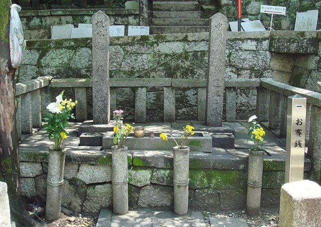
慶應3年舊曆11月15日（公曆12月10日）夜，他在京都河原町近江屋二樓與中岡慎太郎密談時，遭自稱「十津川鄉士」的刺客襲擊，當夜身亡，享年31歲（虛歲33歲）；這天恰好是他的生日。中岡兩天後也傷重去世。刺客一般認為是京都見迴組的今井信郎等人，但新選組說、薩摩藩陰謀說等至今仍有爭議。兩人葬於京都東山的靈山。

## 1868 | 明治維新
他去世不到一個月，朝廷就發布「王政復古大號令」，隔年新政府軍在戊辰戰爭中擊敗舊幕府軍，江戶城無血開城，明治維新開始；海援隊則被土佐藩解散。海援隊的岩崎彌太郎後來承襲其精神，創立了三菱。

## 1891 | 追贈正四位
明治政府追贈他正四位。後來司馬遼太郎的歷史小說《龍馬來了》（1962–1966）讓他成為日本最受歡迎的歷史人物之一。
