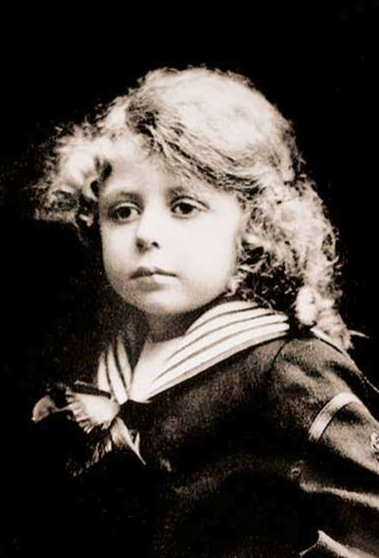
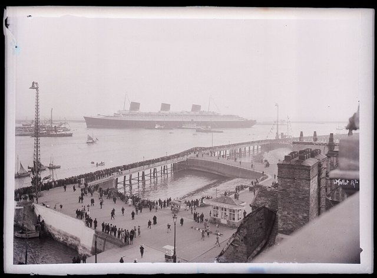
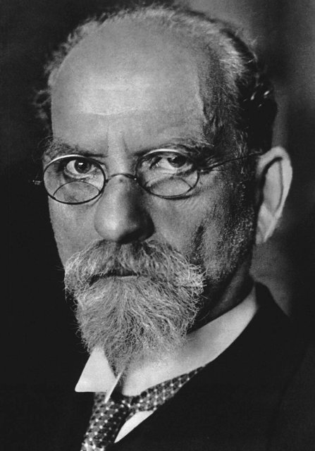
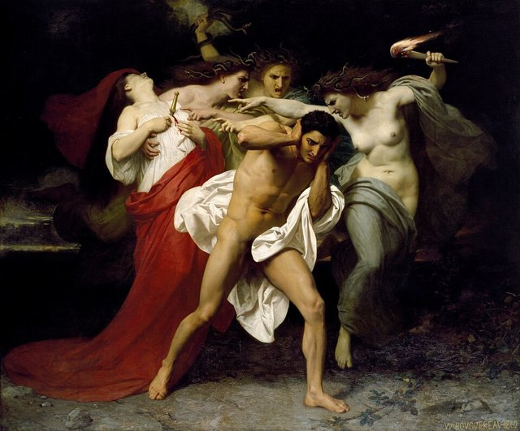
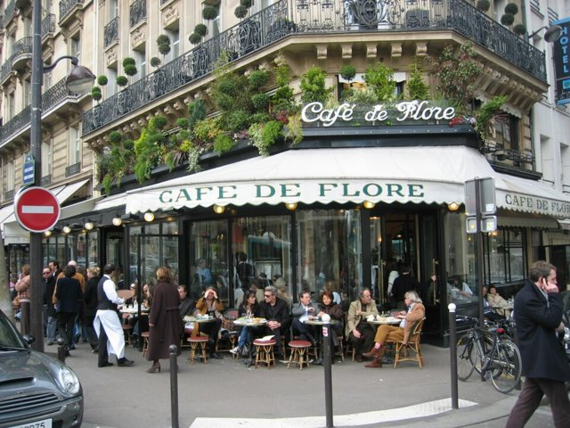
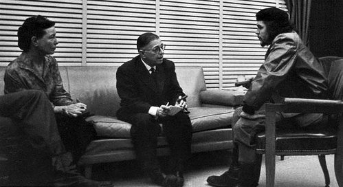
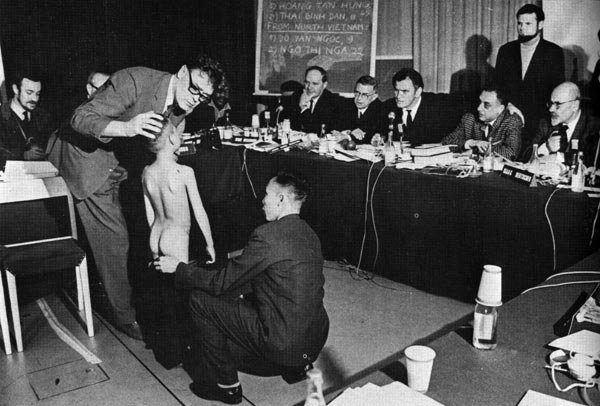
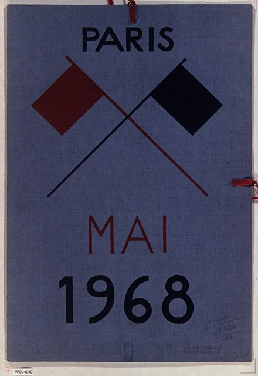
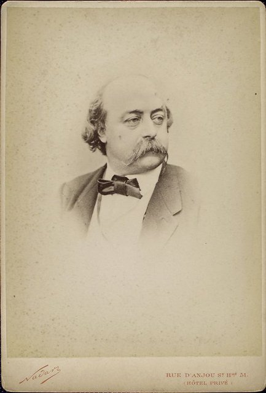
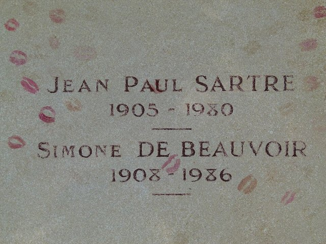

<!--
內容整理自本機筆記〈沙特生平大事記〉（圖表\沙特生平大事記.md）與中文維基百科「讓-保羅·沙特」條目（CC BY-SA 4.0），以台灣用語改寫摘要。
https://zh.wikipedia.org/zh-tw/让-保罗·萨特
（中文維基百科的「沙特」會重新導向到國家「沙烏地阿拉伯」，此處使用的是哲學家本人的條目。）
兩份資料的出入與處理：
- 書名與人名：維基百科作《噁心》《間隔》《摩登時代》、波伏娃，此處依筆記與台灣常見譯名作《嘔吐》《禁閉》《現代》雜誌、西蒙·波娃；卡繆與《反抗者》的寫法和卡繆時間軸一致。
- 父親去世：筆記只寫1906年、他不到兩歲；維基百科寫他1歲3個月時，此處作1906年9月。
- 服兵役：維基百科提到他1929年起在氣象台服了一年半兵役，筆記只寫1939年動員時擔任氣象兵；兩次都是氣象工作，分開交代。
- 被俘：維基百科記載他在1940年6月21日、35歲生日當天被俘，並說「幾小時後」停戰協定生效；實際上停戰協定是6月22日簽訂、25日生效，此處寫「幾天後」。筆記寫他1941年獲釋，維基百科寫他以視力不佳為由說服德軍放人，兩者合併敘述。
- 《自我的超越》：筆記寫1936年出版，維基百科寫1934年在柏林寫成，此處寫1934年寫成、1936年發表。
- 與卡繆決裂：維基百科另有一說，認為卡繆把尚松的書評怪罪到沙特頭上；此處依兩份資料共同的說法，寫雙方因《反抗者》的論戰而決裂。
- 諾貝爾獎：維基百科寫他拒絕的理由是一向拒絕官方榮譽，晚年又說是因為獎項把作家分等級；筆記強調作家不應被制度化。兩種說法都列出。
- 維基百科收錄比安卡·蘭布蘭1993年的回憶錄，指控沙特與波娃利用師生關係對她進行性剝削；這是當事人的指控，此處以「指控」陳述，不加渲染。
- 1917年母親再婚、1941年組織「社會主義與自由」、1945年《自由之路》前兩卷出版、1947年《什麼是文學》、1954年訪蘇、1955年訪華、1960年《121人宣言》與訪問古巴、1968年譴責蘇聯入侵捷克、1973年創辦《解放報》、葬禮與波娃合葬等細節，係依維基百科與一般公認的史實補充。
圖片來源（皆為 Wikimedia Commons 公有領域／CC0 作品；封面：1965年的照片（荷蘭國家檔案館，CC0；裁去外圍的底片框））：
- sar-cover.jpg：Jean Paul Sartre (kop), Bestanddeelnr 917-9600.jpg（裁去外圍的底片框）
- sar-child.jpg：Jean Paul Sartre circa 1910.jpg
- sar-havre.jpg：Entrée du paquebot Normandie dans le port du Havre, vue depuis une fenêtre d'un immeuble du Grand-quai - Mullot Pht - btv1b10480197g.jpg
- sar-husserl.jpg：Edmund Husserl 1910s.jpg
- sar-orestes.jpg：Orestes Pursued by the Furies by William-Adolphe Bouguereau (1862) - Google Art Project.jpg
- sar-flore.jpg：Café de Flore.jpg（2008年攝）
- sar-cuba.jpg：Beauvoir Sartre - Che Guevara -1960 - Cuba.jpg（1960年與切·格瓦拉會面）
- sar-russell.jpg：Russelltribunalen.jpg
- sar-mai68.jpg：Mai 1968. Paris Mai 68. affiche couverture de portfolio, non identifié.jpg
- sar-flaubert.jpg：Gustave Flaubert portrait photo.jpg
- sar-tomb.jpg：Tombe de Sartre et Beauvoir au cimetière du Montparnasse.jpg（2011年攝）
-->

# Periods
- 1905 ~ 1929 | 書堆裡的童年與高師歲月 | #f08c00
  幼年喪父，在外祖父的書房裡長大，進入巴黎高等師範學院攻讀哲學，結識終身伴侶西蒙·波娃。
- 1929 ~ 1939 | 中學教師、現象學與《嘔吐》 | #1c7ed6
  在勒阿弗爾等地教中學，赴柏林研究胡塞爾的現象學，以小說《嘔吐》與短篇集《牆》成名。
- 1939 ~ 1945 | 戰爭、戰俘營與《存在與虛無》 | #495057
  應徵入伍、被德軍俘虜，獲釋後在佔領下的巴黎寫出《存在與虛無》《蒼蠅》《禁閉》。
- 1945 ~ 1960 | 存在主義風潮與政治介入 | #343a40
  創辦《現代》雜誌，「存在先於本質」風靡戰後世界；他主張作家必須「介入」，靠近共產黨，與卡繆、梅洛-龐蒂等老友決裂。
- 1960 ~ 1973 | 反殖民、拒領諾貝爾獎與五月風暴 | #c92a2a
  出版《辯證理性批判》，聲援阿爾及利亞獨立、反對越戰，拒絕諾貝爾文學獎，走上街頭支持學生運動。
- 1973 ~ 1980 | 失明的晚年 | #862e9c
  雙眼幾乎失明，靠口述與對談繼續工作，逝世時數萬人為他送葬。

# Events

## 1905-06-21 | 出生@巴黎
生於巴黎一個富裕的中產階級家庭，是家中的獨子。父親尚-巴蒂斯特是海軍軍官，母親安妮-瑪麗出身亞爾薩斯的史懷哲家族，她的堂兄就是後來獲得諾貝爾和平獎的醫生史懷哲。

## 1906-09 | 父親病逝
父親在越南服役時染上熱病，回國後病逝，沙特才1歲3個月。母親帶著他搬回娘家，由當德語教師的外祖父夏爾·史懷哲撫養。他後來說，這讓他從小沒有「超我」，因為沒有父親來壓著他。

## 1909 | 外祖父的書房 {age=4}

四歲時一場病讓他的右眼幾乎失明，從此斜視，他自覺長得醜。他在外祖父的書房裡長大，很早就識字，大量閱讀古典文學與冒險小說，也開始自己寫故事，認定長大要當作家。外祖父一度讓他退學，請老師到家裡授課，使他很晚才有同齡的玩伴。這段童年後來寫進自傳《文字生涯》。

## 1917-04 | 母親再婚
母親改嫁一位造船工程師，他隨家人搬到港口城市拉羅歇爾。他在新學校受同學欺負，與繼父也處不來，這幾年是他童年最不快樂的時光。三年後他回到巴黎，就讀亨利四世中學。

## 1924 | 巴黎高等師範學院
考進巴黎高等師範學院攻讀哲學，研讀笛卡兒、康德、柏拉圖等人的著作。他在同學間以愛惡作劇聞名，也參加學校的戲劇演出，寫了第一部獨幕劇。

## 1928 | 教師資格考試落榜
第一次參加哲學教師資格考試沒有通過。據說他想在答案中展現自己的原創見解，反而不合評審的口味。

## 1929 | 首席通過與波娃
第二年重考，以第一名通過教師資格考試，第二名是就讀索邦大學的西蒙·波娃。兩人在備考時相識，從此成為一生的伴侶。他們不結婚、不同住，訂下可以續約的「兩年契約」：彼此最重要，但也允許與他人交往，並承諾對對方坦白一切。同年秋天他入伍服役，在氣象站待了一年半。

## 1931-04 | 勒阿弗爾的哲學老師

到法國北部的港口城市勒阿弗爾的高中教哲學，課餘寫作小說與哲學論文。他不喜歡外省小城沉悶的中產階級生活，這種感受後來成為《嘔吐》裡布維爾城的原型。

## 1933 | 柏林研究現象學

聽朋友雷蒙·阿隆說起胡塞爾的現象學「可以從一杯雞尾酒談出哲學」，他大為振奮，申請到柏林的法國學院進修一年。他研讀胡塞爾與海德格，在柏林寫成〈自我的超越〉（1936年發表），主張意識本身並沒有一個固定的「自我」坐鎮其中。

## 1938-04 | 《嘔吐》
小說《嘔吐》由伽利瑪出版社出版，原本書名叫《憂鬱》，被出版社建議改名。主角洛岡丹在海港小城寫一部歷史傳記，卻越來越被一種說不出的「噁心」感侵襲：一塊石頭、一棵栗樹的樹根，突然都顯得毫無理由地「多餘」地存在著。這本小說把哲學的「偶然性」寫成具體的身體感受，評論界反應熱烈。隔年出版的短篇集《牆》更受歡迎，讓他真正成名。

## 1939-09 | 動員入伍
第二次世界大戰爆發，他被徵召到亞爾薩斯一帶擔任氣象兵，負責觀測風向報給砲兵，其餘時間都在閱讀和寫作，留下大量的日記與書信。

## 1940-06-21 | 35歲生日被俘
法國戰敗，他在35歲生日當天被德軍俘虜，幾天後法德就簽訂了停戰協定，他覺得這種偶然簡直像一齣荒謬劇。他被關進德國特里爾的戰俘營，在營中研讀海德格的《存在與時間》，還為獄友編寫、演出了一齣耶誕劇《巴理奧納》。

## 1941-03 | 獲釋與「社會主義與自由」
他以右眼失明、根本不能打仗為由，讓德軍相信他不是正規士兵，獲釋回到巴黎，繼續在中學教書。他和朋友組織了抵抗團體「社會主義與自由」，卻因為沒有實際行動能力，不久就解散；兩年後他才為地下刊物撰稿。

## 1943-06-03 | 《蒼蠅》首演

劇作《蒼蠅》在德軍佔領下的巴黎首演，改寫希臘神話：俄瑞斯忒斯為父報仇殺死母親與篡位者，卻拒絕向眾神懺悔，宣告「我就是我的自由」。這是一部借古喻今、呼喚自由的戲，通過了德軍審查，觀眾卻聽得懂其中的弦外之音。首演場合上，他結識了卡繆。

## 1943-06 | 《存在與虛無》

出版長達七百頁的哲學鉅著《存在與虛無》。因為戰時缺煤缺電，他大多在住處附近的花神咖啡館寫作。書中區分沒有意識、「是其所是」的「自在存在」，和能夠反省自身、不斷超越現狀的「自為存在」，也就是人。人「被判定為自由」，無法把選擇推給天性或上帝；逃避這份自由、假裝自己別無選擇，就是「自欺」。這本書戰後吸引大量讀者，成為法國存在主義的奠基之作。

## 1944-05-27 | 《禁閉》首演
劇作《禁閉》首演：一男兩女死後被關進一個沒有刑具、燈永遠不關的房間，三人互相需要、又互相妨礙，在彼此的目光下無處可逃。劇末的台詞「他人就是地獄」成為他最廣為人知的一句話，但他後來解釋，這指的是人若完全依賴他人的評價來看待自己，就會被困住。

## 1945-10 | 《現代》雜誌與「存在主義是一種人道主義」
與波娃、梅洛-龐蒂、雷蒙·阿隆等人創辦《現代》雜誌。同月他在巴黎發表演講〈存在主義是一種人道主義〉，會場擠得水洩不通。他宣示「存在先於本質」：人先存在於世上，然後透過自己的選擇與行動成為某種人；人在為自己選擇時，也是在為全人類選擇，因此自由伴隨著沉重的責任。存在主義從此成為風靡戰後的思潮，左岸咖啡館裡穿黑衣的年輕人都自稱存在主義者。同年9月，長篇小說《自由之路》前兩卷出版。

## 1946 | 《反猶太主義者與猶太人》
出版《反猶太主義者與猶太人》，主張反猶太主義不是一種「意見」，而是人藉著製造敵人來逃避自由與責任的選擇。隔年他在《現代》連載《什麼是文學》，提出「介入」的主張：作家必須透過作品對時代表態，為自己的時代寫作。

## 1948-04-02 | 《骯髒的手》
劇作《骯髒的手》首演，描寫一個出身資產階級的年輕共產黨員，奉命刺殺黨內主張妥協的領袖，探討政治行動能否保持雙手乾淨。同年他加入「革命民主同盟」，想在美蘇之間走第三條路，但不到一年就與同盟領導人分道揚鑣。

## 1951-06-07 | 《魔鬼與上帝》
劇作《魔鬼與上帝》首演，主角是十六世紀德國農民戰爭中的軍閥，一心作惡、又一心行善，最後發現兩者都是演給上帝看的戲。這是他自己最喜歡的劇本。

## 1952-08 | 與卡繆決裂
卡繆的《反抗者》批判革命暴力，《現代》雜誌刊出尚松的嚴厲書評。卡繆寫信給「《現代》主編」反駁，沙特隨即發表長文〈答卡繆〉，兩人的友誼就此結束。同年他發表〈共產黨人與和平〉，成為法國共產黨的同路人，這個立場也讓梅洛-龐蒂等人陸續離開了《現代》。

## 1954-05 | 訪問蘇聯
應邀訪問蘇聯，回國後撰文稱讚蘇聯有充分的批評自由，日後被批評為替史達林體制粉飾。隔年9月他與波娃訪問中國，在《人民日報》發表觀感。

## 1956-11 | 譴責蘇聯鎮壓匈牙利
蘇聯出兵鎮壓匈牙利革命，他公開譴責蘇聯與支持出兵的法國共產黨，與共產黨決裂，隔年在《現代》發表〈史達林的幽靈〉，但政治立場仍然偏左。

## 1960-04 | 《辯證理性批判》
出版第二部哲學鉅著《辯證理性批判》第一卷，試圖把存在主義對個人自由的分析，與馬克思主義對階級、物質條件與歷史的研究結合起來，探討人如何因共同的困境結成群體、群體又如何僵化成壓迫人的組織。第二卷始終沒有完成。

## 1960-09 | 《121人宣言》

阿爾及利亞戰爭期間，他在《121人宣言》上簽名，支持法國士兵拒絕參戰，又公開主張左派應與阿爾及利亞民族解放陣線聯手。退伍軍人在香榭麗舍大道上遊行高喊「槍斃沙特」，有人建議逮捕他，戴高樂據說回答：「人們不會把伏爾泰關進監牢。」此後他的住處兩度遭極右派組織放置炸彈。這一年他也與波娃訪問了古巴。

## 1963-10 | 《文字生涯》
自傳《文字生涯》在《現代》連載，隔年出版單行本，回顧他到12歲為止的童年，並毫不留情地檢討自己如何從小把文學當成救贖、把成為作家當成一種「神經官能症」。這本書被視為他重新回到文學的作品。

## 1964-10-22 | 拒絕諾貝爾文學獎
瑞典學院宣布將諾貝爾文學獎頒給他，理由是他的作品「富於思想、充滿自由精神與對真理的追求，對我們的時代產生了深遠的影響」。他公開拒絕，表示他一向拒絕官方的榮譽，「作家不應該讓自己變成一個機構」；晚年他又說，這是因為獎項把作家分成了等級。他是第一位主動拒領這個獎的得主。

## 1967-05 | 羅素法庭

以執行主席的身分，參加英國哲學家羅素發起的國際戰爭罪行法庭，在斯德哥爾摩等地調查美國在越戰中的行為。這是知識分子發起的民間法庭，沒有正式的司法效力。

## 1968-05 | 五月風暴

巴黎爆發學生運動與工人大罷工，他與波娃發表聲明支持學生，親自到被佔領的索邦大學向學生演講。同年8月蘇聯入侵捷克斯洛伐克，他稱蘇聯是戰犯，從此與蘇聯徹底斷絕往來。

## 1971-05 | 《家庭白癡》

出版研究福樓拜的鉅著《家庭白癡》前兩卷（1972年出第三卷），總計近三千頁，結合精神分析、家庭與階級分析，追問一個人如何在家庭與時代的條件下成為「福樓拜」。1970年起他也在街頭散發被查禁的毛派報紙《人民事業報》，警察卻不敢逮捕他。

## 1973-04 | 失明與《解放報》
參與創辦左派日報《解放報》並擔任總編輯。這一年他的視力急遽惡化，幾乎完全失明，無法再讀寫，生活由波娃與養女照料，只能靠口述與錄音繼續工作。

## 1980-04-15 | 逝世@巴黎

因肺水腫在巴黎逝世，享年74歲。過世前不久，他與秘書貝尼·列維的對談〈現在的希望〉刊出，語調轉向倫理與希望，波娃等老友認為那不是他真正的想法，至今仍有爭議。4月19日的葬禮有數萬人自發隨行，送他到蒙帕納斯公墓。六年後波娃去世，與他合葬在一起。

## 1993 | 蘭布蘭的回憶錄
曾是波娃學生的比安卡·蘭布蘭出版回憶錄，指控波娃與沙特在戰前利用師生關係，對年輕的她進行性剝削。這本書是為回應沙特身後出版的書信集而寫，讓兩人的私生活與「契約關係」受到重新檢視。
