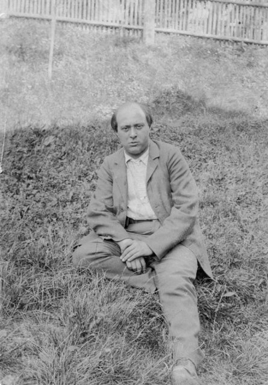
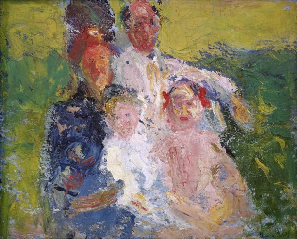
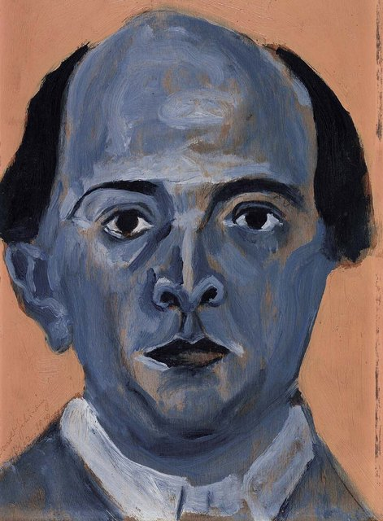
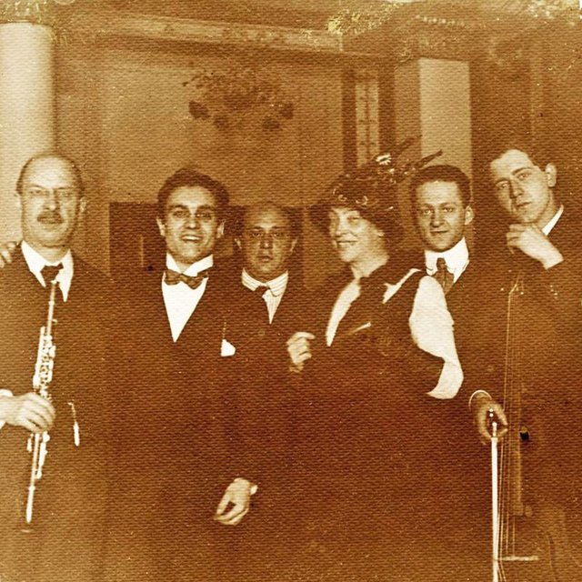
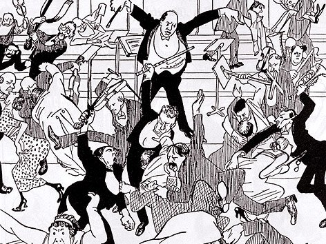
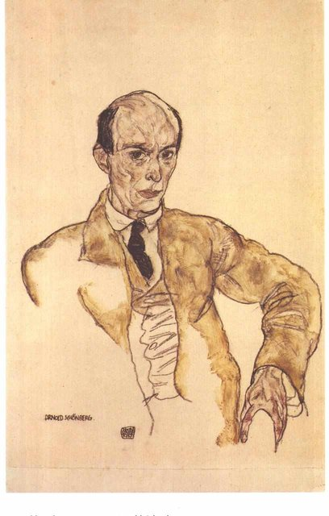
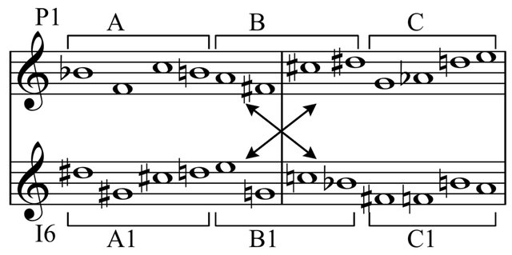

<!--
內容整理自中文維基百科「阿諾·荀白克」與英文維基百科「Arnold Schoenberg」條目（CC BY-SA 4.0），並以台灣用語改寫摘要。
https://zh.wikipedia.org/zh-tw/阿诺尔德·勋伯格
https://en.wikipedia.org/wiki/Arnold_Schoenberg
中文條目大致譯自英文條目，生平細節以英文條目為準。
《昇華之夜》、《月光小丑》、《古勒之歌》、《華沙倖存者》等作品的首演日期，係依一般公認的史實補充。
圖片皆為 Wikimedia Commons 上的公有領域（含PD-US）作品（封面：1920年的照片）。
-->

# Periods
- 1874 ~ 1894 | 維也納的少年
  生於維也納猶太人聚居的利奧波德城，父親是鞋店老闆。8歲學小提琴，靠模仿聽到的音樂自學作曲。
- 1894 ~ 1907 | 晚期浪漫派的新星
  幾乎完全自學，只跟澤姆林斯基學過對位，後來娶了他的妹妹。靠為輕歌劇配器維生，寫出《昇華之夜》、《古勒之歌》，得到馬勒與理查·史特勞斯的賞識。
- 1907 ~ 1915 | 走向無調性
  妻子與畫家私奔的危機中，他寫出第一首不依調性的作品，接著是《月光小丑》等表現主義名作。他也畫畫，作品和康丁斯基一起在「藍騎士」展出，並為《和聲學》奠定理論。
- 1915 ~ 1933 | 十二音技法與第二維也納樂派
  一次大戰從軍後回到維也納，創辦私人音樂演出協會，1923年發表十二音技法，學生貝爾格、魏本都採用這套方法。1925年起到柏林主持作曲大師班。
- 1933 ~ 1951 | 流亡美國@Los Angeles
  納粹上台後重歸猶太教，流亡美國，在洛杉磯任教，學生包括約翰·凱吉。晚年寫下《華沙倖存者》悼念大屠殺受害者，最後在他最害怕的「13日」去世。

# Events

## 1874-09-13 | 出生@維也納
生於維也納利奧波德城（過去的猶太人聚居區）一個中下階層的猶太家庭。父親薩謬爾來自匈牙利，是鞋店老闆；母親寶琳來自布拉格。

## 1882 | 8歲學小提琴
開始學小提琴，很快就靠改編、模仿自己演奏或聽到的音樂（例如軍樂隊的曲目）自學作曲，寫了小提琴二重奏與弦樂三重奏。

## 1894 | 跟澤姆林斯基學對位
他幾乎完全是自學的作曲家，只跟作曲家澤姆林斯基學過對位法，澤姆林斯基後來成了他的大舅子。

## 1898 | 改信路德宗
依循當時猶太人同化的潮流改信基督教路德宗，但猶太身分始終是他自我認同的核心。

## 1899 | 《昇華之夜》
二十多歲時靠為輕歌劇配器維生，同時寫下根據德默爾詩作的弦樂六重奏《昇華之夜》，後來改編成弦樂團版本，至今仍是他最受歡迎的作品之一。

## 1901-10 | 與瑪蒂爾德結婚

娶了澤姆林斯基的妹妹瑪蒂爾德，1901到1903年住在柏林，生了女兒葛楚德與兒子格奧爾格。

## 1904 | 馬勒的賞識
早期作品受到馬勒的青睞，大合唱《古勒之歌》也引起理查·史特勞斯的注意。他原本看不起馬勒的音樂，聽了第三號交響曲後如遭「雷擊」，從此視馬勒為天才，甚至稱他為「聖人」。

## 1907 | 《佩利亞與梅莉桑》與第一號室內交響曲
交響詩《佩利亞與梅莉桑》在柏林演出後，他首次獲得一些公眾認可，但他和學生的音樂大多遭到敵視。同年第一號室內交響曲首演，反應平平。

## 1908 | 妻子出走；第一首無調性作品

第二號弦樂四重奏的最後兩個樂章加入女高音、演唱格奧爾格的詩：「我感受到其他星球的空氣」，和聲已接近無調性，連馬勒都無法理解。夏天妻子瑪蒂爾德離開他，和畫家格斯特爾在一起，11月回到他身邊後，格斯特爾自殺。妻子離開期間，他寫下歌曲集《懸空花園之書》的第13首，這可能是他第一首完全不依傳統調性的作品。這段時間他也畫了大約四十幅油畫；格斯特爾也留下了一幅描繪荀白克一家的畫作。

## 1909 | 自由的無調性
《三首鋼琴小品》與《五首管弦樂曲》幾乎以意識流的方式自由創作。理查·史特勞斯在《伊萊克特拉》之後轉向保守，與他漸行漸遠。

## 1910 | 《和聲學》
夏天寫下《和聲學》，至今仍是極具影響力的音樂理論著作。他結識英國記者克拉克，這位唯一的英國學生後來在BBC把他和學生們的音樂介紹到英國。

## 1911-05 | 馬勒的葬禮
他和學生們出席了馬勒在格林青的葬禮，6月寫的《六首鋼琴小品》最後一首，以鐘聲般的音響向馬勒致敬。7月鄰居的反猶辱罵讓他無法工作，帶全家到施坦恩貝格湖投靠澤姆林斯基，並結識了畫家康丁斯基。

## 1911-09 | 移居柏林；「藍騎士」展覽

認定維也納本質上對他充滿敵意，在克拉克協助下搬到柏林，加入《狂飆》雜誌創辦人瓦爾登等人的藝術圈。12月起，他的畫作和康丁斯基、馬爾克的作品一起在「藍騎士」展覽中巡迴德國。

## 1912-10-16 | 《月光小丑》首演

應女演員采梅委託，以吉羅的詩集譜成21首歌曲，首創長笛、單簧管、小提琴、大提琴、鋼琴的五人編制（今稱「月光小丑樂團」），並要求演唱者使用介於說話與歌唱之間的「說唱」。他把自己投射在小丑身上：「我們都是這樣被月亮迷住的傻瓜。」這一年他婉拒了維也納音樂學院的教職，理由是「厭惡維也納」，並開始領取馬勒基金會的津貼。

## 1913-02-23 | 《古勒之歌》首演大成功
延宕多年的大合唱在維也納首演，全場起立鼓掌15分鐘，還獻上月桂冠。

## 1913-03-31 | 「醜聞音樂會」

他在維也納指揮自己的第一號室內交響曲，以及學生貝爾格、魏本和澤姆林斯基的作品，觀眾在掌聲中離席、互相鬥毆，警察介入，他被迫中斷貝爾格《阿爾滕貝格歌曲》的演出。

## 1914-08 | 「戰爭精神病」
一次大戰爆發，他陷入後來所說的「戰爭精神病」，寫信給阿爾瑪·馬勒說即將「清算」，要讓法國的「媚俗商人」拉威爾和史特拉汶斯基臣服（中文條目還提到比才）。他甚至記錄天氣日記，相信雲的形狀能預測戰爭結果。

## 1915-12-15 | 入伍服役

學生流失、經濟困難，他10月回到維也納，年底因氣喘不再能免役而被徵召入伍。畫家席勒在1917年為他畫了一幅肖像。他從未上過戰場，1916年10月在支持者奔走下退伍；據說貝爾格、魏本，可能還有巴爾托克都曾為他請命。有軍官問他是不是那個「惡名昭彰的荀白克」，他回答：「報告長官，是的。沒人想當他，但總得有人當，所以就由我來吧。」

## 1918 | 私人音樂演出協會
搬到維也納森林附近的默德林，創辦私人音樂演出協會，讓現代音樂能在充分排練、沒有樂評與敵意觀眾干擾的情況下演出。協會舉辦了353場演出，曲目包括史克里亞賓、馬勒、德布西、貝爾格、魏本等人的作品；頭一年半他完全不讓自己的作品上演。協會後來因奧地利惡性通膨而解散。

## 1920 | 馬特湖的反猶事件
帶全家到薩爾斯堡附近的度假勝地馬特湖，當地卻張貼公告要求猶太人立刻離開，官員要他證明自己不是猶太人。他雖然能證明自己是新教徒，仍憤而離開，這是希特勒崛起前多年的不祥預兆。

## 1923 | 發表十二音技法

1921年他寫信給阿爾瑪·馬勒說正在研究「全新的東西」。1923年他正式發表十二音技法，以十二個半音排成的音列作為作曲的統一原則，學生貝爾格、魏本、艾斯勒都採用了這套方法，形成所謂的「第二維也納樂派」。他強調自己是在延續「正確理解的」傳統，而不是想當「嚇人的怪物」。10月妻子瑪蒂爾德去世。

## 1924-08 | 與葛楚德結婚
娶了學生、小提琴家科利許的妹妹葛楚德，兩人後來生了三個孩子。他在1925年的《組曲》中，用G和降E（德文Es，即「S」）兩個音作為「G[ertrud] S[choenberg]」的音樂密碼。

## 1926 | 柏林普魯士藝術學院
布梭尼去世後，他獲任主持柏林普魯士藝術學院的作曲大師班，1925年任命、因健康問題1926年才到任。1920年代的年輕作曲家熱衷爵士、新古典主義等潮流，他感到孤立，在《三首諷刺曲》中嘲諷史特拉汶斯基的新古典主義是「就像巴赫老爹一樣！」。

## 1930 | 喜歌劇《從今天到明天》
與妻子葛楚德（化名馬克斯·布隆達寫劇本）合作的十二音喜歌劇，被認為是在回應作曲家克熱內克在歌劇《強尼開始演奏》中對他的諷刺。這時期他也開始寫完全以十二音寫成的歌劇《摩西與亞倫》，最終沒有完成。

## 1933 | 重歸猶太教，流亡美國
納粹上台後，他在法國度假時被警告回德國會有危險，於是在巴黎的猶太會堂正式重歸猶太教，表明反對納粹的立場。10月31日抵達美國，把姓氏的拼法從Schönberg改為Schoenberg，以「尊重美國慣例」。第一份教職在波士頓的馬爾金音樂學院。他申請雪梨音樂學院的教職時，院方在申請書上註記「猶太人」和「現代主義思想，危險傾向」；他從小就迷戀島嶼，也曾想移民紐西蘭，可能是因為紐西蘭郵票上的美景。

## 1935 | 加州大學洛杉磯分校
搬到洛杉磯，先在南加州大學任教，再經指揮家克倫培勒推薦擔任加州大學洛杉磯分校的客座教授，隔年升為正教授。兩所大學後來都以他的名字命名了音樂建築。

## 1937 | 布倫特伍德的家
買下加州大學洛杉磯分校附近的一棟西班牙殖民風格住宅，對面就是童星秀蘭·鄧波兒的家。他在這裡和作曲家蓋西文成為網球球友。週日下午的聚會以好咖啡和維也納糕點聞名，常客包括克倫佩勒、瓦雷茲，有時還有馬克思兄弟的哈潑與演員彼得·羅。他的學生包括約翰·凱吉與盧·哈里森。

## 1941 | 入籍美國
成為美國公民。晚年的作品有艱深的小提琴協奏曲、鋼琴協奏曲、《拿破崙頌》，也重新回到調性，寫了G大調弦樂組曲與第二號室內交響曲（1906年動筆，1939年才完成）。

## 1947 | 《華沙倖存者》
世人得知大屠殺的真相後，他寫下這部作品悼念受害者，1948年首演。同年作家湯瑪斯·曼出版小說《浮士德博士》，主角是一位使用十二音技法、把靈魂賣給魔鬼的作曲家，他很不高興，和曼通信爭論。

## 1951-07-13 | 逝世@洛杉磯
他有「13恐懼症」，害怕死在13的倍數之年。1939年65歲生日時，占星師說這一年危險但不致命；1950年76歲生日時，又有占星師提醒他7加6等於13，他從沒想過把年齡的數字相加，深受打擊。1951年7月13日星期五，他整天躺在床上，焦慮而沮喪，晚上11點45分去世，離午夜只差15分鐘。

## 1974-06-06 | 骨灰安葬維也納
他的骨灰移回維也納，安葬在中央公墓。妻子葛楚德在他死後成立出版社，專門出版他的作品，並請人整理了未完成的神劇《雅各的天梯》。
