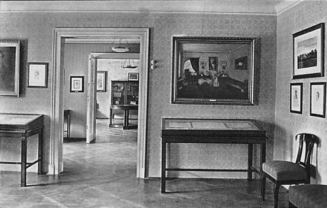
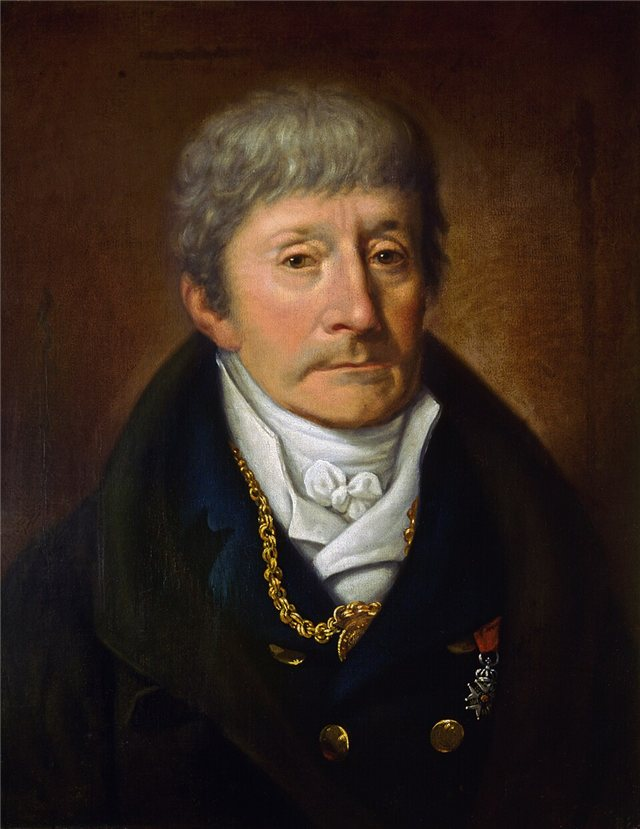
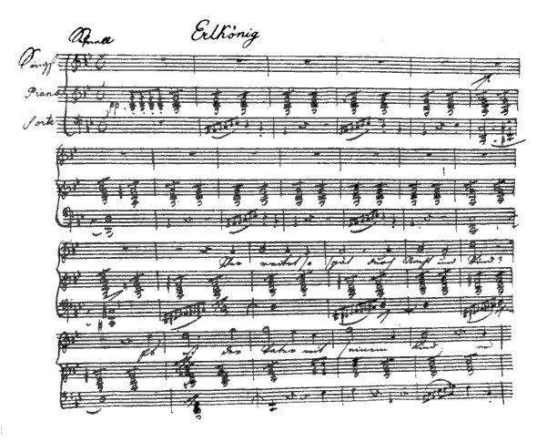
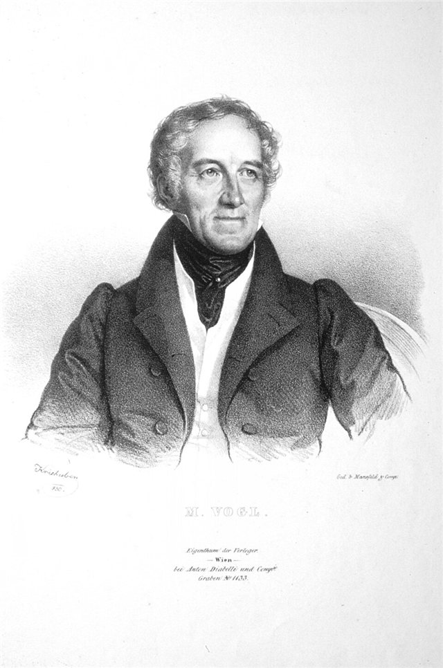
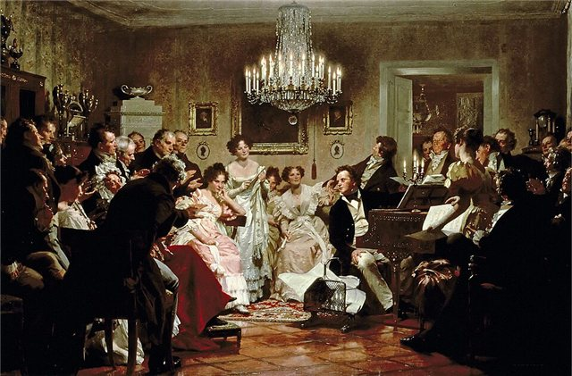
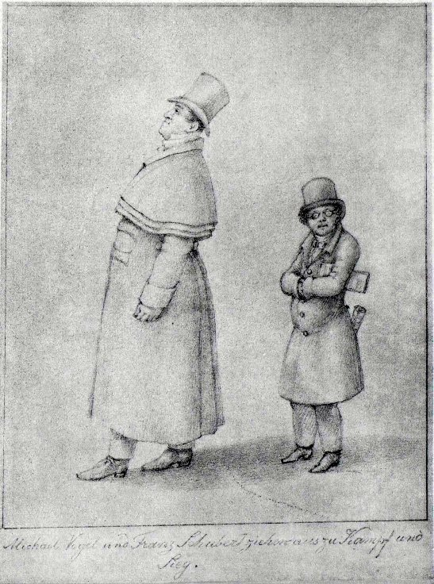
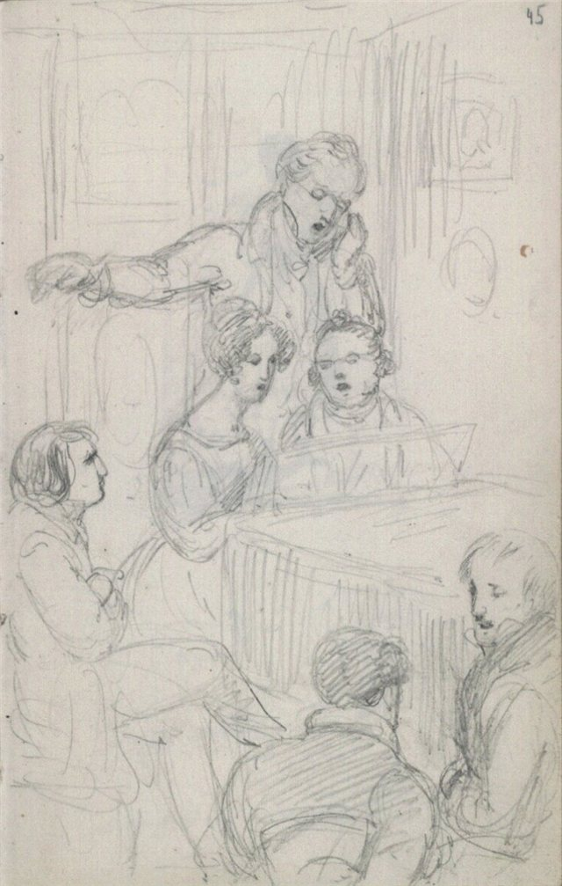
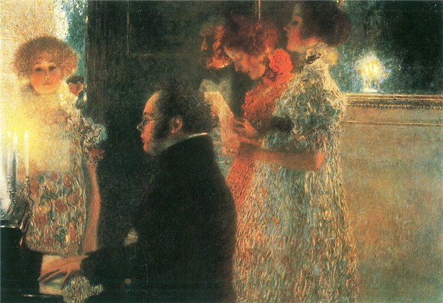

<!--
內容整理自中文維基百科「法蘭茲·舒伯特」條目（CC BY-SA 4.0），並以台灣用語改寫摘要。
https://zh.wikipedia.org/zh-tw/法蘭茲·舒伯特
圖片皆為 Wikimedia Commons 上的公有領域作品（封面：威廉·奧古斯特·里德所繪肖像）。
-->

# Periods
- 1797 ~ 1808 | 童年@維也納
  父親是維也納郊區一所學校的校長，也是業餘音樂家。家中14個孩子有10個早夭，舒伯特是倖存的孩子中最小的。5歲隨父親學小提琴，7歲跟教堂樂隊長霍爾澤學習，但老師很快就發現沒什麼可以教他了。
- 1808 ~ 1813 | 皇家神學寄宿學校
  因加入宮廷教堂童聲合唱團而進入皇家神學寄宿學校，在學校樂團接觸到莫札特的序曲與交響曲，也常去聽歌劇。他的天分引起宮廷樂長薩列里的注意，開始親自教他作曲與音樂理論。
- 1814 ~ 1816 | 父親學校的助理教師
  為了避免服兵役，接受教師訓練，在父親的學校教低年級。教書繁重，卻是他產量驚人的時期，1815年一年就寫了146首歌曲。薩列里持續個別指導他作曲。
- 1816 ~ 1823 | 舒伯特圈子
  辭去教職，靠朋友接濟專心作曲。朔伯爾提供住處，男中音沃格爾在沙龍演唱他的歌曲，朋友們為他舉辦的音樂聚會被稱為「舒伯特圈子」（Schubertiade）。他身高只有157公分、身材圓胖，朋友暱稱他「小蘑菇」。
- 1823 ~ 1828 | 晚年
  1823年起健康每況愈下，卻寫出最重要的作品：《美麗的磨坊女》、《冬之旅》、《死與少女》四重奏與兩首鋼琴三重奏。作品開始陸續出版，生前已有約一百部作品付梓。

# Events

## 1797-01-31 | 出生@維也納

出生於父親任校長的學校裡，校址就是今天的舒伯特出生地博物館。

## 1804 | 隨霍爾澤學習
7歲起跟教堂樂隊長麥可·霍爾澤學習，但他要教的內容舒伯特早就會了。反倒是一位學徒帶他到鋼琴倉庫，讓他有機會彈到更好的樂器。

## 1808-08 | 進入宮廷童聲合唱團與寄宿學校

在皇家教堂童聲合唱團演唱，並住進皇家神學寄宿學校。大量接觸各種樂譜與歌劇，為日後的創作打下基礎。

## 1812-05 | 母親去世
據說他當年寫的一首未完成的管樂八重奏，是為了悼念母親。

## 1813 | 第一號交響曲；離開寄宿學校
在寄宿學校的最後時光寫下第一號交響曲（D. 82）、彌撒經文與清唱劇等作品，年底離開學校。

## 1814 | 《紡車旁的葛麗卿》；第一部歌劇
開始在父親的學校教書。這一年寫了第一部歌劇《魔鬼之樂》、第一首彌撒與17首歌曲，其中根據歌德詩作寫成的《紡車旁的葛麗卿》被譽為第一首現代人能真正體會其內涵的德語藝術歌曲。

## 1814-12 | 結識詩人邁爾霍弗
兩人個性迥異：舒伯特開朗直率，邁爾霍弗憂鬱寡言，卻很快成為摯友。邁爾霍弗後來介紹他認識男中音沃格爾。

## 1815 | 驚人多產的一年
一面教書、一面上薩列里的課，仍寫出第二、三號交響曲，兩首彌撒、多部歌劇與146首歌曲。10月15日一天就寫了8首歌，10月19日又寫了7首。

## 1816 | 《魔王》；辭去教職

完成第四、五號交響曲，並為歌德的詩《魔王》譜曲。申請盧布爾雅那的宮廷樂師未果後，接受朔伯爾的邀請搬去同住，從此辭去教職，專心作曲。

## 1817 | 《鱒魚》與《死與少女》

寫下這兩首歌曲，日後分別發展成著名的鋼琴五重奏與弦樂四重奏。同年經邁爾霍弗介紹結識男中音沃格爾，沃格爾從此在各個沙龍演唱他的歌曲。

## 1820 | 兩部歌劇在卡特納托劇院上演
《孿生兄弟》與《神奇的豎琴》在維也納上演，被視為他創作風格走向成熟的一年。

## 1821-02 | 《魔王》公開演唱，作品首度出版

沃格爾公開演唱《魔王》後，出版商迪亞貝利終於同意印行他的部分作品。

## 1822 | 《未完成》交響曲
只完成了兩個樂章的b小調第八號交響曲，直到1865年才首演。同年起他開始受到疾病折磨，研究多認為是梅毒。

## 1823 | 染上重病；《美麗的磨坊女》
年初病重，秋天住院治療，隔年寫信說自己是「世界上最不幸、最可憐的人」。同年完成以威廉·米勒詩作寫成的聯篇歌曲集《美麗的磨坊女》。

## 1824 | 再赴熱利佐夫采
為卓耳伯爵寫下八重奏。夏天再度前往埃斯特哈齊家位於熱利佐夫采（今斯洛伐克）的莊園，寫出《匈牙利嬉遊曲》與a小調弦樂四重奏。據說他愛上了學生卡洛琳·埃斯特哈齊伯爵小姐。

## 1825 | 上奧地利之旅；《聖母頌》

作品陸續出版，經濟壓力稍減。夏天與沃格爾同遊上奧地利與薩爾茲堡一帶，受到熱烈歡迎，途中寫下《華特·史考特爵士歌曲集》，其中的〈艾倫之歌第三首〉就是今天人們熟知的《聖母頌》。

## 1826 | 《死與少女》弦樂四重奏
d小調弦樂四重奏寫於1825到1826年冬天，第二樂章取材自他1817年的同名歌曲。同年他把一部交響曲獻給維也納音樂之友協會並獲得酬金。

## 1827 | 《冬之旅》；兩首鋼琴三重奏

完成同樣以米勒詩作寫成的聯篇歌曲集《冬之旅》，以及降B大調、降E大調兩首鋼琴三重奏。降E大調三重奏在12月26日首演，反應熱烈。

## 1827-03-29 | 擔任貝多芬葬禮的抬棺人
一生崇拜貝多芬，卻只見過他幾次面。在貝多芬的葬禮上擔任抬棺人之一。

## 1828-03-26 | 生平唯一的個人作品音樂會

在維也納音樂之友協會演奏廳舉辦第一場、也是唯一一場個人作品音樂會，曲目由他親自安排，演出大獲好評。這天剛好是貝多芬逝世一週年。

## 1828-11-19 | 逝世@維也納
在哥哥費迪南的公寓去世，年僅31歲，最後的病症很可能是傷寒。依他的心願安葬在維令根墓園，就在貝多芬墓旁不遠處。1888年兩人一同遷葬到維也納中央公墓。

## 1839-03-21 | 第九號交響曲《偉大》首演
舒曼到維也納拜訪舒伯特的哥哥費迪南，在遺稿中發現這部交響曲，寄給孟德爾頌，由孟德爾頌在萊比錫指揮首演。
