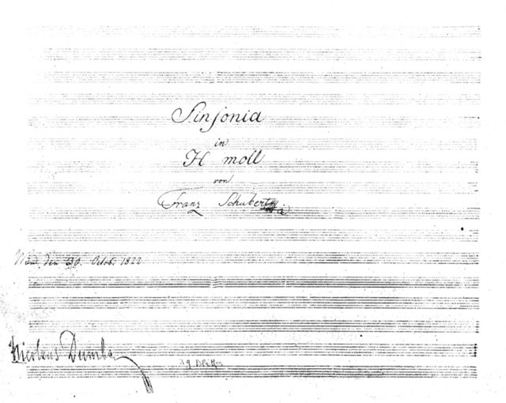
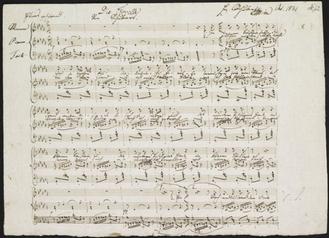
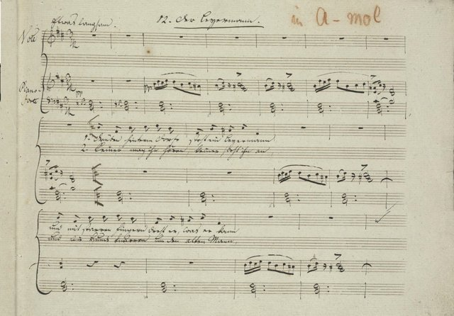

<!--
內容整理自本機筆記〈舒伯特主要作品〉（D:\Books\md\音樂\舒伯特主要作品.md，網頁版在知識圖譜的「5-2-1.音樂家作品」），做法比照「貝多芬主要作品」。
- 每首作品一則事件，日期採「創作時間」（多年創作的作品以區間呈現；「年代」以十年計、「世紀」以百年計，修訂或出版年份只寫在顯示文字裡），事件顏色依筆記的類別段落區分：交響曲、藝術歌曲與歌曲套曲、鋼琴奏鳴曲、鋼琴小品與幻想曲、室內樂、舞台音樂、歌劇與配樂、宗教音樂與彌撒曲。
- 「約」、「前後」、修訂、出版等不是單純年份的寫法，以原文作為顯示文字。
- 作品編號是目錄編號，不等於創作順序，時間軸依創作時間排序。
- 筆記沒有分期，時期沿用「舒伯特生平」時間軸的主要時期（重疊的細分時期不列）。
- 筆記「最值得優先聆聽」清單中的作品另註明順序。
- 以 follows 排在「舒伯特生平」之後；生平事件見該時間軸。
圖片來源（皆為 Wikimedia Commons 公有領域作品，多為手稿、初版樂譜與首演海報；封面為《冬之旅》第24首〈手搖風琴師〉手稿；註明「共用」者沿用生平時間軸的圖片）：
- schubertw-unfinished.jpg：Franz Schubert – Symphony No. 8 in B minor – Title Page.png（《未完成》交響曲手稿書名頁，1822）
- schubert-1816-erlkoenig.jpg（《魔王》手稿（與舒伯特生平共用））
- schubertw-forelle.jpg：Die Forelle.JPG（《鱒魚》手稿）
- schubertw-winterreise.jpg：Schubert - Winterreise, 24 ms f°15r.png（《冬之旅》第24首〈手搖風琴師〉手稿，1827）
-->

# Periods
- 1797 ~ 1808 | 童年@維也納
  父親是維也納郊區一所學校的校長，也是業餘音樂家。家中14個孩子有10個早夭，舒伯特是倖存的孩子中最小的。5歲隨父親學小提琴，7歲跟教堂樂隊長霍爾澤學習，但老師很快就發現沒什麼可以教他了。
- 1808 ~ 1813 | 皇家神學寄宿學校
  因加入宮廷教堂童聲合唱團而進入皇家神學寄宿學校，在學校樂團接觸到莫札特的序曲與交響曲，也常去聽歌劇。他的天分引起宮廷樂長薩列里的注意，開始親自教他作曲與音樂理論。
- 1814 ~ 1816 | 父親學校的助理教師
  為了避免服兵役，接受教師訓練，在父親的學校教低年級。教書繁重，卻是他產量驚人的時期，1815年一年就寫了146首歌曲。薩列里持續個別指導他作曲。
- 1816 ~ 1823 | 舒伯特圈子
  辭去教職，靠朋友接濟專心作曲。朔伯爾提供住處，男中音沃格爾在沙龍演唱他的歌曲，朋友們為他舉辦的音樂聚會被稱為「舒伯特圈子」（Schubertiade）。他身高只有157公分、身材圓胖，朋友暱稱他「小蘑菇」。
- 1823 ~ 1828 | 晚年
  1823年起健康每況愈下，卻寫出最重要的作品：《美麗的磨坊女》、《冬之旅》、《死與少女》四重奏與兩首鋼琴三重奏。作品開始陸續出版，生前已有約一百部作品付梓。

# Events

## 1813 | D. 82 第一號交響曲，D 大調 {color=#c92a2a}
類別：交響曲（交響曲）。

## 1814 ~ 1815 | D. 125 第二號交響曲，降 B 大調 {color=#c92a2a}
類別：交響曲（交響曲）。

## 1815 | D. 200 第三號交響曲，D 大調 {color=#c92a2a}
類別：交響曲（交響曲）。

## 1816 | D. 417 第四號《悲劇》交響曲，C 小調 {color=#c92a2a}
類別：交響曲（交響曲）。

## 1816 | D. 485 第五號交響曲，降 B 大調 {color=#c92a2a}
類別：交響曲（交響曲）。

## 1817 ~ 1818 | D. 589 第六號交響曲，C 大調 {color=#c92a2a}
類別：交響曲（交響曲）。

## 1821 | D. 729 第七號交響曲，E 大調（未完成草稿） {color=#c92a2a}
類別：交響曲草稿（交響曲）。

## 1822 | D. 759 第八號《未完成》交響曲，B 小調 {color=#c92a2a}

類別：交響曲（交響曲）。入門推薦聆聽第 3 首。

## 1825 ~ 1826 | D. 944 第九號《偉大》交響曲，C 大調 {color=#c92a2a}
類別：交響曲（交響曲）。入門推薦聆聽第 9 首。

## 1814 | Op. 2／D. 118 《紡車旁的葛麗卿》 {color=#1971c2}
類別：藝術歌曲（藝術歌曲與歌曲套曲）。入門推薦聆聽第 2 首。

## 1815 | Op. 1／D. 328 《魔王》 {color=#1971c2}

類別：敘事歌曲（藝術歌曲與歌曲套曲）。入門推薦聆聽第 1 首。

## 1815 | Op. 5 No. 1／D. 121 《野玫瑰》 {color=#1971c2}
類別：藝術歌曲（藝術歌曲與歌曲套曲）。

## 1815 | Op. 7 No. 3／D. 216 《迷娘》相關歌曲版本 {color=#1971c2}
類別：藝術歌曲（藝術歌曲與歌曲套曲）。

## 1817 | Op. 25／D. 550 《鱒魚》 {color=#1971c2}

類別：藝術歌曲（藝術歌曲與歌曲套曲）。

## 1815 | Op. 7 No. 1／D. 257 《流浪者之歌》相關早期歌曲 {color=#1971c2}
類別：藝術歌曲（藝術歌曲與歌曲套曲）。

## 1815 | Op. 7 No. 2／D. 255 《迷娘的歌》 {color=#1971c2}
類別：藝術歌曲（藝術歌曲與歌曲套曲）。

## 1817 | Op. 13 No. 2／D. 531 《死神與少女》 {color=#1971c2}
類別：藝術歌曲（藝術歌曲與歌曲套曲）。

## 1817 | Op. 32／D. 553 《在多瑙河上》 {color=#1971c2}
類別：藝術歌曲（藝術歌曲與歌曲套曲）。

## 1817 | Op. 43 No. 1／D. 550 《鱒魚》（另一種出版編號系統可能有異） {color=#1971c2}
類別：藝術歌曲（藝術歌曲與歌曲套曲）。

## 1823 | Op. 59 No. 3／D. 777 《在水上歌唱》 {color=#1971c2}
類別：藝術歌曲（藝術歌曲與歌曲套曲）。

## 1823 | Op. 89／D. 795 《美麗的磨坊少女》 {color=#1971c2}
類別：歌曲套曲（藝術歌曲與歌曲套曲）。

## 1823 | Op. 89 中的歌曲／D. 795 《流浪》 {color=#1971c2}
類別：歌曲套曲中的歌曲（藝術歌曲與歌曲套曲）。

## 1823 | Op. 89 中的歌曲／D. 795 《磨坊少女的花》 {color=#1971c2}
類別：歌曲套曲中的歌曲（藝術歌曲與歌曲套曲）。

## 1823 | Op. 89 中的歌曲／D. 795 《最後的希望》 {color=#1971c2}
類別：歌曲套曲中的歌曲（藝術歌曲與歌曲套曲）。

## 1823 | Op. 89 中的歌曲／D. 795 《溪流的搖籃曲》 {color=#1971c2}
類別：歌曲套曲中的歌曲（藝術歌曲與歌曲套曲）。

## 1827 | Op. 90 No. 3／D. 899 《降 B 大調即興曲》並非歌曲，請勿與歌曲 Op. 90 混淆 {color=#1971c2}
類別：鋼琴作品（藝術歌曲與歌曲套曲）。入門推薦聆聽第 7 首。

## 1823 | Op. 89／D. 795 《美麗的磨坊少女》全套 {color=#1971c2}
類別：歌曲套曲（藝術歌曲與歌曲套曲）。

## 1827 | Op. 89 以外／D. 911 《冬之旅》 {color=#1971c2}

類別：歌曲套曲（藝術歌曲與歌曲套曲）。入門推薦聆聽第 6 首。

## 1828 | Op. 23／D. 957 《天鵝之歌》 {color=#1971c2}
類別：歌曲集／後人編成的套曲（藝術歌曲與歌曲套曲）。

## 1815 | D. 157 E 大調鋼琴奏鳴曲 {color=#e67700}
類別：鋼琴奏鳴曲（鋼琴奏鳴曲）。

## 1815 | D. 279 C 大調鋼琴奏鳴曲 {color=#e67700}
類別：鋼琴奏鳴曲（鋼琴奏鳴曲）。

## 1817 | D. 537 A 小調鋼琴奏鳴曲 {color=#e67700}
類別：鋼琴奏鳴曲（鋼琴奏鳴曲）。

## 1817 | D. 566 E 小調鋼琴奏鳴曲 {color=#e67700}
類別：鋼琴奏鳴曲（未完成）（鋼琴奏鳴曲）。

## 1817 | D. 575 B 大調鋼琴奏鳴曲 {color=#e67700}
類別：鋼琴奏鳴曲（鋼琴奏鳴曲）。

## 1825 | Op. 42\*／D. 845 A 小調鋼琴奏鳴曲 {color=#e67700}
類別：鋼琴奏鳴曲（鋼琴奏鳴曲）。

## 1825 | Op. 53\*／D. 850 D 大調《加斯泰因》奏鳴曲 {color=#e67700}
類別：鋼琴奏鳴曲（鋼琴奏鳴曲）。

## 1826 | Op. 78\*／D. 894 G 大調奏鳴曲 {color=#e67700}
類別：鋼琴奏鳴曲（鋼琴奏鳴曲）。

## 1823 | Op. 143\*／D. 784 A 小調鋼琴奏鳴曲 {color=#e67700}
類別：鋼琴奏鳴曲（鋼琴奏鳴曲）。

## 1825 | Op. posth. 42／D. 845 A 小調奏鳴曲 {color=#e67700}
類別：鋼琴奏鳴曲（鋼琴奏鳴曲）。

## 1817 | Op. posth. 122／D. 568 降 E 大調鋼琴奏鳴曲 {color=#e67700}
類別：鋼琴奏鳴曲（鋼琴奏鳴曲）。

## 1828 | D. 958 C 小調鋼琴奏鳴曲 {color=#e67700}
類別：晚期鋼琴奏鳴曲（鋼琴奏鳴曲）。

## 1828 | D. 959 A 大調鋼琴奏鳴曲 {color=#e67700}
類別：晚期鋼琴奏鳴曲（鋼琴奏鳴曲）。

## 1828 | D. 960 降 B 大調鋼琴奏鳴曲 {color=#e67700}
類別：晚期鋼琴奏鳴曲（鋼琴奏鳴曲）。

## 1822 | Op. 15／D. 760 《流浪者幻想曲》C 大調 {color=#2f9e44}
類別：鋼琴幻想曲（鋼琴小品與幻想曲）。入門推薦聆聽第 8 首。

## 1827 | Op. 90／D. 899 四首即興曲 {color=#2f9e44}
類別：鋼琴小品（鋼琴小品與幻想曲）。入門推薦聆聽第 7 首。

## 1827 | Op. 142／D. 935 四首即興曲 {color=#2f9e44}
類別：鋼琴小品（鋼琴小品與幻想曲）。

## 1823 ~ 1827 | Op. 94／D. 780 六首《音樂瞬間》 {color=#2f9e44 label="約1823–1827"}
類別：鋼琴小品（鋼琴小品與幻想曲）。

## 1827 | Op. 90 No. 2／D. 899 降 E 大調即興曲 {color=#2f9e44}
類別：鋼琴即興曲（鋼琴小品與幻想曲）。入門推薦聆聽第 7 首。

## 1827 | Op. 90 No. 3／D. 899 G♭ 大調即興曲 {color=#2f9e44}
類別：鋼琴即興曲（鋼琴小品與幻想曲）。入門推薦聆聽第 7 首。

## 1827 | Op. 90 No. 4／D. 899 A♭ 大調即興曲 {color=#2f9e44}
類別：鋼琴即興曲（鋼琴小品與幻想曲）。入門推薦聆聽第 7 首。

## 1828 | D. 946 三首鋼琴小品 {color=#2f9e44}
類別：鋼琴小品（鋼琴小品與幻想曲）。

## 1824 | Op. 140\*／D. 812 C 大調《大二重奏》 {color=#2f9e44}
類別：四手聯彈奏鳴曲（鋼琴小品與幻想曲）。

## 1828 | D. 940 F 小調幻想曲 {color=#2f9e44}
類別：四手聯彈幻想曲（鋼琴小品與幻想曲）。

## 1824 | Op. 29\*／D. 810 D 小調《死神與少女》四重奏 {color=#862e9c}
類別：弦樂四重奏（室內樂）。入門推薦聆聽第 5 首。

## 1824 | Op. 125 No. 1\*／D. 804 A 小調《羅莎蒙》四重奏 {color=#862e9c}
類別：弦樂四重奏（室內樂）。

## 1826 | Op. 161\*／D. 887 G 大調弦樂四重奏 {color=#862e9c}
類別：弦樂四重奏（室內樂）。

## 1828 | D. 956 C 大調弦樂五重奏 {color=#862e9c}
類別：弦樂五重奏（室內樂）。入門推薦聆聽第 10 首。

## 1819 | Op. 114\*／D. 667 A 大調《鱒魚》五重奏 {color=#862e9c}
類別：鋼琴五重奏（室內樂）。入門推薦聆聽第 4 首。

## 1827 | Op. 99\*／D. 898 降 B 大調鋼琴三重奏 {color=#862e9c}
類別：鋼琴三重奏（室內樂）。

## 1827 | Op. 100\*／D. 929 降 E 大調鋼琴三重奏 {color=#862e9c}
類別：鋼琴三重奏（室內樂）。

## 1824 | Op. 148\*／D. 821 A 小調《阿佩喬尼》奏鳴曲 {color=#862e9c}
類別：大提琴／阿佩喬尼與鋼琴（室內樂）。

## 1817 | Op. 162\*／D. 574 A 大調小提琴奏鳴曲 {color=#862e9c}
類別：小提琴奏鳴曲（室內樂）。

## 1824 | Op. 166\*／D. 803 F 大調八重奏 {color=#862e9c}
類別：室內樂（室內樂）。

## 1824 | D. 810 D 小調《死神與少女》四重奏 {color=#862e9c}
類別：弦樂四重奏（室內樂）。入門推薦聆聽第 5 首。

## 1821 | D. 732 《阿方索與埃斯特雷拉》 {color=#0c8599}
類別：歌劇（舞台音樂、歌劇與配樂）。

## 1823 | D. 796 《費耶拉布拉斯》 {color=#0c8599}
類別：歌劇（舞台音樂、歌劇與配樂）。

## 1823 | D. 797 《羅莎蒙》戲劇配樂 {color=#0c8599}
類別：戲劇配樂（舞台音樂、歌劇與配樂）。

## 1819 | D. 644 《雙胞胎》 {color=#0c8599}
類別：喜歌劇（舞台音樂、歌劇與配樂）。

## 1812 | D. 84 《魔鬼的歡樂宮》相關早期舞台作品 {color=#0c8599}
類別：舞台音樂（舞台音樂、歌劇與配樂）。

## 1823 | D. 787 《陰謀者》／《家庭戰爭》 {color=#0c8599}
類別：歌唱劇（舞台音樂、歌劇與配樂）。

## 1823 | D. 796 《費耶拉布拉斯》序曲與歌劇音樂 {color=#0c8599}
類別：歌劇、管弦樂（舞台音樂、歌劇與配樂）。

## 1814 | D. 105 F 大調彌撒曲 {color=#5f3dc4}
類別：彌撒曲（宗教音樂與彌撒曲）。

## 1815 | D. 167 G 大調彌撒曲 {color=#5f3dc4}
類別：彌撒曲（宗教音樂與彌撒曲）。

## 1815 | D. 324 降 B 大調彌撒曲 {color=#5f3dc4}
類別：彌撒曲（宗教音樂與彌撒曲）。

## 1816 | D. 452 C 大調彌撒曲 {color=#5f3dc4}
類別：彌撒曲（宗教音樂與彌撒曲）。

## 1819 ~ 1822 | D. 678 降 A 大調彌撒曲 {color=#5f3dc4}
類別：彌撒曲（宗教音樂與彌撒曲）。

## 1827 | D. 872 《德意志彌撒曲》 {color=#5f3dc4}
類別：德語宗教合唱（宗教音樂與彌撒曲）。

## 1828 | D. 950 降 E 大調彌撒曲 {color=#5f3dc4}
類別：彌撒曲（宗教音樂與彌撒曲）。
