<!--
內容整理自中文維基百科「羅伯特·舒曼」條目（CC BY-SA 4.0），並以台灣用語改寫摘要。
https://zh.wikipedia.org/zh-tw/羅伯特·舒曼
圖片皆為 Wikimedia Commons 與英文維基百科上的公有領域作品（封面：約1839年肖像）。
-->

# Periods
- 1810 ~ 1828 | 童年與中學@茲威考(Zwickau)
  父親奧古斯特是書商、出版人兼譯者，家境富裕，但家中沒有人從事音樂。舒曼從小在父親的藏書中讀遍文學經典，一邊寫詩與劇本，一邊寫鋼琴小曲與歌曲。最喜愛的作家讓·保羅，對他日後的創作影響深遠。
- 1828 ~ 1830 | 大學時期@萊比錫、海德堡
  父親去世後，母親希望他讀法律。他先後就讀萊比錫大學與海德堡大學，卻把大部分時間花在讀書與彈琴上，最後決定以音樂為業。
- 1830 ~ 1840 | 鋼琴作品時期@萊比錫
  隨維克學琴，但右手受傷斷送了鋼琴家之路，轉而專心作曲並主編《新音樂雜誌》。這十年寫下《狂歡節》、《童年即景》、《克萊斯勒偶記》等最受推崇的鋼琴作品，也為了與克拉拉結婚和維克纏訟多年。
- 1840 ~ 1844 | 婚後創作高峰@萊比錫
  與克拉拉成婚後，創作範圍從鋼琴擴展到歌曲、交響曲與室內樂，幾乎每年專注一種體裁：1840年是「歌曲之年」，1841年寫交響曲，1842年寫室內樂。
- 1844 ~ 1850 | 德勒斯登時期@Dresden
  隨克拉拉巡演俄羅斯後身心俱疲，賣掉《新音樂雜誌》，舉家遷往有歌劇院的德勒斯登，希望轉向歌劇創作。健康時好時壞，仍完成鋼琴協奏曲、第二號交響曲與歌劇《格諾費娃》。
- 1850 ~ 1854 | 杜塞道夫音樂總監@Düsseldorf
  為了養家接下杜塞道夫音樂總監一職，但個性羞怯、精神不穩定，與樂團關係逐漸惡化，1853年被迫辭職。這段時間仍寫出「萊因」交響曲與大提琴協奏曲。
- 1854 ~ 1856 | 恩德尼希療養院
  投萊因河自殺獲救後，依自己的要求住進波昂附近的私人療養院，身心狀況持續惡化，偶有清醒時仍會寫信、嘗試作曲。院方認為家屬探視不利康復，克拉拉直到他臨終前兩天才再見到他。

# Events

## 1810-06-08 | 出生@茲威考
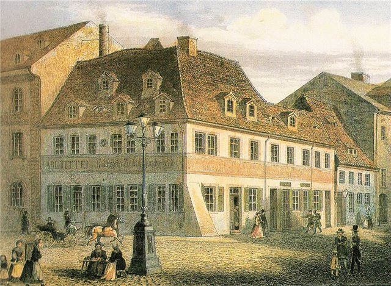
是書商奧古斯特·舒曼的第五個、也是最小的孩子，深受父親寵愛。3到5歲半之間，因母親感染斑疹傷寒，曾多次被寄養在別人家。

## 1817 | 開始學鋼琴
7歲起隨當地管風琴師孔奇學習音樂與鋼琴。他並非神童，但從小就能用鋼琴上的音型惟妙惟肖地模仿朋友們的個性，逗得旁人哈哈大笑。

## 1826 | 父親去世
父親一直鼓勵他的音樂興趣，曾為他買平台鋼琴、帶他去聽《魔笛》和莫謝萊斯的演奏。父親死後，母親並不支持他走音樂這條路。

## 1828-03 | 進入萊比錫大學讀法律
中學畢業後依母親的期望攻讀法律。室友說他從沒踏進講堂，他自己則宣稱讀得很認真；但他確實花了大把時間讀書、彈琴，還養成了喝香檳、抽雪茄的昂貴嗜好。

## 1828-11 | 為舒伯特之死痛哭整夜
在萊比錫發現了舒伯特的音樂，深深著迷。舒伯特在11月去世時，他整夜痛哭。

## 1829 | 拜維克為師
萊比錫最重要的鋼琴教師弗里德利希·維克認可他的天分，收他為學生。維克的女兒克拉拉當時才9歲，已是嶄露頭角的鋼琴神童。

## 1829-07-30 | 轉學海德堡；瑞士與義大利之旅
轉到海德堡大學，並在秋天遊歷瑞士與義大利，迷上了羅西尼的歌劇與義大利美聲唱法。

## 1830-04 | 在法蘭克福聽帕格尼尼
小提琴大師帕格尼尼的演奏帶給他極深的震撼。

## 1830-07-30 | 決定以音樂為業
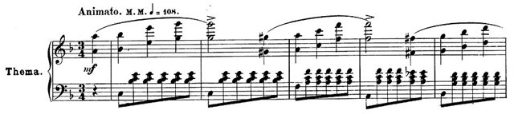
寫信給母親，說自己二十年的人生是「音樂與法律的鬥爭」，並請她讓維克評估他的潛力。維克認為只要肯下苦功，三年內就能成為出色的鋼琴家。同年他發表作品1《阿貝格變奏曲》，主題音符取自一位（很可能是虛構的）伯爵夫人的姓名字母。

## 1831 | 向多恩學作曲；「諸位脫帽，一位天才在此」
隨薩克森宮廷劇院音樂總監多恩學習和聲與對位。在評論蕭邦早期作品的文章中寫下名句「諸位先生，請脫帽，一位天才在此！」，也開始用衝動的「弗洛雷斯坦」與詩意的「歐西比烏斯」兩個分身代表自己性格的兩面。

## 1832 | 右手受傷，放棄鋼琴家之路
右手手指逐漸癱瘓，試遍各種療法都無效，病因至今不明。成為鋼琴大師的夢想破滅，他把重心轉向作曲。同年出版作品2《蝴蝶》。

## 1834-03 | 創辦《新音樂雜誌》
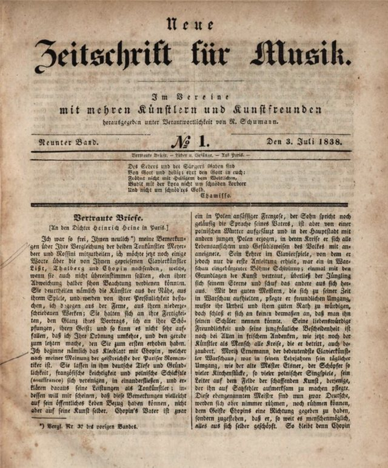
與維克等人共同創辦音樂雜誌，1835年起由他獨自擔任主編長達十年。撰稿人多以筆名寫作，舒曼把他們想像成為音樂真理而戰的「大衛同盟」。

## 1835 | 《狂歡節》；結識孟德爾頌、蕭邦
完成《狂歡節》與《交響練習曲》，兩部作品都與他當時秘密訂婚的對象埃內斯蒂娜有關，這段感情後來無疾而終。同年結識他極為敬重的孟德爾頌、蕭邦與莫謝萊斯。

## 1836-01 | 與克拉拉互訴衷情
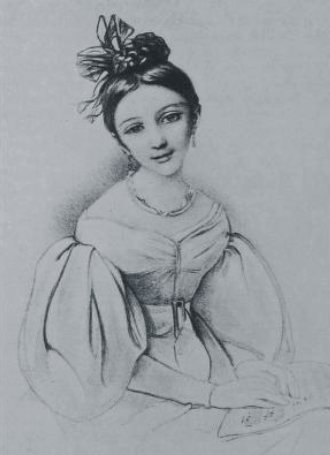
維克堅決反對，擔心舒曼無法養活女兒、克拉拉也必須放棄演奏事業。兩人展開長達四年的法律訴訟。

## 1837 | 《大衛同盟舞曲》、《克萊斯勒偶記》
這段期間寫下多部以短小樂曲串成、帶有詩意標題的鋼琴組曲。

## 1838 | 《童年即景》；發現舒伯特的「偉大」交響曲
完成鋼琴組曲《童年即景》（其中包括〈夢幻曲〉）。在維也納拜訪舒伯特的哥哥費迪南，在遺稿中發現C大調第九號交響曲，取得副本後安排首演。

## 1839-03-21 | 舒伯特第九號交響曲首演
由孟德爾頌在萊比錫指揮首演。舒曼在雜誌上熱情讚美這部作品擁有「天堂般宏偉的長度」，這句話後來成為形容此曲的名言。

## 1840 | 歌曲之年
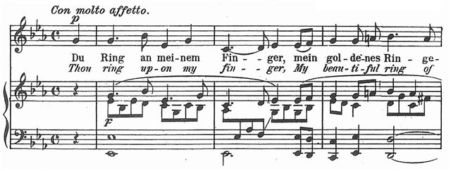
這一年寫下他一生半數以上的藝術歌曲，包括獻給克拉拉的新婚禮物《桃金孃》、《女人的愛情與生活》與《詩人之戀》，歌詞多取自海涅與艾興多夫。

## 1840-09-12 | 與克拉拉結婚
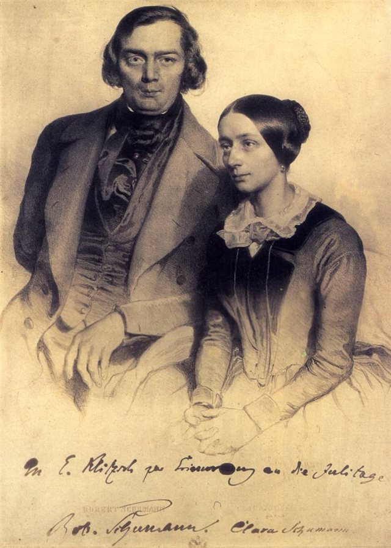
法院裁定兩人不需父親同意即可結婚，婚禮就在克拉拉21歲生日的前一天。克拉拉當時的聲望比舒曼更高，婚後育有七個孩子，演奏事業常因此中斷，但她始終鼓勵舒曼嘗試鋼琴以外的體裁。

## 1841-03-31 | 第一號交響曲「春」首演
由孟德爾頌在萊比錫布商大廈指揮首演，克拉拉在同一場音樂會中擔任鋼琴演奏。同年他還寫了一部鋼琴與樂團的幻想曲，日後成為鋼琴協奏曲的第一樂章。

## 1842 | 室內樂之年
研究海頓與莫札特的作品後，寫出三首弦樂四重奏、一首鋼琴五重奏與一首鋼琴四重奏。鋼琴五重奏為克拉拉量身而寫，成為後來布拉姆斯、德弗札克等人鋼琴五重奏的範本。

## 1843-12-04 | 世俗神劇《樂園與帕里》首演
年初經歷一次嚴重的精神危機，康復後完成這部取材自湯瑪斯·摩爾東方題材詩作的作品，在他生前廣受歡迎，讓他名揚國際。同年應孟德爾頌之邀到萊比錫音樂學院任教，維克也主動與他和解。

## 1844 | 俄羅斯巡演；遷居德勒斯登
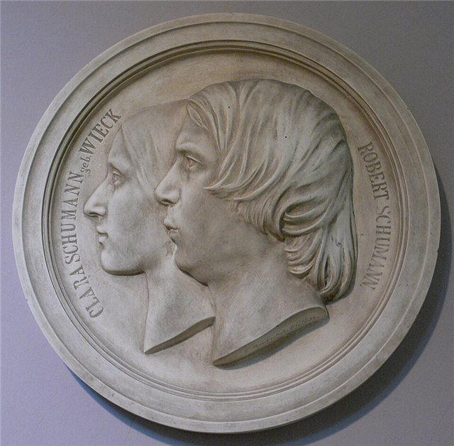
隨克拉拉巡演俄羅斯，結識葛令卡與安東·魯賓斯坦，巡演雖然成功卻讓他筋疲力竭。返國後賣掉《新音樂雜誌》，12月舉家遷往德勒斯登。

## 1845 | 鋼琴協奏曲
為1841年的幻想曲加上慢板與終樂章，完成a小調鋼琴協奏曲，至今仍是最受歡迎的浪漫派鋼琴協奏曲之一。

## 1847 | 長子夭折；孟德爾頌姊弟去世
前一年出生的長子埃米爾夭折，好友孟德爾頌與姊姊范妮也在這一年相繼去世。

## 1848 | 《青年曲集》；完成歌劇《格諾費娃》
為年輕學生寫下較簡單的鋼琴曲集《青年曲集》，8月完成他唯一的歌劇《格諾費娃》。

## 1850-04 | 接任杜塞道夫音樂總監
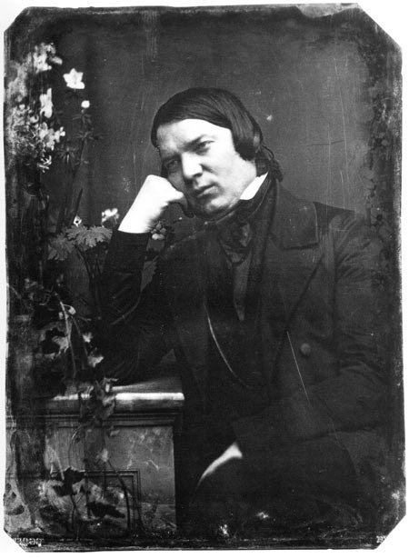
在克拉拉支持下接受這個職位，希望能為大家庭帶來穩定收入。

## 1850-06 | 歌劇《格諾費娃》萊比錫首演
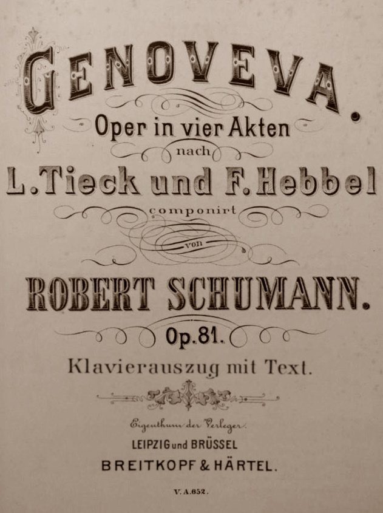
由舒曼親自指揮，但反應不如預期：一般觀眾嫌它不夠悅耳，華格納派又嫌它不夠前衛。生前只有李斯特在威瑪復演過一次。

## 1850-11 | 「萊因」交響曲與大提琴協奏曲
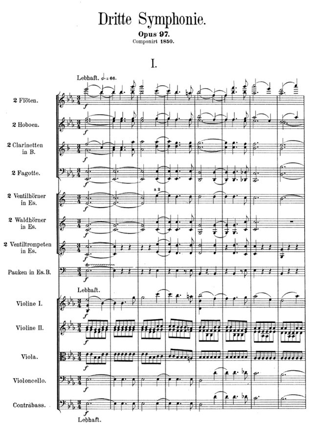
在杜塞道夫寫下兩部重要的晚期作品。第三號交響曲「萊因」採用少見的五樂章結構，第四樂章描繪科隆大教堂莊嚴的儀式。

## 1853 | 結識布拉姆斯；發表《新道路》
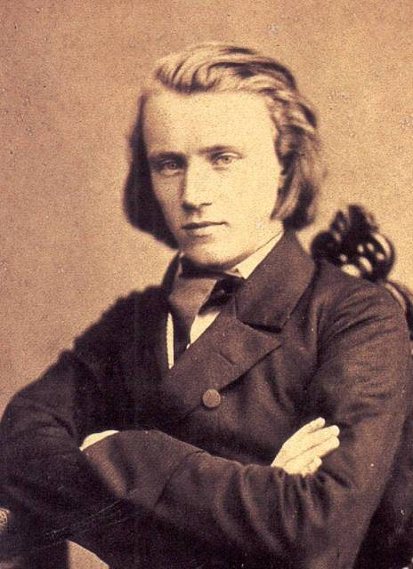
20歲的布拉姆斯帶著約阿希姆的介紹信來訪，為他彈奏自己的鋼琴奏鳴曲。舒曼激動地衝出房間把克拉拉拉來聽，隨後在《新音樂雜誌》發表最後一篇文章《新道路》，讚譽布拉姆斯將引領時代。同年被迫辭去杜塞道夫的職務。

## 1854-02-27 | 投萊因河自殺獲救
精神狀況急劇惡化，跳入萊因河，被漁夫救起。

## 1854-03-04 | 住進恩德尼希療養院
依自己的要求住進波昂附近恩德尼希的私人療養院。布拉姆斯在這段艱難的日子裡成為克拉拉的重要精神支柱。

## 1856-07-29 | 逝世@恩德尼希
在療養院去世，年僅46歲，死因記錄為肺炎，真正病因至今眾說紛紜。克拉拉在他臨終前兩天才再度見到他。
