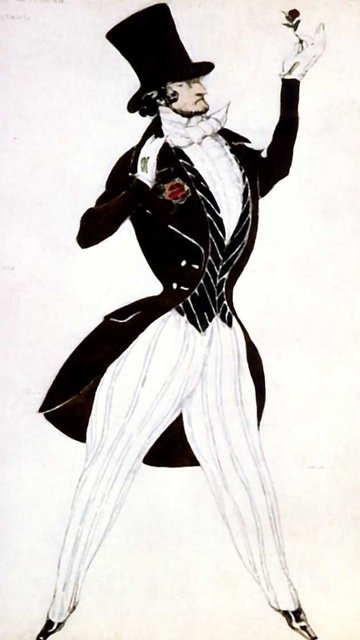

<!--
內容整理自本機筆記〈舒曼主要作品〉（D:\Books\md\音樂\舒曼主要作品.md，網頁版在知識圖譜的「5-2-1.音樂家作品」），做法比照「貝多芬主要作品」。
- 每首作品一則事件，日期採「創作時間」（多年創作的作品以區間呈現；「年代」以十年計、「世紀」以百年計，修訂或出版年份只寫在顯示文字裡），事件顏色依筆記的類別段落區分：鋼琴獨奏與鋼琴套曲、藝術歌曲、交響曲、鋼琴協奏曲與其他協奏作品、室內樂、序曲與管弦樂作品、神劇、合唱與宗教音樂、歌劇與戲劇作品。
- 「約」、「前後」、修訂、出版等不是單純年份的寫法，以原文作為顯示文字。
- 作品編號是目錄編號，不等於創作順序，時間軸依創作時間排序。
- 時期沿用「舒曼生平」時間軸的主要時期（重疊的細分時期不列）。
- 筆記「優先聆聽」清單中的作品另註明順序。
- 以 follows 排在「舒曼生平」之後；生平事件見該時間軸。
圖片來源（皆為 Wikimedia Commons 公有領域作品；註明「共用」者沿用生平時間軸的圖片）：
- mw-schumann-carnaval.jpg：Carnaval (Schumann) by L.Bakst 01.jpg（巴克斯特為俄羅斯芭蕾舞團的《狂歡節》（以舒曼原曲編成的芭蕾）設計的服裝，1910）
- schumann-1830-abegg.jpg（《阿貝格變奏曲》的主題（與舒曼生平共用））
- schumann-1840-lieder.jpg（《婦女的愛與生命》第四首〈你，我指上的戒指〉的樂譜（與舒曼生平共用））
- schumann-1850-genoveva.jpg（《格諾費娃》鋼琴聲樂譜的書名頁（與舒曼生平共用））
- schumann-1850-rhenish.jpg（第三號交響曲《萊茵》總譜的第一頁（與舒曼生平共用））
-->

# Periods
- 1810 ~ 1828 | 童年與中學@茲威考(Zwickau)
  父親奧古斯特是書商、出版人兼譯者，家境富裕，但家中沒有人從事音樂。舒曼從小在父親的藏書中讀遍文學經典，一邊寫詩與劇本，一邊寫鋼琴小曲與歌曲。最喜愛的作家讓·保羅，對他日後的創作影響深遠。
- 1828 ~ 1830 | 大學時期@萊比錫、海德堡
  父親去世後，母親希望他讀法律。他先後就讀萊比錫大學與海德堡大學，卻把大部分時間花在讀書與彈琴上，最後決定以音樂為業。
- 1830 ~ 1840 | 鋼琴作品時期@萊比錫
  隨維克學琴，但右手受傷斷送了鋼琴家之路，轉而專心作曲並主編《新音樂雜誌》。這十年寫下《狂歡節》、《童年即景》、《克萊斯勒偶記》等最受推崇的鋼琴作品，也為了與克拉拉結婚和維克纏訟多年。
- 1840 ~ 1844 | 婚後創作高峰@萊比錫
  與克拉拉成婚後，創作範圍從鋼琴擴展到歌曲、交響曲與室內樂，幾乎每年專注一種體裁：1840年是「歌曲之年」，1841年寫交響曲，1842年寫室內樂。
- 1844 ~ 1850 | 德勒斯登時期@Dresden
  隨克拉拉巡演俄羅斯後身心俱疲，賣掉《新音樂雜誌》，舉家遷往有歌劇院的德勒斯登，希望轉向歌劇創作。健康時好時壞，仍完成鋼琴協奏曲、第二號交響曲與歌劇《格諾費娃》。
- 1850 ~ 1854 | 杜塞道夫音樂總監@Düsseldorf
  為了養家接下杜塞道夫音樂總監一職，但個性羞怯、精神不穩定，與樂團關係逐漸惡化，1853年被迫辭職。這段時間仍寫出「萊因」交響曲與大提琴協奏曲。
- 1854 ~ 1856 | 恩德尼希療養院
  投萊因河自殺獲救後，依自己的要求住進波昂附近的私人療養院，身心狀況持續惡化，偶有清醒時仍會寫信、嘗試作曲。院方認為家屬探視不利康復，克拉拉直到他臨終前兩天才再見到他。

# Events

## 1829 ~ 1830 | Op. 1 《阿貝格變奏曲》（Abegg Variations） {color=#c92a2a}

類別：鋼琴變奏曲（鋼琴獨奏與鋼琴套曲）。

## 1829 ~ 1831 | Op. 2 《蝴蝶》（Papillons） {color=#c92a2a}
類別：鋼琴套曲（鋼琴獨奏與鋼琴套曲）。

## 1832 | Op. 3 《帕格尼尼隨想曲主題練習曲》 {color=#c92a2a}
類別：鋼琴練習曲（鋼琴獨奏與鋼琴套曲）。

## 1832 | Op. 4 《間奏曲集》（Intermezzi） {color=#c92a2a}
類別：鋼琴套曲（鋼琴獨奏與鋼琴套曲）。

## 1833 | Op. 5 《克拉拉主題即興曲》 {color=#c92a2a}
類別：鋼琴變奏曲（鋼琴獨奏與鋼琴套曲）。

## 1837 | Op. 6 《大衛同盟舞曲》（Davidsbündlertänze） {color=#c92a2a}
類別：鋼琴套曲（鋼琴獨奏與鋼琴套曲）。

## 1830 ~ 1832 | Op. 7 C 大調《托卡塔》（Toccata） {color=#c92a2a label="1830–1832，後修訂"}
類別：鋼琴獨奏（鋼琴獨奏與鋼琴套曲）。

## 1831 | Op. 8 b 小調《快板》（Allegro） {color=#c92a2a}
類別：鋼琴獨奏（鋼琴獨奏與鋼琴套曲）。

## 1834 ~ 1835 | Op. 9 《狂歡節》（Carnaval） {color=#c92a2a}

類別：鋼琴套曲（鋼琴獨奏與鋼琴套曲）。入門推薦聆聽第 1 首。

## 1833 | Op. 10 《帕格尼尼隨想曲主題音樂會練習曲》 {color=#c92a2a}
類別：鋼琴練習曲（鋼琴獨奏與鋼琴套曲）。

## 1833 ~ 1835 | Op. 11 升 f 小調第一號鋼琴奏鳴曲 {color=#c92a2a}
類別：鋼琴奏鳴曲（鋼琴獨奏與鋼琴套曲）。

## 1837 | Op. 12 《幻想小品集》（Fantasiestücke） {color=#c92a2a}
類別：鋼琴套曲（鋼琴獨奏與鋼琴套曲）。

## 1834 ~ 1837 | Op. 13 《交響練習曲》（Études symphoniques） {color=#c92a2a label="1834–1837；後修訂"}
類別：鋼琴變奏曲（鋼琴獨奏與鋼琴套曲）。

## 1835 ~ 1836 | Op. 14 f 小調第三號鋼琴奏鳴曲 {color=#c92a2a}
類別：鋼琴奏鳴曲（鋼琴獨奏與鋼琴套曲）。

## 1838 | Op. 15 《童年情景》（Kinderszenen） {color=#c92a2a}
類別：鋼琴套曲（鋼琴獨奏與鋼琴套曲）。入門推薦聆聽第 2 首。

## 1838 | Op. 16 《克萊斯勒偶記》（Kreisleriana） {color=#c92a2a}
類別：鋼琴套曲（鋼琴獨奏與鋼琴套曲）。入門推薦聆聽第 3 首。

## 1836 ~ 1838 | Op. 17 C 大調《幻想曲》（Fantasie） {color=#c92a2a}
類別：鋼琴幻想曲（鋼琴獨奏與鋼琴套曲）。入門推薦聆聽第 4 首。

## 1838 ~ 1839 | Op. 18 C 大調《阿拉貝斯克》（Arabeske） {color=#c92a2a}
類別：鋼琴獨奏（鋼琴獨奏與鋼琴套曲）。

## 1839 | Op. 19 降 D 大調《花之曲》（Blumenstück） {color=#c92a2a}
類別：鋼琴套曲（鋼琴獨奏與鋼琴套曲）。

## 1839 | Op. 20 降 B 大調《幽默曲》（Humoreske） {color=#c92a2a}
類別：鋼琴套曲（鋼琴獨奏與鋼琴套曲）。

## 1838 | Op. 21 《八首新事曲》（Novelletten） {color=#c92a2a}
類別：鋼琴套曲（鋼琴獨奏與鋼琴套曲）。

## 1833 ~ 1838 | Op. 22 g 小調第二號鋼琴奏鳴曲 {color=#c92a2a}
類別：鋼琴奏鳴曲（鋼琴獨奏與鋼琴套曲）。

## 1839 | Op. 23 《夜曲》（Nachtstücke） {color=#c92a2a}
類別：鋼琴套曲（鋼琴獨奏與鋼琴套曲）。

## 1839 ~ 1840 | Op. 26 《維也納狂歡節》（Faschingsschwank aus Wien） {color=#c92a2a}
類別：鋼琴套曲（鋼琴獨奏與鋼琴套曲）。

## 1839 | Op. 28 《三首浪漫曲》（Drei Romanzen） {color=#c92a2a}
類別：鋼琴小品（鋼琴獨奏與鋼琴套曲）。

## 1838 ~ 1839 | Op. 32 《四首鋼琴小品》 {color=#c92a2a}
類別：鋼琴小品（鋼琴獨奏與鋼琴套曲）。

## 1849 | Op. 76 《四首進行曲》（Vier Märsche） {color=#c92a2a}
類別：鋼琴小品（鋼琴獨奏與鋼琴套曲）。

## 1848 ~ 1849 | Op. 82 《森林情景》（Waldszenen） {color=#c92a2a}
類別：鋼琴套曲（鋼琴獨奏與鋼琴套曲）。

## 1851 | Op. 111 《三首幻想曲》（Drei Fantasiestücke） {color=#c92a2a}
類別：鋼琴小品（鋼琴獨奏與鋼琴套曲）。

## 1853 | Op. 133 《晨歌》（Gesänge der Frühe） {color=#c92a2a}
類別：鋼琴套曲（鋼琴獨奏與鋼琴套曲）。

## 1840 | Op. 24 《歌曲集》（Liederkreis，海涅詩作） {color=#1971c2}
類別：聲樂套曲（藝術歌曲）。

## 1840 | Op. 25 《桃金孃》（Myrthen） {color=#1971c2}
類別：歌曲集（藝術歌曲）。

## 1840 | Op. 27 《三首歌曲》 {color=#1971c2}
類別：藝術歌曲（藝術歌曲）。

## 1840 | Op. 29 《三首合唱曲》 {color=#1971c2}
類別：合唱作品（藝術歌曲）。

## 1840 | Op. 30 《三首歌曲》 {color=#1971c2}
類別：藝術歌曲（藝術歌曲）。

## 1840 | Op. 31 《三首歌曲》 {color=#1971c2}
類別：藝術歌曲（藝術歌曲）。

## 1840 | Op. 35 《十二首歌曲》（克爾納詩作） {color=#1971c2}
類別：歌曲集（藝術歌曲）。

## 1839 ~ 1840 | Op. 36 《六首歌曲》 {color=#1971c2}
類別：歌曲集（藝術歌曲）。

## 1840 | Op. 37 《十二首歌曲》（與克拉拉共同創作的歌曲集） {color=#1971c2}
類別：聲樂與鋼琴（藝術歌曲）。

## 1840 | Op. 39 《歌曲集》（Liederkreis，艾興多夫詩作） {color=#1971c2}
類別：聲樂套曲（藝術歌曲）。

## 1840 | Op. 40 《三首詩與歌曲》 {color=#1971c2}
類別：藝術歌曲（藝術歌曲）。

## 1840 | Op. 42 《婦女的愛與生命》（Frauenliebe und -leben） {color=#1971c2}

類別：聲樂套曲（藝術歌曲）。入門推薦聆聽第 6 首。

## 1840 | Op. 45 《三首歌曲》 {color=#1971c2}
類別：歌曲集（藝術歌曲）。

## 1840 | Op. 48 《詩人之戀》（Dichterliebe） {color=#1971c2}
類別：聲樂套曲（藝術歌曲）。入門推薦聆聽第 5 首。

## 1840 | Op. 49 《三首歌曲》 {color=#1971c2}
類別：藝術歌曲（藝術歌曲）。

## 1840 | Op. 51 《四首歌曲》 {color=#1971c2}
類別：歌曲集（藝術歌曲）。

## 1840 | Op. 57 《巴爾薩澤》（Belsatzar） {color=#1971c2}
類別：聲樂敘事曲（藝術歌曲）。

## 1847 | Op. 64 《三首歌曲》 {color=#1971c2}
類別：歌曲集（藝術歌曲）。

## 1849 | Op. 79 《歌曲集》（Liederalbum für die Jugend） {color=#1971c2}
類別：歌曲集（藝術歌曲）。

## 1850 | Op. 90 《六首歌曲》 {color=#1971c2}
類別：歌曲集（藝術歌曲）。

## 1851 | Op. 98a 《米娜之歌》（Minnespiel） {color=#1971c2}
類別：聲樂套曲（藝術歌曲）。

## 1851 | Op. 107 《六首歌曲》 {color=#1971c2}
類別：歌曲集（藝術歌曲）。

## 1852 | Op. 135 《六首歌曲》 {color=#1971c2}
類別：歌曲集（藝術歌曲）。

## 1832 ~ 1833 | WoO 29 g 小調《茨維考交響曲》（Zwickau，未完成） {color=#e67700}
類別：交響曲草稿（交響曲）。

## 1841 | Op. 38 降 B 大調第一號交響曲《春天》（Spring） {color=#e67700}
類別：交響曲（交響曲）。入門推薦聆聽第 7 首。

## 1845 ~ 1846 | Op. 61 C 大調第二號交響曲 {color=#e67700}
類別：交響曲（交響曲）。

## 1850 | Op. 97 降 E 大調第三號交響曲《萊茵》（Rhenish） {color=#e67700}

類別：交響曲（交響曲）。入門推薦聆聽第 11 首。

## 1841 | Op. 120 d 小調第四號交響曲 {color=#e67700 label="1841；1851修訂"}
類別：交響曲（交響曲）。

## 1841 ~ 1845 | Op. 54 a 小調鋼琴協奏曲 {color=#2f9e44}
類別：鋼琴協奏曲（鋼琴協奏曲與其他協奏作品）。入門推薦聆聽第 8 首。

## 1849 | Op. 86 F 大調四圓號與管弦樂《音樂會小品》（Konzertstück） {color=#2f9e44}
類別：圓號協奏性作品（鋼琴協奏曲與其他協奏作品）。

## 1849 | Op. 92 G 大調《引子與熱情的快板》（Introduction and Allegro appassionato） {color=#2f9e44}
類別：鋼琴與管弦樂（鋼琴協奏曲與其他協奏作品）。

## 1850 | Op. 129 a 小調大提琴協奏曲 {color=#2f9e44}
類別：大提琴協奏曲（鋼琴協奏曲與其他協奏作品）。入門推薦聆聽第 12 首。

## 1853 | Op. 131 d 小調《幻想曲》（Phantasie） {color=#2f9e44}
類別：小提琴與管弦樂（鋼琴協奏曲與其他協奏作品）。

## 1853 | Op. 134 d 小調《引子與快板》（Introduction and Allegro） {color=#2f9e44}
類別：鋼琴與管弦樂（鋼琴協奏曲與其他協奏作品）。

## 1853 | WoO 23 d 小調小提琴協奏曲 {color=#2f9e44}
類別：小提琴協奏曲（鋼琴協奏曲與其他協奏作品）。

## 1842 | Op. 41 No. 1 a 小調第一號弦樂四重奏 {color=#862e9c}
類別：弦樂四重奏（室內樂）。

## 1842 | Op. 41 No. 2 F 大調第二號弦樂四重奏 {color=#862e9c}
類別：弦樂四重奏（室內樂）。

## 1842 | Op. 41 No. 3 A 大調第三號弦樂四重奏 {color=#862e9c}
類別：弦樂四重奏（室內樂）。

## 1842 | Op. 44 降 E 大調鋼琴五重奏 {color=#862e9c}
類別：鋼琴五重奏（室內樂）。入門推薦聆聽第 9 首。

## 1842 | Op. 47 降 E 大調鋼琴四重奏 {color=#862e9c}
類別：鋼琴四重奏（室內樂）。

## 1843 | Op. 46 降 E 大調雙鋼琴、雙大提琴與圓號《行板與變奏》 {color=#862e9c}
類別：室內樂（室內樂）。

## 1847 | Op. 63 d 小調第一號鋼琴三重奏 {color=#862e9c}
類別：鋼琴三重奏（室內樂）。

## 1847 | Op. 80 f 小調第三號鋼琴三重奏 {color=#862e9c}
類別：鋼琴三重奏（室內樂）。

## 1842 | Op. 88 《四首室內樂小品》（Vier Fantasiestücke） {color=#862e9c}
類別：室內樂（室內樂）。

## 1851 | Op. 105 a 小調第一號小提琴奏鳴曲 {color=#862e9c}
類別：小提琴奏鳴曲（室內樂）。

## 1851 | Op. 121 d 小調第二號小提琴奏鳴曲 {color=#862e9c}
類別：小提琴奏鳴曲（室內樂）。

## 1853 | WoO 2 a 小調第三號小提琴奏鳴曲 {color=#862e9c}
類別：小提琴奏鳴曲（室內樂）。

## 1841 | Op. 52 E 大調《序曲、詼諧曲與終曲》 {color=#0c8599}
類別：管弦樂組曲式作品（序曲與管弦樂作品）。

## 1844 ~ 1848 | Op. 81 歌劇《格諾費娃》（Genoveva）序曲及全劇 {color=#0c8599}

類別：歌劇、管弦樂（序曲與管弦樂作品）。

## 1850 ~ 1851 | Op. 100 《墨西拿的新娘》序曲 {color=#0c8599}
類別：戲劇序曲（序曲與管弦樂作品）。

## 1848 ~ 1849 | Op. 115 《曼弗雷德》（Manfred）序曲及戲劇配樂 {color=#0c8599}
類別：戲劇配樂（序曲與管弦樂作品）。

## 1851 | Op. 116 《朱利葉斯・凱撒》序曲 {color=#0c8599}
類別：戲劇序曲（序曲與管弦樂作品）。

## 1851 | Op. 136 《赫爾曼與多蘿泰》序曲 {color=#0c8599}
類別：戲劇序曲（序曲與管弦樂作品）。

## 1844 ~ 1853 | WoO 3 《浮士德中的場景》（Szenen aus Goethes Faust） {color=#0c8599}
類別：大型聲樂與管弦樂作品（序曲與管弦樂作品）。

## 1843 | Op. 50 《天堂與仙女》（Das Paradies und die Peri） {color=#5f3dc4}
類別：世俗清唱劇（神劇、合唱與宗教音樂）。入門推薦聆聽第 10 首。

## 1852 | Op. 60 降 D 大調《聖母頌》（Missa sacra）相關作品目錄需區分版本 {color=#5f3dc4}
類別：宗教音樂（神劇、合唱與宗教音樂）。

## 1849 | Op. 67 《四首雙合唱歌曲》 {color=#5f3dc4}
類別：合唱作品（神劇、合唱與宗教音樂）。

## 1849 | Op. 75 《五首歌曲》 {color=#5f3dc4}
類別：合唱歌曲（神劇、合唱與宗教音樂）。

## 1849 | Op. 78 《四首雙合唱歌曲》 {color=#5f3dc4}
類別：合唱作品（神劇、合唱與宗教音樂）。

## 1849 | Op. 93 《四首雙合唱歌曲》 {color=#5f3dc4}
類別：合唱作品（神劇、合唱與宗教音樂）。

## 1849 | Op. 98b 《雷克斯與米尼翁安魂曲》（Requiem für Mignon） {color=#5f3dc4}
類別：合唱與管弦樂（神劇、合唱與宗教音樂）。

## 1852 | Op. 117 《安魂曲》（Requiem） {color=#5f3dc4}
類別：宗教合唱作品（神劇、合唱與宗教音樂）。

## 1844 ~ 1853 | WoO 3 《浮士德中的場景》 {color=#5f3dc4}
類別：大型聲樂與管弦樂作品（神劇、合唱與宗教音樂）。

## 1844 ~ 1848 | Op. 81 《格諾費娃》（Genoveva） {color=#a61e4d}
類別：歌劇（歌劇與戲劇作品）。

## 1848 ~ 1849 | Op. 115 《曼弗雷德》（Manfred） {color=#a61e4d}
類別：戲劇配樂（歌劇與戲劇作品）。
