<!--
內容整理自本機筆記〈科學大事記〉（近現代科學大事記：從科學革命到人工智慧時代）與〈近現代科學大事記2〉（圖表\ 資料夾），合併兩份年表並以台灣用語改寫。
兩份筆記的出入與修正（依一般公認的史實）：
- 第一份把 CRISPR-Cas9 基因編輯的首篇研究列在2010年，實際是2012年（道納與夏彭蒂耶），採第二份的說法。
- 第一份「乙烯重組 DNA 技術」應為「重組 DNA 技術」（1973年科恩與博耶）。
- 核分裂：1938年由哈恩與史特拉斯曼在實驗中發現，1939年由麥特納與弗里施提出理論解釋；第二份寫成「哈恩與麥特納發現」，此處分開說明。
- 重力波在2015年9月偵測到、2016年2月公布；桃莉羊1996年7月出生、1997年2月公布。
- 第一份把 AlphaFold 2 列在2021年、第二份列在2020年：2020年底在 CASP14 競賽中突破，2021年發表論文並公開資料庫，此處合併在2020年。
- 第一份最後一列「2026年科學研究結合生成式 AI」是趨勢描述而非單一事件，只寫進時期說明。
人名譯名統一為：克卜勒、拉瓦節、道耳頓、厄斯特、馬克士威、門得列夫、拉塞福、波耳、哈伯（天文學家）、華生、克里克。
各事件的精確日期為補充。
圖片皆為 Wikimedia Commons 上的公有領域（含CC0）作品（封面：蘇斯特曼斯1636年所繪伽利略像）。部分配圖年份與事件不完全相同：元素週期表配1871年的修訂版、量子力學配1927年第五屆索爾維會議合影、廣義相對論配1919年日食照片、青黴素配1940年代的弗萊明、哈伯太空望遠鏡配2009年維修任務時的照片、2015年事件配新視野號的冥王星影像、韋伯太空望遠鏡配2022年公布的首張深空影像。
-->

# Periods
- 1543 ~ 1687 | 科學革命 | #7b2d26
  日心說、實驗方法與數學化的自然哲學取代傳統權威，最後由牛頓的經典力學集大成。代表人物：哥白尼、伽利略、克卜勒、牛頓。
- 1687 ~ 1850 | 啟蒙運動與工業科學 | #e8590c
  力學、熱學、電學與化學逐步建立，拉瓦節的化學革命與瓦特的蒸汽機推動了工業革命。代表人物：林奈、拉瓦節、道耳頓、法拉第。
- 1850 ~ 1900 | 古典科學的成熟 | #2b8a3e
  演化論、熱力學、電磁場理論、元素週期表與細菌致病說，讓科學的面貌煥然一新；世紀末的 X 射線、放射性與電子則預告了新物理的來臨。代表人物：達爾文、孟德爾、馬克士威、門得列夫、巴斯德。
- 1900 ~ 1945 | 物理學革命 | #862e9c
  相對論重新理解時空，量子力學重新理解物質與能量；原子核物理、抗生素與計算理論奠定了現代科技的基礎。代表人物：普朗克、愛因斯坦、波耳、海森堡、弗萊明、圖靈。
- 1945 ~ 2000 | 大科學時代：太空、資訊與分子生物學 | #1864ab
  電晶體、積體電路與電腦，DNA 雙螺旋與基因工程，太空探索與網際網路，科學研究走向大型團隊與國家計畫。
- 2000 ~ 2026 | 基因體、大數據與人工智慧 | #0ca678
  基因定序、CRISPR、希格斯玻色子、重力波、深度學習與生成式 AI；大型實驗設施、全球研究團隊與高效能運算緊密結合，研究也越來越重視可驗證性與可重現性。

# Events

## 1543 | 哥白尼《天體運行論》；維薩留斯《人體構造》
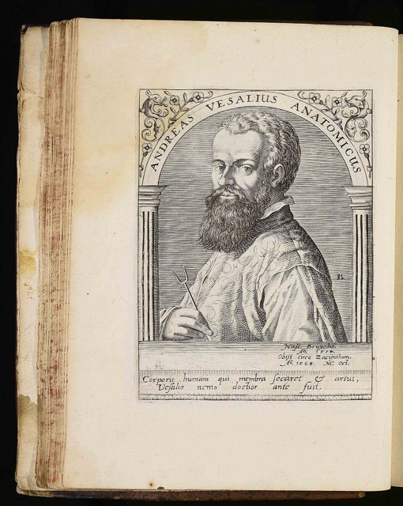
哥白尼在臨終前出版《天體運行論》，主張地球繞太陽運行，挑戰了地心宇宙觀，揭開科學革命的序幕。同年維薩留斯出版《人體構造》，以親自解剖的觀察修正古羅馬醫生蓋倫的錯誤，奠定近代解剖學。

## 1609 ~ 1619 | 克卜勒行星運動定律
克卜勒根據第谷累積的精密觀測資料，提出行星以橢圓軌道繞日運行等三大定律（前兩條發表於1609年，第三條於1619年）。

## 1610 | 伽利略的望遠鏡觀測
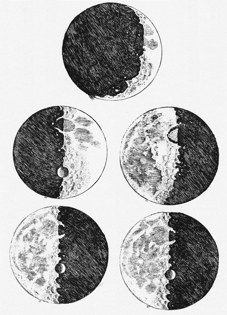
伽利略用自製望遠鏡發現木星的四顆衛星，並觀察到金星的盈虧、月球表面的坑洞，為日心說提供有力證據，出版《星際信使》。

## 1628 | 哈維的血液循環理論
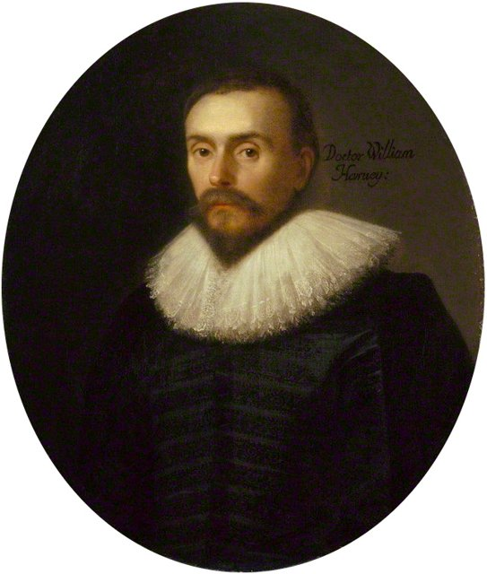
英國醫生哈維發表《心血運動論》，以實驗證明血液由心臟推動、在全身循環，奠定現代生理學的基礎。

## 1661 | 波以耳《懷疑派化學家》
波以耳批判煉金術與古希臘的四元素說，主張以實驗研究物質，推動化學走向實驗科學。

## 1665 | 虎克《顯微圖譜》
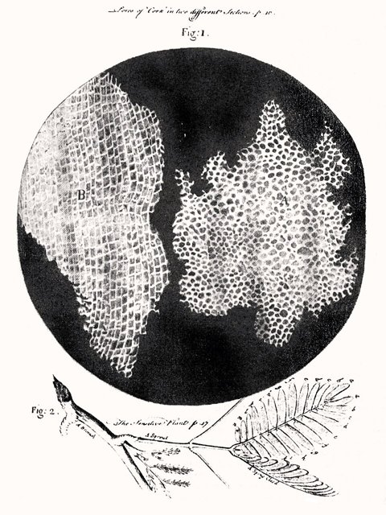
虎克以顯微鏡觀察軟木薄片，看到一格一格的小室，命名為「細胞」（cell）。

## 1670 | 雷文霍克看見微生物 {label=1670年代}
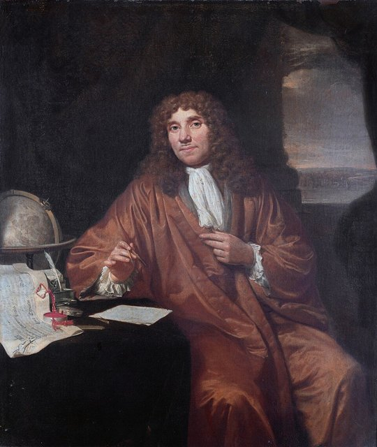
荷蘭布商雷文霍克以自製的高倍率單透鏡顯微鏡，首次觀察到細菌、原生動物等「微小動物」。

## 1687 | 牛頓《自然哲學的數學原理》

牛頓提出萬有引力定律與運動三定律，以同一套數學法則解釋天上與地上的運動，建立經典力學，集科學革命之大成。

## 1735 | 林奈的生物分類系統
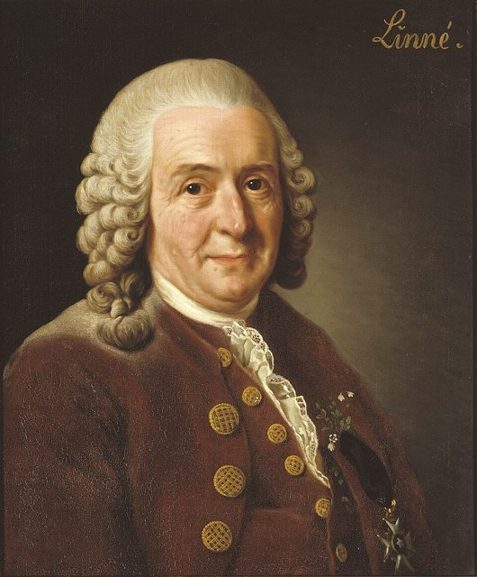
林奈出版《自然系統》，建立界、綱、目、屬、種的分類階層，後來又推廣以屬名加種小名命名物種的「二名法」，成為現代生物命名的基礎。

## 1752 | 富蘭克林的風箏實驗
富蘭克林在雷雨中放風箏，證明閃電就是電，並發明了避雷針。

## 1769 | 瓦特改良蒸汽機

瓦特為蒸汽機加上獨立的冷凝器，大幅提升效率並取得專利，蒸汽動力推動了工業革命與機械化生產。

## 1774 | 普利斯特里分離出氧氣
普利斯特里加熱氧化汞得到一種能讓蠟燭燒得更旺的氣體。拉瓦節後來把它命名為「氧」，並用來推翻「燃素說」。

## 1789 | 拉瓦節《化學基本論》
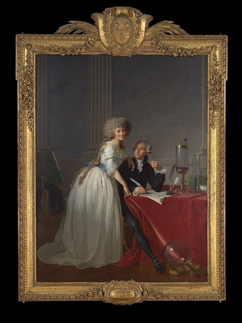
拉瓦節以精確的定量實驗提出質量守恆定律，釐清燃燒是與氧結合的反應，並建立新的化學命名法，被譽為「近代化學之父」。

## 1796 | 詹納的牛痘接種
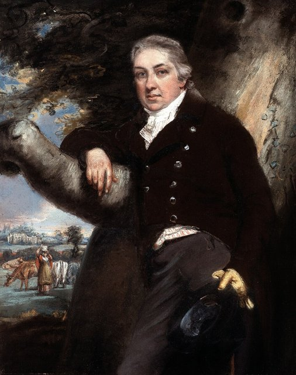
詹納發現擠牛奶的女工感染牛痘後不會得天花，於是為一名男孩接種牛痘，成功預防天花，開創了疫苗的先河。

## 1800 | 伏打電堆
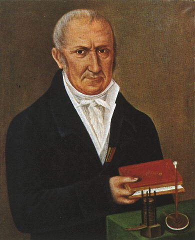
伏打把鋅片、銅片與浸過鹽水的布交互堆疊，發明能產生持續電流的電池，開啟了電化學與電學研究的新時代。

## 1803 | 道耳頓的原子論
道耳頓提出每種元素由相同的原子組成、化學反應是原子重新組合的原子論，以原子解釋物質的組成。

## 1820 | 厄斯特發現電流的磁效應
厄斯特在課堂上發現通電的導線會讓磁針偏轉，首次揭示電與磁之間的關聯。

## 1831 | 法拉第發現電磁感應
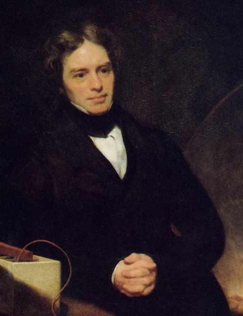
法拉第發現變動的磁場能在導線中產生電流，這是發電機與變壓器的原理，也是電力時代的理論基礎。

## 1838 ~ 1839 | 細胞學說
植物學家許萊登與動物學家許旺先後提出，所有植物與動物都由細胞構成，細胞是生命的基本單位。

## 1847 | 能量守恆定律 {label=1840年代}
焦耳以實驗測定熱功當量，亥姆霍茲等人則在1847年系統地闡述能量守恆定律，熱力學第一定律由此確立。

## 1859 | 達爾文《物種起源》

達爾文以在小獵犬號航行中的觀察為基礎，提出以「天擇」為核心機制的演化論，徹底改變了人類對生命與自身的看法。

## 1865 | 孟德爾遺傳定律；馬克士威電磁理論
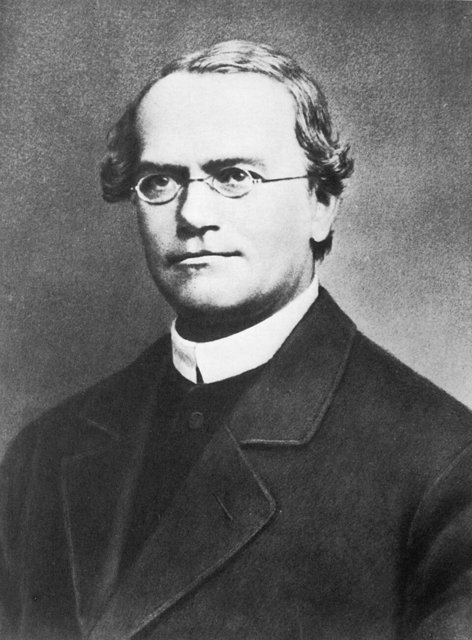
孟德爾發表豌豆雜交實驗，揭示遺傳的規律，但直到1900年才被重新發現，成為遺傳學的基礎。同年馬克士威以一組方程式統一了電、磁與光，並預言電磁波的存在。

## 1869 | 門得列夫元素週期表；核酸的發現
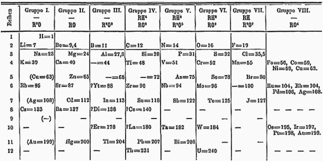
門得列夫依原子量排列元素，發現性質的週期性，並大膽預留空格預言尚未發現的元素。同年瑞士的米歇爾從白血球的細胞核中分離出「核素」，也就是後來所稱的 DNA。

## 1876 | 貝爾的電話
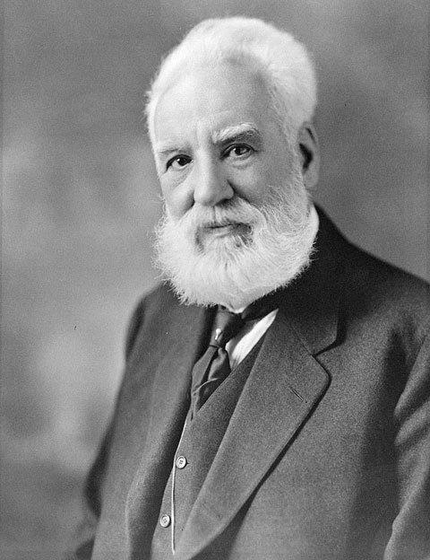
貝爾取得電話的專利，電信技術從此改變人類的溝通方式。

## 1879 | 愛迪生的白熾燈
愛迪生團隊發展出可長時間點亮的實用白熾燈與整套供電系統，推動電氣照明的普及。

## 1882 | 柯霍發現結核桿菌
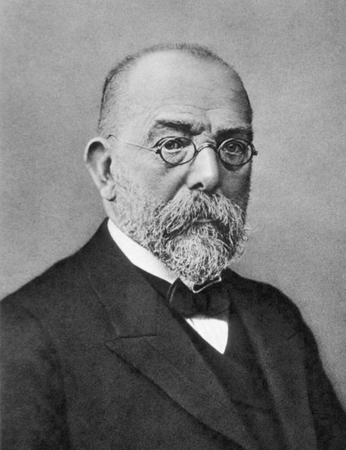
柯霍證明結核病由結核桿菌引起。他和巴斯德在1860至1880年代建立的「細菌致病說」，推動了細菌學與傳染病防治。

## 1885 | 巴斯德的狂犬病疫苗
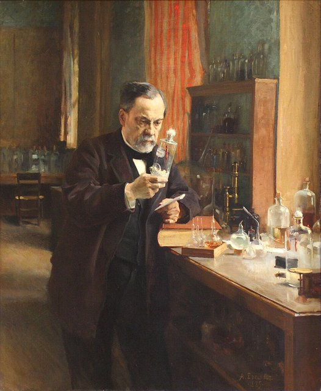
巴斯德以減毒的狂犬病疫苗，成功救治一名被瘋狗咬傷的男孩。他也發明了以加熱殺菌的「巴氏殺菌法」。

## 1895 | 倫琴發現 X 射線
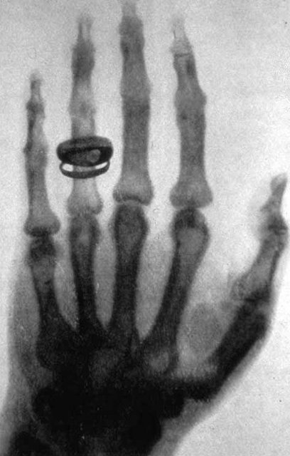
倫琴在實驗中發現一種能穿透物體的神秘射線，命名為 X 射線，並拍下妻子手骨的照片，開啟了醫學影像與新物理研究。

## 1896 | 貝克勒發現放射性
貝克勒發現鈾鹽會自發放出射線，使包好的感光底片感光，打開了原子內部與核物理研究的大門。

## 1897 | 湯姆森發現電子
湯姆森以陰極射線實驗證明電子的存在，說明原子並非不可分割，而是有內部結構。

## 1898 | 居禮夫婦發現釙與鐳
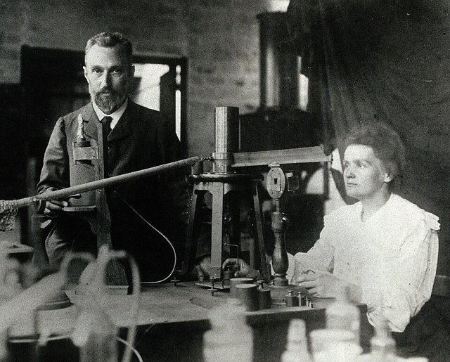
瑪麗·居禮與皮埃爾·居禮從瀝青鈾礦中發現放射性更強的新元素釙與鐳。瑪麗·居禮後來成為第一位兩度獲得諾貝爾獎的人。

## 1900 | 普朗克的量子假說
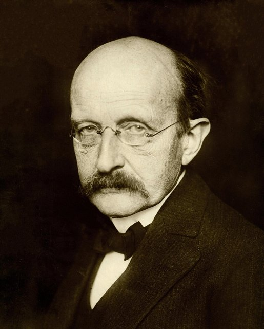
普朗克為了解釋黑體輻射，假設能量只能以一份一份的「量子」形式吸收或放出，這被視為量子物理的開端。

## 1905 | 愛因斯坦的奇蹟年
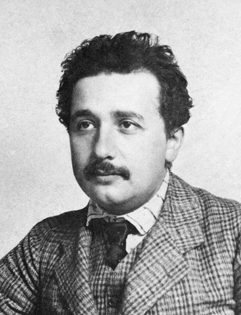
26歲的專利局職員愛因斯坦在一年內發表光量子（光電效應）、布朗運動、狹義相對論，以及質能等價公式 E=mc² 等論文，改變了人類對時空、光與能量的理解。

## 1911 | 拉塞福發現原子核
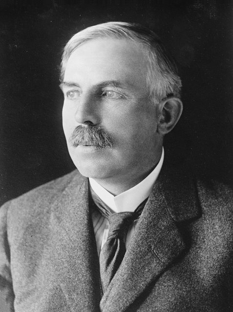
拉塞福以α粒子撞擊金箔，發現原子的質量集中在中心極小的原子核上。1913年波耳以量子化的能階提出新的原子模型，成功解釋氫原子光譜。

## 1915 | 廣義相對論
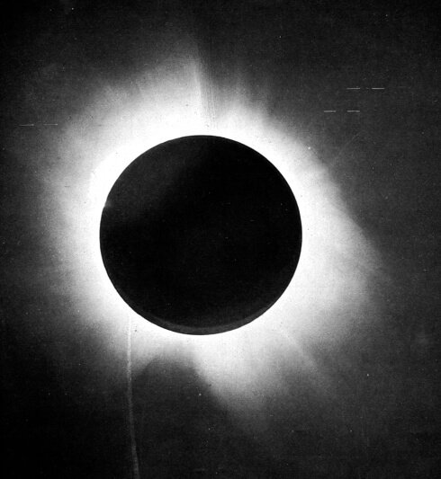
愛因斯坦提出廣義相對論，把引力解釋為質量造成的時空彎曲。1919年英國的日食觀測證實了光線經過太陽附近會偏折，愛因斯坦一舉成名。

## 1925 ~ 1927 | 量子力學成形
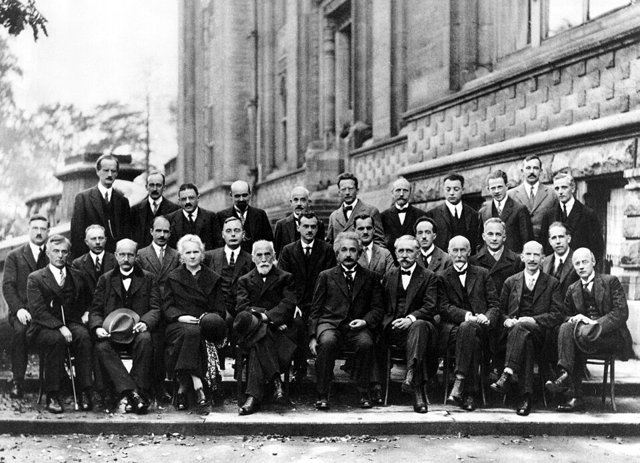
海森堡的矩陣力學、薛丁格的波動方程、玻恩的機率詮釋與海森堡的測不準原理相繼提出，建立了描述微觀世界的數學理論。這是多位科學家在1920年代共同完成的理論革命。

## 1928 | 弗萊明發現青黴素

弗萊明發現培養皿中的青黴菌能殺死周圍的細菌。1940年代青黴素量產後，人類進入抗生素時代。

## 1929 | 哈伯發現宇宙膨脹
天文學家哈伯發現星系離我們越遠、遠離的速度越快，為膨脹宇宙與後來的大霹靂理論提供重要的觀測證據。

## 1931 | 哥德爾不完備定理
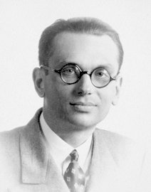
哥德爾證明任何足以描述算術的形式系統，都存在無法在系統內證明或否證的命題，動搖了數學基礎。

## 1932 | 查兌克發現中子
查兌克發現原子核中不帶電的中子，完善了對原子核結構的理解。

## 1936 | 圖靈機

圖靈提出一種抽象的計算模型「圖靈機」，定義了什麼是可計算的，為理論計算機科學奠定基礎。

## 1938 | 核分裂的發現
哈恩與史特拉斯曼發現以中子撞擊鈾會產生較輕的鋇；1939年麥特納與弗里施提出理論解釋，稱之為「核分裂」，並指出會釋放巨大能量，開啟了核能與核武器的時代。

## 1945-07-16 | 第一顆原子彈試爆
曼哈頓計畫在美國新墨西哥州進行代號「三位一體」的試爆，人類首次釋放核分裂的能量。

## 1946 | ENIAC 啟用
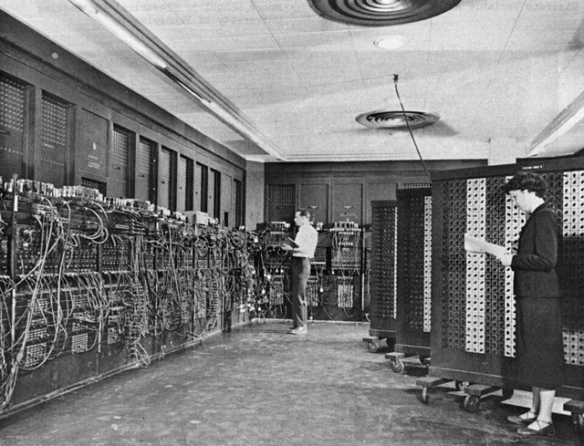
早期的通用電子計算機 ENIAC 在美國賓州大學啟用，使用約一萬八千支真空管，電子計算逐步走向實用。

## 1947 | 電晶體的發明
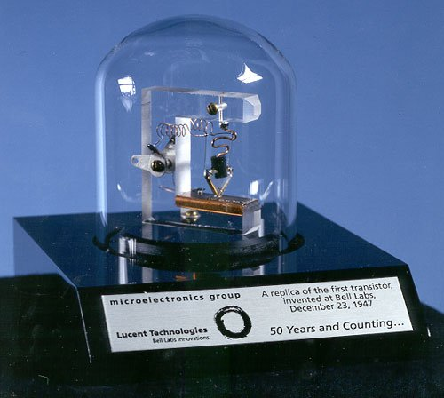
貝爾實驗室的巴丁、布拉頓與肖克利發明電晶體，取代笨重的真空管，奠定現代電子工業的基礎。

## 1953 | DNA 雙螺旋；米勒－尤里實驗
華生與克里克依據富蘭克林與威爾金斯的 X 光繞射資料，提出 DNA 雙螺旋結構，揭示遺傳物質的分子結構。同年米勒－尤里實驗在模擬早期地球的環境中合成出胺基酸，探討生命起源。

## 1955 | 沙克的小兒麻痺疫苗
沙克研發的小兒麻痺疫苗經大規模試驗證實有效，此後小兒麻痺病例大幅減少。

## 1957-10-04 | 史普尼克1號

蘇聯發射人類第一顆人造衛星史普尼克1號，震撼美國，太空競賽與太空時代正式開始。

## 1958 | 積體電路
德州儀器的基爾比做出第一個積體電路，隔年快捷半導體的諾伊斯發展出可量產的矽平面積體電路，推動電子元件的微型化。

## 1960 | 第一台雷射
梅曼展示第一台可運作的紅寶石雷射，開啟了雷射在通訊、醫療與工業上的應用。

## 1961-04-12 | 人類首次進入太空
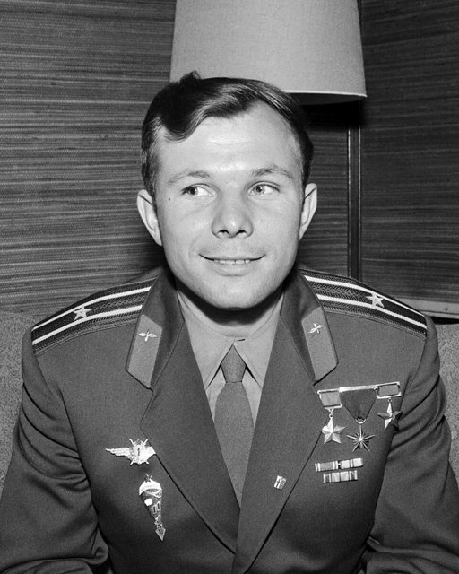
蘇聯太空人加加林搭乘東方1號繞行地球一圈，成為第一個進入太空的人。

## 1965 | 宇宙微波背景輻射
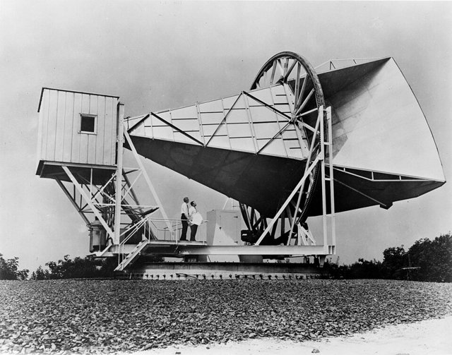
彭齊亞斯與威爾遜意外偵測到來自四面八方的微波雜訊，證實是大霹靂留下的餘暉，為熱大霹靂宇宙模型提供有力支持。

## 1967 | 板塊構造學說確立 {label=1960年代}
韋格納1912年提出的大陸漂移說長期不被接受。1960年代海底擴張的證據出現後，板塊構造學說在1967至1968年間確立，解釋了地震、火山與山脈的成因。

## 1969 | 阿波羅11號登月；ARPANET

7月20日阿波羅11號的阿姆斯壯與艾德林成為最早踏上月球的人。同年美國國防部的 ARPANET 啟用，是網際網路的前身。

## 1971 | 微處理器問世
英特爾推出第一顆商用微處理器 4004，把整個中央處理器放進一顆晶片，推動個人電腦與嵌入式系統的發展。

## 1973 | 重組 DNA 技術
科恩與博耶把不同生物的 DNA 剪接後放入細菌中表現，開啟了基因工程的時代。1970年代粒子物理的「標準模型」也在這時成形。

## 1977 | 桑格 DNA 定序法
桑格發展出雙去氧鏈終止法，能讀出 DNA 的鹼基序列，成為往後數十年基因定序的主要方法。

## 1980 | 天花根除
世界衛生組織宣布天花在全球根除，這是人類第一個、也是唯一一個被完全消滅的傳染病，距詹納的牛痘接種將近兩百年。

## 1983 | PCR 聚合酶連鎖反應
穆利斯發明聚合酶連鎖反應（PCR），能把微量的 DNA 在短時間內大量複製，廣泛用於研究、醫學診斷與鑑識。

## 1989 ~ 1991 | 全球資訊網
歐洲核子研究組織（CERN）的柏納斯－李提出並實作全球資訊網（WWW），包括網址、超文字傳輸協定與第一個網頁瀏覽器，改變了全球資訊傳播的方式。

## 1990 | 哈伯太空望遠鏡
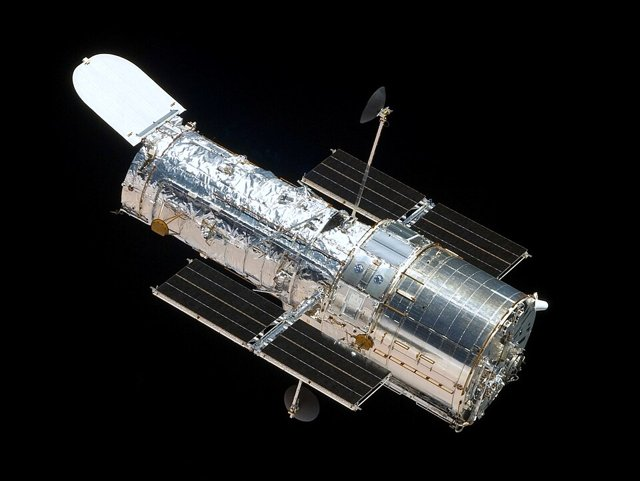
哈伯太空望遠鏡發射升空，在大氣層外拍攝清晰的宇宙影像，大幅拓展了人類的宇宙觀測能力。

## 1995 | 第一顆類太陽恆星的系外行星
馬約爾與奎洛茲發現繞行類太陽恆星飛馬座51的行星，開啟了系外行星研究，兩人在2019年獲得諾貝爾物理獎。

## 1996-07-05 | 複製羊桃莉
蘇格蘭羅斯林研究所以成羊的乳腺細胞進行體細胞核移植，誕生了第一隻複製哺乳動物桃莉羊，1997年2月公布時震驚世界。

## 1998 | 宇宙加速膨脹
兩個獨立的研究團隊觀測遙遠的超新星，發現宇宙的膨脹正在加速，「暗能量」成為現代宇宙學的核心議題之一。

## 2003 | 人類基因組計畫完成
國際合作的人類基因組計畫在2001年公布草圖，2003年宣布完成，定出人類約30億個鹼基對的序列，建立人類基因體研究的重要基礎。

## 2006 | iPS 細胞；深度學習復興
山中伸彌只用四個基因，就把成熟的小鼠皮膚細胞重新設定成類似胚胎幹細胞的「誘導性多能幹細胞」（iPS 細胞）。同年辛頓等人提出深度信念網路，帶動神經網路與深度學習的復興。

## 2012 | 希格斯玻色子；CRISPR-Cas9；AlexNet
7月4日歐洲核子研究組織宣布大型強子對撞機發現與希格斯玻色子相符的新粒子，證實了標準模型的重要預測。6月道納與夏彭蒂耶發表以 CRISPR-Cas9 進行可編程基因編輯的研究。同年 AlexNet 在 ImageNet 影像辨識競賽中大幅勝出，深度學習成為 AI 研究的主流。

## 2015 | 重力波；新視野號飛掠冥王星
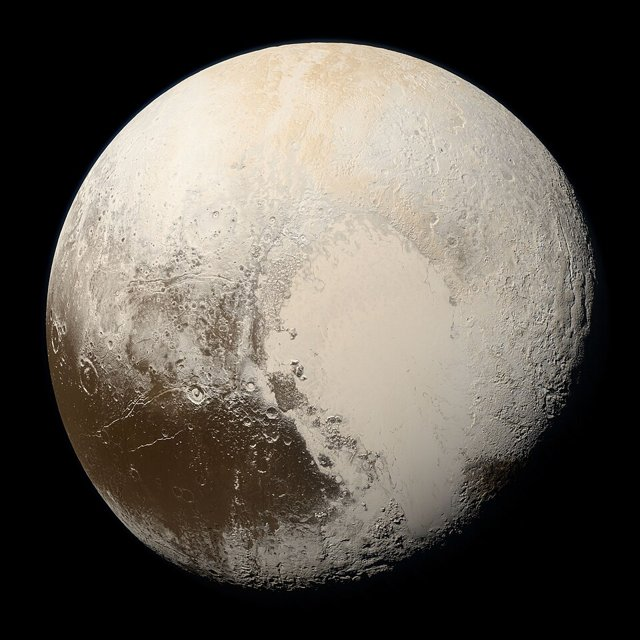
9月14日 LIGO 首次直接偵測到兩個黑洞合併產生的重力波，2016年2月公布，驗證了廣義相對論的重要預測，開啟重力波天文學。7月新視野號飛掠冥王星，拍下這顆矮行星的清晰影像。

## 2016-03 | AlphaGo 擊敗李世乭
DeepMind 的圍棋程式 AlphaGo 以4比1擊敗頂尖棋士李世乭，展示了深度學習與強化學習的能力。

## 2019-04-10 | 首張黑洞影像
事件視界望遠鏡以遍布全球的電波望遠鏡組成等效於地球大小的望遠鏡，公布 M87 星系中心黑洞的首張影像。

## 2020 | mRNA 疫苗；AlphaFold 2
12月 mRNA 新冠疫苗獲准緊急使用，展現 mRNA 平台在傳染病防治上的潛力。同年 DeepMind 的 AlphaFold 2 在蛋白質結構預測競賽 CASP14 中大幅勝出，大致解決了這個困擾生物學界五十年的難題；2021年起公開的結構資料庫加速了結構生物學與藥物研究。

## 2021-12-25 | 韋伯太空望遠鏡發射
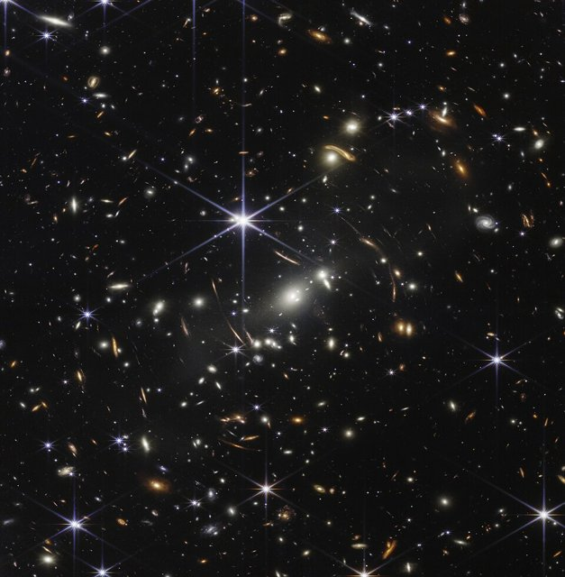
詹姆斯·韋伯太空望遠鏡發射升空，2022年7月公布首批全彩科學影像，開啟新一代紅外線宇宙觀測。

## 2022 | 核融合點火；DART 小行星偏轉
9月 NASA 的 DART 探測器撞擊小行星迪莫弗斯，成功改變其軌道，首次驗證行星防禦技術。12月美國國家點火設施首次達成核融合「點火」：核融合釋出的能量超過射入靶丸的雷射能量，但不代表整座設施能淨發電。

## 2023 | 首個 CRISPR 基因編輯療法獲准
英國與美國先後核准以 CRISPR 治療鐮刀型貧血症與乙型地中海貧血的療法，基因編輯開始進入臨床治療。

## 2024 | 諾貝爾獎肯定人工智慧研究
諾貝爾物理獎頒給霍普菲爾德與辛頓的類神經網路研究，化學獎則頒給貝克的蛋白質設計，以及哈薩比斯、瓊珀的 AlphaFold 蛋白質結構預測。同年 DESI 巡天計畫公布的初步結果，暗示暗能量可能隨時間變化，仍需更多資料驗證。

## 2025-06 | 魯賓天文台首批影像
薇拉·魯賓天文台公布首批影像，即將展開為期十年的「時空遺產巡天」，對南天進行大規模、長期的時域觀測。
