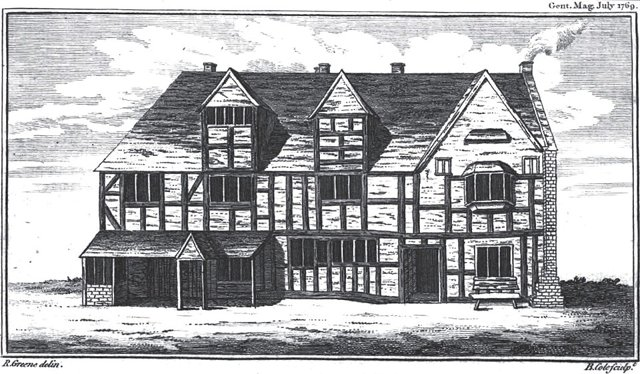
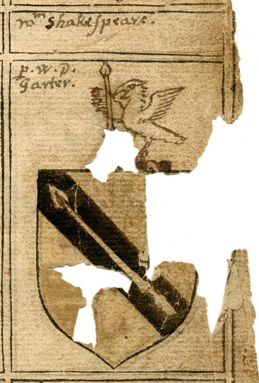
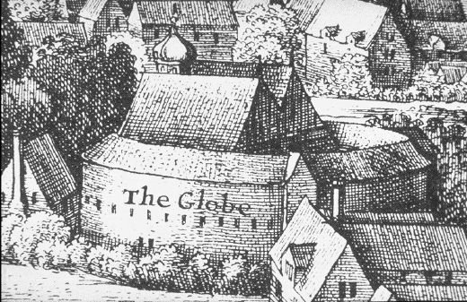
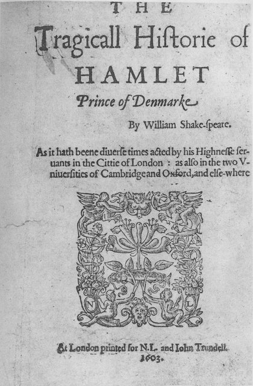
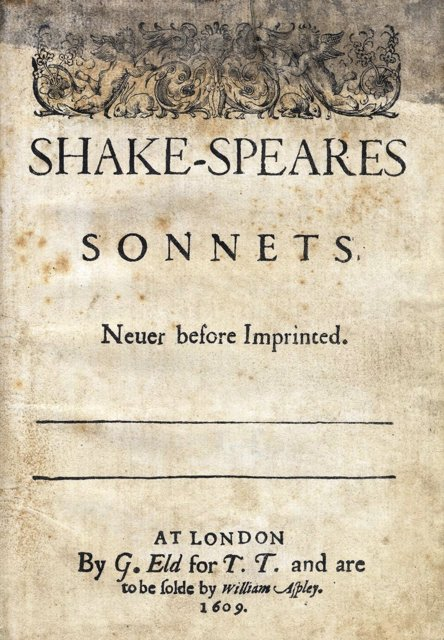
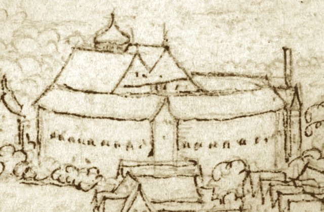
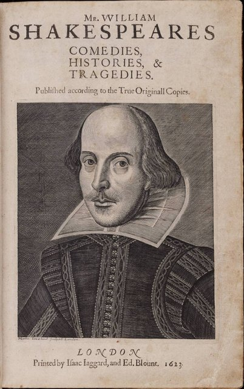

<!--
內容整理自本機筆記〈莎士比亞生平大事記〉（圖表\莎士比亞生平大事記.md）與中文維基百科「威廉·莎士比亞」條目（CC BY-SA 4.0），以台灣用語改寫摘要。
https://zh.wikipedia.org/zh-tw/威廉·莎士比亚
史料與日期說明：
- 生日沒有可靠紀錄，只知道1564年4月26日受洗；傳統上定為4月23日（聖喬治日，也恰好是他的忌日），時間軸以4月23日計算年齡，出生事件標示受洗日。
- 生卒日期都是當時英國使用的舊曆（儒略曆）。
- 劇作的寫作年代多半只能推估，《羅密歐與茱麗葉》《哈姆雷特》《李爾王》《馬克白》《暴風雨》等都以「約」標示，依一般學界的推定。
- 筆記把四大悲劇的高峰寫為約1604–1608年；《哈姆雷特》一般認為寫於約1600–1601年，此處另列一則。
- 筆記寫1594年《泰特斯·安德洛尼克斯》等早期劇作開始出版、1598年已被列為重要作者：分別指1594年的四開本，以及米爾斯《智慧的寶庫》列出他的十二部劇作，此處依此具體寫出。
- 1596年獲頒家族紋章、1601年《理查二世》被艾塞克斯伯爵的支持者用於起事前夕、1607年長女出嫁、1608年接管黑衣修士劇院與母親去世、1613年環球劇場大火、遺囑中的「次好的床」、1623年妻子去世、本·瓊森的題詩等細節，係依維基百科與一般公認的史實補充。
- 《第一對開本》出版於他死後七年，為避免空白，保留為獨立事件。
圖片來源（皆為 Wikimedia Commons 公有領域／CC0 作品）：
- sha-cover.jpg：William Shakespeare by John Taylor, edited.jpg
- sha-birthplace.jpg：Shakespeare's birthplace 1769.jpg
- sha-arms.jpg：William-Shakespeare CoA 1602.jpg
- sha-globe.jpg：Hollar Long View detail.png
- sha-hamlet.jpg：Hamlet Q1 Frontispiece 1603.jpg
- sha-sonnets.jpg：Sonnets1609titlepage.jpg
- sha-globe2.jpg：Wenceslaus-Hollar-The-second-Globe-playhouse-detail.png
- sha-folio.jpg：Title page William Shakespeare's First Folio 1623.jpg
-->

# Periods
- 1564 ~ 1585 | 史特拉福的少年 | #f08c00
  生於華威郡亞芬河畔史特拉福的手套商家庭，在當地文法學校學習拉丁文與古典文學，18歲結婚，二十歲出頭已是三個孩子的父親。
- 1585 ~ 1594 | 失落的歲月與倫敦初登場 | #495057
  雙胞胎出生後有七年幾乎沒有史料，再出現時已是倫敦劇壇的新秀；瘟疫關閉劇院期間，他以長詩打響名號。
- 1594 ~ 1603 | 宮內大臣劇團 | #1c7ed6
  成為宮內大臣劇團的股東、演員與編劇，寫出《羅密歐與茱麗葉》、《仲夏夜之夢》、《哈姆雷特》等名作，並參與建造環球劇場。
- 1603 ~ 1613 | 國王劇團與悲劇的高峰 | #9c36b5
  劇團獲詹姆士一世贊助，改名為國王劇團；他寫出《奧賽羅》、《李爾王》、《馬克白》等悲劇，晚年轉向寬恕與和解的傳奇劇。
- 1613 ~ 1616 | 回到史特拉福 | #2f9e44
  環球劇場焚毀前後逐漸退出倫敦劇壇，回到故鄉，三年後去世。

# Events

## 1564-04-23 | 出生@史特拉福 {label=1564年4月26日受洗}

生於英格蘭華威郡的亞芬河畔史特拉福，4月26日在聖三一教堂受洗。父親約翰·莎士比亞是手套商人，也做羊毛買賣，後來當上鎮長；母親瑪麗·阿登是富裕地主的女兒。他是家中長子，上面兩個姊姊都早夭。傳統上把他的生日定在4月23日，也就是英格蘭的守護聖人聖喬治的紀念日。

## 1571 | 文法學校的教育 {label=約1571～1579年}
雖然沒有留下就學紀錄，一般認為他就讀於家附近的國王新學校。伊莉莎白時代的文法學校課程由法律規定，從早到晚密集學習拉丁文文法、修辭與古典作家，他後來的作品中處處可見奧維德等羅馬詩人的影響。他沒有上過大學，日後還因此被大學出身的劇作家譏笑。

## 1582-11 | 與安·海瑟薇結婚
18歲時與比他年長八歲、已懷有身孕的安·海瑟薇結婚，教區法院在11月底發出結婚許可。

## 1583-05 | 長女蘇珊娜出生
長女蘇珊娜受洗。她後來嫁給醫生約翰·霍爾，是他最主要的財產繼承人。

## 1585-02 | 雙胞胎出生
雙胞胎哈姆內特與朱迪絲受洗。此後直到1592年，史料中幾乎沒有他的任何紀錄，被稱為「失落的歲月」。後世傳說他曾因偷獵鹿被追捕而逃往倫敦，或曾當過鄉村教師，但都沒有確切證據。

## 1592 | 倫敦劇壇的新秀
劇作家羅伯特·格林在臨終前出版的小冊子中，嘲諷一隻「用我們的羽毛裝扮自己的暴發戶烏鴉」，說他「披著演員外皮、藏著一顆老虎的心」，還自以為是「全國唯一能震撼舞台的人」（原文用了雙關語 Shake-scene）。這句話模仿了《亨利六世》的台詞，是他倫敦劇場生涯最早的紀錄，顯示他這時已是令大學出身的劇作家眼紅的新秀。他早期的作品以《亨利六世》三部曲、《理查三世》等歷史劇，以及《錯誤的喜劇》《馴悍記》等喜劇為主。

## 1593 | 長詩《維納斯與阿多尼斯》
1592至1594年間倫敦爆發瘟疫，劇院長期關閉。他轉而寫作長篇敘事詩，出版取材自奧維德《變形記》的《維納斯與阿多尼斯》，獻給年輕的南安普敦伯爵，大受歡迎，在他生前再版了十多次；隔年又出版《魯克麗絲受辱記》。

## 1594 | 宮內大臣劇團
劇院重新開放後，他與名演員理查·伯比奇等人組成「宮內大臣劇團」，他身兼股東、演員與編劇，劇團很快成為倫敦最重要的劇團。同年《泰特斯·安德洛尼克斯》以四開本出版，是他第一部印行的劇作。

## 1595 | 《羅密歐與茱麗葉》 {label=約1595年}
寫出悲劇《羅密歐與茱麗葉》與浪漫喜劇《仲夏夜之夢》，接著又有《威尼斯商人》《無事生非》等喜劇，以及《理查二世》《亨利四世》等歷史劇。他的寫作手法日益成熟，喜劇中的人物與詩意的語言尤其受到觀眾喜愛。

## 1596-08 | 兒子哈姆內特去世

11歲的獨子哈姆內特去世，葬於史特拉福。同年10月，他為父親申請到家族紋章，格言是「並非沒有權利」，莎士比亞家從此躋身士紳。兒子之死是否影響了數年後的《哈姆雷特》，學者有不同看法，沒有直接證據。

## 1597-05 | 購置新宅邸
在史特拉福買下鎮上第二大的住宅「新居」，顯示他已在倫敦累積可觀的財富。他把大部分時間花在倫敦，家人則一直住在史特拉福。

## 1598 | 名列英國最佳劇作家
作家米爾斯在《智慧的寶庫》中稱讚他是英國最優秀的悲劇與喜劇作家，列出他的十二部劇作，並提到他在朋友間流傳的「甜美的十四行詩」。同年起，他的名字開始出現在劇本的扉頁上，成為賣書的招牌。

## 1599 | 環球劇場落成

劇團與地主發生糾紛，把舊劇場的木料拆下，運過泰晤士河，在南岸蓋起「環球劇場」，他是持有股份的合夥人之一。據說劇場門口寫著拉丁文「全世界都是一座舞台」。這一年在環球劇場上演的可能有《凱撒大帝》與《皆大歡喜》。

## 1601 | 《哈姆雷特》 {label=約1600～1601年}

寫出《哈姆雷特》，丹麥王子為父報仇卻猶豫不決，「生存還是毀滅，這是一個問題」成為文學史上最著名的獨白。這一年2月，艾塞克斯伯爵的支持者在起事前夕，特地出錢請劇團演出講述國王被廢黜的《理查二世》，劇團事後被調查，幸而未受懲罰。9月，父親去世。

## 1603-05 | 國王劇團
伊莉莎白一世去世，詹姆士一世即位後不到兩個月，就把他的劇團納入王室贊助，改名「國王劇團」，劇團成員成為宮廷的侍從，在宮中演出的次數大增。這段時期他住在倫敦聖保羅大教堂附近，向一位製作女士頭飾的法國新教徒家庭租屋。

## 1604 | 《奧賽羅》 {label=約1603～1604年}
寫出《奧賽羅》，描寫摩爾人將軍在部下伊阿古的挑撥下，因嫉妒而毀掉自己與妻子。同一時期還有《一報還一報》《終成眷屬》等被稱為「問題劇」的作品。

## 1606 | 《李爾王》與《馬克白》 {label=約1605～1606年}
寫出《李爾王》與《馬克白》。年老的李爾王把王國分給甜言蜜語的女兒，卻放逐了真心的小女兒；蘇格蘭將軍馬克白受到女巫預言與妻子的慫恿弒君篡位。《馬克白》以蘇格蘭為背景、加入女巫情節，一般認為是為了迎合出身蘇格蘭、對巫術很有興趣的詹姆士一世。這幾年也是《安東尼與克麗奧佩脫拉》等羅馬劇的創作時期。

## 1607-06 | 長女出嫁
長女蘇珊娜嫁給史特拉福的醫生約翰·霍爾，隔年生下他唯一的孫女伊莉莎白。

## 1608 | 黑衣修士劇院
國王劇團接管室內的黑衣修士劇院，此後冬天在室內點著燭光演出、夏天在露天的環球劇場演出。室內劇場的音樂與舞台效果，影響了他晚年作品的風格。同年9月，母親去世。

## 1609 | 《十四行詩》出版

出版商出版了他的《十四行詩》，共154首，前126首多寫給一位俊美的年輕男子，後面則寫給一位神秘的「黑膚女郎」，探討愛情、時間、青春與詩歌的不朽。詩集獻詞中的「W.H.先生」究竟是誰，至今仍是文學史上的謎。

## 1611 | 《暴風雨》 {label=約1610～1611年}
晚年轉向寫作悲喜交織的「傳奇劇」，包括《辛白林》《冬天的故事》與《暴風雨》，故事以失而復得、寬恕與和解收場。《暴風雨》中魔法師普洛斯彼羅最後折斷魔杖、告別魔法，常被視為莎士比亞向舞台告別的象徵。

## 1613-06-29 | 環球劇場大火

與年輕劇作家弗萊徹合寫的《亨利八世》演出時，舞台上施放的禮炮點燃了茅草屋頂，環球劇場在一小時內燒成平地，所幸無人傷亡，據說只有一名觀眾的褲子著火，被人用啤酒澆熄。劇場隔年重建。這一年之後，他沒有再寫新劇本，逐漸回到史特拉福生活。

## 1616-04-23 | 逝世@史特拉福
在史特拉福去世，享年52歲，死因不明，兩天後葬於他受洗的聖三一教堂高壇。去世前一個月他修改了遺囑，把大部分財產留給長女蘇珊娜，只留給妻子「次好的床與床具」，這句話引起後世無數猜測。他的墓碑刻著詛咒移動他屍骨的人的詩句，至今沒有人打開過他的墓。他的直系後代到1670年孫女去世時便已斷絕。

## 1623 | 《第一對開本》出版

他去世七年後，國王劇團的老同事赫明斯與康德爾蒐集整理他的劇作，出版《第一對開本》，共收錄36部劇作，其中《馬克白》《暴風雨》《凱撒大帝》等18部是首次付印，若沒有這本書可能早已失傳。同年8月，妻子安去世。劇作家本·瓊森在書前的題詩中稱讚他「不屬於一個時代，而屬於所有的世紀」。
