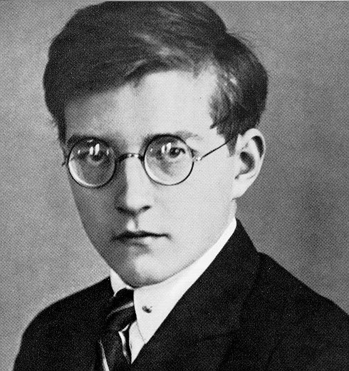
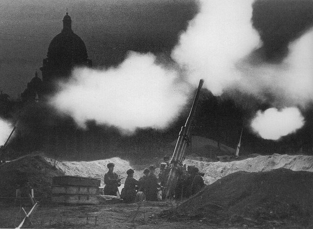
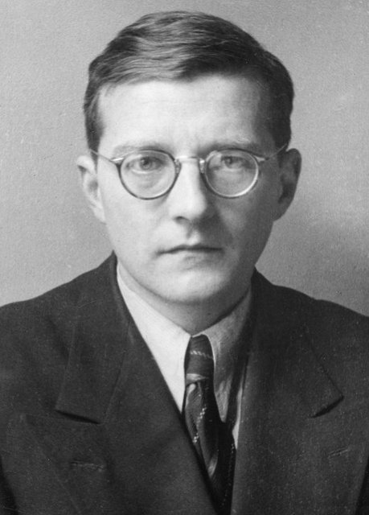

<!--
內容整理自中文維基百科「德米特里·蕭士塔高維奇」與英文維基百科「Dmitri Shostakovich」條目（CC BY-SA 4.0），並以台灣用語改寫摘要。
https://zh.wikipedia.org/zh-tw/德米特里·肖斯塔科维奇
https://en.wikipedia.org/wiki/Dmitri_Shostakovich
中文條目較簡略，生平細節主要參考英文條目。日期採新曆。
圖片皆為 Wikimedia Commons 上的公有領域（含PD-US）作品（封面：1941年以前的肖像照）。
-->

# Periods
- 1906 ~ 1919 | 童年@聖彼得堡
  父親是在門得列夫手下工作的工程師，祖父是被流放西伯利亞的波蘭革命分子。9歲才跟母親學鋼琴，卻展現驚人的記憶力。
- 1919 ~ 1926 | 彼得格勒音樂學院
  13歲進入格拉祖諾夫領導的音樂學院，學作曲、鋼琴與指揮。19歲的畢業作品第一號交響曲一鳴驚人。
- 1926 ~ 1936 | 早慧的新星
  鋼琴家與作曲家雙軌發展，寫下歌劇《鼻子》、大量劇場與電影配樂。歌劇《姆欽斯克縣的馬克白夫人》大受歡迎，被官方譽為蘇維埃文化的成就。
- 1936 ~ 1941 | 第一次譴責與大清洗
  史達林看了《馬克白夫人》後，《真理報》痛批它是「混亂而非音樂」。大清洗中許多親友被捕、處決，他撤回第四號交響曲，以第五號交響曲重新贏回官方認可。
- 1941 ~ 1948 | 戰爭交響曲
  在被圍困的列寧格勒寫下第七號交響曲「列寧格勒」，成為全世界抗戰的象徵。第八號的悲劇色彩與輕巧的第九號，卻讓官方愈來愈不滿。
- 1948 ~ 1953 | 第二次譴責
  日丹諾夫批判「形式主義」，他的作品被禁、被逐出音樂學院，夜裡在電梯口等著被捕。他寫電影配樂糊口、寫官方作品求生，真心之作則收進「抽屜」。
- 1953 ~ 1975 | 史達林之後
  史達林死後逐步恢復名譽，「抽屜」裡的作品陸續首演。1960年被迫入黨，晚年病痛纏身，作品中瀰漫著對死亡的沉思。

# Events

## 1906-09-25 | 出生@聖彼得堡
生於當時俄羅斯帝國首都聖彼得堡的波多利斯卡亞街，是三個孩子中的老二。祖父是參加1863年一月起義的波蘭革命分子，被流放西伯利亞後在當地成為銀行家。父親畢業於聖彼得堡大學物理數學系，在化學家門得列夫主持的度量衡局當工程師。

## 1915 | 跟母親學鋼琴
9歲開始跟母親學鋼琴，很快就展現驚人的才華。他常能記住母親上一堂課彈過的曲子，假裝看譜、其實是憑記憶彈奏，好幾次被「當場抓包」。1918年他寫了一首送葬進行曲，悼念被布爾什維克水手殺害的兩位立憲民主黨領袖。

## 1919 | 進入彼得格勒音樂學院
13歲入學，院長格拉祖諾夫一直密切關注、提攜他。他跟尼古拉耶夫學鋼琴、跟施坦伯格學作曲、跟索科洛夫學對位與賦格。1925年他也上了指揮課。

## 1925-03-20 | 作品首次在莫斯科演出
樂評與觀眾反應冷淡，讓他很失望。這次莫斯科之行，他經人介紹認識了後來的紅軍元帥圖哈切夫斯基，對方幫他在莫斯科找住處與工作，還派了「非常時髦的汽車」接他去聽音樂會。

## 1926-05-12 | 第一號交響曲首演

這是他19歲時的畢業作品，原本只打算由學院樂團私下演出，最後由指揮家馬爾科帶領列寧格勒愛樂首演，觀眾熱烈到要求安可詼諧曲樂章。他此後每年都會慶祝這一天。

## 1927-01 | 第一屆蕭邦國際鋼琴大賽
比賽前把自己關在家裡苦練三週，比賽開幕當天卻急性盲腸炎發作。他撐到了決賽，只拿到榮譽獎狀，冠軍是同為蘇聯代表的奧伯林。他一度考慮放棄演奏，最後決定專心作曲，1933年以後只彈自己的作品。

## 1927 | 結識布魯諾·華爾特與索列爾汀斯基
比賽後在柏林遇到指揮家布魯諾·華爾特，華爾特非常欣賞第一號交響曲，同年就在國外指揮首演；隔年史托考夫斯基也在美國首演並錄音。這一年他開始和音樂學家索列爾汀斯基成為摯友，索列爾汀斯基教他「理解並熱愛布拉姆斯、馬勒、布魯克納」。他也寫了帶有親蘇維埃合唱的第二號交響曲《獻給十月》。

## 1930-01-18 | 歌劇《鼻子》首演
根據果戈里的諷刺小說寫成，前一年的音樂會版本就被「俄羅斯無產階級音樂家協會」猛烈抨擊，正式首演也評價不佳、令人費解。1920年代末到1930年代初，他在列寧格勒的工人青年劇院任職，寫了許多劇場音樂、電影配樂與芭蕾，據中文條目，三部芭蕾都很快因意識形態問題被撤下。

## 1932 | 與妮娜結婚
與第一任妻子妮娜·瓦爾扎爾結婚，兩人一度在1935年離婚，但因妮娜懷孕很快又復合，兩人的婚姻一直維持到1954年妮娜去世。女兒嘉琳娜生於1936年，兒子馬克辛生於1938年。

## 1934 | 《姆欽斯克縣的馬克白夫人》首演
改編自列斯科夫的小說，首演後立刻大受歡迎，無論一般觀眾或官方都讚譽有加，稱它是「社會主義建設全面成功與黨的正確政策的成果」，此後一年多在國內外場場爆滿。

## 1936-01-28 | 《真理報》：〈混亂而非音樂〉
1月26日史達林與莫洛托夫、日丹諾夫等人看了《馬克白夫人》，一句話也沒說就離場，在場的他謝幕時「臉色白得像紙」。兩天後《真理報》刊出社論，痛批這部歌劇是「故意不和諧、混亂的聲音……嘎嘎叫、嗚嗚叫、喘氣」，全國隨即展開批判，連曾經稱讚過的樂評都被迫公開認錯。2月他的芭蕾《清澈的溪流》也遭點名批判。他的收入從每月一萬兩千盧布驟降到兩千。

## 1936-12 | 撤回第四號交響曲
受馬勒影響的第四號交響曲已開始排練，列寧格勒愛樂的經理卻勸他撤回。他沒有否定這部作品，仍保留「第四號」的編號，直到25年後的1961年才首演。這段時間開始了史達林的大清洗，他的許多親友被捕或處決，包括曾經關照他的圖哈切夫斯基元帥。

## 1937-11-21 | 第五號交響曲首演
在列寧格勒首演，風格比之前的作品保守，大獲成功，許多觀眾感動落淚。官方宣稱他已「從錯誤中學習」，以他名義發表的文章說這是「一位蘇維埃藝術家對正確批評的創作回應」。爭議回憶錄《證言》則借他之口說：「他們當然懂，他們懂周遭正在發生什麼，也懂第五號在說什麼。」同年他寫了第一首弦樂四重奏，9月開始在列寧格勒音樂學院教作曲。

## 1939 | 《芬蘭主題組曲》
蘇聯入侵芬蘭前，日丹諾夫委託他寫一首慶祝作品，準備讓紅軍樂隊在赫爾辛基遊行時演奏。結果冬季戰爭打得很慘，遊行從未舉行，他一輩子都不承認這首曲子是他寫的，直到2001年才首演。

## 1941 | 列寧格勒圍城

德蘇戰爭爆發後，他想從軍卻因視力不佳被拒，改加入音樂學院的志願消防隊，他戴著消防帽的照片登上全國報紙。他在被圍困的列寧格勒寫下第七號交響曲的前三個樂章，並在廣播中說每個人都有讓生活繼續下去的「士兵的責任」。之後全家疏散到古比雪夫，12月27日完成全曲。

## 1942-03-29 | 第七號交響曲「列寧格勒」首演

在古比雪夫首演，很快傳到倫敦與美國，美國好幾位指揮爭著搶首演。8月在仍被圍困的列寧格勒演出時，城裡的樂團只剩14位樂手，指揮艾利亞斯堡只好召集所有會樂器的人來湊數。這首交響曲成了全世界反法西斯的象徵。

## 1943 | 第八號交響曲
全家在春天搬到莫斯科，紅軍此時已轉守為攻，第八號交響曲悲劇性的基調卻讓官方與國際觀眾都摸不著頭緒，在國內外的反應都很冷淡。

## 1945 | 輕巧的第九號交響曲
他原本計畫寫一首宏偉的第九號，為戰爭三部曲畫下句點，連史達林都期待它能超越貝多芬的第九號。最後交出的卻是一首短小、輕快、近似海頓風格的作品，1946年起遭到官方批評，埋下第二次譴責的伏筆。前一個宏偉版本的草稿直到2003年才被重新發現。

## 1944 | 第二號鋼琴三重奏
獻給剛過世的摯友索列爾汀斯基，終樂章帶有猶太音樂色彩。

## 1948-02 | 日丹諾夫批判：第二次譴責
日丹諾夫藉批判穆拉德里的歌劇《偉大的友誼》，指控他與普羅高菲夫、哈察都量等作曲家犯了「形式主義」錯誤。他被迫公開道歉，大部分作品被禁演，家庭的特權被收回，還被逐出音樂學院。據說他晚上都在電梯口等著被捕，免得驚擾家人。此後幾年他寫電影配樂付房租、寫官方作品求平反，真正的作品則「放進抽屜」，例如第一號小提琴協奏曲與《猶太民間詩歌》。

## 1949 | 紐約和平大會的屈辱
史達林需要藝術家代表蘇聯出席紐約的世界和平文化科學大會，對他的限制因此放寬。他在記者會上被迫照稿念演講，聲音緊張發抖，念到一半就由播音員接手。作曲家納博科夫當眾問他是否支持蘇聯對史特拉汶斯基的批判，崇拜史特拉汶斯基的他只能回答是，這份羞辱他終生未能釋懷。同年他寫了清唱劇《森林之歌》，把史達林比喻成「偉大的園丁」。

## 1953-12-17 | 第十號交響曲
史達林在3月去世（據中文條目，普羅高菲夫也在同一天過世），他終於踏上平反之路。第十號交響曲首次大量使用代表自己名字縮寫的「DSCH動機」，據《證言》說，狂暴的第二樂章是史達林的音樂肖像。它與第五、第七號並列為他最受歡迎的作品，「抽屜」裡的作品也陸續首演。

## 1954 | 《節慶序曲》；妮娜去世
寫下《節慶序曲》，後來成為1980年莫斯科奧運的主題音樂。這年妻子妮娜去世，他向學生烏斯特沃爾斯卡婭求婚被拒。1956年他與共青團幹部瑪格麗塔結婚，但兩人很不合，幾年後就離婚。

## 1959 | 伯恩斯坦與紐約愛樂訪蘇
伯恩斯坦率紐約愛樂在莫斯科演出他的第五號交響曲，他在曲終上台向伯恩斯坦與樂團致賀。

## 1960 | 被迫入黨；第八號弦樂四重奏
政府要他擔任俄羅斯聯邦作曲家協會主席，條件是必須加入共產黨。兒子回憶他為此落淚，他後來對妻子說自己是被要脅的。他只花三天就寫完第八號弦樂四重奏，表面上獻給「法西斯與戰爭的受害者」，其實引用了自己許多舊作與名字縮寫動機。他對朋友說：「我想到，如果哪天我死了，大概不會有人寫曲子紀念我，不如我自己先寫一首。」

## 1961 | 第四號交響曲終於首演
被撤回25年後，第四號交響曲終於首演。同年完成獻給列寧的第十二號交響曲《1917年》，這是入黨時答應要寫的作品。

## 1962 | 第十三號交響曲「娘子谷」；與伊琳娜結婚
以詩人葉夫圖申科的詩作譜曲，第一首悼念二戰時在基輔娘子谷遭納粹屠殺的猶太人。首演後，葉夫圖申科被迫在詩中加上俄羅斯人與烏克蘭人也死在那裡的段落。同年他與小他29歲的伊琳娜結婚，朋友說是伊琳娜讓他終於享有家庭的平靜，還為他延長了好幾年壽命。11月他在高爾基市指揮自己的作品，這是他一生唯一一次公開指揮。

## 1965 | 聲援詩人布洛茨基
詩人布洛茨基被判五年流放與勞改，他與葉夫圖申科、阿赫瑪托娃、沙特等人聯名抗議，最後刑期獲得減免。這一年他右手的退化性疾病被診斷為小兒麻痺，但真正的病因至今沒有定論。

## 1966 | 第一次心臟病發作
從年輕就抽菸的他被迫戒菸，之後1970、1971年又兩度心臟病發，還摔斷過雙腿。他在信中自嘲：「目前達成率75%（右腿斷、左腿斷、右手壞）。只要再把左手弄壞，四肢就100%報廢了。」

## 1969 | 第十四號交響曲
以多位詩人關於死亡的詩作寫成的歌曲交響曲，獻給好友、英國作曲家布瑞頓，布瑞頓隔年在奧德堡音樂節指揮它的西方首演。

## 1971 | 第十五號交響曲
最後一首交響曲，旋律優美、充滿回顧，引用了羅西尼《威廉泰爾序曲》、華格納，以及他自己的第四號交響曲。

## 1975-08-09 | 逝世@莫斯科
1973年確診肺癌，在莫斯科中央臨床醫院去世，享年68歲，死因一般歸於肺癌或心臟衰竭。他舉行了公民葬禮，安葬於莫斯科新聖女公墓。最後的作品中提琴奏鳴曲在他死後不到兩個月首演。他一生寫了十五首交響曲與十五首弦樂四重奏。

## 1979 | 爭議回憶錄《證言》出版
音樂學者沃爾科夫聲稱這本書是根據他1971到1974年間的口述整理而成，並經他簽名確認，但手稿從未公開。他的遺孀伊琳娜與多位友人質疑內容的真實性，大提琴家羅斯托波維奇等人則表示支持；1991年蘇聯解體後，兒子馬克辛也公開表示書中確實是父親的親口所述。這本書描繪了一個暗中反抗體制的蕭士塔高維奇，至今仍有爭議。
