<!--
內容整理自中文維基百科「讓·西貝流士」與英文維基百科「Jean Sibelius」條目（CC BY-SA 4.0），並以台灣用語改寫摘要。
https://zh.wikipedia.org/zh-tw/让·西贝柳斯
https://en.wikipedia.org/wiki/Jean_Sibelius
中文條目大致譯自英文條目，生平細節以英文條目為準。
圖片皆為 Wikimedia Commons 上的公有領域作品（封面：約1898至1900年的肖像照）。
-->

# Periods
- 1865 ~ 1885 | 童年@海門林納
  生於當時屬於俄羅斯帝國的芬蘭大公國，2歲喪父，在外婆家的女性環境中長大，叔叔送他的小提琴讓他立志成為小提琴名家。夏天在海邊小鎮洛維薩親近大自然，那是他心中的「自由」。
- 1885 ~ 1892 | 求學：赫爾辛基、柏林、維也納
  放棄法律改讀赫爾辛基音樂學院，結識布梭尼與未來的妻子愛諾。到柏林、維也納深造，迷上布魯克納，回國後以取材自史詩《卡勒瓦拉》的《庫勒沃》一舉成名。
- 1892 ~ 1904 | 成名與民族英雄
  與愛諾結婚，在卡雷利亞度蜜月。俄國加緊壓迫芬蘭之際，他寫下第一號交響曲與《芬蘭頌》，成為國家英雄，第二號交響曲與《悲傷圓舞曲》更讓他揚名國際。
- 1904 ~ 1926 | 愛諾拉時期@Järvenpää
  在圖蘇拉湖畔蓋了以妻子命名的家「愛諾拉」，寫下第三到第七號交響曲、小提琴協奏曲定稿與《塔皮奧拉》。他與菸酒、債務、喉癌與手抖搏鬥，也經歷了芬蘭獨立與內戰。
- 1926 ~ 1957 | 「亞爾文帕的沉默」
  《塔皮奧拉》之後幾乎不再發表大型作品，傳說中的第八號交響曲最終被他燒毀。他的音樂卻透過廣播傳遍世界，1935年還被美國聽眾票選為最喜愛的作曲家。91歲在愛諾拉去世，舉行國葬。

# Events

## 1865-12-08 | 出生@海門林納
生於芬蘭大公國（當時是俄羅斯帝國的自治領）的海門林納，本名約翰·克里斯蒂安·朱利烏斯·西貝流士。父親是說瑞典語的醫生，母親瑪麗亞。家族姓氏來自曾祖父在東新地區擁有的「西貝」莊園。他的生日12月8日，今天是芬蘭的國旗日，也是「芬蘭音樂日」。

## 1868-07 | 父親死於傷寒
父親留下大筆債務，懷孕的母親只好賣掉房子，帶著孩子搬回同在海門林納的外婆家。他在一個以女性為主的家庭長大，唯一的男性長輩是熱愛小提琴的叔叔佩爾，叔叔不只取代了父親的角色，也是他的音樂導師。

## 1872 | 學鋼琴
7歲跟阿姨朱莉亞學鋼琴，彈錯音就會被敲指關節。他比較喜歡自己即興，但也學會了讀譜。夏天全家到海邊小鎮洛維薩避暑，他常在鄉間漫步，他說：「洛維薩代表陽光與快樂。海門林納是我上學的地方，洛維薩是自由。」

## 1874 | 進入芬蘭語學校
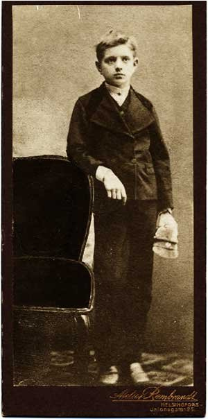
母語是瑞典語的他被送進芬蘭語預備學校，1876年進入海門林納的芬蘭語中學。他上課常常心不在焉，數學和植物學倒是不錯，還留級過一年。小時候大家叫他「楊內」，求學時期他看到已故航海家叔叔的名片，改用法文名字「讓」，從此以讓·西貝流士聞名。

## 1875 | 叔叔送的小提琴
10歲時叔叔佩爾送他一把小提琴，後來也一直鼓勵他作曲。他和姊姊、弟弟組成鋼琴三重奏，也和鄰居一起演奏四重奏。弟弟克里斯蒂安後來成為芬蘭現代精神醫學的重要人物。

## 1881 | 立志當小提琴名家
跟當地樂隊指揮列文德學小提琴，一心想成為小提琴大師，很快就成為技巧出色的演奏者，1887年還在赫爾辛基演奏孟德爾頌小提琴協奏曲的後兩個樂章。現存最早的作品片段也來自這個時期，包括一首撥奏小品〈水滴〉。

## 1885 | 進入赫爾辛基音樂學院
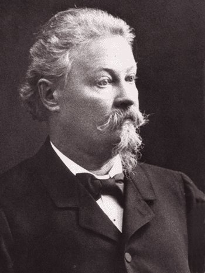
中學畢業後進入帝國亞歷山大大學讀法律，但他對音樂興趣大得多，很快就轉到赫爾辛基音樂學院（今西貝流士音樂學院）。創辦人韋格利烏斯給了自學的他第一堂正式作曲課；鋼琴家兼作曲家布梭尼也是他的老師，兩人成為終生好友。

## 1888 | 初見愛諾
同學阿瑪斯·亞爾內費爾特邀他到家裡作客，他對阿瑪斯17歲的妹妹愛諾一見鍾情。她是瓦薩省省長亞爾內費爾特將軍的女兒。

## 1889 | 柏林留學
到柏林跟貝克爾學習，聽了大量音樂會和歌劇，包括理查·史特勞斯《唐璜》的首演。他也聽到芬蘭作曲家卡亞努斯指揮柏林愛樂演出愛國交響詩《愛諾》，這可能啟發了他日後以史詩《卡勒瓦拉》作為創作題材。

## 1890 | 維也納留學
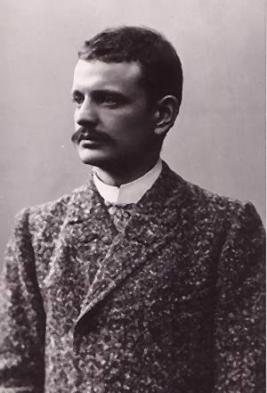
到維也納跟富克斯與戈德馬克學習，一度認為布魯克納是「在世最偉大的作曲家」，也很欣賞貝多芬與華格納。他很喜歡在維也納的這一年，常和新朋友狂歡、賭博，也在這裡開始寫管弦樂作品。寫作《庫勒沃》期間他病倒，接受了膽結石手術。

## 1892-04-28 | 《庫勒沃》首演
取材自《卡勒瓦拉》，為獨唱、合唱與管弦樂團而寫的大型作品，在赫爾辛基首演大獲成功。作曲家形容它像「火山爆發」，合唱團員說：「這就是芬蘭音樂。」這時他終於放棄當小提琴家的夢想：「我的悲劇是不惜一切想成為著名的小提琴家……當我不得不承認自己太晚開始接受演奏家訓練時，那是非常痛苦的覺醒。」

## 1892-06-10 | 與愛諾結婚
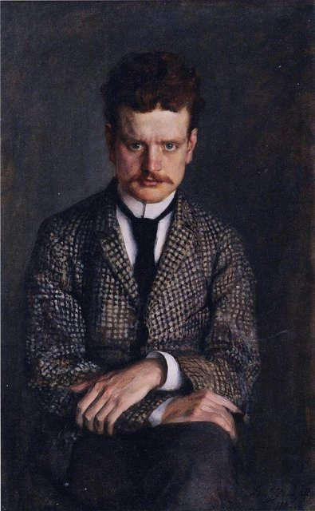
在馬克斯莫的托特松德莊園舉行婚禮，蜜月到《卡勒瓦拉》的故鄉卡雷利亞，啟發了交響詩《傳說》、《連明蓋寧》傳說與《卡雷利亞組曲》。兩人後來生了六個女兒，其中一個在1歲時死於傷寒。為了養家，他在音樂學院和卡亞努斯的指揮學校兼課，作曲時間不多。

## 1893-11-13 | 《卡雷利亞》首演
在維堡的學生協會晚會上首演，畫家加倫－卡勒拉等人設計舞台。首演時觀眾吵雜到很難聽清楚，五天後的第二場成功得多。同年2月交響詩《傳說》首演反應普通，後來他在1902年刪修成今天的版本。

## 1896-04-13 | 《連明蓋寧組曲》首演
原本為一部始終沒完成的《卡勒瓦拉》歌劇所寫的素材，改編成四首交響詩，在赫爾辛基首演時座無虛席。樂評弗洛丁覺得〈圖奧內拉的天鵝〉的英國管獨奏「長得驚人又無聊」，這首曲子卻成了他最著名的作品之一。

## 1898 | 國家終身年金
獲得一筆可觀的年度補助，起初為期十年，後來改為終身，讓他能專心創作。同年他為好友的戲劇《克里斯蒂安二世》寫的配樂大受歡迎，他說：「我想這是我第一次寫出完整的東西。」

## 1899-04-26 | 第一號交響曲；《雅典人之歌》
俄國沙皇尼古拉二世試圖削減芬蘭大公國的權力，他的愛國情緒高漲。第一號交響曲在赫爾辛基首演獲得好評，同場首演的愛國合唱曲《雅典人之歌》更讓他立刻成為民族英雄。

## 1899-11-04 | 《芬蘭頌》的誕生
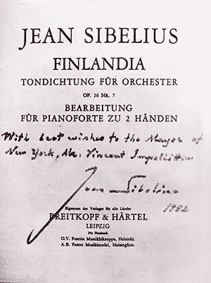
為聲援因批評俄國統治而被停刊的《日報》員工，他寫了八段描繪芬蘭歷史的「新聞慶典音樂」。最後一段〈芬蘭甦醒〉特別受歡迎，稍加修改後就成了家喻戶曉的《芬蘭頌》。

## 1900 | 痛失么女；歐洲巡演
2月么女克爾絲蒂夭折。夏天他隨卡亞努斯的樂團在斯德哥爾摩、哥本哈根、漢堡、柏林、巴黎等13個城市巡演，柏林樂評的熱烈報導讓他贏得國際聲望。

## 1902-03-08 | 第二號交響曲首演
1901年全家到義大利拉帕洛時開始動筆，部分靈感來自莫札特《唐喬凡尼》中唐璜的命運。首演時芬蘭人反應狂熱，樂評稱它「超越了最大膽的期待」、「一部絕對的傑作」。11月修訂後的《傳說》在柏林由柏林愛樂演出，奠定了他在德國的名聲。

## 1903 | 《悲傷圓舞曲》
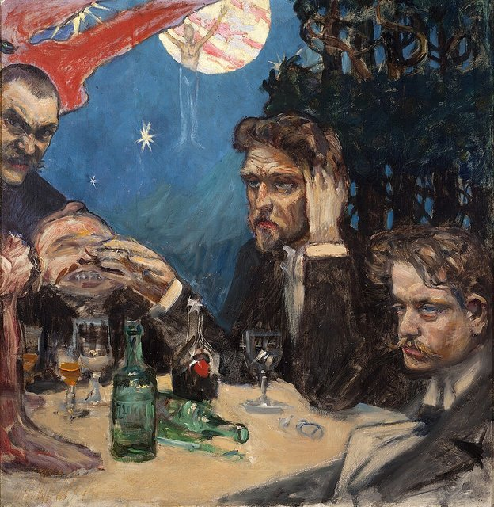
這一年他常在赫爾辛基吃喝玩樂，欠下大筆餐廳帳單，妻子不斷寫信求他回家也沒用。畫家加倫－卡勒拉早在1894年就畫過他和卡亞努斯等人通宵暢飲的〈研討會〉。他為大舅子的戲劇《死亡》寫的配樂中，有一首〈悲傷圓舞曲〉，他因缺錢低價賣斷，結果它在國內外都大受歡迎。

## 1904-02-08 | 小提琴協奏曲首演
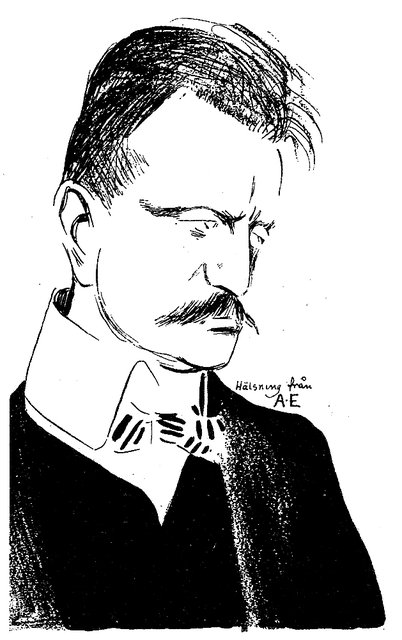
首演並不成功，他把協奏曲大幅刪修，1905年在柏林演出的修訂版才成為今天的定本。

## 1904-09-24 | 搬進愛諾拉
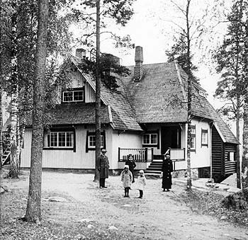
在赫爾辛基北方約45公里的圖蘇拉湖畔蓋了新家，以妻子命名為「愛諾拉」（愛諾的家）。為了籌措建屋費用，他在芬蘭、愛沙尼亞與拉脫維亞舉辦音樂會。搬進去後，他與當地的畫家、作家結為好友，此後在這裡住了半個多世紀。

## 1905 | 第一次訪英
1月在柏林指揮第二號交響曲。11月第一次到英國，在利物浦結識指揮家亨利·伍德，12月指揮第一號交響曲與《芬蘭頌》大獲好評。

## 1907-09-25 | 第三號交響曲；與馬勒對談
酗酒揮霍讓妻子累到住進療養院，他決心戒酒，專心寫完第三號交響曲。首演時較古典的風格讓聽眾意外。不久後他在赫爾辛基遇到來訪的馬勒，兩人都覺得每寫一首新交響曲，就會失去被前作吸引的聽眾。

## 1908-05 | 喉部腫瘤手術
菸酒已危及他的性命，前一年他就因疑似喉癌動過手術。1908年他和妻子到柏林切除喉部腫瘤，術後發誓徹底戒菸戒酒。這次與死神擦身而過，據說影響了他之後的作品，例如《大自然的女兒》與第四號交響曲。

## 1909 | 結識德布西
手術成功後，他與愛諾的家庭生活重拾幸福。他到英國指揮《傳說》、《芬蘭頌》、《悲傷圓舞曲》等作品，觀眾反應熱烈，也在那裡見到德布西，得到他的支持。

## 1911-04 | 第四號交響曲
內省、陰暗的第四號交響曲如他所料，在赫爾辛基首演時評價兩極；1913年在紐約演出時，大批觀眾在樂章之間離席，波士頓的報紙稱它是「悲慘的失敗」。

## 1914-06 | 美國之行：《海洋女神》；耶魯榮譽博士
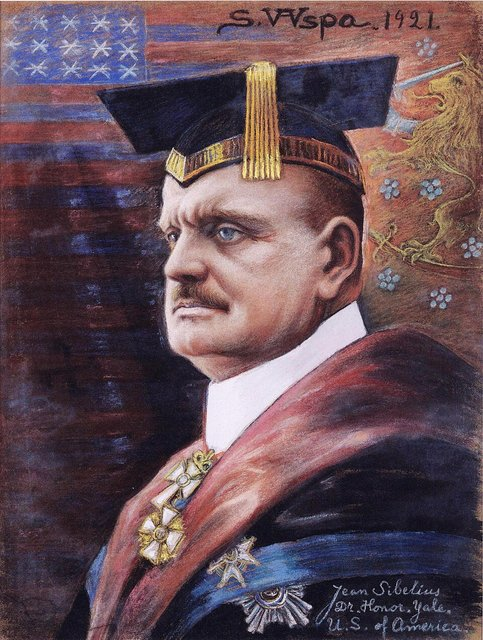
應美國富豪史托克爾委託，為諾福克音樂節寫下交響詩《海洋女神》，親自赴美指揮首演，樂評稱它是有史以來最美的海洋音樂之一。他也獲頒耶魯大學榮譽博士。年初他在柏林待了一個月，特別對荀白克的音樂感興趣。回程途中，他聽到塞拉耶佛事件的消息，一次大戰隨即爆發，他的海外版稅中斷，只好寫小品維持生計。

## 1915-04 | 十六隻天鵝
寫作第五號交響曲時，他看到16隻天鵝飛過，這成了終樂章的靈感，他說這是「我一生中最偉大的經歷之一」。

## 1915-12-08 | 第五號交響曲首演
在50歲生日當晚，於赫爾辛基證券交易所大廳親自指揮首演。他對作品不滿意，此後又修改了兩次，最終版在1919年11月首演。這時他債台高築，連別人送的平台鋼琴都差點被法院查封，所幸歌手伊達·艾克曼發起募款，替他還了大筆債務。

## 1918 | 芬蘭內戰
芬蘭在1917年12月宣布脫離俄國獨立，他寫的《獵兵進行曲》一時風靡。1918年1月內戰爆發，他支持白軍；2月，紅衛軍兩度搜查愛諾拉找武器，他的弟弟也被逮捕。卡亞努斯與紅衛軍總司令交涉，由紅衛軍護送他們全家到赫爾辛基避難。4月德軍占領赫爾辛基後，他指揮了《獵兵進行曲》。

## 1919 | 剃光頭
決定改變形象，把日漸稀疏的頭髮全部剃光，從此以光頭的形象為人熟知。6月他到哥本哈根演出，這是他1915年以來第一次出國。

## 1920 | 手抖與美國的邀約
手抖愈來愈嚴重，他靠喝酒來緩解，有研究認為他可能從年輕就患有原發性顫抖症。柯達相機的發明人伊士曼以年薪兩萬美元邀他到伊士曼音樂學院教書一年，談到《紐約時報》都報導他即將抵達，最後他還是婉拒了。

## 1923-02 | 第六號交響曲
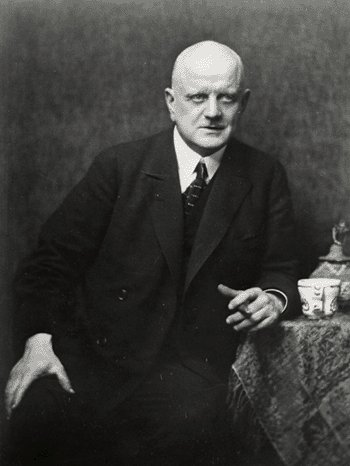
前一年弟弟克里斯蒂安去世，他也加入了芬蘭共濟會，為他們寫儀式音樂。第六號交響曲首演，樂評稱它是「純粹的田園詩」。

## 1924-03 | 第七號交響曲
不顧妻子的擔心持續喝酒，仍在3月完成單樂章的第七號交響曲，以《交響幻想曲》的名稱在斯德哥爾摩首演成功，秋天在哥本哈根更受歡迎，丹麥授予他丹尼布洛勳章。這也是他最後一首交響曲。

## 1926 | 《暴風雨》與《塔皮奧拉》
為哥本哈根皇家劇院的莎士比亞《暴風雨》寫配樂，3月首演獲好評。同年完成描寫北國森林之神的交響詩《塔皮奧拉》。這是他最後的重要作品，此後30年他幾乎不再發表大型作品，被稱為「亞爾文帕的沉默」。他自己的解釋很簡單：他覺得已經寫得夠多了。

## 1933 | 消失的第八號交響曲
他曾答應讓庫塞維茲基首演第八號交響曲，1933年倫敦甚至已公告演出，唯一的具體證據是一張第一樂章謄寫稿的帳單。他對朋友說：「如果我寫不出比第七號更好的交響曲，那它就是我最後一首。」同年芬蘭廣播公司把他的作品透過國際廣播聯盟播送到14個國家。

## 1935 | 美國聽眾最喜愛的作曲家
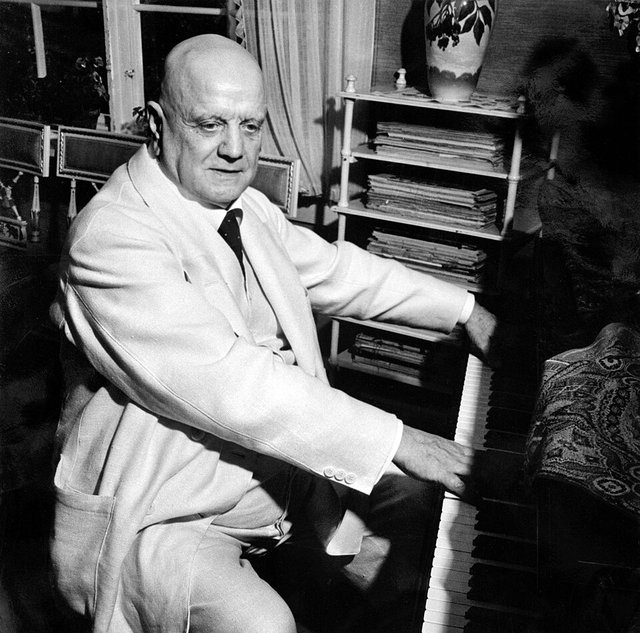
紐約愛樂調查全美聽眾最喜歡的作曲家，他在所有作曲家中排名第一，無論在世或已故，這樣的生前聲望在西方音樂史上無人能及。70歲生日時，他也獲頒德國的歌德獎章。

## 1939-01-01 | 唯一留存的自己指揮錄音
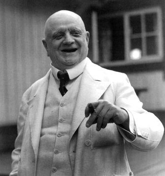
在國際廣播節目中指揮自己的《節慶行板》，這段錄音後來發行成CD，可能是唯一留存的西貝流士親自詮釋自己作品的錄音。

## 1945 | 焚稿
他把許多手稿裝進洗衣籃，在愛諾拉餐廳的壁爐裡燒掉，第八號交響曲很可能就在其中。愛諾回憶：「我沒有力氣在場，就離開了房間……但在這之後，我丈夫變得平靜了，心情也漸漸開朗起來。」

## 1955 | 90歲大壽
生日受到廣泛慶祝，奧曼第指揮的費城管弦樂團與畢勤爵士指揮的皇家愛樂都舉辦了特別音樂會。他私下欣賞理查·史特勞斯，認為巴爾托克與蕭士塔高維奇是年輕一代最有才華的作曲家，1950年代也提攜了芬蘭年輕作曲家拉烏塔瓦拉。

## 1957-09-20 | 逝世@愛諾拉
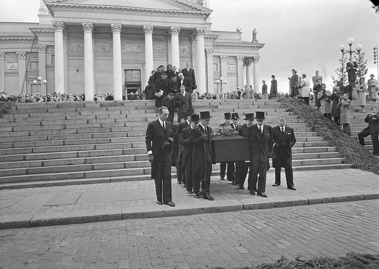
兩天前他散步回來，興奮地告訴愛諾看到一群鶴飛來：「牠們來了，我青春時代的鳥兒！」其中一隻還脫隊在愛諾拉上空盤旋一圈才歸隊。他因腦溢血去世，享年91歲，當時赫爾辛基的電台正好在播放他的第五號交響曲。聯合國大會主席當場呼籲默哀，說：「西貝流士屬於全世界。」他舉行國葬，9月30日的葬禮在赫爾辛基大教堂舉行，之後安葬在愛諾拉的庭院中；愛諾在1969年以97歲高齡去世後，與他合葬。
