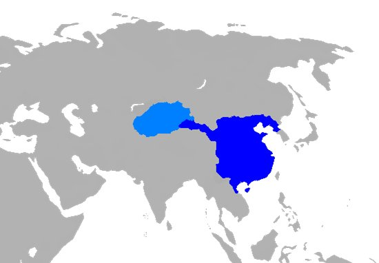
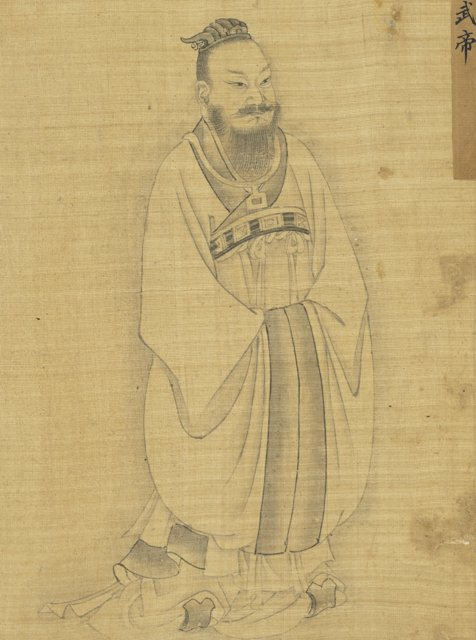
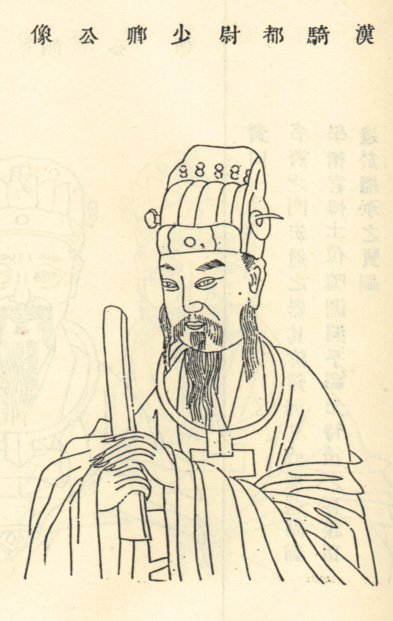
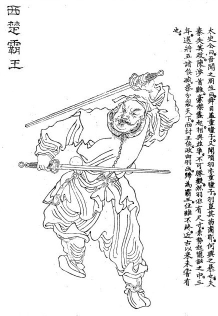
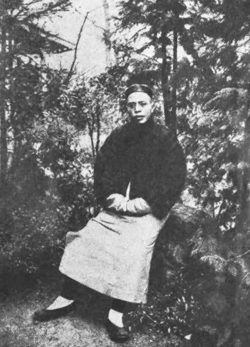

<!--
內容整理自 D:\Books\md\歷史\人物\中國\司馬遷（約前145－前86年）生平大事記.txt（網頁版為 D:\Books\html\1-2-1.中國歷史人物\司馬遷(約前145~前86).html），並整合中文維基百科〈司馬遷〉條目，以自己的話改寫。
時期依筆記的階段歸納：出生與早年求學、進入仕途與繼承父志、擔任太史令與編寫《史記》、李陵事件與宮刑、忍辱著史與完成《史記》、晚年與身後。筆記的「《史記》的五種體例」「重要思想與歷史觀」「重要人物與篇章」「與中國史學的發展」「核心時間軸」寫進時期說明與相關事件，不另立事件。
兩份資料出入與處理方式（司馬遷的生卒與許多年份都沒有定論，筆記與維基百科都說明了這一點）：
- 生卒：筆記寫約前145年（另有前135年說）出生，約前86年可能去世（另有前90、前87年等說）；維基百科寫「前145年—前86年？」，並說1916年王國維第一次把司馬遷的生卒年當作學術問題考證，認為卒年「絕不可考」，但視為與武帝相終始、當無大誤；有一說是昭帝始元元年（前86年）去世，仍沒有證據。這裡 born 採前145年、died 採前86年，都是約數，事件的年齡因此只是約數。
- 籍貫：筆記寫左馮翊夏陽（今陝西韓城一帶）；維基百科寫龍門（今陝西韓城），兩者指同一地，寫「夏陽（龍門，今陝西韓城）」。
- 早年：筆記兩份版本把「在父親指導下學習」寫成約前135年（11歲）或約前130年（16歲）；約前130–前125年向孔安國學古文《尚書》、向董仲舒學《春秋公羊傳》，取自筆記的詳細版本；前126年約20歲開始漫遊江淮、會稽、九嶷山、沅湘等地，一併寫進早年事件。
- 郎中與出使：筆記寫約前118年任郎中、前111年奉命出使巴蜀以南，維基百科沒有，照筆記。
- 父親之死與太史令：筆記一處寫約前110年司馬談因病未能參加武帝封禪大典而臨終囑託，另一處寫前110年去世、前108年繼任太史令；維基百科寫元封元年（前110年）司馬談去世，三年之後（前108年）承襲父職任太史令，照此。
- 太初曆：筆記寫前104年參與太初曆改革並正式展開《史記》編纂；維基百科補充太初元年（前104年）與唐都、落下閎等人共同制定太初曆，改以正月為歲首，取代秦代顓頊曆以十月為歲首，照此。
- 李陵事件：筆記寫前99年李陵兵敗投降、司馬遷為他辯護；維基百科寫天漢二年（前99年），李陵是飛將軍李廣的孫子。受宮刑：筆記寫前98年左右（也寫「前99—前98年」），並列「前99年或前98年」兩說，這裡寫前98年。贖刑：筆記說漢代死刑可用贖金處理，司馬遷家境無力支付而選擇宮刑，這是依《報任安書》的說法，照此。
- 出獄與《史記》：筆記寫前97年左右出獄任中書令、前91年《史記》主要編纂完成（原稱《太史公書》）並寫下《太史公自序》；筆記的另一版本把前99—前91年寫成編寫階段。《史記》的結構（本紀12、表10、書8、世家30、列傳70，共130篇）取自筆記，「究天人之際，通古今之變，成一家之言」出自《報任安書》，照筆記。
- 身後：筆記列了班固《漢書》、劉知幾《史通》、司馬光《資治通鑑》、趙翼《廿二史劄記》等史學的後續發展，這裡只在身後事件提班固與後世影響，其餘不收。
- 人名與其他時間軸一致：漢武帝、項羽、劉邦、孔子、屈原、司馬光、班固（頁面）。
圖片來源（皆為 Wikimedia Commons 公有領域／CC0 作品；繪畫、版畫與插圖多為後世作品，不代表事件當時的樣貌）：
- sq-cover.jpg：Sima Qian (painted portrait).jpg（司馬遷畫像）
- sq-wudi.jpg：Liu Che (Emperor Wu of Han).png（漢武帝像）
- sq-han.jpg：Han Dynasty map 2CE.png（漢朝的疆域（地圖））
- sq-liling.jpg：李陵.jpg（李陵像（版畫））
- sq-xiangyu.jpg：Xiang Yu.jpg（項羽（《史記》把他列入本紀））
- sq-wang.jpg：王靜安先生壯年小像.jpg（王國維）
-->

# Periods
- -145 ~ -118 | 出生與早年求學 | #868e96
  生於夏陽（龍門）的史官世家，父親司馬談是太史令；少年讀古文經典，向孔安國、董仲舒學習，二十歲起漫遊各地，實地考察歷史遺跡與民間傳說。
- -118 ~ -108 | 進入仕途與繼承父志 | #2f9e44
  任郎中，出使西南，父親去世時囑託他完成修史的事業，三年後繼任太史令，開始整理皇家典籍。
- -108 ~ -99 | 太史令與編寫《史記》 | #1971c2
  參與制定太初曆，正式展開《史記》的編纂。
- -99 ~ -97 | 李陵事件與宮刑 | #c92a2a
  替兵敗投降匈奴的李陵辯護，觸怒漢武帝而下獄，受宮刑，是他一生最大的轉折。
- -97 ~ -91 | 忍辱著史 | #7048e8
  出獄後任中書令，把痛苦轉化為寫作的動力，完成130篇的《史記》與〈太史公自序〉。
- -91 ~ -86 | 晚年與身後 | #495057
  晚年的活動缺乏完整記載，卒年沒有定論；《史記》逐漸成為中國史學與古典文學的典範。

# Events

## -145 | 出生於夏陽
司馬遷字子長，出生於西漢夏陽（又稱龍門，今陝西韓城一帶），父親司馬談是漢武帝時代的太史令，負責天文、曆法與史籍。司馬遷的生年沒有定論，常見的說法是前145年，另有前135年說。
他從小受家庭的學術環境影響，逐漸形成編寫一部完整中國通史的志向。

## -135 | 在父親指導下讀書 {label="約前135–前125年"}
司馬遷在家鄉與父親的指導下學習古代典籍，讀《尚書》《左傳》《國語》等文獻，奠定史學的基礎；約前130至前125年，他向孔安國學習古文《尚書》，向董仲舒學習《春秋公羊傳》。

## -126 | 漫遊各地

約二十歲的司馬遷開始漫遊中國各地，遊歷江淮、會稽、九嶷山、沅湘等地（前126–前123年），實地考察歷史遺跡、風土民情與民間傳說，考察楚漢歷史與古代文化。他不只閱讀文獻，也親自走訪事件發生的地點，透過實地考察與訪談，建立了兼具文獻與實證精神的史學方法。

## -118 | 任郎中 {label="約前118年"}

司馬遷開始在漢武帝的朝廷任職，擔任郎中，得到接觸宮廷與國家事務的機會。

## -111 | 出使巴蜀以南
司馬遷奉命出使巴蜀以南，考察西南地區並處理相關事務。

## -110 | 父親司馬談去世
漢武帝元封元年（前110年），司馬談因病未能參加武帝的封禪大典，臨終前囑託司馬遷：「余死，汝必為太史」，要他完成編寫歷史的志業。司馬談長期擔任太史令，對歷史、天文與思想學術都有深入的研究，希望兒子繼承家族的史官傳統，完成一部記述歷代興衰的著作。

## -108 | 繼任太史令
司馬遷在父親去世三年之後，承襲父職出任太史令，掌管史籍、天文與曆法，開始有系統地整理皇家典籍與歷代史料。

## -104 | 太初曆與《史記》的編纂
太初元年（前104年），司馬遷與唐都、落下閎等人共同制定太初曆，改變秦代以十月為歲首的習慣，改以正月為歲首，是西漢重要的曆法改革，漢武帝頒行施行。同年他正式展開《史記》的系統編纂，前103至前100年整理歷代史料、皇家典籍與各地考察所得的資料，逐步撰寫。

## -99 | 李陵事件

天漢二年（前99年），名將李廣的孫子李陵率軍攻打匈奴，因兵力懸殊、孤軍深入而兵敗投降。漢武帝得知後震怒，朝臣多數指責李陵；司馬遷在朝廷上為李陵辯護，認為李陵作戰英勇、投降可能另有原因，並不是一開始就有叛國之心。漢武帝認為他有意替李陵開脫，把他下獄治罪。

## -98 | 受宮刑 {label="約前98年（一說前99年）"}
司馬遷被判死刑。在漢代，死刑可以透過一定條件的贖刑處理，但司馬遷的家境無力支付所需的贖金，面臨死亡與宮刑的抉擇，最後選擇忍受宮刑（腐刑）。他在《報任安書》中說明，自己之所以忍辱苟活，是因為《史記》還沒有完成，希望自己的著作能流傳後世。這段經歷使司馬遷的史學事業具有特殊的人生意義：以個人生命的苦難，完成對歷史與文化的責任。

## -97 | 出獄任中書令 {label="約前97年"}
司馬遷出獄後擔任中書令，在朝廷任職，繼續整理歷史資料與撰寫《史記》。前96至前93年左右，他修訂本紀、表、書、世家、列傳等各個部分，整理歷代帝王、諸侯、政治制度與重要人物的事蹟，並建立完整的歷史架構，持續思考歷史興衰、政治得失與人物的命運。

## -91 | 完成《史記》

《史記》的主要編纂工作完成，書名原稱《太史公書》，共130篇：本紀12篇、表10篇、書8篇、世家30篇、列傳70篇，從傳說中的黃帝寫起，記述到漢武帝時代，涵蓋約三千年，是中國第一部紀傳體通史。他同時寫下〈太史公自序〉，交代家族史官的傳統、修史的動機與全書的宗旨。
他在《報任安書》中提出著名的修史理念：「究天人之際，通古今之變，成一家之言」，也就是探討自然與人事的關係、理解歷史的變化，並建立自己的歷史觀點。《史記》以人物為中心，不只記錄帝王，也為平民、商人、刺客、游俠留下歷史的位置；他把項羽列入本紀，突破只以勝敗論英雄的寫法。

## -86 | 去世 {label="約前86年（確切卒年無定論）"}
司馬遷晚年的活動與著作修訂情況缺乏完整的記載，一種常見的說法認為他在前86年前後去世，也有前90年、前87年等說法，確切的卒年沒有定論。

## 100 | 《史記》的影響 {label="西漢後期以後"}
《史記》逐漸受到學者重視，成為研究先秦與秦漢歷史的重要文獻，東漢班固撰寫《漢書》，延續紀傳體史書的傳統；唐代以後《史記》成為重要的歷史與文學經典，明清時期有大量注釋、評點與研究著作出現。司馬遷被尊為中國史學的奠基者，《史記》也成為世界漢學研究的重要典籍。

## 1916 | 王國維考證生卒年

王國維第一次把司馬遷的生卒年當作學術問題考證，認為卒年「絕不可考……然視為與武帝相終始，當無大誤」。司馬遷的生年（前145年或前135年）與卒年的各種說法，至今仍是史學討論的課題。
