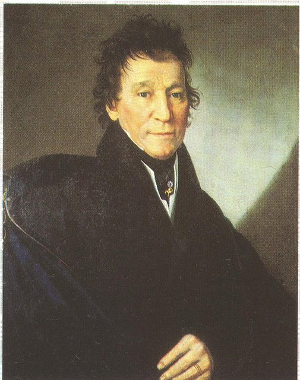
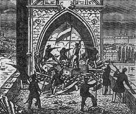
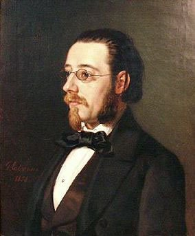
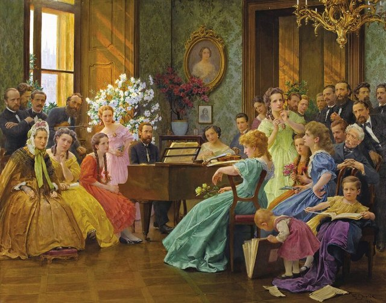
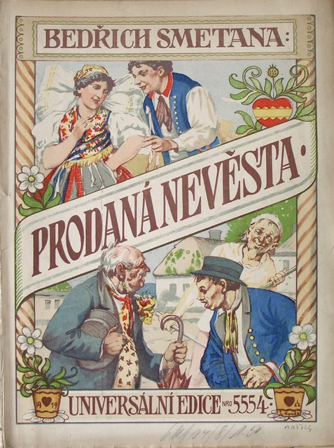
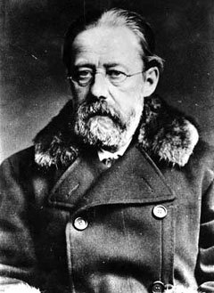
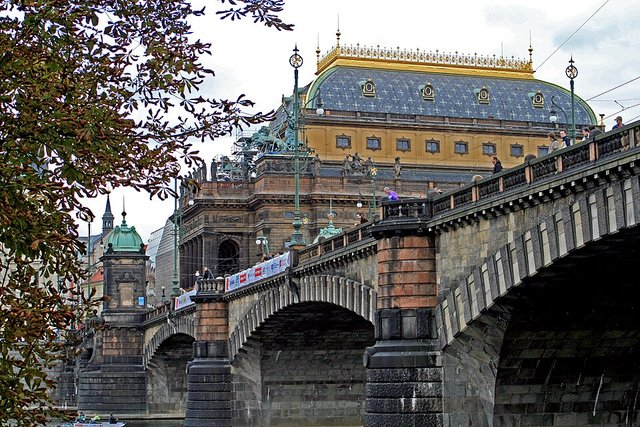
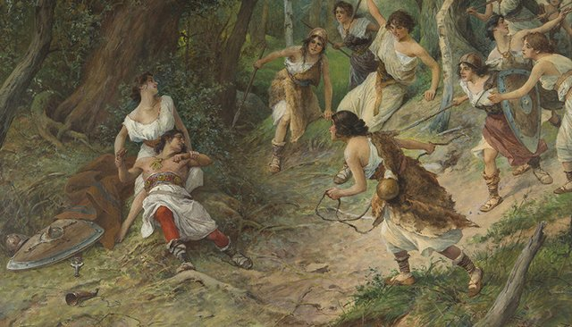
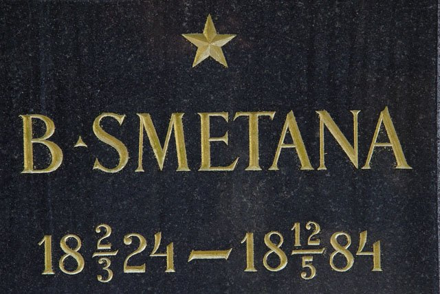

<!--
內容整理自中文維基百科「貝多伊齊·史麥塔納」與英文維基百科「Bedřich Smetana」條目（CC BY-SA 4.0），並以台灣用語改寫摘要。
https://zh.wikipedia.org/zh-tw/贝德里赫·斯美塔那
https://en.wikipedia.org/wiki/Bedřich_Smetana
中文條目較簡略，生平細節主要參考英文條目；各歌劇首演日期兩條目一致。
圖片皆為 Wikimedia Commons 上的公有領域（含PD-US）作品（封面：晚年肖像照）。
-->

# Periods
- 1824-03-02 ~ 1839 | 童年@利托米什爾
  釀酒師之子，在講德語的家庭長大，6歲首次公開演奏。隨父親的工作輾轉波希米亞各地求學，結識了後來的革命詩人哈夫利切克。
- 1839 ~ 1856 | 布拉格：求學、革命與鋼琴學院@Prague
  立志「作曲要像莫札特，技巧要像李斯特」，靠擔任伯爵家的音樂老師維生，跟普羅克施學作曲。參加1848年革命，創辦鋼琴學院並得到李斯特支持，卻接連失去三個女兒。
- 1856 ~ 1861 | 瑞典哥德堡@Gothenburg
  在布拉格不受重視，遠赴瑞典哥德堡發展，大受歡迎。受李斯特交響詩的啟發寫下《理查三世》等作品。第一任妻子病逝，他再娶貝蒂娜。
- 1861 ~ 1874 | 捷克國家歌劇的旗手
  奧地利專制鬆動後回到布拉格，努力補學母語捷克語。寫出《波希米亞的布蘭登堡人》、《交換新娘》、《達利波》等開創性的捷克歌劇，擔任臨時劇院首席指揮，卻也捲入「華格納主義」的論戰。
- 1874 ~ 1884 | 失聰後的晚年
  1874年雙耳全聾，被迫辭去指揮。在女兒家的寧靜鄉間寫出交響詩組曲《我的祖國》與弦樂四重奏《我的一生》，被尊為捷克音樂之父，最後在精神病院中去世。

# Events

## 1824-03-02 | 出生@利托米什爾

生於布拉格以東、波希米亞與摩拉維亞交界附近的利托米什爾，本名腓特烈·史麥塔納。父親法蘭提謝克是伯爵城堡的釀酒師，在拿破崙戰爭期間靠供應法軍衣物糧食致富。在哈布斯堡統治下，德語是波希米亞的官方語言，父親雖然懂捷克語卻很少用，孩子們直到很晚才學會正確的捷克語。他是父親第三段婚姻的第一個兒子，全家共有十幾個孩子。

## 1830-10 | 6歲首次公開演出
父親在弦樂四重奏中拉小提琴，啟蒙了他的音樂。6歲時在利托米什爾的音樂會上，以鋼琴演奏奧柏歌劇《波蒂契的啞女》序曲的改編版，大受歡迎。

## 1831 | 遷居因德日赫城
全家搬到南波希米亞的因德日赫城（一個世代後，馬勒也在這一帶長大）。他在這裡上學，學小提琴和鋼琴，認識了莫札特與貝多芬的作品，也開始寫簡單的小曲。

## 1835 | 輾轉求學
父親退休搬到鄉間城堡，他先被送到伊赫拉瓦讀中學，因為想家讀不下去，又轉到聶梅茨基布羅德的學校，在那裡結識了後來的捷克革命詩人哈夫利切克。

## 1839 | 到布拉格讀書，立志當音樂家
進入布拉格的學術文法學校，但被同學嘲笑土氣，開始翹課，跑去聽音樂會、看歌劇、聽軍樂隊。聽了李斯特的鋼琴獨奏會後，他在日記中寫下：「作曲要成為莫札特，技巧要成為李斯特。」父親發現他翹課後，把他帶離布拉格。

## 1840 | 普爾森的中學時光
由在普爾森教書的堂兄照顧，在當地讀完中學。他的鋼琴演奏在各種社交晚會上非常受歡迎，並愛上了童年時就認識的卡特日娜·柯拉諾娃，日記裡寫著：「她不在身邊時，我就像坐在熱炭上。」

## 1843-08 | 帶著20弗羅林到布拉格
家道中落，父親雖然同意他走音樂之路，卻無法資助他。他帶著20弗羅林來到布拉格，經卡特日娜母親介紹，向布拉格音樂學院院長普羅克施學作曲。隔年他擔任圖恩伯爵家的音樂老師，經濟壓力才得以緩解。普羅克施介紹他認識了李斯特與白遼士。

## 1846 | 白遼士與舒曼夫婦
白遼士到布拉格舉行音樂會，他很可能在普羅克施安排的招待會上見到了白遼士。他也在圖恩伯爵家見到舒曼與克拉拉，把自己的G小調鋼琴奏鳴曲拿給他們看，兩人卻不以為然，覺得裡面白遼士的味道太重。

## 1848 | 參加革命；創辦鋼琴學院

1848年革命中，他寫了多首愛國進行曲，加入公民軍，在查理大橋的街壘上防守。起義很快被鎮壓，他幸運地沒有被捕。同年他寫信給素未謀面的李斯特，請求接受題獻並借他400弗羅林開辦音樂學校；李斯特熱情回信、答應幫忙找出版商，但沒有借錢。8月，他仍靠自己開辦了鋼琴學院，李斯特後來常來造訪，兩人的友誼對他一生影響深遠。

## 1849-08-27 | 與卡特日娜結婚
鋼琴學院搬到卡特日娜父母家，漸漸成為布拉格的時尚場所，連退位後定居布拉格的前奧地利皇帝斐迪南都會來聽音樂會。經濟穩定後，他和心愛的鋼琴家卡特日娜結婚，兩人在1851到1855年間生了四個女兒。

## 1850 | 宮廷鋼琴師

儘管有革命情懷，他仍接下斐迪南在布拉格城堡的宮廷鋼琴師一職。這段時期他寫了鋼琴組曲《婚禮場景》，部分音樂後來用在《交換新娘》裡。

## 1855-02-26 | 《凱旋交響曲》
為紀念法蘭茲·約瑟夫皇帝大婚而寫，獻給皇后伊莉莎白（茜茜公主），卻被宮廷退件，可能是因為引用的奧地利國歌旋律不夠顯眼。他自掏腰包請樂團在布拉格演出，反應冷淡，還賠了錢。

## 1855 | 痛失愛女
1854年二女兒死於肺結核，1855年4歲就展現音樂天分的長女貝德日什卡死於猩紅熱，他寫下G小調鋼琴三重奏紀念她，樂評很嚴厲，李斯特卻很欣賞。1856年剛出生的四女兒也夭折，妻子卡特日娜被診斷出肺結核。

## 1856-01 | 莫札特百年誕辰音樂會
演奏莫札特D小調鋼琴協奏曲，是他這段時期最成功的演出。樂評稱讚他的觸鍵「細膩、晶瑩剔透」，比較接近蕭邦而非李斯特，但認為他體質虛弱，不適合當演奏家。

## 1856-10-11 | 遠赴瑞典哥德堡
革命好友哈夫利切克死於流放地，奧地利的專制統治又捲土重來，他對布拉格愈來愈失望，寫信給父母說「布拉格不想承認我，所以我離開了」，前往瑞典哥德堡。幾週內他就舉行了獨奏會、開辦音樂學校，並擔任古典合唱音樂協會的指揮。

## 1857 | 父親去世；在威瑪受李斯特鼓舞
6月父親去世。秋天他帶著病重的妻子和唯一倖存的女兒回哥德堡，途中到威瑪拜訪李斯特，聽了李斯特的《浮士德交響曲》與交響詩，深受鼓舞。李斯特是他一生創作上最主要的導師，把他從哥德堡的藝術孤立中拯救出來。

## 1858 | 交響詩《理查三世》
受李斯特交響詩的啟發，寫下《理查三世》，之後又寫了取材自席勒的《華倫斯坦的陣營》，開始創作大型作品。

## 1859-04-19 | 第一任妻子病逝
卡特日娜的病情在春天急速惡化，在返鄉途中於德勒斯登去世。他寫道，她走得「很安詳，直到那片寂靜讓我察覺才知道」。之後他到威瑪住在李斯特那裡，聽到了李斯特學生科內利烏斯的喜歌劇《巴格達的理髮師》，影響了他日後的歌劇創作。

## 1860-07-10 | 與貝蒂娜結婚
愛上弟弟妻子的妹妹貝蒂娜，她比他小16歲。婚後兩人回瑞典度過最後一季，1861年4月他在斯德哥爾摩為瑞典王室演奏。

## 1861 | 回到布拉格
奧地利在索爾費里諾戰役中戰敗，專制統治鬆動，捷克民族文化迎來新希望。宣布興建捷克歌劇的「臨時劇院」後，他決定回布拉格發展。他說：「我的家鄉深深扎根在我心裡，只有在那裡我才能真正滿足。」他希望當上臨時劇院的指揮，保守派卻認為他是追隨李斯特和華格納的「危險的現代派」而另選他人。

## 1862 | 補學捷克語

他這一代的捷克人受德語教育，他的捷克語很差，於是每天苦讀文法、堅持說寫捷克語。他擔任愛國合唱協會「聲音」的合唱指揮，為他們寫愛國合唱曲；1864年他的捷克語已好到能擔任捷克語大報的樂評。畫家法蘭提謝克·德弗札克後來畫下了他在1865年與朋友們聚會的情景。

## 1864-04-23 | 莎士比亞三百週年音樂會
指揮白遼士的戲劇交響曲《羅密歐與茱麗葉》，並加演自己寫的《莎士比亞慶典進行曲》。同年他爭取布拉格音樂學院院長失敗，又是因為被視為激進的李斯特派。

## 1866-01-05 | 《波希米亞的布蘭登堡人》首演
他的第一部歌劇，由1848年街壘上的戰友薩賓納寫劇本，描寫13世紀布蘭登堡人入侵波希米亞。劇院指揮嫌風格太前衛，拒絕排練和指揮，最後由他親自指揮，首演滿座、他被叫上台謝幕九次。這部作品後來也贏得了歌劇比賽的首獎。

## 1866-05-30 | 《交換新娘》首演

這部輕鬆的喜劇首演時正逢一年中最熱的晚上，普奧戰爭即將爆發、普魯士軍隊隨時可能入侵，觀眾稀少，票房連成本都不夠。他經過多次修改，1870年9月推出三幕的最終版，大受歡迎，成為他享譽國際的代表作。

## 1866-09 | 臨時劇院首席指揮
戰爭期間他擔心寫過反德歌劇的自己成為普軍目標，暫時離開布拉格。9月回來後終於當上臨時劇院的首席指揮。他製作葛令卡的《為沙皇獻身》時激怒了俄國的巴拉基列夫，兩人從此長期交惡。

## 1868-05-16 | 國家劇院奠基；《達利波》首演
他代表捷克音樂家為未來的國家劇院奠基，並寫了《節慶序曲》。當晚他的第三部歌劇《達利波》首演，樂評不佳。之後反對派批評《達利波》是極端的「華格納主義」，不適合作為捷克國家歌劇的典範，布拉格樂壇為此分成兩派。

## 1872-12 | 撤換連署與德弗札克的力挺
劇院內部的反對派發起86人連署，要求撤換他。在副主席支持，以及包括德弗札克在內的知名音樂家發出最後通牒下，他保住職位，1873年1月還加薪並兼任藝術總監。這一年他也完成了氣勢恢宏的歌劇《莉布舍》，但決定留待國家劇院開幕時才首演。

## 1874-03-27 | 《兩個寡婦》首演
支持者在首演後送他一支裝飾精美的指揮棒，反對者仍持續攻擊他，說在他手下「捷克歌劇每年至少病危一次」。

## 1874-10 | 雙耳全聾
夏天他喉嚨發炎，接著出現皮疹與耳朵堵塞，8月起無法工作；9月右耳全聾，10月左耳也聽不見了，被迫辭去指揮職務。劇院以每年1,200弗羅林的年金換取演出他歌劇的權利。他的學生與遠在哥德堡的舊情人發起募款，讓他出國求醫，但都沒有效果。他在日記中寫道：「如果我的病無法治癒，我寧願從這個生命中解脫。」

## 1875 | 《高堡》與《伏爾塔瓦河》首演

失聰後他繼續作曲，開始寫作六首交響詩組成的《我的祖國》，前兩首《高堡》與《伏爾塔瓦河》（又名《莫爾道河》）在1875年首演。《伏爾塔瓦河》以音樂描繪捷克母親河從源頭流向布拉格的旅程，是他最著名的作品。

## 1876 | 移居亞布肯尼采；《我的一生》
與妻子的關係因金錢問題惡化，6月全家搬到長女在亞布肯尼采的家，在寧靜的鄉間專心創作。這一年他寫下自傳性的E小調弦樂四重奏《我的一生》，終樂章中一個尖銳的高音，描寫了他耳中不斷響起的耳鳴。同年歌劇《吻》首演。

## 1880-01-04 | 首次公開演出50週年

布拉格舉辦特別音樂會，紀念他6歲首次登台50年，他親自出席，演奏了1855年為紀念早夭的女兒所寫的G小調鋼琴三重奏。

## 1881-06-11 | 《莉布舍》為國家劇院揭幕

他等了將近十年的歌劇終於在國家劇院開幕時首演。他起初甚至沒拿到門票，最後一刻才被請進劇院總監的包廂，觀眾熱烈喝采，一再請他上台謝幕。不久後國家劇院遭大火焚毀，他不顧病體協助募款重建，1883年11月18日重新開幕時再度上演《莉布舍》。

## 1882 | 《我的祖國》全曲首演；《交換新娘》第100場

5月《交換新娘》演出第100場，是捷克歌劇史上的創舉，因為太受歡迎還加演了一場「第100場」。11月5日，六首交響詩組成的《我的祖國》由切赫指揮首次全曲演出。

## 1884-05-12 | 逝世@布拉格

1879年他就向詩人聶魯達透露害怕自己會發瘋。晚年他飽受憂鬱、失眠、幻覺、暈眩與暫時失語所苦，最後的歌劇《薇奧拉》只留下片段。3月的60歲壽宴他病重無法出席，4月家人無力照顧，送他進布拉格的精神病院，5月12日去世。院方登記死因為老年失智，家人則認為是梅毒，至今仍有爭議。葬禮在提恩教堂舉行，合唱協會成員手持火炬，帶領大批群眾送他到高堡公墓安葬。當晚國家劇院照常上演《交換新娘》，舞台以黑布覆蓋致哀。
