<!--
內容整理自本機筆記《社會結構史》（D:\Books\md\歷史\世界史\社會結構史，網頁版在知識圖譜的「1-6-8.社會結構史」）。
- 79個年份檔各成一則事件，說明採用該檔的「案件摘要」，數學式轉成文字；結尾以「→ 對外連結」連到知識圖譜上的完整案件卷宗（在新分頁開啟），摘要中提到同卷其他案件的連結也改連到知識圖譜。
- README 標為「頃」的100、200、605、710年以「約…年」顯示。
- 時期只取 README 中依年代排列的第一至四、六至八樂章，以下一樂章的起始年為界首尾相接。第五樂章「美洲發現、新食物與地理交換」（1492–1650）落在第四樂章的年代之內，第九樂章「疾病與醫療」、第十樂章「氣候、戰爭與移民」、第十一樂章「制度因素補篇」是橫跨各時代的主題線，年代彼此重疊，未做成色帶；這些案件依年份落入對應的時期。
- 前600呂底亞硬幣、1440古騰堡、1602東印度公司、1769瓦特、1776國富論、1929大蕭條、1944布列頓森林等案件，也出現在世界發展史、金融經濟史等時間軸，各自保留。
圖片來源（皆為 Wikimedia Commons 公有領域／CC0 作品；註明「共用」者沿用其他時間軸已有的圖片）：
- ss-ur.jpg：Standard of Ur - War.jpg（〈烏爾軍旗〉的戰爭面，約前2600年）
- ss-uruk.jpg：Cuneiform tablet- administrative account concerning the distribution of barley and emmer MET DP297601.jpg（記錄大麥與二粒小麥分配的楔形文字帳目泥板）
- fe-hammurabi.jpg（羅浮宮的漢摩拉比法典石碑（與金融經濟史時間軸共用））
- ss-croesus.jpg：British Museum gold coin of Croesus.jpg（大英博物館藏的克羅伊斯金幣）
- wd-qin.jpg（秦始皇像（19世紀）（與世界發展史時間軸共用））
- ss-villa.jpg：Mosaïque villa Tabarka 1.jpg（北非塔巴卡出土的羅馬晚期莊園鑲嵌畫）
- eu-romulus.jpg（羅慕路斯·奧古斯都向奧多亞塞交出帝位（與歐洲史時間軸共用））
- eu-justinian.jpg（拉溫納聖維塔教堂的查士丁尼一世鑲嵌畫（與歐洲史時間軸共用））
- ss-keju.jpg：Civilserviceexam1.jpg（古畫中的科舉考場）
- ss-heiji.jpg：Heiji Monogatari Emaki - Warriors.jpg（〈平治物語繪卷〉中的武士）
- renaissance-1352-plague-tournai.jpg（圖爾奈居民埋葬黑死病死者，1352（與文藝復興時間軸共用））
- wd-gutenberg.jpg（古騰堡聖經的彩飾頁（與世界發展史時間軸共用））
- aod-columbus.jpg（范德林〈哥倫布登陸〉（與大航海時代時間軸共用））
- aod-gama.jpg（格雷戈里奧·洛佩斯〈達伽馬像〉（與大航海時代時間軸共用））
- eu-luther.jpg（克拉納赫工作室〈馬丁·路德像〉（與歐洲史時間軸共用））
- aod-potosi.jpg（《秘魯編年史》中的波托西銀山，1553（與大航海時代時間軸共用））
- ss-maize.jpg：Aztecs storing maize.jpg（《佛羅倫斯手抄本》中阿茲特克人貯藏玉米）
- aod-voc.jpg（弗魯姆〈第二次東印度遠征船隊返抵阿姆斯特丹〉（與大航海時代時間軸共用））
- eu-munster.jpg（1648年明斯特和約在市政廳宣誓（與歐洲史時間軸共用））
- aod-brookes.jpg（布魯克斯號奴隸船的裝載圖，1787（與大航海時代時間軸共用））
- eu-torbay.jpg（透納臨摹〈奧蘭治親王登陸托貝〉（與歐洲史時間軸共用））
- ss-gin.jpg：William Hogarth - Gin Lane.jpg（霍加斯〈琴酒巷〉，1751）
- ss-watt.jpg：SteamEngine Boulton&Watt 1784.png（博爾頓與瓦特的蒸汽機，1784）
- fe-smith.jpg（《國富論》初版書名頁，1776（與金融經濟史時間軸共用））
- wd-bastille.jpg（〈攻占巴士底獄〉，1789（與世界發展史時間軸共用））
- wd-jenner.jpg（諾斯科特〈詹納像〉（與世界發展史時間軸共用））
- ss-peterloo.jpg：The Massacre of Peterloo.jpg（諷刺彼得盧屠殺的版畫，1819）
- ss-railway.jpg：Opening of the Liverpool and Manchester Railway.jpg（1830年利物浦–曼徹斯特鐵路通車典禮）
- ss-irish.jpg：The Famine in Ireland, Funeral at Skibbereen - ILN 1847.jpg（《倫敦新聞畫報》1847年描繪的斯基伯林葬禮）
- wd-manifesto.jpg（1848年《共產黨宣言》瑞典文版封面（與世界發展史時間軸共用））
- ss-snow.jpg：Snow-cholera-map.jpg（約翰·斯諾標示霍亂死亡病例的倫敦蘇活區地圖，1854）
- ss-kapital.jpg：Zentralbibliothek Zürich Das Kapital Marx 1867.jpg（《資本論》第一卷初版書名頁，1867）
- ss-mafia.jpg：SicilianMafia1900Cutrera.jpg（庫特雷拉1900年繪製的西西里黑手黨勢力分布圖）
- ss-commune.jpg：Barricade place Vendome Commune Paris 1871.jpg（1871年巴黎公社在凡登廣場築起的街壘）
- ss-edison.jpg：Edisons Jumbo dynamo in Pearl Street NYC.jpg（愛迪生珍珠街發電廠的「巨無霸」發電機）
- ss-bismarck.jpg：Bundesarchiv Bild 146-2005-0057, Otto von Bismarck (cropped).jpg（俾斯麥）
- ss-pasteur.jpg：Albert Edelfelt - Louis Pasteur - 1885.jpg（埃德費爾特〈巴斯德像〉，1885）
- ss-nzpetition.jpg：Women's Suffrage Petition 1893 (9365778997).jpg（1893年紐西蘭婦女參政權請願書）
- ss-ford.jpg：Ford assembly line - 1913.jpg（1913年福特汽車的裝配線）
- ss-munitions.jpg：Women at work during the First World War- Munitions Production, Chilwell, Nottinghamshire, England, UK, 1917 Q30042.jpg（一戰期間英國奇爾韋爾兵工廠的女工，1917）
- wd-lenin.jpg（1920年列寧在莫斯科演說（與世界發展史時間軸共用））
- ss-flu.jpg：Emergency hospital during Influenza epidemic, Camp Funston, Kansas - NCP 1603.jpg（1918年大流感期間堪薩斯州芬斯頓營的臨時醫院）
- ss-radio.jpg：Early 1920s radio and horn speaker.png（1920年代初的收音機與喇叭）
- ss-vote.jpg：Virginia Norma and Industrial Institute faculty members who registered to vote in 1920.jpg（1920年維吉尼亞州一所學院的女性教職員登記投票）
- fe-crash.jpg（1929年10月股災時聚集在紐約證交所外的人潮（與金融經濟史時間軸共用））
- ss-penicillin.jpg：PENICILLIN FOR GONORRHEA - NARA - 515171.jpg（1940年代美國宣導以盤尼西林治療淋病的海報）
- fe-bretton.jpg（布雷頓森林會議開幕（與金融經濟史時間軸共用））
- ss-partition.jpg：A refugee train, Punjab, 1947.jpg（1947年印巴分治時旁遮普的難民列車）
- ss-tv.jpg：Family watching television 1958.jpg（1958年一家人在客廳看電視）
- ss-civilrights.jpg：Lyndon Johnson signing Civil Rights Act, July 2, 1964.jpg（1964年7月2日詹森總統簽署民權法）
- ss-intel.jpg：Intel 4004 Chip Layout (29983532570).jpg（Intel 4004 微處理器的電路佈局圖）
- ss-thatcher.jpg：Margaret Thatcher 1979.jpg（柴契爾夫人，1979）
- ss-mosaic.jpg：NCSA Mosaic Browser Screenshot.png（早期 Mosaic 瀏覽器的畫面）
- fe-bitcoin.jpg（比特幣創世區塊的原始資料（與金融經濟史時間軸共用））
-->

# Periods
- -9000 ~ -1000 | 農業革命與社會分層的誕生 | #b08900
  農業帶來剩餘與財產，也帶來階層；蘇美人為了記帳發明文字與官僚，青銅與城市國家建立貢賦制與王權，漢摩拉比法典把統治寫成成文法。
- -1000 ~ 476 | 鐵器、貨幣與官僚帝國 | #e67700
  鐵器讓暴力民主化、迎來軸心時代，呂底亞硬幣催生市場與商人階層，秦以郡縣制編戶齊民，羅馬帝國則以奴隸勞動與麵包配給供養消費城市。
- 476 ~ 1440 | 中古的解體與重建 | #2f9e44
  西羅馬崩潰後社會退回莊園自給與封建依附；科舉打開階層流動的閥門，重犁與三圃制帶來農業革命，自治城市與行會撐起商業革命，黑死病造成勞力稀缺、瓦解農奴制，明朝則以里甲制把人口編進格子。
- 1440 ~ 1769 | 印刷、航海與資本主義的序曲 | #1971c2
  古騰堡印刷打破知識壟斷、助宗教改革擊碎教會權威，大航海建立世界體系，美洲的白銀、作物與奴隸貿易重塑各大洲的社會，東印度公司與光榮革命帶來股份公司、國債與金融革命。
- 1769 ~ 1882 | 工業革命與階級社會 | #c92a2a
  蒸汽機帶來工廠制、時間紀律與城市化，《國富論》描繪市場社會，法國大革命打造民族國家；鐵路與電報整合全國市場，彼得盧屠殺、《資本論》與巴黎公社標誌著階級政治的興起。
- 1882 ~ 1971 | 電力、汽車、廣播、電視、總體戰與福利國家 | #862e9c
  電力點亮夜間城市，福特流水線開啟大眾消費，總體戰動員整個社會、讓婦女走進職場；廣播、普選與婦女參政改變大眾政治，大蕭條帶來凱因斯革命，戰後的福利國家、去殖民化與電視重塑了社會。
- 1971 ~ 2026 | 資訊革命與平台社會 | #0c8599
  微處理器開啟後工業社會，新自由主義轉向推動全球化；全球資訊網、社群媒體與智慧型手機帶來注意力經濟、平台與零工，金融危機催生比特幣，難民危機擠壓邊界與福利國家，生成式 AI 則開始重構工作。

# Events

## -9000 | 農業革命與定居
約一萬年前（前9000-8000），黎凡特與兩河流域的人類開始馴化小麥、大麥與山羊綿羊——新石器革命。這樁看似「食物技術」的案件，實則是社會結構的第一場大重構：農業產生**剩餘**，剩餘產生**財產**，財產產生**階層**，階層催生**國家**。採集時代的人人平等讓位於農民、祭司、戰士、酋長的分層世界。此後一萬年的政治與經濟，都在這個「剩餘的詛咒」框架裡展開。

[→ 對外連結：-9000-農業革命與定居](https://chad-liu.github.io/books/html/1-6-8.社會結構史/-9000-農業革命與定居.html)

## -3200 | 文字與官僚制度

約前3200年，兩河流域烏魯克（Uruk）的祭司們開始在泥板上壓出楔形符號——人類最早的文字。偵辦此案會發現驚人的線索：文字**不是為了寫詩，而是為了記帳**。它從計數泥籌（tokens）演化的每一步，都是為了記錄「誰交了多少大麥」。文字是統治技術：它讓記憶外化、讓稅收可稽核、讓命令可遠傳——官僚制度（bureaucracy）自此誕生。此後五千年，每一種組織的規模上限，都由「記錄與傳播的技術」決定。

[→ 對外連結：-3200-文字與官僚制度](https://chad-liu.github.io/books/html/1-6-8.社會結構史/-3200-文字與官僚制度.html)

## -3000 | 青銅城市與貢賦國家

約前3000年起，美索不達米亞與尼羅河畔拔起城牆、塔廟與金字塔——青銅時代的城市國家與領土帝國。偵辦這樁「文明集中營」案件，會發現三條技術線索的合流：**青銅**（銅錫合金，礦產不共處，催生長途貿易與職業軍隊）、**灌溉**（大規模水利需中央協調）、**文字**（行政可及性）——三者合力把「貢賦制」（貢賦 taxation in kind）變成穩定的統治機器。這是第一個「經濟剩餘被政治組織起來」的系統：王權、神廟、軍隊三位一體。

[→ 對外連結：-3000-青銅城市與貢賦國家](https://chad-liu.github.io/books/html/1-6-8.社會結構史/-3000-青銅城市與貢賦國家.html)

## -1754 | 漢摩拉比法典

約前1754年，巴比倫王漢摩拉比把 282 條法規刻在 2.25 公尺高的玄武岩石柱上，立於神廟——人類最完整的早期成文法典。表面看是「法律文件」，實則是一樁「統治技術升級」案：把正當性從王的隨意裁決，轉移到**公開、可預期、可引用的條文**。以眼還眼的同態復仇背後，是精心分層的階級差異定價（貴族 vs 平民 vs 奴隸）。成文法讓契約、利息、商業糾紛有了可預期的裁決規則——市場經濟的司法基礎設施自此落成。

[→ 對外連結：-1754-漢摩拉比法典](https://chad-liu.github.io/books/html/1-6-8.社會結構史/-1754-漢摩拉比法典.html)

## -1000 | 鐵器革命
約前1200-1000年，赫梯帝國崩潰後，冶鐵技術從安納托利亞擴散——鐵器時代開啟。這樁「冶金技術」案件撬動了整個社會結構：鐵礦遍地皆是、冶煉便宜，**平民第一次可以武裝自己**——青銅時代貴族壟斷暴力的秩序崩解。鐵劍撐起的重裝步兵催生希臘民主，鐵鋤開墾的小農撐起戰國編戶，鐵犁與鐵斧讓人口爆炸——軸心時代（前800-200）的哲學家、先知與諸子百家，全都站在鐵器的社會震盪之上。

[→ 對外連結：-1000-鐵器革命](https://chad-liu.github.io/books/html/1-6-8.社會結構史/-1000-鐵器革命.html)

## -600 | 呂底亞硬幣與市場革命

約前600年，小亞細亞的呂底亞王國鑄出人類最早的硬幣——蓋印琥珀金（electrum）圓片。這樁「小圓片」案件是人類組織方式的深層重構：以物易物需要**雙重巧合**（我要的你有、你要的我有），貨幣把交換從兩兩配對解放出來；鑄幣更把「信用」從人際（親友賒帳）變成**非人格**（王的印記）。市場、商人階層、利息、哲學（畢達哥拉斯的數、赫拉克利特的 logos）與雅典民主，都在貨幣的社會震盪中誕生。

[→ 對外連結：-600-呂底亞硬幣與市場革命](https://chad-liu.github.io/books/html/1-6-8.社會結構史/-600-呂底亞硬幣與市場革命.html)

## -221 | 秦郡縣制與官僚帝國

前221年，秦王政統一六國，廢封建、行郡縣——人類第一個「現代式」官僚帝國誕生。這樁案件的核心線索是**制度技術**：把統治從「封臣的人身效忠」改寫為「郡縣的行政代理」——皇帝的命令經文書、驛站、戶籍直接抵達每一個村莊。編戶齊民（人人成為國家的納稅與兵役單位）、統一文字與度量衡、車同軌書同文——兩千年帝制的作業系統自此安裝。福山（Fukuyama）稱之為世界史上最早的現代國家：比歐洲早了將近兩千年。

[→ 對外連結：-221-秦郡縣制與官僚帝國](https://chad-liu.github.io/books/html/1-6-8.社會結構史/-221-秦郡縣制與官僚帝國.html)

## 100 | 羅馬帝國城市與奴隸社會 {label="約100年"}
西元 100 年前後，羅馬帝國人口約五千萬，羅馬城破百萬——前工業時代最大的人口—城市奇蹟。本案追查：帝國如何用**奴隸＋城市＋麵包配給**維持階層結構？行省剩餘經稅收與奴隸莊園（latifundia）流入首都，二十萬人領免費小麥，都市無產者以麵包與競技（panem et circenses）被馴服。這是秦郡縣官僚帝國（前221案）的西方镜像：同樣編戶、同樣剩餘汲取，只是羅馬用**奴隸制＋城市寄生**代替了小農aysa編戶。本案補上前221到476之間七百年的帝國社會空白。

[→ 對外連結：0100-羅馬帝國城市與奴隸社會](https://chad-liu.github.io/books/html/1-6-8.社會結構史/0100-羅馬帝國城市與奴隸社會.html)

## 200 | 摩奴法論與種姓制度 {label="約200年"}
約公元 2 世紀成書的《摩奴法論》（Manusmriti）把印度社會切成四個瓦爾納（婆羅門、剎帝利、吠舍、首陀羅）加不可接觸者，並以「達摩」（dharma）宣告：各守其位即宇宙秩序。本案兇手不是宗教信仰，而是一套**身分—職業—通婚三鎖定的制度機器**：法典規定誰能讀經、誰能持武、誰能經商、誰只能掃街，且「種姓內婚＋職業世襲」讓流動的數學期望為零。對比同時期中國的編戶齊民（見 [秦郡縣制與官僚帝國](https://chad-liu.github.io/books/html/1-6-8.社會結構史/-221-秦郡縣制與官僚帝國.html)），印度選擇了反方向的社會技術：用法律取消流動。

雅利安部落分工 —法典＋祭司壟斷＋內婚→ 世襲階層均衡 → 千年鎖定

[→ 對外連結：0200-摩奴法論與種姓制度：法律如何凍結階層](https://chad-liu.github.io/books/html/1-6-8.社會結構史/0200-摩奴法論與種姓制度.html)

## 300 | 晚期羅馬與莊園化
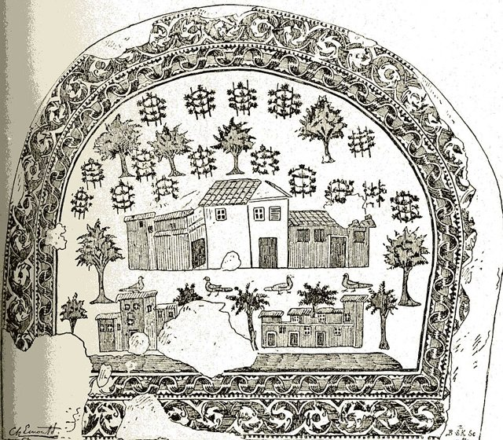
西元 301 年戴克里先頒布《限價敕令》，332 年君士坦丁頒布《對殖民者的敕令》把隸農（coloni）釘死在土地上，376 年前後各行會成員被立法強制世襲職業。這一連串看似瑣碎的法令，其實是社會結構史上最大案件的作案現場：**自由公民社會如何在三世紀內逐步變形為封建社會**。476 年西羅馬滅亡常被寫成「帝國的死亡」，但真正的死者更早——是「自由農 + 城市公民 + 金屬貨幣稅」這套古典社會結構。本案偵破：莊園與農奴制不是蠻族帶來的，而是帝國為求存自己鑄造的。

[→ 對外連結：0300-晚期羅馬與莊園化：從公民到農奴的最後一里路](https://chad-liu.github.io/books/html/1-6-8.社會結構史/0300-晚期羅馬與莊園化.html)

## 476 | 西羅馬崩潰與封建莊園

476年，日耳曼將領奧多亞克廢黜西羅馬末帝——西羅馬帝國正式落幕。偵辦這樁「文明倒退」案件會發現：崩潰的關鍵是**經濟網路的解體**——貿易萎縮、貨幣消失、城市衰退，長距離交換的交易成本重新超過自給的收益。社會組織隨之「縱向化」：市場（非人格交換）讓位於莊園（人身依附）——農民以自由換保護，領主以土地換效忠。封建制不是野蠻倒退，而是「交易成本上升後的組織重構」——波蘭尼筆下市場從社會中「脫出」的鏡像案例。

[→ 對外連結：476-西羅馬崩潰與封建莊園](https://chad-liu.github.io/books/html/1-6-8.社會結構史/476-西羅馬崩潰與封建莊園.html)

## 541 | 查士丁尼瘟疫與地中海

541-549 年，鼠疫（耶爾森氏菌）沿埃及港口傳入拜占庭——查士丁尼瘟疫，史上第一次鼠疫大流行：地中海人口損失約四分之一到三分之一。這樁「疫病」案件是社會結構的重構：拜占庭的再征服大業（查士丁尼收復西地中海）因兵力與稅基崩潰而止步；波斯與阿拉伯的擴張獲得空間（七世紀的伊斯蘭征服部分是「疫病真空」的填充）；與 536-545 年「火山冬天」（晚古典小冰期）疊加——農歉與疫病雙擊。瘟疫 → 兵力、稅基、貿易的連鎖崩潰——**疫病是帝國的隱形推手**（1347 案的千年先例）。

[→ 對外連結：541-查士丁尼瘟疫與地中海](https://chad-liu.github.io/books/html/1-6-8.社會結構史/541-查士丁尼瘟疫與地中海.html)

## 605 | 科舉制與階層流動 {label="約605年"}

605 年，隋煬帝設進士科——人類史上第一個**全國標準化考試選官**制度。本案追查：當官職不再靠血統（九品中正）而靠考卷，社會結構發生什麼事？寒門士人十年苦讀換一紙功名，世家壟斷被撕開缺口，皇帝獲得直屬官僚，而全社會的聰明才智被吸進同一套經書答案。這是階層流動線（0200 種姓凍結 → 0710 均田戶籍 → 本案 → 1958 戶口）缺失的鑰匙：**流動的閥門第一次由考試分數控制**。

[→ 對外連結：0605-科舉制：考試如何重塑階層流動](https://chad-liu.github.io/books/html/1-6-8.社會結構史/0605-科舉制與階層流動.html)

## 710 | 均田戶籍與唐宋戶等制 {label="約710年"}
710 年前後唐玄宗整頓戶籍：均田制授口分田、租庸調按丁徵收、戶分九等（後宋分五等主客戶）。本案兇手是一套**戶籍—土地—稅役三位一體的社會作業系統**：國家不直接統治人，統治「戶籍上的丁口與田畝」。對比羅馬的人頭稅（奧古斯都）與印度的種姓鎖定（0200 案），中華帝國的發明是**可更新、可檢括、可流動但逃不掉的戶口**——黃冊一修，誰納稅、誰免役、誰是客戶（佃戶）一目了然。

戰亂戶口亡失 —均田＋租庸調＋九等戶→ 可課稅的編戶社會 → 兩稅法的 Walk

[→ 對外連結：0710-均田戶籍與唐宋戶等制：國家如何給每個人定價](https://chad-liu.github.io/books/html/1-6-8.社會結構史/0710-均田戶籍與唐宋戶等制.html)

## 950 | 重犁三圃制農業革命
西元 900-1100 年，歐洲發生一場安靜的農業革命：**重犁**（翻耕北歐黏土）、**三圃制**（休耕從 1/2 降到 1/3）、**馬項圈**（馬力替代人力）、**水車與風車**（水能替代人力）——四項技術合流，農業產出躍升三成以上。剩餘增加 → 人口倍增 → 城市復興 → 貿易重啟——封建世界的「權力碎片化」中，市場與城市開始反攻。林恩·懷特（Lynn White）的技術決定論經典案例：技術改變了土地、剩餘與階層的算式，中古後半期的商業革命與大學誕生都在其上。

[→ 對外連結：950-重犁三圃制農業革命](https://chad-liu.github.io/books/html/1-6-8.社會結構史/950-重犁三圃制農業革命.html)

## 1100 | 商業革命與行會
1050-1300 年，歐洲爆發商業革命：自治城市（「城市的空氣使人自由」）、行會、香檳集市、銀行與**複式記帳**——中世紀的市場從村落集市長成國際網絡。偵辦此案的核心線索是**記錄技術**：複式記帳（每一筆交易記兩次：借與貸）讓商業第一次「可以計算」——企業的損益、資產與負債可以核對。桑巴特稱複式記帳為「資本主義的計算精神」，韋伯視之為理性化的標誌。這是從「人情商業」到「計算商業」的組織革命，股份公司（1602 案）與金融革命（1688 案）都在其上。

[→ 對外連結：1100-商業革命與行會](https://chad-liu.github.io/books/html/1-6-8.社會結構史/1100-商業革命與行會.html)

## 1185 | 日本武士與封建社會
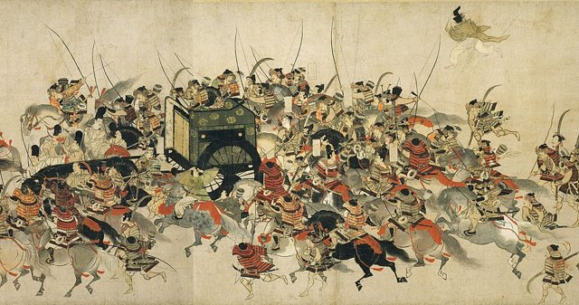
1185 年源賴朝在壇之浦殲滅平家，1192 年受任「征夷大將軍」，在鎌倉設立幕府——天皇仍在京都，但實權移往武士集團的東國政府。日本自此展開近七百年的「雙重政權」：公家（朝廷）與武家（幕府）並立。本案偵破一個比較史的大謎題：**日本在與歐洲幾乎零接觸的條件下，演化出與西歐高度相似又關鍵不同的封建結構**——采邑、騎士（武士）、領主效忠、世襲身分，全都在 12–13 世紀前後獨立出現。相似處指向結構的普遍邏輯，差異處指向文化與制度的路徑依賴。

[→ 對外連結：1185-日本武士與封建社會：武士團與封建社會的並行實驗](https://chad-liu.github.io/books/html/1-6-8.社會結構史/1185-日本武士與封建社會.html)

## 1315 | 大飢荒與氣候震盪
1315-1317 年，連年暴雨與低溫襲擊歐洲（史稱「狼雨」Wolfsjahr）——收成連續三年腰斬，穀價漲三倍，部分地區餓死 10-15% 人口。這樁「氣候」案件是「非技術因素重構社會」的經典：中世紀溫暖期的頂點（950 案的人口倍增）已撞上土地的極限——氣候波動把「馬爾薩斯頂點」戳破。社會後果：犯罪與動亂（糧食暴動、吃人傳聞）、北歐擴張的轉折（維京格陵蘭殖民的衰落起點）、以及為 1347 黑死病的脆弱結構鋪路（1315 飢荒 + 1347 疫病雙擊）。**氣候是社會結構的隱形變數**——小冰期（1600s）、歐洲大飢荒（1315）、愛爾蘭飢荒（1846）是同一主題的變奏。

[→ 對外連結：1315-大飢荒與氣候震盪](https://chad-liu.github.io/books/html/1-6-8.社會結構史/1315-大飢荒與氣候震盪.html)

## 1347 | 黑死病與勞動力市場

1347-1351 年，鼠疫（黑死病）殺死歐洲三分之一到一半的人口。這樁「人口災難」案件是經濟學的天然實驗室：勞力驟減 → **勞動變稀缺** → 實際工資翻倍 → 農奴制的鎖鏈斷裂（西歐）；而東歐反向走向「再封建化」。Malthus 的陷阱被反轉：土地不再稀缺、人力才稀缺——工資與地租的天平倒轉，階級力量的對比重組。這是史上最嚴酷的一次「勞動力市場休克」，證明了古典經濟學的邊際原理在整個社會結構上的作用。

[→ 對外連結：1347-黑死病與勞動力市場](https://chad-liu.github.io/books/html/1-6-8.社會結構史/1347-黑死病與勞動力市場.html)

## 1368 | 明朝里甲與戶役制
1368 年，明太祖建國即編里甲：110 戶為一里，輪流充役；農戶、軍戶、匠戶**世襲其籍，不許改業**。本案追查：黑死病（1347）之後西歐農奴制瓦解，中國為何反向**強化人身束縛**？答案是戰爭創傷＋稅收飢渴：元末戰亂戶口減半，朱元璋用里甲—黃冊—魚鱗冊把殘存人口一一定格，稅役直達每戶。這是 0710 均田戶籍案到 1958 戶口案之間缺失的鎖鏈：**中國編戶傳統的明代強化版**。

[→ 對外連結：1368-明朝里甲與戶役制：把每個人釘在格子裡](https://chad-liu.github.io/books/html/1-6-8.社會結構史/1368-明朝里甲與戶役制.html)

## 1440 | 古騰堡印刷術

1450 年前後，美因茨的金匠古騰堡組合出活字金屬鑄字、油墨與螺旋壓印機——1455 年的《四十二行聖經》問世。這樁「複製技術」案件是社會結構的深層重構：書的複製成本下跌兩個數量級 → 知識從修道院的稀缺品變成城市商品 → 識字擴張 → 宗教權威（教會對經文的壟斷）崩解 → 民族語言與民族國家成形。愛森斯坦（Eisenstein）稱之為「作為變革動因的印刷機」；安德森（Anderson）的「印刷資本主義」催生想像的共同體——民族主義。每一種「複製知識的技術」都重畫一次社會結構，本案是其中最徹底的一次。

[→ 對外連結：1440-古騰堡印刷術](https://chad-liu.github.io/books/html/1-6-8.社會結構史/1440-古騰堡印刷術.html)

## 1492 | 哥倫布與美洲殖民體系

1492 年 10 月 12 日，哥倫布抵達巴哈馬群島——表面是「地理發現」，實則是社會結構的全球重構案。偵辦會發現三層結構變化：**疫病的無形征服**（免疫孤島崩潰，原住民人口百年內死亡約九成）、**貢賦制的海外複製**（encomienda 委託監護制，把舊大陸的貢賦國家搬到新大陸）、**史上第一個官方種族階層**（casta 制度，從半島人到奴隸的金字塔）。大西洋經濟自此誕生——兩個隔絕一萬兩千年的生物圈重新接通，社會結構在兩岸同時重畫。

[→ 對外連結：1492-哥倫布與美洲殖民體系](https://chad-liu.github.io/books/html/1-6-8.社會結構史/1492-哥倫布與美洲殖民體系.html)

## 1498 | 大航海與世界體系

1498 年 5 月，達伽馬繞過好望角抵達印度卡利卡特——歐亞海上直航打通；四年前的 1492，哥倫布西航到美洲。兩條航線合流，人類第一次有**全球性貿易網**：香料、白銀、絲綢、作物、人力在三大洋循環。這樁「航路」案件是社會結構的全球重構：世界體系（Wallerstein）的「中心-半邊陲-邊陲」分工成形——歐洲成為金融與海權中心，美洲與非洲成為資源與勞力邊陲，亞洲仍在生產中心但漸被白銀纏入。地理交換自此開始重畫全球的經濟與階層地圖。

[→ 對外連結：1498-大航海與世界體系](https://chad-liu.github.io/books/html/1-6-8.社會結構史/1498-大航海與世界體系.html)

## 1500 | 火器革命與軍事財政國家
約 1500–1700 年，歐洲發生**火器革命**（Military Revolution，羅伯茨—帕克）：火繩槍—加農炮—棱堡（trace italienne）—常備軍—軍艦——**戰爭成本爆炸**；此前：1453 君士坦丁堡（大炮）、百年戰爭末期（火炮）、1494 查理八世入侵義大利（機動炮「野戰炮」）——**火器的亮相**。此後：常備軍（法國 1445，西班牙）、財政國家（稅收—國債）、三十年戰爭（1618）、絕對主義（路易十四）——**現代國家**。理論：Tilly「戰爭造國家」（war made states）——**本卷是社會學命題的戰場版**。這樁案件是「成本的政治」：**火器越貴，國家越大**。

[→ 對外連結：1500-火器革命與軍事財政國家：戰爭造國家](https://chad-liu.github.io/books/html/1-6-8.社會結構史/1500-火器革命與軍事財政國家.html)

## 1517 | 宗教改革與印刷媒體

1517 年 10 月 31 日，路德把《九十五條論綱》貼上維滕貝格教堂門——兩週內傳遍德意志，兩個月內傳遍歐洲。這樁「論戰」案件的偵辦重點：路德的勝利不在神學，而在**媒體**——古騰堡印刷術（1440 案）讓論綱、小冊、德文聖經以史無前例的速度複製。教會對經文的壟斷崩解 → 譯經 → 識字 → 教育 → 教派分裂的政治版圖。這是「傳播技術重構權威」的經典案例——每一次媒體革命（印刷 → 報紙 → 廣播 → 社交媒體）都重畫一次權力結構，本案是第一個完整樣本。

[→ 對外連結：1517-宗教改革與印刷媒體](https://chad-liu.github.io/books/html/1-6-8.社會結構史/1517-宗教改革與印刷媒體.html)

## 1545 | 波托西白銀與價格革命

1545 年，安第斯山脈海拔四千公尺的波托西（Potosí）銀山被發現——十六至十八世紀，美洲產出約 15 萬噸白銀，波托西獨占一半，人口一度達 15 萬（世界最大城市之一）。偵辦這樁「白銀洪流」案件會發現：白銀不只是金錢，而是**全球化的血液**——經塞維利亞流入歐洲（價格革命），經阿卡普爾科-馬尼拉流入中國（明朝白銀化）。貨幣數量論（MV=PY）第一次在全球尺度被驗證：白銀湧入 → 物價革命 → 實際工資下跌 → 社會衝擊；西班牙得了「資源詛咒」，製造業反被荷英承接。

[→ 對外連結：1545-波托西白銀與價格革命](https://chad-liu.github.io/books/html/1-6-8.社會結構史/1545-波托西白銀與價格革命.html)

## 1550 | 美洲作物與人口革命
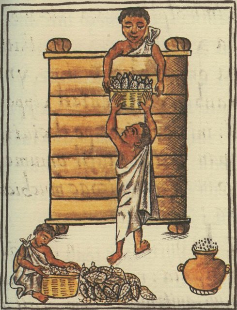
哥倫布交換最沉默卻最深遠的部分：**新食物**。玉米、馬鈴薯、番薯、花生、番茄、辣椒從美洲擴散到歐亞非（16-18 世紀），改寫了三洲的人口地圖——中國人口從明末約 1.5 億增到清末 4 億多（番薯玉米支撐山地開發，史稱「康乾盛世」的隱形推手）；愛爾蘭靠馬鈴薯人口爆炸（1846 案的伏筆）；非洲的木薯玉米（殘酷地）支撐了奴隸貿易的供給面。這是「熱量密度」的社會學：一種作物改一個大陸的階層與人口結構——農業全球化的第一次浪潮。

[→ 對外連結：1550-美洲作物與人口革命](https://chad-liu.github.io/books/html/1-6-8.社會結構史/1550-美洲作物與人口革命.html)

## 1601 | 濟貧法與教區社保
1601 年伊莉莎白《濟貧法》（Poor Relief Act）：各教區（parish）開徵濟貧稅，救濟老弱病殘，懲戒遊民，學徒安置孤兒。本案兇手是**屬地—屬人綁定的社保原型**：遷徙需「定居證」（settlement certificate），本教區只養本區窮人。圈地運動製造的流民潮（見 [黑死病與勞動力市場](https://chad-liu.github.io/books/html/1-6-8.社會結構史/1347-黑死病與勞動力市場.html) 後續）第一次被「稅收＋教區＋濟貧官」接住——現代福利國家的源代碼在此編譯。

圈地＋物價革命＋流民 —教區稅＋定居法＋分類救濟→ 屬地社保 → 濟貧—勞動規訓

[→ 對外連結：1601-濟貧法與教區社保：誰為窮人買單](https://chad-liu.github.io/books/html/1-6-8.社會結構史/1601-濟貧法與教區社保.html)

## 1602 | 東印度公司與股份制

1602 年，荷蘭議會特許「聯合東印度公司」（VOC）——人類第一家可轉讓股份、永久存續的股份公司誕生；同年阿姆斯特丹證券市場開張。這樁「組織發明」案件是社會結構的深層重構：**公司成為超越個人生命的法人**——出資人以有限風險（認繳額）換取遠洋貿易的暴利機會，資金規模首次超越任何家族或王室的財力。股份制 + 證交所 + 有限責任，三件套讓「資本」成為可集合、可流通、可繼承的獨立存在——資本主義的組織硬體自此安裝，殖民帝國（VOC 自己就是半個政府）與現代企業同源而生。

[→ 對外連結：1602-東印度公司與股份制](https://chad-liu.github.io/books/html/1-6-8.社會結構史/1602-東印度公司與股份制.html)

## 1618 | 三十年戰爭與西發里亞體系

1618-1648 年，三十年戰爭席捲歐洲——德意志人口損失三分之一到一半（部分地區）。這樁「宗教戰爭」案件是政治結構的重構：1648 年西發里亞和約確立**主權國家體系**——內政不容干涉、教隨國定的擴展、勢力均衡。表面是和約，實則是「宗教衝突的政治解」：宗教不再是政治的終極理由（「教派的邊界」變成「國家的邊界」）——現代國際體系（主權、外交、國際法）的誕生。常備軍與財政-軍事國家（Brewer）同步成形——1688 案的金融革命、1789 案的民族國家都在西發里亞體系的骨架上生長。

[→ 對外連結：1618-三十年戰爭與西發里亞體系](https://chad-liu.github.io/books/html/1-6-8.社會結構史/1618-三十年戰爭與西發里亞體系.html)

## 1650 | 大西洋奴隸貿易與種植園社會

1501 年首批非洲奴隸抵達美洲；1650-1850 年達到高峰——總計約 1250 萬人被強制渡越大西洋（中段航程死亡 12-15%），是人類史上最大規模的強制遷徙。偵辦這樁「三角貿易」案件會發現三層結構：**經濟**（糖棉的種植園規模經濟 + 美洲勞力真空）、**法律**（「人」被財產化——種族奴隸法典是新的法律發明）、**社會**（非洲人口結構被抽血、美洲種族社會的誕生）。這是地理交換（1492 案）最黑暗的一面：白銀、作物與人力構成大西洋經濟的三角循環。

[→ 對外連結：1650-大西洋奴隸貿易與種植園社會](https://chad-liu.github.io/books/html/1-6-8.社會結構史/1650-大西洋奴隸貿易與種植園社會.html)

## 1688 | 光榮革命與金融革命

1688 年，英國議會迎荷蘭的威廉三世入主，廢黜詹姆斯二世——光榮革命確立議會主權。1694 年英格蘭銀行成立，政府公債利率從戰前的 10-14% 降到 1730 年代的 3%——「金融革命」。偵辦此案的核心線索是**可信承諾**（credible commitment）：議會掌握錢包 → 王室無法賴帳 → 債權人敢借 → 政府能以低利率融資打戰。North-Weingast（1989）的經典論文證明：**制度的可信度決定資本的價格**——財政-軍事國家的崛起、英國的霸權與工業革命資本，都從這樁「制度設計」案件出發。

[→ 對外連結：1688-光榮革命與金融革命](https://chad-liu.github.io/books/html/1-6-8.社會結構史/1688-光榮革命與金融革命.html)

## 1700 | 英國農業革命與圈地
1769 年瓦特改良蒸汽機、工廠制誕生（[瓦特蒸汽機與工廠制](https://chad-liu.github.io/books/html/1-6-8.社會結構史/1769-瓦特蒸汽機與工廠制.html)）的劇本，通常被讀成「技術革命」的開場。但劇本的第一頁其實寫在農田裡：1700 年前後一百年間，英國以諾福克四區輪作、選種育種、新農具與大規模圈地，把農業產出推高了近一倍，同時把大量農村人口與土地控制權一起「釋放」出來。本案偵破：**工業革命需要的三種要素——剩餘糧食、自由勞動力、集中資本——是如何在農場上被生產出來的**。沒有這場農業前傳，蒸汽機只能停在礦井抽水。

[→ 對外連結：1700-英國農業革命與圈地：工業革命的前傳](https://chad-liu.github.io/books/html/1-6-8.社會結構史/1700-英國農業革命與圈地.html)

## 1736 | 倫敦琴酒狂熱
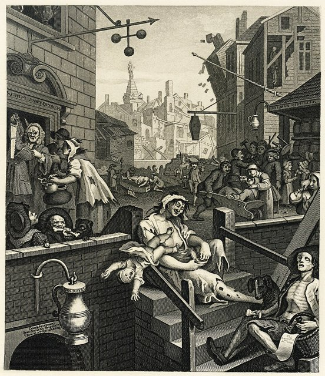
18 世紀上半葉，倫敦琴酒（杜松子烈酒）泛濫：1720s–50s，人均年飲數加侖（一說），「一便士就醉，兩便士醉死」（招牌），犯罪、棄嬰、死亡率飆升。議會連頒琴酒法案（1729、1736、1743、1751）：1736 年重稅+零售許可（天價牌照，意在禁絕），引發暴動（牌照持有者被砸）；1751 年法案（溫和管制+鼓勵啤酒）奏效，狂熱退潮。**一杯酒，如何逼出五部法律？**

> **貧民為何酗酒？當琴酒比啤酒便宜、比水乾淨，窮人的選擇是理性，還是絕望？**

[→ 對外連結：1736 琴酒狂熱：杜松子酒與倫敦貧民窟](https://chad-liu.github.io/books/html/1-6-8.社會結構史/1736-倫敦琴酒狂熱.html)

## 1769 | 瓦特蒸汽機與工廠制

1769 年，格拉斯哥的儀器技師瓦特取得分離冷凝器專利——蒸汽機的效率躍升四倍。這樁「動力革命」案件是社會結構的大重構：蒸汽機讓**工廠**第一次可以離開河岸（水力束縛）→ 工廠集中於城市 → 勞動集中 → 城市化爆炸（曼徹斯特 1773 年 2.3 萬人 → 1851 年 30 萬）；**時間紀律**（工廠鐘、輪班）取代自然時序——E.P. Thompson 稱之為「工業資本主義的時間」。人力 → 機器的能量轉換，重畫了勞動階層、家庭結構與城市的地圖——工業革命的核心案件。

[→ 對外連結：1769-瓦特蒸汽機與工廠制](https://chad-liu.github.io/books/html/1-6-8.社會結構史/1769-瓦特蒸汽機與工廠制.html)

## 1776 | 國富論與市場社會
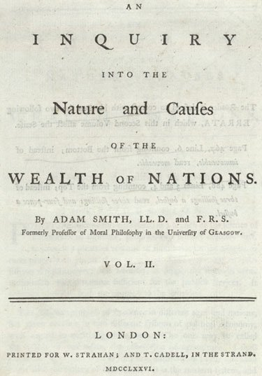
1776 年 3 月 9 日，亞當·斯密出版《國富論》。這樁「理論」案件為正在發生的工業革命提供了**認知地圖**：分工（製針工廠的經典算式——10 人分工日產 48000 枚 vs 一人 20 枚）、市場規模限制分工、看不見的手（自利 → 公利）。波蘭尼（1944）則揭露其社會後果：土地、勞動、貨幣被「商品化」——**市場社會**誕生：一切（包括人的勞動力）都按價格買賣。這是經濟從社會中「脫嵌」的理論宣言，也是此後兩百年「市場 vs 社會保護」鐘擺的起點。

[→ 對外連結：1776-國富論與市場社會](https://chad-liu.github.io/books/html/1-6-8.社會結構史/1776-國富論與市場社會.html)

## 1789 | 法國大革命與民族國家

1789 年 7 月 14 日，巴黎民眾攻陷巴士底獄。這樁「革命」案件是現代政治的誕生：**公眾輿論**（印刷沙龍、報紙、咖啡館——哈伯瑪斯的公共領域）第一次成為政治力量；**徵兵制**（levée en masse，1793）把全體人民變成戰爭主體——民族（nation）取代王朝成為政治共同體；**人權宣言**（8 月 26 日）把正當性從君權神授改寫為人民主權。拿破崙法典（1804）與行政中央集權把革命成果制度化——現代民族國家的作業系統自此安裝，並隨拿破崙戰爭輸出全歐。

[→ 對外連結：1789-法國大革命與民族國家](https://chad-liu.github.io/books/html/1-6-8.社會結構史/1789-法國大革命與民族國家.html)

## 1796 | 牛痘疫苗與免疫

1796 年 5 月 14 日，英國鄉村醫師琴納為 8 歲的菲普斯接種牛痘（cowpox），六週後再接種天花——孩子免疫。這樁「疫苗」案件是醫學與政治的雙重誕生：**免疫學**的實證起點（感染較輕的牛痘可防天花——交叉免疫）、**國家衛生權力**的開端（1853 英國強制接種法——「身體的國家化」）。天花當時每年殺死歐洲 40 萬人、死亡率 30%；疫苗讓天花在 1980 年被全球根除（人類史上唯一）。群體免疫的數學（ pc = 1 - 1/R0 ）讓「個人接種」升級為「公共財」——公共衛生國家的第一塊基石（1854 案霍亂在其上）。

[→ 對外連結：1796-牛痘疫苗與免疫](https://chad-liu.github.io/books/html/1-6-8.社會結構史/1796-牛痘疫苗與免疫.html)

## 1819 | 彼得盧屠殺

1819 年 8 月 16 日，曼徹斯特聖彼得廣場逾六萬工人和平集會，要求普選權與廢除《穀物法》，地方官派出義勇騎兵以軍刀驅散——十五死、逾六百傷。諷刺的命名（Peterloo＝St Peter＋Waterloo）道盡一切：打敗拿破崙的軍隊回頭砍自己的工人。這樁介於法國大革命（1789）與鐵路時代（1825）之間的血案，是英國工人階級從「機器破坏者」變成「選票 đòi hỏi者」的轉折點——此前抗議砸機器（盧德），此後抗議要議席。

[→ 對外連結：1819-彼得盧屠殺：六萬人聽演講、騎兵拔刀的政治案](https://chad-liu.github.io/books/html/1-6-8.社會結構史/1819-彼得盧屠殺.html)

## 1825 | 鐵路與全國市場

1825 年 9 月 27 日，史托克頓-達靈頓鐵路通車——蒸汽機車（史蒂芬生）首次公共客貨運輸。這樁「軌道」案件是市場與組織的雙重重構：鐵路把**全國市場**縫合（運費降 80%、時間從天縮到小時）、把**標準時間**強加給全國（各地太陽時被鐵路時刻表取代，1884 格林威治標準）、並催生**管理革命**——錢德勒（1977）《看得見的手》：鐵路是第一家需要職業經理人層級的大型組織。資本市場（鐵路股票佔紐交所大半）、時區、管理層級、全國品牌——現代經濟的骨架由軌道澆鑄。

[→ 對外連結：1825-鐵路與全國市場](https://chad-liu.github.io/books/html/1-6-8.社會結構史/1825-鐵路與全國市場.html)

## 1844 | 電報與即時通訊
1844 年 5 月 24 日，莫爾斯在華盛頓發出「What hath God wrought」——電報把通訊第一次與**交通**分離：信息跑得比火車、比輪船快。這樁「電流傳信」案件是信息結構的重構：新聞從「周報」變「即時」、金融套利被壓縮（倫敦-紐約價差在電纜通後數日內消失）、帝國獲得「即時統治」能力（1866 大西洋電纜、帝國電報網）。Jevons（1871）以小麥價格證明：**信息成本下降 = 市場整合**。電報是現代通訊技術鏈（電報 → 電話 → 廣播 → 網路）的第一環——每一次都重畫市場、新聞與政治的結構。

[→ 對外連結：1844-電報與即時通訊](https://chad-liu.github.io/books/html/1-6-8.社會結構史/1844-電報與即時通訊.html)

## 1846 | 愛爾蘭大飢荒與大移民
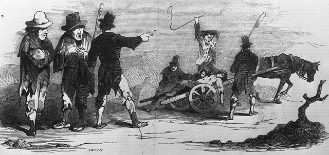
1845-1849 年，馬鈴薯晚疫病（Phytophthora infestans）襲擊愛爾蘭——人口從 850 萬降到 655 萬（百萬餓死、百萬移民），1841-1900 年移民總數逾 400 萬。這樁「單一作物」案件是社會結構的跨洋重構：愛爾蘭農民靠一英畝馬鈴薯過活（1550 案的人口爆炸）——單一化的脆弱結構 + 英國政策的自由放任（穀物法 1846 同年廢除——糧食出口未禁止）= 史上最慘飢荒之一。移民改寫了美國的社會結構：波士頓、紐約的愛爾蘭勞工、天主教堂網、政治機器（Tammany Hall）——**移民是社會結構的出口閥與輸入管**：愛爾蘭失去人口，美國得到城市工人階級與天主教少數。

[→ 對外連結：1846-愛爾蘭大飢荒與大移民](https://chad-liu.github.io/books/html/1-6-8.社會結構史/1846-愛爾蘭大飢荒與大移民.html)

## 1848 | 共產黨宣言

1848 年 2 月，倫敦利物浦街一家小印刷所印出二十三頁德文小冊子《共產黨宣言》；數週內巴黎二月革命爆發，「民族之春」席捲歐洲五十國。兇手不是馬克思與恩格斯的文采，而是三力咬合：工業化製造的無產階級、正義者同盟的組織網絡，與印刷技術加持的小冊子傳播。本案追問：為什麼一份委託撰寫的黨綱，成為此後一百年社會結構重構的總劇本？

[→ 對外連結：1848-共產黨宣言：革命之春、階級政治與小冊子的傳播力案件](https://chad-liu.github.io/books/html/1-6-8.社會結構史/1848-共產黨宣言.html)

## 1854 | 斯諾霍亂與公共衛生
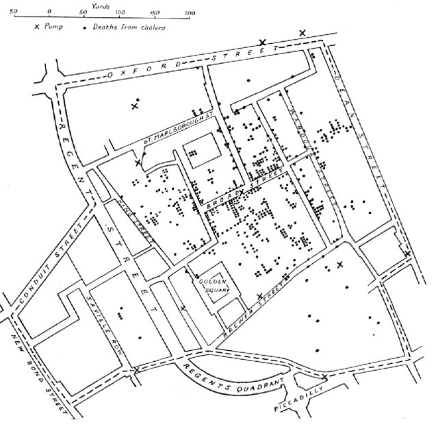
1854 年夏，倫敦蘇活區霍亂爆發——十天內五百餘人死亡。麻醉科醫師 John Snow 標點死者住址於地圖，發現死亡集中於布羅德街的公共水泵——拆掉泵柄，疫情止息。這樁「泵柄」案件是**流行病學**的誕生：以數據地圖（最早的空間流行病學）推翻「瘴氣論」——霍亂經水傳播（Vibrio 要到 1883 才被科赫發現）。推理的結論是政治的：水是公共事務——1858 年起巴澤爾傑特的下水道系統（1865 完成）改造倫敦，城市死亡率崩降——**公共衛生國家**誕生：下水道、自來水、衛生局——城市可住性的基礎設施革命。

[→ 對外連結：1854-斯諾霍亂與公共衛生](https://chad-liu.github.io/books/html/1-6-8.社會結構史/1854-斯諾霍亂與公共衛生.html)

## 1867 | 資本論與階級政治
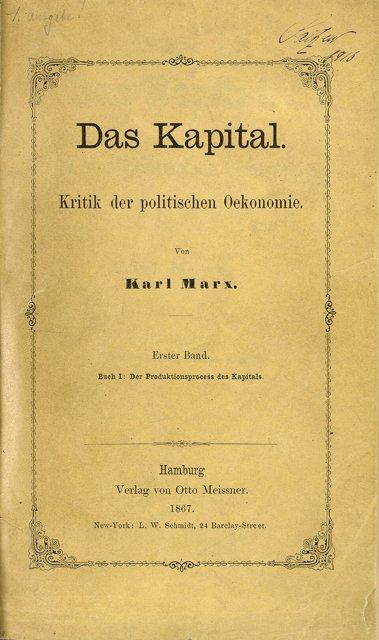
1867 年 9 月 14 日，馬克思《資本論》第一卷出版。這樁「理論」案件為工業社會的核心矛盾命名：**剩餘價值**——工人的勞動創造的價值超過其工資，差額即利潤之源（剝削）。表面是經濟學，實則是階級政治的武器：把工廠的日常矛盾（工時、工資、危險）理論化為「階級衝突」——工會、社會民主黨、八小時運動（1886 五一）自此有了理論語言。馬克思不是發明階級衝突（工廠裡早已存在），而是**為衝突命名、組織與預言**——20 世紀的政治分野（社會主義 vs 資本主義）由此案鋪路。

[→ 對外連結：1867-資本論與階級政治](https://chad-liu.github.io/books/html/1-6-8.社會結構史/1867-資本論與階級政治.html)

## 1869 | 黑手黨起源
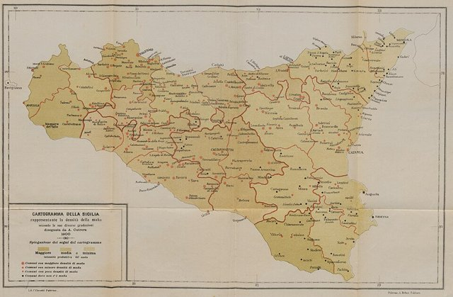
1869 年（一說），西西里巴勒摩省長報告首次用「黑手黨」指有組織犯罪。此前：1860 加里波第統一（南部併入義大利）、1861–65 徵兵+重稅、柑橘出口繁榮（英國要檸檬治壞血病）。此後：黑手黨收保護費、滲透政治（選票）、移民美國（新奧爾良1890 警察局長被殺案、紐約五大家族）。**統一為何養出黑幫？當國家來了又好像沒來，西西里的秩序誰維持？**

> **黑手黨是犯罪，還是影子政府？當保護費比稅收管用，黑手黨人是匪，還是官？**

[→ 對外連結：1869 黑手黨：西西里柑橘園與保護費](https://chad-liu.github.io/books/html/1-6-8.社會結構史/1869-黑手黨起源.html)

## 1870 | 義務教育與國民塑造
1870 年前後，一場安靜但深刻的社會工程在全球同步展開：英國 1870《福斯特教育法》、法國 1881–1882 費里法（免費、義務、世俗）、普魯士早已實行的義務就學、日本 1872《學制》。不到半世紀，歐洲與日本的識字率從少數精英的特權躍升為多數成人的標配。本案偵破的謎題：**為什麼國家突然願意花大錢教育平民？** 表面答案是啟蒙與進步，真實答案寫在 1870 年普法戰爭的戰報與工廠的車間裡——國家需要能讀操典的士兵、能看圖紙的工人、能用國語投票的公民。

[→ 對外連結：1870-義務教育與國民塑造：製造「國民」的工廠](https://chad-liu.github.io/books/html/1-6-8.社會結構史/1870-義務教育與國民塑造.html)

## 1871 | 巴黎公社
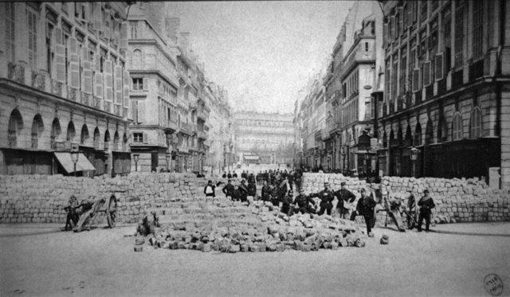
1871 年 3 月 18 日至 5 月 28 日，巴黎工人、國民自衛軍、婦女俱樂部在普法戰爭慘敗、政府逃往凡爾賽後接管首都，建立人類史上第一個「無產階級政權」雛形——公社委員會、麵包限價、夜校、婦女同工同酬令。七十二天後，凡爾賽軍自西門長驅直入，「流血週」屠殺逾萬人，盧浮宮與杜樂麗宮付之一炬。夾在《共產黨宣言》（1848）與《資本論》（1867）之後、電力城市（1882）之前，公社是**理論第一次肉身下場**：馬克思为之改寫《法蘭西內戰》，巴枯寧、蒲魯東的信徒在街壘上吵架，女社員在救護站與印刷所兩頭跑。

[→ 對外連結：1871-巴黎公社：七十二天、婦女與焚城的自治實驗案](https://chad-liu.github.io/books/html/1-6-8.社會結構史/1871-巴黎公社.html)

## 1882 | 電力系統與現代城市
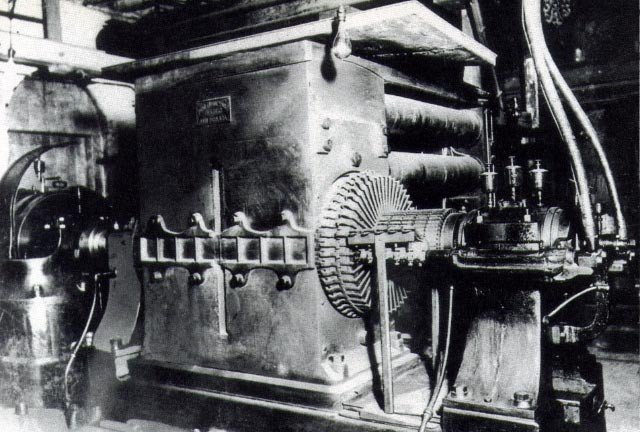
1882 年 9 月 4 日，愛迪生的珍珠街發電廠點亮紐約華爾街——電力系統誕生；1891-93 年特斯拉與西屋的交流電贏得傳輸之戰（尼加拉瀑布電廠 1895）。這樁「電流」案件是城市與工業的雙重重構：電梯（1852/1889）+ 鋼架 + 電燈 → **摩天樓**（城市向天發展）；電燈 → 夜間城市與夜班；電車 → 郊區化；電力工廠 → 佈局自由。保羅·大衛（Paul David, 1990）的經典研究揭示：**電力的生產力紅利滯後了四十年**（1880s 引入，1920s 才兌現）——因為紅利不在機器，而在**組織重構**（單位驅動 → 中央電站 + 輕型機器自由佈局）。技術紅利 = 組織改造，是本案最深遠的推理。

[→ 對外連結：1882-電力系統與現代城市](https://chad-liu.github.io/books/html/1-6-8.社會結構史/1882-電力系統與現代城市.html)

## 1883 | 俾斯麥社保與福利國家起源
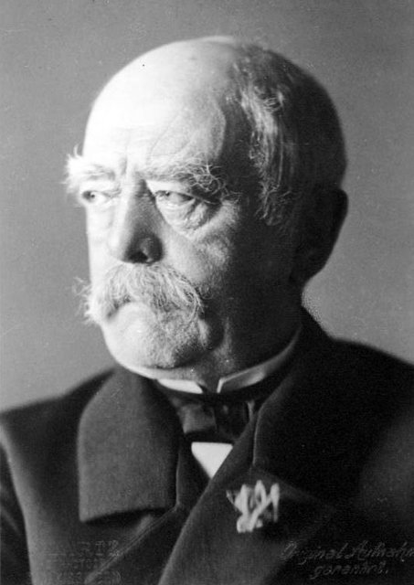
1883 年德國《疾病保險法》、1884 工傷、1889 養老——俾斯麥在鎮壓社會民主黨（《非常法》1878）的同時，給工人送上人類史上第一套**強制性社會保險**。本案兇手是「胡蘿蔔加大棒」的制度套餐：國家以雇主＋工人＋補貼三方缴费，換取工人對帝國的忠誠。口號直白：「讓工人把養老金看作國家的恩惠，就不會去革命。」保險單即選票，精算表即政治學。

工業化＋工人運動＋戰爭動員需求 —強制三方缴费＋待遇掛鉤→ 保險型福利國家 → 去商品化

[→ 對外連結：1883-俾斯麥社保與福利國家起源：鐵血宰相為何給工人買保險](https://chad-liu.github.io/books/html/1-6-8.社會結構史/1883-俾斯麥社保與福利國家起源.html)

## 1885 | 巴斯德細菌革命

1860s-1885 年，巴斯德（Pasteur）與科赫（Koch）建立起**細菌學說**：1862 巴氏滅菌、1876 科赫證明炭疽桿菌、1882 結核桿菌、1881-85 巴斯德的疫苗（禽霍亂、炭疽、狂犬）。這樁「看不見的敵人」案件是醫學的典範轉移（Kuhn）：瘴氣論（1854 案的對手）被**病原論**取代——「疾病有具體的看不見敵人」。李斯特（Lister, 1865）的石碳酸消毒讓手術死亡率從 45% 降到 15%。社會後果：外科的信任重建、嬰兒死亡率下降的科學基礎、食品衛生（巴氏滅菌牛奶）、**衛生國家**的科學化（實驗室國家）。柯霍氏法則（四條件證因果）更是「因果證明」的方法論模板。

[→ 對外連結：1885-巴斯德細菌革命](https://chad-liu.github.io/books/html/1-6-8.社會結構史/1885-巴斯德細菌革命.html)

## 1893 | 紐西蘭婦女參政權
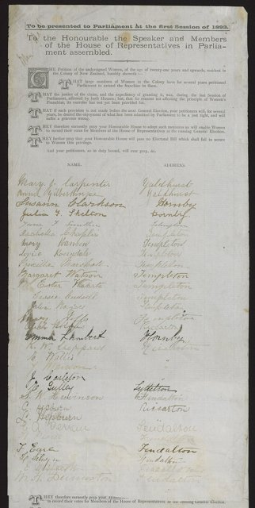
1893 年 9 月 19 日，紐西蘭總督簽署《選舉法修正案》，全球第一個所有婦女獲得國會投票權的國家誕生（澳大利亞 1902 跟進）。兇手不是進步觀念的自然擴散，而是一場持續二十四年的組織工程：基特（Kate Sheppard）領導的基督教婦女禁酒聯盟（WCTU NZ）以三次遞交數萬人簽名的巨型請願卷軸、政黨游說與酒商對抗的選票算術，把道德議題轉譯為可交付的政治籌碼。本案追查：為什麼是紐西蘭、為什麼是 1893？

[→ 對外連結：1893-紐西蘭婦女參政權：組織工程、請願技術與選票政治的案件](https://chad-liu.github.io/books/html/1-6-8.社會結構史/1893-紐西蘭婦女參政權.html)

## 1908 | 福特T型車與大眾消費
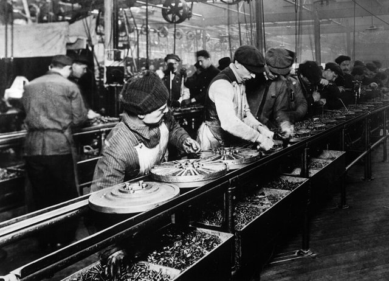
1908 年福特 T 型車上市；1913 年海蘭德公園工廠的**流水線**（assembly line）把裝配切成 84 道工序、節拍 93 分鐘——汽車價格從 850 美元跌到 260 美元，產量佔世界一半。1914 年福特宣布 5 美元日薪（市場工資的兩倍）與 1926 年五天工作週——「福特主義」誕生：**高效率生產 + 高工資 + 大眾消費**的閉環。這樁「流水線」案件重構了勞動（技能被節拍取代）、消費（大眾市場）、城鄉（公路與郊區）與勞資關係（高工資換穩定）——20 世紀中葉的社會結構（中產階級、郊區、消費社會）由流水線澆鑄。

[→ 對外連結：1908-福特T型車與大眾消費](https://chad-liu.github.io/books/html/1-6-8.社會結構史/1908-福特T型車與大眾消費.html)

## 1914 | 總體戰與社會動員
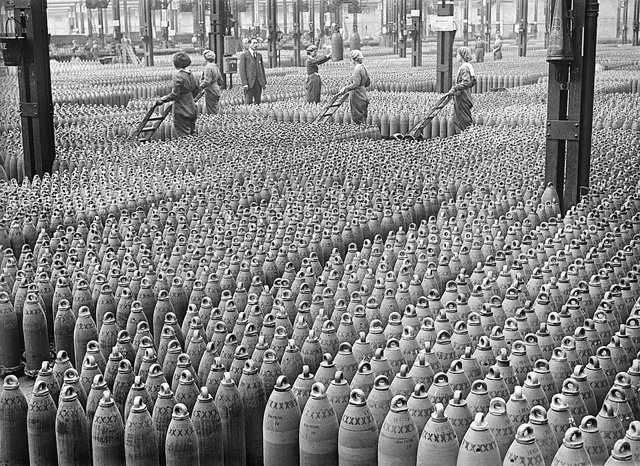
1914 年 7 月 28 日，一戰爆發——這樁「總體戰」案件是國家與社會關係的大重構：工業技術（機槍、火炮、毒氣、坦克）讓戰爭需要**全社會的動員**——千萬級軍隊、戰時經濟（國家接管工廠與配給）、婦女進入工廠與農田（彈藥廠的「軍火姐妹」）、全國配給與價格管制。帝國崩潰（奧匈、鄂圖曼、俄、德）→ 民族自決（Wilson 14 點）→ 新國家地圖；婦女勞動 → 戰後普選擴張（英 1918/1928）。**總體戰把國家滲透到社會的每個角落**——福利國家與極權國家的技術基礎，都在 1914-18 的動員機器中預演。

[→ 對外連結：1914-總體戰與社會動員](https://chad-liu.github.io/books/html/1-6-8.社會結構史/1914-總體戰與社會動員.html)

## 1917 | 俄國革命與計畫經濟

1917 年，俄國二月與十月革命——蘇聯開啟人類第一次**非資本主義的工業化實驗**：計畫經濟（Gosplan、五年計畫 1928、集體化）。這樁「計算」案件是經濟組織的極端實驗：用**中央計算**取代**市場價格**配置資源。米塞斯（1920）的計算論戰：沒有價格就沒有理性計算；蘭格（1936）的反駁：模擬市場可行；哈耶克（1945）的知識問題：分散知識無法集中。蘇聯的實驗證明兩面：動員能力（1930s 工業化速度對照大蕭條）與信息瓶頸（短缺、扭曲、崩潰 1991）。這是「計算與經濟制度」母題的世紀論戰——其迴響延伸到大數據與 AI 時代。

[→ 對外連結：1917-俄國革命與計畫經濟](https://chad-liu.github.io/books/html/1-6-8.社會結構史/1917-俄國革命與計畫經濟.html)

## 1918 | 大流感與社會重構
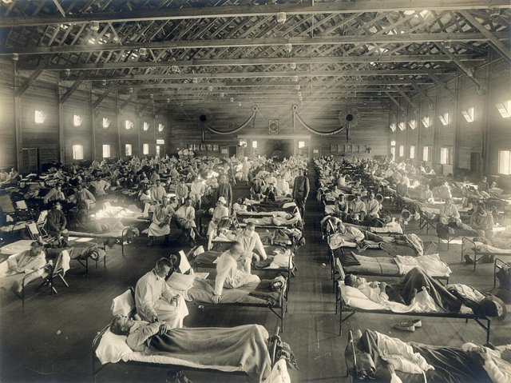
1918–1920 年，H1N1 流感（西班牙流感）在全球殺死約 5,000 萬至 1 億人——
超過一戰戰死總和，卻在戰時審查與戰後遺忘中成為「被消失的災難」。
它專殺 20–40 歲青壯年（W 形死亡曲線），癱瘓戰爭機器、重創殖民地、
催生全民公衛體系：
R0 ≈ 2–3 × 戰時動員（運兵船＋壕溝＋審查） → 三波大流行 → 青壯斷層 → 公衛國家 + 殖民正當性危機
這是第九樂章（疾病與醫療）最大的缺口——
1885 細菌革命與 1943 抗生素之間 58 年的空白，主角正是它。

[→ 對外連結：1918-大流感與社會重構](https://chad-liu.github.io/books/html/1-6-8.社會結構史/1918-大流感與社會重構.html)

## 1920 | 廣播與大眾社會

1920 年 11 月 2 日，匹茲堡 KDKA 電台播報哈定當選總統——美國大選結果第一次經由無線電波即時送進客廳。兩年內全美電台從 1 家暴增到 500 家，收音機從業餘玩家的零件盒變成家具。兇手不是單一的發射塔，而是真空管成熟、一戰軍用無線電過剩、AT&T 與 RCA 的專利池與廣告商業模式四者咬合。聲音第一次脫離現場與唱片，即時、免費、同時抵達百萬人——大眾社會（mass society）的第一個技術地基，印刷（1440 案）之後傳播半徑的第二次躍遷。

[→ 對外連結：1920-廣播與大眾社會：聲音第一次住進客廳](https://chad-liu.github.io/books/html/1-6-8.社會結構史/1920-廣播與大眾社會.html)

## 1928 | 普選與婦女參政
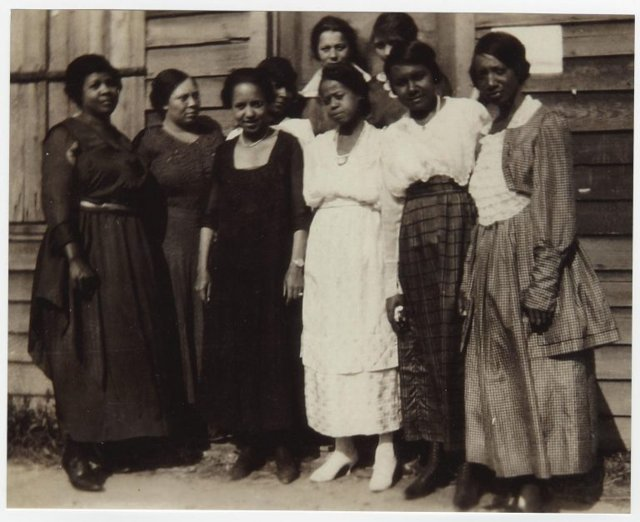
1928 年 7 月 2 日，英國《人民代表法（平等選舉權）》生效：婦女投票年齡從三十歲降至二十一歲、與男子平等——一千萬婦女新選民入場，女性選民首次與男性持平。夾在廣播時代（1920：聲音進客廳）與大蕭條（1929）之間，這是民主化的臨門一腳：沒有這一案，1929 年大選（第一次男女平等選舉、「 flapper 選舉」）與工黨 1929 年勝選、福利國家前夜皆無從談起。本案偵破的是**參政的計價公式**：婦女的選票不是恩賜，是戰爭、工業與組織三筆帳的結算。

[→ 對外連結：1928-普選與婦女參政：三十歲門檻倒塌、一千萬選票入場案](https://chad-liu.github.io/books/html/1-6-8.社會結構史/1928-普選與婦女參政.html)

## 1929 | 大蕭條與凱因斯革命

1929 年 10 月 24/29 日，紐約股市崩潰——大蕭條：美國產出跌三成、失業 25%、通縮螺旋，全球蔓延。這樁「崩潰」案件推翻了古典經濟學的自信（「市場自動回復」）——1936 年凱因斯《就業、利息與貨幣通論》給出理論革命：**有效需求**決定產出，失業可持續存在，政府必須干預（乘數效應）。費雪（1933）的債務-通縮螺旋補完機制。國家與市場的關係自此改寫：新政（羅斯福）、社會保險、金融管制——福利國家（1944 案）的理論與政治基礎。這是「市場失靈 → 國家干預」的世紀轉折。

[→ 對外連結：1929-大蕭條與凱因斯革命](https://chad-liu.github.io/books/html/1-6-8.社會結構史/1929-大蕭條與凱因斯革命.html)

## 1930 | 人口轉型與家庭革命
1870-1930 年代，西北歐與北美完成人口轉型：死亡率率先崩降（1854、1885、1943 案的公衛與醫學），生育率隨後腰斬（法國 1800s 先行、英德美 1900s）。這樁「生育率」案件是家庭結構的革命：農業家庭（多子 = 勞力與養老保險）→ 城市家庭（多子 = 成本）——**兒童的經濟價值反轉**（Becker 1960：孩子從「資產」變「投資」）——核心家庭、晚婚、避孕技術（避孕套量產、子宮帽、口服避孕藥 1960）與女性的就業聯動。人口轉型的五階段模型（Notestein 1945）成為社會學的基石——它解釋了家庭、性別、教育與老齡化的整個現代結構。

[→ 對外連結：1930-人口轉型與家庭革命](https://chad-liu.github.io/books/html/1-6-8.社會結構史/1930-人口轉型與家庭革命.html)

## 1943 | 抗生素與人口轉型
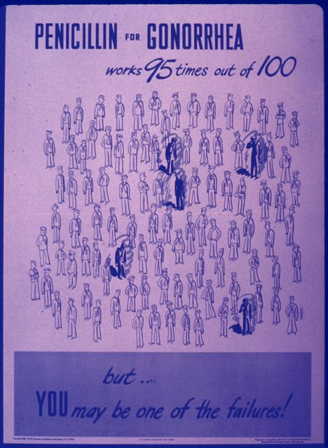
1928 年弗萊明發現盤尼西林；1940 佛羅里與錢恩純化；1943-45 年美國戰時工廠量產（1945 年月產 646 億單位）——**抗生素時代**來臨。這樁「黴菌」案件是人口結構的轉折：肺炎、敗血症、梅毒、傷寒——感染性疾病從頭號殺手變成可治——死亡率崩降（尤其嬰兒與產婦）→ 人口轉型完成（死亡率下降 → 生育率下降的中間爆炸 → 嬰兒潮）。同時：製藥產業誕生（量產技術 + 專利 + FDA 規制）、抗藥性的公地悲劇（濫用 → 耐藥菌）。抗生素是「醫學終於能治好病」的轉折點——死亡率革命的最後一塊拼圖（接 1854、1885 案）。

[→ 對外連結：1943-抗生素與人口轉型](https://chad-liu.github.io/books/html/1-6-8.社會結構史/1943-抗生素與人口轉型.html)

## 1944 | 布列頓森林與福利國家

1944 年 7 月，44 國在布列頓森林定下戰後貨幣秩序：美元錨定黃金（35 美元/盎司）、各國貨幣錨定美元、IMF 與世界銀行誕生；同年（貝弗里奇報告 1942、Polanyi《大轉型》1944）福利國家的藍圖成形。這樁「戰後秩序」案件是國家與市場關係的全面重構：**嵌入式自由主義**（Ruggie）——自由貿易 + 國內福利 + 資本管制。戰後三十年（1945-75「光輝三十年」）是史上最快的增長：中產階級擴張、大學普及、失業率 2-5%。1971 年尼克森衝擊終結金兌換 → 浮動匯率 → 金融全球化——本案是「市場與國家」鐘擺中最接近平衡的一格。

[→ 對外連結：1944-布列頓森林與福利國家](https://chad-liu.github.io/books/html/1-6-8.社會結構史/1944-布列頓森林與福利國家.html)

## 1947 | 去殖民化與民族國家量產

1947 年 8 月，印巴分治，一千萬人遷徙、百萬人喪生；此前越南八月革命（1945）、其後非洲獨立年（1960，17 國同年獨立）——三十年間世界從 70 個國家变为 170 個。本案追查：殖民帝國為何在戰後十年內雪崩？總體戰（1914、1944 案）掏空宗主國財政，殖民地士兵（一百三十萬印度兵參戰）帶回民族意識，兩個超級大國（美蘇）為搶盟友競相拆台。這是 1492 殖民體系案到 1964 民權案之間缺失的收尾：**殖民社會結構如何被民族國家取代**。

[→ 對外連結：1947-去殖民化：帝國退場與民族國家的量產](https://chad-liu.github.io/books/html/1-6-8.社會結構史/1947-去殖民化與民族國家量產.html)

## 1954 | 電視與客廳社會

1954 年，RCA 推出 CT-100——第一台量產彩色電視機（售價 1,000 美元，約當時半年工資）；同年美國電視戶突破三千萬，晚上七點全國一起看《我愛露西》。兇手不是單一的映像管，而是掃描線標準統一、戰後郊區化＋電力普及、廣告時段模式成熟與冷戰宣傳需求四者咬合。影像第一次即時進客廳，家庭的時間表、家具擺設、政治動員同時被改寫——廣播（1920 案）給了聲音，電視補上眼睛，客廳從起居空間變成全國劇場的包廂。

[→ 對外連結：1954-電視與客廳社會：影像把家庭變成劇場](https://chad-liu.github.io/books/html/1-6-8.社會結構史/1954-電視與客廳社會.html)

## 1958 | 戶口條例與城鄉二元
1958 年 1 月《戶口登記條例》：農業戶口與非農業戶口二分，遷徙需准遷證，糧油副食按戶口配給。本案兇手不是糧票本身，而是一套**戶口—配給—單位三位一體的制度柵欄**：城市戶口綁定糧油、住房、醫療、養老、子女教育，農村戶口綁定集體土地與自給。城鄉收入比從 1957 年 2.2 倍拉到 1978 年 2.6 倍，城鄉本身成為最大的階層。對比唐宋戶等制（0710 案）管汲取、英國定居法（1601 案）管救濟，1958 年戶口兩者兼管：**汲取農村、補貼城市**。

工業化趕超＋糧食短缺 —戶口＋統購統銷＋單位→ 城鄉二元均衡 → 最大階層鴻溝

[→ 對外連結：1958-戶口條例與城鄉二元：中國如何用一紙戶口劃出兩個社會](https://chad-liu.github.io/books/html/1-6-8.社會結構史/1958-戶口條例與城鄉二元.html)

## 1960 | 避孕藥與性革命
1960 年 5 月，美國 FDA 批准 Enovid——世界第一顆口服避孕藥。
一片小藥丸把「性」與「生育」拆開：
已婚婦女五年內使用率過半，生育率從每婦 3.7 子跌向 2 子以下，
女性大學入學率、勞動參與率同步起飛：
黃體酮抑制排卵 → 生育可計畫 → 人力資本投資回報確定 → 晚婚＋升學＋就業 → 家庭與性別結構重構
這是人口轉型（1930 案）缺失的技術環節——
死亡率崩降（疫苗＋抗生素）之後，生育率崩降靠的不是觀念，是藥片。

[→ 對外連結：1960-避孕藥與性革命](https://chad-liu.github.io/books/html/1-6-8.社會結構史/1960-避孕藥與性革命.html)

## 1964 | 民權法與種姓階層解體
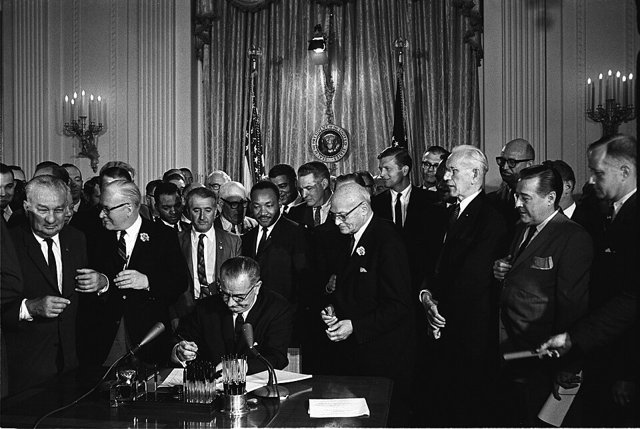
1964 年 7 月 2 日，美國《民權法》簽署：禁止在公共場所、就業與工會中的種族歧視；次年《投票權法》拆掉南方州的人頭稅與識字測試；1968 年《公平住宅法》禁止住房歧視。三項立法在十年內解散了綿延三百年、以法律明文維持的種姓制度。本案偵破：**一個以法律建立的等級體系，是否可能只靠法律拆除？** 答案是：法律拆除的是「腳手架」，真正的拆除靠的是戰後結構力量（戰爭動員、機械化、電視、人口遷移）與公民社會的聯合作用——法律只是最後一塊、也是方向盤般關鍵的一塊。

[→ 對外連結：1964-民權法與種姓階層解體：法律如何重寫社會等級](https://chad-liu.github.io/books/html/1-6-8.社會結構史/1964-民權法與種姓階層解體.html)

## 1968 | 反文化運動與五月風暴
1968 年是全球的「事件之年」：巴黎五月風暴（千萬人罷工）、布拉格之春、芝加哥民主黨大會衝突、墨西哥特拉特洛爾科、越戰春攻。兇手不是一場運動，而是結構合力：嬰兒潮世代同時抵達大學、高等教育大擴張、電視使暴力即時可見、戰後繁榮的承諾出現裂縫。本案追查：為什麼 1968 年前後，整個已開發世界的社會契約被同時重寫？

[→ 對外連結：1968-反文化運動與五月風暴：嬰兒潮、電視與合法性危機的案件](https://chad-liu.github.io/books/html/1-6-8.社會結構史/1968-反文化運動與五月風暴.html)

## 1971 | 微處理器與後工業社會

1971 年 11 月，Intel 4004 微處理器問世——電腦的大腦縮到一枚晶片。這樁「算力」案件是社會結構的又一次大重構：摩爾定律（1965）的指數曲線 → 算力成本暴跌 → 自動化（機器人取代製造業勞工）→ **後工業社會**（Bell 1973）：就業從製造轉向服務與知識；PC（Apple II 1977、IBM PC 1981）把計算從機構帶入家庭 → 知識工作者、白領的世紀。丹尼爾·貝爾的「後工業社會的來臨」為此命名：**知識取代資本與勞力，成為社會的戰略資源**——階層圖從「擁有機器的人 vs 出賣體力的人」重畫為「擁有知識的人 vs 出賣服務的人」。

[→ 對外連結：1971-微處理器與後工業社會](https://chad-liu.github.io/books/html/1-6-8.社會結構史/1971-微處理器與後工業社會.html)

## 1979 | 新自由主義轉向

1979 年是戰後秩序的斷裂年：5 月柴契爾入主唐寧街，
10 月沃克（Volcker）宣布緊縮貨幣，中國改革開放起步、伊朗革命引爆第二次石油危機。
停滯性通膨（stagflation）同時殺死了凱因斯主義的菲利浦曲線信仰：
通膨兩位數、失業兩位數、增長近零。
解方是整套範式更換——私有化、去管制、緊貨幣、全球化：
石油衝擊 + 工會剛性 → 滯脹 → 貨幣主義＋供給學派 → 通膨馴服＋工會瓦解＋資本全球化
第八樂章從 1971（微處理器）直跳 1991（全球化）——
中間 20 年的橋正是本案。

[→ 對外連結：1979-新自由主義轉向：柴契爾、沃克與全球化的總開關](https://chad-liu.github.io/books/html/1-6-8.社會結構史/1979-新自由主義轉向.html)

## 1981 | 愛滋病與藥物政治
1981 年 6 月 5 日，美國 CDC 通報紐約與加州的罕見肺炎（後稱 AIDS）；1983-84 HIV 病毒分離。這樁「新疫病」案件的偵辦重點不在病毒，而在**社會結構的反應**：汙名（同性戀、血友病、藥癮者）讓初期資源稀缺；病人運動（ACT UP 1987）改寫了臨床試驗規則（病人參與設計——「最快樂的死亡者」? 不，「加速審批」AZT 1987）；1996 雞尾酒療法讓死亡率崩降；藥價與專利的政治（南非訴訟 1998-2001、TRIPS 與通用藥）——藥物的可及性成為全球不平等的核心議題。愛滋病證明：**疫病的社會傷害 = 病原 × 汙名 × 制度反應**——社會運動改寫科學制度。

[→ 對外連結：1981-愛滋病與藥物政治](https://chad-liu.github.io/books/html/1-6-8.社會結構史/1981-愛滋病與藥物政治.html)

## 1991 | WWW與資訊全球化
1989-91 年，CERN 的 Tim Berners-Lee 提出並上線 WWW（HTTP/HTML/URL）——網路從軍事與學術（ARPANET 1969、TCP/IP 1983）走向公共。同年 12 月，蘇聯解體——「計算的失敗」（1917 案）與「網路的誕生」同年。這樁「超連結」案件是信息結構與組織的雙重重構：**信息與通訊成本的暴跌**（Coase 1937 的應用：交易成本下降 → 企業邊界縮小——外包、全球供應鏈、WTO 1995）+ **信息的高速流動**——全球化 2.0 的十年（1990s-2000s）。Castells 的「網路社會」：組織從科層金字塔變成網路。

[→ 對外連結：1991-WWW與資訊全球化](https://chad-liu.github.io/books/html/1-6-8.社會結構史/1991-WWW與資訊全球化.html)

## 1995 | 瀏覽器與網路大眾化
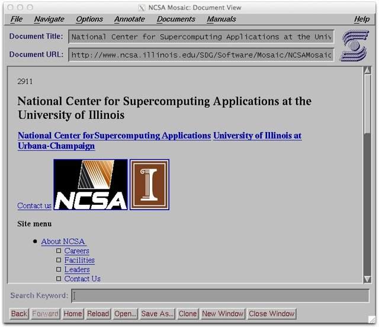
1995 年，一個免費軟體把網路從工程師玩具變成全民入口：網景 Navigator 市佔八成、IE 1.0 隨 Windows 95 搭售、亞馬遜與 eBay 同年上線、全球網民從千萬衝向五千萬。兇手不是單一的程式，而是 WWW 開放協定（1991 案）、Mosaic 圖形化（1993）、撥接降價＋PC 降價、入口商業模式發現四者咬合。網路第一次有了「門」——不懂 FTP、Telnet 的普通人，點兩下就能進來。大眾化不是技術的附帶結果，它本身就是社會結構事件：誰能上網、做什麼、跟誰連結，階層圖從此重畫。

[→ 對外連結：1995-瀏覽器與網路大眾化：從工程師玩具到全民入口](https://chad-liu.github.io/books/html/1-6-8.社會結構史/1995-瀏覽器與網路大眾化.html)

## 2004 | 社交媒體與注意力經濟
2004 年 2 月 4 日，Facebook 上線——社交媒體時代開啟（Twitter 2006、YouTube 2005、微博 2009）。這樁「按讚」案件是信息與政治結構的重構：**注意力經濟**（Herbert Simon 1971：「信息的豐富造成注意力的稀缺」）——媒體的商業模式從「賣內容」變「賣注意力」（廣告 = 產品，用戶 = 受眾）；推薦演算法優化 engagement（點擊、停留）→ 情緒化內容獲得偏置 → **極化與過濾氣泡**（Pariser 2011）；2011 阿拉伯之春（社交媒體動員）與 2016 劍橋分析（數據操控選舉）——媒體 → 政治的千年鏈條（印刷 1440 → 電報 1844 → 廣播 → 社交媒體）的最新一環：**每個人都成為媒體**，權威中介（報社、電視台）崩解。

[→ 對外連結：2004-社交媒體與注意力經濟](https://chad-liu.github.io/books/html/1-6-8.社會結構史/2004-社交媒體與注意力經濟.html)

## 2007 | 智慧手機與平台零工經濟
2007 年 1 月，Jobs 發布 iPhone；6 月開賣——智慧手機把網路裝進口袋（App Store 2008）。這樁「口袋裡的電腦」案件是組織與勞動的重構：**平台**（Uber 2009、滴滴 2012、外送、Airbnb 2008）以雙邊市場（Rochet-Tirole 2003）的網路效應重構中介——計程車行、仲介、旅行社被平台取代；**零工經濟**：僱傭關係拆解為「按單接案」——**演算法管理**（algorithmic management）：派單、評分、定價都由演算法執行——泰勒的科學管理（1908 案）以演算法復活，且這次**沒有人情、沒有工會的緩衝**。組織從「公司」變「平台」，勞動從「職業」變「任務」。

[→ 對外連結：2007-智慧手機與平台零工經濟](https://chad-liu.github.io/books/html/1-6-8.社會結構史/2007-智慧手機與平台零工經濟.html)

## 2008 | 金融危機與加密貨幣
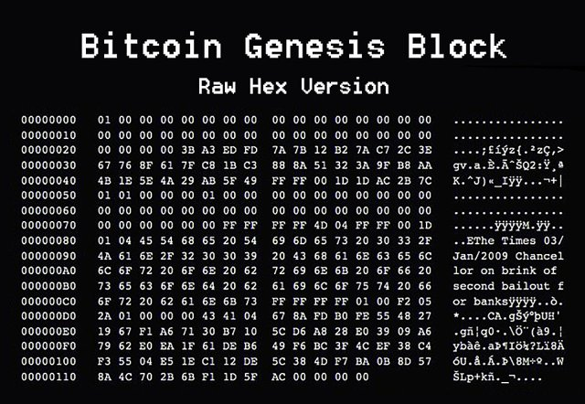
2008 年 9 月 15 日雷曼倒閉——全球金融危機；同年 10 月 31 日，中本聰發表 Bitcoin 白皮書，2009 年 1 月創世區塊上線——**演算法信任**的誕生。這樁「崩潰 + 白皮書」案件的偵辦重點：危機暴露了**機構信任的失效**（銀行倒閉、政府紓困、量化寬鬆）——比特幣的答案是「不信任任何人，信任數學」：去中心化帳本 + 工作量證明（PoW）+ 拜占庭容錯（Lamport 1982）解決「雙花問題」。信任的來源從「機構與法律」變成「演算法與算力」——這是記錄與信任技術的千年鏈條（泥板前3200 → 複式記帳 1100 → 區塊鏈 2008）的最新一環。

[→ 對外連結：2008-金融危機與加密貨幣](https://chad-liu.github.io/books/html/1-6-8.社會結構史/2008-金融危機與加密貨幣.html)

## 2015 | 難民危機與邊界政治
2015 年，逾百萬難民經地中海—巴爾幹湧入歐洲，德國總理梅克爾宣布「我們辦得到」（Wir schaffen das）並接收 89 萬人——二戰後最大規模的非常態遷徙。本案追查：敘利亞內戰＋阿富汗潰敗＋非洲人口爆炸三股洪流，為何在 2015 同時漫過邊界？智能手機（2007 案）讓偷渡可導航，社交媒體讓路線可複製，人口轉型（1930 案）的南北落差讓壓力-under水位十年。本案補上 2008 金融危機到 2020 COVID 之間缺失的遷徙環：**1846 愛爾蘭大移民的二十一世紀版本**。

[→ 對外連結：2015-難民危機：邊界、人口與福利國家的三重擠壓](https://chad-liu.github.io/books/html/1-6-8.社會結構史/2015-難民危機與邊界政治.html)

## 2020 | COVID與遠距社會
2020 年 1 月 23 日武漢封城；3 月 11 日 WHO 宣布大流行——COVID-19 讓全球進入「遠距社會」：封城、遠距工作（Zoom 日用戶從 1000 萬到 3 億）、供應鏈斷裂、全球財政刺激（美國 2020-21 約 5 兆美元）、mRNA 疫苗（2020/12 緊急授權——史上最快）。這樁「封城」案件是社會結構的全面壓力測試：**遠距工作**（辦公的物理束縛解除——1882 案「組織重構兌現技術紅利」的終極兌現：通訊技術已就緒 20 年，疫情逼出組織改造）、**供應鏈韌性 vs 效率**（JIT 的反轉）、**國家權力**（封城、疫苗護照、接觸追蹤——監控技術的擴張）、**超額死亡**（全球 1500 萬+）。疫病 + 遠距 = 社會結構的重構實驗。

[→ 對外連結：2020-COVID與遠距社會](https://chad-liu.github.io/books/html/1-6-8.社會結構史/2020-COVID與遠距社會.html)

## 2022 | 生成式AI與工作重構
2022 年 11 月 30 日，OpenAI 發布 ChatGPT——兩個月內用戶破億，史上最快的技術採用。這樁「對話框」案件是勞動結構的新一輪重構：生成式 AI 首次衝擊**非常規認知工作**（寫作、程式、設計、分析）——此前自動化只吃掉常規任務（工廠、文書）；2020 COVID 已把遠距工作常態化（辦公的物理束縛解除），AI 再把「知識任務」拆解自動化。Autor 的任務模型：就業不是「職業被取代」而是「任務被重分配」——Eloundou 等（2023）估計：80% 勞動力的至少 10% 任務受 AI 影響。**每一次技術躍升（蒸汽 1769 → 流水線 1908 → 電腦 1971 → 生成式 AI）都重畫一次勞動的階層圖**——這次輪到白領與創意工作。

[→ 對外連結：2022-生成式AI與工作重構](https://chad-liu.github.io/books/html/1-6-8.社會結構史/2022-生成式AI與工作重構.html)
