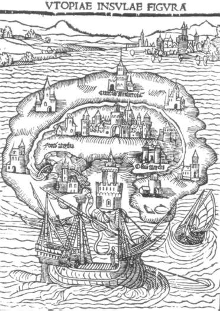
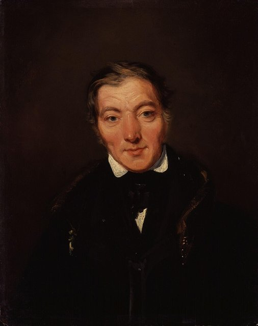
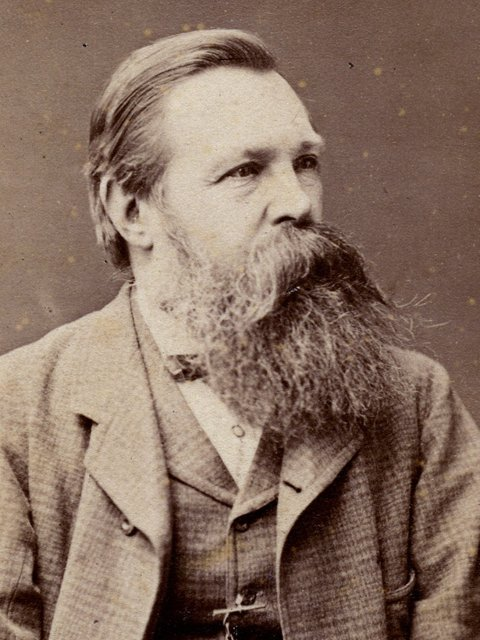
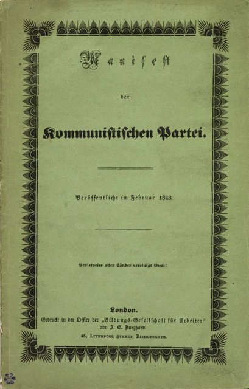
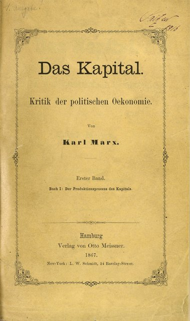
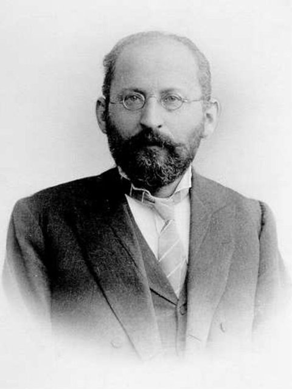
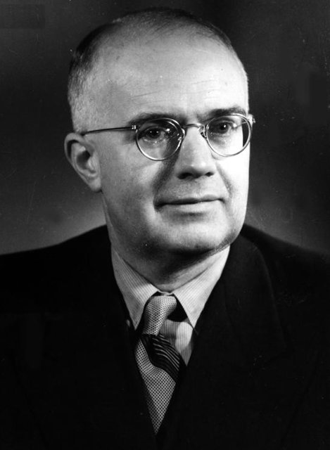

<!--
內容整理自本機筆記〈社會主義經濟學（Socialist Economics）〉（D:\Books\md\歷史\術語\經濟學\社會主義經濟學（Socialist Economics）.md；html 版在 D:\Books\html\4-1-1.經濟學派），並參考中文維基百科〈社會主義經濟學〉條目，以自己的話改寫。
時期依筆記「完整歷史時間軸總整理」的九個階段，合併為六段：思想萌芽（1516－1840）、科學社會主義（1841－1916）、蘇聯計畫經濟（1917－1939）、制度擴張與論爭（1940－1977）、市場化改革與轉型（1978－2000）、全球化與當代（2001－）。
處理方式：
- 筆記的「歷史分類補充」提醒：1516年的《烏托邦》與1602年的《太陽城》是後世社會主義思想的先驅，不能直接視為社會主義經濟學已經成立；這點寫進第一則事件。
- 筆記把許多中國的五年計畫、會議與政策各列一則（如1971年第四個五年計畫、2003年科學發展觀、2006年新農村建設），這裡只保留對經濟體制有轉折意義的事件。
- 社會主義經濟計算論爭依通行說法補充：1920年米塞斯發表〈社會主義國家的經濟計算〉，1936－1937年蘭格以市場社會主義回應，海耶克在1945年發表〈知識在社會中的運用〉。筆記列為1938年「論爭持續」與1944年「蘭格思想擴大」，這裡依實際發表年份。
- 俄國革命的經過見「俄國革命」時間軸，這裡只寫經濟體制。
- 2016年以後的「新時代社會主義經濟學」，筆記多為政策方向的概述（共同富裕、AI、綠色轉型），這裡寫進最後一則事件，不另立事件。
- 人名用·分隔（原稿作・）。
圖片來源（皆為 Wikimedia Commons 公有領域／CC0 作品，縮成最長邊 640px）：
- soe-marx.jpg：Karl Marx by John Jabez Edwin Mayall 1875 - Restored.png（馬克思，1875年梅奧爾攝（修復版））
- soe-utopia.jpg：Isola di Utopia Moro.jpg（1516年《烏托邦》初版的烏托邦島木刻插圖）
- soe-owen.jpg：Robert Owen by William Henry Brooke.jpg（威廉·亨利·布魯克所繪羅伯特·歐文像）
- soe-engels.jpg：Friedrich Engels portrait (cropped).jpg（恩格斯像）
- soe-manifesto.jpg：Communist-manifesto.png（《共產黨宣言》1848年德文初版封面）
- soe-kapital.jpg：Zentralbibliothek Zürich Das Kapital Marx 1867.jpg（《資本論》第一卷1867年初版書名頁（蘇黎世中央圖書館））
- soe-bernstein.jpg：Eduard Bernstein (portrait).jpg（愛德華·伯恩斯坦像）
- soe-lange.jpg：Oskar Lange 20-65.jpg（奧斯卡·蘭格）
-->

# Periods
- 1516 ~ 1840 | 思想萌芽與空想社會主義 | #868e96
  從摩爾的理想國度到聖西門、傅立葉、歐文，思想家批判私有財產與工業社會的不平等，設計合作社區的藍圖，卻多半停留在理想與小規模實驗。
- 1841 ~ 1916 | 馬克思主義與流派分化 | #c92a2a
  馬克思與恩格斯以歷史唯物主義與剩餘價值理論批判資本主義；第一、第二國際成立，社會主義運動分化為革命派與伯恩斯坦的修正主義、社會民主路線。
- 1917 ~ 1939 | 蘇聯計畫經濟的誕生 | #e03131
  十月革命後歷經戰時共產主義與新經濟政策，史達林以五年計畫與農業集體化建立中央計畫經濟；西方則爆發社會主義經濟計算論爭。
- 1940 ~ 1977 | 制度擴張與改革嘗試 | #e67700
  蘇聯模式擴散到東歐、中國、古巴；南斯拉夫走工人自治，蘭格提出市場社會主義，東歐與蘇聯數度嘗試引入市場機制，中國則經歷大躍進與文革。
- 1978 ~ 2000 | 市場化改革與轉型 | #1971c2
  中國改革開放走向社會主義市場經濟，蘇聯與東歐的改革失敗、政權崩潰，轉向市場經濟；越南也推行革新開放。
- 2001 ~ 2026 | 全球化與當代社會主義 | #5f3dc4
  中國加入世界貿易組織、成為第二大經濟體，提出市場在資源配置中起決定性作用；社會主義經濟學的課題轉向國企、分配與共同富裕。

# Events

## 1516 | 摩爾《烏托邦》

英國人文主義者托馬斯·摩爾出版《烏托邦》，描寫一個沒有私有財產、財物共有、人人勞動的理想島國，藉以批判英國圈地運動造成農民流離失所。1602年義大利修士康帕內拉的《太陽城》也構想了財產公有的社會。這些作品是後世社會主義思想的先驅，但還不是現代意義的社會主義經濟學。18世紀，盧梭在1755年的《論人類不平等的起源》中把不平等歸咎於私有財產，1796年法國的巴貝夫更密謀以革命建立財產平等的社會。

## 1803 | 聖西門與傅立葉
法國的聖西門主張由科學家與實業家按計畫組織生產的工業社會，被視為計畫經濟思想的先聲；傅立葉從1808年起構想以約一千六百多人組成的合作公社「法郎吉」取代競爭的資本主義。後來恩格斯稱他們與歐文為「空想社會主義者」。

## 1824 | 歐文的新和諧村

英國紗廠老闆羅伯特·歐文在蘇格蘭新拉納克工廠縮短工時、設立學校、改善工人生活，證明善待工人也能獲利。1824年他到美國印第安納州買地建立「新和諧」公社，實行財產共有，兩年後因內部紛爭失敗。他的理念後來啟發了英國的合作社運動，1844年羅奇代爾先鋒社成立，是現代合作社的起點。

## 1840 | 蒲魯東「財產就是竊盜」
法國的蒲魯東出版《什麼是財產？》，提出「財產就是竊盜」，主張以互助、交換銀行取代私有財產與國家，是無政府主義的重要源頭。同時期英國的憲章運動要求工人的政治權利，工人運動與社會主義思想逐漸結合。

## 1844 | 馬克思與恩格斯

馬克思在巴黎寫下《1844年經濟學哲學手稿》，討論勞動異化；同年他與恩格斯相識，兩人開始終身的合作。恩格斯根據在曼徹斯特的親身觀察，於1845年出版《英國工人階級狀況》。1845年至1846年兩人合寫《德意志意識形態》，提出歷史唯物主義：社會的生產方式與經濟基礎決定政治與思想的上層建築。

## 1848-02 | 《共產黨宣言》

馬克思與恩格斯受共產主義者同盟委託，發表《共產黨宣言》：「一切至今存在的社會的歷史都是階級鬥爭的歷史」，資產階級創造了巨大的生產力，也製造了自己的掘墓人無產階級，結尾號召「全世界無產者，聯合起來！」同年歐洲爆發一連串革命，失敗後馬克思流亡倫敦，在大英博物館研究政治經濟學；1859年出版《政治經濟學批判》。

## 1864-09-28 | 第一國際成立
各國工人組織在倫敦成立國際工人協會（第一國際），馬克思起草成立宣言與章程。協會內部馬克思派與巴枯寧的無政府主義派衝突不斷，1871年巴黎公社失敗後更加分裂，1876年解散。

## 1867 | 《資本論》第一卷

馬克思出版《資本論》第一卷：商品的價值由社會必要勞動時間決定，工人出賣勞動力，創造的價值卻超過工資，差額就是被資本家無償占有的「剩餘價值」，也是利潤的來源。資本為了競爭不斷累積，造成工人的貧困化、產業後備軍與周期性危機，最終將導致資本主義的崩潰。1883年馬克思去世後，恩格斯整理遺稿，在1885年與1894年出版第二、三卷。

## 1889-07-14 | 第二國際成立
在法國大革命一百週年之際，各國社會主義政黨在巴黎成立第二國際，德國社會民主黨是最大的成員，並決定以5月1日為國際勞動節。社會主義政黨在各國議會中逐漸壯大。

## 1899 | 伯恩斯坦修正主義

德國社會民主黨理論家伯恩斯坦出版《社會主義的前提和社會民主黨的任務》，指出資本主義並未如馬克思預言般走向崩潰，中產階級反而擴大，主張以議會選舉與社會改革逐步實現社會主義。這條「修正主義」路線遭到盧森堡與考茨基等人批判，卻成為日後社會民主主義與北歐福利國家的思想源頭。1902年列寧則在《怎麼辦？》中主張由職業革命家組成的先鋒黨領導革命。

## 1908 | 巴羅內的計畫經濟模型
義大利經濟學家巴羅內發表〈集體主義國家的生產部〉，以一般均衡方程式證明：理論上中央計畫者只要解出同一組方程式，就能得到與競爭市場相同的資源配置。這篇論文日後成為社會主義經濟計算論爭的起點。

## 1917-11-07 | 十月革命與戰時共產主義
布爾什維克在俄國奪取政權（俄曆10月25日），宣布土地國有、銀行與大工業收歸國有。內戰期間（1918－1921年）實行「戰時共產主義」：糧食徵集、禁止私人買賣、以實物配給取代貨幣，造成生產崩潰與饑荒。詳見「俄國革命」時間軸。

## 1920 | 社會主義經濟計算論爭

奧地利經濟學家米塞斯發表〈社會主義國家的經濟計算〉，指出生產資料公有就沒有生產要素的市場價格，計畫者無法理性計算成本、配置資源。1936年至1937年，波蘭經濟學家蘭格發表〈論社會主義的經濟理論〉回應：計畫局可以模仿市場「試錯」調整價格，形成「市場社會主義」；海耶克則在1945年的〈知識在社會中的運用〉中反駁，強調分散在各處的知識只能透過價格機制傳遞。這場論戰是20世紀經濟思想史最重要的爭論之一。

## 1921-03 | 新經濟政策
喀琅施塔得水兵叛變後，列寧在俄共第十次代表大會宣布新經濟政策（NEP），以固定的糧食稅取代徵集，允許農民出售剩餘糧食、小企業私營與外資租讓，國家只控制「制高點」的大工業、銀行與外貿，經濟迅速恢復。1922年蘇聯成立，1924年列寧去世，黨內就工業化的速度與方式展開激烈辯論。

## 1928-10 | 第一個五年計畫
史達林結束新經濟政策，推行第一個五年計畫，由國家計畫委員會（Gosplan）下達生產指標，以強制的高積累發展重工業；1929年起強迫農民加入集體農莊，消滅「富農」。工業產量快速成長，農業卻嚴重受創，1932年至1933年烏克蘭、哈薩克等地的大饑荒造成數百萬人死亡。1933年、1938年接續第二、第三個五年計畫，中央計畫經濟的蘇聯模式從此定型。

## 1948 | 南斯拉夫工人自治
南斯拉夫的狄托與史達林決裂，被逐出共產黨情報局。南斯拉夫隨後放棄蘇聯式的中央計畫，1950年起推行「工人自治」：企業由工人選出的委員會經營，在市場中競爭，成為社會主義另一種模式的實驗。

## 1949-10-01 | 中華人民共和國成立
中共建政後進行土地改革（1950年），1953年起以蘇聯模式推行第一個五年計畫，1956年完成對農業、手工業與工商業的社會主義改造。1958年的大躍進與人民公社追求不切實際的高指標，造成1959年至1961年的大饑荒；1966年至1976年的文化大革命又使經濟陷入停滯。1959年古巴革命後，計畫經濟也擴及拉丁美洲。

## 1965 | 柯西金改革
蘇聯部長會議主席柯西金推動經濟改革，以利潤、銷售額取代單純的產量指標，擴大企業自主權，參考了經濟學家利別爾曼的主張；東歐的匈牙利在1968年推行「新經濟機制」，捷克斯洛伐克的「布拉格之春」也包含經濟改革，卻被蘇聯出兵鎮壓。這些改革大多未能突破計畫體制，蘇聯經濟到1970年代陷入「停滯時期」。

## 1978-12 | 中國改革開放
1976年毛澤東去世，1978年十二月中共十一屆三中全會決定把工作重點轉向經濟建設，實行改革開放：農村推行家庭聯產承包責任制，1979年起設立深圳等經濟特區吸引外資，1984年改革擴及城市與國有企業，1987年提出「社會主義初級階段」理論。匈牙利經濟學家科爾奈在1980年出版《短缺經濟學》，分析計畫體制下企業的「軟預算約束」與長期短缺，影響了各國的改革討論。

## 1991-12-26 | 蘇聯解體
1985年戈巴契夫上台，推動「重建」（改革）與「開放」，經濟改革卻導致物資短缺與通膨惡化；1989年東歐劇變，各國共產黨政權相繼垮台。1991年底蘇聯解體，俄羅斯與東歐國家以「休克療法」快速轉向市場經濟，經歷嚴重的衰退與私有化爭議。越南則從1986年起推行「革新開放」，走上與中國相似的路。

## 1992 | 社會主義市場經濟
鄧小平南巡講話，強調計畫與市場都只是手段，不是區分社會主義與資本主義的本質；同年中共十四大確立「社會主義市場經濟」的改革目標。此後中國推行1994年分稅制、1990年代後期的國有企業「抓大放小」改革，形成公有制為主體、多種所有制並存的體制。

## 2001-12-11 | 中國加入世界貿易組織
中國正式加入世界貿易組織，深度融入全球分工，成為「世界工廠」；2004年修憲寫入保護私有財產，2010年超越日本成為全球第二大經濟體。2013年中共十八屆三中全會提出「使市場在資源配置中起決定性作用」，同時強調國有經濟的主導地位。2016年以後，「共同富裕」、國有資本、數位經濟與綠色轉型成為社會主義經濟學的新課題，計畫與市場、效率與公平的關係仍在持續探索之中。
