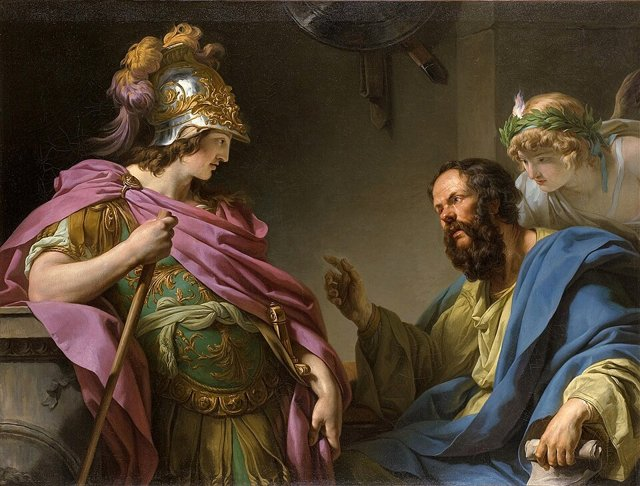
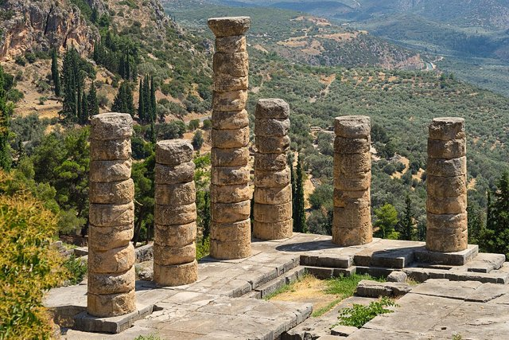
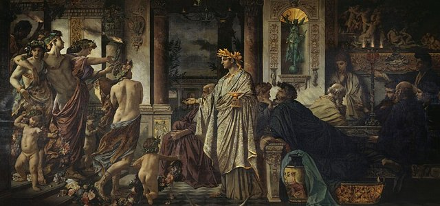
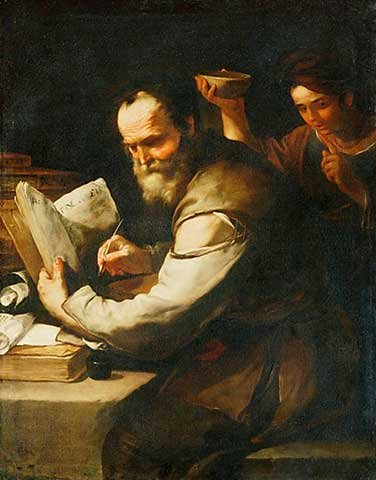
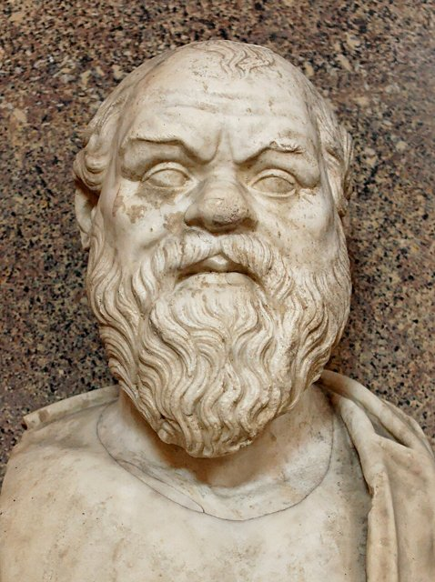
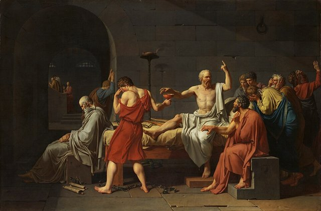

<!--
內容整理自本機筆記〈蘇格拉底生平大事記（約前470–前399年）〉（圖表\蘇格拉底生平大事記（約前 470–前 399 年）.md）與中文維基百科「蘇格拉底」條目（CC BY-SA 4.0），以台灣用語改寫摘要。
https://zh.wikipedia.org/zh-tw/苏格拉底
史料與日期說明：
- 蘇格拉底沒有留下任何著作，生平主要來自柏拉圖、色諾芬的記述與阿里斯托芬的喜劇，三者的描寫常有出入（即所謂「蘇格拉底問題」），許多細節只能依古代文獻重建。
- 生年有前470與前469年兩說；時間軸以前469年計算年齡，使前399年受審時為70歲，與柏拉圖《申辯篇》中他自稱「七十歲」相符。各事件的年齡都只是約略值。
- 德爾菲神諭、與贊西佩成婚的年代都不確定，以「約」標示。
- 維基百科有一段描述他在前430年雅典大瘟疫中染病、痊癒後「獲得抗體」回城照顧病患，此說查無古代史料支持，因此未採用；只保留修昔底德記載的瘟疫本身作為時代背景。
- 審判票數依柏拉圖《申辯篇》推算的有罪280比無罪220，死刑票數360比140出自第歐根尼·拉爾修，屬傳統說法。
- 前406年阿吉紐西審判時他的職務：維基百科稱「主審官」，筆記作「議事會相關職務」；此處依一般說法寫為當值的議事會主席團成員。
- 伯里克利時代背景、前432年在波提狄亞救阿爾西比亞德斯、前416年《會飲篇》的場景、前387年柏拉圖創辦學院等細節，係依柏拉圖對話錄與一般公認的史實補充。
圖片來源（皆為 Wikimedia Commons 公有領域／CC0 作品）：
- soc-cover.jpg：Socrates Louvre.jpg
- soc-born.jpg：Parthenon from west.jpg
- soc-delphi.jpg：Delphes, Grèce. Temple d'Apollon. Six colonnes.jpg
- soc-potidaea.jpg：Alcibades being taught by Socrates, François-André Vincent.jpg
- soc-xanthippe.jpg：Luca Giordano - Xanthippe schuettet Sokrates Wasser in den Kragen.jpg
- soc-trial.jpg：Socrates Pio-Clementino Inv314.jpg
- soc-death.jpg：David - The Death of Socrates.jpg
- soc-symposium.jpg：Anselm Feuerbach - Das Gastmahl. Nach Platon (zweite Fassung) - Google Art Project.jpg
-->

# Periods
- -469 ~ -432 | 雅典的黃金時代 | #8d6e63
  生於伯里克利領導下的雅典鼎盛時期，父親是石匠、母親是助產士。他接觸當時流行的自然哲學，後來卻轉而追問人應該如何生活。
- -432 ~ -404 | 伯羅奔尼撒戰爭與街頭哲學家 | #c92a2a
  雅典與斯巴達爆發長達27年的戰爭，他以重裝步兵身分多次出征；平時在市集與年輕人對話，用一連串提問檢驗別人自以為知道的事，名聲與爭議同時增加。
- -404 ~ -399 | 戰敗、審判與死亡 | #495057
  雅典戰敗，三十僭主短暫掌權後民主恢復。在政治創傷未平的氣氛中，他被控不敬神與腐化青年，判處死刑，拒絕逃亡，飲毒芹汁而死。

# Events

## -469 | 出生@雅典 {label=約前470／469年}

生於雅典的阿洛佩刻區，父親索福洛尼斯庫斯據傳是石匠或雕刻師，母親斐娜瑞特是助產士。他成長於伯里克利主政、帕德嫩神廟興建、悲劇與哲學蓬勃發展的雅典黃金時代，接受雅典公民一般的教育。他後來常說自己繼承了母親的「助產術」——不是生產知識，而是幫助別人把心中的想法「接生」出來，並判斷它是否站得住腳。

## -450 | 從自然哲學到人的問題 {label=約前450年}
年輕時他曾熱衷於當時流行的自然哲學，讀到阿那克薩哥拉主張「心靈」是萬物秩序的原因時大感興奮，卻失望地發現對方仍只用空氣、水這些物質來解釋一切。他後來轉向追問更根本的問題：什麼是正義？什麼是勇敢？人應該如何生活？據說他也受過阿那克薩哥拉的學生阿基勞斯的教導。

## -432 | 波提狄亞戰役

伯羅奔尼撒戰爭前夕，他以重裝步兵身分參與波提狄亞之圍。據柏拉圖《會飲篇》中阿爾西比亞德斯的描述，他在嚴冬中赤腳行軍、比穿鞋的士兵還穩健，有一次站著沉思了一整天一整夜；戰鬥中他還救了受傷的阿爾西比亞德斯，卻把勇敢的獎賞讓給了對方。

## -431 | 伯羅奔尼撒戰爭爆發
雅典與斯巴達之間長達27年的伯羅奔尼撒戰爭爆發。前430年雅典爆發大瘟疫，人口大量死亡，伯里克利也在隔年病逝，雅典的黃金時代從此蒙上陰影。

## -430 | 德爾菲神諭：「沒有人比蘇格拉底更有智慧」 {label=約前430年代}

他的朋友凱勒豐到德爾菲神殿詢問阿波羅：有沒有人比蘇格拉底更有智慧？女祭司回答：沒有。他對此十分困惑，於是拜訪自認有智慧的政治家、詩人與工匠，發現他們都自以為知道其實並不知道的事。他的結論是：自己比別人多知道的一點，只在於他知道自己無知。從此他把在雅典街頭追問別人視為神交付的使命，這也讓他得罪了許多有權勢的人。

## -424 | 德利昂戰役
參加德利昂戰役。雅典軍大敗撤退時，據記載他從容鎮定地環顧四周，敵人都不敢靠近，與他同行的將軍拉凱斯因此得以生還；騎馬的阿爾西比亞德斯也目睹了這一幕。

## -423 | 阿里斯托芬的喜劇《雲》
喜劇作家阿里斯托芬在《雲》中把他描寫成一個吊在籃子裡研究天象、開辦「思想所」、教人用詭辯打贏官司的古怪學者。這與柏拉圖筆下專注倫理問題、從不收學費的蘇格拉底大不相同，但這個舞台形象深植人心；柏拉圖在《申辯篇》中讓他指出，這正是日後指控他的偏見來源之一。

## -422 | 安菲波利斯戰役
傳統記載他也參加了安菲波利斯戰役，這是他最後一次為雅典出征。他一生只為了服兵役離開過雅典，平時很少走出城門。

## -416 | 《會飲篇》的宴會 {label=約前416年}

悲劇詩人阿伽頌在戲劇比賽中獲勝，舉行宴會慶祝，柏拉圖的《會飲篇》就以這場宴會為背景：與會者輪流讚頌愛神，蘇格拉底轉述女祭司狄奧提瑪的教導，說明愛是從愛美的身體一步步上升到愛「美」本身的歷程。宴會最後喝醉的阿爾西比亞德斯闖入，發表了對蘇格拉底又愛又恨的頌詞。

## -420 | 與贊西佩成婚 {label=約前420年}

大約在這段時期與贊西佩結婚，生了三個兒子，他死時兒子們都還年幼。後世流傳贊西佩是個脾氣暴躁的悍妻，有一次對他大吵後把一盆水潑在他頭上，他說：「打雷之後，總是會下雨。」這些故事很可能出自色諾芬等人的誇大。

## -406 | 反對集體審判阿吉紐西將領
雅典海軍在阿吉紐西群島海戰中獲勝，卻因暴風雨未能救起落水的士兵，民怨沸騰，公民大會要求以一次集體表決審判八名將領。他正好是當天輪值的議事會主席團成員，在群眾的威脅下仍堅持這種審判違法，拒絕把案子付諸表決。將領們最後仍被判處死刑，這是他一生中最重要的一次政治行動。

## -404 | 三十僭主與薩拉米斯的列昂
雅典在伯羅奔尼撒戰爭中向斯巴達投降，斯巴達扶植的「三十僭主」掌權，大肆整肅。三十僭主命令他和另外四人去逮捕無辜的薩拉米斯人列昂，好讓列昂被處死；其他四人照辦，他卻直接回家。他後來說，若不是三十僭主很快倒台，他可能因此喪命。三十僭主的首領克里提亞斯和查米迪斯都曾是他的學生，這讓他日後備受懷疑。

## -403 | 雅典恢復民主
民主派推翻三十僭主，雅典恢復民主政體，並宣布大赦，不追究內戰期間的行為。然而戰敗、內戰與政權更替留下的創傷，成為他受審的重要背景。

## -399 | 受審：不敬神與腐化青年

米利都斯、安尼圖斯與呂孔控告他「不承認城邦所承認的神、引進新的神靈，並且腐化青年」。他在由500名公民組成的陪審團前為自己辯護，拒絕哀求或帶家人上庭博取同情，並說「未經檢驗的人生不值得活」。他以280票對220票被判有罪；依雅典的程序，他可以提議替代的刑罰，他卻說自己應該像奧運冠軍一樣由城邦供養，最後以更懸殊的票數被判處死刑。柏拉圖的《申辯篇》記錄了這場審判，但它是哲學作品，而不是逐字的法庭紀錄。

## -399 | 拒絕逃亡，飲毒芹汁而死

因為雅典派往提洛島的宗教船隊尚未返航，處決延後了約一個月。老友克力同已買通獄卒，勸他逃到外地，他在《克力同篇》中拒絕：一生都受城邦法律保護的人，不能因為判決對自己不利就違反法律，以不義回報不義。依《斐多篇》的描述，最後一天他與朋友們從容討論靈魂不朽，傍晚平靜地喝下毒芹汁，臨終前最後一句話是：「克力同，我們還欠阿斯克勒庇俄斯一隻公雞，別忘了還。」

## -387 | 柏拉圖創辦學院 {label=約前387年}
他的學生柏拉圖在雅典城外創辦「學院」，以他為主角寫下大量對話錄，讓他的思想流傳後世；色諾芬、安提西尼（犬儒學派的先驅）、阿瑞斯提普斯（昔蘭尼學派）等學生也各自發展出不同的學派。柏拉圖的學生亞里斯多德，與蘇格拉底、柏拉圖並稱「希臘三哲」。他讓哲學從研究宇宙轉向追問人應該如何生活，被視為西方哲學與倫理學的奠基者；但我們熟悉的「蘇格拉底」究竟有多少是他本人、多少是柏拉圖的想法，至今仍是學界爭論的「蘇格拉底問題」。
