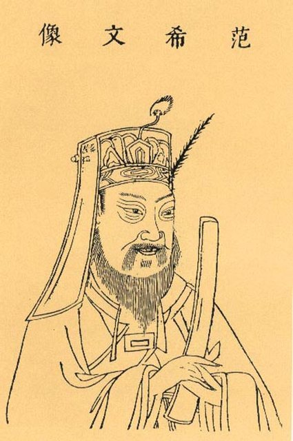
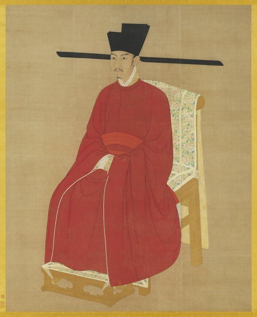
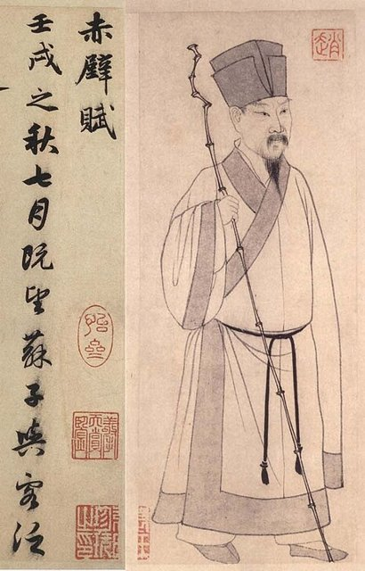
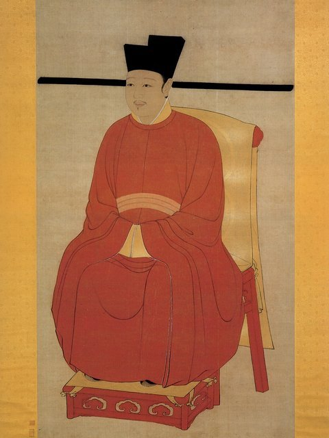
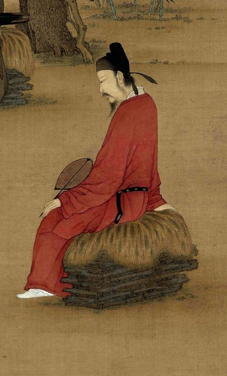
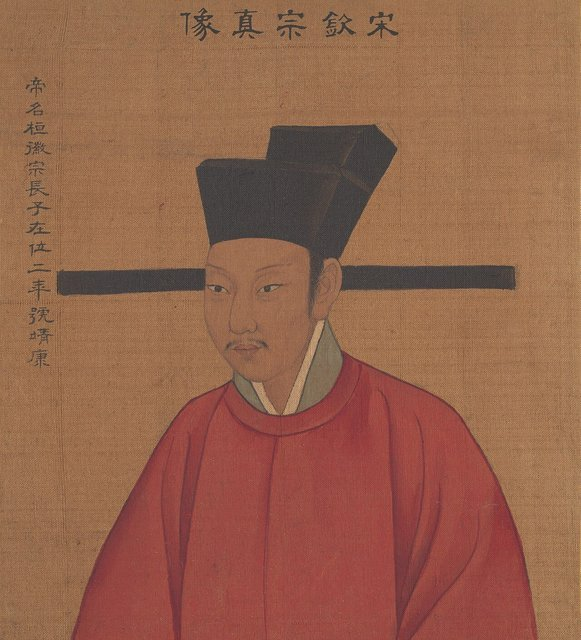

<!--
內容整理自本機筆記〈北宋新舊黨爭大事記——從熙寧變法、元祐更化到崇寧黨禁（1069—1127年）〉（D:\Books\md\歷史\東方歷史\北宋新舊黨爭大事記.md），以自己的話改寫；只依這份筆記，沒有另外合併其他資料。
時期依筆記的六大節（背景、熙寧元豐、元祐更化、紹聖紹述、徽宗與崇寧黨禁、北宋滅亡）；筆記開頭另列的「六個階段」年代略有出入（如1069—1076），以各大節為準。
處理方式：
- 與〈北宋王安石變法大事記〉有重疊（1043年慶曆新政、1067—1076年神宗與王安石、1086年廢法與王安石去世、1127年靖康之變）；兩份筆記各寫各的，這裡著重黨爭本身的過程，新法措施的細節留在「北宋王安石變法」那條時間軸。
- 王安石的去世：筆記作「享年約六十五歲，以傳統虛歲計為六十六歲」，照寫。
- 筆記一再提醒的區分，內文都保留：「新黨」「舊黨」是後人的概括、不是有黨章與一致思想的現代政黨；洛黨、蜀黨、朔黨同樣是概括；蔡京不能等同王安石；黨籍名單不能直接當成立場一致的「反變法派名冊」；309人是研究中常提的數字；新舊黨爭不是北宋滅亡的唯一原因。
- 「1110年代」是筆記的泛稱，用 label 保留，時間軸上放在1110年。
- 筆記第七部分（完整時間軸總表）、第八部分（新舊黨重要人物對照表）、第九部分（四個核心問題）、第十部分（總結）是整理與評論，不單列事件；要點寫進相關事件（例如「為什麼黨爭持續數十年、皇權更替是關鍵」寫進1100年；人物角色寫進各事件）。
- 筆記中的網頁引用連結（含追蹤參數）未收錄。
- 圖片皆為 Wikimedia Commons 上的公有領域（含 CC0）作品，縮成最長邊 640px 的 JPEG。
- dangzheng-tingqin.jpg：Songhuizong cropped 赵佶听琴图轴.jpg（宋徽宗《聽琴圖》局部，封面）
- wangan-fan.jpg：范仲淹像（與北宋王安石變法大事記共用）
- wangan-shenzong.jpg：宋神宗像（與北宋王安石變法大事記共用）
- sudongpo-wang-anshi.jpg：王安石像（與蘇東坡生平大事記共用）
- wangan-zhezong.jpg：宋哲宗像（與北宋王安石變法大事記共用）
- sudongpo-sima-guang.jpg：司馬光像（與蘇東坡生平大事記共用）
- sudongpo-zhao-portrait.jpg：趙孟頫〈書前赤壁賦並畫蘇軾像〉卷首的蘇軾像（與蘇東坡生平大事記共用，蘇軾、蘇轍同為此時的朝臣）
- dangzheng-huizong.jpg：Huizong.jpg（宋徽宗像，國立故宮博物院藏）
- dangzheng-caijing.jpg：聽琴圖 (蔡京 cropped).jpg（《聽琴圖》中一般認為是蔡京的人物）
- dangzheng-qinzong.jpg：SongQinzongPortrait.jpg（宋欽宗像）
-->

# Periods
- 1043 ~ 1068 | 黨爭形成的背景 | #868e96
  慶曆新政是中期改革的先聲；宋神宗即位並重用王安石，為變法與其後的新舊分歧鋪路。
- 1069 ~ 1085 | 熙寧、元豐：新舊黨爭激化 | #e8590c
  變法引發政府與市場、農民借貸、土地賦稅與教育選才的爭議；司馬光等人反對，王安石兩度罷相，神宗仍繼續推動部分新法。
- 1085 ~ 1093 | 元祐更化：舊黨掌權 | #1864ab
  神宗去世、高太皇太后臨朝，司馬光主持廢除新法；舊黨掌權後內部也出現洛黨、蜀黨、朔黨的分歧。
- 1094 ~ 1100 | 紹聖紹述：新黨捲土重來 | #c92a2a
  哲宗親政後重用章惇等人，恢復部分新法，並追究元祐年間的舊黨官員，政治鬥爭從政策辯論走向清算。
- 1101 ~ 1107 | 徽宗、蔡京與崇寧黨禁 | #862e9c
  蔡京以繼承新法為旗號掌權，立《元祐黨籍碑》、擴大黨籍到309人，還延伸到元祐學禁，黨爭淪為排除異己的工具。
- 1107 ~ 1127 | 政局反覆與北宋滅亡 | #2b8a3e
  黨籍碑雖被拆毀，派系問題與政治裂痕仍在；欽宗在1126年解除黨禁，1127年靖康之變，北宋滅亡。

# Events

## 1043 | 范仲淹推動慶曆新政

宋仁宗時期，北宋的官僚制度、財政與軍事體系逐漸暴露問題，范仲淹等人提出整頓官僚行政、改善選官制度與提升政府效率的措施，改革受到部分官員反對，推行不久就中止了。慶曆新政是北宋中期改革的重要先聲，顯示政治上已出現改革與守成的分歧，也預示了後來王安石變法將面臨的阻力；不過它與後來的新舊黨爭並非同一場政治鬥爭，應分開理解。

## 1067 | 宋神宗即位

宋英宗去世，宋神宗即位。神宗希望改善北宋財政、軍事與行政方面的問題，逐漸把王安石視為推動改革的重要人物。神宗的支持是王安石變法得以展開的重要條件，後來新法的存廢，也和皇帝對改革的態度密切相關。

## 1068 | 王安石受到重用

宋神宗召見王安石，討論治國與改革；王安石提出改革財政、農業、軍事與人才制度的主張，神宗逐漸下定推動改革的決心。

## 1069 | 王安石變法正式開始
王安石出任參知政事，朝廷設置制置三司條例司統籌改革，均輸法、青苗法、農田水利法等新法陸續推行，目標是富國強兵、改善財政管理與社會經濟制度。但改革涉及政府與市場的關係、農民借貸、土地賦稅與地方行政，很快就引發爭議。

## 1070 | 王安石升任宰相，新舊分歧加深
王安石升任同中書門下平章事，成為宰相；免役法、保甲法等措施陸續推行或擴大實施，司馬光等大臣對部分新法提出反對，朝廷內部逐漸形成支持與反對新法的不同群體。司馬光並不是反對一切改革，而是對王安石改革的具體措施、政策風險與行政執行方式有不同看法。兩派的傾向大致是：支持者主張積極改革制度，認為政府可以積極調節經濟與財政，希望改善資源調度、增加財政能力，強調用制度改革解決問題，並支持神宗推動新法；反對者主張審慎改革、重視既有制度，擔心政府過度介入市場與民間生活，擔心增加民間負擔與行政弊端，更重視政策的執行風險與實際民情，對改革的內容與推行方式提出批評。這只是雙方主要的傾向，並不是每位官員都完全符合的固定立場；「新黨」「舊黨」也不是有黨章、組織與一致思想的現代政黨，而是後人對北宋政治派系的概括。

## 1071 | 科舉與教育改革引起爭論
王安石推動科舉與太學制度的改革，希望培養具備經世致用能力的人才；部分士大夫則擔心改革會改變傳統學術與科舉標準。這場爭論顯示新舊分歧已超出單純的財政政策，延伸到教育、經學與人才選拔。

## 1072 | 市易法、方田均稅法推行
市易法試圖調節部分市場交易、協助商業經營並改善商品供應，方田均稅法著重清查土地、調整土地資料與賦稅負擔。這些政策觸及商業活動、土地利益與地方行政，因此受到不同群體關注：改革支持者認為政府應改善制度缺陷，反對者則擔心官府與民爭利，以及執行過程中可能出現的徵收問題。

## 1074 | 鄭俠呈《流民圖》，王安石第一次罷相
鄭俠向宋神宗呈上《流民圖》，藉流民困苦的形象批評部分新法的施行，新法引發的民生爭議進一步擴大，王安石離開宰相職位，第一次罷相，出知江寧府。這是黨爭發展的重要轉折點；不過第一次罷相並不代表所有新法立即停止，神宗仍支持改革，部分新法繼續推行。

## 1075 | 王安石復相
宋神宗再次任用王安石為宰相，他試圖繼續推動改革，但新舊雙方的政策分歧並未消失。此時改革的問題已不只是政策是否合理，也涉及官員任用、行政權力，以及皇帝對改革的支持程度。

## 1076 | 王安石第二次罷相
王安石再次離開宰相職位，逐漸退出中央政治核心，新法仍由其他官員繼續推行。王安石退出政壇後，改革運動並沒有立即終止，只是失去了主要倡導者的直接領導。

## 1076 ~ 1085 | 宋神宗繼續推行部分新法 {label=1076～1085年}
這段期間（熙寧、元豐年間）宋神宗仍支持部分改革措施，朝廷繼續調整財政、軍事與行政制度，新法的實施成效與相關爭議也持續存在。新法支持者仍有相當的政治影響力，但新舊派系的對立也逐漸累積：新舊黨爭從政策辯論，逐步發展為官員進退與政治派系競爭，改革的實際問題與政治權力衝突相互交織，為神宗去世後的政策大逆轉埋下伏筆。

## 1085 | 宋神宗去世，宋哲宗即位

宋神宗去世，年幼的宋哲宗即位，高太皇太后臨朝聽政、掌握重要的政治決策權，反對新法的官員重新獲得重用，朝廷開始檢討神宗時期推行的新法。神宗去世讓新法失去了最重要的皇權支持者，新舊黨爭也從此不再只是王安石與司馬光等人之間的政策爭論，而是進一步發展成不同政治勢力圍繞皇帝、太后與中央官職展開的權力競爭。

## 1086 | 司馬光主持廢除新法（元祐更化）

司馬光重新受到重用、主持朝政，舊黨官員陸續進入中央，朝廷著手廢除或調整神宗時期的新法，王安石變法的政策方向遭到重大逆轉，這一系列改革方向的改變稱為「元祐更化」。「元祐」是宋哲宗在位初期的年號，「更化」指改變原有的政治與制度安排：舊黨在高太皇太后的支持下重新掌握朝政，對熙寧、元豐年間的新法進行大規模調整。司馬光認為部分新法造成民間負擔，應恢復較符合民情的舊制。不過元祐更化並非所有新法都在同一時間、以相同方式廢除：部分措施被直接取消，部分經過調整，另有一些制度仍然保留。

## 1086 | 王安石去世
王安石在元祐元年去世，享年約六十五歲，以傳統虛歲計為六十六歲，沒能親眼見到元祐更化後新法被大規模調整。他的去世具有象徵意義，但新舊黨爭並沒有因此結束，相反地，改革政策的存廢已成為北宋朝廷持續爭論的核心問題。

## 1086 | 蘇軾、蘇轍等人參與政治

蘇軾與蘇轍是北宋文學史上極為重要的人物，也曾參與元祐年間的政治活動：蘇軾對部分新法持批評態度，但他的政治主張並不等於毫無條件地支持所有舊黨政策；蘇轍則在朝廷擔任重要職務、參與政策討論。這說明新舊黨爭並不是由兩群思想完全一致的人構成，即使同屬舊黨，官員對具體政策、學術立場與政治策略仍可能有分歧，元祐年間舊黨內部也逐漸形成不同的政治群體。

## 1086 ~ 1087 | 舊黨官員陸續掌權，新黨官員遭到排斥 {label=1086～1087年}
舊黨官員陸續進入中央政府，部分支持新法的官員被免職、貶官或調離，新法支持者的影響力下降，朝廷重新檢討財政、役法與其他改革措施。重要人物包括主持元祐更化的司馬光、舊黨重要人物呂公著、資深大臣文彥博（支持調整部分新法），以及參與朝政的蘇軾——他的立場不能簡單等同於所有舊黨人物。這個時期的特徵，是舊黨逐漸取得政治優勢，但內部並非完全一致。

## 1087 ~ 1093 | 舊黨內部矛盾逐漸浮現 {label=1087～1093年}
舊黨長期掌握朝政，部分官員之間的分歧日益明顯，主要的分歧包括：如何處理神宗時期的全部新法、是否應完全恢復舊制、如何評價王安石及其學術思想、官員應如何處理政見不同者，以及朝廷如何平衡政策改革與社會穩定。後來出現的「洛黨」（以程頤等人為代表，重視經學、道德與政治原則）、「蜀黨」（以蘇軾等人的政治與學術圈為代表）、「朔黨」（以劉摯等人為代表，以部分北方籍貫的朝臣為核心）等派別，正反映了這種複雜性；這些名稱是對元祐年間政治群體的概括，不能理解為組織嚴密、立場完全一致的現代政黨。舊黨並不是鐵板一塊，當新法問題暫時退居次要位置時，舊黨內部原有的學術、道德與政治分歧就更加明顯。

## 1093 | 高太皇太后去世
高太皇太后去世，宋哲宗開始親自處理朝政，朝廷政治方向逐漸改變，原本受到排斥的新法支持者重新獲得機會。這是新舊黨爭的第二個重大轉折點：元祐更化之所以能大規模推行，與高太皇太后的支持密切相關，她去世後，哲宗不再受到同樣的政治制約，開始積極尋求改變元祐年間的政策方向，為新黨重新掌權與紹聖年間的政治清算鋪平了道路。

## 1094 | 宋哲宗改元紹聖，紹聖紹述
「紹聖」帶有繼承先前政治傳統的意涵，宋哲宗希望恢復神宗時期的改革方向，逐步重新任用支持新法的官員，這一階段通常稱為「紹聖紹述」或「紹聖更化」。章惇等新法支持者重新受到重用，朝廷逐步恢復神宗時期的部分政策，元祐年間掌權的舊黨官員遭到貶斥，政治鬥爭從政策辯論進一步走向對前朝官員的追究。重要人物有章惇（新黨重要領袖，主張繼承神宗的改革方向）、蔡卞（王安石的女婿，支持新法）與曾布（曾參與王安石變法，後來在北宋政治中扮演重要角色，但與其他新黨人物也有分歧）。

## 1094 | 舊黨官員遭到貶斥
宋哲宗親政後，朝廷對元祐年間的政治決策展開重新評價：呂大防、劉摯、蘇轍、范純仁等舊黨人物遭到不同程度的貶官或排斥，部分已故官員也受到追究，朝廷重新檢討元祐年間廢除新法的決策，政治清算逐漸加劇。原本可以透過政治討論解決的政策問題，逐漸演變成對官員忠誠、政治立場與歷史責任的追究，使新舊黨爭進一步惡化。

## 1094 ~ 1098 | 新黨重新推行部分新法 {label=1094～1098年}
紹聖年間，朝廷恢復部分熙寧、元豐時期的政策：改革政策重新獲得政治支持，舊黨主導時期的部分政策調整遭到逆轉，新黨官員在中央政府的地位上升，政治派系競爭仍持續影響官員任用與政策執行。但這並不表示新黨內部完全團結，支持王安石變法的官員，對政策細節與政治策略仍可能有分歧。

## 1098 ~ 1099 | 政治鬥爭持續，黨爭進一步制度化 {label=1098～1099年}
元符年間，隨著新法支持者掌握朝政，元祐年間的政治人物與相關言論受到更嚴格的檢視，政治派系逐漸以「紹述神宗改革」或「反對元祐政策」等名義界定官員的政治立場。這時的新舊黨爭已不只是改革方案之爭，而逐漸成為一種政治分類方式：官員是否被視為支持或反對特定政治路線，開始影響他的仕途與政治安全。

## 1100 | 宋哲宗去世，宋徽宗即位

宋哲宗去世，宋徽宗即位，因新君即位，朝廷政治方向再次出現變化；向太后臨朝期間，部分舊黨人物重新受到重用，新黨內部的政治地位也出現變化。哲宗時期新黨重新掌權並打擊舊黨，徽宗即位後政治權力再度轉移，這種反覆更替讓北宋的政治改革難以維持穩定，也讓新舊黨爭進一步演變成以皇帝意向與宮廷政治為核心的派系競爭。這也說明了黨爭為什麼持續數十年：北宋中央政治高度依賴皇帝的決策，當政治路線隨皇帝與權力核心的更替而反覆改變，黨爭就很難自然結束。

## 1101 | 宋徽宗親政，政治路線再次改變
（建中靖國元年）向太后臨朝期間，部分舊黨官員重新獲得政治機會；宋徽宗親政後，朝廷對新法與舊法的取捨再次出現變化，曾布等人參與朝廷政治、試圖在不同政治勢力之間取得平衡，新舊黨爭仍未真正停止。徽宗即位後北宋政治一度出現調整空間，但朝廷未能建立穩定的政策共識，政治勢力仍傾向依皇帝的支持與反對，決定官員的升遷與改革政策的存廢。

## 1102 | 蔡京掌握朝政，立《元祐黨籍碑》

蔡京逐步取得宋徽宗信任，成為朝廷重要的政治人物（崇寧元年）；朝廷開始以黨籍的方式整理並標記政治上的反對者，元祐年間的舊黨人物被列入清算範圍，並立《元祐黨籍碑》。這是徽宗時期把被認定為元祐黨人的官員姓名刻石公布的政治措施，作用是把朝廷認定的政治異己正式列名、公開標記，不只是歷史紀錄，更是一種政治懲戒手段：列入黨籍者可能受到貶官、限制任用等處分，部分人的著作與學術思想也受到限制。此時所謂的「新黨」已不等同於王安石當年的改革派，政治立場、個人恩怨與官僚權力鬥爭，逐漸凌駕於改革政策本身；蔡京雖以繼承新法為旗號掌權，卻不能因此認為他與王安石有完全相同的改革理念與政治作風。1102年是新舊黨爭從官員派系鬥爭進一步走向制度化政治迫害的重要年份。

## 1103 | 黨籍範圍擴大
朝廷進一步處理元祐黨人的名單與相關政治案件，被認定為政治異己的人物及相關著作受到更嚴格的檢查，政治清算逐漸延伸到學術、文學與思想領域。並非所有遭到排斥的人都有完全相同的政治立場：一些官員受到打擊，是因為反對蔡京的政治作風，或與掌權者有權力衝突，所以黨籍名單不能直接視為一份立場完全一致的「反變法派名冊」。

## 1104 | 再次擴大黨籍，崇寧黨禁達到高峰
朝廷把更多被視為政治異己的人物納入黨籍，除了元祐黨人，部分元符末年受到追究的官員也被列入，《元祐黨籍碑》再次刊刻公布，相關的政治處分與思想限制進一步擴大；黨籍名單擴大到309人，是研究北宋後期政治清算時經常提到的數字。連部分新黨人物也被列入，因為此時的黨爭已不能單純用「支持新法」和「反對新法」來解釋：原本支持變法的人，也可能因與蔡京不合、反對其政治手段或被認為具有威脅而遭到排斥，蔡京時期的政治清算已逐漸超出原本的新舊改革之爭，轉變成掌權者藉黨籍排除異己的手段。1104年是崇寧黨禁發展到高峰的年份，影響不再局限於官員個人的仕途，還涉及家族、著作、學術傳承與公共言論。

## 1104 | 元祐學禁擴大 {label=1104年起}
除了官員遭到清算，元祐年間的學術思想也受到限制：部分元祐黨人的著作被禁止或焚毀，官員與士人對政治議題的公開討論受到限制，部分學術思想因與特定政治派系相關而被排斥，學校教育與地方學術活動也受到政治氣氛影響。這種現象通常稱為「元祐學禁」，顯示北宋後期的政治鬥爭已從官場擴展到知識與文化領域；當政治立場決定哪些書籍可以流傳、哪些思想可以公開討論時，政治清算就不再只是官員升降的問題，也會影響整個社會的學術環境。

## 1105 ~ 1106 | 徽宗下令拆毀黨籍碑，黨禁出現鬆動 {label=1105～1106年}
隨著朝廷政治局勢的變化，黨禁政策開始受到檢討，1106年宋徽宗下令拆毀相關的黨籍碑刻，但政治上的限制並未因此立即全部解除。拆毀黨籍碑反映朝廷已意識到公開刻石列名造成的政治問題，然而政治清算已對許多官員及其家族造成影響，單純拆碑並不足以立即消除黨爭留下的後果。

## 1107 | 蔡京仍在政治中發揮重要影響
（大觀元年）即使黨籍碑遭到拆毀，北宋朝廷仍存在嚴重的政治派系問題：蔡京及其政治勢力繼續影響朝廷決策，官員之間的信任與合作也受到長期黨爭的損害。這個階段的主要問題，已不再只是要不要恢復王安石的新法，而是如何處理黨爭留下的政治裂痕，以及如何維持穩定的行政體系。

## 1110 | 政治派系競爭持續 {label=1110年代}
北宋後期，朝廷政治仍受不同官員集團與皇帝個人意向的影響：官員任用容易受政治關係與派系立場左右，部分政策缺乏穩定性，政治人物可能因立場變化而被排斥，新法與舊法的爭論仍然存在，卻已與更廣泛的權力競爭交織。要注意北宋末年並非每項政治問題都能直接歸因於新舊黨爭，財政、軍事、外交與皇帝的施政方式，也都有重要的影響。

## 1125 | 金軍南下，北宋面臨重大危機
（宣和七年）金朝的軍事力量日益強大，北宋面臨嚴重的外部威脅，朝廷必須同時處理國防、外交與內政等多重問題。北宋長期的政治紛爭與行政問題，是理解其危機的重要背景，但不能因此把金軍南下完全歸因於新舊黨爭。

## 1126 | 宋欽宗即位，解除黨禁

（靖康元年）金軍進一步威脅北宋首都，宋徽宗禪位，由宋欽宗即位，朝廷開始調整政治路線；二月，欽宗下令解除元祐黨禁與相關學術禁令，部分先前受排斥的舊黨官員及其政治群體重新獲得參與朝政的機會。這次解禁象徵北宋後期長期政治清算的重要轉折，然而此時北宋已面臨嚴重的軍事危機，解除黨禁並不足以立即恢復國家的政治穩定與國防能力。

## 1127 | 靖康之變，北宋滅亡
（靖康二年）金軍攻陷開封，宋徽宗、宋欽宗被俘，北宋滅亡，宋室南遷，南宋政權隨後建立。新舊黨爭對政治穩定、官僚合作與政策延續造成了長期影響，但北宋滅亡還涉及金朝的崛起、軍事部署、外交決策、國防體制與朝廷應對危機的能力；較嚴謹的判斷是，新舊黨爭是北宋後期政治問題的重要組成部分，但不是北宋滅亡的唯一原因。這場黨爭是一場從改革理念的分歧開始，經由皇權更替不斷反覆，最後演變成政治派系清算的長期鬥爭；它最值得思考的問題，是當政治人物把政策分歧視為忠奸之別、以排斥異己取代制度討論時，一個國家如何維持政策的穩定、行政的效率與政治的合作。
