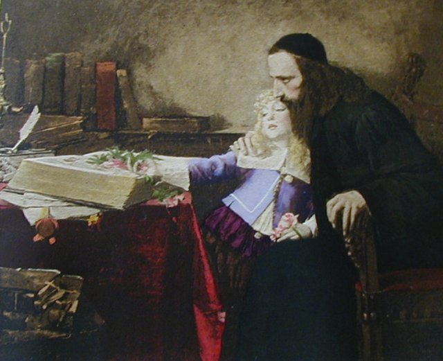
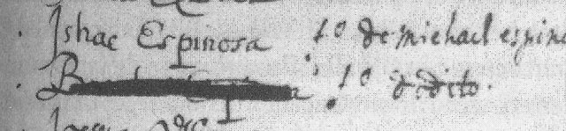
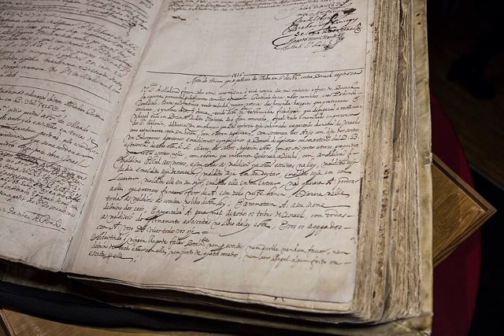
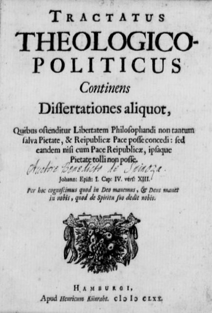
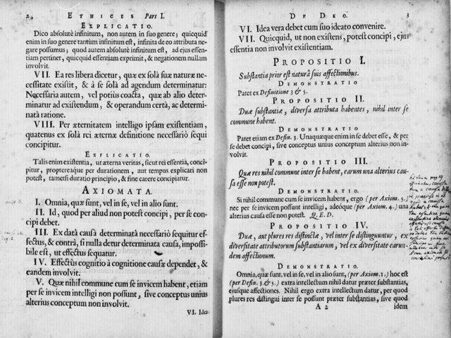
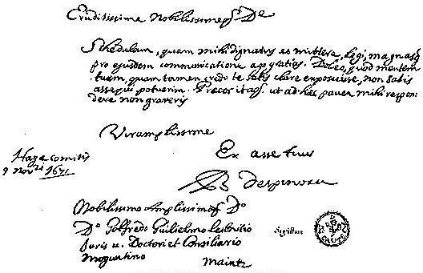
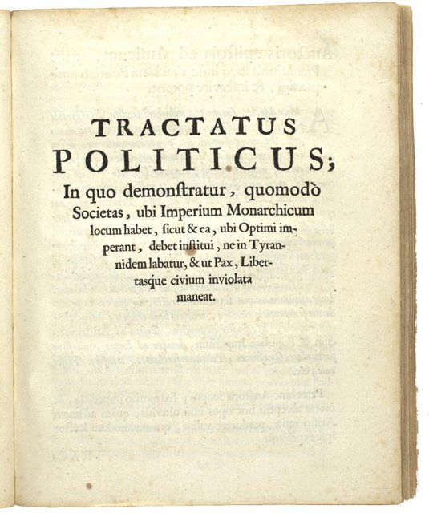

<!--
內容整理自本機筆記〈史賓諾莎生平大事記（1632–1677）〉（圖表\史賓諾莎生平大事記（1632–1677）.md）與中文維基百科「巴魯赫·斯賓諾莎」條目（CC BY-SA 4.0），以台灣用語改寫摘要。
https://zh.wikipedia.org/zh-tw/巴鲁赫·斯宾诺莎
史料與日期說明：
- 譯名採筆記與台灣常用的「史賓諾莎」（維基百科台灣正體作「史賓諾沙」）；笛卡兒、萊布尼茲時間軸中的寫法已一併統一。
- 你提供的網址「史賓諾莎」在中文維基百科沒有對應條目，改讀正式條目「巴魯赫·斯賓諾莎」。
- 母親1638年11月5日去世，距他六歲生日還有十多天，時間軸自動計算為5歲；維基百科寫「年僅六歲」是約略說法。
- 跟隨范登恩登學拉丁文的時間，維基百科並列1654–1655年與1657–1658年兩說，此處以「約1654～1657年」概括。
- 搬到萊茵斯堡的年份：筆記寫約1660年，維基百科寫約1660–1661年；遷居海牙：筆記寫福爾堡時期到1669年，維基百科寫1670年，此處依維基百科與一般說法。
- 《簡論上帝、人及其幸福》的荷蘭文手稿：維基百科寫1810年重新被發現，一般說法是1850年代，此處依一般說法。
- 1676年11月萊布尼茲來訪的確切日期不詳（約在月中），他當時尚未過44歲生日，以 {age=43} 標示。
- 死因：維基百科認為很可能是長年磨鏡片吸入玻璃粉塵造成的肺病，一般也認為與肺結核有關，此處並列。
- 1672年「災難之年」、1673年前往烏特勒支法軍營地、《遺著集》1677年底出版、1678年遭禁等細節，係依一般公認的史實補充；後世影響併入最後一則事件。
圖片來源（皆為 Wikimedia Commons 公有領域／CC0 作品）：
- spi-cover.jpg：Spinoza.jpg
- spi-dacosta.jpg：Dacosta und Spinoza.jpg
- spi-school.jpg：Baruch Espinosa crossed out from pupil list, Ets Haim, Amsterdam, 17th century.jpeg
- spi-ban.jpg：Ban of Baruch Spinoza, Amsterdam, 27 July 1656, 6 Av 5416.jpg
- spi-ttp.jpg：Spinoza Tractatus Theologico-Politicus.jpg
- spi-ethica.jpg：Spinoza Ethica Pars1 Prop1.jpg
- spi-letter.jpg：Spinoza Letter to Leibniz.jpg
- spi-opera.jpg：Spinoza, Tractatus Politicus Titlepage.jpg
-->

# Periods
- 1632 ~ 1656 | 阿姆斯特丹的猶太少年 | #1c7ed6
  生於阿姆斯特丹的葡萄牙猶太商人家庭，在猶太學校學習希伯來文與經典，父兄相繼去世後接手家族生意，同時開始學拉丁文、接觸笛卡兒哲學。
- 1656 ~ 1663 | 逐出教會後的獨立生活 | #495057
  23歲被猶太社群永久逐出，改用拉丁名字本尼迪克特斯，以磨鏡片維生，搬到萊頓附近的萊茵斯堡，開始建構自己的哲學體系。
- 1663 ~ 1670 | 福爾堡時期 | #2f9e44
  住在海牙郊外的福爾堡，出版《笛卡兒哲學原理》，撰寫《倫理學》，並中斷寫作去完成為思想自由辯護的《神學政治論》。
- 1670 ~ 1677 | 海牙的最後歲月 | #862e9c
  遷居海牙，《神學政治論》匿名出版後掀起軒然大波；他婉拒大學教職，完成《倫理學》卻不敢出版，44歲死於肺病。

# Events

## 1632-11-24 | 出生@阿姆斯特丹
生於阿姆斯特丹的猶太人區，本名巴魯赫（希伯來文「受祝福的人」）。他的祖先是為了逃避宗教迫害，從西班牙輾轉逃到葡萄牙、再到荷蘭的塞法迪猶太人。父親麥可經營進出口貿易，也擔任猶太社群與學校的幹部。當時的荷蘭共和國正處於黃金時代，商業繁榮、宗教相對寬容，是歐洲異議思想的避風港。

## 1638-11-05 | 母親去世
母親安娜·狄波拉去世，他還不滿六歲。父親的三任妻子都早逝，家中六個孩子也只有少數活到成年。他的母語是葡萄牙語，後來還通曉希伯來文、西班牙文、荷蘭文與拉丁文。

## 1640 | 猶太學校的教育 {label=1640年代}

在阿姆斯特丹猶太社群的學校學習希伯來文、《妥拉》、《塔木德》與中世紀猶太哲學，老師包括著名的拉比摩爾泰拉與瑪拿西·本·以色列。他天資出眾，一度被期待成為拉比，但並沒有完成高等的律法教育。這段熟讀經典的訓練，日後成為他批判性研究《聖經》的基礎。

## 1649 | 長兄去世，輟學經商

長兄艾薩克去世，他不得不中斷學業，到父親的公司幫忙經營生意。

## 1654-03 | 父親去世
父親去世，21歲的他依照猶太禮法守喪十一個月，並與弟弟加布里埃爾一起接手家族生意。受第一次英荷戰爭影響，生意很快陷入困境；1656年他向法院申明自己是孤兒，以免繼承父親的債務。

## 1655 | 學習拉丁文，接觸笛卡兒 {label=約1654～1657年}
跟隨自由思想家范登恩登學習拉丁文，並在他的學校擔任教師；范登恩登是前耶穌會士、激進的民主派，很可能就是他引導史賓諾莎閱讀笛卡兒的新哲學。這段期間他也結識了一群反對教會權威的基督教異議人士，常聚會討論宗教與哲學問題。

## 1656-07-27 | 被逐出猶太社群

阿姆斯特丹猶太會堂對23歲的他發布措辭極為嚴厲的「赫倫」（逐出令），詛咒他並禁止任何人與他交談、往來或閱讀他的文字。逐出令沒有寫明具體罪狀，但一般認為與他公開否認靈魂不朽、主張摩西五經並非摩西所寫、律法對猶太人沒有約束力等觀點有關。此後他從未回到猶太社群，也沒有改信基督教，而是改用拉丁名字本尼迪克特斯，走上獨立思考的道路。這道逐出令至今仍未撤銷。

## 1657 | 磨鏡片維生 {label=約1656～1660年}
離開猶太人區，以磨製光學鏡片維生，同時私下教授哲學。後世常把他描繪成孤獨的磨鏡匠，但他其實身處一個熱絡的朋友圈，這些朋友後來組成研讀他手稿的讀書會。這個時期他寫下《簡論上帝、人及其幸福》，但生前沒有出版，手稿直到1850年代才被重新發現。

## 1661 | 萊茵斯堡 {label=約1660～1661年}
搬到萊頓附近的小鎮萊茵斯堡，寫作《知性改進論》，探討如何找到可靠的知識與真正的幸福，並開始撰寫《倫理學》。1661年夏天，英國皇家學會秘書奧爾登堡專程來訪，此後兩人長期通信，他也透過奧爾登堡與化學家波以耳討論科學問題。

## 1663 | 《笛卡兒哲學原理》，遷居福爾堡
出版《笛卡兒哲學原理》，用歐幾里得幾何學的定義、公理、命題與證明，重新整理笛卡兒的哲學，這是他生前唯一署上本名出版的著作。同年搬到海牙郊外的福爾堡，在那裡繼續寫《倫理學》，並與歐洲各地的學者通信。

## 1665 | 中斷《倫理學》，轉寫《神學政治論》
他寫信告訴奧爾登堡，自己暫停《倫理學》，改寫一部討論《聖經》與政治的書。他的鏡片與光學研究也受到荷蘭科學家惠更斯的讚賞，兩人討論顯微鏡與望遠鏡的設計。

## 1670 | 匿名出版《神學政治論》

以假的出版者與出版地匿名出版《神學政治論》，主張《聖經》應該像其他古代文獻一樣，用歷史與語言的方法研究；宗教的核心只是正義與仁愛，國家應該保障人民思考與言論的自由。此書支持當時主政的共和派領袖德維特，反對奧蘭治派與喀爾文教會。出版後立刻被斥為褻瀆神明的危險著作，1674年遭到荷蘭當局查禁。同年他遷居海牙，靠德維特的津貼與朋友的年金過著簡樸的生活。

## 1672 | 「災難之年」
法國、英國等國聯手入侵荷蘭，史稱「災難之年」。德維特兄弟被激憤的群眾殺害，共和派政權垮台，奧蘭治親王威廉三世掌權。據萊布尼茲轉述，向來冷靜的史賓諾莎悲憤不已，想到現場張貼「野蠻至極」的抗議告示，被房東鎖在屋內才作罷。

## 1673-02 | 婉拒海德堡大學教職
普法茲選侯透過顧問邀請他擔任海德堡大學哲學教授，承諾給他「最充分的哲學思想自由」，條件是不得擾亂公認的宗教。他回信婉拒，擔心這個條件會限制自己，也不想因教學而中斷研究。同年夏天，他應邀前往被法軍佔領的烏特勒支，會見法軍將領孔代親王的幕僚，回到海牙後一度被懷疑是法國間諜。

## 1675 | 完成《倫理學》

完成《倫理學》，全書仿照幾何學的形式，從「實體」的定義出發，推論出唯一的實體就是「上帝或自然」，心靈與身體只是同一實體的兩種屬性；再一路推到人的情感、奴役與自由，最後以「對上帝的理智之愛」作結。他原本打算出版，但聽說神學家已經在散布他是無神論者的傳言，便決定擱置。他的印章上刻著拉丁文「謹慎」，正是他處境的寫照。

## 1676-11 | 萊布尼茲來訪 {age=43}

30歲的萊布尼茲從巴黎前往漢諾威途中，特地到海牙拜訪他，兩人談了好幾天，萊布尼茲還讀到了《倫理學》的手稿。萊布尼茲後來公開批評史賓諾莎的思想，卻刻意淡化這次會面。這時他正在撰寫未完成的《政治論》，討論君主制、貴族制與民主制。

## 1677-02-21 | 逝世@海牙
因肺病在海牙去世，享年44歲，死因很可能是肺結核，或長年磨鏡片吸入玻璃粉塵所加重的肺部疾病。他生前已安排好，把書桌與手稿交給朋友，送往阿姆斯特丹的出版商。他被安葬在海牙新教堂的墓園。

## 1677-12 | 出版《遺著集》

朋友們秘密整理他的手稿，以拉丁文與荷蘭文出版《遺著集》，收錄《倫理學》《政治論》《知性改進論》與書信，作者只以縮寫「B.D.S.」標示。次年這部書被荷蘭當局查禁，天主教會也將他的著作列為禁書。他被視為無神論者長達一個世紀，直到德國的萊辛、歌德與德國觀念論者重新發現他；黑格爾說「要麼是史賓諾莎主義，要麼根本不是哲學」，愛因斯坦也說他信仰的是「史賓諾莎的上帝」。
