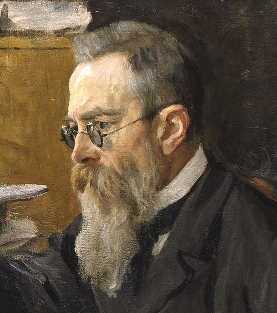
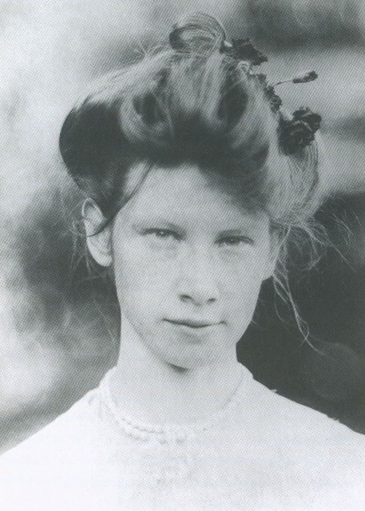
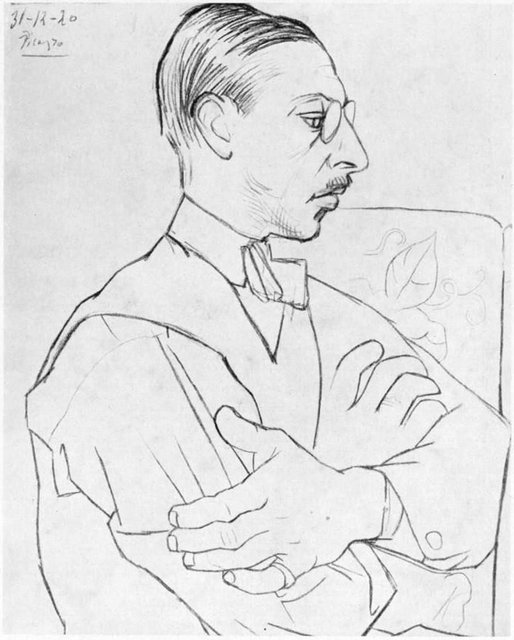
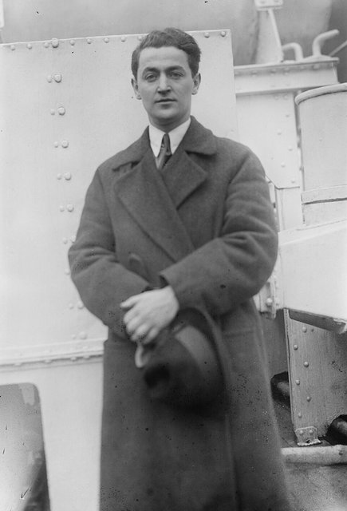
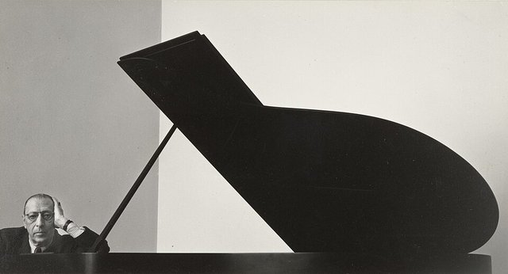
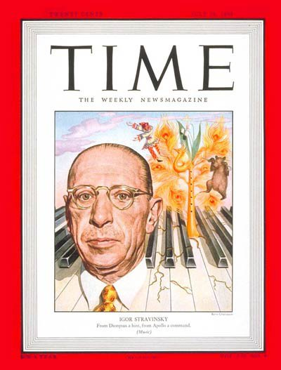
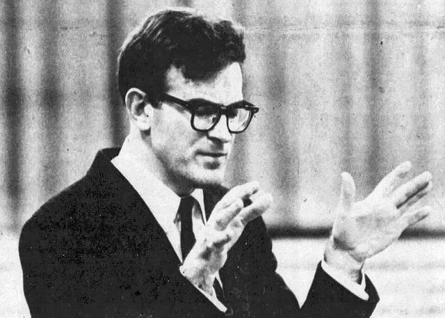

<!--
內容整理自中文維基百科「伊果·史特拉汶斯基」與英文維基百科「Igor Stravinsky」條目（CC BY-SA 4.0），並以台灣用語改寫摘要。
https://zh.wikipedia.org/zh-tw/伊戈尔·斯特拉文斯基
https://en.wikipedia.org/wiki/Igor_Stravinsky
中文條目大致譯自英文條目，生平細節以英文條目為準。日期採新曆。
圖片皆為 Wikimedia Commons 上的公有領域（含PD-US）作品（封面：喬治·班恩新聞圖片社所攝肖像）。
-->

# Periods
- 1882 ~ 1901 | 童年@聖彼得堡
  父親是馬林斯基劇院的男低音，家住劇院附近。他畏懼脾氣暴躁的父親、和母親也不親，只和弟弟古利感情深厚。父母看不出他有音樂天分，他卻常泡在劇院看排練。
- 1901 ~ 1909 | 法律系學生與林姆斯基－高沙可夫的門生
  依父母期望讀法律，卻結識林姆斯基－高沙可夫的兒子，成為大師的私人學生。與表姊葉卡捷琳娜結婚，第一首交響曲在宮廷樂團首演。
- 1909 ~ 1920 | 俄羅斯芭蕾舞團與國際聲名
  狄亞基列夫委託的《火鳥》、《彼得洛希卡》、《春之祭》讓他一舉成為最前衛的作曲家。一次大戰期間避居瑞士，深入研究俄國民間詩歌，寫出《婚禮》、《大兵的故事》。
- 1920 ~ 1939 | 法國：新古典主義@Paris
  轉向新古典風格，寫下《普欽奈拉》、《伊底帕斯王》、《阿波羅》、《詩篇交響曲》等作品。重拾東正教信仰，1934年入籍法國，但晚年接連失去女兒、妻子和母親。
- 1939 ~ 1971 | 美國：從好萊塢到十二音@Los Angeles
  二次大戰爆發後移居美國，與薇拉結婚、定居洛杉磯，1945年入籍美國。結識助理克拉夫特後轉向荀白克的十二音技法，晚年重返闊別48年的祖國。

# Events

## 1882-06-17 | 出生@奧拉寧鮑姆
生於聖彼得堡西方約50公里的奧拉寧鮑姆（今羅蒙諾索夫），全家夏天在那裡避暑，平常住在馬林斯基劇院附近的克留科夫運河旁。父親費奧多爾是馬林斯基劇院的男低音，祖先是波蘭地主；母親安娜是業餘歌手兼鋼琴家。「史特拉汶斯基」這個姓氏源自波蘭－立陶宛聯邦的斯特拉瓦河。

## 1891 | 開始學鋼琴
9歲開始跟私人老師學鋼琴，但他常常即興而不練指定曲目，父母因此認為他沒什麼音樂天分。不過他視譜能力極佳，常翻閱父親的大量聲樂總譜。他11歲前由家庭教師教育，之後進入聖彼得堡第二中學，他很討厭那裡，因為沒什麼朋友。

## 1892 | 馬林斯基劇院的常客
大約10歲起他經常到馬林斯基劇院看演出，認識了俄國、義大利與法國歌劇；到16歲時，他每週有五、六天去看劇院排練。14歲時他已能彈奏孟德爾頌第一號鋼琴協奏曲的獨奏部分，15歲把格拉祖諾夫的一首弦樂四重奏改編成鋼琴獨奏。

## 1901 | 進入聖彼得堡大學法律系
依父母期望讀法律，他自稱是個壞學生，很少去上選修課。交換條件是父母讓他上和聲與對位課。他在大學結識了林姆斯基－高沙可夫的兒子弗拉基米爾，同年夏天還和表姊葉卡捷琳娜的好友有過一段「夏日戀情」。

## 1902 | 拜林姆斯基－高沙可夫為師

暑假和弗拉基米爾到德國海德堡，把作品拿給林姆斯基－高沙可夫看。大師雖然沒有被驚豔，仍堅持要他繼續上課，並勸他不要進要求嚴格的音樂學院，答應親自指導他作曲。同年父親去世，他變得更加獨立，也愈來愈融入林姆斯基－高沙可夫的藝術圈。

## 1905 | 半張文憑；與表姊訂婚
1月「血腥星期日」事件讓大學停課，他沒能參加期末考，只拿到「半張文憑」。同年他的鋼琴奏鳴曲在林姆斯基－高沙可夫家中首演，這是他的作品第一次公開演出。8月他宣布與表姊葉卡捷琳娜訂婚，他說她就像「我一直渴望的姊姊」。

## 1906-01-24 | 與葉卡捷琳娜結婚

因為表親通婚是被禁止的，他們找了一位不問身分的神父，在聖彼得堡北方的報喜教堂成婚，唯一的賓客是林姆斯基－高沙可夫的兒子們。兩人後來生了四個孩子。

## 1907-04 | 第一首交響曲首演
林姆斯基－高沙可夫安排宮廷樂團首演他的降E大調交響曲與歌曲集《牧神與牧羊女》，這是他的作品第一次正式公開首演。

## 1908-06 | 林姆斯基－高沙可夫去世
他寄給老師的管弦樂《煙火》總譜被退了回來，上面寫著：「收件人已逝，無法投遞。」他深感哀痛，寫了《葬禮之歌》紀念恩師，後來說這是「《火鳥》之前我最好的作品」。

## 1909-02 | 狄亞基列夫注意到他

俄羅斯芭蕾舞團的經理人狄亞基列夫聽了他的《諧謔幻想曲》與《煙火》首演，被其鮮明的色彩深深吸引，請他為芭蕾《仙女們》改編幾首蕭邦的作品。

## 1910-06-25 | 《火鳥》巴黎首演

狄亞基列夫想推出一部充滿俄國風情的新芭蕾，問過利亞多夫等多位作曲家都沒結果，最後找上他，他欣然接受。首演好評如潮，他一夜成名。德布西被請上台致意，還邀他吃晚飯，兩人從此成為終生好友。

## 1911-06-13 | 《彼得洛希卡》首演

原本是一首描寫木偶活過來的鋼琴與管弦樂曲，狄亞基列夫聽了草稿後說服他改成芭蕾。首演與《火鳥》同樣成功，奠定他當代最前衛劇場作曲家的地位。

## 1913-05-29 | 《春之祭》首演引發騷動

寫《火鳥》時，他腦中浮現一個畫面：「莊嚴的異教儀式：智慧的長老圍坐成圈，看著一位少女跳舞至死。」他與畫家羅瑞赫合作，寫成描繪斯拉夫部落異教儀式的《春之祭》，運用不規則的節奏與拍子、疊置的和聲與龐大的編制。加上尼金斯基激進的編舞，在巴黎香榭麗舍劇院首演時幾乎引發暴動。這部作品後來徹底改變了作曲家對節奏結構的理解。

## 1913-06 | 傷寒住院
首演後不久他因傷寒住院休養五週，德布西、法雅、拉威爾等同行都來探望他。

## 1914 | 歌劇《夜鶯》；避居瑞士

妻子染上肺結核，到瑞士萊森的療養院休養，第四個孩子在那裡出生。他完成歌劇《夜鶯》，5月由狄亞基列夫推出，反應普通。7月他回俄國收集《婚禮》的歌詞資料，回來後一次大戰就爆發了，全家在瑞士一住就是六年（法國畫家布朗許在1915年為他畫了一幅肖像），他此後直到1962年才再回到俄國。

## 1916 | 戰時的困頓
德國的出版商因戰爭停業，他的版稅收入突然中斷，只好賣手稿、接受富人委託，例如應波利尼亞克親王夫人之邀寫了《狐狸》。他在紅十字會的慈善音樂會上指揮《火鳥》，這是他第一次登台指揮。

## 1917-04 | 結識畢卡索
俄羅斯芭蕾舞團到羅馬演出時結識畢卡索，兩人一起遊歷義大利。在拿坡里看到的即興喜劇，啟發了後來的芭蕾《普欽奈拉》。

## 1918 | 《大兵的故事》
與瑞士作家拉繆合作的小型劇場作品，只需11位樂手和2位舞者，方便巡演，融合了探戈、圓舞曲、拉格泰姆與聖詠等通俗形式。首演之後，其餘演出都因西班牙流感疫情而取消。

## 1920-05 | 《普欽奈拉》首演

由畢卡索設計舞台與服裝，在巴黎首演。戰後他覺得瑞士離歐洲音樂中心太遠，9月搬進香奈兒的家，在那裡寫下早期的新古典作品《管樂交響曲》。

## 1921 | 與薇拉的戀情

他和香奈兒的關係發展成婚外情，1921年5月又把全家搬到俄國流亡者聚集的比亞里茨，部分原因是另一位情人薇拉也在那裡。妻子知道他外遇，但兩人始終沒有離婚。前一年底，畢卡索為他畫了一幅著名的素描肖像。這一年他也和普雷耶爾鋼琴公司簽約，把自己的作品改編成自動鋼琴紙捲。

## 1922-06 | 和普羅高菲夫大吵
普羅高菲夫在狄亞基列夫面前彈奏歌劇《三橘之戀》，他只聽了第一幕就不肯再聽，還說普羅高菲夫「浪費時間寫歌劇」。兩人吵到差點動手，後來才和好。同年他取材自普希金的喜歌劇《瑪芙拉》首演，轉向柴可夫斯基、葛令卡等古典俄國歌劇作曲家，卻讓樂評失望。

## 1923-06 | 《婚禮》首演
以四台鋼琴與打擊樂器為伴奏的芭蕾清唱劇，描繪俄國的婚禮傳統。倫敦演出時遭到猛烈批評，作家H·G·威爾斯還發表公開信聲援。同年他指揮自己的八重奏首演，1924年擔任鋼琴協奏曲的獨奏並巡演四十多場。

## 1926 | 重拾東正教信仰
全家1924年搬到尼斯。他在青少年時期就離開了東正教會，1926年遇到一位神父後重拾信仰，此後定期上教堂、參與慈善工作。他說自己在帕多瓦的聖安東尼大教堂感受到上帝的召喚，於是寫了第一首宗教作品〈天主經〉。

## 1927-05 | 《伊底帕斯王》
請考克多以拉丁文改寫索福克勒斯的悲劇，寫成歌劇神劇。因為時間和經費不足只能以音樂會形式首演，評價不佳，樂評也不喜歡其中受韓德爾等18世紀作曲家影響的風格。

## 1928 | 《阿波羅》與《仙女之吻》

芭蕾《阿波羅》由巴蘭欽編舞，開啟兩人數十年的合作。同年應舞蹈家伊達·魯賓斯坦委託，以安徒生童話寫成芭蕾《仙女之吻》，大量借用柴可夫斯基的主題。狄亞基列夫氣他接了別人的芭蕾委託，兩人鬧翻，直到1929年8月狄亞基列夫去世都沒和好。

## 1930-12 | 《詩篇交響曲》
應波士頓交響樂團委託，以拉丁文的《詩篇》寫成這首深具宗教情懷的合唱交響曲。

## 1931 | 小提琴協奏曲

在德國巡演時結識小提琴家杜希金，在他的協助下寫成小提琴協奏曲，此後兩人一起巡演到1933年。

## 1934-06 | 入籍法國
成為法國公民，讓他的作品在法國與美國都受到著作權保護。全家搬到巴黎聖奧諾雷市郊街，他寫下兩卷自傳《我的生活紀事》。同年與杜希金到美國巡演三個月，1935年第一次到南美洲。

## 1937 | 美國的委託
為巴蘭欽寫芭蕾《紙牌遊戲》，以及仿布蘭登堡協奏曲的《敦巴頓橡園》，之後又為芝加哥交響樂團50週年寫《C大調交響曲》。

## 1939 | 喪親；移居美國
1938到1939年間，長女柳德米拉與妻子葉卡捷琳娜相繼死於肺結核，母親安娜也過世了。加上報刊的批評愈來愈敵意，又沒能當選法蘭西學會院士，他與法國漸行漸遠。二次大戰爆發不久，他移居美國，在哈佛大學主講六場諾頓講座，後來出版為《音樂詩學》。

## 1940-03-09 | 與薇拉結婚；定居洛杉磯
在麻州貝德福與薇拉結婚，講座結束後搬到洛杉磯。戰爭讓他收不到歐洲的版稅，只好四處指揮、寫商業作品，例如為保羅·懷特曼的樂團寫《俄羅斯詼諧曲》。他也同意迪士尼在動畫電影《幻想曲》中使用由史托考夫斯基改編刪節的《春之祭》。

## 1942 | 大象的《馬戲團波卡》
巴蘭欽受玲玲馬戲團委託，要為大象編一支舞，請他作曲。他問：「給誰跳？」「大象。」「幾歲？」「很年輕。」「如果牠們很年輕，我就寫。」這就是《馬戲團波卡》的由來。這段時期常到他家作客的還有小提琴家西格蒂、鋼琴家魯賓斯坦與拉赫曼尼諾夫，他也和作家赫胥黎、奧登、伊舍伍德等人成為好友。

## 1945 | 入籍美國

成為美國公民，並與布西與霍克斯出版社簽約出版他未來所有的作品。他也修訂了許多舊作重新出版，以取得新的著作權。

## 1948 | 結識克拉夫特

芭蕾《奧菲斯》首演前後，他在紐約認識年輕指揮家羅伯特·克拉夫特，很快邀他到洛杉磯，克拉夫特從此成為他的助理、合作者與代筆，直到他去世。同年他登上《時代》雜誌封面。這一年他的音樂在蘇聯被正式禁演；1949年蕭士塔高維奇訪美時，還被迫當眾表態支持對他的批判。

## 1951 | 歌劇《浪子的歷程》

根據18世紀英國畫家霍加斯的同名系列畫作，與詩人奧登合寫英文劇本的歌劇，在威尼斯首演並廣受演出。但他發現自己的新作品吸引不了年輕作曲家，於是在克拉夫特介紹下，開始研究魏本與荀白克的十二音音樂。

## 1954 | 第一首十二音作品
原本答應和詩人狄倫·湯瑪斯合寫新歌劇，湯瑪斯卻在1953年11月猝逝。他寫下《紀念狄倫·湯瑪斯》，這是他第一首完全以十二音技法寫成的作品。之後的《神聖讚歌》、芭蕾《競賽》與《哀歌》，讓他完全轉向音列技法。

## 1962-01 | 白宮晚宴
為慶祝他的80歲生日，甘迺迪總統在白宮設宴款待他。這雖然很大程度是反蘇的政治宣傳，他仍很懷念這次晚宴，甘迺迪遇刺後還寫了《甘迺迪輓歌》。

## 1962-09 | 闊別48年重返祖國
應蘇聯作曲家協會之邀，在莫斯科與列寧格勒指揮六場演出，這是他1914年以來第一次回到俄國。他的音樂在史達林時代幾乎消失，1948年更被正式禁演，赫魯雪夫解凍時期才重新受到重視。他在三週的訪問中會見了赫魯雪夫，以及蕭士塔高維奇、哈察都量等作曲家。

## 1966 | 最後的大型作品《安魂頌歌》
晚年多以聖經為題材，例如《大洪水》、《亞伯拉罕與以撒》。他在巡演空檔不斷構思新的音列，甚至寫在飛機廁所的衛生紙上。《安魂頌歌》是他最後的大型作品。

## 1967-05-17 | 最後一次公開指揮

在多倫多梅西音樂廳指揮多倫多交響樂團演出《普欽奈拉組曲》，當時他已非常虛弱。晚年陪伴在側的是助理克拉夫特。同年1月是他最後一次錄音；秋天因胃潰瘍出血與血栓住院，此後漸漸停止作曲。

## 1971-04-06 | 逝世@紐約
晚年和薇拉、克拉夫特搬到紐約以便就醫，因肺水腫在第五大道的公寓去世，享年88歲。在威尼斯的聖若望及保祿大殿舉行告別式，由克拉夫特指揮演出他的《安魂頌歌》，之後安葬在威尼斯的聖米凱萊墓島，距離狄亞基列夫的墓只有幾公尺。1998年《時代》雜誌將他列入20世紀最有影響力的百位人物。
