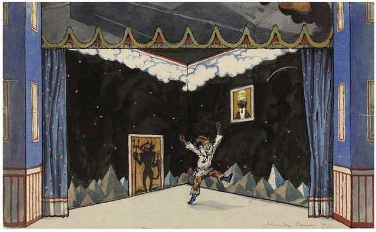
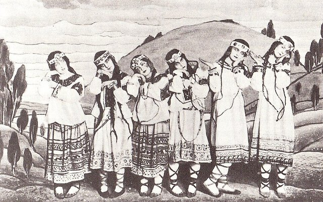
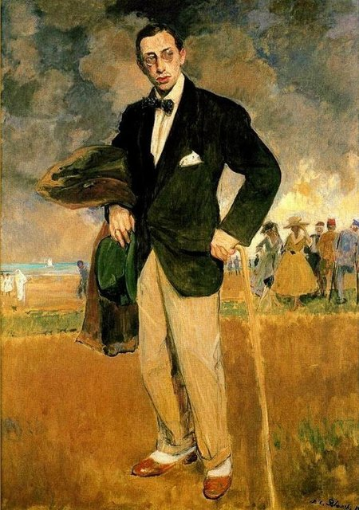
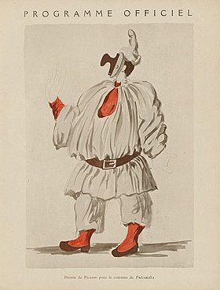
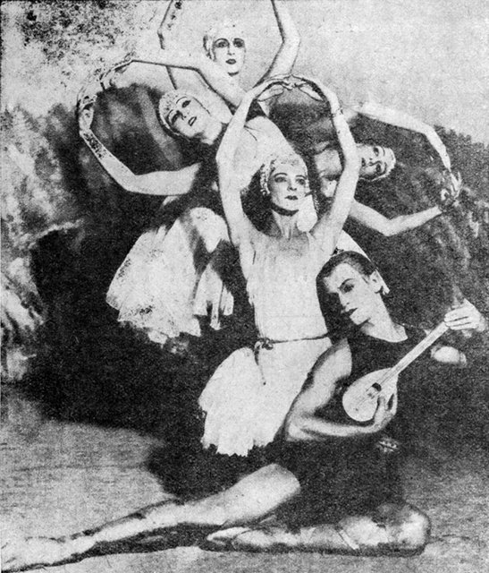
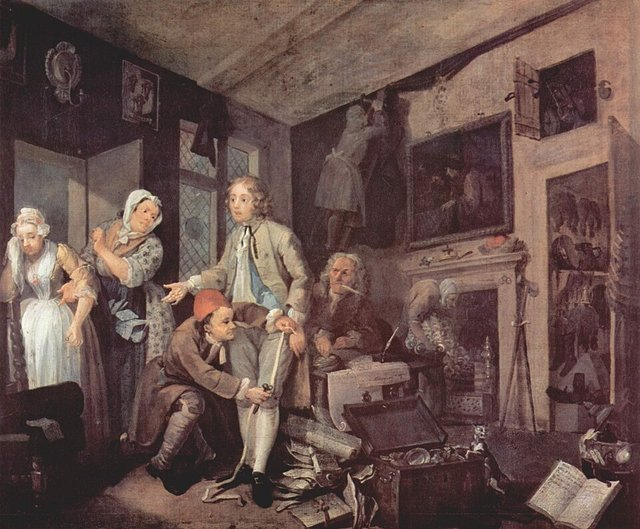

<!--
內容整理自本機筆記〈史特拉汶斯基主要作品〉（D:\Books\md\音樂\史特拉汶斯基主要作品.md；知識圖譜的「5-2.音樂家作品」尚無這份筆記的網頁版），做法比照「貝多芬主要作品」。
- 每首作品一則事件，日期採「創作時間」（多年創作的作品以區間呈現；「年代」以十年計、「世紀」以百年計，修訂或出版年份只寫在顯示文字裡），事件顏色依筆記的類別段落區分：芭蕾舞劇：史特拉汶斯基最重要的代表作、交響曲與大型管弦樂作品、協奏曲與協奏性作品、歌劇與戲劇作品、宗教合唱與聲樂作品、管弦樂組曲、序曲與其他管弦樂作品、室內樂與器樂作品、鋼琴與鍵盤作品。
- 「約」、「前後」、修訂、出版等不是單純年份的寫法，以原文作為顯示文字。
- 作品編號是目錄編號，不等於創作順序，時間軸依創作時間排序；筆記中只是表格序號的「編號」欄不列為作品編號。
- 筆記的推薦清單、依年代整理的總覽與編號說明，和前面的作品表重複，未另立事件。
- 時期沿用「史特拉汶斯基生平」時間軸的主要時期（重疊的細分時期不列）。
- 筆記推薦清單中的作品另註明順序。
- 沒有年份、無法放上時間軸的條目未收錄：K.100 《以色列支派》（The Twelve Tribes of Israel）相關作品（晚期）。
- 以 follows 排在「史特拉汶斯基生平」之後；生平事件見該時間軸。
圖片來源（皆為 Wikimedia Commons 公有領域／CC0 作品，沿用生平時間軸的圖片）：
- stravinsky-cover.jpg（與史特拉汶斯基生平共用）
- stravinsky-1910-firebird.jpg（與史特拉汶斯基生平共用）
- stravinsky-1911-petrushka.jpg（與史特拉汶斯基生平共用）
- stravinsky-1913-rite.jpg（與史特拉汶斯基生平共用）
- stravinsky-1915-blanche.jpg（與史特拉汶斯基生平共用）
- stravinsky-1920-pulcinella.jpg（與史特拉汶斯基生平共用）
- stravinsky-1928-apollon.jpg（與史特拉汶斯基生平共用）
- stravinsky-1735-hogarth.jpg（與史特拉汶斯基生平共用）
-->

# Periods
- 1882 ~ 1901 | 童年@聖彼得堡
  父親是馬林斯基劇院的男低音，家住劇院附近。他畏懼脾氣暴躁的父親、和母親也不親，只和弟弟古利感情深厚。父母看不出他有音樂天分，他卻常泡在劇院看排練。
- 1901 ~ 1909 | 法律系學生與林姆斯基－高沙可夫的門生
  依父母期望讀法律，卻結識林姆斯基－高沙可夫的兒子，成為大師的私人學生。與表姊葉卡捷琳娜結婚，第一首交響曲在宮廷樂團首演。
- 1909 ~ 1920 | 俄羅斯芭蕾舞團與國際聲名
  狄亞基列夫委託的《火鳥》、《彼得洛希卡》、《春之祭》讓他一舉成為最前衛的作曲家。一次大戰期間避居瑞士，深入研究俄國民間詩歌，寫出《婚禮》、《大兵的故事》。
- 1920 ~ 1939 | 法國：新古典主義@Paris
  轉向新古典風格，寫下《普欽奈拉》、《伊底帕斯王》、《阿波羅》、《詩篇交響曲》等作品。重拾東正教信仰，1934年入籍法國，但晚年接連失去女兒、妻子和母親。
- 1939 ~ 1971 | 美國：從好萊塢到十二音@Los Angeles
  二次大戰爆發後移居美國，與薇拉結婚、定居洛杉磯，1945年入籍美國。結識助理克拉夫特後轉向荀白克的十二音技法，晚年重返闊別48年的祖國。

# Events

## 1909 ~ 1910 | K.010 《火鳥》（The Firebird） {color=#c92a2a}

類別：芭蕾舞劇；俄羅斯民間傳說題材，管弦樂色彩華麗（芭蕾舞劇：史特拉汶斯基最重要的代表作）。入門推薦聆聽第 1 首。

## 1910 ~ 1911 | K.012 《彼得洛希卡》（Petrushka） {color=#c92a2a label="1910–1911；1947修訂"}

類別：芭蕾舞劇；描寫俄羅斯節慶、木偶與人物悲劇（芭蕾舞劇：史特拉汶斯基最重要的代表作）。入門推薦聆聽第 2 首。

## 1910 ~ 1913 | K.015 《春之祭》（The Rite of Spring） {color=#c92a2a label="1910–1913；後有修訂"}

類別：芭蕾舞劇；原始節奏、複合節拍及強烈不協和音（芭蕾舞劇：史特拉汶斯基最重要的代表作）。入門推薦聆聽第 3 首。

## 1908 ~ 1914 | K.018 《夜鶯》（The Nightingale） {color=#c92a2a}

類別：歌劇／音樂童話；融合東方色彩與現代管弦樂（芭蕾舞劇：史特拉汶斯基最重要的代表作）。

## 1915 ~ 1916 | K.023 《雷納德》（Renard，狐狸的故事） {color=#c92a2a}
類別：舞台作品；帶有荒誕、諷刺與民間故事色彩（芭蕾舞劇：史特拉汶斯基最重要的代表作）。

## 1919 ~ 1920 | K.034 《普欽奈拉》（Pulcinella） {color=#c92a2a}

類別：芭蕾舞劇；新古典主義的重要起點，借用佩爾戈雷西時代的音樂素材（芭蕾舞劇：史特拉汶斯基最重要的代表作）。入門推薦聆聽第 5 首。

## 1914 ~ 1923 | K.040 《婚禮》（Les Noces） {color=#c92a2a}
類別：舞台作品；獨唱、合唱、打擊樂與四架鋼琴，呈現俄羅斯鄉村婚禮（芭蕾舞劇：史特拉汶斯基最重要的代表作）。入門推薦聆聽第 6 首。

## 1927 ~ 1928 | K.048 《阿波羅》（Apollon musagète） {color=#c92a2a}

類別：芭蕾舞劇；以弦樂團演奏，風格典雅、古典（芭蕾舞劇：史特拉汶斯基最重要的代表作）。入門推薦聆聽第 7 首。

## 1928 | K.049 《仙女之吻》（The Fairy’s Kiss） {color=#c92a2a label="1928；1950修訂"}
類別：芭蕾舞劇；向柴可夫斯基致敬（芭蕾舞劇：史特拉汶斯基最重要的代表作）。

## 1946 ~ 1947 | K.076 《俄耳甫斯》（Orpheus） {color=#c92a2a}
類別：芭蕾舞劇；希臘神話題材，新古典主義風格（芭蕾舞劇：史特拉汶斯基最重要的代表作）。

## 1953 ~ 1957 | K.088 《阿貢》（Agon） {color=#c92a2a}
類別：芭蕾舞劇；晚期作品，結合古典舞蹈形式與序列技法（芭蕾舞劇：史特拉汶斯基最重要的代表作）。

## 1905 ~ 1907 | K.003／Op. 1 降 E 大調交響曲 {color=#1971c2 label="1905–1907；後續修訂"}
類別：早期交響曲，仍可聽出俄羅斯晚期浪漫派影響（交響曲與大型管弦樂作品）。

## 1916 ~ 1917 | K.026 《夜鶯之歌》（The Song of the Nightingale） {color=#1971c2}
類別：交響詩；改編自歌劇《夜鶯》的音樂素材（交響曲與大型管弦樂作品）。

## 1920 | K.036 《管樂器交響曲》（Symphonies of Wind Instruments） {color=#1971c2 label="1920；1947修訂"}
類別：管樂合奏；採用片段式結構，帶有紀念性與儀式感（交響曲與大型管弦樂作品）。

## 1930 | K.052 《詩篇交響曲》（Symphony of Psalms） {color=#1971c2 label="1930；1948修訂"}
類別：合唱與管弦樂；以聖經詩篇為文本，使用不尋常的編制（交響曲與大型管弦樂作品）。入門推薦聆聽第 8 首。

## 1942 ~ 1945 | K.073 《三樂章交響曲》（Symphony in Three Movements） {color=#1971c2}
類別：管弦樂；節奏強烈，具有戰爭時期的戲劇張力（交響曲與大型管弦樂作品）。

## 1938 ~ 1940 | K.061（常見目錄編號待版本核對） C 大調交響曲（Symphony in C） {color=#1971c2}
類別：交響曲；以古典形式為基礎，融合現代節奏與和聲（交響曲與大型管弦樂作品）。

## 1943 | K.066 《頌歌》（Ode） {color=#1971c2}
類別：管弦樂哀歌；具有紀念與沉思性質（交響曲與大型管弦樂作品）。

## 1946 ~ 1947 | K.075 D 大調協奏曲（巴塞爾協奏曲） {color=#1971c2}
類別：弦樂團作品；結構清晰，帶有巴洛克協奏曲的影響（交響曲與大型管弦樂作品）。

## 1923 ~ 1924 | K.042 《鋼琴與管樂協奏曲》（Concerto for Piano and Wind Instruments） {color=#e67700 label="1923–1924；1950修訂"}
類別：鋼琴與管樂團；新古典主義代表作（協奏曲與協奏性作品）。

## 1928 ~ 1929 | K.050 《綺想曲》（Capriccio） {color=#e67700 label="1928–1929；1949修訂"}
類別：鋼琴與管弦樂；明快、炫技，帶有新古典主義風格（協奏曲與協奏性作品）。

## 1931 | K.053 D 大調小提琴協奏曲 {color=#e67700}
類別：小提琴與管弦樂；以鮮明的節奏和特殊和弦結構聞名（協奏曲與協奏性作品）。

## 1937 ~ 1938 | K.060 降 E 大調協奏曲《鄧巴頓橡園》（Dumbarton Oaks） {color=#e67700}
類別：室內管弦樂協奏曲；受巴赫《布蘭登堡協奏曲》啟發（協奏曲與協奏性作品）。

## 1945 | K.074 《烏木協奏曲》（Ebony Concerto） {color=#e67700}
類別：單簧管與爵士樂團；融合爵士節奏與古典形式（協奏曲與協奏性作品）。

## 1935 | K.058 雙鋼琴協奏曲（Concerto for Two Pianos） {color=#e67700}
類別：雙鋼琴；節奏緊密，具有強烈的打擊性（協奏曲與協奏性作品）。

## 1955 | K.086 《聖馬可之名》（Canticum Sacrum） {color=#e67700}
類別：聲樂與管弦樂；結合宗教文本及晚期現代技法（協奏曲與協奏性作品）。

## 1958 ~ 1959 | K.092 《鋼琴與管弦樂的樂章》（Movements for Piano and Orchestra） {color=#e67700}
類別：鋼琴與管弦樂；晚期序列音樂風格（協奏曲與協奏性作品）。

## 1915 ~ 1916 | K.023 《雷納德》（Renard） {color=#2f9e44}
類別：荒誕舞台作品；以歌唱、舞蹈與表演結合（歌劇與戲劇作品）。

## 1918 | K.029 《士兵的故事》（The Soldier’s Tale） {color=#2f9e44}
類別：朗誦、舞蹈與室內樂；以小型樂團伴奏（歌劇與戲劇作品）。入門推薦聆聽第 4 首。

## 1921 ~ 1922 | K.039 《瑪芙拉》（Mavra） {color=#2f9e44}
類別：一幕喜歌劇；帶有諷刺與俄羅斯民間風格（歌劇與戲劇作品）。

## 1926 ~ 1927 | K.047 《俄狄浦斯王》（Oedipus Rex） {color=#2f9e44 label="1926–1927；1948修訂"}
類別：歌劇清唱劇；拉丁文演唱、法文旁白，取材自希臘悲劇（歌劇與戲劇作品）。入門推薦聆聽第 10 首。

## 1933 ~ 1934 | K.056 《珀耳塞福涅》（Perséphone） {color=#2f9e44 label="1933–1934；1949修訂"}
類別：朗誦、獨唱、合唱與管弦樂；結合戲劇與清唱劇（歌劇與戲劇作品）。

## 1947 ~ 1951 | K.078 《浪子的歷程》（The Rake’s Progress） {color=#2f9e44}

類別：三幕歌劇；以霍加斯版畫為靈感，採用古典歌劇形式（歌劇與戲劇作品）。入門推薦聆聽第 11 首。

## 1962 ~ 1963 | K.101 《亞伯拉罕與以撒》（Abraham and Isaac） {color=#2f9e44}
類別：聲樂與管弦樂；以聖經故事為題材（歌劇與戲劇作品）。

## 1911 | K.014 《星面者》（Le Roi des étoiles／Zvezdoliki） {color=#862e9c}
類別：男聲合唱與管弦樂；早期大型聲樂作品（宗教合唱與聲樂作品）。

## 1917 | K.028 《四首俄羅斯農民歌曲》 {color=#862e9c}
類別：合唱作品；取材自民間歌曲（宗教合唱與聲樂作品）。

## 1926 | K.046 《主禱文》（Pater Noster） {color=#862e9c label="1926；1949改用拉丁文版本"}
類別：無伴奏合唱；宗教作品（宗教合唱與聲樂作品）。

## 1930 | K.052 《詩篇交響曲》 {color=#862e9c label="1930；1948修訂"}
類別：合唱與管弦樂；採用聖經詩篇文本（宗教合唱與聲樂作品）。

## 1932 | K.055 《信經》（Credo／Russian Credo） {color=#862e9c label="1932；後有修訂"}
類別：合唱；宗教禮儀作品（宗教合唱與聲樂作品）。

## 1934 | K.057 《聖母頌》（Ave Maria） {color=#862e9c label="1934；後有修訂"}
類別：無伴奏合唱（宗教合唱與聲樂作品）。

## 1944 | K.068 《巴別》（Babel） {color=#862e9c}
類別：朗誦、男聲合唱與管弦樂（宗教合唱與聲樂作品）。

## 1944 ~ 1948 | K.077 《彌撒曲》（Mass） {color=#862e9c}
類別：合唱與雙簧管、英國管、低音管、小號及長號等管樂編制（宗教合唱與聲樂作品）。

## 1951 ~ 1952 | K.079 《康塔塔》（Cantata） {color=#862e9c}
類別：獨唱、合唱與器樂合奏；以中世紀英語詩歌為文本（宗教合唱與聲樂作品）。

## 1956 | K.087 《聖歌變奏曲》（Choral-Variationen） {color=#862e9c}
類別：以宗教聖歌為素材的變奏作品（宗教合唱與聲樂作品）。

## 1962 | K.096 《聖歌》（Anthem） {color=#862e9c}
類別：合唱；晚期作品（宗教合唱與聲樂作品）。

## 1965 ~ 1966 | K.102 《安魂聖歌》（Requiem Canticles） {color=#862e9c}
類別：獨唱、合唱與器樂；晚期代表作（宗教合唱與聲樂作品）。入門推薦聆聽第 12 首。

## 1907 ~ 1908 | Op. 3／K.005 《奇幻諧謔曲》（Scherzo fantastique） {color=#0c8599}
類別：管弦樂作品；早期大型管弦樂創作（管弦樂組曲、序曲與其他管弦樂作品）。

## 1908 ~ 1909 | Op. 4／K.007 《煙火》（Feu d’artifice） {color=#0c8599}
類別：管弦樂小品；展示配器與音響實驗（管弦樂組曲、序曲與其他管弦樂作品）。

## 1908 | Op. 5／K.008 《葬禮之歌》（Chant funèbre） {color=#0c8599}
類別：管弦樂；紀念林姆斯基－高沙可夫，樂譜長期失傳，後於 2015 年重新發現（管弦樂組曲、序曲與其他管弦樂作品）。

## 1911 ~ 1945 | K.010 《火鳥》音樂會組曲 {color=#0c8599 label="1911、1919、1945"}
類別：管弦樂組曲；不同版本的選曲與編制各異（管弦樂組曲、序曲與其他管弦樂作品）。

## 1921 | K.012 《彼得洛希卡》三樂章 {color=#0c8599}
類別：鋼琴獨奏改編；高難度炫技作品（管弦樂組曲、序曲與其他管弦樂作品）。

## 1916 ~ 1917 | K.026 《夜鶯之歌》 {color=#0c8599}
類別：交響詩；取材自歌劇《夜鶯》（管弦樂組曲、序曲與其他管弦樂作品）。

## 1921 | K.037 《五指》（Les cinq doigts） {color=#0c8599}
類別：原為鋼琴小品；另有相關編制與版本（管弦樂組曲、序曲與其他管弦樂作品）。

## 1915 ~ 1921 | K.038 第二號小型管弦樂組曲 {color=#0c8599}
類別：管弦樂組曲；包含〈進行曲〉、〈圓舞曲〉、〈波卡舞曲〉與〈加洛舞曲〉（管弦樂組曲、序曲與其他管弦樂作品）。

## 1925 ~ 1929 | K.043 《嬉遊曲》（Divertissement） {color=#0c8599}
類別：管弦樂作品（管弦樂組曲、序曲與其他管弦樂作品）。

## 1914 ~ 1928 | K.051 《管弦樂練習曲四首》 {color=#0c8599 label="1914–1928；1952修訂"}
類別：管弦樂；由早期室內樂作品改編（管弦樂組曲、序曲與其他管弦樂作品）。

## 1942 | K.064 《馬戲團波卡舞曲》（Circus Polka） {color=#0c8599}
類別：管弦樂舞曲；為大象表演而作（管弦樂組曲、序曲與其他管弦樂作品）。

## 1943 ~ 1944 | K.070 《俄羅斯式諧謔曲》（Scherzo à la russe） {color=#0c8599}
類別：管弦樂；另有爵士樂團版本（管弦樂組曲、序曲與其他管弦樂作品）。

## 1952 ~ 1953 | K.080 七重奏（Septet） {color=#0c8599}
類別：室內樂；結合新古典與晚期語彙（管弦樂組曲、序曲與其他管弦樂作品）。

## 1955 | K.094 《歡迎前奏曲》（Greeting Prelude） {color=#0c8599}
類別：管弦樂短曲；由《生日快樂》旋律改編（管弦樂組曲、序曲與其他管弦樂作品）。

## 1964 | K.098 《挽歌》（Elegy） {color=#0c8599}
類別：獨奏與室內樂版本；晚期作品（管弦樂組曲、序曲與其他管弦樂作品）。

## 1914 | K.019 《弦樂四重奏三首小品》 {color=#5f3dc4 label="1914；1918–1921修訂"}
類別：弦樂四重奏；後改編為管弦樂練習曲（室內樂與器樂作品）。

## 1919 | K.029 《士兵的故事》室內樂組曲 {color=#5f3dc4}
類別：小提琴、單簧管與鋼琴等編制版本（室內樂與器樂作品）。

## 1918 | K.030 《拉格泰姆》（Ragtime） {color=#5f3dc4}
類別：室內樂；受美國拉格泰姆音樂影響（室內樂與器樂作品）。

## 1918 ~ 1919 | K.033 《單簧管三首小品》 {color=#5f3dc4}
類別：單簧管獨奏；短小、節奏鮮明（室內樂與器樂作品）。

## 1920 | K.035 弦樂四重奏小協奏曲（Concertino） {color=#5f3dc4}
類別：弦樂四重奏（室內樂與器樂作品）。

## 1922 ~ 1923 | K.041 八重奏（Octet） {color=#5f3dc4 label="1922–1923；1952修訂"}
類別：長笛、單簧管、低音管、小號與長號等管樂組合（室內樂與器樂作品）。

## 1931 ~ 1932 | K.054 《協奏二重奏》（Duo concertant） {color=#5f3dc4}
類別：小提琴與鋼琴（室內樂與器樂作品）。

## 1943 ~ 1944 | K.067 雙鋼琴奏鳴曲 {color=#5f3dc4}
類別：雙鋼琴（室內樂與器樂作品）。

## 1944 | K.072 《輓歌》（Elegy） {color=#5f3dc4}
類別：中提琴或小提琴獨奏（室內樂與器樂作品）。

## 1959 | K.089 《紀念雙子星》（Epitaphium） {color=#5f3dc4}
類別：室內樂；晚期作品（室內樂與器樂作品）。

## 1964 | K.094 《挽歌》（Elegy） {color=#5f3dc4}
類別：室內樂相關版本（室內樂與器樂作品）。

## 1959 | K.099 《雙重卡農》（Double Canon） {color=#5f3dc4}
類別：弦樂四重奏；對位技巧鮮明（室內樂與器樂作品）。

## 1903 ~ 1904 | K.001 鋼琴奏鳴曲 {color=#a61e4d}
類別：早期鋼琴作品（鋼琴與鍵盤作品）。

## 1908 | Op. 7／K.009 《四首練習曲》 {color=#a61e4d}
類別：鋼琴獨奏；早期炫技作品（鋼琴與鍵盤作品）。

## 1915 | K.021 《三首簡易小品》 {color=#a61e4d}
類別：四手聯彈；後改編為管弦樂組曲（鋼琴與鍵盤作品）。

## 1916 ~ 1917 | K.025 《五首簡易小品》 {color=#a61e4d}
類別：四手聯彈；結合民謠與舞曲風格（鋼琴與鍵盤作品）。

## 1919 | K.032 《鋼琴拉格泰姆》（Piano-Rag-Music） {color=#a61e4d}
類別：鋼琴獨奏；受美國爵士與拉格泰姆影響（鋼琴與鍵盤作品）。

## 1924 | K.043 鋼琴奏鳴曲 {color=#a61e4d}
類別：鋼琴獨奏；新古典主義風格（鋼琴與鍵盤作品）。

## 1925 | K.044 A 大調小夜曲（Serenade in A） {color=#a61e4d}
類別：鋼琴獨奏；結構精緻（鋼琴與鍵盤作品）。

## 1958 ~ 1959 | K.092 《鋼琴與管弦樂的樂章》 {color=#a61e4d}
類別：晚期協奏性作品（鋼琴與鍵盤作品）。
