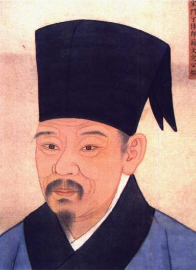
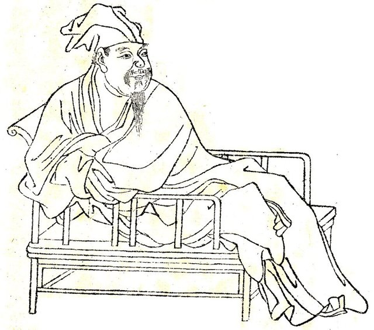
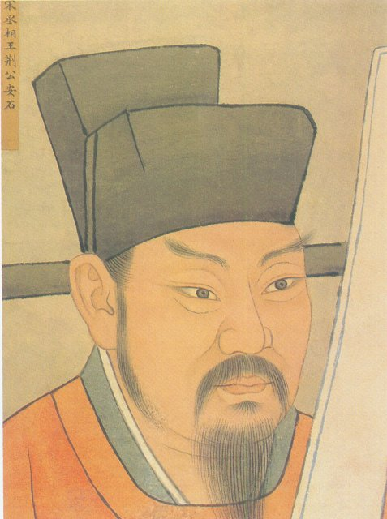
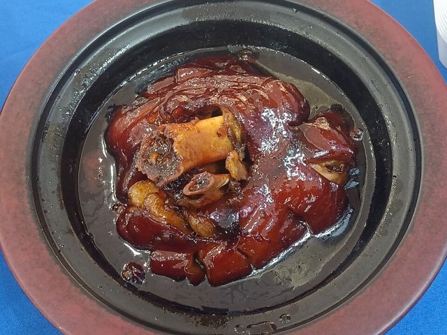
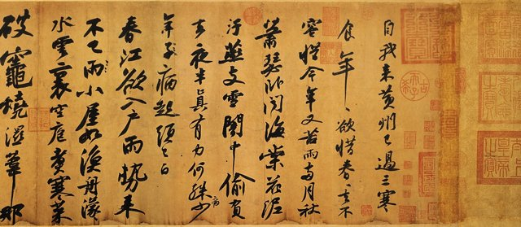
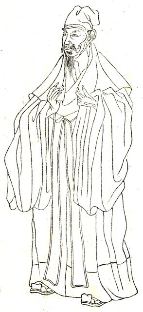
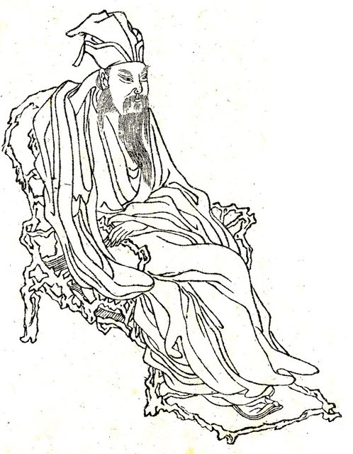

<!--
內容整理自本機筆記〈蘇東坡（蘇軾）生平大事記〉（圖表\蘇東坡生平大事記.md）與中文維基百科「蘇軾」條目（CC BY-SA 4.0），以台灣用語改寫摘要。
https://zh.wikipedia.org/zh-tw/苏轼
兩份資料的出入與處理：
- 娶王弗：維基百科寫「至和元年（1056年）」，但至和元年是1054年，與王弗16歲出嫁的年紀相符，採1054年。
- 〈黃州寒食詩帖〉：維基百科內文同時出現元豐四年與元豐五年兩種說法，採通行的1082年（元豐五年）寒食節。
- 生卒日期依維基百科換算的公曆：1037年1月8日（景祐三年十二月十九日）生，1101年8月24日（建中靖國元年七月二十八日）卒。其餘事件月日多為農曆，只標年份。
- 事件日期後的年齡為周歲（依公曆生日自動計算）；內文引用傳統記載的年齡多為虛歲，比周歲多一到兩歲。
- 范滂故事中的母子對話、王弗屏後聽言、東坡肉、杭州安樂坊、姜唐佐中舉、北歸詩句、金山畫像出自李公麟、1170年追諡、林語堂傳記出版年份等細節，係依一般公認的史實補充。
- 圖片皆為 Wikimedia Commons 上的公有領域（含CC0）作品。封面擷取自國立故宮博物院藏元代趙孟頫〈書前赤壁賦並畫蘇軾像〉卷首的蘇軾像；〈黃州寒食詩帖〉為故宮藏卷的局部（第一首詩開頭）；蘇轍、歐陽修、王安石、司馬光、蘇軾線描像為後世所繪；躬耕東坡事件配今日的東坡肉照片（CC0）。
-->

# Periods
- 1037-01-08 ~ 1057 | 眉山求學與科舉成名 | #b08900
  生於四川眉山，由母親程夫人啟蒙，與父親蘇洵、弟弟蘇轍一起讀書，21歲兄弟同科進士及第，受到歐陽修賞識。
- 1057 ~ 1079 | 入仕、地方治理與新舊黨爭 | #2b8a3e
  歷任鳳翔、杭州、密州、徐州、湖州等地的地方官，關心民生、防洪賑災；因批評王安石新法而與新黨衝突，最後在烏臺詩案中被捕下獄。
- 1079 ~ 1085 | 黃州貶謫與文學高峰 | #1864ab
  貶為黃州團練副使，在城東坡地躬耕，自號「東坡居士」，寫出〈念奴嬌・赤壁懷古〉、前後〈赤壁賦〉與〈黃州寒食詩帖〉，形成曠達深沉的人生觀。
- 1085 ~ 1094 | 元祐還朝與杭州治水 | #862e9c
  哲宗即位、舊黨執政，他一度官至兵部尚書，卻又反對盡廢新法、與程頤交惡；外放杭州時疏浚西湖、築成蘇堤。
- 1094 ~ 1101-08-24 | 惠州、儋州貶謫與北歸 | #c92a2a
  新黨重新執政，他一貶再貶到惠州、海南島儋州，在艱困中仍寫作、講學；徽宗即位後遇赦北歸，病逝於常州。

# Events

## 1037-01-08 | 出生@眉山
生於眉州眉山（今四川眉山）。父親蘇洵為他取名「軾」，意思是車前的扶手，雖不起眼，卻能扶危救困、不可或缺。

## 1039 | 弟弟蘇轍出生

弟弟蘇轍小他兩歲，兩兄弟從小一起讀書遊玩、後來同年中進士，一生感情深厚、詩文唱和不斷，在宦海沉浮中始終相互扶持。

## 1042 | 入小學
入學拜道士張易簡為師，隔年進入鄉校，以韓琦、范仲淹、富弼、歐陽修等名臣為榜樣。

## 1045 | 母親講《漢書》范滂傳
父親蘇洵長年在外遊學，由母親程夫人親自教導。讀到東漢范滂不畏權貴、捨身取義的故事時，他問母親：「我如果做范滂，母親願意嗎？」母親回答：「你能做范滂，我難道不能做范滂的母親嗎？」培養了他一生的志節。

## 1054 | 娶王弗為妻
虛歲19歲（周歲17歲）時娶虛歲16歲的同鄉王弗。王弗聰慧謹慎，常在屏風後聽他與客人談話，提醒他識人，是他重要的精神伴侶。

## 1057 | 兄弟同科進士；母親去世

隨父親赴京應試，以〈刑賞忠厚之至論〉受到考官梅堯臣青睞，主考官歐陽修讀後大為讚賞，本想取為第一，卻懷疑是自己的學生曾鞏所作，為了避嫌改列第二。兄弟同科及第，父子三人「一日而聲名赫然」。同年四月母親程氏去世，返鄉守喪。

## 1059 | 南行赴京
守喪期滿，隨父親與弟弟沿長江東下、經荊楚北上京師，一路寫詩，父子三人合編為《南行集》。

## 1061 | 制科高第，出任鳳翔簽判
參加選拔特殊人才的制科考試，入第三等（宋代最高的實際等第）。據說宋仁宗讀了兄弟倆的策論後說：「朕今日為子孫得兩宰相矣。」他出任鳳翔府簽判，正式踏入仕途。

## 1065 | 妻子王弗去世
在鳳翔任滿回京，妻子王弗病逝，年僅27歲，留下長子蘇邁。

## 1066 | 父親蘇洵去世
父親蘇洵去世，與蘇轍護送靈柩返回眉山守喪。

## 1068 | 續娶王閏之
守喪期滿，續娶王弗的堂妹王閏之，此後離開故鄉，終生不曾再回到眉山。

## 1069 | 反對王安石變法

回京任職時，王安石開始推行新法。他贊成改革，但反對操之過急的做法與科舉改制，屢次上書批評，因此遭新黨排擠，甚至被誣陷在守喪途中販運私貨。

## 1071 | 出任杭州通判
因不堪新黨的打壓，自請外放，出任杭州通判，開始第一次杭州的任官生活，與當地僧人、文士詩酒唱和。

## 1073 | 〈飲湖上初晴後雨〉
寫下讚美西湖的名句：「水光瀲灩晴方好，山色空濛雨亦奇。欲把西湖比西子，淡妝濃抹總相宜。」這年冬天他也沿運河往來常州、潤州一帶賑濟災民。

## 1074 | 改任密州知州
調任密州（今山東諸城）知州，當地連年蝗旱，他捕蝗救災，還收養被遺棄的孩童。

## 1075 | 兩首〈江城子〉
正月二十日夢見亡妻王弗，寫下悼亡詞〈江城子・乙卯正月二十日夜記夢〉：「十年生死兩茫茫，不思量，自難忘。」同年出城打獵，又寫下豪放的〈江城子・密州出獵〉：「老夫聊發少年狂。」一柔一剛，展現他詞風的兩面。

## 1076 | 〈水調歌頭・明月幾時有〉
中秋夜與弟弟蘇轍已分別七年，歡飲達旦後寫下：「但願人長久，千里共嬋娟。」成為中秋詞的千古絕唱。

## 1077 | 徐州抗洪
出任徐州知州。七月黃河決口，洪水圍困徐州，他住在城牆上指揮軍民築堤防洪，保全了全城。隔年在城東築黃樓紀念，作〈黃樓賦〉。

## 1079 | 烏臺詩案
移任湖州知州，上任謝表中的牢騷話被新黨御史李定、舒亶等人抓住，指控他在詩文中「謗訕朝政」。七月在湖州被捕，押往御史臺（烏臺）受審，獄中自料必死，寫詩向蘇轍訣別。在弟弟、張方平，甚至已退隱的王安石等人營救，以及曹太皇太后勸說下，神宗才免他一死。

## 1080 | 貶謫黃州
年初被貶為黃州團練副使，「本州安置，不得簽書公事」，形同被監管的罪官。蘇轍也因上書求情而被貶。初到黃州時借住寺院，生活拮据。

## 1081 | 躬耕東坡

朋友馬正卿替他向官府請得城東一塊荒廢的營地，他親自開墾耕種，取名「東坡」，隔年又在此建「雪堂」，自號「東坡居士」。他也在黃州研究烹調，留下「東坡肉」的傳說。

## 1082 | 赤壁懷古與〈黃州寒食詩帖〉

兩次夜遊黃州城外的赤鼻磯，寫下〈念奴嬌・赤壁懷古〉（「大江東去，浪淘盡，千古風流人物」）與前、後〈赤壁賦〉，思索變與不變、有限生命與無窮宇宙。春天遇雨時作〈定風波〉：「一蓑煙雨任平生。」寒食節寫下的兩首詩與書法〈黃州寒食詩帖〉，被譽為繼〈蘭亭序〉、〈祭姪文稿〉之後的「天下第三行書」，今藏國立故宮博物院。

## 1084 | 離開黃州，遊廬山
改任汝州團練副使，四月離開黃州。途經廬山寫下〈題西林壁〉：「不識廬山真面目，只緣身在此山中。」又作〈石鐘山記〉。七月在金陵拜訪已退隱的王安石，兩人盡釋前嫌、詩文唱和。

## 1085 | 哲宗即位，重新起用
宋神宗去世，哲宗即位，高太皇太后垂簾聽政，起用司馬光等舊黨。他先知登州，到任才五天又被召回京城，任禮部郎中、中書舍人，再升翰林學士、知制誥。

## 1086 | 元祐還朝；與程頤交惡

司馬光主政後盡廢新法，他反對連免役法這樣有益的新法也一併廢除，與舊黨也發生衝突。司馬光死後，他嘲笑程頤主持喪禮的迂腐，兩人結怨，演變成蜀黨與洛黨之爭。

## 1088 | 主持科舉
以翰林學士主持科舉，奏請限制濫賜功名的「特奏名」制度，獲朝廷採納。

## 1089 | 再任杭州知州
不堪黨爭，自請外放，以龍圖閣學士出任杭州知州，杭州父老夾道歡迎。他設立公立醫坊「安樂坊」救治疫病，治理杭州的水井與運河。

## 1090 | 疏浚西湖，築蘇堤
西湖淤塞嚴重，他動員民工疏浚，並把挖出的葑草淤泥築成一道橫貫南北的長堤，堤上建六座橋、種植桃柳，就是後世所稱的「蘇堤」，「蘇堤春曉」成為西湖十景之首。

## 1091 | 潁州、揚州與兵部尚書
召回朝廷後又遭賈易等人彈劾，外放潁州，在當地也疏浚了一座西湖；隔年移知揚州。1092年九月召還，以兵部尚書兼翰林侍讀學士，達到仕途的最高點。

## 1093 | 王閏之去世；高太后去世
妻子王閏之去世。九月高太皇太后去世，哲宗親政，政局即將轉向新黨，他被外放定州。

## 1094 | 貶謫惠州
新黨章惇等人執政，他以「譏斥先朝」的罪名一貶再貶，十月抵達嶺南的惠州。他在惠州寫下〈惠州一絕〉：「日啖荔枝三百顆，不辭長作嶺南人。」

## 1096 | 惠州修橋；王朝雲去世
惠州修建東、西新橋，他捐出朝廷賞賜的犀帶資助工程。侍妾王朝雲在惠州病逝，年34歲。朝雲曾笑他「一肚皮不合時宜」，是最懂他的人。

## 1097 | 再貶海南儋州
被貶為瓊州別駕、昌化軍安置，渡海前往海南島的儋州。途中在藤州與同樣被貶的蘇轍相遇，兄弟同行到雷州後告別，這也是兩人最後一次見面。初到儋州時無處可住，當地人替他蓋了茅屋，他取名「桄榔庵」。

## 1098 | 儋州講學
在儋州與黎族百姓為鄰，辦學講學、傳授詩書，以「海南萬里真吾鄉」自我寬慰。1099年瓊州的姜唐佐來從他學習，後來成為海南第一位舉人。

## 1100 | 遇赦北歸
哲宗去世、徽宗即位，向太后垂簾聽政，下詔讓他北還。他離開海南時寫道：「九死南荒吾不恨，茲遊奇絕冠平生。」

## 1101 | 〈自題金山畫像〉

北歸途中經過鎮江金山寺，看到李公麟為他畫的畫像，題詩回顧一生：「心似已灰之木，身如不繫之舟。問汝平生功業，黃州惠州儋州。」把三個貶謫之地當作一生的功業。

## 1101-08-24 | 逝世@常州
北歸途中在真州中暑、腹瀉不止，病情惡化，七月二十八日病逝於常州，享年64歲。蘇轍依遺願將他葬於河南郟縣小峨眉山。

## 1170 | 追諡「文忠」與後世評價
南宋孝宗推崇他「忠言讜論，立朝大節，一時廷臣無出其右」，追諡「文忠」，又追贈太師。他的詩文成為宋代科考的範本，當時讀書人流傳：「蘇文熟，喫羊肉；蘇文生，嚼菜羹。」

後世對他的喜愛延續至今：1947年林語堂以英文出版《蘇東坡傳》（The Gay Genius），稱他是「無可救藥的樂天派、偉大的人道主義者、百姓的朋友」，讓他的形象廣為世界所知；2000年法國《世界報》評選公元1001至2000年間的12位「千年英雄」，蘇東坡是唯一入選的中國人。
