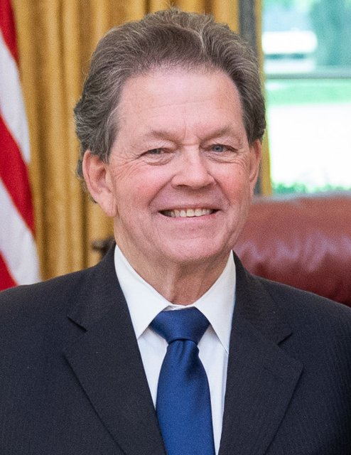
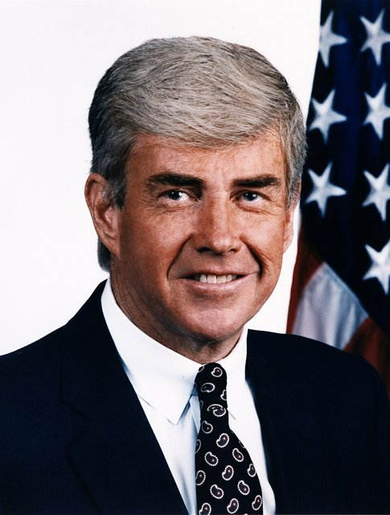
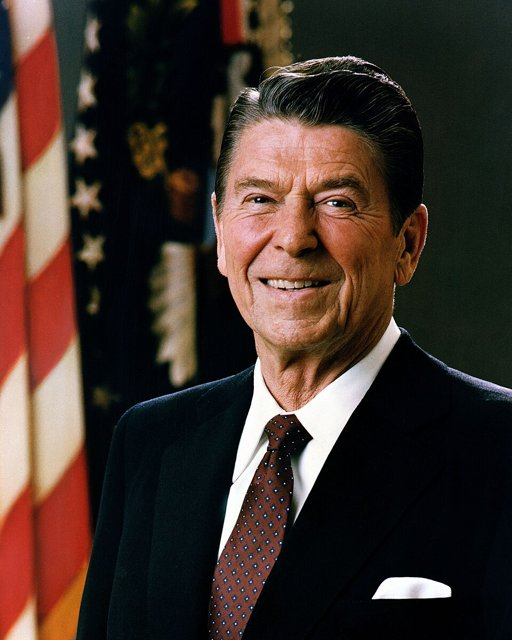
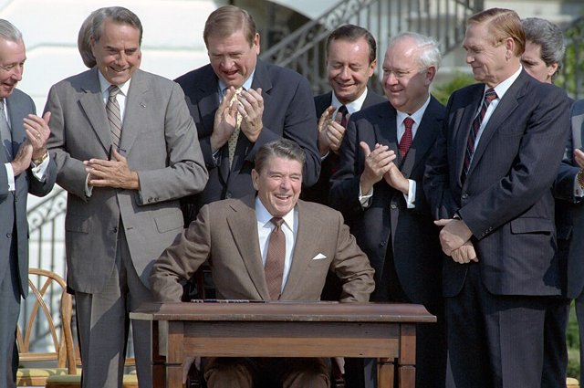

<!--
內容整理自本機筆記〈供給面經濟學（Supply-Side Economics）〉（D:\Books\md\歷史\術語\經濟學\供給面經濟學（Supply-Side Economics）.md；html 版在 D:\Books\html\4-1-1.經濟學派），並參考中文維基百科〈供給面經濟學〉條目，以自己的話改寫。
時期依原稿的發展階段：思想淵源與停滯性通膨、學派形成、雷根與柴契爾、調整與延續、新供給面政策。
處理方式：
- 原稿總表的思想淵源（1776《國富論》、1803薩伊法則、1817李嘉圖、1936《通論》、1956索洛成長模型、1960年代人力資本理論）寫進第一則事件；古典學派見「古典經濟學派」時間軸。
- 學派的命名依維基百科補充：1976年赫伯特·史坦以「供給面財政主義者」稱呼這批主張，萬尼斯基加以採用推廣；1978年萬尼斯基出版《世界運作的方式》。
- 1974年拉弗在華盛頓餐廳的餐巾紙上畫出拉弗曲線的故事，原稿與維基百科都記載，依此。
- 1990年、1993年的增稅與1997年的資本利得稅改革合為一則。
- 2021年基礎建設法、2022年晶片法與降低通膨法，原稿把它們歸為「擴大長期生產能力」的新供給面政策；這和1980年代以減稅為核心的供給學派不同，內文說明兩者的差異。
- 人名依 Books 原稿與台灣慣用譯名：拉弗、孟岱爾、萬尼斯基、雷根、柴契爾；人名用·分隔。
圖片來源（皆為 Wikimedia Commons 公有領域／CC0 作品，縮成最長邊 640px）：
- sse-erta.jpg：Ronald-Reagan-ERTA-Omnibus-Budget-Rancho-del-Cielo-13-Aug-1981-NARA-C3490-4A.jpg（1981年8月13日，雷根在加州的牧場簽署《經濟復甦稅法》（美國國家檔案館））
- sse-laffer.jpg：Arthur Laffer 2019.jpg（亞瑟·拉弗，2019）
- sse-kemp.jpg：Jack Kemp official portrait.jpg（傑克·坎普的官方肖像）
- sse-reagan.jpg：Official Portrait of President Reagan 1981.jpg（雷根的總統官方肖像，1981）
- sse-tra.jpg：Signing Ceremony for Tax Reform Act of 1986 with Bob Dole Dan Rostenkowski on South Lawn - DPLA - 21fafbed08a425472462cfeae40c359a.jpg（1986年10月22日，雷根在白宮南草坪簽署稅制改革法（美國國家檔案館））
-->

# Periods
- 1971 ~ 1975 | 停滯性通膨的困境 | #868e96
  布列敦森林瓦解與石油危機帶來通膨與失業並存，凱因斯的需求管理失靈；一群經濟學家與記者轉而從生產、誘因與稅率尋找答案。
- 1976 ~ 1980 | 學派的形成 | #5c940d
  拉弗曲線、孟岱爾的政策組合與萬尼斯基的宣傳，使「供給面經濟學」進入共和黨的政綱；坎普—羅斯減稅案為雷根的政策鋪路。
- 1981 ~ 1989 | 雷根經濟學與柴契爾改革 | #e67700
  雷根大幅調降所得稅、鬆綁管制，配合伏克爾的貨幣緊縮；經濟在衰退後強勁復甦，財政赤字卻急速擴大。1986年稅改降低稅率、擴大稅基。英國柴契爾也推動減稅、私有化與金融自由化。
- 1990 ~ 2019 | 爭論與延續 | #1971c2
  老布希與柯林頓為控制赤字而增稅，美國仍在1990年代繁榮；小布希與川普再度減稅，減稅能否「自償」的爭論持續不休。
- 2020 ~ 2026 | 新供給面政策 | #5f3dc4
  疫情與供應鏈危機凸顯生產能力的重要，基礎建設、半導體與能源投資、勞動力與人工智慧，成為擴大供給能力的新政策工具。

# Events

## 1973 | 石油危機與停滯性通膨
供給面經濟學的思想可上溯到斯密對分工與資本累積的分析、薩伊的「供給創造需求」，以及李嘉圖對賦稅如何影響資本累積的討論；1950年代索洛的成長模型與1960年代的人力資本理論，也強調技術、資本與教育對長期產出的作用。1971年布列敦森林體系瓦解，1973年第一次石油危機使油價暴漲，1974年至1975年美國陷入通膨與失業同時上升的停滯性通膨。石油危機本身就是「供給衝擊」：問題不在需求不足，而在生產成本與供給能力，凱因斯式的需求刺激反而只會推高通膨。

## 1974-12 | 拉弗曲線

據記者萬尼斯基的記載，經濟學家拉弗在華盛頓一家餐廳與福特政府的錢尼、倫斯斐聚會時，在餐巾紙上畫出一條曲線：稅率為零時稅收為零，稅率為百分之百時沒有人願意工作，稅收也是零，兩者之間存在一個使稅收最大的稅率；如果現行稅率高於這一點，減稅反而能增加稅收。這條「拉弗曲線」成為供給學派最著名的圖像，但現實的稅率是否真的高到減稅能增加稅收，至今仍有爭議。

## 1976 | 「供給面經濟學」的命名
經濟學家赫伯特·史坦以略帶貶意的「供給面財政主義者」稱呼主張以減稅刺激生產的人，《華爾街日報》的萬尼斯基加以採用，把「供給面經濟學」推廣開來。哥倫比亞大學的孟岱爾（1999年諾貝爾獎得主）主張以緊縮貨幣對抗通膨、以減稅刺激成長，提供了這套政策組合的理論基礎；1978年萬尼斯基出版《世界運作的方式》。

## 1978 | 坎普—羅斯減稅案

共和黨眾議員坎普與參議員羅斯提出把個人所得稅率全面調降約30%的法案，雖然沒有通過，卻成為共和黨的經濟政綱。同年加州選民以「第13號提案」大幅限制房地產稅，掀起全美的抗稅運動；國會也通過資本利得稅的減稅。

## 1979 | 柴契爾上台
英國柴契爾夫人出任首相，在第一個預算中把所得稅最高稅率從83%降到60%、基本稅率從33%降到30%，改以提高加值稅彌補，並推動國營企業私有化、削弱工會力量。同年第二次石油危機爆發，美國通膨升到兩位數。

## 1980-11 | 雷根當選總統

雷根以減稅、縮小政府、加強國防為政見當選美國總統。競選期間，黨內對手老布希曾譏諷他的減稅主張是「巫毒經濟學」。批評者則稱這套主張為「涓滴經濟學」：認為給高所得者與企業的減稅，好處最後會「涓滴」到一般人。

## 1981-08-13 | 《經濟復甦稅法》
雷根簽署《經濟復甦稅法》（ERTA），在三年內把個人所得稅率全面調降約23%，最高稅率從70%降到50%，並加速企業設備的折舊、稅率依通膨指數化。配合伏克爾的貨幣緊縮，美國先在1981年至1982年陷入嚴重衰退，1983年起強勁復甦；但稅收並未如拉弗曲線預期般增加，加上國防支出擴大，聯邦赤字急速膨脹。1982年國會通過《租稅公平與財政責任法》（TEFRA），收回了部分減稅。

## 1984 | 雷根連任
美國經濟1983年至1984年強勁成長，通膨大幅下降，雷根以「美國的早晨」為口號，在49州獲勝連任。雷根任內美國經歷長期擴張，但國債也從約9,000億美元增加到約2.7兆美元，「雙赤字」（財政與貿易）成為長期問題。

## 1986-10-22 | 《1986年稅制改革法》

雷根簽署兩黨合作的稅制改革法，把個人所得稅級距大幅簡化，最高稅率降到28%，同時取消許多扣除額與避稅漏洞、提高企業稅負，以「降低稅率、擴大稅基」達到稅收中立，被視為稅制改革的典範。同年英國推動倫敦金融市場的「大爆炸」自由化改革，1988年柴契爾政府再把所得稅最高稅率降到40%。

## 1990 | 增稅與財政紀律
老布希曾承諾「看我的嘴唇：不加新稅」，卻因赤字壓力在1990年與國會達成增稅協議，1992年因此失去連任。1993年柯林頓再提高最高稅率到39.6%，1990年代美國仍迎來長期繁榮與財政盈餘，成為反對供給學派的論據；支持者則把繁榮歸功於低通膨與1997年的資本利得稅減稅。

## 2001 | 小布希減稅
小布希簽署《經濟成長與減稅調和法》，分年調降所得稅率、擴大子女扣抵、逐步廢除遺產稅；2003年再以《就業與成長減稅調和法》大幅降低股利與資本利得稅率。這兩次減稅都設有落日條款，伴隨伊拉克戰爭支出，財政赤字再度擴大。

## 2008 | 金融海嘯
金融海嘯使政策焦點轉向需求面的紓困與刺激，市場自由化與金融管制鬆綁受到檢討。2010年代各國討論的「結構性改革」，例如勞動市場、教育與投資環境的改革，擴大了供給面政策的範圍，不再只限於減稅。

## 2017-12-22 | 《減稅與就業法》
川普簽署《減稅與就業法》（TCJA），把企業所得稅率從35%降到21%，同時調降個人所得稅率，並改革跨國企業的海外所得課稅，是1986年以來最大的稅制改革。支持者認為能吸引企業投資回流，批評者指出企業多用於買回庫藏股，且大幅增加聯邦赤字。

## 2022-08 | 晶片法與新供給面政策
疫情造成的供應鏈中斷與晶片短缺，使生產能力成為國家安全問題。美國在2021年通過《基礎建設投資與就業法》，2022年8月通過《晶片與科學法》與《降低通膨法》，以補貼與租稅抵減吸引半導體、電池與再生能源產業在本土投資。這些政策以政府主導的產業投資擴大長期供給能力，被稱為「新供給面經濟學」，與1980年代以減稅、鬆綁為主的供給學派方向不同。製造業回流、能源轉型、勞動力與人工智慧帶來的生產力，是當前供給面政策的核心議題。
