<!--
內容整合自知識圖譜兩篇，以自己的話改寫：
- 「台積電（TSMC）傳記」（D:\Books\html\4-3.臺灣公司\台積電傳記.html；md 原稿在 D:\Books\md\歷史\公司\台積電，五章十五節）
- 「台積電知識圖譜」（D:\Books\html\4-3.臺灣公司\台積電知識圖譜.html，商業模式、製程演進、全球布局與產業地位的概述）
時期依傳記的五章；傳記第二、三章的年代有重疊，這裡以1997年（蔣尚義加入、技術爬坡開始）為界。
傳記有幾處年份與公開資料不符，依中文維基百科「張忠謀」「台灣積體電路製造」條目更正：
- 張忠謀在德州儀器的年資：傳記說1972年競逐總裁失利後離開、1972–1979年任通用儀器總裁；維基記載他1972年升任德儀集團副總經理，1983年才離開德儀轉任通用儀器營運長，在德儀共二十五年。這裡採維基。
- 史丹佛博士：傳記說1961年回校、一年拿到；維基記為1964年取得，這裡寫1961年由德儀資助回校、1964年取得博士。
- 股票上市：傳記作1993年9月，維基作1994年在臺灣證券交易所上市、1997年在紐約證券交易所發行 ADR，這裡採維基。
- 蔣尚義加入：傳記說「1990年代初」，一般記載是1997年，這裡放在1997年。
- 出資比例：傳記作行政院開發基金48.3%、飛利浦27.6%、民間24.1%；維基作政府48.3%、飛利浦27.5%、民間24.2%，差異在進位，這裡採維基。
- 華為斷供：傳記作2020年9月15日斷供，維基作9月14日後停止出貨，這裡採維基。
- 7奈米：傳記說2018年即以 EUV 版的7奈米+領先，一般記載是2018年量產7奈米（多重曝光），2019年量產採用 EUV 的7奈米+，這裡依後者。
- 2奈米：傳記說2025年風險試產、2026年量產；維基記載2025年第四季已開始量產，這裡採維基。
- 市值：傳記說2025–2026年突破一兆美元；維基記載2026年2月24日 ADR 市值首度突破兩兆美元，這裡以後者為準。
另依維基補上兩篇沒有的事件：2016–2017年市值超越 IBM 與英特爾、2025年追加亞利桑那投資與全年營運數字、2026年市值突破兩兆美元。
傳記中的數學式與「因果鏈」段落未收錄。
圖片來源（皆為 Wikimedia Commons 公有領域／CC0 作品；台積電的歷史多在1987年以後，公有領域圖片以美國政府攝影與 CC0 釋出的晶片照片為主）：
- ts-hsinchu.jpg：Tsmc factory hsinchu.JPG（新竹科學園區的台積電廠房）
- ts-chang-mit.jpg：Morris Chang 1951 MIT yearbook portrait.jpg（張忠謀在 MIT 1951年畢業紀念冊上的照片）
- ts-ti.jpg：Texas Instruments Dallas September 2019.jpg（德州儀器達拉斯總部，2019）
- ts-wafer.jpg：Wafer scale integrated circuit on 300 mm wafer.webp（12吋（300毫米）晶圓）
- ts-transistors.jpg：Planar MOSFET FinFET and GAAFET structure comparison horizontal tr.png（平面電晶體、FinFET 與 GAAFET 的結構比較（圖中標示為土耳其文））
- ts-a8.jpg：Apple A8 system-on-a-chip.jpg（蘋果 A8 處理器）
- ts-a12.jpg：Apple A12.jpg（台積電7奈米生產的蘋果 A12 處理器）
- ts-chang.jpg：Morris Chang and Sophia.jpg（張忠謀與夫人張淑芬）
- ts-m1.jpg：Apple M1.jpg（台積電5奈米生產的蘋果 M1 晶片）
- ts-euv.jpg：Extreme ultraviolet lithography tool.jpg（極紫外光（EUV）微影設備）
- ts-phoenix.jpg：Joe Biden at the TSMC Semiconductor Plant in Phoenix (P20221206AS-0794).jpg（2022年12月拜登總統出席亞利桑那廠的首批機台進廠典禮）
- ts-whitehouse.jpg：TSMC CC Wei and Trump 2025.png（2025年3月魏哲家在白宮宣布追加投資亞利桑那，左為川普總統）
-->

# Periods
- 1931 ~ 1985 | 張忠謀之路 | #b08900
  張忠謀在戰亂中度過童年，赴美念 MIT，進入草創期的半導體業；在德州儀器二十五年，把統計與良率管理帶進生產線，也看到整合元件製造（IDM）模式的內耗，萌生「設計與製造分開」的念頭。
- 1985 ~ 1997 | 代工模式的誕生 | #e67700
  張忠謀返台主持工研院，以政府、飛利浦與民間合資創立台積電，首創「只替別人製造、不與客戶競爭」的純晶圓代工，孵化出無廠設計公司（fabless）的生態系。
- 1997 ~ 2010 | 技術爬坡 | #2f9e44
  台積電押注銅製程、12吋晶圓與浸潤式微影，在網路泡沫的低谷逆勢擴廠，甩開聯電；2009年張忠謀回任執行長，整頓士氣並押注 FinFET。
- 2010 ~ 2020 | 登頂 | #1971c2
  智慧型手機浪潮中拿下蘋果訂單，7奈米同時超越三星與英特爾；張忠謀2018年退休，華為斷供成為地緣政治的第一課。
- 2020 ~ 2026 | 地緣政治時代 | #862e9c
  全球晶片短缺讓台積電成為「護國神山」，也讓各國要求在地生產；美國、日本、德國相繼設廠，2奈米與 AI 晶片把台積電推上市值巔峰。

# Events

## 1931-07-10 | 張忠謀出生於寧波
張忠謀生於浙江寧波，父親是鄞縣財政局長。中日戰爭與國共內戰期間，全家從南京輾轉廣州、香港、重慶、上海，十年間搬家十多次。流亡的童年讓他渴望穩定的秩序，也練就了在陌生環境中快速適應的能力。

## 1949 | 赴美就讀哈佛、轉入 MIT
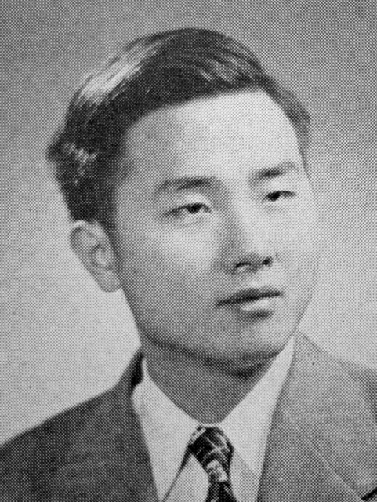
18歲的張忠謀考進哈佛大學，一年後聽從父親「學工比較好找工作」的建議，轉入麻省理工學院機械系，1952年取得學士、1953年取得碩士。

## 1955 | 進入半導體業
張忠謀兩度未通過 MIT 的博士資格考，決定先就業。福特汽車開出的月薪比希凡尼亞（Sylvania）半導體部門少一美元，他選了希凡尼亞——這一美元的差距，把他帶進了半導體業。他後來把博士落榜視為一生最大的幸運。

## 1958 | 加入德州儀器
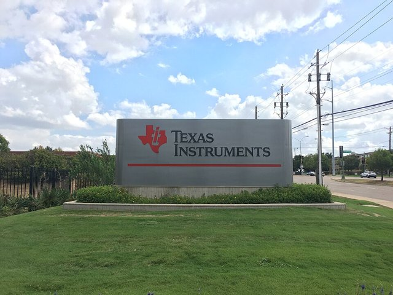
張忠謀加入德州儀器（TI），當時德儀的基爾比正做出第一塊積體電路。他的第一份工作是改善電晶體的良率，他把統計製程管制引進生產線，用數據而非老師傅的經驗找出缺陷，一年內大幅提升良率而受到高層注意。

## 1964 | 史丹佛電機博士
德儀在1961年資助張忠謀回史丹佛大學進修，他在1964年取得電機博士，隨後在德儀一路晉升，主導 MOS 與半導體記憶體的研發。

## 1972 | 德州儀器集團副總經理
張忠謀升任德儀集團副總經理，負責全球半導體業務，是當時美國大企業中職位最高的華人之一。他在德儀學到良率即利潤、大企業的紀律與研發管理，也看到 IDM 模式下設計與製造互相掣肘、資源永遠傾向當紅產品——「設計與製造分開」的念頭在此萌芽。

## 1983 | 離開德儀，轉任通用儀器
張忠謀競逐德儀總裁未果，在德儀待了二十五年後離開，轉任通用儀器營運長、總裁。通用儀器的董事會短視、只看季報，讓他體會到沒有股權與理念認同的專業經理人難有作為。這幾年他也目睹日本半導體以「產官學一體」橫掃美國 DRAM 市場。

## 1985 | 返台接掌工研院
在李國鼎、孫運璿等人力邀下，54歲的張忠謀返台出任工業技術研究院院長，兼任聯華電子董事長。當時台灣的半導體只有工研院從 RCA 引進的技術和一家聯電，美國大公司體制內沒人理會的「純代工」構想，在台灣這張白紙上有了試驗的機會。

## 1987-02-21 | 台積電成立
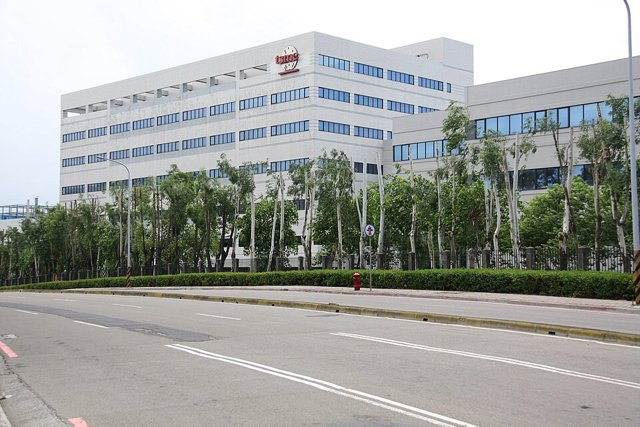
台灣積體電路製造公司在新竹科學園區成立，張忠謀任董事長。資金由政府出資48.3%、荷蘭飛利浦27.5%（並授權製程技術）、民間24.2%；工研院電子所一百多位工程師轉入，第一座廠就設在工研院的廠房。當時幾乎沒人看好：「不做產品，要賣給誰？」張忠謀想填補的，是設計公司蓋不起晶圓廠、大廠又不願真心代工之間的空白。

## 1987 ~ 1991 | 不與客戶競爭
台積電立下鐵律：不設計、不賣自有品牌產品，永遠不與客戶競爭。客戶的設計資料嚴格隔離、產能分配透明，讓互相廝殺的設計公司敢把設計交出來。台積電也提供標準元件庫與設計手冊，讓小公司不懂製造也能下單，Altera、Xilinx 等早期客戶把最先進的產品交給台積電，無廠設計公司（fabless）的生態系就此成形。

## 1994 | 股票上市
台積電在臺灣證券交易所掛牌上市（代號2330），1997年再赴紐約證券交易所發行美國存託憑證（代號 TSM）。上市資金投入新廠，產能利用率長期維持九成以上，證明代工不是微利，而是利用率與良率雙高時利潤極厚的生意。IDM 大廠紛紛關閉老舊小廠、把訂單轉給台積電。

## 1997 | 蔣尚義加入
曾在德儀、惠普任職的蔣尚義加入台積電，主導先進製程研發；劉德音（1993年加入）、魏哲家（1998年加入）、孫元成等人陸續到位，台積電從跟隨飛利浦的技術轉向自主研發。蔣尚義建立的研發紀律，讓每一代製程都有明確的良率與缺陷密度目標，不達標不量產。

## 1998 ~ 2003 | 銅製程與12吋晶圓
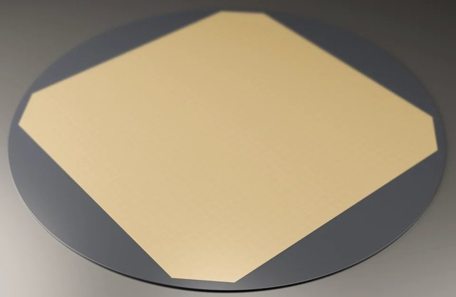
台積電同時押注兩場豪賭：以銅導線取代鋁導線，解決線寬縮小後的導線延遲；以12吋（300毫米）晶圓取代8吋，每片晶圓的晶粒數增加約2.25倍。12吋廠動工時正逢網路泡沫破滅，張忠謀不但不停建，反而加碼——衰退時建廠成本最低。2002年景氣復甦時，台積電手握最成熟的銅製程與最早的12吋產能，輝達、ATI、博通等高階訂單蜂擁而至。

## 2000 ~ 2005 | 與聯電之爭
聯電宣布轉型純代工，與台積電正面對決，一度在0.18微米緊咬不放。台積電靠銅製程與12吋的先發產能、人才磁吸，以及下一代微影的路線抉擇拉開差距；2005年聯電90奈米良率失足，大客戶轉單台積電，台積電市占突破四成五，「晶圓雙雄」變成一強。

## 2004 | 浸潤式微影
當英特爾、IBM 押注157奈米乾式微影時，台積電的林本堅主張在鏡頭與晶圓之間加一層水，用193奈米浸潤式微影延續機台壽命，一度被譏為「洗澡式曝光」。張忠謀與蔣尚義力挺，說服 ASML 全力開發浸潤式機台；台積電率先以浸潤式量產90奈米，再推進到65、45奈米，押注157奈米的陣營則血本無歸。ASML 從此與台積電結為盟友。

## 2005 | 張忠謀交棒蔡力行
74歲的張忠謀把執行長交給蔡力行，自己專任董事長。

## 2009-06 | 張忠謀回任執行長
2008年金融海嘯中，台積電裁員凍薪，打擊「不裁員」的文化，40奈米良率又出包，輝達公開抱怨。78歲的張忠謀重掌執行長，恢復雇用、加薪、重建紀律；台積電在28奈米高介電金屬閘極（HKMG）取得七成以上市占，賺來的現金全數投入下一代研發。同一時期，研發要角梁孟松離職，後來轉往三星，引發營業秘密訴訟。

## 2011 | 押注 FinFET
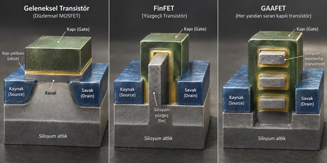
28奈米之後平面電晶體漏電失控，台積電宣布16奈米鰭式場效電晶體（FinFET）路線，與三星14奈米、英特爾14奈米正面對決。16奈米 FinFET 在2015年量產。

## 2014 | 拿下蘋果 A8
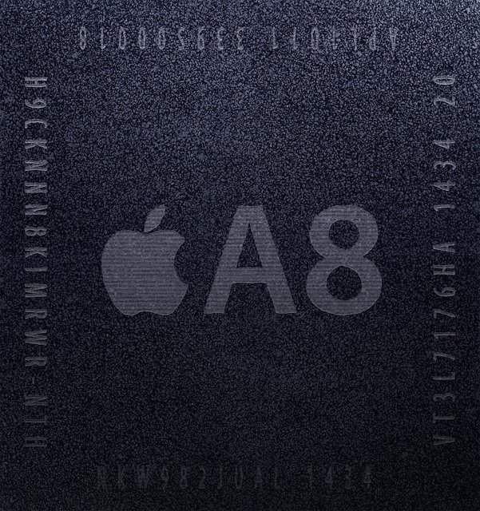
蘋果不願再把命脈交給同時是手機對手的三星，將 iPhone 6 的 A8 處理器轉給台積電20奈米代工。蘋果要求包下數座廠的產能、更高的良率與獨立的保密團隊，A8 準時交貨。台積電「不做手機」的中立性，在這裡成為決定性的優勢。

## 2015 | A9 晶片門
蘋果 A9 同時交給三星14奈米與台積電16奈米生產，實測台積電版續航與發熱表現較佳，輿論稱為「晶片門」。2016年 A10 起，蘋果全數交給台積電。蘋果的量與利潤，從此支撐台積電每年上百億美元的資本支出。

## 2016 ~ 2017 | 市值超越 IBM 與英特爾
2016年9月台積電市值首度超越 IBM，2017年3月超越英特爾。

## 2018 | 7奈米量產
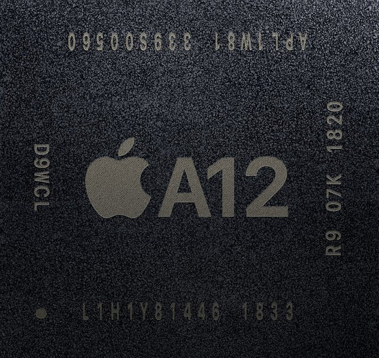
台積電7奈米量產，蘋果 A12、華為麒麟980、AMD Zen 2 全數採用；2019年再量產採用極紫外光（EUV）微影的7奈米+。同時期英特爾10奈米一再跳票，三星7奈米落後且缺少大客戶，「設計在美國、製造在台灣」的分工確立，英特爾第一次在製造上被代工廠超越。

## 2018-06-05 | 張忠謀退休
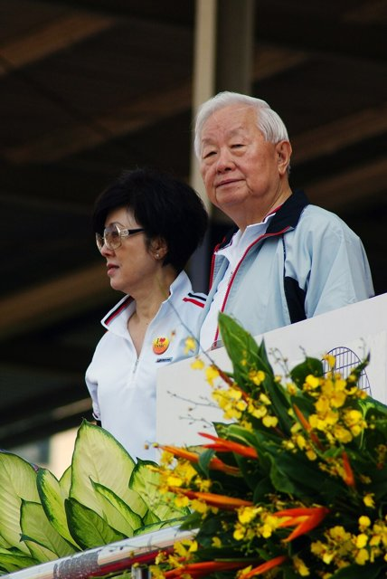
87歲的張忠謀退休，由劉德音任董事長、魏哲家任總裁，實行雙首長制。他留下的台積電全球市占過半，退休時強調的仍是創業時的那幾個詞：誠信正直、承諾、創新、客戶信任。

## 2019 ~ 2020 | 華為斷供
2019年美國把華為列入實體清單；2020年5月15日再修改出口規定，凡使用美國技術生產的晶片要供應華為都須取得許可。華為海思當時是台積電第二大客戶，2019年貢獻約14%營收；台積電自5月15日起不再接新單，9月14日後停止出貨，麒麟9000成為絕響。空出的產能隨即被蘋果、AMD、輝達、高通、聯發科瓜分，台積電2020年營收不減反增，但「誰都是客戶」的中立定位，第一次被出口管制打破。

## 2020 | 5奈米與亞利桑那廠
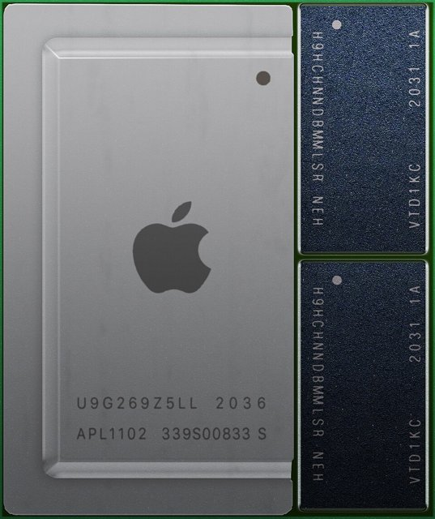
台積電5奈米量產，蘋果 A14 與 M1 首發，連 Mac 處理器也改由台灣製造。同年5月15日，台積電宣布赴美國亞利桑那州設廠。

## 2021 | 晶片短缺與護國神山
疫情造成供需錯配：車廠年初砍單、年中需求反彈，加上遠距辦公、5G 與挖礦需求，全球代工產能全面爆滿，車用晶片缺貨導致各大車廠減產，外國政府紛紛向台灣求援，「護國神山」「矽盾」的說法傳遍國際。台積電宣布三年1,000億美元的資本支出；同年台灣大旱，水車馳援南科。批評者則指出，矽盾也可能讓各國加速扶植本土產能、逼台積電外移。

## 2021-10-14 | 日本熊本廠
台積電宣布在日本熊本設立合資子公司 JASM，生產22/28奈米與12/16奈米的成熟與特殊製程，主攻車用與影像感測；一廠2024年2月啟用、年底量產，二廠2025年動工。

## 2022 | 3奈米量產
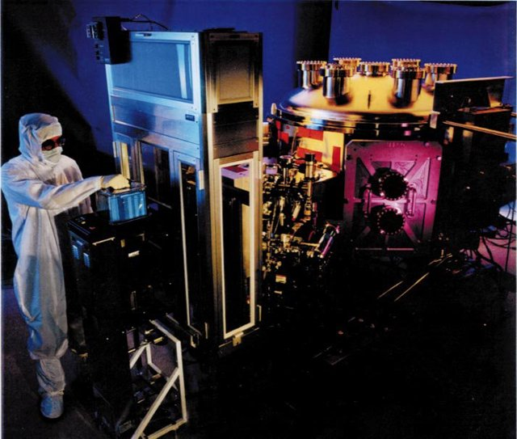
台積電3奈米量產，仍以改良的 FinFET 守住效能領先；同年營收約新台幣2.26兆元，毛利率59.6%。

## 2023-08-08 | 德國德勒斯登廠
台積電與博世、英飛凌、恩智浦合資成立 ESMC，在德國德勒斯登設廠，生產車用與工業用的28/22奈米及16/12奈米製程；2024年8月動土，預計2027年底量產。

## 2024 | 魏哲家時代與亞利桑那量產
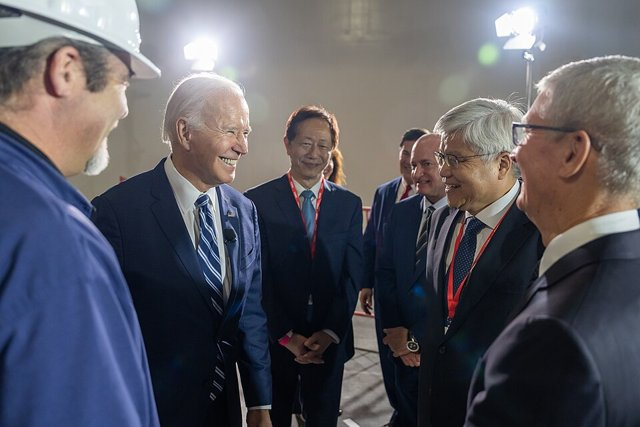
6月劉德音退休，魏哲家接任董事長兼總裁，結束雙首長制。亞利桑那一廠在年底以4奈米量產，台積電並依美國晶片法案獲得最高66億美元補助。輝達、蘋果、AMD 的 AI 晶片訂單讓產能再度滿載，先進封裝 CoWoS 成為新的瓶頸。海外廠的建廠成本遠高於台灣，最先進製程則維持「台灣優先」。

## 2025 | 2奈米量產
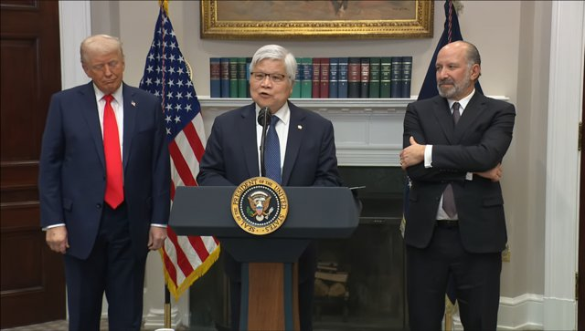
3月，魏哲家在白宮宣布追加1,000億美元投資亞利桑那，台積電在美國的總投資達1,650億美元。第四季，台積電以奈米片環繞式閘極（GAA）電晶體量產2奈米，生產基地在新竹寶山的二十廠。全年營收約新台幣3.8兆元，毛利率59.9%，7奈米以下的先進製程占晶圓營收七成以上。

## 2026-02-24 | 市值突破兩兆美元
台積電美國存託憑證市值首度突破兩兆美元，是第一家達到這個里程碑的台灣企業。台積電的課題也愈加清楚：地緣政治常態化、對 AI 需求的依賴，以及用電、用水、人才與房價等「護國神山」與台灣社會之間的拉扯。
