<!--
事件取材自 Snapask 學習專欄〈高中歷史圖表一次看 台灣四百年〉（IvyShen，2021-03-31）的年表，以自己的文字改寫、拆分並補充細節。
https://academy.snapask.com/zh-tw/post/高中歷史圖表一次看%20台灣四百年-9d2d005487e1
原文的第9張圖誤放成近代世界史的圖表，年表實際只到1987年；1988年以後的民主化事件為補充。
與原圖表不同之處（依一般公認的史實修正或補充）：
- 朱一貴事件發生於1721年（康熙60年），原圖誤標為康熙23年；臺灣府設於1684年（康熙23年）。
- 中法戰爭與劉銘傳來臺都在1884年，臺灣建省在1885年（光緒11年），原圖分別標為1883年與1884年。
- 1923年成立的是「臺灣議會期成同盟會」，原圖簡稱「同盟會」。
- 牡丹社事件的導火線是1871年的八瑤灣事件（琉球船難者遭殺害），原圖未列。
- 1624年荷蘭人在大員先建奧倫治城，1627年改名熱蘭遮城；普羅民遮城（赤崁樓）建於1653年，1625年建的是普羅民遮街（市街）。
- 顏思齊在臺建立據點是傳統說法，史學界對其事蹟仍有爭議。
各時期劃分與精確日期為補充。
圖片皆為 Wikimedia Commons 上的公有領域（含CC0）作品（封面：約1640年荷蘭人所繪福爾摩沙與澎湖地圖）。部分配圖年份與事件不完全相同：荷蘭人佔領配19世紀描繪熱蘭遮城與普羅民遮城的掛畫、羅妹號事件配1869年李仙得遊記中的地圖、六三法配1930年代的總督府、臺灣銀行配1940年的總行、文化協會配1926年的理事會合影、民眾黨配1922年的蔣渭水、十大建設配1965年訪美的蔣經國、八二三砲戰配同年駐防桃園的美軍F-104戰機、政黨輪替配陳水扁日後的照片。
-->

# Periods
- 約5萬～400年前 | 史前時代 | #8d6e63
  從舊石器時代的長濱文化、左鎮人，到新石器時代的大坌坑、圓山、卑南文化，再到金屬器時代的十三行文化，南島語族的祖先在這座島上生活了數千年。
- 1624 ~ 1662 | 荷西時期 | #e8590c
  荷蘭東印度公司佔領南臺灣、西班牙佔領北臺灣，臺灣被捲入國際貿易網絡，成為東亞的轉口貿易站。
- 1662 ~ 1683 | 明鄭時期 | #c92a2a
  鄭成功驅逐荷蘭人，以臺灣為反清復明的基地，引進漢人的典章制度，招募移民開墾。
- 1683 ~ 1895 | 清領時期 | #1864ab
  清廷由消極治臺、頒布渡臺禁令，到開港通商、牡丹社事件後轉為積極經營，最後建省並推動近代化建設。
- 1895 ~ 1945 | 日治時期 | #862e9c
  臺灣成為日本第一個殖民地，經歷武裝抗日、殖民基礎建設與社會政治運動，最後在皇民化運動中走向戰爭。
- 1945 ~ 1987 | 戰後與戒嚴時期 | #495057
  中華民國政府接收臺灣，經歷二二八事件與長達38年的戒嚴；經濟從土地改革走向十大建設，外交上則面臨退出聯合國與美國斷交。
- 1987 ~ 2000 | 解嚴與民主化 | #2b8a3e
  解除戒嚴後，報禁、黨禁相繼開放，終止動員戡亂，實現國會全面改選、總統直選與首次政黨輪替。

# Events

## 約5萬～3萬年前 | 舊石器時代
目前已知臺灣最早的人類活動屬於舊石器時代晚期，代表有臺東的長濱文化（以八仙洞遺址為主），以及臺南左鎮出土的「左鎮人」化石。此外，在澎湖海溝打撈到的「澎湖原人」下顎骨化石，年代可能更早；北部的網形文化也屬於這個時期。

## 約七千年前 | 新石器時代
距今約六、七千年前起，臺灣進入新石器時代，人們開始製作陶器、磨製石器並從事農耕。最早的大坌坑文化以粗繩紋陶為特徵，一般認為與南島語族的起源有關；後來各地發展出訊塘埔、牛罵頭、牛稠子、墾丁、圓山、芝山岩、植物園、營埔、大湖、卑南、麒麟等文化。臺東的卑南遺址出土了大量石板棺與玉器。

## 約兩千年前 | 金屬器時代
距今約兩千年前，臺灣進入金屬器時代，開始使用鐵器，並透過貿易取得玻璃珠、瑪瑙等外來物品。代表有新北八里的十三行遺址（當地已能煉鐵）、番仔園、蔦松、漢本、靜浦等遺址。

## 14c | 元朝在澎湖設巡檢司
元朝在澎湖設立巡檢司，負責治安與鹽課，是中國政府在臺澎地區設置行政機構的開始。

## 16c | 大航海時代來到東亞
葡萄牙人、西班牙人相繼來到東亞貿易，據說葡萄牙水手航經臺灣時稱它為「Formosa」（美麗島）。這時臺灣周邊海域也是海盜與走私貿易者活動的地方。

## 1597 | 明朝派兵巡守澎湖
明朝為防範倭寇與海盜，派兵到澎湖巡守。

## 1621 | 顏思齊與鄭芝龍
依照傳統說法，海商顏思齊率眾在臺灣西南沿海（今雲林、嘉義一帶）建立據點，鄭芝龍跟隨他發展海上勢力，顏思齊死後鄭芝龍接掌了這支武裝船隊。

## 1624 | 荷蘭人佔領南臺灣
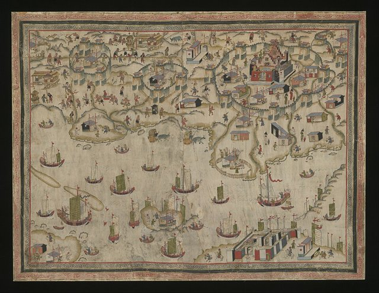
荷蘭人原本佔領澎湖，被明軍逼退後轉往臺灣，在大員（今臺南安平）建立城堡，1627年命名為熱蘭遮城。荷蘭東印度公司以臺灣為轉口貿易中心，把中國的生絲、瓷器轉賣到日本與歐洲，並輸出鹿皮與蔗糖。隔年在對岸的赤崁建立普羅民遮街。

## 1626 | 西班牙人佔領北臺灣
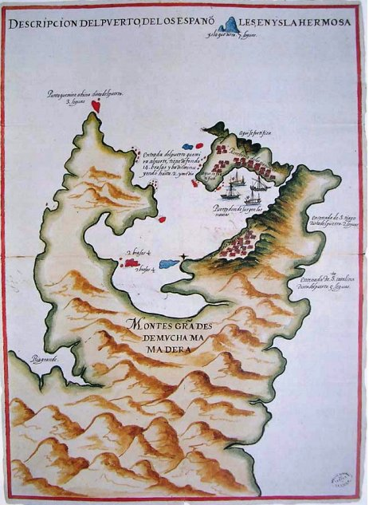
為了對抗荷蘭並保護與中國、日本的貿易，西班牙人從菲律賓北上，由東北角的三貂角進入臺灣，在雞籠（今基隆）和平島興建聖薩爾瓦多城，1628年又在滬尾（今淡水）建聖多明哥城。

## 1628 | 鄭芝龍接受明朝招撫
鄭芝龍接受明朝招撫，成為官方認可的海上力量，藉此壟斷東南沿海的貿易，勢力達到頂峰。

## 1642 | 荷蘭人驅逐西班牙人
荷蘭人北上攻打雞籠，西班牙人投降，結束在臺灣16年的統治，荷蘭人掌控了全臺的主要港口。

## 1652 | 郭懷一事件
在臺漢人不滿荷蘭人的重稅與壓迫，在郭懷一領導下起事，遭荷蘭人與原住民聯手鎮壓。

## 1653 | 普羅民遮城建成
郭懷一事件後，荷蘭人在赤崁興建普羅民遮城，即今天的赤崁樓。

## 1661 | 鄭成功攻臺
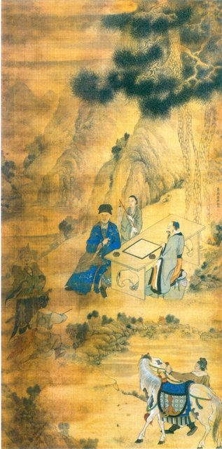
鄭成功在南京之役失利後，率兵從鹿耳門登陸，包圍熱蘭遮城，持續反清復明的大業。

## 1662-02 | 荷蘭人投降
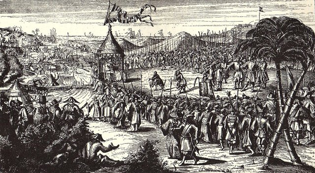
荷蘭守軍在圍城九個月後投降，結束在臺灣38年的統治。鄭成功改大員為安平，在赤崁設承天府，同年病逝；其子鄭經改稱「東寧」。

## 1666 | 明鄭的建設
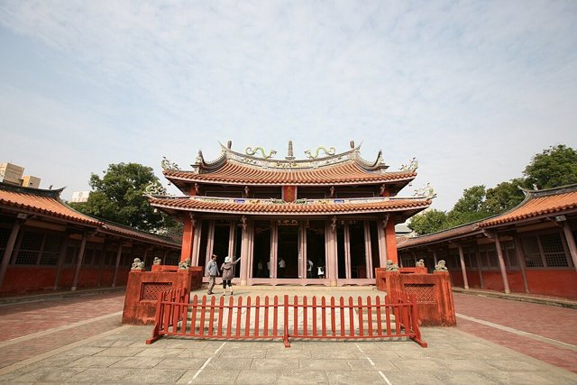
明鄭在謀臣陳永華的規劃下，興建臺灣第一座孔廟、推行科舉與漢人的文教制度，實行屯田制度招募移民開墾（「林鳳營」、「新營」等地名即源自屯田的營盤），並與日本、英國等地維持貿易。

## 1683 | 施琅攻臺，明鄭滅亡
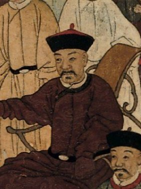
康熙22年，清廷派施琅率水師在澎湖海戰中擊敗明鄭軍隊，鄭克塽投降，明鄭結束在臺灣的統治。

## 1684 | 設臺灣府；頒布渡臺禁令
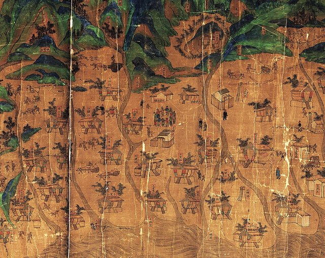
康熙23年，清廷在施琅力主下將臺灣納入版圖，設臺灣府，隸屬福建省，下轄臺灣、鳳山、諸羅三縣。同時頒布渡臺禁令，限制人民渡海來臺、不准攜帶家眷，但偷渡來臺的移民仍然絡繹不絕。

## 1721 | 朱一貴事件
康熙60年，臺灣南部的朱一貴不滿地方官的苛政起事，一度攻下臺灣府城，自稱「中興王」，被清廷派兵平定。

## 1723 | 增設彰化縣與淡水廳
雍正元年，清廷因朱一貴事件檢討治臺政策，增設彰化縣與淡水廳，加強對中北部的管理；1727年（雍正5年）又增設澎湖廳。

## 1786 | 林爽文事件
乾隆51年，天地會領袖林爽文在彰化大里杙起事，是清代臺灣規模最大的民變之一，歷時一年多才被平定。

## 1787 | 諸羅縣改名嘉義縣
諸羅縣城的居民在林爽文事件中堅守城池，乾隆皇帝為嘉獎「義民」，把諸羅縣改名為嘉義縣。

## 1812 | 設噶瑪蘭廳
嘉慶17年，因海盜侵擾與漢人移墾宜蘭平原，清廷正式設立噶瑪蘭廳。

## 1841 | 鴉片戰爭與英軍犯臺
道光21年，鴉片戰爭期間英國船艦數次侵犯雞籠、大安等地，列強開始注意到臺灣的戰略與經濟價值。

## 1858 | 天津條約
咸豐8年，英法聯軍之役中，清廷與英、法等國簽訂《天津條約》，同意開放臺灣的港口。

## 1860 | 北京條約與臺灣開港
咸豐10年，清廷簽訂《北京條約》，此後陸續開放臺灣（安平）、滬尾（淡水）、雞籠（基隆）、打狗（高雄）四個港口，茶、糖、樟腦成為主要出口商品，洋行與傳教士也隨之而來。

## 1862 | 戴潮春事件
同治元年，彰化的天地會領袖戴潮春起事，持續約3年，是清代臺灣歷時最久的民變。

## 1867 | 羅妹號事件
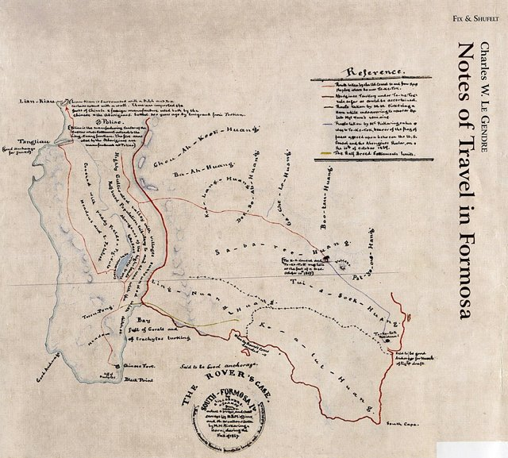
同治6年，美國商船羅妹號（Rover）在鵝鑾鼻附近觸礁，船員上岸後遭原住民殺害。清廷消極以「番地不屬版圖」推託，美國領事李仙得最後與原住民頭目卓杞篤直接訂約。這種態度間接成為後來牡丹社事件的遠因。

## 1868 | 樟腦事件
同治7年，英國商人不滿清廷的樟腦專賣，與官方爆發衝突，英軍砲擊安平。事後中英簽訂樟腦條約，清廷廢除樟腦專賣。

## 1871 | 八瑤灣事件
同治10年，琉球船隻遇颱風漂流到臺灣南部的八瑤灣，數十名船員遭原住民殺害，成為日本出兵臺灣的藉口。

## 1874 | 牡丹社事件；沈葆楨來臺
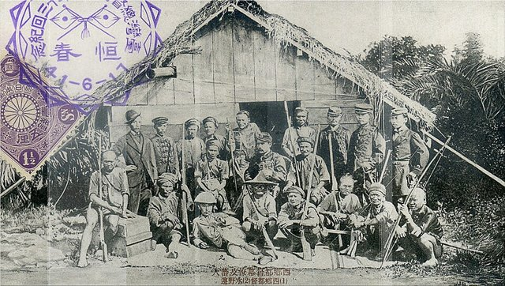
同治13年，日本以八瑤灣事件為由出兵攻打恆春半島的牡丹社等部落。事後清廷與日本簽約，承認日軍出兵是「保民義舉」，等於間接承認琉球屬於日本。清廷派沈葆楨以欽差大臣身分來臺籌辦防務，治臺態度從此由消極轉為積極。

## 1875 | 廢除渡臺禁令；設臺北府
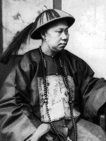
光緒元年，沈葆楨奏請廢除渡臺禁令，推動「開山撫番」，開闢通往後山（東部）的道路，增設臺北府，並開採煤礦、興建砲臺（如安平的億載金城）。之後福建巡撫丁日昌來臺，延續沈葆楨的政策，架設了臺灣第一條電報線。

## 1884 | 中法戰爭；劉銘傳來臺
光緒10年，中法戰爭爆發，法軍進攻基隆、淡水，並封鎖臺灣海峽。清廷派劉銘傳督辦臺灣防務，在滬尾之役擊退法軍。

## 1885 | 臺灣建省；臺灣府城教會報
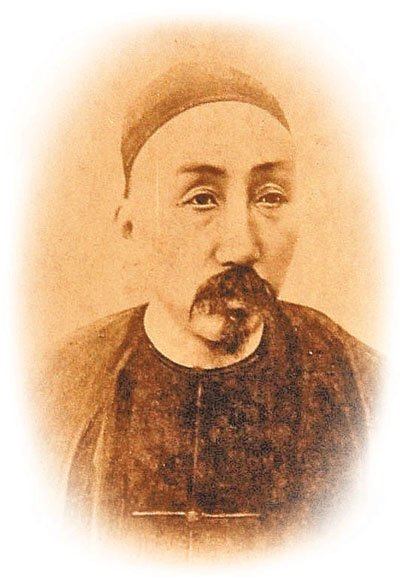
光緒11年，清廷決定臺灣建省，劉銘傳出任首任臺灣巡撫，推動近代化建設：購置輪船、架設電報線、興建基隆到臺北的鐵路（1891年通車，1893年延伸到新竹）、設立郵政總局。同年英國長老教會的巴克禮牧師在臺南發行以白話字（教會羅馬字）書寫的《臺灣府城教會報》，是臺灣第一份報紙。

## 1895-04-17 | 馬關條約

光緒21年，清廷在甲午戰爭中戰敗，李鴻章與伊藤博文簽訂《馬關條約》，把臺灣與澎湖割讓給日本。

## 1895-05-25 | 臺灣民主國
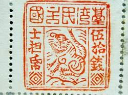
丘逢甲、唐景崧等人成立臺灣民主國，試圖抵抗日本接收。日本派樺山資紀為第一任臺灣總督，日軍登陸後各地爆發激烈抵抗（乙未戰爭），臺灣民主國很快就瓦解。

## 1896 | 六三法
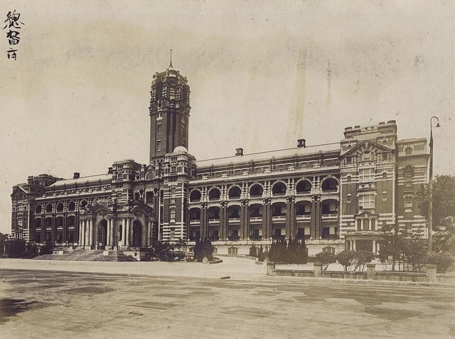
明治29年，日本國會通過「六三法」，授權臺灣總督可以發布具有法律效力的命令，總督集行政、立法、司法與軍事大權於一身。

## 1897 | 臺灣阿片令
明治30年，總督府發布「臺灣阿片令」，規定鴉片由總督府專賣，採漸禁政策。日治時期納入專賣的物品還包括鹽、樟腦、菸草、酒與度量衡，專賣收入成為總督府重要的財源。

## 1898 | 兒玉源太郎與後藤新平
明治31年，總督兒玉源太郎與民政長官後藤新平上任，以「生物學原則」採取「無方針主義」，對抗日勢力剿撫兼施，並改造清代的保甲制度來控制地方。同年成立臨時臺灣土地調查局，調查土地與山林資源，奠定殖民統治的基礎。

## 1899 | 臺灣銀行設立
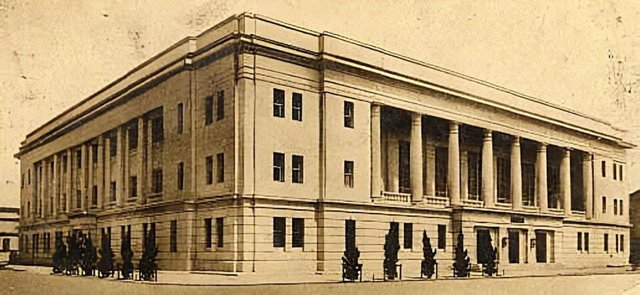
明治32年，臺灣銀行成立，負責發行貨幣、整理幣制，支持殖民地的產業開發。

## 1905 | 第一次臨時臺灣戶口調查
明治38年，總督府舉行第一次全臺戶口普查，是臺灣第一次現代化的人口調查。

## 1908 | 縱貫鐵路通車
明治41年，從基隆到高雄的縱貫鐵路全線通車，大幅縮短南北往來的時間，也帶動了產業發展。

## 1914 | 臺灣同化會
大正3年，日本政治家板垣退助來臺，與林獻堂等人成立臺灣同化會，主張臺灣人應享有與日本人同等的待遇，但隔年就被總督府解散。

## 1915 | 臺中中學校設立
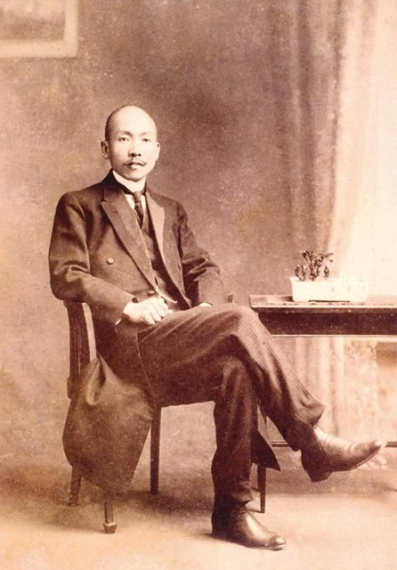
大正4年，經過林獻堂等臺灣仕紳的爭取與捐款，臺中中學校成立，是第一所專收臺灣子弟的中學。同年發生西來庵事件，此後漢人的武裝抗日大致結束，轉向政治與社會運動。

## 1920 | 新民會
大正9年，留日的臺灣學生組成新民會，發行《臺灣青年》雜誌，推動撤廢六三法的運動。

## 1921 | 臺灣議會設置請願運動；臺灣文化協會
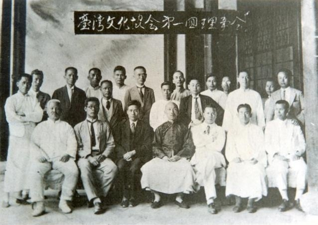
大正10年，林獻堂等人展開臺灣議會設置請願運動，前後持續14年、向日本帝國議會請願15次。同年蔣渭水、林獻堂等人成立臺灣文化協會，透過讀報社、講習會、演講啟蒙民眾。

## 1923-12-16 | 治警事件
大正12年，蔣渭水等人成立「臺灣議會期成同盟會」，總督府以違反治安警察法為由大舉逮捕成員，史稱「治警事件」。

## 1925 | 二林事件
大正14年，彰化二林的蔗農因不滿製糖會社壓低收購價格而組織蔗農組合抗爭，引發衝突，是臺灣農民運動的開端。

## 1927 | 文化協會分裂；臺灣民眾黨成立
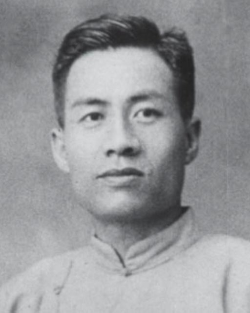
昭和2年，臺灣文化協會因左右路線之爭分裂，蔣渭水等人另組臺灣民眾黨，是臺灣史上第一個合法政黨。

## 1928 | 臺灣共產黨；臺北帝國大學
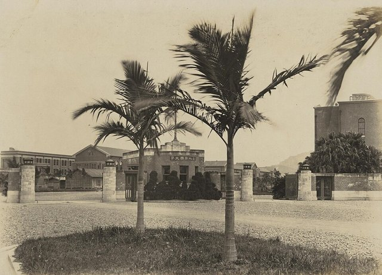
昭和3年，臺灣共產黨在上海成立。同年臺北帝國大學創校，是今天國立臺灣大學的前身。

## 1930 | 嘉南大圳完工；霧社事件
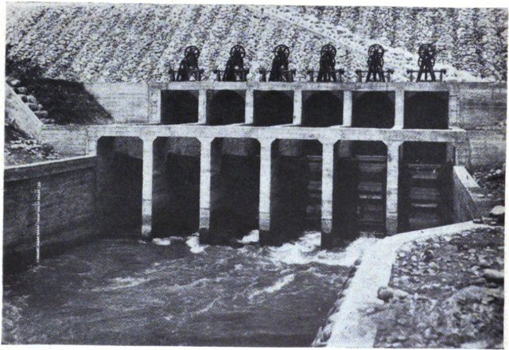
昭和5年，由八田與一設計的嘉南大圳與烏山頭水庫完工，大幅改善嘉南平原的灌溉。同年10月，不滿長期被壓迫的賽德克族人在莫那魯道領導下於霧社起事，遭日軍強力鎮壓。

## 1937 | 中日戰爭；皇民化運動
昭和12年，中日戰爭爆發，總督小林躋造宣布推行皇民化運動，推動國語（日語）家庭、改日本姓名、參拜神社，並在1942年後實施志願兵、徵兵制度，動員臺灣人投入戰爭。

## 1945-10-25 | 中華民國接收臺灣
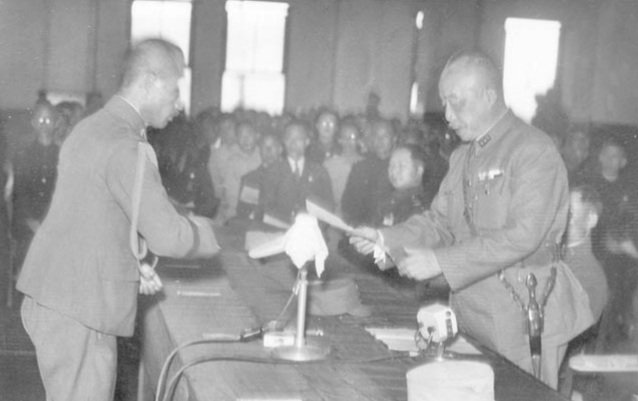
昭和20年，第二次世界大戰結束，日本投降，中華民國政府派陳儀為臺灣省行政長官，在臺北公會堂（今中山堂）接受日本受降，接收臺灣。

## 1947-02-28 | 二二八事件
民國36年，臺北查緝私菸引發衝突，民眾長期累積的不滿爆發，抗議迅速蔓延全臺。政府派軍隊來臺鎮壓並展開清鄉，造成大量死傷，影響臺灣社會深遠。

## 1948 | 《動員戡亂時期臨時條款》
民國37年，國民大會通過《動員戡亂時期臨時條款》，擴大總統職權，後來修訂使總統可以不受連任一次的限制。

## 1949 | 戒嚴；政府遷臺；三七五減租；新臺幣
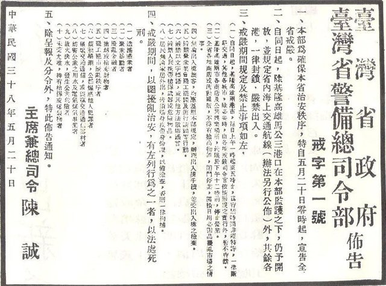
民國38年，5月20日起臺灣實施戒嚴，包括黨禁與報禁，長達38年。同年推行三七五減租（地租不得超過收穫量的37.5%），6月發行新臺幣。12月中華民國政府遷臺。11月，胡適、雷震等人創辦《自由中國》雜誌。

## 1958-08-23 | 八二三砲戰

民國47年，中共對金門發動大規模砲擊，國軍堅守，美國也提供支援。

## 1960 | 雷震案
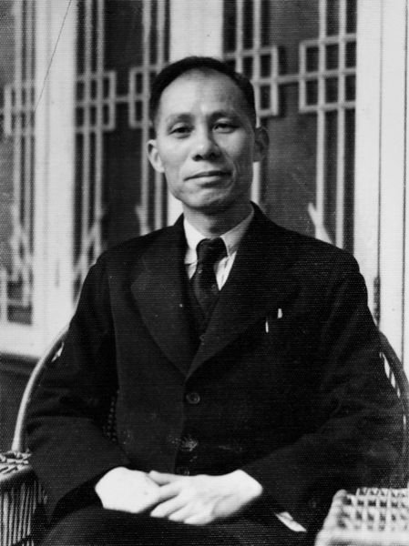
民國49年，雷震籌組「中國民主黨」，未成立就遭逮捕入獄，《自由中國》被迫停刊。

## 1968 | 九年國民義務教育
民國57年，國民義務教育由六年延長為九年。

## 1971-10-25 | 退出聯合國
民國60年，聯合國大會通過第2758號決議，由中華人民共和國取得中國代表權，中華民國退出聯合國。

## 1973 | 十大建設
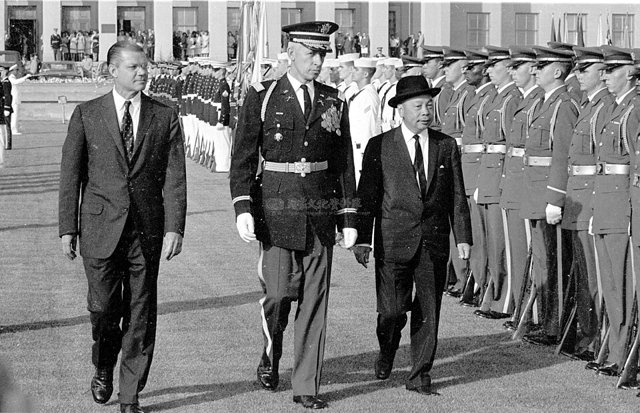
民國62年，行政院長蔣經國宣布推動十大建設，包括中山高速公路、鐵路電氣化、桃園國際機場、中鋼、中船、石油化學工業等，以交通、鋼鐵、石油、化學為主，帶動經濟起飛。

## 1979 | 美國斷交；美麗島事件
民國68年，1月1日美國與中華人民共和國建交，同時與中華民國斷交，並通過《臺灣關係法》。12月10日，《美麗島》雜誌社在高雄舉辦人權日遊行，與軍警爆發衝突，事後多名黨外人士被捕受審。

## 1986-09-28 | 民主進步黨成立
民國75年，黨外人士在戒嚴尚未解除時突破黨禁，宣布成立民主進步黨。

## 1987-07-15 | 解除戒嚴
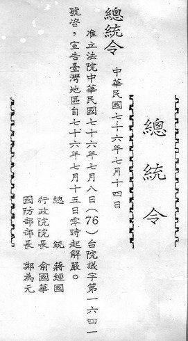
民國76年，總統蔣經國宣布解除實施38年的戒嚴令。11月開放民眾赴中國大陸探親。

## 1988 | 解除報禁；李登輝繼任總統
民國77年，1月1日解除報禁。1月13日蔣經國逝世，副總統李登輝繼任，成為第一位臺灣出生的總統。

## 1991 | 終止動員戡亂時期
民國80年，廢止《動員戡亂時期臨時條款》，年底國民大會全面改選；隔年刑法第100條修正、立法院全面改選。

## 1996-03-23 | 首次總統直選
民國85年，臺灣舉行第一次總統、副總統直接民選，李登輝、連戰當選。選前中共在臺灣海峽試射飛彈，引發臺海危機。

## 2000-03-18 | 首次政黨輪替
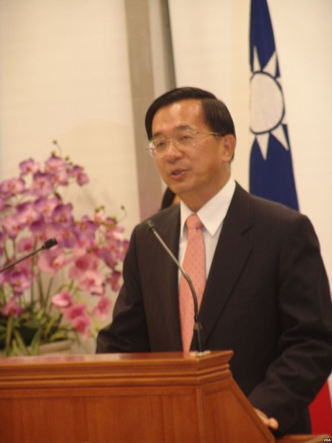
民國89年，民主進步黨的陳水扁當選總統，國民黨首度失去執政權，臺灣完成第一次和平的政黨輪替。
