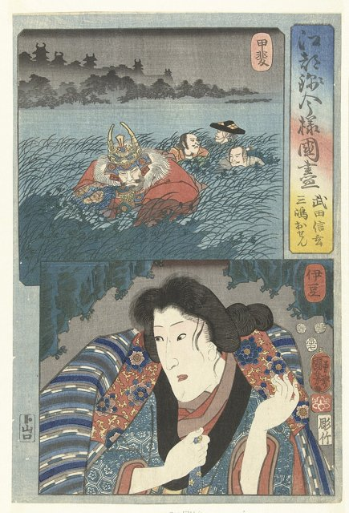
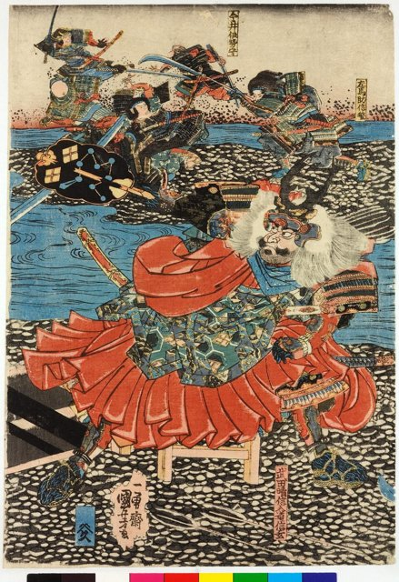
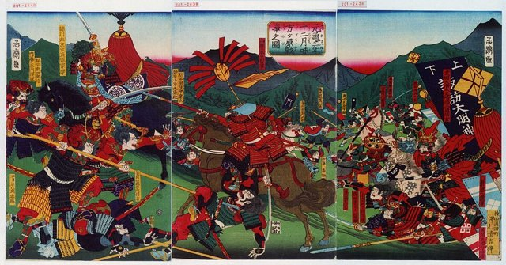

<!--
內容整理自 D:\Books\html\1-3-1.日本歷史人物\武田信玄(1521~1573).html（沒有對應的 md 筆記），並整合中文維基百科〈武田信玄〉條目，以自己的話改寫。
時期依頁面的八個階段歸納：出生與繼承人時期、掌握武田家、信濃攻略、川中島與上杉謙信、轉向駿河與北條、西上作戰與病逝。
兩份資料出入與處理方式：
- 生卒：頁面只寫年份；維基百科作大永元年十一月三日（1521年12月1日）生於甲斐躑躅崎館，元龜四年四月十二日（1573年5月13日）病逝於信濃駒場，享年51歲（虛歲53；維基百科正文作五十二歲），採維基百科日期，寫實歲51歲。
- 1536年：頁面寫元服改名晴信；維基百科補充是獲將軍足利義晴賜偏諱，同年11月初陣攻陷海之口城。
- 1541年放逐父親信虎：維基百科作6月，與板垣信方等重臣合謀，採維基百科月份。
- 砥石城：頁面作「戶石城」「戶石崩」，維基百科作砥石城，兩者是同一座城，這裡寫「砥石城（戶石城）」；維基百科補充1551年真田幸隆攻下砥石城。
- 甲相駿三國同盟：頁面沒有；維基百科寫在1555年定惠院病逝之後，一般多記為1554年（天文23年），這裡寫在1554年並在事件中說明。
- 川中島之戰：頁面寫五次（1553、1555、1557、1561、1564），維基百科補充第一次在1553年5月、第四次在1561年9月10日，採維基百科日期；謙信單騎突入本陣的故事，頁面提醒史料可靠性有爭議，照此寫法。
- 義信事件：頁面寫1567年；維基百科只記事件內容沒有年份，一般記為1565年事發、1567年義信死，這裡寫在1565年並註明。
- 西上作戰：頁面寫1572年10月出兵、12月三方原之戰；維基百科補充12月22日、隔年2月10日攻下野田城，採維基百科日期。
- 遺命秘喪：維基百科引《甲陽軍鑑》說要秘不發喪三年，頁面也記載死訊一度隱瞞；1576年正式本葬取自頁面。
- 頁面的「主要功績」「與戰國重要人物的關係」「為何未能統一日本」「總結」寫進時期說明與相關事件，不另立事件。
- 人名與其他時間軸一致：上杉謙信、德川家康、織田信長、今川義元、北條氏康、足利義昭、真田幸隆、武田勝賴。
圖片來源（皆為 Wikimedia Commons 公有領域／CC0 作品；註明「共用」者沿用其他時間軸已有的圖片）：
- sg-cover.jpg：Takeda Harunobu.jpg（傳為武田晴信（信玄）的肖像）
- sg-shingen.jpg：Takeda Shungen in de povincie Kai en Mishima Osen in Izu.-Rijksmuseum RP-P-1979-174.jpeg（浮世繪中的武田信玄，阿姆斯特丹國家博物館藏）
- sg-kawanakajima.jpg：Takeda Uesugi Kawanakajima o-kassen no zu 武田上杉川中嶋大合戦の圖 (Takeda and Uesugi at the Battle of Kawanakajima) (BM 2008,3037.18311).jpg（浮世繪〈武田上杉川中嶋大合戰之圖〉，大英博物館藏）
- sg-mikatagahara.jpg：Battle of Mikatagahara.jpg（浮世繪中的三方原之戰）
-->

# Periods
- 1521-12-01 ~ 1541 | 出生與繼承人時期 | #868e96
  生於甲斐國，父親武田信虎整合了甲斐；元服後改名晴信，與今川家聯姻，與父親的關係逐漸緊張。
- 1541 ~ 1553 | 掌握武田家與信濃攻略 | #e8590c
  放逐父親繼承家督，進攻諏訪，制定《甲州法度之次第》；上田原與砥石城兩度挫敗後，改以情報、外交與地方豪族合作經營信濃。
- 1553 ~ 1565 | 川中島與上杉謙信 | #c92a2a
  為爭奪信濃北部，五度與越後的上杉謙信在川中島對峙，1561年第四次最為慘烈；同時與今川、北條結成三國同盟，出家號信玄。
- 1565 ~ 1572 | 轉向駿河與北條 | #1971c2
  長子義信事件後與今川家決裂，進攻駿河，與北條家在小田原、三增峠交戰，後與北條恢復和平。
- 1572 ~ 1573-05-13 | 西上作戰 | #7048e8
  響應反信長包圍網向西進軍，三方原大破德川家康，攻下野田城後病重，在返回甲斐途中病逝。

# Events

## 1521-12-01 | 出生於甲斐國
武田信玄生於甲斐國的躑躅崎館（今山梨縣），幼名勝千代（一說太郎），是當主武田信虎的長子，母親大井夫人。武田氏是源氏系統的武家，長期統治甲斐。甲斐多山、平原有限，如何以有限的資源維持軍隊、控制交通要道，成為武田家日後的課題。
少年時期的許多故事帶有傳奇色彩，較可靠的理解是：他在武家環境中成長，後來展現了出色的軍事與政治能力。

## 1536 | 元服，改名晴信
信玄元服，獲將軍足利義晴賜偏諱，改名「晴信」，敘任從五位下大膳大夫；同年11月初陣，攻陷佐久郡的海之口城。1537年前後，武田家與駿河的今川家透過婚姻建立同盟，避免同時面對多方威脅。

## 1541-06 | 放逐父親武田信虎
晴信與板垣信方等重臣合作，把父親信虎送往駿河，交由今川家收留，自己繼承家督。後世常說信虎偏愛次子信繁、施政嚴厲，細節並不全能確證；但這次政變顯示，家督繼承不只取決於血緣，也受家臣團的利益與判斷左右。

## 1542-06 | 進攻諏訪
晴信攻打妹夫諏訪賴重，賴重戰敗自盡，武田家取得進入信濃的門戶諏訪地區，之後再以與諏訪氏的婚姻等政治安排鞏固控制。信濃不是可以一次征服的整體，當地有許多互相競爭的武士家族，武田家必須以戰爭、聯姻、臣服與合作逐步擴張。

## 1547 | 《甲州法度之次第》
晴信制定《甲州法度之次第》，規範家臣行為、領國秩序與司法，減少領國內部的任意行為，讓大名能管理家臣與地方社會。它不是現代意義的憲法，而是戰國大名的領國法度；武田家的崛起不只靠軍事，也靠這類制度把人力、財政與軍事資源動員起來。

## 1548-02 | 上田原之戰
武田軍向信濃北部擴張，在上田原與村上義清交戰，遭到重大挫敗，重臣板垣信方、甘利虎泰戰死。這是信玄早期最重要的失敗，顯示即使實力已強，在地形陌生、地方勢力團結時仍可能遭到重創。同年7月，他在鹽尻峠大破小笠原長時。

## 1550-09 | 砥石崩
武田軍進攻村上義清的砥石城（戶石城），久攻不下，撤退時遭到反擊，損失慘重，史稱「砥石崩」。這與上田原之戰讓信玄體認到，信濃攻略不能只靠攻城與正面決戰，還要靠情報、地形與地方政治。1551年，信濃豪族真田幸隆以計攻下砥石城，真田家從此成為武田家的重要部將。

## 1553-05 | 第一次川中島之戰
村上義清逃往越後投靠上杉謙信，武田與上杉兩軍在千曲川與犀川交會的川中島一帶首次對峙，爭奪信濃北部的城砦、交通線與地方勢力。川中島不是一座城，而是戰略要地：控制它，武田能向北擴張，上杉則關係到越後南部的防衛。

## 1554 | 甲相駿三國同盟
武田、北條（相模）、今川（駿河）三家以聯姻締結同盟，各自得以專心應付其他方向的敵人（維基百科條目寫在1555年）。1555年，武田與上杉第二次在川中島長期對峙，在今川義元的調停下撤兵；1557年第三次對峙，雙方未交戰。

## 1559-05 | 出家，號信玄

晴信出家，法名德榮軒信玄，後世因此稱他為「武田信玄」。出家不表示退出政治或軍事，他仍是武田家的實際統治者。

## 1561-09-10 | 第四次川中島之戰

上杉謙信率軍進入川中島，雙方在八幡原激戰，傷亡慘重，信玄之弟武田信繁戰死，傳統記載軍師山本勘助也死於此役。後世流傳謙信單騎突入武田本陣、與信玄交手的故事，史料可靠性有爭議。
雙方都沒能消滅對方，武田家仍保有主要領地與實力。這場戰役使信玄與謙信成為日本戰國史上最著名的宿敵；1564年第五次對峙未演變成決戰，此後雙方的重心轉向其他方向。

## 1565 | 義信事件
信玄的長子武田義信娶今川義元之女，象徵武田、今川的同盟。1560年今川義元在桶狹間戰死後，信玄的戰略轉向駿河，與義信分歧；義信與家老飯富虎昌的密謀敗露，飯富虎昌自盡，義信失去繼承人地位，1567年死於幽禁之中（頁面寫在1567年）。事件的具體原因有不同解釋。

## 1568 | 進攻駿河
信玄打破與今川家的同盟，進攻駿河，在薩埵峠大破今川氏真。駿河有沿海交通與經濟的戰略價值，德川家康也從另一方向進攻遠江，今川家的領地被兩家瓜分，武田與北條的關係也隨之惡化。

## 1569-10-08 | 三增峠之戰
信玄率軍深入相模，10月包圍北條家的小田原城，城防堅固無法攻下；撤退途中在三增峠與北條軍交戰，突破阻擊。武田軍取得戰術成功，但沒有因此消滅北條。1571年北條氏康去世後，兩家恢復和平，信玄得以集中力量向西。

## 1572-10 | 西上作戰
將軍足利義昭與織田信長的關係惡化，義昭聯合反信長勢力，信玄也加入這個包圍網。10月，他親率約三萬大軍離開甲斐，向遠江、三河推進，德川家康只能依靠城池與有限兵力抵抗。

## 1572-12-22 | 三方原之戰

武田軍逼近德川家康的據點濱松，家康與織田援軍在三方原迎戰，大敗，損失慘重；後世流傳家康撤退時驚慌失措的故事，部分帶有傳奇色彩。這是信玄一生最著名的勝利，證明武田軍仍有強大的野戰能力，也一度威脅織田信長的政治布局。

## 1573-02-10 | 攻下野田城
武田軍進入三河，圍攻德川方的野田城，2月10日攻下。此時信玄的健康已經惡化，長途行軍、補給與持續作戰的壓力也影響了軍事行動。

## 1573-05-13 | 病逝於信濃駒場
元龜四年四月十二日，信玄在返回甲斐的途中，於信濃國伊那郡的駒場病逝，享年51歲（虛歲53），死因有肺結核、胃病等說法，未有定論。依《甲陽軍鑑》的記載，他遺命秘不發喪三年，武田家一度隱瞞死訊，由武田勝賴繼承（一說以勝賴之子信勝為繼承人、勝賴攝政），1576年才舉行正式的葬禮。
同年，織田信長把足利義昭逐出京都，室町幕府走向終結。信玄留下強大的軍事力量與領國體制，但1582年武田家仍被織田、德川聯軍所滅。他以法度、金山開發、信玄堤等治水工程與交通建設維持武田家的基礎；但創業者的能力未必能傳給下一代，這是許多戰國大名的共同問題。
