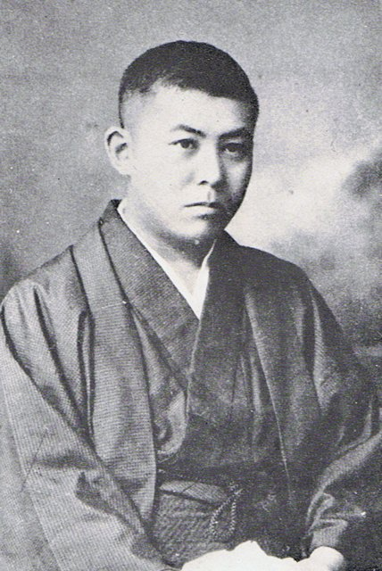
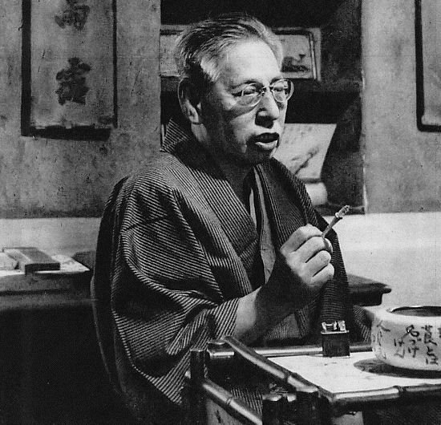
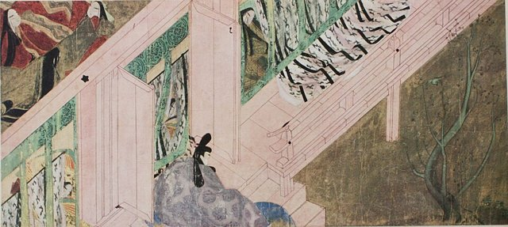
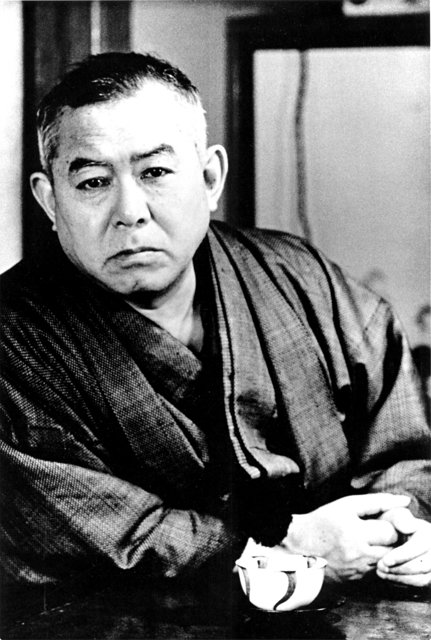

<!--
內容整理自 D:\Books\html\6-4.日本文學家\谷崎潤一郎.html（沒有對應的 md 筆記），並整合中文維基百科〈谷崎潤一郎〉條目，以自己的話改寫。
時期依生平歸納：東京的少年時代、官能唯美的出道、關東大地震與移居關西、古典美學與《細雪》、戰後與晚年。
兩份資料出入與處理方式：
- 生卒：1886年7月24日生於東京日本橋；1965年7月30日去世，兩份一致。
- 結婚：維基百科寫1916年與石川千代結婚、隔年生下長女鮎子；一般記載是1915年結婚、1916年鮎子出生，採一般記載。
- 妻子讓渡事件：頁面寫1930年三人聯名在報上發表聲明，千代改嫁佐藤春夫，照頁面；1921年谷崎曾答應把千代讓給佐藤又反悔（小田原事件），依一般記載補充，頁面提醒細節各家記載不同，只寫大概。
- 關東大地震：頁面與維基百科都寫1923年9月，震後移居關西；維基百科寫「搬到京都」，之後定居兵庫的阪神一帶，兩者合併。
- 《陰翳禮讚》：頁面寫1933年，一般記載是1933年12月至1934年1月連載，寫1933年。
- 《源氏物語》譯本：頁面說前後修訂三次、耗時數十年；依一般記載寫1939年、1951年、1964年三個譯本。
- 文化勳章：維基百科寫1949年，照此。諾貝爾文學獎提名：維基百科寫1958至1964年間六度獲提名，寫進晚年事件。
- 1918年、1926年兩度到中國，1926年結識郭沫若，取自維基百科。
- 其他時間軸（村上春樹、遠藤周作、大江健三郎）提到的「谷崎潤一郎賞」以 notNames 排除，不算提及本人。
- 人名與其他時間軸一致：佐藤春夫、永井荷風、紫式部、芥川龍之介。
圖片來源（皆為 Wikimedia Commons 公有領域／CC0 作品；註明「共用」者沿用其他時間軸已有的圖片）：
- ta-cover.jpg：Junichiro Tanizaki 02.jpg（谷崎潤一郎，1951年前後）
- ta-1913.jpg：Junichiro Tanizaki 1913.jpg（1913年的谷崎潤一郎）
- ta-sato.jpg：Haruo Sato 01.jpg（佐藤春夫，1952）
- ta-quake.jpg：Kanto-daishinsai.jpg（關東大地震後的橫濱廢墟）
- ta-genji.jpg：Genji emaki TAKEKAWA2.jpg（《源氏物語繪卷》〈竹河〉）
- ta-1950.jpg：Portrait of Tanizaki Jun'ichirō - Atami - 1950 - Kimura Ihei.png（木村伊兵衛所攝熱海的谷崎潤一郎，1950）
-->

# Periods
- 1886-07-24 ~ 1910 | 東京的少年時代 | #868e96
  生於東京日本橋的商家，家道中落後靠當家教讀完中學，進入東京帝國大學國文科。
- 1910 ~ 1923 | 官能唯美的出道 | #a61e4d
  以《刺青》出道，受永井荷風讚賞，以官能、異色與西洋風的作品成為耽美派的代表。
- 1923 ~ 1945 | 關西與古典美學 | #e8590c
  關東大地震後移居關西，風格轉向日本的古典與關西的風土，寫出《痴人之愛》《春琴抄》《陰翳禮讚》與《源氏物語》譯本，戰時寫作《細雪》。
- 1945 ~ 1965-07-30 | 戰後與晚年 | #495057
  《細雪》完成出版，獲文化勳章，晚年以《鍵》《瘋癲老人日記》繼續探索老年的情欲，多次獲諾貝爾文學獎提名。

# Events

## 1886-07-24 | 出生於東京日本橋
谷崎潤一郎生於東京日本橋蠣殼町的商家。祖父經營印刷業致富，但父親經商屢屢失敗，家境逐漸衰落。他從小成績優異，靠著到富裕人家當家教，才得以繼續讀完府立第一中學與第一高等學校。

## 1908 | 進入東京帝國大學
谷崎進入東京帝國大學國文科就讀，但志在創作，很少上課，後來因繳不出學費在1911年被退學。

## 1910-11 | 《刺青》

谷崎與小山內薰等人創辦第二次《新思潮》，發表短篇小說《刺青》，寫一名刺青師在少女背上刺上巨大的女郎蜘蛛，使她變成支配男人的魔性女子。1911年，永井荷風在《三田文學》上撰文盛讚，谷崎就此登上文壇，成為耽美派的代表作家。他的作品反覆出現對女性腳部與被虐的迷戀。

## 1915 | 與石川千代結婚
谷崎與石川千代結婚，1916年長女鮎子出生。兩人個性不合，谷崎反而迷戀千代的妹妹聖子，婚姻長期陷入緊張。

## 1918 | 第一次中國之旅
谷崎到朝鮮、中國華北與江南旅行，回國後寫出多篇以中國為背景的作品。他在1926年再次到上海，結識了郭沫若、田漢等中國文人。

## 1921 | 小田原事件

谷崎的好友、詩人佐藤春夫同情受冷落的千代，兩人產生感情。谷崎原本答應讓千代改嫁佐藤，後來又反悔，與佐藤絕交，這件事被稱為「小田原事件」。

## 1923-09 | 關東大地震，移居關西

關東大地震摧毀了東京大片市區，當時人在箱根的谷崎舉家遷到關西，先住京都，之後定居兵庫縣的阪神一帶。原本嚮往西方、嫌棄日本傳統的他，在關西的風土與大阪方言中，逐漸轉向日本古典的美。

## 1924 | 《痴人之愛》
谷崎連載《痴人之愛》，寫一名上班族把咖啡廳女侍奈緒美當成理想的西洋式女性來培養，最後反被她支配。「奈緒美主義」成為當時摩登女郎的代名詞。之後他又發表以大阪方言寫成的《卍》（1928–1930）與《食蓼蟲》（1928–1929）。

## 1930-08 | 妻子讓渡事件
谷崎與千代離婚，千代改嫁佐藤春夫。三人聯名把通知寄給親友，內容在報紙上刊出，「妻子讓渡事件」轟動社會，引起許多議論。

## 1933 | 《春琴抄》與《陰翳禮讚》
谷崎發表《春琴抄》，寫盲眼的三味線師傅春琴與服侍她的弟子佐助，佐助在春琴毀容後刺瞎自己的雙眼。同年他寫隨筆《陰翳禮讚》，認為日本的美存在於幽暗與陰影之中，而不是明亮的燈光下，至今仍是談日本美學最常被引用的文本之一。1935年，他與森田松子結婚，松子成為他晚年作品的靈感來源。

## 1939 | 《源氏物語》現代語譯

谷崎出版《潤一郎譯源氏物語》（至1941年），把平安時代紫式部的古典日語譯成現代日語；戰後他又出版1951年的新譯與1964年的新新譯，三度修訂，讓一般讀者也能親近這部千年經典。

## 1943 | 《細雪》遭禁止連載
谷崎在《中央公論》連載長篇小說《細雪》，寫大阪船場舊家蒔岡家四姊妹的生活與婚事，被軍部認為與戰時的緊迫氣氛不合，連載被迫中止。他在戰爭期間仍私下繼續寫作，1948年全書完成，獲每日出版文化賞與朝日文化賞。

## 1949 | 文化勳章

谷崎獲頒日本政府的文化勳章。戰後他以老年的情欲為題，發表《少將滋幹之母》（1949–1950）、《鍵》（1956）、《瘋癲老人日記》（1961–1962）等作品。

## 1958 | 諾貝爾文學獎提名
谷崎在1958至1964年間多次獲提名諾貝爾文學獎，1960年與1964年進入最後的候選名單，但最後都沒有得獎。1964年，他成為美國國家藝術文學院的第一位日本籍名譽會員。

## 1965-07-30 | 逝世
谷崎因腎病與心臟衰竭在神奈川縣湯河原的家中去世，享年79歲。同年，中央公論社設立了以他為名的「谷崎潤一郎賞」，此後成為日本重要的文學獎之一。
