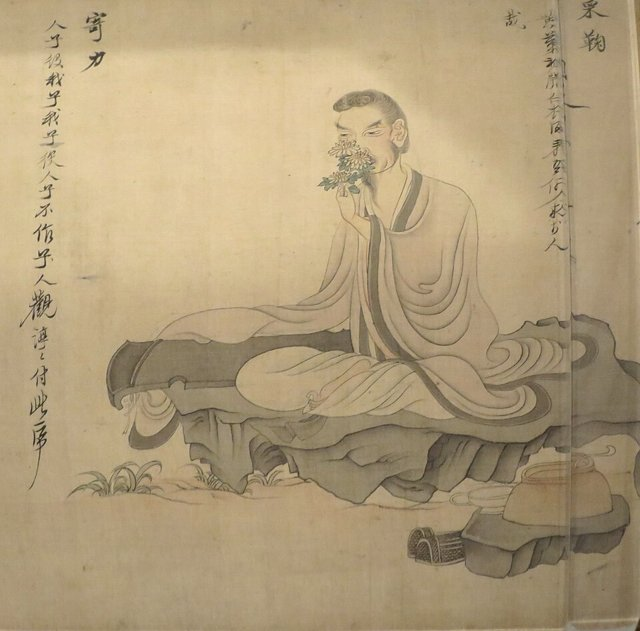

<!--
內容整理自 D:\Books\md\歷史\人物\中國\陶淵明生平大事記（約365－427）.md（Books 的人物頁為 D:\Books\html\1-2-1.中國歷史人物\陶淵明(365~427).html），並整合中文維基百科〈陶淵明〉條目，以自己的話改寫。
時期依筆記的「人生重要階段」歸納：家世與少年、五度出仕、彭澤辭官、歸田與田園詩、劉宋代晉後的晚年。筆記的「核心思想」「重要著作」「文學特色」「交往人物」「對中國文學史的影響」「後世田園詩人」寫進時期說明與相關事件，不另立事件。
筆記說陶淵明的生年與部分任官、作品的年代都有考證差異，因此用「約」表示；維基百科的仕宦年份較細，這裡大多採維基百科，並逐條說明。
兩份資料出入與處理方式：
- 生卒：筆記寫約365年（東晉興寧三年）生於尋陽柴桑（今江西九江附近）、427年（元嘉四年）去世，約63歲；維基百科同寫約365年—427年，享年63歲，born 採365、died 採427（只有年份），網站自動算出的歲數與傳統的63歲（虛歲）可能相差一歲。
- 家世：筆記寫曾祖父陶侃官至大司馬、祖父陶茂曾任太守；維基百科補充陶氏屬溪族，世奉天師道，陶侃因平定蘇峻之亂成為東晉名臣，祖父陶茂任武昌太守，外祖父孟嘉曾供事於桓溫，叔父陶淡與外叔祖孟陋都是隱士，陶家仍有做官的親戚可以幫他求官，照此。
- 父親：筆記寫「父親早逝」（放在幼年）；維基百科寫他是陶逸的獨生子，二十歲左右喪父，家道中落，兩者不同，這裡採維基百科。
- 初仕：筆記與維基百科同寫約393年任江州祭酒，因不適應而辭職；維基百科補充他不堪江州刺史王凝之的倨傲，幾個月就辭職，之後受召為江州主簿未赴任，照此。
- 鎮軍參軍：筆記寫404年任鎮軍參軍、建威參軍；維基百科寫399年赴京口任北府兵首領、鎮軍將軍劉牢之的參軍，翌年五月辭官（岡村繁推測是為了逃避孫恩之亂的戰事），404年服喪完畢後任建威將軍、江州刺史劉敬宣的參軍，這裡採維基百科，鎮軍參軍放在399年。
- 桓玄：筆記寫約400年曾任桓玄幕僚；維基百科寫401年赴江陵，在荊州刺史桓玄幕下任職，照維基百科寫401年。
- 母親：筆記寫約401年母親去世、回鄉守喪；維基百科寫401年十一月母親孟氏去世，他第三度辭職回尋陽服喪三年，照此。
- 彭澤縣令：筆記寫405年任彭澤縣令，因不願為督郵束帶迎接，約八十餘日後辭官，寫下《歸去來兮辭》；維基百科寫405年三月劉敬宣辭任江州刺史，陶淵明暫回故鄉，八月受族人提攜出任距柴桑約50公里的彭澤縣令，十一月以同父異母的妹妹在武昌去世為由請辭；兩種說法並列：辭官的原因，「不為五斗米折腰」是傳統的說法（筆記也標為「傳統記載」），維基百科說的是他藉妹妹的喪事請辭。
- 歸隱後：維基百科補充他擁有數處田產，有僮客協助耕作；408年家中失火、舊屋盡毀，移居尋陽城南郊的南村；411年一同耕種的堂弟陶敬遠去世；他與江州刺史王弘、殷景仁、顏延之交往，415年結交顏延之，418年曾拒絕王弘求見，後來經好友龐通之介紹相識，王弘常贈酒資助；他與周續之、劉遺民並稱「尋陽三隱」，晉末曾被徵為著作佐郎未上任，照此。筆記寫他經常遭遇飢餓與住宅失火，照此。
- 桃花源：筆記寫傳統上認為《桃花源記》與《桃花源詩》約作於417年，確切年代仍有不同看法，照此。
- 劉宋：筆記與維基百科同寫420年劉裕建立劉宋，陶淵明不再出仕；維基百科補充他痛心東晉傾覆，詩文不用劉宋年號，只題甲子紀年，424年與路過尋陽的顏延之多次相聚，426年拒絕江州刺史檀道濟的邀請與饋贈，照此。
- 婚姻：維基百科補充他30歲時喪妻，續娶翟氏，因貧窮受妻子埋怨，有兒子五人（陶儼、陶俟、陶份、陶佚、陶佟，三子、四子是雙生兒），至少一個女兒；筆記的《責子》詩以幽默筆調描寫子女，照此。
- 身後：筆記寫顏延之為他撰寫誄文，後世稱「靖節先生」，唐代王維、孟浩然、儲光羲，宋代蘇軾（大量和陶詩）、黃庭堅都推崇他，照此。
- 人名與其他時間軸一致：蘇軾（Data 的 SuDongpo）；顏延之、慧遠、劉裕、桓玄沒有獨立時間軸。東晉的玄學背景見 Xuanxue。
圖片來源（皆為 Wikimedia Commons 公有領域／CC0 作品，縮成最長邊 640px）：
- tym-cover.jpg：Anonymous - Portrait of Tao Yuanming - 1943.120 - Art Institute of Chicago.jpg（佚名〈陶淵明像〉，芝加哥藝術博物館）
- tym-chen.jpg：Tao Yuanming by Chen Hongshou.jpg（陳洪綬〈陶淵明故事圖〉中持菊的陶淵明，明代）
-->

# Periods
- 365 ~ 392 | 家世與少年 | #868e96
  生於尋陽柴桑，曾祖父是東晉名將陶侃，少年好讀書、習琴，二十歲左右喪父，家道中落。
- 393 ~ 405 | 五度出仕 | #1971c2
  為了生計先後任江州祭酒、鎮軍參軍、桓玄幕僚與建威參軍，每次任期都不長，母喪時回鄉守制。
- 405 ~ 419 | 彭澤辭官與田園生活 | #2f9e44
  405年辭去彭澤縣令，寫《歸去來兮辭》，從此躬耕隱居，家中失火後移居南村，寫下大量田園詩。
- 420 ~ 427 | 劉宋代晉與晚年 | #495057
  劉裕篡晉，他不再出仕，詩文只題甲子，生活日益貧困，仍拒絕官聘，在故鄉去世。

# Events

## 365 | 出生於尋陽柴桑 {label="約365年（東晉興寧三年）"}
陶淵明名潛（一說名淵明），字元亮，生於尋陽郡柴桑縣（今江西九江附近），是陶逸的獨生子。陶家屬溪族，世奉天師道；曾祖父陶侃出身寒微，因平定蘇峻之亂成為東晉名臣，官至大司馬，祖父陶茂任武昌太守，外祖父孟嘉曾在桓溫手下任職，叔父陶淡與外叔祖孟陋都是隱士。到了陶淵明出生時，家族已逐漸衰落，但仍有做官的親戚可以幫他求官。

## 380 | 好讀書與喪父 {label="少年至二十歲左右"}
陶淵明少年時喜好讀書、學琴，修習儒學，也受到老莊哲學與古代隱逸文化的影響；二十歲左右父親去世，家道中落。年輕時的他並非一開始就決定歸隱，也曾希望透過仕途實現政治理想、改善家庭生活。

## 393 | 任江州祭酒 {label="約393年"}
因家境貧窮，陶淵明出任江州祭酒（主管教育的官員），但不堪仕宦生活與江州刺史王凝之的傲慢，只做了幾個月就辭職；後來受召為江州主簿，沒有赴任。他三十歲時喪妻，續娶翟氏，常因貧窮受到妻子埋怨。

## 399 | 劉牢之的參軍
陶淵明到京口，擔任北府兵首領、鎮軍將軍劉牢之的參軍；隔年五月他再度辭官，有學者推測是為了逃避孫恩之亂引起的戰事。東晉末年政局動盪，權臣相爭，官場充滿複雜的權力鬥爭。

## 401 | 桓玄幕府與母喪
陶淵明到江陵，在荊州刺史桓玄的幕府任職，接觸當時的權力中心；同年十一月母親孟氏去世，他第三度辭職，回到尋陽為母親服喪三年。

## 404 | 劉敬宣的參軍
服喪完畢，陶淵明出任建威將軍、江州刺史劉敬宣的參軍；隔年三月劉敬宣辭任江州刺史，陶淵明也暫時回到故鄉。他一生有五次任官與辭官的經歷，逐漸發現追隨的軍閥並不可靠，也目睹官場的貪腐。

## 405 | 辭去彭澤縣令
八月，陶淵明受族人提攜，出任距故鄉約50公里的彭澤縣令，原本打算做滿一年；傳統記載說郡裡的督郵前來視察，有人要他整飭衣冠、束帶迎接，他不願為了微薄的俸祿向權勢低頭，說「不為五斗米折腰」，任職八十餘日就辭官（維基百科則說他在十一月以同父異母的妹妹在武昌去世為由請辭）。他寫下《歸去來兮辭》：「歸去來兮，田園將蕪胡不歸？」表達告別官場、返回田園的決心。

## 406 | 躬耕田園 {label="406年起"}

此後二十餘年，陶淵明拒絕一切官聘，回到家鄉務農隱居：他擁有幾處田產，有僮客協助耕作，自己也親身下田，把耕作的經驗寫進詩裡，如《歸園田居》五首；他喜歡喝酒，作品幾乎「篇篇有酒」，《飲酒》二十首（其五：「採菊東籬下，悠然見南山」）在日常生活中思考人生與自然，語言平淡自然、不刻意雕琢，開創了中國田園詩的傳統。他也在《五柳先生傳》以自我的形象描寫不慕名利、安貧樂道的生活態度。

## 408 | 家中失火、移居南村
陶淵明家中失火，舊屋全部燒毀，他移居尋陽城南郊的南村，寫有《移居》二首，描寫鄰里交往與田園生活的樂趣；411年，與他一同耕種的堂弟陶敬遠去世。他的生活並不富裕，經常遭遇飢餓與經濟困難，但他珍惜自由，不願再為官位與財富犧牲人格。

## 415 | 與地方官員交遊 {label="415–418年"}
陶淵明與江州刺史王弘、殷景仁、顏延之等人結識往來：415年他開始與顏延之交往；418年他曾拒絕王弘的求見，後來經由好友龐通之介紹才相識，此後兩人常有來往，王弘時常資助或贈酒。他與周續之、劉遺民齊名，同稱「尋陽三隱」，晉末朝廷曾徵他為著作佐郎，他沒有上任。

## 417 | 《桃花源記》 {label="約417年（傳統說法）"}
傳統上認為陶淵明約在此時寫下《桃花源記》與《桃花源詩》：漁人在桃花林盡頭穿過山洞，找到一個與世隔絕的村落，村民安居樂業，不知外面的朝代更替，也不受戰亂與政治壓迫，與東晉末年長期戰亂的現實形成鮮明的對照。確切的寫作年代仍有不同的看法。

## 420 | 劉宋代晉
劉裕篡晉，建立劉宋，東晉滅亡。陶淵明對東晉的傾覆感到痛心，不再出仕新朝，他的詩文不用劉宋的年號，只題干支紀年，生活日益貧困，仍拒絕以出仕換取富貴，堅持個人的志節；他晚年的《形影神》《擬挽歌辭》以平靜坦然的態度思考生命與死亡。

## 424 | 與顏延之相聚
顏延之路過尋陽，與陶淵明多次相聚；顏延之後來為陶淵明撰寫誄文。

## 426 | 拒絕檀道濟
江州刺史檀道濟邀請陶淵明出仕，他拒絕了，也謝絕檀道濟的饋贈。

## 427 | 逝世 {label="427年（元嘉四年）"}
陶淵明在故鄉去世，享年63歲（虛歲），友人私諡「靖節先生」。他不是單純逃避現實的隱士，而是在政治動盪與人生困境中，以自己的方式維持人格的獨立；他開創的田園詩傳統影響了唐代的王維、孟浩然、儲光羲，宋代的蘇軾更大量寫作「和陶詩」，黃庭堅也推崇陶詩的精神與藝術。
