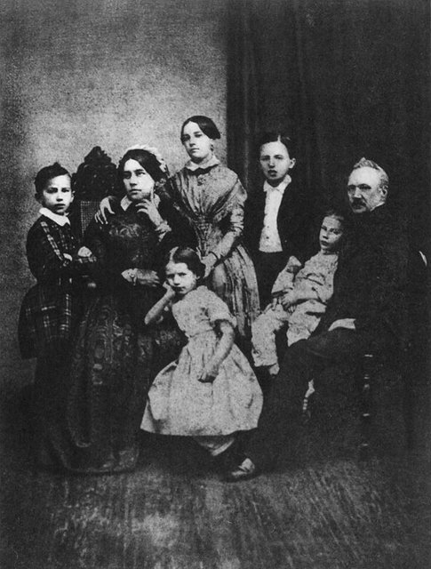
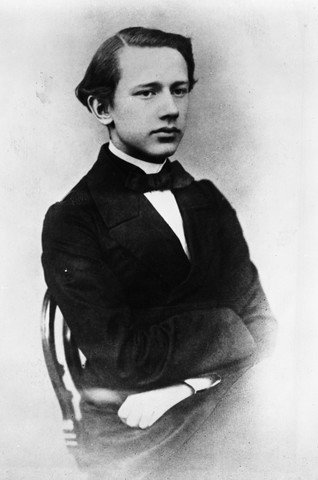
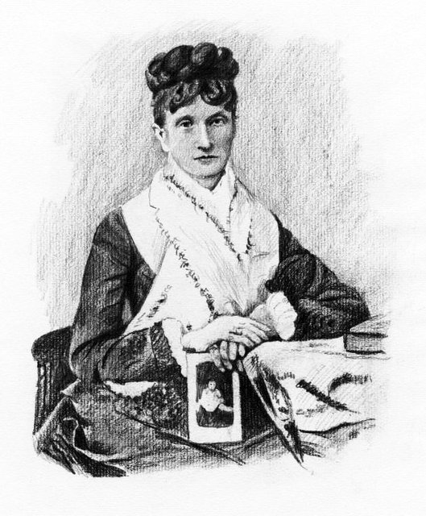
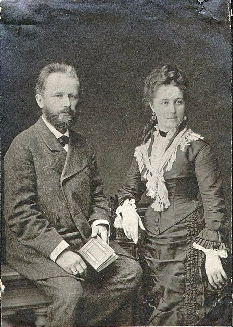
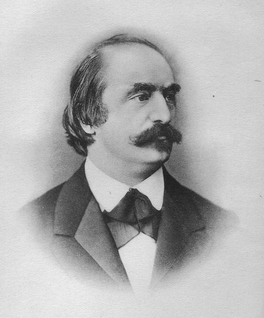
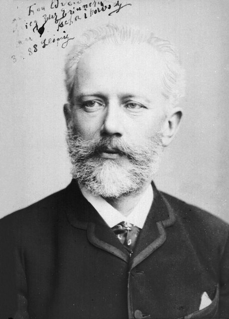

<!--
內容整理自中文維基百科「彼得·柴可夫斯基」與英文維基百科「Pyotr Ilyich Tchaikovsky」條目（CC BY-SA 4.0），並以台灣用語改寫摘要。
https://zh.wikipedia.org/zh-tw/彼得·伊里奇·柴可夫斯基
https://en.wikipedia.org/wiki/Pyotr_Ilyich_Tchaikovsky
中文條目大致譯自英文條目。日期一律採新曆（格里曆）。
《天鵝湖》、第一號鋼琴協奏曲、小提琴協奏曲、《睡美人》、《胡桃鉗》等作品的首演日期，兩個條目的生平段落沒有完整記載，係依一般公認的史實補充。
圖片皆為 Wikimedia Commons 上的公有領域（含PD-US）作品（封面：1888年的肖像照）。
-->

# Periods
- 1840 ~ 1850 | 童年@沃特金斯克
  父親是礦業局的中校工程師，負責管理鐵工廠。他4歲半就堅持要跟哥哥一起上法籍家庭教師的課，6歲已精通法語和德語；5歲開始學鋼琴，不到三年視譜能力就追上老師。
- 1850 ~ 1859 | 帝國法學院@Saint Petersburg
  10歲被送到離家1,300公里的聖彼得堡讀法學院，準備當公務員。與母親的分離成為他一生的創傷，14歲時母親又死於霍亂。
- 1859 ~ 1865 | 公務員與音樂學院
  在司法部當了三年小公務員，同時到俄羅斯音樂協會上課，成為聖彼得堡音樂學院的第一屆學生，跟安東·魯賓斯坦學作曲。
- 1866 ~ 1877 | 莫斯科音樂學院教授@Moscow
  應尼古拉·魯賓斯坦之邀到莫斯科音樂學院教樂理，兼寫樂評。在「俄國五人組」與學院派之間保持獨立，寫出《羅密歐與茱麗葉》、第一號鋼琴協奏曲、《天鵝湖》等作品。
- 1877 ~ 1884 | 婚姻破裂與流浪歲月
  一場只維持兩個半月的婚姻讓他身心崩潰。此後靠著梅克夫人的贊助專心作曲，獨自在歐洲與俄國鄉間四處旅行，避開社交，完成《奧涅金》、小提琴協奏曲與《1812序曲》。
- 1884 ~ 1893 | 國際聲望的巔峰
  獲沙皇授勳與終身年金，成為事實上的宮廷作曲家。克服怯場站上指揮台，巡迴歐美，寫下《睡美人》、《黑桃皇后》、《胡桃鉗》與第六號交響曲「悲愴」。

# Events

## 1840-05-07 | 出生@沃特金斯克

生於俄羅斯帝國維亞特卡省卡馬河畔的小鎮沃特金斯克（今屬烏德穆爾特共和國）。父親伊利亞是礦業局的中校工程師，管理當地鐵工廠；母親亞歷山德拉比父親小18歲，有法國與德國血統。曾祖父是參加過1709年波爾塔瓦會戰的札波羅結哥薩克。父母都受過包括音樂在內的藝術教育。

## 1844 | 法籍家庭教師杜爾巴赫
家裡聘請22歲的法國家庭教師杜爾巴赫，4歲半的他堅持要跟哥哥一起上課，6歲就精通法語和德語。他非常依戀這位老師，據說她的關愛彌補了母親的冷淡（也有人說母親其實很溺愛他）。他最早的作品就是靠她保存下來的。

## 1845 | 開始學鋼琴
5歲開始學鋼琴，不到三年視譜能力就和老師一樣好。父母買了一台能模仿管弦樂效果的自動風琴給他，起初也很鼓勵他學琴。

## 1850 | 送到聖彼得堡帝國法學院
當時在俄國當音樂家只能在學院教書或在皇家劇院演奏，社會地位跟農民差不多，父母希望他當公務員。因為未滿入學年齡，10歲的他得先在離家1,300公里的預科學校寄宿兩年，再讀七年的正科。

## 1854 | 母親死於霍亂
14歲時母親死於霍亂，早年與母親分離的創傷因此更深。他寫了一首圓舞曲紀念母親，這是他第一次認真作曲。父親也染上霍亂但康復了，立刻把他送回學校，希望課業能轉移他的注意力。孤單的他與同學結下終生的友誼。

## 1855 | 被判定「看不出作曲家的跡象」
父親替他請了鋼琴老師昆丁格，並問兒子能否走音樂之路。昆丁格雖然欣賞他的天分，卻說看不出他能成為作曲家或演奏家，建議他好好讀完書去司法部任職。昆丁格後來承認，這也是因為不希望他像自己一樣在俄國吃苦。

## 1859-06-10 | 法學院畢業，進入司法部
19歲以九等文官的身分畢業，分發到司法部，八個月內升為高級助理，之後三年都待在這個職位。同年，安東·魯賓斯坦與大公夫人創立俄羅斯音樂協會，致力培養本土音樂人才。

## 1861 | 上俄羅斯音樂協會的樂理課
在米哈伊洛夫斯基宮（今俄羅斯博物館）上扎倫巴教的樂理課，這些課程正是聖彼得堡音樂學院的前身。

## 1862 | 聖彼得堡音樂學院第一屆學生

音樂學院開辦，他成為第一屆學生，跟扎倫巴學和聲與對位，跟安東·魯賓斯坦學配器與作曲。西方式的專業訓練讓他相信俄國與西歐的音樂傳統「相互交織、彼此依存」。

## 1865 | 畢業；第一次公開演出
以席勒《歡樂頌》譜成的康塔塔獲頒銀牌畢業。9月11日，小約翰·史特勞斯在巴甫洛夫斯克公園的音樂會上指揮他的《性格舞曲》，這是他的作品第一次公開演出。

## 1866 | 莫斯科音樂學院教授
安東的弟弟尼古拉·魯賓斯坦邀他到即將開辦的莫斯科音樂學院教樂理，月薪只有50盧布，他仍欣然接受。

## 1868-02 | 第一號交響曲首演
他把第一號交響曲交給聖彼得堡的俄羅斯音樂協會，安東·魯賓斯坦與扎倫巴要求大改，他照改了對方仍拒絕演出。覺得自己還被當成學生，他憤而撤回，最後以未修改的版本在莫斯科完整首演。同年他結識比利時女高音阿爾托，一度考慮結婚，但這段感情無疾而終，他後來說她是自己唯一愛過的女人。

## 1869 | 《羅密歐與茱麗葉》幻想序曲

與「俄國五人組」的領袖巴拉基列夫合作寫成，是他第一部公認的傑作，五人組也全心擁護。同年第一部歌劇《總督》首演，他不滿意，後來把手稿毀了。他和五人組大多保持友好，但刻意維持自己的獨立。

## 1874 | 歌劇《禁衛兵》
他第一部完整保存下來的歌劇。創作途中把劇作家給的半成品劇本弄丟了，不好意思再要，乾脆自己寫劇本。五人組的居伊在報上猛烈抨擊這部歌劇。

## 1875-10-25 | 第一號鋼琴協奏曲首演
尼古拉·魯賓斯坦私下把這首協奏曲批評得一文不值，他沒有照改，把作品獻給德國鋼琴家兼指揮畢羅。畢羅在美國波士頓首演，之後以鋼琴家與指揮的身分大力推廣他的作品。同年寫成第三號交響曲。

## 1876 | 拜魯特的《指環》首演
以樂評身分到拜魯特音樂節觀賞華格納《指環》的首演，欣賞舞台製作，卻不太喜歡音樂，說《萊因的黃金》是「不太可能的胡鬧，偶爾閃現異常美麗驚人的細節」。他在樂評中推崇貝多芬，認為布拉姆斯被高估，也批評舒曼的配器。同年他的歌劇《鐵匠瓦庫拉》在比賽中勝出，首演卻反應冷淡；他也寫了大提琴與樂團的《洛可可主題變奏曲》。

## 1877-03-04 | 芭蕾《天鵝湖》首演

在莫斯科大劇院首演，當時反應普通，直到他死後的新製作才成為最受歡迎的芭蕾之一。

## 1877 | 梅克夫人的贊助

鐵路大亨的遺孀娜傑日達·馮·梅克開始與他通信，此後13年每年資助他，讓他能辭去教職專心作曲。她既是重要的朋友，也是情感上的支柱，他稱她為「最好的朋友」，但兩人約定永不見面。他為她寫了第四號交響曲。

## 1877-07-18 | 婚姻災難

37歲的他和以前的學生安東尼娜·米柳科娃結婚。兩人在心理與性方面都不相合，只同住了兩個半月他就離開，情緒崩潰、無法創作。傳記作者普遍認為他是同性戀，這場失敗的婚姻可能也迫使他面對自己的性傾向；他始終沒有怪罪安東尼娜，家人也一直支持他。

## 1878 | 出國一年：《奧涅金》與小提琴協奏曲

婚姻破裂後在國外待了一年，完成歌劇《尤金·奧涅金》、第四號交響曲的配器，並在瑞士寫下小提琴協奏曲，年輕的小提琴家柯泰克協助他完成獨奏聲部。之後靠著梅克夫人的固定贊助辭去教職，在歐洲與俄國鄉間獨自旅行，盡量避開社交。

## 1879-03-29 | 《尤金·奧涅金》首演
根據普希金的詩體小說寫成，由莫斯科音樂學院的學生首演，後來成為他最受歡迎的歌劇。

## 1880 | 杜斯妥也夫斯基的演說
小說家杜斯妥也夫斯基在莫斯科普希金紀念碑揭幕時呼籲俄國與西方「普世團結」，他的音樂因此擺脫「過度依賴西方」的污名，連聖彼得堡的年輕知識分子班諾瓦、巴克斯特、狄亞基列夫都成了他的狂熱崇拜者。據中文條目，這時期梅克夫人家的鋼琴師正是年輕的德布西。

## 1881-03-23 | 尼古拉·魯賓斯坦去世

好友兼老長官尼古拉·魯賓斯坦在巴黎去世。他寫下A小調鋼琴三重奏，「紀念一位偉大的藝術家」，這首曲子後來也成了他自己追悼音樂會上的輓歌。12月，他的小提琴協奏曲在維也納首演，被樂評家漢斯立克痛批。

## 1882-08-20 | 《1812序曲》首演
應尼古拉·魯賓斯坦的建議，為莫斯科基督救世主大教堂落成與工藝展覽會而寫，六週內完成。他寫信給梅克夫人說這首曲子「非常大聲吵鬧，但我寫的時候沒有溫暖的愛，所以大概沒什麼藝術價值」，結果它卻成了許多人最熟悉的柴可夫斯基作品，尤其以樂譜中的大砲聞名。

## 1884-03 | 沙皇授勳
亞歷山大三世授予他四等聖弗拉基米爾勳章，附帶世襲貴族頭銜與沙皇親自接見，社會地位大為提升。他也開始擺脫孤僻與漂泊不定的生活。

## 1885 | 沙皇的終身年金
沙皇下令在聖彼得堡的大劇院重新製作《奧涅金》，等於宣告他的音樂取代義大利歌劇，成為帝國的官方藝術。他也獲得沙皇每年3,000盧布的終身年金，實質上成了首席宮廷作曲家。

## 1887-01 | 站上指揮台
臨時代打在莫斯科大劇院指揮自己的歌劇，一年內就在歐洲與俄國炙手可熱，也幫他克服了一輩子的怯場。11月他到聖彼得堡聽了林姆斯基－高沙可夫等人的俄國交響音樂會，此後和「別利亞耶夫圈」的作曲家相處融洽，比當年和五人組在一起自在得多。

## 1888 | 第五號交響曲；歐洲巡演

在聖彼得堡親自指揮第五號交響曲首演，居伊批評它「老套」、「俗氣」，觀眾卻非常熱烈。巡演途中，他在布拉格結識德弗札克，在德國見到布拉姆斯與葛利格。

## 1889 | 俄羅斯音樂協會莫斯科分會主任
1889到1890年樂季擔任主任，邀請布拉姆斯、德弗札克、馬斯奈等國際名家來指揮。

## 1890-01-15 | 芭蕾《睡美人》首演

應皇家劇院總監弗謝沃洛日斯基委託，在聖彼得堡馬林斯基劇院首演。同年12月，歌劇《黑桃皇后》也在同一劇院首演。

## 1890 | 梅克夫人中斷贊助
13年的資助與通信突然中斷，讓他非常受傷。

## 1891-05-05 | 卡內基音樂廳開幕
到美國巡演，在紐約卡內基音樂廳的開幕音樂會上指揮自己的《加冕節慶進行曲》。

## 1892 | 法蘭西藝術院院士
成為法蘭西藝術院院士，是獲此殊榮的第二位俄國人。這年他在漢堡觀賞了馬勒指揮的《奧涅金》，稱讚馬勒「確實是個天才」。

## 1892-12-18 | 芭蕾《胡桃鉗》首演

與歌劇《約蘭塔》同晚在馬林斯基劇院首演，如今是全世界最常演出的耶誕節芭蕾。

## 1893-06 | 劍橋大學榮譽博士
英國劍橋大學授予他榮譽音樂博士學位。

## 1893-10-28 | 第六號交響曲「悲愴」首演
在聖彼得堡親自指揮首演，九天後他就去世了。這首交響曲獻給他的外甥弗拉基米爾·「鮑伯」·達維多夫，學者多認為兩人之間有愛慕之情。

## 1893-11-06 | 逝世@聖彼得堡
享年53歲，一般認為是喝了餐廳未煮沸的水感染霍亂而死；1980年代英國學界一度推測他是自殺，但至今仍無定論，有學者說：「我們不知道柴可夫斯基是怎麼死的，也許永遠不會知道。」他安葬在亞歷山大·涅夫斯基修道院的季赫溫公墓，鄰近格林卡、鮑羅定、穆索斯基等作曲家，後來林姆斯基－高沙可夫與巴拉基列夫也葬在附近。
