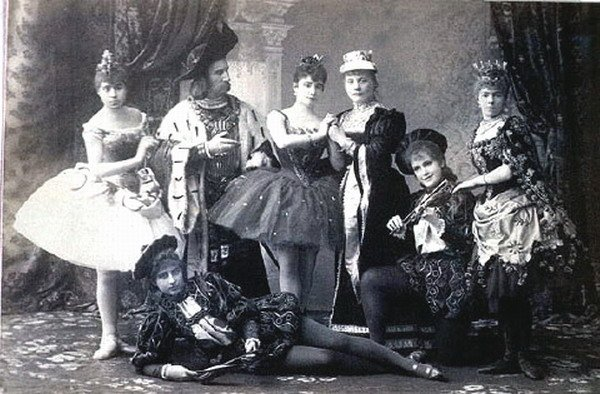
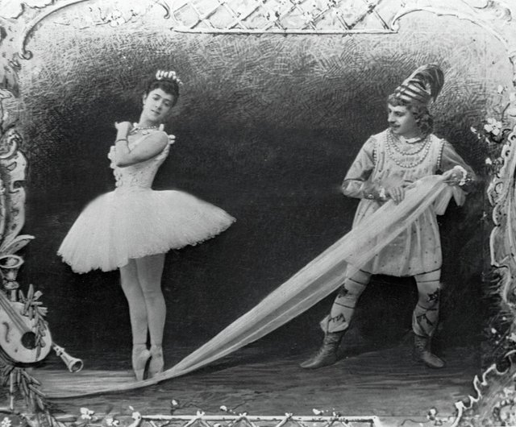
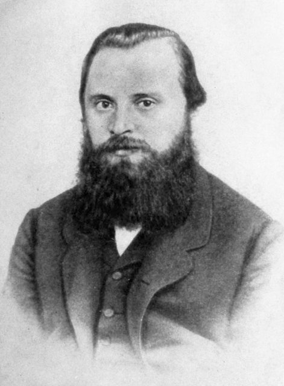
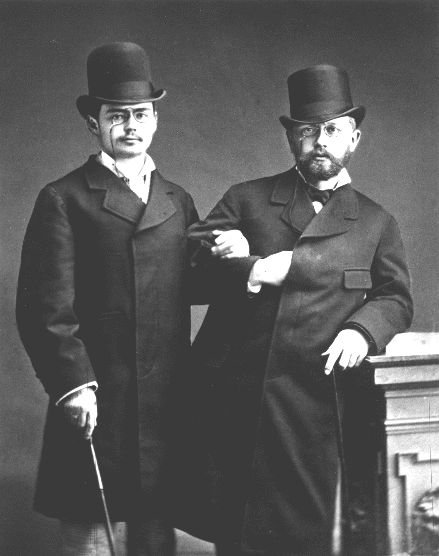

<!--
內容整理自本機筆記〈柴可夫斯基主要作品〉（D:\Books\md\音樂\柴可夫斯基主要作品.md，網頁版在知識圖譜的「5-2.音樂家作品」），做法比照「貝多芬主要作品」。
- 每首作品一則事件，日期採「創作時間」（多年創作的作品以區間呈現；「年代」以十年計、「世紀」以百年計，修訂或出版年份只寫在顯示文字裡），事件顏色依筆記的類別段落區分：交響曲、芭蕾舞劇、序曲、交響幻想曲與其他管弦樂作品、鋼琴協奏曲與其他協奏作品、歌劇、室內樂、鋼琴獨奏作品、藝術歌曲與聲樂作品。
- 「約」、「前後」、修訂、出版等不是單純年份的寫法，以原文作為顯示文字。
- 作品編號是目錄編號，不等於創作順序，時間軸依創作時間排序。
- 時期沿用「柴可夫斯基生平」時間軸的主要時期（重疊的細分時期不列）。
- 筆記「優先聆聽」清單中的作品另註明順序。
- 以 follows 排在「柴可夫斯基生平」之後；生平事件見該時間軸。
圖片來源（皆為 Wikimedia Commons 公有領域作品；註明「共用」者沿用生平時間軸的圖片）：
- tchaikovsky-1877-swan-lake.jpg（《天鵝湖》早期演出的舞台（與柴可夫斯基生平共用））
- tchaikovsky-1890-sleeping-beauty.jpg（1890年《睡美人》首演的演員（與柴可夫斯基生平共用））
- tchaikovsky-1892-nutcracker.jpg（1892年《胡桃鉗》首演（與柴可夫斯基生平共用））
- tchaikovsky-1869-balakirev.jpg（建議柴可夫斯基創作此曲、並接受題獻的巴拉基列夫（與柴可夫斯基生平共用））
- tchaikovsky-1877-kotek.jpg（柴可夫斯基與協助他寫作小提琴協奏曲的小提琴家柯特克（與柴可夫斯基生平共用））
-->

# Periods
- 1840 ~ 1850 | 童年@沃特金斯克
  父親是礦業局的中校工程師，負責管理鐵工廠。他4歲半就堅持要跟哥哥一起上法籍家庭教師的課，6歲已精通法語和德語；5歲開始學鋼琴，不到三年視譜能力就追上老師。
- 1850 ~ 1859 | 帝國法學院@Saint Petersburg
  10歲被送到離家1,300公里的聖彼得堡讀法學院，準備當公務員。與母親的分離成為他一生的創傷，14歲時母親又死於霍亂。
- 1859 ~ 1865 | 公務員與音樂學院
  在司法部當了三年小公務員，同時到俄羅斯音樂協會上課，成為聖彼得堡音樂學院的第一屆學生，跟安東·魯賓斯坦學作曲。
- 1866 ~ 1877 | 莫斯科音樂學院教授@Moscow
  應尼古拉·魯賓斯坦之邀到莫斯科音樂學院教樂理，兼寫樂評。在「俄國五人組」與學院派之間保持獨立，寫出《羅密歐與茱麗葉》、第一號鋼琴協奏曲、《天鵝湖》等作品。
- 1877 ~ 1884 | 婚姻破裂與流浪歲月
  一場只維持兩個半月的婚姻讓他身心崩潰。此後靠著梅克夫人的贊助專心作曲，獨自在歐洲與俄國鄉間四處旅行，避開社交，完成《奧涅金》、小提琴協奏曲與《1812序曲》。
- 1884 ~ 1893 | 國際聲望的巔峰
  獲沙皇授勳與終身年金，成為事實上的宮廷作曲家。克服怯場站上指揮台，巡迴歐美，寫下《睡美人》、《黑桃皇后》、《胡桃鉗》與第六號交響曲「悲愴」。

# Events

## 1866 | Op. 13；TH 24 第 1 號交響曲《冬日之夢》（Winter Daydreams），G 小調 {color=#c92a2a label="1866；1868修訂"}
類別：交響曲（交響曲）。

## 1872 | Op. 17；TH 25 第 2 號交響曲《小俄羅斯》（Little Russian），C 小調 {color=#c92a2a label="1872；1879–1880修訂"}
類別：交響曲（交響曲）。

## 1875 | Op. 29；TH 26 第 3 號交響曲《波蘭》（Polish），D 大調 {color=#c92a2a}
類別：交響曲（交響曲）。

## 1877 ~ 1878 | Op. 36；TH 27 第 4 號交響曲，F 小調 {color=#c92a2a}
類別：交響曲（交響曲）。

## 1885 | Op. 58；TH 28 《曼弗雷德交響曲》，B 小調 {color=#c92a2a}
類別：標題交響曲（交響曲）。

## 1888 | Op. 64；TH 29 第 5 號交響曲，E 小調 {color=#c92a2a}
類別：交響曲（交響曲）。入門推薦聆聽第 7 首。

## 1893 | Op. 74；TH 30 第 6 號交響曲《悲愴》（Pathétique），B 小調 {color=#c92a2a}
類別：交響曲（交響曲）。入門推薦聆聽第 3 首。

## 1892 ~ 1893 | 未完成；與《悲愴》相關的構想 第 7 號交響曲構想及未完成素材 {color=#c92a2a}
類別：未完成交響曲素材（交響曲）。

## 1875 ~ 1876 | Op. 20；TH 12 《天鵝湖》（Swan Lake） {color=#1971c2}

類別：芭蕾舞劇（芭蕾舞劇）。入門推薦聆聽第 1 首。

## 1888 ~ 1889 | Op. 66；TH 13 《睡美人》（The Sleeping Beauty） {color=#1971c2}

類別：芭蕾舞劇（芭蕾舞劇）。

## 1891 ~ 1892 | Op. 71；TH 14 《胡桃鉗》（The Nutcracker） {color=#1971c2}

類別：芭蕾舞劇（芭蕾舞劇）。入門推薦聆聽第 2 首。

## 1892 | Op. 71a 《胡桃鉗》組曲 {color=#1971c2}
類別：芭蕾組曲（芭蕾舞劇）。

## 1869 | 無 Op.；TH 46 《羅密歐與茱麗葉》幻想序曲 {color=#e67700 label="1869；1870、1880修訂"}

類別：交響幻想曲（序曲、交響幻想曲與其他管弦樂作品）。

## 1873 | Op. 18；TH 35 《暴風雨》（The Tempest） {color=#e67700}
類別：交響幻想曲（序曲、交響幻想曲與其他管弦樂作品）。

## 1875 | Op. 26；TH 56 降 B 小調《憂鬱小夜曲》（Sérénade mélancolique） {color=#e67700}
類別：小提琴與管弦樂（序曲、交響幻想曲與其他管弦樂作品）。

## 1876 | Op. 32；TH 42 《法蘭切斯卡・達・里米尼》（Francesca da Rimini） {color=#e67700}
類別：交響幻想曲（序曲、交響幻想曲與其他管弦樂作品）。

## 1875 ~ 1876 | Op. 37a；TH 135 《四季》（The Seasons） {color=#e67700}
類別：鋼琴套曲（序曲、交響幻想曲與其他管弦樂作品）。入門推薦聆聽第 9 首。

## 1878 ~ 1879 | Op. 43；TH 50 第一號管弦樂組曲 {color=#e67700}
類別：管弦樂組曲（序曲、交響幻想曲與其他管弦樂作品）。

## 1880 | Op. 45；TH 51 《義大利隨想曲》（Capriccio Italien） {color=#e67700}
類別：管弦樂幻想曲（序曲、交響幻想曲與其他管弦樂作品）。

## 1880 | Op. 49；TH 53 《1812 序曲》 {color=#e67700}
類別：節慶序曲（序曲、交響幻想曲與其他管弦樂作品）。入門推薦聆聽第 8 首。

## 1885 | Op. 58；TH 28 《曼弗雷德交響曲》 {color=#e67700}
類別：標題交響曲（序曲、交響幻想曲與其他管弦樂作品）。

## 1887 | Op. 61；TH 62 《莫札特風格》（Mozartiana） {color=#e67700}
類別：管弦樂組曲（序曲、交響幻想曲與其他管弦樂作品）。

## 1888 | Op. 67a；TH 67 《哈姆雷特》幻想序曲 {color=#e67700}
類別：戲劇序曲（序曲、交響幻想曲與其他管弦樂作品）。

## 1864 ~ 1873 | Op. 76；TH 66 《暴風雨》相關戲劇序曲版本 {color=#e67700 label="1864–1873，版本需區分"}
類別：管弦樂作品（序曲、交響幻想曲與其他管弦樂作品）。

## 1874 ~ 1875 | Op. 23；TH 55 第 1 號鋼琴協奏曲，降 B 小調 {color=#2f9e44 label="1874–1875；後修訂"}
類別：鋼琴協奏曲（鋼琴協奏曲與其他協奏作品）。入門推薦聆聽第 4 首。

## 1875 | Op. 26；TH 56 《憂鬱小夜曲》，降 B 小調 {color=#2f9e44}
類別：小提琴與管弦樂（鋼琴協奏曲與其他協奏作品）。

## 1876 ~ 1877 | Op. 33；TH 57 A 大調《洛可可主題變奏曲》 {color=#2f9e44}
類別：大提琴與管弦樂（鋼琴協奏曲與其他協奏作品）。

## 1878 | Op. 35；TH 59 D 大調小提琴協奏曲 {color=#2f9e44}

類別：小提琴協奏曲（鋼琴協奏曲與其他協奏作品）。入門推薦聆聽第 5 首。

## 1879 ~ 1880 | Op. 44；TH 60 第 2 號鋼琴協奏曲，G 大調 {color=#2f9e44}
類別：鋼琴協奏曲（鋼琴協奏曲與其他協奏作品）。

## 1884 | Op. 56；TH 61 G 大調《音樂會幻想曲》（Concert Fantasia） {color=#2f9e44}
類別：鋼琴與管弦樂（鋼琴協奏曲與其他協奏作品）。

## 1887 | Op. 62；TH 62 b 小調《隨想曲》（Pezzo capriccioso） {color=#2f9e44}
類別：大提琴與管弦樂（鋼琴協奏曲與其他協奏作品）。

## 1893 | Op. 75；TH 65 第 3 號鋼琴協奏曲，降 E 大調 {color=#2f9e44}
類別：鋼琴協奏曲素材；版本與完成狀態需區分（鋼琴協奏曲與其他協奏作品）。

## 1867 ~ 1868 | Op. 3；TH 1 《沃耶沃達》（The Voyevoda） {color=#862e9c}
類別：歌劇（歌劇）。

## 1869 | TH 2 《溫蒂娜》（Undina） {color=#862e9c label="1869；後來撤回或銷毀大部分樂譜"}
類別：歌劇（歌劇）。

## 1870 ~ 1872 | TH 3 《禁衛軍》（The Oprichnik） {color=#862e9c}
類別：歌劇（歌劇）。

## 1874 | Op. 14；TH 4 《瓦庫拉鐵匠》（Vakula the Smith） {color=#862e9c}
類別：喜歌劇（歌劇）。

## 1877 ~ 1878 | Op. 24；TH 5 《尤金・奧涅金》（Eugene Onegin） {color=#862e9c}
類別：抒情歌劇（歌劇）。入門推薦聆聽第 10 首。

## 1878 ~ 1879 | TH 6 《奧爾良的少女》（The Maid of Orleans） {color=#862e9c}
類別：歌劇（歌劇）。

## 1881 ~ 1883 | TH 7 《馬捷帕》（Mazeppa） {color=#862e9c}
類別：歌劇（歌劇）。

## 1885 | TH 8 《切列維奇基》（Cherevichki） {color=#862e9c}
類別：喜歌劇（歌劇）。

## 1885 ~ 1887 | TH 9 《女巫》（The Enchantress） {color=#862e9c}
類別：歌劇（歌劇）。

## 1890 | Op. 68；TH 10 《黑桃皇后》（The Queen of Spades） {color=#862e9c}
類別：歌劇（歌劇）。

## 1891 | Op. 69；TH 11 《約蘭塔》（Iolanta） {color=#862e9c}
類別：抒情歌劇（歌劇）。

## 1871 | Op. 11；TH 36 D 大調第一號弦樂四重奏 {color=#0c8599}
類別：弦樂四重奏（室內樂）。

## 1873 | Op. 22；TH 42 F 大調第二號弦樂四重奏 {color=#0c8599}
類別：弦樂四重奏（室內樂）。

## 1876 | Op. 30；TH 47 降 E 小調第三號弦樂四重奏 {color=#0c8599}
類別：弦樂四重奏（室內樂）。

## 1881 ~ 1882 | Op. 50；TH 56 a 小調《偉大藝術家的回憶》（In Memory of a Great Artist） {color=#0c8599}
類別：鋼琴三重奏（室內樂）。

## 1890 | Op. 70；TH 64 d 小調《佛羅倫斯的回憶》（Souvenir de Florence） {color=#0c8599 label="1890；1891修訂"}
類別：弦樂六重奏（室內樂）。入門推薦聆聽第 12 首。

## 1865 | TH 117 降 B 大調弦樂四重奏片段 {color=#0c8599}
類別：早期室內樂（室內樂）。

## 1867 | Op. 2 《哈普薩爾回憶》（Souvenir de Hapsal） {color=#5f3dc4}
類別：鋼琴小品集（鋼琴獨奏作品）。

## 1868 | Op. 5 F 小調《浪漫曲》 {color=#5f3dc4}
類別：鋼琴獨奏（鋼琴獨奏作品）。

## 1873 | Op. 19 六首鋼琴小品 {color=#5f3dc4}
類別：鋼琴小品集（鋼琴獨奏作品）。

## 1875 ~ 1876 | Op. 37a；TH 135 《四季》（The Seasons，十二首性格小品） {color=#5f3dc4}
類別：鋼琴套曲（鋼琴獨奏作品）。入門推薦聆聽第 9 首。

## 1878 | Op. 37b G 大調《大奏鳴曲》 {color=#5f3dc4}
類別：鋼琴奏鳴曲（鋼琴獨奏作品）。

## 1878 | Op. 40 十二首中等難度鋼琴小品 {color=#5f3dc4}
類別：鋼琴小品集（鋼琴獨奏作品）。

## 1882 | Op. 51 六首鋼琴小品 {color=#5f3dc4}
類別：鋼琴小品集（鋼琴獨奏作品）。

## 1893 | Op. 72 十八首鋼琴小品 {color=#5f3dc4}
類別：鋼琴小品集（鋼琴獨奏作品）。

## 1869 | Op. 6 六首浪漫曲（Six Romances） {color=#a61e4d}
類別：藝術歌曲（藝術歌曲與聲樂作品）。

## 1872 | Op. 16 六首歌曲 {color=#a61e4d}
類別：藝術歌曲（藝術歌曲與聲樂作品）。

## 1874 | Op. 25 六首歌曲 {color=#a61e4d}
類別：藝術歌曲（藝術歌曲與聲樂作品）。

## 1875 | Op. 27 六首歌曲 {color=#a61e4d}
類別：藝術歌曲（藝術歌曲與聲樂作品）。

## 1878 | Op. 38 六首歌曲 {color=#a61e4d}
類別：藝術歌曲（藝術歌曲與聲樂作品）。

## 1880 | Op. 47 七首歌曲 {color=#a61e4d}
類別：藝術歌曲（藝術歌曲與聲樂作品）。

## 1883 | Op. 54 十二首兒童歌曲 {color=#a61e4d}
類別：兒童歌曲（藝術歌曲與聲樂作品）。

## 1886 | Op. 60 六首歌曲 {color=#a61e4d}
類別：藝術歌曲（藝術歌曲與聲樂作品）。

## 1887 | Op. 63 六首歌曲 {color=#a61e4d}
類別：藝術歌曲（藝術歌曲與聲樂作品）。

## 1893 | Op. 73 六首歌曲 {color=#a61e4d}
類別：藝術歌曲（藝術歌曲與聲樂作品）。
