<!--
內容整理自本機筆記《戲劇史》（D:\Books\md\歷史\文化史\戲劇史，網頁版在知識圖譜的「9-4.戲劇史」），做法比照「音樂史」。
- 每個年份檔各成一則事件，說明採用該檔的「案件摘要」；結尾以「→ 對外連結」連到知識圖譜上的完整案件卷宗（在新分頁開啟）。
- 時期大致依 README 的段落，但 README 把1898年以後的二十世紀事件也列在「十八與十九世紀」之下，這裡另分出「二十世紀」（自莫斯科藝術劇院起）；起訖年以各段第一個事件為界，古希臘羅馬以西羅馬滅亡（476）為界。README 的「中世紀與東亞古典」也收錄了1603阿國歌舞伎、1629女形禁令，在時間軸上它們依年代落在「文藝復興與十七世紀」。
- -0534-酒神競賽與悲劇誕生是「開篇探案」，和同年的-0534-雅典悲劇競賽是同一事件，只在該事件附上它的連結。
圖片來源（皆為 Wikimedia Commons 公有領域／CC0 作品；註明「共用」者沿用其他時間軸已有的圖片）：
- th-masks.jpg：Mosaic depicting theatrical masks of Tragedy and Comedy (Thermae Decianae).jpg（羅馬馬賽克上的悲劇與喜劇面具）
- th-pronomos.jpg：Griechische Vasenmalerei, Taflen - A. Furtwangler, K Reichhold.jpg（「普洛諾摩斯陶瓶」上準備演出薩提爾劇的演員與酒神（摹繪））
- th-aristotle.jpg：Aristotle Altemps Inv8575.jpg（亞里斯多德胸像，阿爾坦普斯宮）
- th-menander.jpg：Samia (Girl from Samos) Mytilene 3cAD.jpg（米蒂利尼出土的馬賽克，描繪米南德喜劇《薩摩斯女子》的一景，3世紀）
- th-valenciennes.jpg：Valenciennes-stage-bnf-ms-fr-12536-f1v-2.jpg（1547年瓦朗謝訥受難劇的舞台，一字排開的「景站」）
- th-fushikaden.jpg：Sousetsubon fushikaden 7 part.PNG（《風姿花傳》的古抄本）
- th-commedia.jpg：Stefanello Bottarga, grabado s.XVII.JPG（即興喜劇的潘塔洛內（Stefanello Bottarga），17世紀版畫）
- th-swan.jpg：Swan-theatre-johannes-de-witt-ms-842-f132r-1596.jpg（德維特1596年所繪倫敦天鵝劇院的內部）
- th-globe.jpg：The Globe Theatre from the Long Antwerp View of London.jpg（霍拉《倫敦長景圖》中的第二座環球劇院）
- th-hamlet.jpg：Hamlet Q1 Frontispiece 1603.jpg（《哈姆雷特》1603年第一四開本書名頁）
- th-okuni.jpg：Okuni kabuki byobu-zu cropped.jpg（〈阿國歌舞伎圖屏風〉（局部））
- th-lear.jpg：Ford Madox Brown - King Lear - 2013.261 - Cleveland Museum of Art.jpg（福特·馬多克斯·布朗〈李爾王與寇蒂莉亞〉）
- th-onnagata.jpg：The actors Sawamura Sojuro III as Minamoto no Yoritomo, Yamashita Mangiku as Mas (5759418418).jpg（歌舞伎役者繪，女形演員山下萬菊（右））
- th-lecid.jpg：3402440-Le Cid performed in Paris 1637-Burgos.jpg（1637年《熙德》在巴黎演出的版畫）
- th-moliere.jpg：Molière Mignard Chantilly.jpg（米尼亞爾所繪莫里哀像）
- th-comedie.jpg：Detail of French and Italian Comedians, 1670 Comédie-Française.jpg（〈法國與義大利的喜劇演員〉（局部），1670，法蘭西喜劇院藏）
- th-sonezaki.jpg：Sonezaki.jpg（《曾根崎心中》的插圖）
- th-goldoni.jpg：Alessandro Longhi - Ritratto di Goldoni.jpg（亞歷山德羅·隆吉所繪哥爾多尼像）
- th-lessing.jpg：PPN663946352 G. E. Lessing (1772).jpg（萊辛像，1772）
- th-peking.jpg：Тринадцать великих актёров поздней Цин.jpg（沈蓉圃〈同光名伶十三絕〉）
- th-faust.jpg：Faust, Titelblatt der Erstausgabe.jpg（《浮士德》第一部1808年初版書名頁）
- th-hernani.jpg：Besnard, Albert - La première d'Hernani. Avant la bataille - 196 - Maison de Victor Hugo.jpg（貝斯納〈《歐那尼》首演：開戰之前〉）
- th-nora.jpg：Betty Hennings Nora 1.jpg（1879年哥本哈根首演中飾演娜拉的貝蒂·亨寧斯）
- th-antoine.jpg：Répétition de la Sérénade de Jean Jullien, au Théâtre-Libre.jpg（自由劇院的排練）
- th-salome.jpg：Aubrey Beardsley - The Climax.jpg（比亞茲萊為《莎樂美》繪製的插畫〈高潮〉）
- th-seagull.jpg：Anton Chekhov reads The Seagull.jpg（契訶夫為莫斯科藝術劇院的演員朗讀《海鷗》，1898）
- th-meilanfang.jpg：Mei Lanfang performing at Tianchan Theatre.jpg（梅蘭芳在天蟾舞台演出）
- th-artaud.jpg：Antonin Artaud 1926.jpg（亞陶，1926）
-->

# Periods
- -534 ~ 476 | 古希臘羅馬：劇場的發明 | #b08900
  雅典以酒神祭的名義設立悲劇競賽，埃斯庫羅斯、歐里庇得斯的悲劇與亞里斯多德的《詩學》奠定西方戲劇的基礎；米南德的新喜劇與普勞圖斯的羅馬喜劇則把劇場變成節慶娛樂產業。
- 476 ~ 1545 | 中世紀與東亞古典 | #2f9e44
  歐洲的戲劇在修道院祭台旁重生，再由行會接手成為廣場上的神蹟劇與循環劇；東亞則有唐代參軍戲、溫州南戲，以及觀阿彌、世阿彌在幕府支持下完成的能劇與《風姿花傳》。
- 1545 ~ 1740 | 文藝復興與十七世紀 | #1971c2
  義大利即興喜劇的職業戲班、倫敦的商業劇院與莎士比亞，法國的高乃依、莫里哀、拉辛與第一家國家劇院；日本則誕生歌舞伎與近松門左衛門的淨琉璃。
- 1740 ~ 1898 | 十八與十九世紀 | #862e9c
  哥爾多尼改革喜劇、萊辛開創市民悲劇與劇評，徽班進京開啟京劇；歌德的《浮士德》與雨果的《歐那尼》掀起浪漫主義，易卜生的《玩偶之家》與安托萬的自由劇院則走向寫實與導演制。
- 1898 ~ 2000 | 二十世紀 | #c92a2a
  史坦尼斯拉夫斯基的表演體系、布萊希特的史詩劇場、亞陶的殘酷劇場、貝克特的荒謬劇場、葛羅托斯基的貧窮劇場輪番改寫劇場；中國話劇從春柳社走到曹禺，梅蘭芳把京劇帶到美國，音樂劇則成為全球產業。
- 2000 ~ 2026 | 當代 | #0c8599
  紀實劇場以訪談為劇本，沉浸式劇場讓觀眾走進故事，疫情則讓劇院轉向串流與線上演出。

# Events

## -534 | 雅典悲劇競賽
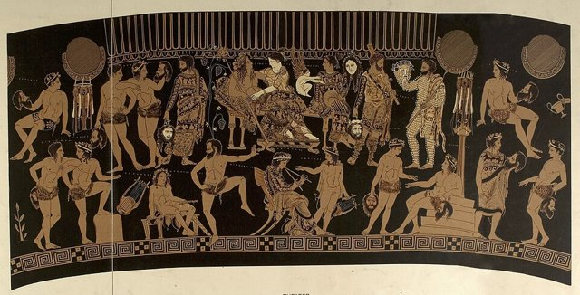
約西元前 534 年，雅典執政官官方檔案首次記載悲劇競賽（tragic agon）的優勝者：演員泰斯庇斯（Thespis of Icaria）奪冠。地點是雅典城內的酒神祭（City Dionysia），由僭主庇西特拉圖（Peisistratus）一手擴辦的國家級慶典。這是西方戲劇史上第一筆可查的「官方紀錄」——**悲劇從鄉村酒神遊行升格為國家資助的競賽制度，是政治工程與宗教工程的合謀結晶**。

[→ 對外連結：-0534 - 雅典悲劇競賽：國家用酒神的名義，發明了「戲劇」這門生意](https://chad-liu.github.io/books/html/9-4.戲劇史/-0534-雅典悲劇競賽.html)
[→ 對外連結（開篇探案）：-0534-酒神競賽與悲劇誕生](https://chad-liu.github.io/books/html/9-4.戲劇史/-0534-酒神競賽與悲劇誕生.html)

## -458 | 奧瑞斯提亞
西元前 458 年，埃斯庫羅斯（Aeschylus）以《奧瑞斯提亞》（The Oresteia）三部曲——《阿伽門農》《奠酒人》《福靈》——在雅典酒神祭競賽奪冠。全劇講阿特柔斯家族三代血仇：阿伽門農獻女、被妻子克呂泰涅斯特拉謀殺，其子奧瑞斯特斯弒母復仇、被復仇女神追殺，最後由雅典娜在戰神山法庭（Areopagus）主持審判，第一票平手、女神投下赦免一票。**這是戲劇史上第一次用一齣戲為一個城邦的政治制度做合法性論證——用神話審判，為現實法庭背書**。

[→ 對外連結：-0458 - 奧瑞斯提亞：殺母的血案，審判的是新生的雅典民主](https://chad-liu.github.io/books/html/9-4.戲劇史/-0458-奧瑞斯提亞.html)

## -431 | 美狄亞
西元前 431 年，歐里庇得斯（Euripides）的《美狄亞》（Medea）在雅典酒神祭競賽中只得到第三名（墊底）。劇情講外邦女巫美狄亞被丈夫伊阿宋（Jason）拋棄、將另娶科林斯公主，她先是毒殺公主與國王，最後親手殺死自己的兩個兒子以報復丈夫，然後乘赫利俄斯的龍車逃走。評審的判決與後世的判決完全相反——**這齣落選的戲，成了西方戲劇史上第一個把「人為什麼犯罪」寫到心理深處的案件卷宗**。

[→ 對外連結：-0431 - 美狄亞：殺了孩子的女人只拿第三名，卻寫下了第一份心理寫實檔案](https://chad-liu.github.io/books/html/9-4.戲劇史/-0431-美狄亞.html)

## -335 | 詩學
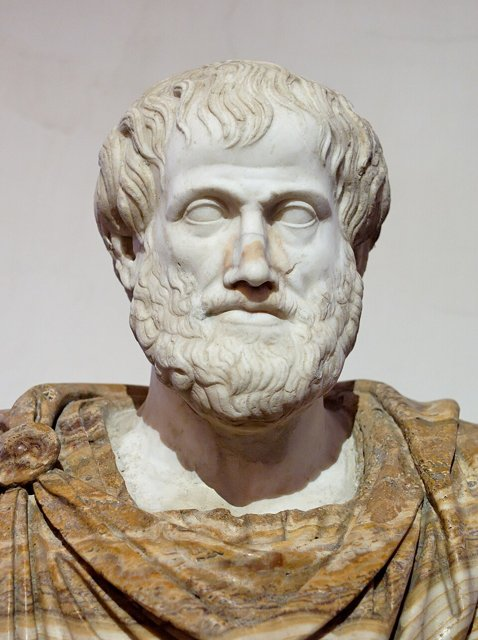
約西元前 335 年前後，亞里斯多德（Aristotle）在雅典呂克昂（Lyceum）學園講學，《詩學》（Poetics）即其講義式著作。全書現存二十六章，前半論悲劇：模仿（mimesis）的本質、情節是悲劇的靈魂、悲劇透過憐憫與恐懼完成「淨化」（catharsis）、以及「突轉」與「發現」的技術。**這不是一齣戲，而是一份「鑑識報告」——它解剖了希臘黃金時代的戲劇遺體，並把解剖結論寫成了未來兩千年的立法**。

[→ 對外連結：-0335 - 詩學：一冊講義殘卷，統治了歐洲戲劇理論兩千年](https://chad-liu.github.io/books/html/9-4.戲劇史/-0335-詩學.html)

## -316 | 新喜劇米南德
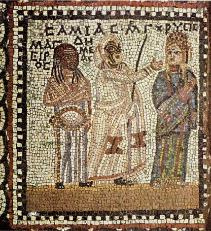
西元前 316 年，雅典劇作家米南德（Menander）以《恨世者》（Dyskolos，又譯《恨世者》《古怪人》）在勒奈亞節（Lenaea）戲劇競賽奪冠。劇情極簡：孤僻老農夫克涅蒙拒絕一切社交，富家公子蘇斯特拉托斯愛上他的女兒，經歷落井、誤會與自省，最終老夫改變心意、成全婚事。**在政治自由消亡的年代，戲劇棄城邦而選客廳——米南德把喜劇從政治諷刺改造成家庭倫理劇，這個模板統治了羅馬與歐洲喜劇近兩千年**。

[→ 對外連結：-0316 - 新喜劇米南德：政治退場之後，戲台只剩戀愛、家產與失散的嬰兒](https://chad-liu.github.io/books/html/9-4.戲劇史/-0316-新喜劇米南德.html)

## -240 | 普勞圖斯
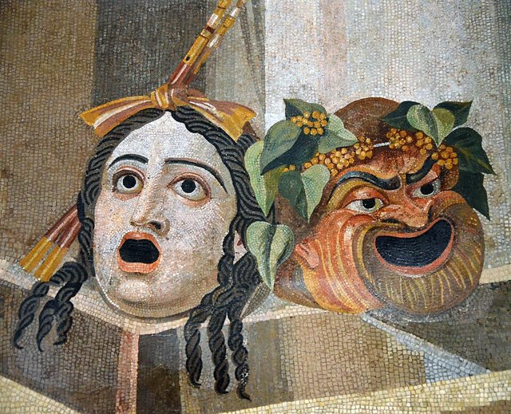
約西元前 240 年，羅馬首度舉辦有紀錄的戲劇演出（ Livius Andronicus 的拉丁譯劇），而真正把羅馬喜劇做成「產業」的是數十年後的提圖斯·馬克基烏斯·普勞圖斯（Titus Maccius Plautus）。他改編希臘新喜劇，寫出《一罐金子》《雙胞胎》（Menaechmi，即莎劇《錯誤的喜劇》的直接源頭）等逾百部滑稽劇，主角是狡猾奴隸、吝嗇老父、荒唐浪子。**羅馬人不再翻譯希臘，而是把希臘劇本拆解重組成笑聲流水線——這條流水線最終供貨到莎士比亞的倫敦**。

[→ 對外連結：-0240 - 普勞圖斯：羅馬節慶的笑聲工廠，供貨給莎士比亞的源頭](https://chad-liu.github.io/books/html/9-4.戲劇史/-0240-普勞圖斯.html)

## 700 | 參軍戲
唐代（約 7 至 10 世紀）宮廷流行一種兩人滑稽表演：一人扮「參軍」（被嘲弄的官員），一人扮「蒼鶻」（嘲弄者），以對答、打諢、插科逗趣諷刺時政，後世稱「參軍戲」。唐玄宗時宮廷設梨園、教坊，供養樂工優人數千，參軍戲是其中的滑稽項目。**中國戲曲的「腳色制」與「優人諷諫」傳統在此定型——兩個角色、一捧一逗，是後世雜劇與相聲的共同祖先**。

[→ 對外連結：0700 - 參軍戲：宮廷裡的兩人相聲，優人用笑聲罵皇帝](https://chad-liu.github.io/books/html/9-4.戲劇史/0700-參軍戲.html)

## 970 | 復活節彌撒劇
約 965 至 975 年間，英格蘭溫徹斯特（Winchester）主教埃塞爾沃爾德（Æthelwold）頒布《Regularis Concordia》（修道院統一規章），其中明文記載復活節晨禱時的儀式：三位修士扮天使守在祭台旁，唱「Quem quaeritis in sepulchro, Christicolae?」（你們在墳墓中尋找誰，敬拜基督的人？），扮聖女的修士答「Jesum Nazarenum crucifixum」（拿撒勒被釘十字架的耶穌）。**這三句問答是歐洲現存最早的儀式劇（liturgical drama）腳本——教會自己把戲劇重新放回了西方世界**。

[→ 對外連結：0970 - 復活節彌撒劇：修道院規章裡的三句對唱，歐洲戲劇的重新點火](https://chad-liu.github.io/books/html/9-4.戲劇史/0970-復活節彌撒劇.html)

## 1200 | 南戲
約 12 世紀中葉至 13 世紀初，浙江溫州（永嘉）一帶流行「戲文」（又稱溫州雜劇、永嘉雜劇），由村坊小曲、里巷歌謠發展為長篇代言體戲曲：分「齣」演出、生旦淨丑腳色俱全、以曲牌聯套演唱。《張協狀元》（現存最早南戲全本，一般定為南宋後期書會才人所編）講書生張協負心休妻、貧女遭難，最後團圓。**南戲是中國第一個完整戲曲體制——腳色、曲牌、戲文體例皆在此定型，比元雜劇更早，也活得更久**。

[→ 對外連結：1200 - 南戲：溫州村坊小曲，長成了中國第一個成熟戲曲體制](https://chad-liu.github.io/books/html/9-4.戲劇史/1200-南戲.html)

## 1264 | 聖體節神蹟劇
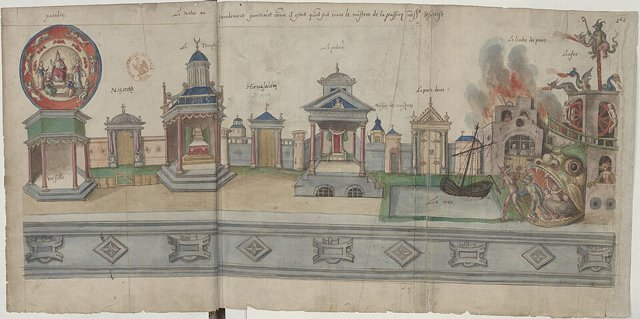
1264 年，教宗烏爾班四世（Urban IV）頒布詔書，設立聖體節（Feast of Corpus Christi），定於聖三主日後的星期四，全教會遊行慶祝聖體聖事。遊行與戲劇迅速結合：各城行會出資承辦聖經場景戲，在馬車舞台（pageant wagon）上沿街巡迴演出。**這是教會「放手」的關鍵案件——儀式劇從教堂祭台交到市民行會手中，戲劇第一次由城市大眾自己出資、自己演出、自己管理**。

[→ 對外連結：1264 - 聖體節神蹟劇：教宗設一個節日，歐洲城市把戲劇搬上馬車](https://chad-liu.github.io/books/html/9-4.戲劇史/1264-聖體節神蹟劇.html)

## 1374 | 觀阿彌與世阿彌
1374 年（應安七年），猿樂師觀阿彌（Kan'ami，観阿弥）攜年方十一歲的幼子世阿彌（Zeami）在京都今熊野社及河崎-{荘}-演出猿樂（sarugaku），足利義滿將軍（當時十七歲）親臨觀賞，大為賞識，隨即召二人入幕府奉公。**這是日本戲劇史上最關鍵的「伯樂案」——一位幕府將軍的個人品味，把猿樂從神社寺院的祭禮娛樂，拉進了武家政權的贊助體系，能樂的制度化由此起步**。

[→ 對外連結：1374 - 觀阿彌與世阿彌：將軍看了一場演出，能樂從此有了幕府贊助人](https://chad-liu.github.io/books/html/9-4.戲劇史/1374-觀阿彌與世阿彌.html)

## 1376 | 約克循環劇
1376 年，英格蘭約克市（York）市政卷宗（House Books）首次記載聖體節演出的組織細節：約克大約五十餘個工匠行會各自承辦一齣聖經場景戲，從上帝創世、挪亞方舟、耶穌受難到末日審判，組成完整循環劇（York Corpus Christi Cycle，又稱 York Cycle），在聖體節前後沿街巡迴於十二至十六個固定站點（stations）演出，戲台是可推動的馬車（pageant wagons）。**這是中世紀市民戲劇最完整的「檔案」——一座城市的宗教義務與自我治理，被寫進了同一份市政卷宗**。

[→ 對外連結：1376 - 約克循環劇：整座城市的工匠，一年演一次「創世到末日」](https://chad-liu.github.io/books/html/9-4.戲劇史/1376-約克循環劇.html)

## 1406 | 風姿花傳
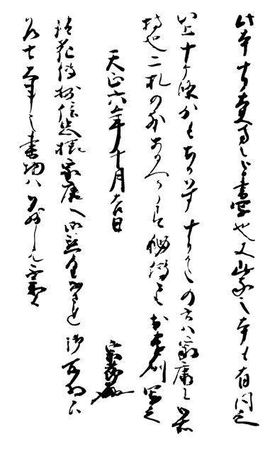
應永年間（1400 年前後起至 1418 年全書定本），世阿彌（Zeami，約 1363–約 1443）在京都與奈良之間的能舞台巡演之餘，陸續寫下《風姿花傳》七篇，前三篇（「各年齑別習物條條」、「物習條條」、「問答條條」）約於 1406 年前後完成。書中提出「花」（觀眾被吸引的瞬間魅力）與「幽玄」（優雅深遠之美）兩大美學核心，並以「秘則花為第一」宣示演技的至高法則。**這不是公開的戲劇教科書，而是一份用來壟斷技藝傳承的家元秘傳書——表演理論第一次被寫成家族世襲的資產。**

[→ 對外連結：1406 - 風姿花傳：室町幕府贊助下，能樂理論的秘傳之書誕生](https://chad-liu.github.io/books/html/9-4.戲劇史/1406-風姿花傳.html)

## 1545 | 即興喜劇
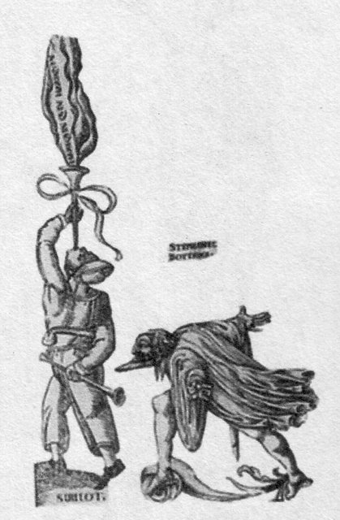
1545 年，帕多瓦（Padua）留下了現存最早記錄職業演員的契約文件：八名演員（其中馬菲奧·扎內利 Maffio Zanelli 名列其中）簽約組成劇團，載明每人的角色分工與收入分配。**這份契約宣告了義大利職業演員階層的誕生——此後一百年，即興喜劇（commedia dell'arte）用面具、定型角色與巡演路線，把戲劇從宮廷業餘遊戲變成跨歐洲的生意。**

[→ 對外連結：1545 - 即興喜劇：帕多瓦一紙演員契約，職業戲班與定型角色誕生](https://chad-liu.github.io/books/html/9-4.戲劇史/1545-即興喜劇.html)

## 1576 | 倫敦劇院
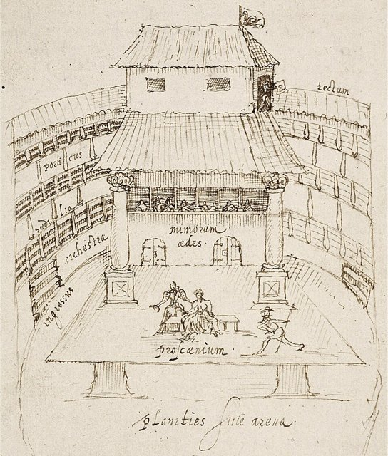
1576 年，木匠出身、後成為演員的詹姆斯·伯比奇（James Burbage，約 1531–1597）在倫敦城牆外肖爾迪奇（Shoreditch）的霍爾伯恩土地（向清教徒地磚商 Gyles Allen 租地 21 年）上，耗資約 700 鎊建造 The Theatre——英國第一座有成功營運紀錄的永久性商業劇場。**選址郊外不是偶然：市議會與清教徒仇視戲劇，伯比奇把劇場塞進司法管轄權的縫隙裡，商業劇場就誕生於這個法律夾層。**

[→ 對外連結：1576 - 倫敦劇院：伯比奇在肖爾迪奇郊外，蓋起英國第一座永久商業劇場](https://chad-liu.github.io/books/html/9-4.戲劇史/1576-倫敦劇院.html)

## 1587 | 馬洛
1587 年，克里斯托弗·馬洛（Christopher Marlowe，1564–1593）的《鐵布蘭大帝》（Tamburlaine the Great）在倫敦上演，由海軍大臣劇團（Lord Admiral's Men）在 The Theatre 等地演出。全劇以強勁的空白詩體（blank verse，五音步抑揚格無韻詩）寫草原征服者鐵木真的崛起，上、下兩部轟動一時。**「馬洛式壯麗詩句」（mighty line）首次證明空白詩可以撐起整齣商業大戲——這是英國詩劇從韻文鬧劇跨入英雄悲劇的分水嶺。**

[→ 對外連結：1587 - 馬洛：《鐵布蘭大帝》的空白詩英雄劇，點燃倫敦舞台](https://chad-liu.github.io/books/html/9-4.戲劇史/1587-馬洛.html)

## 1599 | 環球劇院
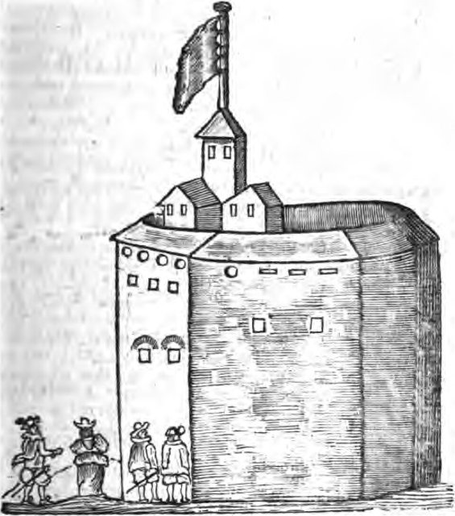
1599 年，宮內大臣劇團（Lord Chamberlain's Men）因 The Theatre 租約到期與地主 Giles Allen 爭訟失敗，遂由 Richard Burbage 領頭，在 1598 年聖誕節前後趁夜拆除 The Theatre 木材，運過泰晤士河，在南岸薩里郡 Bankside 建成環球劇院（Globe Theatre）。**這是一場用舊建材完成的搬遷行動——劇團成員自己出錢當股東（shareholder）蓋劇場，演員第一次成為劇場的資本家。**

[→ 對外連結：1599 - 環球劇院：拆舊劇院木材渡河，演員合夥人在南岸蓋起 Globe](https://chad-liu.github.io/books/html/9-4.戲劇史/1599-環球劇院.html)

## 1600 | 哈姆雷特
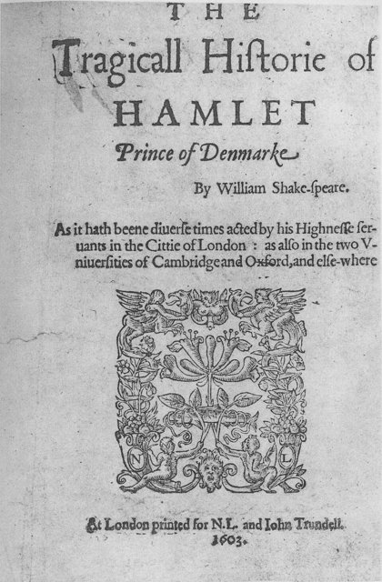
1600–1601 年間，莎士比亞（William Shakespeare，1564–1616）的《哈姆雷特》在環球劇院（Globe）上演，Richard Burbage 首演丹麥王子。全劇改寫當時氾濫的復仇劇（revenge tragedy）套路，以「生存還是毀滅」式的內心獨白（soliloquy）把復仇故事變成意識的劇場。**這不只是類型的集大成，而是一次釜底抽薪的改造：復仇被拖延，殺戮讓位給思考——英國戲劇自此有了內心。**

[→ 對外連結：1600 - 哈姆雷特：環球劇院上的復仇王子，與內心獨白的誕生](https://chad-liu.github.io/books/html/9-4.戲劇史/1600-哈姆雷特.html)

## 1603 | 阿國歌舞伎
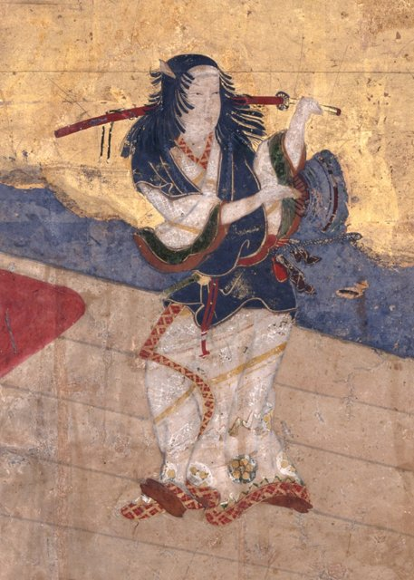
慶長八年（1603），出雲大社的巫女出雲阿國（Izumo no Okuni，生卒年不詳，約活躍於 1600–1610 年代）率領以遊女與美少年組成的班子，在京都鴨川河灘（四條河原一帶）與北野神社等地演出「傾奇踊」（kabuki odori）——她本人身著男裝、佩刀念佛舞，扮演俊男角色。**這場在官方權力管不到的河灘空地上爆發的「傾奇」表演，是日本商業娛樂從寺社庇護轉向都市民間市場的關鍵一跳。**

[→ 對外連結：1603 - 阿國歌舞伎：一名出雲女舞者在鴨川河灘，點燃了歌舞伎的火種](https://chad-liu.github.io/books/html/9-4.戲劇史/1603-阿國歌舞伎.html)

## 1606 | 李爾王
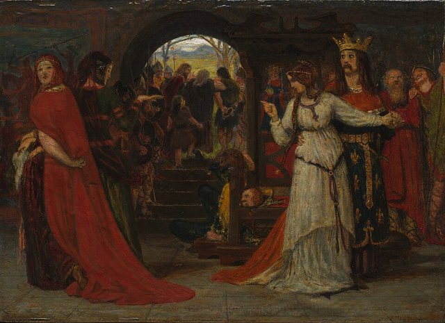
1606 年，莎士比亞（1564–1616）的《李爾王》與《馬克白》同年在環球劇院上演，並進入詹姆斯一世的宮廷演出（1606 年 12 月《李爾王》在 Whitehall 宮廷演出記錄見於劇團帳目）。兩劇分別處理王權崩解與弒君篡位，成為所謂「黑悲劇」（tragedy）的最暗處。**在聯合王國初立、繼承焦慮瀰漫的宮廷面前，莎翁把分裂的王國與被詛咒的蘇格蘭王搬上舞台——這是商業劇作家對新王權政治最精準的一次對焦。**

[→ 對外連結：1606 - 李爾王：詹姆斯一世宮廷之下，黑悲劇與王權焦慮的一年](https://chad-liu.github.io/books/html/9-4.戲劇史/1606-李爾王.html)

## 1629 | 女形禁令
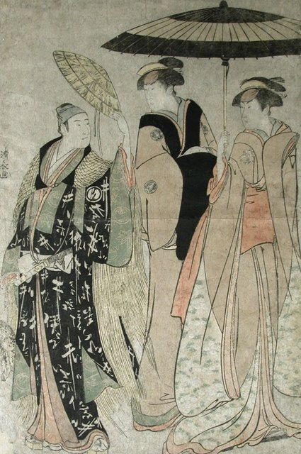
寬永六年（1629），江戶幕府以「擾亂風紀」為由，禁止女性登上歌舞伎舞台，遊女歌舞伎（遊女擔綱的色情歌舞劇）就此被禁。此後若眾歌舞伎（美少年歌舞伎）繼續盛行，幕府再於承應元年（1652）以同樣理由禁止若眾登台。**兩道禁令摧毀了以女色與男色為賣點的市場，卻意外逼出日本戲劇史上最精密的表演專業——由成年男性扮演女性的「女形」（onnagata）。**

[→ 對外連結：1629 - 女形禁令：幕府一紙風紀禁令，逼出男旦的專業技藝](https://chad-liu.github.io/books/html/9-4.戲劇史/1629-女形禁令.html)

## 1637 | 勒熙德論戰
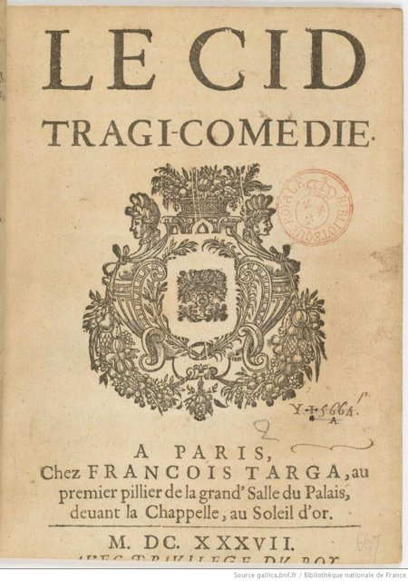
1637 年 1 月，高乃依（Pierre Corneille，1606–1684）的五幕悲喜劇《勒熙德》（Le Cid）在巴黎勃艮第府劇院（Hôtel de Bourgogne）首演，轟動全城，「美如勒熙德」（beau comme le Cid）成為流行語。同年，首演劇院劇作家團體向新成立的法蘭西學院檢舉該劇違反古典規則，首相黎塞留授意學院發表《學院對勒熙德的意見》（Sentiments de l'Académie sur le Cid，1637），批評其違反「三一律」與道德規範。**戲劇規則自此不再是學者的書房理論，而是被國家機構背書的官方標準——法國古典主義劇場由政府出手立法定規。**

[→ 對外連結：1637 - 勒熙德論戰：法蘭西學院出手，三一律被寫進國家機構](https://chad-liu.github.io/books/html/9-4.戲劇史/1637-勒熙德論戰.html)

## 1658 | 莫里哀
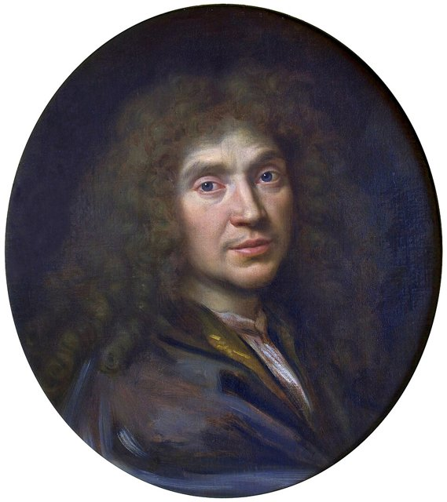
1658 年 10 月 24 日，莫里哀（Molière，本名 Jean-Baptiste Poquelin，1622–1673）率領漂泊十二年的「光耀劇團」（Illustre Théâtre 的殘部）重返巴黎，在羅浮宮衛士廳為路易十四（Louis XIV，1638–1715）演出悲劇失敗後，臨時加演自己的鬧劇《多情的醫生》（Le docteur amoureux）大獲成功。**一場倉促的加演改變了法國劇場史：國王看到了喜劇的價值，宮廷庇護隨之而來，莫里哀開啟了以王權套利為資金鏈的喜劇帝國。**

[→ 對外連結：1658 - 莫里哀：重返巴黎，在羅浮宮為路易十四演一齣鬧劇](https://chad-liu.github.io/books/html/9-4.戲劇史/1658-莫里哀.html)

## 1667 | 拉辛昂朵馬克
1667 年 11 月，年僅 27 歲的尚·拉辛（Jean Racine, 1639-1699）以《昂朵馬克》（Andromaque）在巴黎勃艮第府劇院（Hôtel de Bourgogne）首演，特洛伊遺孀昂朵馬克在仇人皮呂斯逼迫下的道德困境震動巴黎。**本案偵探式結論：拉辛不是在寫高乃依式的英雄意志，而是把激情當成化學試劑注入古典格律，證明受限的形式反而能炸出最猛烈的戲劇能量——法國古典悲劇的真正誕生，始於這一晚。**

[→ 對外連結：1667 - 拉辛《昂朵馬克》：激情成為悲劇的化學燃料](https://chad-liu.github.io/books/html/9-4.戲劇史/1667-拉辛昂朵馬克.html)

## 1680 | 法蘭西喜劇院
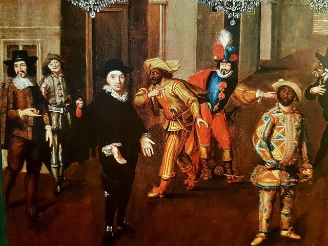
1680 年 8 月，路易十四（Louis XIV, 1638-1715）頒布敕令，將莫里哀遺孀率領的原莫里哀劇團（併入 Guénégaud 劇院者）與勃艮第府劇團合併，成立法蘭西喜劇院（Comédie-Française），同年 12 月 29 日在原 Guénégaud 劇院首演。**本案偵探式結論：這不是單純的劇團合併，而是王室用年金與特許把戲劇從流浪藝人的買賣收編為國家機構——「國家劇院」這個物種，從這紙敕令開始在全球繁殖。**

[→ 對外連結：1680 - 法蘭西喜劇院：世界第一家國家劇院的成立案](https://chad-liu.github.io/books/html/9-4.戲劇史/1680-法蘭西喜劇院.html)

## 1703 | 曾根崎心中
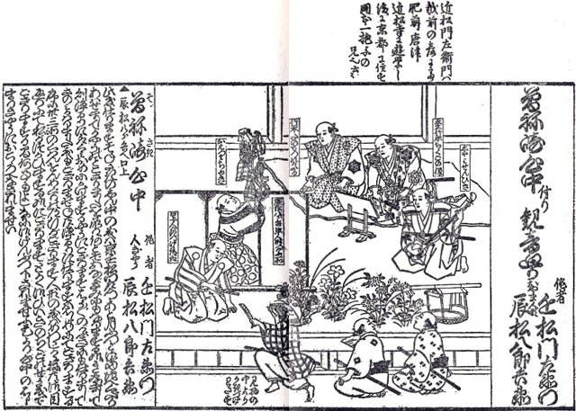
1703 年（元祿 16 年）4 月，近松門左衛門（Chikamatsu Monzaemon, 1653-1725）的《曾根崎心中》（Sonezaki Shinjū）在大阪竹本座首演，將同年 4 月 7 日天滿屋油屋町青樓女遊女阿初與醬油店店員德兵衛在大曾根崎露天神社樹林殉情的真實事件搬上淨琉璃舞台。**本案偵探式結論：這是媒體事件與劇場工業的第一次完美合謀——新聞性的市井死亡被藝術昇華為「義理與人情」的永恆母題，結果劇場反而成了殉情的示範教材，觀眾用生命為票房投票。**

[→ 對外連結：1703 - 《曾根崎心中》：真實殉情事件如何被劇場化並引發殉情風潮](https://chad-liu.github.io/books/html/9-4.戲劇史/1703-曾根崎心中.html)

## 1743 | 哥爾多尼
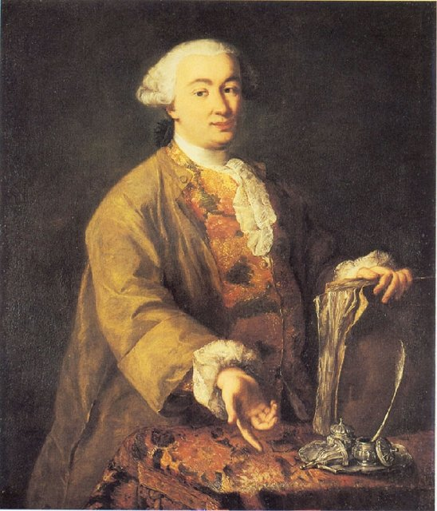
1743 年，卡洛·哥爾多尼（Carlo Goldoni, 1707-1793）在威尼斯寫出《一僕二主》（Il servitore di due padroni），為即興喜劇演員安東尼奧·薩基（Antonio Sacchi, 1708-1788）量身打造——表面上保留即興喜劇的套路，實際上把寫定腳本（commedia erudita）塞進特魯法爾迪諾（Truffaldino）的肚皮。**本案偵探式結論：哥爾多尼的改革不是文人對演員的革命，而是劇作家與明星演員的利益合夥——他用「保留骨架、填入血肉」的手術，逐步肢解了兩百年的即興喜劇帝國。**

[→ 對外連結：1743 - 哥爾多尼《一僕二主》：廢除即興的劇本革命案](https://chad-liu.github.io/books/html/9-4.戲劇史/1743-哥爾多尼.html)

## 1767 | 漢堡劇評
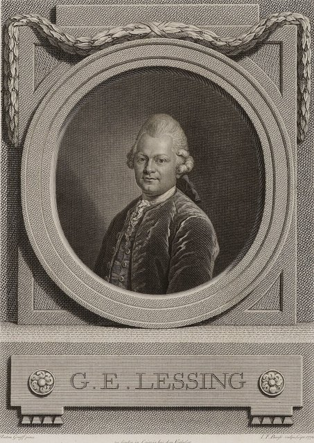
1767 年 4 月，漢堡企業家合夥創辦的「漢堡國家劇院」（Hamburgische Enterprise，德語區第一家不依賴宮廷的公民劇院）開幕，劇作家兼顧問戈特霍爾德·埃夫萊姆·萊辛（Gotthold Ephraim Lessing, 1729-1781）同步創刊《漢堡劇評》（Hamburgische Dramaturgie），逐場劇評演出。**本案偵探式結論：劇院試驗一年半就破產，但劇評活了下來——萊辛輸掉了劇場，卻贏得了話語權，市民階級第一次擁有了判斷戲劇的印刷機關，德國民族劇場的地基是報紙打的。**

[→ 對外連結：1767 - 萊辛《漢堡劇評》：劇評成為新權力的創刊案](https://chad-liu.github.io/books/html/9-4.戲劇史/1767-漢堡劇評.html)

## 1790 | 徽班進京
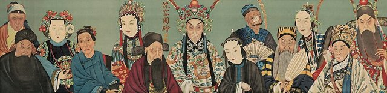
1790 年（乾隆五十五年）秋，為慶祝乾隆帝（愛新覺羅弘曆, 1711-1799）八十大壽，揚州鹽商江鶴亭徵集以高朗亭（約 1774-？）為首的「三慶徽班」入京祝釐，隨後四喜、春台、和春相繼進京，史稱「四大徽班」。**本案偵探式結論：這場祝壽大典是宮廷與鹽商資本合資的一齣大戲——徽調進京後與漢調合流、吸盡崑曲與秦腔的骨血，在京劇成形過程中，紫禁城出場費、鹽商包廂與茶園觀眾三方合力，鑄造了未來中國劇場兩百年的主角。**

[→ 對外連結：1790 - 徽班進京：京劇從宮廷誕生的成型案](https://chad-liu.github.io/books/html/9-4.戲劇史/1790-徽班進京.html)

## 1808 | 浮士德
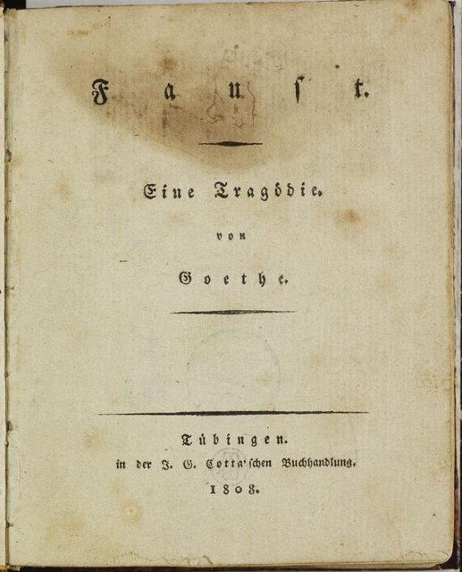
1808 年，約翰·沃爾夫岡·馮·歌德（Johann Wolfgang von Goethe, 1749-1832）在《全集》第八、九卷中正式出版《浮士德，一部悲劇》第一部（Faust. Der Tragödie erster Teil），把自 1770 年代「浮士德」草稿以來近四十年的碎片統合付印。**本案偵探式結論：這不是一齣戲的出版，而是一部總綱的發行——碎片化的結構、知識分子的魔障、格蕾琴的市民悲劇，為整個歐洲浪漫主義提供了劇本模板，其輻射力透過魏瑪宮廷劇院的舞台，直達後世的歌劇與現代戲劇。**

[→ 對外連結：1808 - 歌德《浮士德第一部》出版：浪漫主義總綱的發行案](https://chad-liu.github.io/books/html/9-4.戲劇史/1808-浮士德.html)

## 1830 | 歐那尼之戰
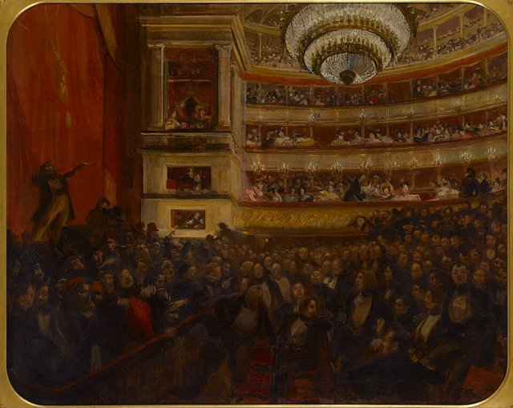
1830 年 2 月 25 日晚，維克多·雨果（Victor Hugo, 1802-1885）的《歐那尼》（Hernani）在法蘭西喜劇院首演，古典派觀眾與浪漫派青年在包廂與樓座間互相叫罵嘶吼，首演夜演變成長達數週的劇院大戰。**本案偵探式結論：這不只是一場首演，而是一場階級與美學的巷戰預演——浪漫派把劇院當成街壘，用鼓掌節奏對抗噓聲，五個月後七月革命的槍聲只是在同一座城市延續了這場戰爭。**

[→ 對外連結：1830 - 歐那尼之戰：法蘭西喜劇院首演夜的劇院大戰](https://chad-liu.github.io/books/html/9-4.戲劇史/1830-歐那尼之戰.html)

## 1879 | 玩偶之家
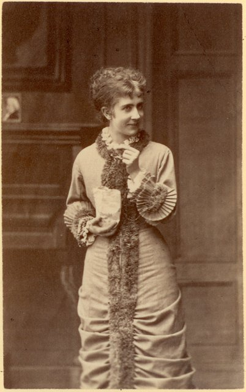
1879年12月21日，易卜生（Henrik Ibsen）的《玩偶之家》（Et dukkehjem）在哥本哈根皇家劇院首演，娜拉（Nora）在劇末與丈夫海爾茂（Helmer）對質後離家，幕落於一聲摔門。地點雖在丹麥，劇本卻由挪威出版商 Gyldendal（金慈達爾）於同年12月出版。這齣戲表面寫家庭糾紛，實則是一樁**偵探式的「社會謀殺案」——兇手不是任何個人，而是把妻子當作玩偶的中產階級婚姻制度本身**。

[→ 對外連結：1879 - 玩偶之家：一記摔門聲，震垮了整個十九世紀的客廳](https://chad-liu.github.io/books/html/9-4.戲劇史/1879-玩偶之家.html)

## 1887 | 自由劇院
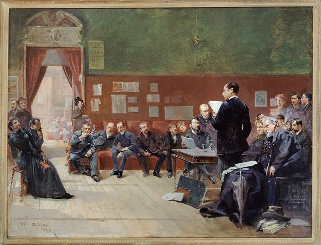
1887年3月30日，安托萬（André Antoine）在巴黎 Élysée-Palais 路的臨時場地創立「自由劇院」（Théâtre Libre），後遷至蒙馬特的地下室場地演出。它不賣長期座票、只以會員制（cercle）形式規避國家審查，專演左拉式自然主義劇作與被正規劇院拒收的劇本。**偵探式論點：這不是一家劇院，而是一場「制度越獄」——用私人俱樂部的外殼，走私公共劇場的革命**。

[→ 對外連結：1887 - 自由劇院：巴黎一家收費站旁的地下室，偷走了正規劇院的特權](https://chad-liu.github.io/books/html/9-4.戲劇史/1887-自由劇院.html)

## 1893 | 莎樂美
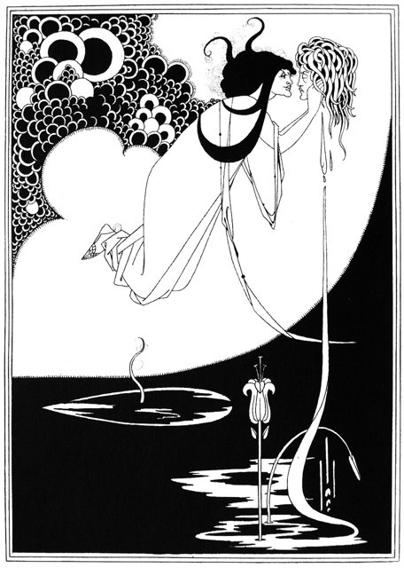
1893年2月，王爾德（Oscar Wilde）以法文寫成的獨幕劇《莎樂美》（Salomé）在巴黎 théâtre de l'Œuvre（作品劇院，呂尼埃–波埃 Lugné-Poë 主持）首演。此劇原定1892年6月在倫敦由女演員 Sarah Bernhardt 主演，卻在排練期間遭英國國家審查官（Lord Chamberlain，宮務大臣）以「不准呈現聖經人物」為由禁演。**偵探式論點：這是英國審查制度的「完美犯罪」——禁演令反而成為最有效的廣告，把一齣小戲推成世紀末頹廢美學的圖騰**。

[→ 對外連結：1893 - 莎樂美：一場被查禁的獨幕劇，養活了整個世紀末的頹廢想像](https://chad-liu.github.io/books/html/9-4.戲劇史/1893-莎樂美.html)

## 1898 | 莫斯科藝術劇院
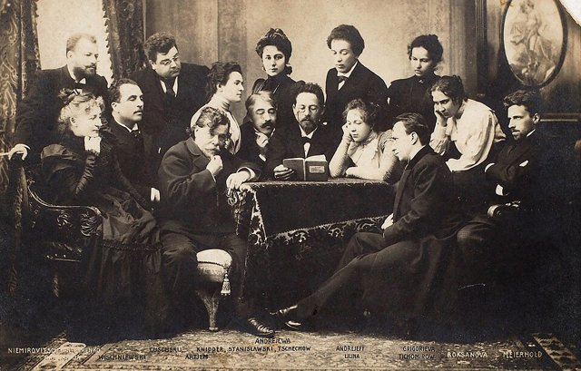
1898年6月，演員史坦尼斯拉夫斯基（Konstantin Stanislavski）與劇作家兼教師丹欽科（Vladimir Nemirovich-Danchenko）在莫斯科郊外的 Slavian bazaar 餐廳（Slavianski Bazar）會談十八小時，議定共同創立「莫斯科藝術劇院」（Moscow Art Theatre，MKhT），同年10月14日以亞歷克賽·托爾斯泰《沙皇費奧多爾》開幕。**偵探式論點：這家劇院的真正兇器不是劇本，而是「導演」——第一次有人把舞台的每個細節交由一雙眼睛統一裁決**。

[→ 對外連結：1898 - 莫斯科藝術劇院：一場十八小時的馬拉松談話，改寫了「導演」這個職業](https://chad-liu.github.io/books/html/9-4.戲劇史/1898-莫斯科藝術劇院.html)

## 1907 | 春柳社
1907年2月，中國留日學生李叔同（息霜）與曾孝谷在東京組成「春柳社」文藝團體，同年6月1日、2日於東京樂座（樂座劇場，為賑濟徐淮水災的「義演」）演出《茶花女》第三幕，李叔同反串飾瑪格麗特；11月再演曾孝谷改編的《黑奴籲天錄》（五幕）。**偵探式論點：這樁案子的兇手不是演員，而是「留學網絡」——東京借來的日本新派劇形式，被改裝成中國第一批有完整劇本的「新劇」**。

[→ 對外連結：1907 - 春柳社：東京的業餘社團，為中國話劇按下啟動鍵](https://chad-liu.github.io/books/html/9-4.戲劇史/1907-春柳社.html)

## 1928 | 三文錢歌劇
1928年8月31日，布萊希特（Bertolt Brecht）與魏爾（Kurt Weill）的《三文錢歌劇》（Die Dreigroschenoper）在柏林 Schiffbauerdamm 劇院（Theater am Schiffbauerdamm）首演，由年輕導演 Erich Engel 執導、Harald Paulsen 飾流氓頭子「刀子麥奇」（Mackie Messer）、Lotte Lenya 飾珍妮。**偵探式論點：這是魏瑪文化產業的「劫案」——布萊希特劫走了英國十八世紀的《乞丐歌劇》，魏瑪的唱片與廣播工業又劫走了這齣戲，人人都是共犯**。

[→ 對外連結：1928 - 三文錢歌劇：一齣搶在盜版前首演的戲，順手把魏瑪掏空了一遍](https://chad-liu.github.io/books/html/9-4.戲劇史/1928-三文錢歌劇.html)

## 1930 | 梅蘭芳訪美
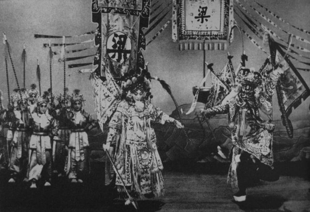
1930年1月至6月，京劇名伶梅蘭芳率團訪美，於2月8日起在紐約49街劇院（49th Street Theatre）演出，隨後巡迴芝加哥、舊金山、洛杉磯等地，波莫納學院（Pomona College）與南加州大學分別授予榮譽博士學位。**偵探式論點：這不是一次巡迴演出，而是一次精心策劃的「文化出口案」——齊如山把京劇的程式（虛擬動作、行當、水袖）重新包裝成可被西方批評界消費的「東方表演體系」**。

[→ 對外連結：1930 - 梅蘭芳訪美：京劇打包裝箱，跨越太平洋的一次程式出口](https://chad-liu.github.io/books/html/9-4.戲劇史/1930-梅蘭芳訪美.html)

## 1934 | 雷雨
1934年7月，曹禺（萬家寶）的四幕劇《雷雨》在北平的《文學季刊》第一卷第三期發表，由編輯巴金發掘並力主刊登。劇本寫天津—周公館一個封建資本家庭在二十四小時內被三十年的舊債（始亂終棄、階級剝削、亂倫疑雲）引爆，結局一夕四人亡。**偵探式論點：這樁「家庭命案」的兇手不是周樸園，而是「三十年的時間」——《雷雨》用易卜生式的回溯結構，把中國的封建家庭變成證物**。

[→ 對外連結：1934 - 雷雨：一部被刊登在《文學季刊》的處女作，替中國話劇驗明正身](https://chad-liu.github.io/books/html/9-4.戲劇史/1934-雷雨.html)

## 1938 | 劇場及其複象
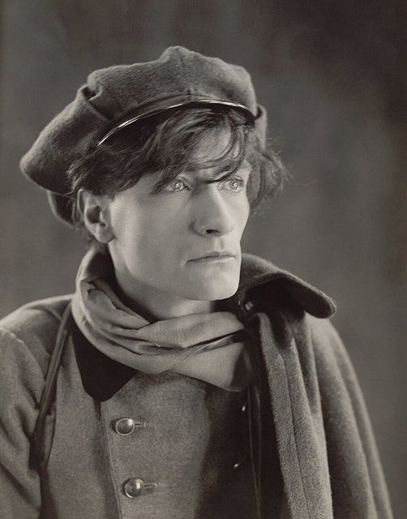
1938年2月，安東南·亞陶（Antonin Artaud）的《劇場及其複象》（Le Théâtre et son Double）在巴黎由 Gallimard（伽利瑪）出版，全書含〈殘酷劇場〉（Théâtre de la Cruauté）、〈東方戲劇〉、〈劇場與瘟疫〉等論文。**偵探式論點：這不是一本劇場理論書，而是一份「起訴書」——亞陶控告西方劇場殺死了「劇場性」本身，而兇器就是文本崇拜與心理寫實**。

[→ 對外連結：1938 - 劇場及其複象：一本無人願出的手稿，成了戰後前衛的聖經](https://chad-liu.github.io/books/html/9-4.戲劇史/1938-劇場及其複象.html)

## 1947 | 慾望街車
1947 年 12 月 3 日，田納西·威廉斯（Tennessee Williams, 1911-1983）的《慾望街車》（A Streetcar Named Desire）在紐約百老匯 Ethel Barrymore 劇院首演，由 Elia Kazan（1909-2003）執導、馬龍·白蘭度（Marlon Brando, 1924-2004）飾演史丹利，Irene Mayer Selznick（1907-1990）出資製作。**偵探式論點：這不是一部戲的首演，而是「方法派表演」與「心理寫實導演術」聯手接管美國劇場的政變現場——戰後美國的焦慮找到了它的舞台技術。**

[→ 對外連結：1947 - 慾望街車：方法派演員把戰後美國的神經質搬上百老匯](https://chad-liu.github.io/books/html/9-4.戲劇史/1947-慾望街車.html)

## 1953 | 等待果陀
1953 年 1 月 5 日，薩繆爾·貝克特（Samuel Beckett, 1906-1989）的法語劇本《等待果陀》（En attendant Godot）在巴黎左岸小型劇院 Théâtre de Babylone 首演，由 Roger Blin（1907-1984）導演並飾演 Pozzo。**偵探式論點：這樁案件表面是一場「沒有情節」的演出事故，實則是戰後歐洲虛無感的定點爆破——它證明劇場可以不需要「故事」而照樣把觀眾釘在椅子上，為「荒謬劇場」的命名埋下伏筆。**

[→ 對外連結：1953 - 等待果陀：什麼都沒發生，而且發生了兩次](https://chad-liu.github.io/books/html/9-4.戲劇史/1953-等待果陀.html)

## 1956 | 憤怒回顧
1956 年 5 月 8 日，John Osborne（1929-1994）的《憤怒回顧》（Look Back in Anger）在倫敦斯隆廣場的皇家宮廷劇院（Royal Court Theatre）首演，由新成立的 English Stage Company（ESC）製作、George Devine（1910-1966）任藝術總監、Tony Richardson（1928-1991）執導。**偵探式論點：這樁案件是一場有計畫的舞台階級革命——ESC 以機構資金刻意引進「憤怒青年」劇本，讓工人階級的口音第一次合法佔領英國商業劇場，並為英國國家劇場運動鋪路。**

[→ 對外連結：1956 - 憤怒回顧：一個工人階級的怒吼推翻英國舞台的口音階級](https://chad-liu.github.io/books/html/9-4.戲劇史/1956-憤怒回顧.html)

## 1964 | 馬拉薩德
1964 年 8 月，彼得·布魯克（Peter Brook, 1925-2022）為皇家莎士比亞劇團（RSC）執導 Peter Weiss（1916-1982）的《馬拉／薩德》（The Persecution and Assassination of Marat as Performed by the Inmates of the Asylum of Charenton under the Direction of the Marquis de Sade），在愛丁堡藝術節首演後轉進倫敦 Aldwych 劇院。**偵探式論點：這樁案件是安托南·阿鐸（Antonin Artaud, 1896-1948）「殘酷劇場」理論的遲到兌現——布魯克用「瘋人院中演出」的套層結構，把政治革命、身體暴力與觀眾席一次打包，證明機構化大劇團也能做前衛戲。**

[→ 對外連結：1964 - 馬拉薩德：瘋人院裡上演革命，Artaud 理論終於兌現](https://chad-liu.github.io/books/html/9-4.戲劇史/1964-馬拉薩德.html)

## 1968 | 貧窮劇場
1968 年，波蘭導演耶日·葛羅托斯基（Jerzy Grotowski, 1933-1999）的《邁向貧窮劇場》（Towards a Poor Theatre）在丹麥出版（Eugenio Barba 編），將其奧波萊（Opole）「13 排劇場」實驗室十年的方法公諸於世。**偵探式論點：這樁案件不是一齣戲而是一套「技術洩密」——葛羅托斯基砍掉佈景服裝燈光，只留下演員的身體作為唯一資產，並靠國際弟子網把這套訓練科學輸出到全世界，改寫了二十世紀後半的演員教育。**

[→ 對外連結：1968 - 貧窮劇場：葛羅托斯基把演員訓練變成一門科學](https://chad-liu.github.io/books/html/9-4.戲劇史/1968-貧窮劇場.html)

## 1970 | 太陽劇團一七八九
1970 年，Ariane Mnouchkine（1939- ）領導的「太陽劇團」（Théâtre du Soleil）在巴黎西郊萬塞訥的彈藥庫廢墟（Cartoucherie）演出集體創作《1789》。**偵探式論點：這樁案件是 1968 年五月風暴的直接遺產——太陽劇團取消階級座位區隔、以集體創作取代明星制度、以「童軍式」巡演經濟取代商業劇院，把民眾劇場從口號變成一個可運作的機構。**

[→ 對外連結：1970 - 太陽劇團一七八九：把法國大革命搬到穀倉，觀眾席不再分階級](https://chad-liu.github.io/books/html/9-4.戲劇史/1970-太陽劇團一七八九.html)

## 1976 | 愛因斯坦在海灘
1976 年 7 月，羅伯·威爾森（Robert Wilson, 1941-）與菲利普·葛拉斯（Philip Glass, 1937-）的《愛因斯坦在海灘》（Einstein on the Beach）在法國亞維農藝術節首演，同年 11 月在紐約大都會歌劇院（Metropolitan Opera）自辦演出。**偵探式論點：這樁案件是後現代劇場的定案現場——五小時無敘事、重複結構、無中場休息，證明極簡主義音樂與視覺劇場可以合流成新的「總體劇場」，而其資金結構（自籌、巡演、賣周邊）成為此後獨立前衛製作的財務教科書。**

[→ 對外連結：1976 - 愛因斯坦在海灘：五小時沒有故事，歌劇院為極簡主義讓位](https://chad-liu.github.io/books/html/9-4.戲劇史/1976-愛因斯坦在海灘.html)

## 1985 | 悲慘世界音樂劇
1985 年 10 月 8 日，倫敦音樂劇《悲慘世界》（Les Misérables）在 Barbican Centre 首演，由 Cameron Mackintosh（1946- ）製作、皇家莎士比亞劇團（RSC）聯合出品，Alain Boublil（1941- ）與 Claude-Michel Schönberg（1944- ）改編自雨果小說，Herbert Kretzmer 作英文歌詞，Trevor Nunn 與 John Caird 執導。**偵探式論點：這樁案件是「巨型音樂劇」（mega-musical）產業的定案現場——首演時惡評如潮，卻靠製作人堅持與 RSC 的敘事技術翻盤，最終以全球授權（licensing）模式讓劇目本身成為跨國品牌，連演數十年打破倫敦西區最長上演紀錄。**

[→ 對外連結：1985 - 悲慘世界音樂劇：把法國小說變成全球授權產業的巨型音樂劇](https://chad-liu.github.io/books/html/9-4.戲劇史/1985-悲慘世界音樂劇.html)

## 1985 | 摩訶婆羅多
1985 年 7 月，彼得·布魯克（Peter Brook, 1925-2022）執導的《摩訶婆羅多》（The Mahabharata）在亞維農藝術節首演，全劇九小時分三晚演出，Jean-Claude Carrière（1931-2021）改編。**偵探式論點：這樁案件是「跨文化劇場」的極限測試——布魯克集結來自十六國的演員，在巴黎 Bouffes du Nord 與採石場空間上演印度宗教史詩，證明世界劇場的語言可能存在，也引爆了東方主義的文化挪用論戰。**

[→ 對外連結：1985 - 摩訶婆羅多：彼得布魯克用九小時把印度史詩變成世界劇場](https://chad-liu.github.io/books/html/9-4.戲劇史/1985-摩訶婆羅多.html)

## 2000 | 拉勒米計畫
2000 年 2 月 19 日，Moisés Kaufman（1963- ）領導的 Tectonic Theater Project 在紐約聯合廣場劇院（Union Square Theatre）演出《拉勒米計畫》（The Laramie Project），素材來自劇團 1998 年起在懷俄明州拉勒米鎮對 Matthew Shepard（1976-1998）仇恨犯罪事件的數百次訪談。**偵探式論點：這樁案件是「verbatim 劇場」（逐字紀實劇場）的定案現場——劇團把採訪逐字稿當作證據鏈，讓小鎮居民自己成為演出的敘事者，開啟了此後二十年的紀實戲劇浪潮與大學社群巡演網絡。**

[→ 對外連結：2000 - 拉勒米計畫：一樁仇恨犯罪變成紀實劇場的採訪案卷](https://chad-liu.github.io/books/html/9-4.戲劇史/2000-拉勒米計畫.html)

## 2011 | 沉浸式劇場
2011 年 3 月 7 日，英國劇團 Punchdrunk（2000- ）的《Sleep No More》在紐約切爾西的三棟廢棄倉庫改建的「McKittrick Hotel」（由 Emursive 公司出資改建）開演，觀眾戴白色面具在三層樓近百個房間自由漫遊，追隨演員重演改編自《馬克白》的無對白敘事。**偵探式論點：這樁案件是沉浸式體驗產業的定案現場——觀眾從「座位」變成「行動者」，票價從分級變成「單一高價長演」，證明空間本身可以被商品化為長期上演的沉浸式資產。**

[→ 對外連結：2011 - 沉浸式劇場：戴上面具的觀眾在旅館裡自由行走](https://chad-liu.github.io/books/html/9-4.戲劇史/2011-沉浸式劇場.html)

## 2020 | 疫情線上劇場
2020 年 3 月起，新冠疫情迫使全球劇院關閉逾一年，英國國家劇院（National Theatre）以「NT Live」與「National Theatre at Home」串流其劇目存檔，紐約公共劇院、Zoom 劇場與虛擬製作接連出現。**偵探式論點：這樁案件是劇場史上最大的「收入歸零危機」——它逼出了遲到多年的數位轉型，也把「劇場是否只能發生在劇院」這一老問題變成行業存亡的公開辯論。**

[→ 對外連結：2020 - 疫情線上劇場：劇院關門之後，劇場搬進了螢幕](https://chad-liu.github.io/books/html/9-4.戲劇史/2020-疫情線上劇場.html)
