<!--
內容整理自本機筆記〈漢末三國大事記——從黃巾之亂、董卓專權到三國鼎立與西晉統一（184—280年）〉（D:\Books\md\歷史\東方歷史\漢末三國大事記.md），以自己的話改寫；只依這份筆記，沒有另外合併其他資料。
時期依筆記的八個階段。
處理方式：
- 筆記的「年代說明」指出三國正式建國的時間不同：曹魏220年、蜀漢221年、東吳229年；這裡分別寫成三則事件，並在229年那一則說明這個差別。
- 筆記一再提醒，赤壁之戰的細節與「七擒孟獲」等情節，後世史籍與《三國演義》有出入，應以《三國志》等史料為準；內文照這個原則寫，不採小說情節。
- 筆記對諸葛亮北伐只明確寫了228年第一次、234年第五次，其餘寫作「229—231年持續北伐」；這裡不補次數與日期。
- 夷陵之戰：筆記寫221年劉備率軍東征、222年陸遜反攻，照寫。
- 諸葛恪：筆記特別說明他是諸葛瑾之子、與諸葛亮是叔侄輩關係，內文保留。
- 階段邊界：時期照筆記（第三階段從197年起、第五階段從221年起），因此第二、三階段與第四、五階段之間各留一年的空隙；196年（曹操迎奉獻帝）、220年（曹丕稱帝）筆記分別放在前一階段的末尾。
- 筆記第九部分（重要年份總表）、第十部分（三國主要人物表）、第十一部分（五個關鍵問題：東漢為何滅亡、曹操為何崛起、赤壁之戰為何重要、三國為何未能迅速統一、西晉為何能統一）、第十二部分（八個關鍵節點）是整理與評論，不單列事件；要點分別寫進220年、196年與200年、208年、229年、280年與各時期的說明。
- 筆記中的網頁引用連結（含追蹤參數）未收錄。
- 圖片皆為 Wikimedia Commons 上的公有領域（含 CC0）作品，縮成最長邊 640px 的 JPEG。
- sanguo-cover.jpg：金武元直赤壁圖 卷.jpg（金代武元直《赤壁圖》，台北故宮藏，封面；裁掉底部色卡。畫的是蘇軾遊赤壁的題材，這裡只借赤壁的山水意象）
- sanguo-yellow.jpg：Three Brothers during the Yellow Turban Rebellion.jpg（《三國演義》版畫插圖：劉備、關羽、張飛與黃巾軍作戰）
- sanguo-dongzhuo.jpg：Dong Zhuo Qing Dynasty Illustration.jpg（清代插圖中的董卓）
- sanguo-luoyang.jpg：Dong Zhuo sears Luoyang.jpg（《三國演義》版畫插圖：董卓焚燒洛陽）
- sanguo-caocao.jpg：Cao Cao scth.jpg（《三才圖會》中的魏太祖曹操像）
- sanguo-redcliff.jpg：金武元直赤壁圖 卷（局部5）.jpg（同一幅《赤壁圖》的另一段，裁掉底部色卡與右側邊緣）
- sanguo-guanyu.jpg：Guan Yu Portrait.jpg（關羽像版畫）
- sanguo-caopi.jpg：Cao Pi Tang.jpg（唐代帝王圖卷中的魏文帝曹丕像）
- sanguo-liubei.jpg：清人画帝王名臣像册-汉昭烈刘备.png（清人《帝王名臣像冊》中的漢昭烈帝劉備，裁取右側畫像）
- sanguo-sunquan.jpg：Sun Quan Tang.jpg（唐代帝王圖卷中的吳大帝孫權像）
- sanguo-zhuge.jpg：Zhuge Kongming Sancai Tuhui.jpg（《三才圖會》中的諸葛孔明像）
- sanguo-simayi.jpg：魏·太傅 司馬懿.jpg（司馬懿像）
- sanguo-simayan.jpg：Sima Yan (Emperor Wu of Jin).png（晉武帝司馬炎像）
-->

# Periods
- 184 ~ 189 | 東漢政治危機與黃巾之亂 | #e03131
  外戚、宦官爭權，土地兼併與豪強坐大；黃巾之亂迫使朝廷倚重地方官員與武裝，中央集權進一步瓦解。
- 189 ~ 196 | 董卓專權與群雄割據 | #862e9c
  董卓控制朝廷、廢立皇帝，關東諸侯起兵討董卻各懷私心；董卓被殺後軍閥混戰，曹操在兗州立足並迎奉漢獻帝。
- 197 ~ 208 | 曹操崛起與北方統一 | #1864ab
  曹操以天子名義與軍事實力先後消滅呂布、袁術與袁紹，官渡一戰決定北方的整合方向，再北征烏桓、南下荊州。
- 208 ~ 220 | 赤壁之戰與三國鼎立的形成 | #2b8a3e
  曹操南下在赤壁受挫，孫劉聯盟保住南方的發展空間；劉備取得益州，關羽失荊州，曹丕取代東漢。
- 221 ~ 223 | 蜀漢建立與夷陵之戰 | #e8590c
  劉備稱帝建立蜀漢，為奪回荊州東征，卻在夷陵敗給陸遜，不久病逝白帝城。
- 224 ~ 234 | 諸葛亮北伐與三國對峙 | #0b7285
  諸葛亮平定南中、進駐漢中並多次北伐；孫權稱帝，三國都已建立皇帝政權，形成長期消耗的對峙。
- 235 ~ 265 | 司馬氏崛起與蜀漢滅亡 | #5f3dc4
  司馬懿平遼東、發動高平陵之變，司馬氏掌握曹魏實權；263年曹魏滅蜀漢，265年司馬炎建立西晉。
- 266 ~ 280 | 西晉滅吳，三國結束 | #a61e4d
  西晉整頓政權、準備滅吳，280年多路進攻使孫皓投降，中國重新統一。

# Events

## 184 | 黃巾之亂爆發
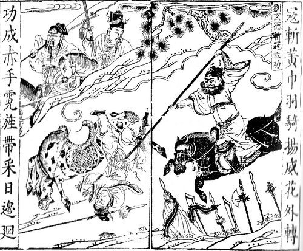
東漢末年政治腐敗，外戚與宦官爭權，土地兼併讓大量農民失去土地，地方豪強坐大，中央對地方社會的控制日漸減弱；漢靈帝時期財政困難，賣官鬻爵更加劇腐敗。社會矛盾累積之下，太平道領袖張角與兄弟張寶、張梁發動大規模起事，參與者以黃巾裹頭，史稱黃巾軍。朝廷調派皇甫嵩、朱儁、盧植等將領鎮壓，曹操也在平亂中累積了軍事經驗；黃巾主力當年遭到重創，但殘部仍持續活動。黃巾之亂雖沒能推翻東漢，卻迫使朝廷倚重地方官員、將領與地方武裝，這些力量日後逐漸掌握徵兵、籌糧與徵收資源的能力，發展成各自割據的軍閥——它不只是農民起義，也是東漢中央集權進一步瓦解的轉折點。

## 188 | 州牧制度發展
黃巾之亂後東漢並沒有恢復穩定，各地流民、叛亂與軍事衝突不斷。188年，漢廷強化部分州級長官的軍政權力，州牧可以掌握地方軍事與行政資源，部分人因而成為擁有獨立軍力的地方領袖。這項變化有兩面：地方長官更能維持秩序，中央卻逐漸失去對地方軍隊的直接控制。劉焉、劉表等人日後在地方建立勢力，便與這種環境密切相關。

## 189 | 漢靈帝去世，何進與宦官衝突
漢靈帝去世，劉辯即位，是為漢少帝；何太后臨朝，外戚何進掌握大權，宦官集團仍想維持影響力。何進打算消滅宦官，並召集外地將領進京以武力施壓，卻適得其反：何進入宮後被宦官殺害，袁紹等人隨後率兵誅殺大批宦官，洛陽朝廷陷入混亂。

## 189 | 董卓進京，廢少帝、立獻帝
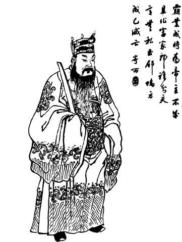
西涼軍閥董卓原本在西北活動，受召進京後趁著中央混亂控制了洛陽與朝廷；朝廷缺乏能與他抗衡的軍隊，逐漸淪為他的政治工具。董卓廢黜漢少帝，改立陳留王劉協為帝，即漢獻帝，顯示皇位繼承已不再完全由漢室宗法與朝廷程序決定，而是受掌握軍隊的權臣左右。189年的宮廷政變是東漢中央政權急遽崩潰的關鍵節點，此後地方諸侯也開始以討伐董卓等名義組織軍隊。

## 190 | 關東諸侯起兵討伐董卓
袁紹、袁術、曹操、孫堅等人組成關東諸侯聯盟，打著討伐董卓、匡扶漢室的旗號起兵：袁紹出身汝南袁氏、聲望很高，成為聯盟的重要領袖；袁術是他的族兄弟，掌握軍事資源，後來與其他諸侯衝突；曹操此時仍是逐步崛起的軍事人物；孫堅在討董戰事中表現活躍，後來成為江東孫氏勢力的奠基者。但聯盟缺乏穩固的指揮體系與一致的戰略，各路諸侯更關心自己的地盤與實力，聯盟逐漸分裂。這反映漢末政治的特徵：許多軍閥雖然仍用漢室名義，實際上已在追求各自的權力與利益。

## 190 | 董卓焚毀洛陽，遷都長安
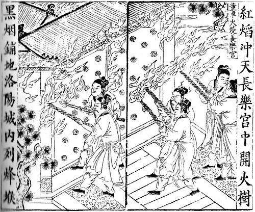
面對關東諸侯的威脅，董卓把漢獻帝與朝廷遷往長安，並焚毀洛陽城。洛陽原本是東漢的政治中心，遷都與焚城不但破壞了城市，也進一步削弱中央的政治威望；董卓控制長安後繼續掌握大權，關東諸侯則各自發展勢力，聯盟很快失去作用。

## 191 ~ 192 | 孫堅進入洛陽，群雄互爭地盤 {label=191～192年}
討董戰爭期間，孫堅曾進入遭到破壞的洛陽地區，戰功提高了孫氏在漢末的地位，也為兒子孫策、孫權日後發展江東打下基礎。聯盟解體後，各路諸侯開始爭奪地盤與軍事資源：袁紹逐步擴大在河北的影響力，袁術在淮南發展，曹操也開始尋找建立根據地的機會。

## 192 | 董卓被呂布殺死
董卓在長安的專權引發朝廷內部反對，司徒王允與呂布合作，由呂布殺死董卓。但董卓的部將李傕、郭汜重新集結，攻入長安，王允被殺，呂布被迫逃離。董卓之死並沒有立即恢復漢室秩序，反而讓長安繼續陷入軍閥混戰。

## 192 ~ 195 | 曹操立足兗州，收編青州黃巾 {label=192～195年}
曹操逐漸在兗州建立勢力，以此為基地擴充軍隊、整頓地方行政，把戰場上的勝利轉成實際的領土與人口。他擊敗部分青州黃巾軍後，吸收大量人員組成著名的「青州兵」，迅速擴軍；對漢末軍閥來說，兵力固然重要，但能否取得人口、糧食與穩定的根據地，同樣決定長期的競爭力。呂布離開長安後輾轉進入兗州，與曹操激戰，經過多次戰事，曹操恢復了對兗州的控制，呂布則轉往徐州一帶，曹操的基礎也日漸穩固。

## 196 | 曹操迎奉漢獻帝，遷都許縣
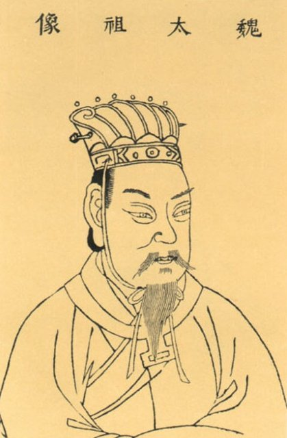
李傕、郭汜內鬥後，漢獻帝脫離長安的控制，輾轉返回洛陽，但洛陽已遭嚴重破壞，朝廷既缺乏軍力保護皇帝，也無法維持正常行政。196年，曹操迎接獻帝，安置在許縣（今河南許昌一帶），從此可以奉獻帝的名義發布詔令、任命官員，並以維護漢室秩序為名對其他諸侯用兵。後世以「挾天子以令諸侯」概括這種策略，帶有後世評價的色彩，但確實指出了他掌握獻帝所帶來的政治優勢：他不只有軍隊，也取得了皇帝所代表的合法性資源，更容易吸引官員、士人與地方勢力。196年是曹操崛起的重要轉折點。

## 197 | 袁術稱帝
袁術控制淮南後稱帝，國號仲氏。這嚴重違背漢朝的政治秩序，使他失去不少原本可能的支持者，曹操與其他諸侯也以此施壓。袁術的失敗顯示，漢末群雄雖然不再真正服從中央，卻仍不能輕易拋棄漢室名義；皇帝名號有很高的象徵意義，沒有足夠的軍事、經濟與政治基礎就貿然稱帝，反而會加速自己的衰敗。

## 198 | 曹操擊敗呂布
呂布據有徐州一帶，與曹操爭奪中原與徐州的控制權。198年曹操進攻呂布、圍困下邳，呂布部下離心，最後呂布被俘處死。曹操消除了一個重要的軍事對手，進一步鞏固了中原。

## 199 | 袁術敗亡，袁紹勢力壯大
袁術在軍事失利、資源不足與政治孤立下逐漸崩潰，199年病死。袁紹則在河北持續擴張，控制冀州、青州、幽州、并州等地的部分區域，成為曹操在北方最強的對手。漢末群雄的競爭，從早期的多方混戰，轉為以曹操與袁紹為核心的北方爭霸。

## 200 | 官渡之戰：曹操擊敗袁紹
袁紹的領土與人口資源較廣，軍隊規模可觀；曹操控制中原與漢廷，政治地位較有利，但整體資源仍居劣勢，雙方爭的是誰能控制黃河流域與北方政治中心。曹操以防守與機動結合的策略維持補給，並突襲袁紹軍重要的糧草據點烏巢，破壞其後勤，袁紹軍的補給與軍心受到重大打擊，曹操取勝。官渡之戰沒有立刻讓曹操統一北方，卻徹底改變了力量對比：曹操取得戰略主動權，袁紹的軍事威望受創、勢力開始分裂，漢末局勢也從多方混戰，轉為曹操逐步消滅北方對手的過程。它常被視為漢末三國史上最重要的戰役之一，不只因為曹操以有限的資源擊敗強敵，更因為它決定了北方政治整合的方向。

## 202 | 袁紹去世
袁紹去世後，他的兒子袁譚、袁熙、袁尚等人未能維持穩固的權力結構，彼此發生衝突。曹操利用袁氏內部的矛盾，逐步進攻河北；袁氏雖仍有相當實力，卻已難以形成統一的戰略指揮。

## 204 | 曹操攻取鄴城
鄴城是袁氏在河北的重要政治與軍事中心。曹操攻取鄴城後進一步削弱袁氏，並把河北當成擴張北方統治的基地；他得到的不只是一座城，而是逐步接收原屬袁氏的官僚、人口、糧食與軍事資源，使政權更有持續作戰的能力。

## 207 | 曹操北征烏桓
袁氏殘餘勢力與北方烏桓等力量仍可能威脅曹操控制的河北。曹操在207年率軍北征烏桓，取得重大勝利，鞏固了對北方的控制，也降低了邊境勢力干擾的風險。至此他已掌握北方大部分重要地區，成為漢末最強大的政治與軍事領袖；不過荊州、益州與江東仍有其他重要勢力，接下來的南下戰爭將決定天下是否由他完成統一。

## 208 | 曹操南下，荊州易主
荊州由劉表控制，是連接中原、益州與長江中下游的要地。208年劉表去世，其子劉琮繼位；曹操南下時，劉琮選擇投降，曹操因此取得荊州北部的重要據點。寄居荊州的劉備與諸葛亮、關羽、張飛等人建立了自己的力量，曹操進軍後，他率部眾南撤、保存實力，政權並未因此滅亡。江東的孫權擁有長期經營的水軍與長江地理條件，必須決定是向曹操屈服，還是與劉備合作抵抗；在諸葛亮等人的外交努力下，孫權與劉備結成聯盟，為赤壁之戰奠下基礎。

## 208 | 赤壁之戰：曹操南下受挫
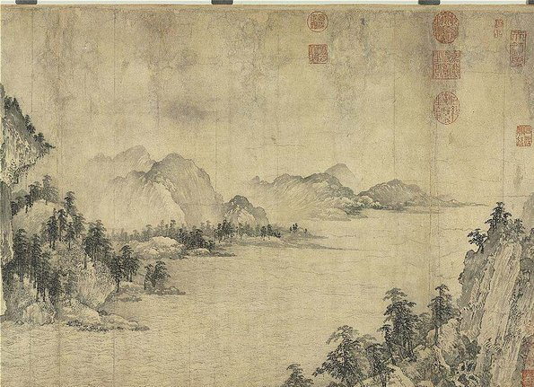
曹操取得荊州北部後繼續南下，想消滅劉備與孫權、完成對南方的統一。劉備派諸葛亮前往江東協商，向孫權分析曹操南下對江東的威脅，孫權決定出兵，派周瑜、程普等人率水軍與劉備軍合作；這個聯盟並非毫無矛盾，而是基於共同的戰略需要而暫時形成。雙方在長江中游的赤壁一帶交戰，曹操軍以北方部隊為主，不熟悉南方水戰環境，孫劉聯軍則善用水軍，並以火攻等戰術重創曹操軍，迫使他撤退。（赤壁之戰的細節，後世史籍與《三國演義》有出入，應以《三國志》等史料為準。）這場戰役是三國格局形成的關鍵：曹操失去迅速統一南方的機會，孫權保住江東，劉備得到重新發展的空間，中國逐漸形成南北分立、三方勢力範圍清晰的格局。

## 209 ~ 210 | 劉備取得荊州部分地區，孫權鞏固江東 {label=209～210年}
赤壁之戰後曹操退回北方，孫權與劉備開始重新分配荊州的控制權。荊州位於長江中游，北通中原、西通益州、東連江東，戰略價值極高。劉備逐漸控制荊州南部的部分地區，孫權則繼續鞏固江東；雙方雖維持聯盟，荊州的歸屬與使用方式卻已埋下日後衝突的種子。對劉備來說，荊州是向西進入益州、建立完整政權的跳板；對孫權來說，則關係到江東西部邊境的安全與沿長江向西發展的可能。

## 211 | 曹操進入關中，劉備西進益州
曹操向關中用兵，與馬超、韓遂等地方勢力交戰；關中位於長安周邊，是連接中原、西北與西部的要道，穩固關中能降低西北勢力的威脅，曹操也逐步擴大了在當地的影響力。同年，益州牧劉璋邀請劉備入蜀，想借他的力量抵抗北方的威脅，但劉備進入益州後逐漸與劉璋決裂，演變成爭奪益州的戰爭。益州地形險要、物產與人口豐富，適合建立相對穩固的政權，若能取得，劉備就能從依附他人的軍事領袖，轉變成擁有獨立領土與行政基礎的政治領袖。

## 214 | 劉備攻取成都，控制益州
經過數年戰爭，劉備擊敗劉璋，取得成都與益州主要地區。這是他政治生涯的重大突破：此前他長期在不同勢力間輾轉，雖有漢室宗親的身分與聲望，卻缺乏穩固的領土基礎，如今終於有了可以長期經營的核心。益州提供糧食、人口與軍事資源，也為他日後稱帝打下基礎。至此，曹操以許縣、鄴城、洛陽等地為政治中心，掌握北方大部分重要地區；孫權以江東為核心，掌握長江下游一帶；劉備以益州為根據地，並在荊州保有部分勢力。三方的邊界尚未固定，尤其荊州問題仍可能引發嚴重衝突。

## 215 | 曹操取得漢中，孫劉重分荊州
曹操攻取漢中，迫使張魯投降。漢中位於益州北方，是進入四川盆地的門戶，曹操控制後便直接威脅劉備在益州的安全。同一時期，孫權與劉備為荊州部分地區的歸屬發生爭議，一度軍事對峙，最後經過協商重新劃分控制範圍。這次安排暫時避免了孫劉聯盟破裂，卻沒有真正消除矛盾：荊州既是雙方聯繫的通道，也是彼此防備的前線，孫權擔心劉備向東擴張，劉備則需要荊州作為向北進攻、與益州相互支援的基地。

## 216 | 曹操進封魏王
曹操在北方取得優勢後，政治地位不斷提高。漢獻帝封他為魏王，他仍以漢朝臣子的名義統治，權力卻已遠超一般官員，並逐漸建立具有獨立性質的魏國政治體制。這有雙重意義：他仍用漢朝的名義維持合法性，而魏國的制度、官僚與軍事力量，已逐步具備取代漢朝的條件。

## 217 ~ 218 | 曹操與劉備爭奪漢中 {label=217～218年}
這段時間曹操與劉備的競爭集中在漢中及其周邊。漢中是北方通往益州的門戶，劉備若能控制，就能建立防線、降低曹操直接進攻益州的可能；雙方積極部署軍隊，最後在219年爆發決定性戰事。

## 219 | 定軍山之戰，劉備進位漢中王
劉備與曹操在漢中激戰，由黃忠、法正等人參與重要部署；定軍山之戰是其中的關鍵戰事，曹操方面的將領夏侯淵戰死。劉備取得漢中，益州政權有了更有利的防禦位置，他也進位漢中王，政治地位大幅提高，已具備建立獨立皇帝政權的領土與軍事基礎。

## 219 | 關羽北伐，孫權襲取荊州
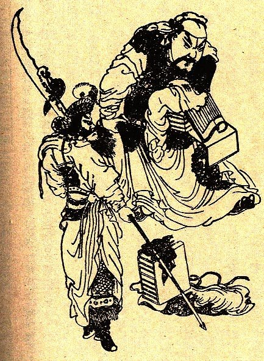
關羽從荊州向北進攻曹操勢力，圍攻樊城等地，一度占上風，對曹操控制的荊襄地區構成重大威脅，但北伐也讓荊州防線在兵力與防守上承受壓力。孫權與劉備本就有荊州領土爭議，關羽北伐期間，孫權方面由呂蒙等人策劃並執行軍事行動，襲取荊州的重要據點；關羽因前線與後方局勢惡化而陷入困境，最後被孫權軍擒獲處死。關羽之死是三國戰略格局的重大變化：劉備失去荊州的重要據點，益州與荊州兩大戰略區域不再相連；孫權擴大了對長江中游的控制；孫劉聯盟受到根本性打擊，從合作抗曹轉向更激烈的敵對；劉備日後發動對吳戰爭，也與此密切相關。219年可說是三國鼎立由形成走向固定的轉折點。

## 220 | 曹操去世，曹丕建立曹魏，東漢滅亡
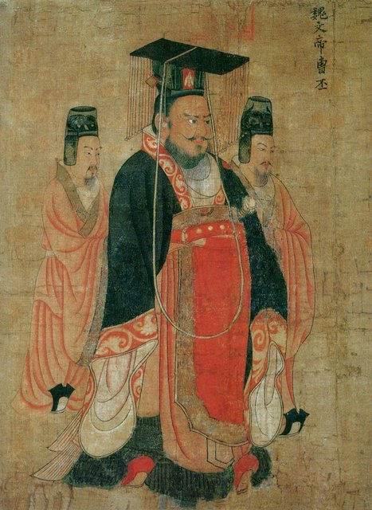
曹操去世，其子曹丕繼承魏王及相關權力。曹操生前已建立強大的魏國政治體制，卻沒有正式取代漢朝稱帝；曹丕進一步推動政權更替，接受漢獻帝禪讓、正式稱帝，建立魏朝，史稱曹魏，漢獻帝退位，東漢正式結束。曹魏以北方為主要統治區，承接了漢朝中央政府大部分的官僚制度與政治資源。東漢並不是在某一場戰役中突然被消滅，而是在長期政治腐敗、地方軍事化、軍閥混戰與中央權威衰落中逐步失去統治能力：外戚與宦官爭權削弱中央的穩定，土地兼併加劇農民的困境，黃巾之亂迫使朝廷依賴地方武力，董卓進京與諸侯割據又使皇帝失去實際控制。曹丕稱帝只是把既有的權力變化正式制度化，220年因此既是東漢滅亡的年份，也是通常所稱三國時代的起點。

## 221 | 劉備稱帝，建立蜀漢
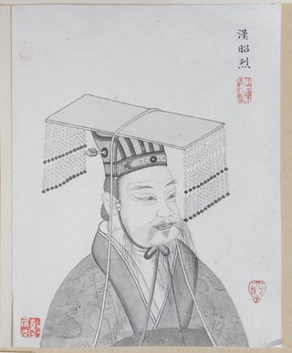
曹丕建立曹魏後，劉備以漢室宗親自居，不承認曹魏取代漢朝的正當性，221年在成都稱帝，國號為漢；因為政權主要統治益州及周邊，後世通常稱為「蜀漢」，也稱「季漢」。蜀漢以延續漢室為政治號召，想在曹魏之外建立另一個有正統主張的皇帝政權。劉備稱帝時主要依靠漢室宗親的名義、益州險要又富庶的條件，以及荊州、益州時期累積的文武人才（諸葛亮、關羽、張飛、趙雲等，不過關羽已在219年去世，張飛也在這一年遇害）。然而失去荊州後，益州與原有荊州勢力區域分離，向北與向東擴張的空間受到限制。

## 221 | 張飛遇害，劉備準備伐吳
張飛與關羽長期追隨劉備，是早期軍事力量的支柱。221年，張飛在準備率軍東征孫權期間，被部下范強、張達殺害，劉備的軍事與政治局勢更加不利。關羽失荊州、張飛遇害，再加上孫權控制荊州，讓劉備認為必須動用軍事行動來挽回局面；然而蜀漢剛建立，政權尚未穩固，東吳又熟悉長江中游地形、具備水陸協同作戰的能力，伐吳並非沒有風險，劉備仍決定出兵。

## 222 | 夷陵之戰：劉備敗於陸遜
劉備率軍進攻東吳，想奪回荊州並為關羽報仇；這不只是個人情感，也關係蜀漢的戰略安全，荊州一旦完全落入東吳手中，蜀漢就失去東向的通道，與孫權的關係也難以恢復。東吳由陸遜統籌，他沒有急於決戰，而是利用地形與蜀軍戰線的延伸來消耗戰力；劉備軍深入吳境後補給與部署吃緊，222年陸遜抓住蜀軍部署上的弱點發動反攻，以火攻等手段重創蜀軍，劉備被迫撤退。這場戰役通常稱為夷陵之戰，也常與猇亭之戰合稱。結果是蜀漢失去奪回荊州的機會、軍事力量受到削弱、孫劉聯盟受到嚴重破壞（雙方後來雖重建外交關係，猜忌仍在），曹魏則因蜀吳互相消耗而獲得喘息。這場戰役也說明，三國的戰爭不單取決於兵力多寡，將領對地形、補給、軍心與時機的掌握同樣重要。

## 223 | 劉備去世，白帝城託孤
夷陵之戰後劉備退至白帝城一帶，健康逐漸惡化，223年去世，太子劉禪即位，是為蜀漢後主。臨終前他把劉禪與蜀漢政權託付給諸葛亮等人。諸葛亮此後成為蜀漢最重要的執政者，面對三項任務：恢復國力（整頓戰後軍政，穩定農業與財政）、穩定外交（重建與東吳的合作，避免同時面對兩個強敵），以及維持劉備延續漢室的政治目標、尋找對曹魏行動的機會。他的治理使蜀漢在夷陵之戰後恢復了一定的穩定，但領土、人口與資源仍遠少於曹魏。

## 225 | 諸葛亮南征，平定南中
南中大致包括今天四川南部、雲南與貴州部分地區，劉備去世後，部分地方勢力叛亂；南中有重要的戰略與經濟價值，長期不穩，蜀漢就難以安心對北方用兵。225年諸葛亮南下平定叛亂，目標不只是擊敗地方武裝，也包括重新建立蜀漢對南中的行政控制，為後續北伐提供較穩定的後方。後世常把南征與「七擒孟獲」聯繫在一起，但這些情節主要透過傳說與《三國演義》流傳，不宜把所有細節都視為確定史實。

## 227 | 諸葛亮進駐漢中，準備北伐
完成南中的治理後，諸葛亮把戰略重心轉向北方，227年進駐漢中，整頓軍隊、部署北伐。漢中是蜀漢北上關中的門戶，從這裡出兵可以威脅曹魏控制的關中，但也必須克服山路崎嶇、運糧困難與兵力不足的問題。北伐並不只是追求領土擴張，也和蜀漢的正統主張有關：他希望持續向曹魏施壓，維持蜀漢的政治地位，並尋求改變三國之間的力量對比。

## 228 | 諸葛亮第一次北伐，街亭失守
諸葛亮發動第一次北伐，蜀軍進入隴右等地，曹魏調集軍隊應對，初期蜀軍在部分地區有進展。街亭是北伐路線上的重要據點，諸葛亮派馬謖防守，但馬謖的部署未能阻止魏軍進攻，街亭失守，蜀軍面臨交通與補給被切斷的風險，只得撤軍。這次北伐雖然失敗，卻顯示曹魏西部防線仍有可乘之機；諸葛亮事後處分相關將領並調整部署。它也反映北伐的基本困難：即使在局部戰場取得優勢，也未必有足夠資源把戰果轉成長期的領土控制。

## 228 | 石亭之戰：東吳擊敗曹魏軍
同年東吳與曹魏也爆發重要戰事：東吳利用曹魏軍隊在部署與判斷上的失誤，在石亭一帶獲勝，進一步牽制曹魏的軍事力量。這顯示三國之間並非只有蜀漢北伐曹魏，東吳也持續在淮南、長江中下游等方向與曹魏競爭。

## 229 | 孫權稱帝，東吳建立
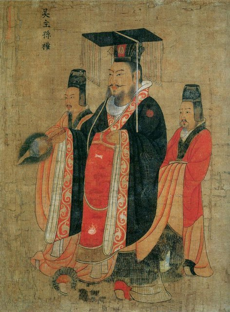
孫權在武昌稱帝，國號為吳，史稱東吳或孫吳。至此曹魏、蜀漢、東吳三個政權都已正式建立皇帝制度，三國鼎立的格局更完整；要注意三國正式稱帝的時間並不一致，曹魏在220年、蜀漢在221年，東吳直到229年。三國為什麼長期無法迅速統一？曹魏擁有北方大部分人口與農業資源，但南下必須面對長江防線；蜀漢靠益州山地防守，卻也被地形限制了軍隊與物資的調度；東吳利用長江水系與水軍抵禦北方，但難以迅速深入北方腹地。三方都有防禦的優勢，卻都難以在短時間內消滅其他兩方，於是形成長期戰爭、外交協商與局部聯盟並存的局面。

## 229 ~ 231 | 諸葛亮持續北伐 {label=229～231年}
228年第一次北伐失利後，諸葛亮仍持續對曹魏西部用兵，希望利用曹魏西線的防禦壓力，爭取隴右與關中；曹魏則靠較多的人口、軍事資源與防禦縱深，阻止蜀軍深入。這些戰事反覆呈現相似的特徵：蜀軍能取得局部進展，但受限於道路、運糧與兵力，難以長期維持大規模進攻，雙方逐漸形成持續消耗的對峙。

## 234 | 諸葛亮第五次北伐，病逝五丈原
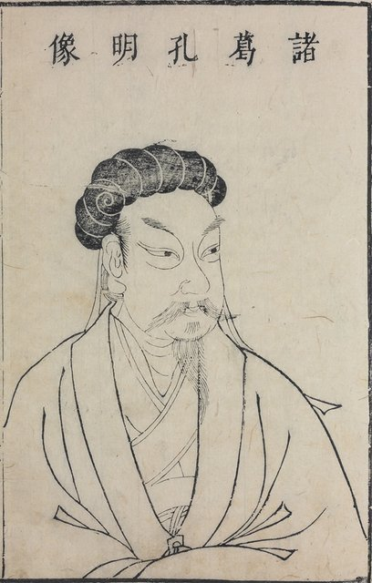
諸葛亮率軍進行第五次北伐，進軍五丈原一帶與曹魏對峙；曹魏由司馬懿負責應對，採取穩守策略，蜀漢則面臨補給與持久作戰的壓力。雙方長期相持之際，諸葛亮病逝於五丈原軍中，蜀軍隨後撤退。他的北伐沒能推翻曹魏，也沒能實現恢復漢室的目標，但不能單以勝敗衡量：他一方面維持蜀漢對外的戰略壓力，另一方面努力確保後方治理、軍隊紀律與行政運作；蜀漢的主要困難，在於國力與曹魏有明顯差距，即使有優秀的統帥與組織能力，也難以完全克服人口、經濟與地理條件的限制。他去世後蜀漢仍然存在，對曹魏的戰略主動性卻逐漸下降。

## 238 | 司馬懿平定遼東公孫淵
遼東的公孫氏長期維持相對獨立的地方勢力，238年曹魏派司馬懿率軍進攻，平定公孫淵，重新鞏固東北邊疆，也提升了司馬懿在軍事與政治上的地位。司馬懿原本是曹魏重要的大臣與將領，隨著皇帝年幼、宗室權力變化與朝廷內部鬥爭加劇，司馬氏逐漸掌握更大的影響力。

## 249 | 高平陵之變，司馬懿掌握曹魏大權
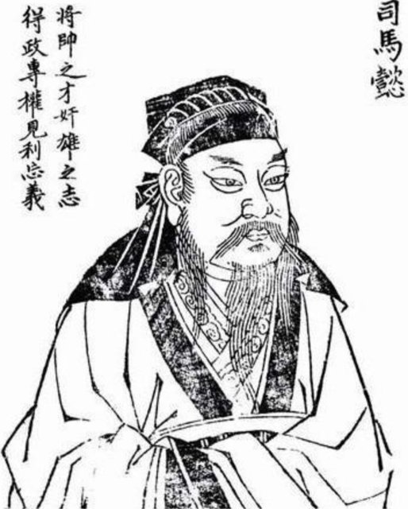
曹魏後期，皇帝的實際政治權力受大臣與宗室勢力左右。曹爽是重要權臣，與司馬懿互相競爭；249年司馬懿趁曹爽陪同皇帝離開洛陽時發動政變，控制京城與重要軍事據點，史稱高平陵之變。司馬懿掌握局勢後，曹爽及其重要支持者被處死，司馬氏取得曹魏的實際政權；皇帝雖仍保有名義上的最高地位，軍政權力卻逐漸轉到司馬氏手中。司馬懿死後，兒子司馬師、司馬昭先後掌權，持續削弱曹魏皇室，司馬氏後來建立西晉、完成統一，正是從這一階段的權力變化逐步發展而來。

## 252 | 孫權去世，東吳進入權力調整期
孫權長期經營江東，建立相對穩定的統治體系，但晚年因繼承問題與宮廷鬥爭，使政權內部出現不穩。他去世後，東吳的皇位繼承與權臣政治持續影響國家治理；東吳仍有長江防線與水軍優勢，朝廷內部的問題卻日益增加，使它在面對曹魏與後來西晉的長期競爭時，必須同時處理內部的穩定。

## 253 | 東吳權臣諸葛恪被殺
諸葛恪是諸葛瑾之子，與蜀漢的諸葛亮不是父子，而是叔侄輩的親族關係。孫權去世後他一度成為東吳重要的執政者，掌握軍政大權，253年在政治鬥爭中被殺，反映東吳後期的權臣政治日益激烈，執政者的權力往往受宮廷派系與皇室關係左右。

## 263 | 曹魏滅蜀漢
曹魏發動大規模攻蜀戰爭，主要將領包括鍾會、鄧艾等。蜀漢長期與曹魏對峙，國力與人口資源有限；諸葛亮去世後雖仍有姜維等人北伐，卻難以扭轉雙方的整體差距。鄧艾採取高風險的行軍路線，穿越險峻山地，出其不意進入蜀漢腹地，打亂防禦部署、直接威脅成都；蜀漢後主劉禪最終投降，蜀漢滅亡。姜維曾想利用鍾會與鄧艾的矛盾復國，但沒有成功。蜀漢的滅亡不能只歸因於某一位將領或某一場戰役，而是長期結構性問題累積的結果：國力有限、山地地形增加交通與運糧的困難、長期北伐消耗資源卻沒能取得足以改變局勢的成果，加上軍政決策未能抵銷曹魏的整體資源優勢。263年是三國鼎立開始瓦解的決定性事件，此後曹魏與東吳成為最後兩個主要的競爭政權。

## 264 | 鍾會之亂
蜀漢滅亡後，鍾會與鄧艾因軍功與政治地位發生矛盾；鍾會在蜀地發動叛亂，想利用當地局勢擴大自己的權力，最後失敗，鍾會、姜維等人在事件中死亡，鄧艾也遭政治鬥爭牽連被殺。這顯示曹魏雖然成功滅蜀，內部仍有軍事將領與權臣之間的權力競爭，司馬氏就是在這樣的環境下，逐步完成對曹魏政權的控制。

## 265 | 司馬炎建立西晉，曹魏滅亡
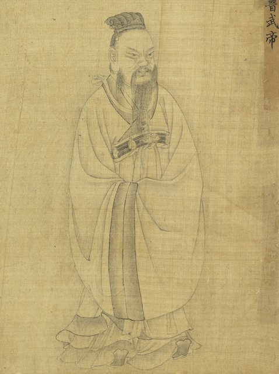
曹魏後期，司馬師與司馬昭先後控制朝廷，逐漸排除反對勢力；司馬昭在263年滅蜀後威望更高，但他在265年去世，沒能親自完成取代曹魏的最後一步。265年，司馬昭之子司馬炎接受曹魏皇帝禪讓，建立晉朝，史稱西晉，曹魏至此結束。西晉繼承曹魏在北方的政治與軍事資源，並逐步準備攻打東吳；中國由魏、蜀、吳三國鼎立，轉變成西晉控制北方與益州、東吳控制江東及長江中下游部分地區的兩方對峙。西晉資源占優，東吳則仍靠長江天險、水軍與長期經營的地方統治體系抵抗。

## 266 | 西晉政權逐步穩定
司馬炎建立西晉後著手整頓政權，承接曹魏原有的官僚制度與軍事資源。西晉要處理的問題包括地方行政、皇室與宗室關係、軍隊配置，以及如何對東吳用兵；統一的可能性逐漸提高，但並非單靠軍事優勢就能自然實現，東吳仍有長江防線，西晉必須在軍事部署、後勤供應與戰略協調上取得突破。

## 269 ~ 279 | 西晉準備滅吳 {label=269～279年}
在西晉的統一戰略中，羊祜、杜預、王濬等人扮演重要角色。羊祜長期負責與東吳對峙的相關事務，主張積極準備統一戰爭，同時注意軍事部署與政治條件；羊祜去世後，杜預等人繼續推動伐吳準備，整備軍隊、安排進攻路線，並尋求協同作戰的機會。另一方面，東吳後期政治問題加劇，孫皓統治下，朝廷內部的矛盾與治理問題影響了政權的長期穩定。

## 280 | 西晉滅東吳，三國時代結束
晉武帝司馬炎決定全面進攻東吳。西晉軍隊從多個方向進軍，王濬等人率水軍沿長江東下，杜預等人負責其他戰線，多路協同逐步突破防線；東吳雖靠長江天險建立防禦，面對多路進攻防線逐漸瓦解，西晉軍隊進入長江下游、逼近政治中心，東吳後主孫皓投降，東吳滅亡。中國自東漢末年以來長期分裂的局面，在政治上重新統一。從184年黃巾之亂到280年西晉滅吳，前後近一百年，經歷農民起義、宮廷政變、軍閥混戰、三國鼎立與政權更替。西晉能夠統一，不是靠某一場戰役，而是建立在長期的權力整合與資源優勢上：司馬氏先在曹魏內部掌握政權，再建立西晉，263年滅蜀後取得更大的領土與縱深，280年多路進攻並利用東吳內部的問題迫使孫皓投降。統一戰爭除了軍事能力，也需要穩定的政權組織、充足的後勤，以及對敵方內部局勢的掌握。但統一並不代表此後長期穩定，西晉後來仍因皇室內鬥及其他政治、社會問題陷入動盪：280年是三國時代的終點，卻不是中國分裂史的終點。
