<!--
內容整理自 D:\Books\html\9-2.藝術家\提香生平大事記.html（沒有對應的 md 筆記），以自己的話改寫。
時期依頁面的五個階段歸納：童年與藝術啟蒙（約1488／1490–1510）、嶄露頭角（1511–1525）、宮廷畫家（1526–1545）、國際聲望（1545–1550）、晚年創作（1551–1576）；頁面兩段在1545年重疊，這裡把宮廷畫家段結束在1544年，讓時期彼此不重疊。
處理方式：
- 出生年份：頁面說明提香的出生年份沒有定論，常見說法為約1488或1490年，部分研究提出更早的可能年代；born 採1488（頁面先列的寫法），事件的年齡因此是大約值，內文註明。逝世日1576年8月27日依頁面。
- 頁面的許多作品年代是約數（如「約1514」「1520年代」「約1565」），照寫，用 label 保留；頁面也說明部分作品的寓意（如《神聖與世俗之愛》）仍有不同解釋，這裡照寫，不選定一種。
- 《聖伯多祿殉道》原作在1867年的火災中毀損，頁面只記「約1529」，這裡併入1529年的事件並註明。頁面把「1500年代初接觸威尼斯畫派傳統」與「約1500–1502前往威尼斯」分成兩則，這裡併成一則。
- 頁面的「與文藝復興其他大師比較」「提香的藝術史貢獻」「重要作品選讀」「五個關鍵轉折」寫進時期說明與最後一則事件，不另立事件；「延伸查閱」三個博物館名稱未收錄。
- 譯名：喬瓦尼·貝利尼依頁面寫成貝里尼（與喬久內頁面一致）；腓力二世、查理五世與其他時間軸一致；人名用·分隔（頁面作・）。
圖片（皆為 Wikimedia Commons 上的公有領域或 CC0 作品，縮成最長邊 640px 的 JPEG）：
- tit-cover.jpg：Photographic print of self portrait painting attributed to Titian - DPLA - 96f23287a2b15767cb253725fa6b6354.jpg（據傳為提香自畫像的畫作翻拍照片）
- tit-sacred.jpg：Tiziano - Amor Sacro y Amor Profano (Galería Borghese, Roma, 1514).jpg（《神聖與世俗之愛》，約1514）
- tit-assumption.jpg：Tizian 041.jpg（弗拉里聖母榮耀大教堂的《聖母升天》，1516–1518）
- tit-bacchus.jpg：Titian - Bacchus and Ariadne - Google Art Project.jpg（《酒神與阿里阿德涅》，1520年代）
- tit-pesaro.jpg：Pala pesaro 02.jpg（《佩薩羅聖母祭壇畫》，1519–1526）
- tit-peter.jpg：Interior of Santi Giovanni e Paolo (Venice) - Copy per, Johann Carl Loth of the martyrdom of St. Peter after Titian.jpg（《聖伯多祿殉道》（原作毀於1867年火災）的摹本，約翰·卡爾·洛特作）
- tit-urbino.jpg：Tiziano - Venere di Urbino - Google Art Project.jpg（《烏爾比諾的維納斯》，1538）
- tit-paul3.jpg：Portrait of Pope Paul III Farnese (by Titian) - National Museum of Capodimonte.jpg（《教宗保祿三世肖像》（卡波迪蒙特國家博物館））
- tit-charles.jpg：Titian - Emperor Charles V at Mühlberg - WGA22965.jpg（《查理五世騎馬像》，1548）
- tit-adonis.jpg：Venus and Adonis by Titian.jpg（《維納斯與阿多尼斯》，1553–1554）
- tit-diana.jpg：Titian - Diana and Actaeon - Google Art Project.jpg（《戴安娜與阿克泰翁》，1556–1559）
- tit-prudence.jpg：Titian - Allegorie der Zeit.jpg（《審慎的寓言》，約1565）
- tit-pieta.jpg：Accademia - Pietà by Titian.jpg（《哀悼基督》，約1575–1576）
-->

# Periods
- 1488 ~ 1510 | 童年與藝術啟蒙 | #868e96
  生於皮耶韋迪卡多雷，約1500年前往威尼斯學習，受貝里尼的繪畫傳統影響；約1507至1508年與喬久內參與德國商館外牆壁畫。
- 1511 ~ 1525 | 嶄露頭角 | #1971c2
  1511年為帕多瓦的聖安東尼奧學院畫壁畫，1516年貝里尼去世後成為威尼斯的核心畫家，完成《聖母升天》並開始發展神話畫。
- 1526 ~ 1544 | 威尼斯首席畫家與宮廷委託 | #2f9e44
  拓展與文學家、建築師的交往，1530年起為查理五世繪製肖像並獲宮廷榮譽，1538年完成《烏爾比諾的維納斯》。
- 1545 ~ 1550 | 羅馬之行與國際聲望 | #e8590c
  前往羅馬為教宗保祿三世與法爾內塞家族工作，1548年創作《查理五世騎馬像》，並與腓力二世建立長期合作。
- 1551 ~ 1576 | 晚年創作與畫風轉變 | #7048e8
  為腓力二世創作「詩畫」系列，晚年筆觸更自由、顏料層次更豐富，1576年在威尼斯瘟疫流行期間去世。

# Events

## 1488 | 出生於皮耶韋迪卡多雷 {label=約1488／1490年}
出生於義大利北部的皮耶韋迪卡多雷（Pieve di Cadore）。他的原名是提齊亞諾·維切利奧（Tiziano Vecellio）；確切的出生年份仍有爭議，常見的說法是約1488或1490年，部分研究提出更早的可能年代，因此藝術史資料通常以約數標示。

## 1500 | 前往威尼斯接受藝術訓練 {label=約1500—1502年}
年少時前往威尼斯，進入當地的藝術環境學習。威尼斯的商業繁榮、國際交流與藝術贊助，成為他日後發展的重要基礎。他早期的訓練與塞巴斯蒂亞諾·祖卡托等人的工作室有關，後來深受喬瓦尼·貝里尼的繪畫傳統影響，逐漸掌握色彩、光線與人物造型。

## 1507 | 與喬久內合作壁畫 {label=約1507—1508年}
參與威尼斯德國商館（Fondaco dei Tedeschi）的外牆壁畫工程，並與喬久內的藝術風格產生密切的關聯，這段合作是他早期生涯的重要階段。

## 1510 | 喬久內去世，提香逐步建立個人聲望
喬久內早逝後，提香逐漸成為威尼斯藝術界的重要人物，並發展出更具力量的構圖、鮮明的色彩與戲劇性的表現。

## 1511 | 為帕多瓦聖安東尼奧學院繪製壁畫
這批壁畫展現他處理宗教敘事、人物動作與空間的能力，也讓他的聲望逐漸超越威尼斯本地。

## 1513 | 選擇留在威尼斯發展
他沒有接受前往羅馬工作的邀請，而是持續經營威尼斯的藝術事業，逐漸建立穩定的委託網絡。

## 1514 | 《神聖與世俗之愛》 {label=約1514年}
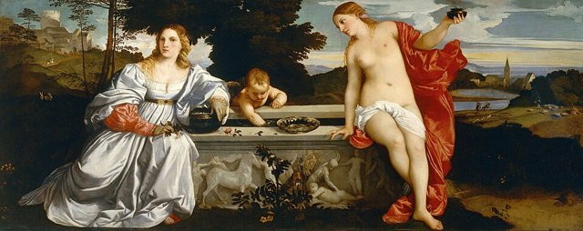
畫中兩名女性、石棺形的水池與古典景觀帶有多重象徵意義，作品確切的寓意仍有不同解釋，是研究提香早期風格的重要作品。

## 1516 | 貝里尼去世，提香成為威尼斯畫壇核心人物
喬瓦尼·貝里尼去世後，提香逐漸承擔重要的公共藝術委託，成為威尼斯最具影響力的畫家之一。

## 1516 ~ 1518 | 《聖母升天》
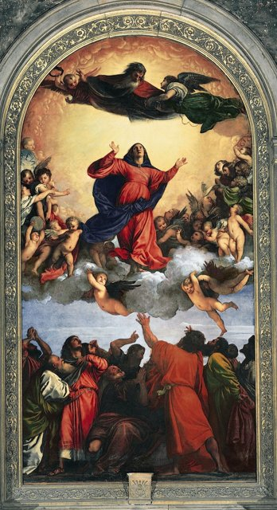
這幅巨型祭壇畫以地面的使徒、升起的聖母與天上的上帝構成強烈的垂直動勢，透過鮮明的色彩與戲劇性的構圖，確立了提香的地位。

## 1518 | 發展古典神話畫 {label=約1518—1523年}
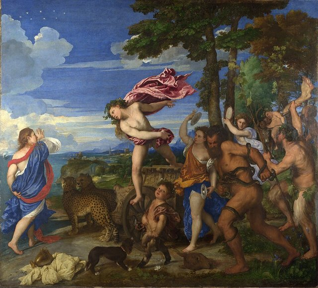
開始為費拉拉宮廷等重要贊助者創作神話題材的作品，把古典故事轉化為富有色彩、動勢與情感的畫面。1520年代的《酒神與阿里阿德涅》結合古典神話、鮮明的色彩與人物動勢，是他神話畫的代表作之一。

## 1519 | 《佩薩羅聖母祭壇畫》 {label=1519—1526年}
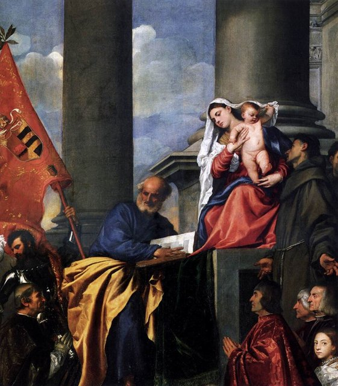
作品採用偏離中央對稱的構圖，藉由人物的位置、柱子與視線的安排創造深度，成為祭壇畫構圖創新的代表。

## 1525 | 與切奇莉亞結婚
與切奇莉亞結婚，兩人育有龐培奧、奧拉齊奧與拉維妮亞等子女。

## 1526 | 拓展文學家與藝術家的社交網絡 {label=1520年代後期}
與建築師雅各布·桑索維諾、作家彼得羅·阿雷蒂諾等人交往，這些關係有助於他擴展聲望與委託來源。

## 1529 | 《聖伯多祿殉道》 {label=約1529年}
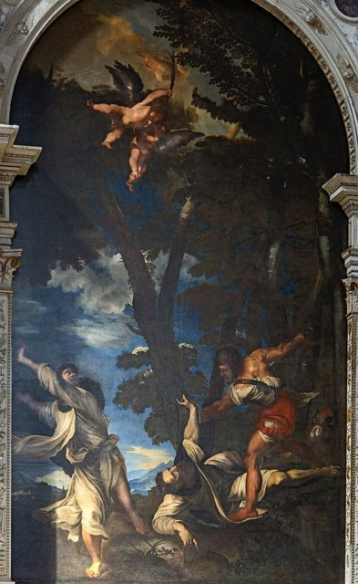
成為他的重要宗教作品。原作以人物動作、林木與強烈的戲劇氣氛呈現殉道的場景，後來在1867年的火災中毀損，作品的影響仍可從歷史記錄與複製品中理解。

## 1530 | 妻子去世，與查理五世建立聯繫@波隆那
切奇莉亞去世。同年，提香在波隆那為神聖羅馬帝國皇帝查理五世繪製肖像，開啟與哈布斯堡宮廷的重要合作。

## 1533 | 獲查理五世授予宮廷榮譽
獲得榮譽頭銜與宮廷地位，顯示畫家已成為歐洲統治者建構文化形象的重要參與者。

## 1538 | 《烏爾比諾的維納斯》
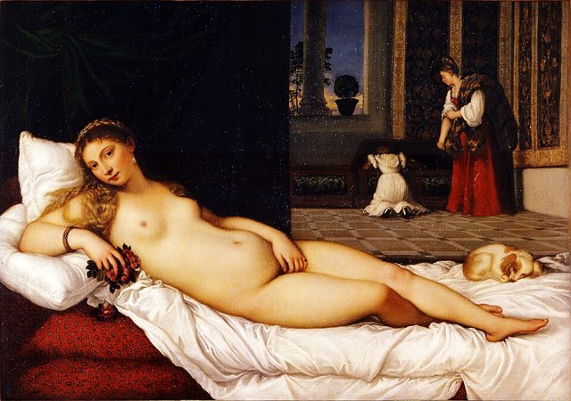
作品把古典女神的形象與室內生活的場景結合，對後世歐洲的女性裸體畫與室內人物畫產生深遠的影響。

## 1545 | 前往羅馬，為教宗保祿三世與法爾內塞家族工作 {label=1545—1546年}
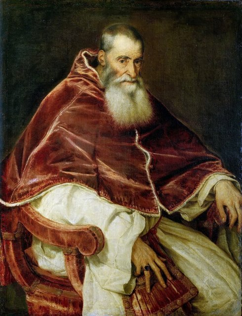
進入羅馬的藝術圈，接觸古典藝術與當地重要的藝術家，並為教宗與其家族繪製肖像，這段經歷擴大了他的文化與藝術視野。

## 1548 | 《查理五世騎馬像》@奧格斯堡
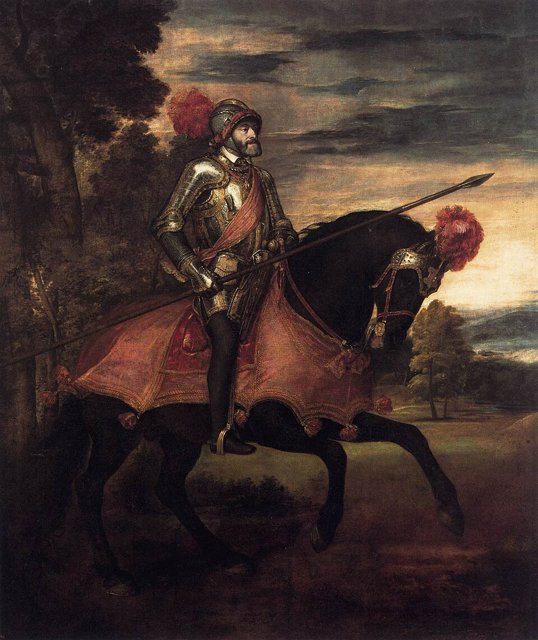
在奧格斯堡為查理五世創作騎馬肖像，以皇帝的姿態、盔甲、馬匹與光線營造威嚴的形象，成為歐洲宮廷騎馬肖像的典範。

## 1550 | 與腓力二世建立長期合作 {label=約1550年}
與西班牙王儲腓力二世建立長期的合作，成為他晚年藝術事業的重要支柱，委託包括肖像畫與以古典神話為題的作品。

## 1551 | 為腓力二世創作「詩畫」系列 {label=1550年代起}
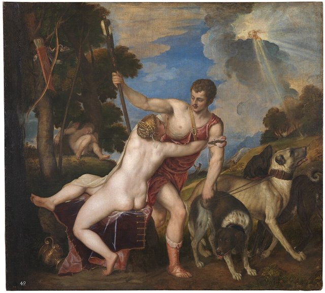
他把神話畫視為可與詩歌相互呼應的藝術形式，透過人物姿態、色彩與戲劇情節表現欲望、愛情、失落與命運。1553至1554年的《維納斯與阿多尼斯》描繪維納斯試圖挽留阿多尼斯的瞬間，把身體動勢與情感衝突結合，是他神話畫的重要代表。

## 1556 | 《戴安娜與阿克泰翁》等神話畫 {label=1556—1559年}
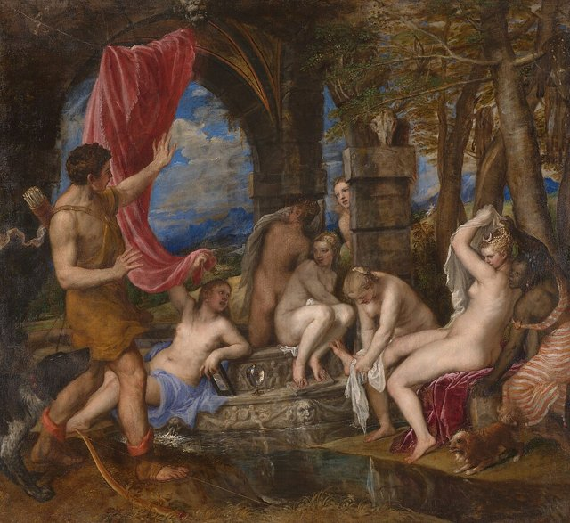
《戴安娜與阿克泰翁》與《戴安娜與卡利斯托》結合古典故事、自然景觀、人物群像與戲劇性的敘事，顯示他成熟期的綜合能力。

## 1565 | 《審慎的寓言》 {label=約1565年}
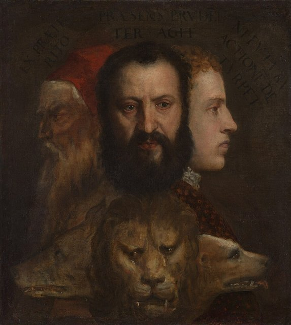
作品以人物與動物的象徵組合，探討時間、人生階段、經驗與審慎等主題，是理解提香晚年思想的重要線索。

## 1560 | 晚期畫風更自由，筆觸更顯著 {label=約1560—1570年代}
晚年他不再一味追求清晰的輪廓與細密的描繪，而是利用鬆動的筆觸、色調變化與顏料層次塑造形體與情緒，這種探索對後世繪畫影響深遠。

## 1575 | 晚期宗教作品《哀悼基督》 {label=約1575—1576年}
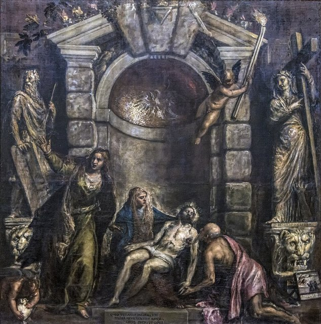
《哀悼基督》展現沉鬱的宗教情感與晚期自由的筆觸，作品的部分工作在他去世後由助手完成。

## 1576-08-27 | 逝世於威尼斯
在威尼斯瘟疫流行期間去世，安葬於弗拉里聖母榮耀大教堂（Santa Maria Gloriosa dei Frari）；他早年的代表作《聖母升天》也位於這座教堂，為他的藝術生涯留下鮮明的歷史呼應。他的職業生涯橫跨十六世紀的大半時期，從威尼斯本地的宗教委託，發展到為神聖羅馬帝國皇帝查理五世、西班牙國王腓力二世等歐洲統治者服務。他的藝術史貢獻有三點：讓色彩成為語言，色彩不只用來呈現物體，也能塑造空間、情緒、光線與人物性格；提升肖像畫的地位，透過姿態、服裝、背景與神情呈現統治者的權力、個性與心理，影響歐洲的宮廷肖像傳統；以及開拓自由的筆觸，晚期作品以鬆動的筆觸、顏料層次與氛圍塑造形體，對魯本斯、委拉斯開茲等後世畫家有重要影響。若與其他大師相比，達文西的關鍵字是觀察，米開朗基羅是力量，拉斐爾是和諧，而他是色彩：擅長色彩層次、人物心理、宮廷肖像與神話畫，晚年筆觸更自由。他是威尼斯畫派的代表人物，將色彩轉化為情感，將肖像畫提升為權力藝術，並為後世的繪畫開拓了新的方向。
