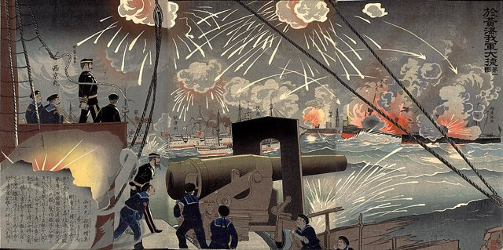
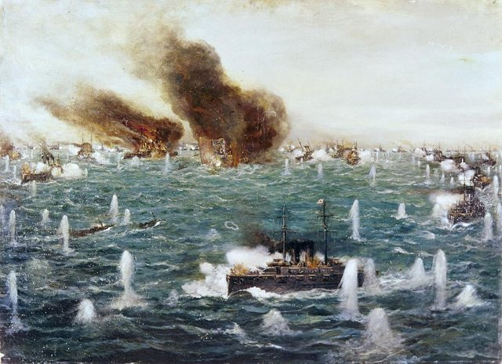
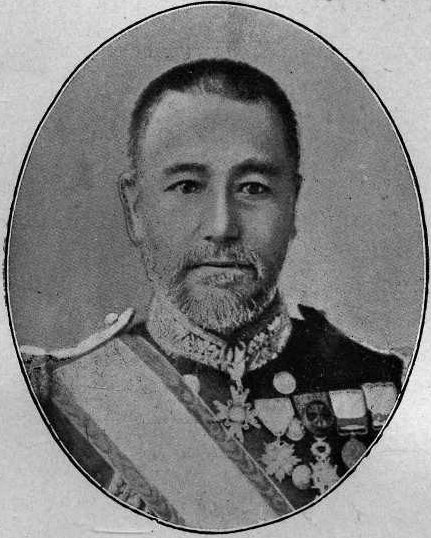

<!--
內容整理自 D:\Books\html\1-3-1.日本歷史人物\東鄉平八郎(1848~1934).html（沒有對應的 md 筆記），並整合中文維基百科〈東鄉平八郎〉條目，以自己的話改寫。
時期依頁面的七個階段歸納：出生與幕末、赴英留學、甲午戰爭、海軍高層與日俄戰爭、戰後與晚年。
兩份資料出入與處理方式：
- 生卒：1848年1月27日生於鹿兒島加治屋町，1934年5月30日病逝於東京，享年86歲，兩份一致。
- 高陞號事件：頁面寫「1894年8月25日」，與豐島海戰不符；維基百科作1894年7月25日豐島海戰中擊沉，採7月25日。
- 英國留學：頁面寫在訓練船伍斯特號受訓，維基百科作泰晤士航海訓練學院（即以伍斯特號為校舍的學校），兩者相符；1878年搭比叡艦返國，取自頁面。
- 1884年任天城艦長、到上海與基隆觀察中法戰爭，1895年3月在澎湖之役指揮第一游擊隊支援登陸，取自維基百科。
- 晉升：頁面寫1895年升少將、1898年升中將；維基百科摘要作1895年升中將，一般記為1895年少將、1898年中將，照頁面。聯合艦隊司令長官：維基百科作1903年12月28日；海軍大將1904年6月6日。
- 對馬海戰：頁面寫5月27至28日，維基百科只記27日，寫成27日的事件，內文說明戰鬥延續到28日；頁面沒有提到「Z旗」之名，這裡依一般記載補述開戰前掛出Z旗的信號。
- 東宮御學問所總裁：頁面寫1914—1921年，維基百科只列職銜，照頁面。1930年反對倫敦海軍條約：頁面在晚年段落有記載，維基百科摘要沒有，照頁面並謹慎寫法。
- 封爵：1907年伯爵、1934年病危時晉升侯爵，取兩份合併。
- 人名與其他時間軸一致：馬修·培里（頁面作「佩里」，改為培里）、昭和天皇（裕仁）、西鄉隆盛；中國方面的「高陞號」照頁面，維基百科作「高升號」。
圖片來源（皆為 Wikimedia Commons 公有領域／CC0 作品；註明「共用」者沿用其他時間軸已有的圖片）：
- tg-cover.jpg：Portrait photo of Tōgō Heihachirō.jpg（東鄉平八郎）
- lhz-yellowsea.jpg（日本浮世繪：黃海海戰（與李鴻章生平時間軸共用））
- tg-tsushima.jpg：Battle of Tsushima, 1905 by Tōjō Shōtarō.jpg（東城鉦太郎〈三笠艦橋之圖〉（對馬海戰），1905）
- tg-1907.jpg：Admiral Togo-1907.jpg（東鄉平八郎，1907）
-->

# Periods
- 1848-01-27 ~ 1871 | 出生與幕末 | #868e96
  生於鹿兒島的薩摩藩士家庭，十五歲參加薩英戰爭，加入薩摩藩海軍，戊辰戰爭時在春日艦上參加阿波沖海戰。
- 1871 ~ 1878 | 赴英留學 | #2f9e44
  被派往英國學習航海、炮術與數學，在訓練船上受訓並遠洋航行，搭乘日本訂造的比叡艦回國。
- 1878 ~ 1903 | 海軍軍官與甲午戰爭 | #1971c2
  歷任艦長，以浪速艦長身分在豐島海戰擊沉高陞號、參加黃海海戰；戰後升將官，任海軍大學校校長與各鎮守府司令長官。
- 1903 ~ 1905 | 日俄戰爭 | #c92a2a
  任聯合艦隊司令長官，奇襲旅順、在黃海海戰阻止俄艦突圍，對馬海戰殲滅波羅的海艦隊，日本取得制海權。
- 1905 ~ 1934-05-30 | 海軍元老 | #495057
  任海軍軍令部長，受封伯爵、元帥，主持皇太子裕仁的教育，晚年成為海軍精神的象徵，反對倫敦海軍條約，國葬。

# Events

## 1848-01-27 | 出生於鹿兒島
東鄉平八郎生於薩摩國鹿兒島的加治屋町，父親東鄉實友是薩摩藩士，家族世代服務島津氏。當時日本仍在江戶幕府統治下，西方列強正要求日本開港，幕府體制開始動搖。

## 1863 | 薩英戰爭
薩摩藩因生麥事件的賠償問題與英國衝突，英國艦隊砲擊鹿兒島。十五歲的東鄉從軍參加海岸防衛，薩摩藩由此親身體認到英國海軍的技術優勢，更加重視西方軍事技術與近代海軍。1866年，他加入薩摩藩新成立的海軍。

## 1868 | 戊辰戰爭與阿波沖海戰
戊辰戰爭爆發，東鄉在薩摩藩的春日艦上參加阿波沖海戰，與舊幕府海軍交戰；1869年箱館戰爭中，他也參與新政府方的海軍行動。

## 1871 | 赴英國留學
明治政府為建立近代海軍，派年輕軍官與學生到歐洲學習。東鄉被派往英國，在以訓練船伍斯特號為校舍的泰晤士航海訓練學院，學習航海、炮術、數學與機械製圖，了解英國海軍的組織、紀律與戰術。1875年，他搭乘訓練船遠洋航行。

## 1878 | 搭比叡艦回國
東鄉在英國接觸軍艦建造技術，搭乘日本向英國訂造的比叡艦回國。長達七年的留學，使他成為日本海軍中少數受過完整西方教育的軍官。1877年西南戰爭時他人在英國，據說曾表示若在國內，願追隨同鄉前輩西鄉隆盛。

## 1884 | 天城艦長
東鄉歷任艦艇與岸上職務，1884年任天城艦長，到上海、福州、基隆觀察中法戰爭的情況，累積艦艇管理、航海與作戰指揮的經驗。1890年代初，他出任巡洋艦浪速艦長。

## 1894-07-25 | 豐島海戰，擊沉高陞號
甲午戰爭爆發之際，英國商船高陞號受清朝租用，載運清軍前往朝鮮。東鄉指揮浪速艦在豐島海戰中下令將它擊沉，船上大量清軍士兵與部分英國船員喪生。由於高陞號懸掛英國旗，事件引發國際爭議，英國經法律與外交調查後，並未演變為英日衝突。

## 1894-09-17 | 黃海海戰

日本聯合艦隊與北洋艦隊在黃海（大東溝）交戰，東鄉指揮浪速艦參戰，日本海軍以機動與火力取得優勢，北洋艦隊遭受重大損失。1895年3月，他指揮第一游擊隊支援日軍在澎湖登陸。

## 1895 | 升任少將
清朝戰敗，簽訂《馬關條約》。東鄉升任海軍少將，從艦艇指揮官轉向海軍高層職務，任海軍大學校校長，培養高級軍官與參謀。1898年升中將，此後歷任佐世保鎮守府、常備艦隊（1900年八國聯軍時）與初代舞鶴鎮守府的司令長官。

## 1903-12-28 | 聯合艦隊司令長官
俄國勢力擴張到滿洲與朝鮮，日俄談判陷入僵局；1902年英日同盟成立，改善了日本的戰略地位。東鄉出任聯合艦隊司令長官，開始部署對俄海軍作戰。

## 1904-02-08 | 奇襲旅順
日俄戰爭爆發，東鄉指揮聯合艦隊以魚雷艇奇襲旅順港內的俄國太平洋艦隊，部分俄艦受損，但未能一次摧毀，日本隨即封鎖旅順港，確保陸軍在朝鮮與東北沿海的運輸。6月，他晉升海軍大將。

## 1904-08-10 | 黃海海戰
俄國旅順艦隊企圖突破封鎖前往海參崴，東鄉率艦隊在黃海攔截，俄艦未能突圍，大多退回旅順。1905年1月，日本陸軍經過203高地等慘烈的攻防後攻下旅順，旅順艦隊覆滅，日本海軍得以專心迎擊遠道而來的波羅的海艦隊。

## 1905-05-27 | 對馬海戰

俄國的波羅的海艦隊從歐洲出發，繞過非洲、橫越印度洋，航行約半年抵達東亞，想突破到海參崴。東鄉在旗艦三笠號上掛出Z旗，傳達「皇國興廢在此一戰，各員一層奮勵努力」的訓令，在對馬海峽迎擊；他指揮艦隊在敵前大迴轉，以T字戰法集中火力，戰鬥延續到28日，俄國艦隊主力幾乎全被擊沉或俘虜。
這是近代亞洲國家第一次在大規模海戰中擊敗歐洲列強的海軍，日本取得日本海與朝鮮半島周邊的制海權，戰局明顯傾向日本，西方媒體把東鄉比作英國名將納爾遜。9月，日俄在美國調停下簽訂《朴次茅斯條約》。

## 1905-12 | 海軍軍令部長

東鄉出任海軍軍令部長，主持戰略規劃，日本海軍據日俄戰爭的經驗發展戰艦、炮術與艦隊理論。1906年他獲英國授予功績勳章，1907年受封伯爵，並陪同皇太子嘉仁訪問大韓帝國。

## 1913 | 元帥
東鄉獲授海軍元帥稱號，退出現役，此後以海軍元老的身分參與國家軍事與教育事務。

## 1914 | 東宮御學問所總裁
東鄉出任東宮御學問所總裁，主持皇太子裕仁（後來的昭和天皇）的教育，到1921年卸任，對皇太子的教育與軍事思想有一定影響。

## 1930 | 反對倫敦海軍條約
1920年代起，東鄉成為日本海軍精神與傳統的象徵，官兵以他在對馬海戰的表現為典範。1930年倫敦海軍軍縮會議限制輔助艦的比例，海軍內部分裂為贊成條約的「條約派」與反對的「艦隊派」，年邁的東鄉站在反對的一方，他的威望使反對派聲勢大增。

## 1934-05-30 | 逝世，國葬
東鄉病危時晉升侯爵，5月30日在東京去世，享年86歲。日本政府為他舉行國葬，葬於多磨靈園，各地後來建有供奉他的東鄉神社。他是近代日本海軍崛起的象徵，晚年的威望也被捲入軍部擴張的政治之中。
