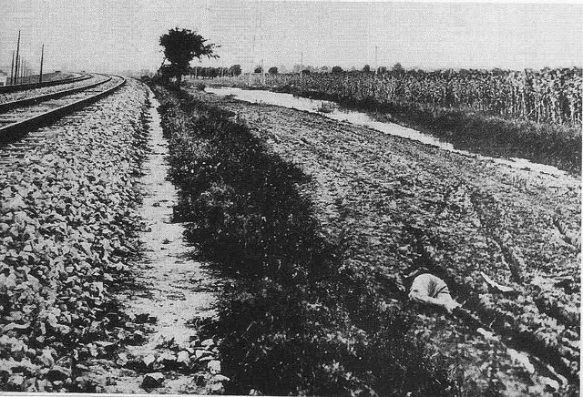
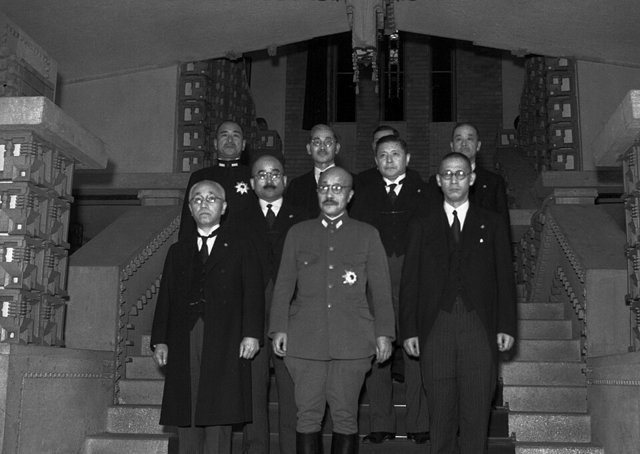
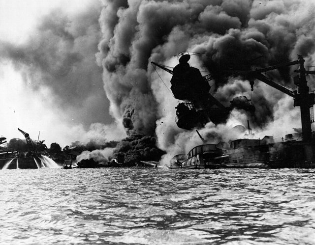
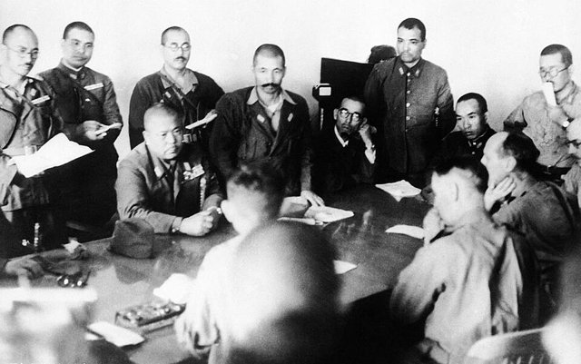
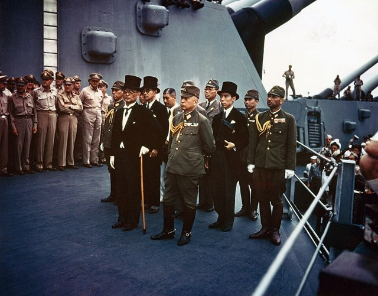
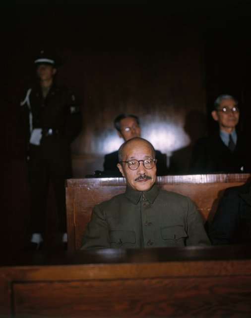

<!--
內容整理自 D:\Books\html\1-3-1.日本歷史人物\東條英機(1884~1948).html（沒有對應的 md 筆記），並整合中文維基百科〈東條英機〉條目，以自己的話改寫。
時期依頁面的八個階段歸納：出身與早年軍旅、參謀生涯、關東軍時期、進入政府核心、太平洋戰爭與東條內閣、戰敗與東京審判。
兩份資料出入與處理方式：
- 出生：頁面寫1884年12月30日；維基百科說實際出生日為7月30日，戶籍記為12月30日。born 採頁面與一般記載的12月30日，處決時的年齡因此是63歲（若依7月30日則為64歲）。
- 陸軍大學校：頁面寫1915年入學、1918年畢業；維基百科作1912年入學、1915年畢業。這裡只寫一則1915年事件，說明兩說。
- 派駐歐洲：頁面寫1919年派駐歐洲，維基百科補充是以武官身分赴瑞士，之後也到德國，照兩份合併。
- 頁面1921年巴登巴登之約、1928年一夕會、1941年1月《戰陣訓》沒有寫，維基百科摘要也沒有，不收。
- 頁面寫1928年升大佐、1933年升少將、1935年關東軍憲兵司令官、1936年升中將、1937年任關東軍參謀長、1938年陸軍次官、1939年升大將（一般記為1941年升大將）；維基百科補充1935年9月21日、1936年12月1日、1937年3月的日期。大將晉升年份兩說不一，只在1941年組閣的事件說明。
- 首相：1941年10月18日組閣，兼任陸軍大臣、內務大臣（至1942年），1943年11月兼軍需大臣，1944年2月21日兼參謀總長，1944年7月18日總辭，日期兩份一致或取自維基百科。
- 珍珠港：頁面寫夏威夷時間12月7日、日本時間12月8日，這裡用日本時間1941年12月8日並說明。
- 自殺未遂：頁面寫1945年9月11日，維基百科只寫9月，採頁面日期。
- 東京審判：1946年5月3日開庭、1948年11月12日宣判、12月23日在巢鴨監獄執行絞刑，兩份一致；1978年合祀靖國神社取自維基百科。
- 頁面的「重要職務與權力變化」「與日本軍國主義的關係」「歷史評價與爭議」寫進時期說明與相關事件，不另立事件。
- 人名與其他時間軸一致：近衛文麿、小磯國昭、昭和天皇。
圖片來源（皆為 Wikimedia Commons 公有領域／CC0 作品；註明「共用」者沿用其他時間軸已有的圖片）：
- tj-cover.jpg：Hideki Tojo.jpg（東條英機）
- tj-mukden.jpg：Mukden 1931 blast spot.JPG（1931年九一八事變爆炸現場的鐵道）
- tj-cabinet.jpg：Hideki Tōjō Cabinet 19411018 3.jpg（1941年10月18日東條內閣成立）
- tj-pearl.jpg：Pearl Harbor Attack, 7 December 1941 - 80-G-19942.jpg（珍珠港事件，日機空襲下的美軍艦艇）
- tj-singapore.jpg：Yamashita and Percival discuss surrender terms.jpg（山下奉文與白思華商談新加坡投降條件）
- tj-missouri.jpg：Surrender of Japan - USS Missouri.jpg（1945年9月2日在密蘇里號上簽署降伏文書）
- tj-1948.jpg：Tojo hideki 1948.jpg（東京審判中的東條英機，1948）
-->

# Periods
- 1884-12-30 ~ 1919 | 出身與早年軍旅 | #868e96
  生於東京的軍人家庭，父親是陸軍中將東條英教；陸軍幼年學校、士官學校出身，日俄戰爭結束時任少尉，考入陸軍大學校。
- 1919 ~ 1935 | 參謀與陸軍官僚 | #8d6e63
  派駐瑞士、德國，回國後在陸軍中央歷任參謀、教育與行政職務，以紀律與執行力著稱，逐漸進入軍部核心。
- 1935 ~ 1940 | 關東軍與陸軍次官 | #e8590c
  任關東軍憲兵司令官、參謀長，七七事變後組建東條兵團進攻察哈爾，回到中央任陸軍次官。
- 1940 ~ 1944-07-18 | 陸軍大臣與東條內閣 | #c92a2a
  第二次近衛內閣的陸軍大臣，1941年組閣後對美英開戰，兼任多項要職集中權力，戰局逆轉、塞班島失陷後總辭。
- 1944-07-18 ~ 1948-12-23 | 戰敗與東京審判 | #495057
  日本投降後被捕時自殺未遂，在遠東國際軍事法庭以甲級戰犯受審，判處絞刑，在巢鴨監獄執行。

# Events

## 1884-12-30 | 出生於東京
東條英機生於東京府麴町區（維基百科說實際出生日為7月30日，戶籍記為12月30日）。父親東條英教是陸軍中將，參與了明治陸軍的建設；他出身職業軍人家庭，從小受到軍事紀律的薰陶。1899年他進入東京陸軍幼年學校。

## 1905 | 陸軍士官學校畢業
東條從陸軍士官學校畢業，授步兵少尉。日俄戰爭在這一年結束，他並沒有參戰建立戰功，此後在陸軍體系內逐步發展。1909年，他與伊東勝子結婚。

## 1915 | 陸軍大學校
東條進入培養高級參謀與指揮官的陸軍大學校（維基百科作1912年入學、1915年畢業；頁面作1915年入學、1918年畢業），開始走向陸軍的參謀與行政決策體系。

## 1919 | 派駐歐洲
東條以武官身分赴瑞士，之後也在德國停留，接觸一戰後歐洲的政治、軍事與社會局勢。回國後他任陸軍大學校教官、陸軍省副官，以重視紀律、執行力與組織管理著稱，在陸軍內部建立人脈。

## 1931 | 九一八事變

9月18日，關東軍在中國東北發動九一八事變，迅速控制東北，1932年扶植成立滿洲國。東條當時在陸軍中央任職，不是現場的策劃者，但日本陸軍內部的擴張派勢力日益增強，軍方對政府外交與國防政策的影響力持續上升。1933年他升任陸軍少將。

## 1935 | 關東軍憲兵司令官
東條出任關東軍憲兵司令官兼警務長，赴中國東北負責軍事警察、治安與情報監控，直接參與對當地的政治與軍事控制。1936年二二六事件中，部分青年軍官發動政變遭鎮壓，東條支持維持陸軍紀律與服從中央的立場，同年升任中將。

## 1937 | 關東軍參謀長
3月，東條任關東軍參謀長。7月7日盧溝橋事變爆發，中日戰爭全面展開，8月他組建「東條兵團」，率軍進攻察哈爾，參與日本在華北方向的軍事行動。

## 1938 | 陸軍次官
東條回到東京任陸軍次官，成為陸軍中央的重要人物，在軍事政策、人事與戰爭動員上有很大的影響力，支持擴大動員。

## 1940-07-22 | 陸軍大臣
第二次近衛文麿內閣成立，東條出任陸軍大臣。9月，日本與德國、義大利簽署《三國同盟條約》，並推動南進政策，與美國、英國的關係日益緊張。美國因日本在中國與法屬印度支那的軍事行動，逐步加強經濟制裁。

## 1941-10-18 | 組閣出任首相

日美談判在中國撤兵與東南亞問題上陷入僵局，近衛內閣總辭，東條組閣，成為第40任內閣總理大臣，兼任陸軍大臣與內務大臣，並晉升陸軍大將。他上任後一度繼續外交談判，但政府已加緊對美、英、荷開戰的準備。

## 1941-12-08 | 太平洋戰爭爆發

日本海軍偷襲夏威夷珍珠港（當地時間12月7日），同時進攻馬來亞、香港、菲律賓，日本對美英宣戰，太平洋戰爭全面爆發。東條以首相兼陸軍大臣的身分，成為日本戰時最高政治領導人之一。

## 1942-02-15 | 新加坡陷落

日軍迅速向東南亞與太平洋推進，2月15日英軍在新加坡投降，日本在東南亞的勢力達到高峰。4月美軍杜立德空襲東京，6月中途島海戰日本海軍損失四艘航空母艦，8月美軍登陸瓜達康納爾島，戰局逐漸從日本的攻勢轉為美軍的反攻。

## 1944-02-21 | 兼任參謀總長
戰略形勢持續惡化，東條仍堅持作戰、強化國內戰時動員。他在1943年11月兼任軍需大臣，1944年2月又兼任陸軍參謀總長，把首相、陸軍大臣與最高作戰參謀機構的權力集中於一身。這種集中化的戰時體制，使國會逐漸失去實質的制衡能力。

## 1944-07-18 | 塞班島失陷，東條內閣總辭
6月美軍登陸塞班島，7月控制全島，取得可以遠程轟炸日本本土的基地。政府內部對東條的戰爭指導批評日增，7月18日東條內閣總辭，22日由小磯國昭接任，東條的政治影響力明顯下降。

## 1945-09-11 | 自殺未遂

日本在1945年8月廣島、長崎原爆與蘇聯對日宣戰後宣布投降，9月2日簽署降伏文書。9月11日盟軍下令逮捕戰爭領導人，美軍前往逮捕時，東條朝胸部開槍自殺，受傷後被救活，隨即被拘押。

## 1946-05-03 | 東京審判開庭
遠東國際軍事法庭開庭，東條是主要的甲級戰犯被告之一，被控策劃、準備、發動與進行侵略戰爭等罪。1947年他出庭作證，主張日本的行動出於國家安全與當時的國際環境。

## 1948-11-12 | 判處死刑

遠東國際軍事法庭宣判，認定東條在日本侵略戰爭的決策與執行中負有重要責任，判處絞刑。

## 1948-12-23 | 處決
東條英機在東京巢鴨監獄被執行絞刑，享年63歲。他不是單純的戰場將領，而是長期參與陸軍行政與政府決策的軍事官僚，對中日戰爭後期與太平洋戰爭負有重要責任。
1978年，他與其他甲級戰犯一同被合祀於靖國神社，日本的戰爭責任與戰後歷史認識，至今仍是東亞歷史與公共討論的重要議題。
