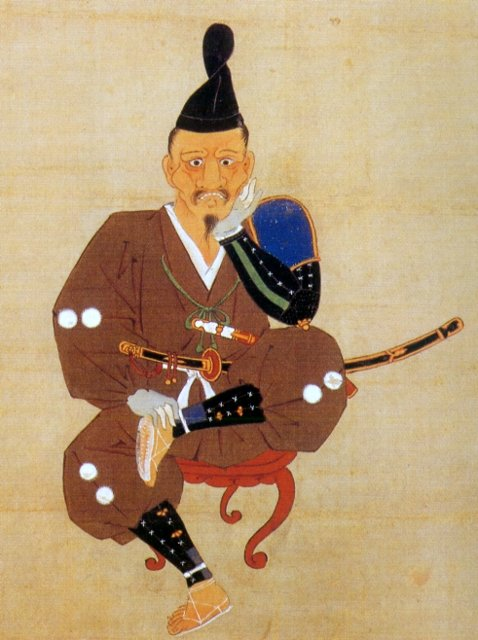
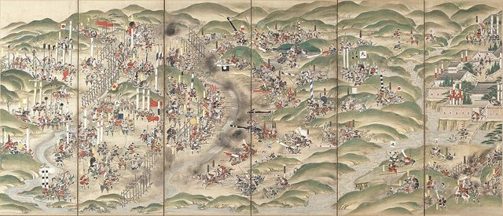
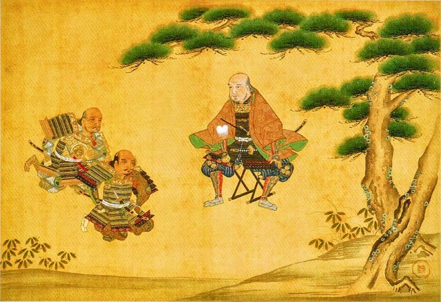
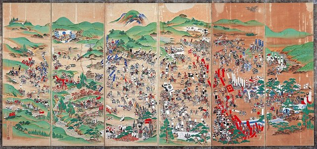
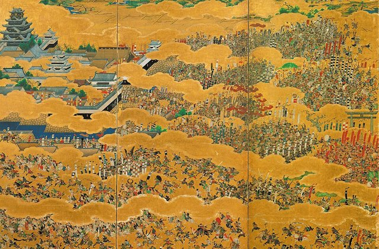

<!--
內容整理自 D:\Books\html\1-3-1.日本歷史人物\德川家康(1543~1616).html（沒有對應的 md 筆記），並整合中文維基百科〈德川家康〉條目，以自己的話改寫。
時期依頁面的五個階段，並把江戶幕府前後拆開：人質少年、獨立與三河霸權、與信長共同作戰、與秀吉爭天下及豐臣政權下、關原與江戶幕府、大御所與大坂之役。
兩份資料出入與處理方式：
- 生卒：兩份都作1543年1月31日（天文十一年十二月二十六日）生於岡崎城，維基百科正文另一處寫1542年，那是和曆年份；1616年6月1日（元和二年四月十七日）卒於駿府城，實歲73歲（虛歲75，頁面作「約73歲」）。
- 人質：頁面寫1547—1549年先被送到織田氏、後成為今川氏人質；維基百科補充是途中遭戶田康光出賣而落入織田家，父親松平廣忠遇刺身亡後被今川家扣為人質，合併寫在1547年。
- 元服與婚姻：頁面寫1555年元服（元信，後改元康）、1556年娶築山殿；維基百科摘要沒有年份，一般記為1557年，這裡寫在1556年並註明。
- 改姓德川：頁面寫1566年；維基百科補充1566年平定三河、任三河守，1567年2月18日（和曆永祿九年十二月二十九日）獲敕許改姓德川並改名家康，寫在1566年的事件。
- 臣服秀吉：頁面寫1586年；維基百科補充1584年底把次子於義丸（結城秀康）送給秀吉為養子，1586年家康上洛謁見秀吉才正式臣服，照頁面寫1586年並說明。
- 關原之戰：頁面寫1600年9月15日，那是和曆慶長五年九月十五日；西曆為1600年10月21日，採西曆。征夷大將軍：慶長八年二月十二日，西曆1603年3月24日。
- 讓位秀忠：頁面寫1605年；維基百科有4月16日、6月2日兩個日期，只寫年份。
- 大坂之役：頁面作「大阪」，這裡用當時的寫法「大坂」；1614年方廣寺鐘銘事件與冬之陣、1615年夏之陣與武家諸法度，兩份一致。禁中並公家諸法度頁面有、維基百科摘要沒有，照頁面。
- 1616年任太政大臣、1617年移靈日光東照宮，取自維基百科。
- 頁面的「歷史遺產」「與三英傑比較」「為什麼能夠取得最後勝利」寫進時期說明與相關事件，不另立事件。
- 人名與其他時間軸一致：今川義元、織田信長、武田信玄、武田勝賴、豐臣秀吉、織田信雄、北條氏、石田三成、小早川秀秋、德川秀忠、豐臣秀賴、淀殿、後陽成天皇。
圖片來源（皆為 Wikimedia Commons 公有領域／CC0 作品；註明「共用」者沿用其他時間軸已有的圖片）：
- ie-cover.jpg：Tokugawa Ieyasu.jpg（德川家康像）
- ie-mikatagahara.jpg：Mikatagaharasenekizou.jpg（〈德川家康三方原戰役畫像〉（顰像），傳說家康敗戰後命人畫下自己的狼狽模樣）
- on-nagashino.jpg：Battle of Nagashino.jpg（〈長篠合戰圖屏風〉（與織田信長生平時間軸共用））
- ie-nagakute.jpg：Portrait of Tokugawa Ieyasu at the Battle of Nagakute.jpg（長久手之戰時的德川家康像）
- ie-sekigahara.jpg：Sekigaharascreen.jpg（〈關原合戰屏風〉）
- ie-osaka.jpg：The Siege of Osaka Castle 1615 cropped.jpg（〈大坂夏之陣圖屏風〉局部）
-->

# Periods
- 1543-01-31 ~ 1560 | 人質少年 | #868e96
  生於三河岡崎城的松平氏，夾在織田與今川兩大勢力之間；幼年先落入織田家，父親遇刺後又成為今川家的人質，在駿府長大。
- 1560 ~ 1573 | 獨立與三河霸權 | #2f9e44
  桶狹間之戰後回到岡崎自立，與織田信長結成清洲同盟，平定三河一向一揆，改姓德川，向遠江擴張，遷居濱松，在三方原大敗於武田信玄。
- 1573 ~ 1582 | 與信長共同作戰 | #e8590c
  長篠之戰聯手擊敗武田勝賴，被迫處死妻子築山殿、長子信康；本能寺之變後經伊賀越逃回三河，趁機取得甲斐、信濃。
- 1582 ~ 1600 | 秀吉時代 | #f08c00
  小牧長久手之戰後臣服秀吉，移封關東、以江戶為根據地；秀吉死後成為五大老之首，與石田三成等人的對立升高。
- 1600 ~ 1605 | 關原之戰與江戶幕府 | #1971c2
  關原之戰擊敗西軍，重新分配大名領地，1603年受封征夷大將軍，在江戶開創幕府，整頓五街道。
- 1605 ~ 1616-06-01 | 大御所與大坂之役 | #7048e8
  讓將軍職給秀忠，以大御所身分在駿府掌政；方廣寺鐘銘事件後發動大坂冬、夏之陣，消滅豐臣氏，頒布武家諸法度，隔年去世。

# Events

## 1543-01-31 | 出生於三河岡崎城
德川家康生於三河國岡崎城，幼名竹千代，父親是松平廣忠，母親於大之方。松平氏勢力有限，夾在西方的織田氏與東方的今川氏之間，必須在兩大強權間求生存。

## 1547 | 人質生涯
六歲的竹千代原本要送往今川家當人質，途中遭戶田康光出賣，落入織田家手中。1549年，父親松平廣忠遇刺身亡，竹千代隨後被交換到今川家，在駿府度過少年時代；今川義元是當時東海道的強權。

## 1555 | 元服
家康在駿府元服，名松平元信，後改元康，名字中的「元」字來自今川義元，反映他當時從屬於今川氏。1556年前後（一般記為1557年），他娶今川家關係密切的築山殿。

## 1560 | 桶狹間之戰，回到岡崎
今川義元率軍進攻尾張，家康隨軍執行任務；義元在桶狹間被織田信長突襲戰死後，家康返回岡崎，重新整頓松平氏的領地與家臣團，逐漸從今川氏的從屬者變成獨立的大名。

## 1562 | 清洲同盟
家康與織田信長結成同盟：家康可以放心向東發展，信長則免除來自三河的威脅。這個同盟一直維持到信長去世，是戰國時代最穩固的聯盟之一。

## 1563 | 三河一向一揆
家康在統一三河時，遭到一向宗信徒與部分家臣、地方武士的反抗，經過軍事鎮壓才恢復對三河的控制。

## 1566 | 統一三河，改姓德川
家康平定東三河、奧三河，統一三河，任三河守，並獲朝廷許可把姓氏由松平改為德川、改名家康（敕許在1567年2月）。改姓有提升家族地位、塑造獨立家門形象的意義。

## 1568 | 進攻遠江
今川氏在桶狹間之後持續衰弱，家康與武田信玄約定瓜分今川領地，向東進攻遠江，1569年今川氏真投降。

## 1570 | 遷居濱松，姊川之戰
家康把據點從岡崎遷到遠江的曳馬城，改名濱松城，便於向東防禦武田、向西與信長協同作戰。同年他參加姊川之戰，與信長擊敗淺井、朝倉聯軍。

## 1572-12-22 | 三方原之戰

武田信玄率大軍西進，家康出城迎戰，在三方原被擊敗，德川軍損失慘重，他本人也險些喪命。此戰讓家康體會到與強敵正面交戰的風險，更需要與信長合作；他也因此在後世被塑造成能忍受挫敗、從失敗中學習的統治者。1573年信玄病逝，武田軍的壓力才緩解。

## 1575 | 長篠之戰

武田勝賴進攻德川方的長篠城，家康與信長聯軍在設樂原以防禦工事與火繩槍大破武田軍，德川氏在東海道的地位更加穩固。

## 1579 | 築山殿與信康事件
家康的長子松平信康與妻子德姬（信長之女）不和，事情牽涉家族內部與同盟關係的壓力，最後築山殿被家臣殺害，信康被迫切腹。

## 1582 | 本能寺之變與伊賀越
武田氏在甲州征伐中滅亡。6月本能寺之變時，家康正在堺一帶，身邊兵力極少；他在地方人士協助下穿越伊賀山地逃回三河，史稱「神君伊賀越」。
信長死後的權力真空中，家康趁機取得甲斐、信濃的大片土地，10月與北條氏和議，領地與軍力大增。

## 1584 | 小牧長久手之戰

羽柴秀吉成為最有實力的人物，家康與織田信雄結盟反對秀吉，在長久手取得局部勝利，但無力徹底擊敗秀吉；信雄與秀吉議和後，家康也停戰，年底把次子於義丸（結城秀康）送給秀吉為養子。

## 1586 | 臣服秀吉
家康上洛謁見豐臣秀吉，正式臣服，雙方以聯姻降低衝突，家康仍保有相當的自主權，持續經營領地與家臣團。

## 1590 | 移封關東，入主江戶
秀吉的小田原征伐中，北條氏投降，家康依秀吉的安排把東海道的領地換成北條氏的舊領關東，8月入主江戶。
關東平原適合農業與城市發展，領地集中、遠離京都與大坂的豐臣政治核心，長期發展潛力巨大；江戶後來成為日本的政治中心，也就是今日的東京。

## 1598 | 秀吉去世，五大老之首
家康在關東整頓行政、軍事與財政，1596年任內大臣。1598年豐臣秀吉去世，秀賴年幼，政權由五大老與五奉行共同維持，家康是五大老中最有實力的一位。他逐步擴大影響力，與五奉行之一的石田三成等人的對立日益加深，各大名依利益與婚姻關係選邊站，形成東、西兩軍。

## 1600-10-21 | 關原之戰

家康率領東軍，與石田三成組織的西軍在美濃國關原決戰（和曆慶長五年九月十五日）。西軍內部利益分歧，小早川秀秋等人在戰場上倒戈，東軍獲勝；石田三成被捕處死，多名西軍大名遭改易或減封。
家康重新分配大量領地，建立以德川氏為中心的秩序，秀賴的地位逐漸被削弱。他著手發展以江戶為中心的五街道，便於人員往來、商業與軍事調動。

## 1603-03-24 | 受封征夷大將軍
後陽成天皇任命家康為征夷大將軍，他以江戶為中心建立德川幕府，控制大名的領地與軍事力量，以法令規範武士，維持與朝廷的關係，整頓行政與財政。

## 1605 | 讓位秀忠，大御所
家康把將軍職讓給三子德川秀忠，讓天下明白將軍之位將由德川家世襲，在自己健在時完成交接，也打消外界對豐臣秀賴重掌大權的期待。他自稱大御所，1607年起以駿府城為據點，繼續主導重大政策與外交。1611年，他與豐臣秀賴在京都二條城會面，雙方的實力差距已十分明顯。

## 1614 | 方廣寺鐘銘事件與大坂冬之陣
豐臣家重建的京都方廣寺，鐘銘中有「國家安康」等字，德川方指為分割「家康」之名、意圖詛咒，成為兩家決裂的導火線。家康集結大軍攻打大坂城，豐臣軍依靠堅固的城防抵抗，雙方達成停戰，大坂城的外堀被填平。

## 1615 | 大坂夏之陣，豐臣氏滅亡

家康與秀忠再度進攻，豐臣方雖有真田信繁等將領奮戰，兵力與資源仍居劣勢，大坂城陷落，豐臣秀賴與母親淀殿自盡，豐臣氏滅亡。
同年，幕府頒布一國一城令、限制大名擴軍與修築城郭的《武家諸法度》，以及規範朝廷與公家的《禁中並公家諸法度》，統一戰爭結束，日本進入以幕府為中心的長期和平。

## 1616-06-01 | 病逝於駿府
1616年3月，家康任太政大臣；6月1日（元和二年四月十七日）在駿府城去世，享年73歲（虛歲75），先葬於久能山，1617年移靈日光東照宮，被奉為「東照大權現」。
他善於選擇盟友、能從失敗中恢復，以關東為穩固基礎，抓住秀吉死後的權力真空，並把軍事勝利轉化為制度：信長打破舊秩序，秀吉完成統一，家康則建立了延續兩百六十多年的幕府。
