<!--
內容整理自本機筆記〈托爾斯泰生平大事記〉（圖表\托爾斯泰生平大事記.md）與中文維基百科「列夫·托爾斯泰」條目（CC BY-SA 4.0），以台灣用語改寫摘要。
https://zh.wikipedia.org/zh-tw/列夫·托尔斯泰
史料與日期說明：
- 俄國當時使用舊曆（儒略曆），比新曆晚12天（20世紀晚13天）。時間軸一律採新曆：生於1828年9月9日（舊曆8月28日）、卒於1910年11月20日（舊曆11月7日）；維基百科內文寫的「1828年8月28日」「1862年9月23日結婚」「1910年11月10日離家」，分別是舊曆的出生、結婚日與新曆的離家日，此處統一換算。
- 譯名：莊園名依筆記作「雅斯納雅·波利亞納」（維基百科作「亞斯納亞波利亞納」）；杜斯妥也夫斯基依其他時間軸的寫法。
- 《戰爭與和平》：筆記寫1863–1869年，維基百科寫1865–1869年；他1863年動筆、1865年起連載、1869年出齊，此處依此。
- 《懺悔錄》：維基百科寫1879年，一般記為1879–1882年寫成，此處標「約」。
- 1837年父親去世、1841年移居喀山、1860年兄長尼古拉病逝、1861年與屠格涅夫決裂、1876年聽柴可夫斯基四重奏落淚、1881年上書沙皇求情、1891年放棄版權、1894年《天國在你們心中》、1899年以稿費資助杜霍波爾教派移民加拿大、1908年〈我不能沉默〉、1901–1909年諾貝爾獎提名等細節，係依維基百科與一般公認的史實補充。
- 克里米亞戰爭、巴黎的死刑等只作背景交代，不描寫細節。
圖片來源（皆為 Wikimedia Commons 公有領域／CC0 作品）：
- tol-cover.jpg：Leo Tolstoy 1908 Portrait (3x4 cropped).jpg
- tol-young.jpg：Leo Nikolaevich Tolstoy poses for a portrait at the age of 20 (4x5 cropped).jpg
- tol-officer.jpg：Tolstoy in military uniform in 1854.jpg
- tol-writers.jpg：Russian writers by Levitsky 1856.jpg
- tol-sofia.jpg：Sofia Tolstaya, 1862.jpg
- tol-draft.jpg：Tolstoy - War and Peace - ninth draft.jpg
- tol-1868.jpg：Tolstoy 1868.jpg
- tol-kramskoi.jpg：Ivan Nikolayevich Kramskoi - Portrait of Leo Tolstoy, 1873.jpg
- tol-plough.jpg：Tolstoy ploughing.jpg
- tol-famine.jpg：Tolstoy organising famine relief in Samara, 1891.jpg
- tol-resurrection.jpg：Resurrection 1899.jpg
- tol-study.jpg：Leo Tolstoi v kabinetie.05.1908.ws.jpg
- tol-gandhi.jpg：Gandhi Tolstoy Farm.jpg
- tol-astapovo.jpg：Astapovo Train Station, On the Right is the House in Which Lev Nikolayevich (Tolstoy) Died MET DP238938.jpg
- tol-funeral.jpg：The Lowering of the Coffin into the Grave with Kneeling Mourners MET DP237973.jpg
-->

# Periods
- 1828 ~ 1851 | 失去雙親的貴族少年 | #f08c00
  生於圖拉附近的雅斯納雅·波利亞納莊園，幼年父母雙亡，由姑母撫養；大學中途輟學，在莊園改革與城市享樂之間徘徊。
- 1851 ~ 1862 | 軍旅與文壇新星 | #495057
  隨兄長到高加索從軍，以《童年》登上文壇；經歷克里米亞戰爭後進入聖彼得堡文學圈，兩度遊歷西歐，回國創辦農民學校。
- 1862 ~ 1878 | 家庭幸福與兩部巨著 | #2f9e44
  與索菲婭結婚，在妻子協助下寫成《戰爭與和平》與《安娜·卡列尼娜》，達到文學創作的巔峰。
- 1878 ~ 1901 | 精神危機與托爾斯泰主義 | #1c7ed6
  深陷人生意義的危機，轉向以登山寶訓為核心的信仰，倡導非暴力、簡樸與勞動，寫出《伊凡·伊里奇之死》與《復活》，最終被東正教會開除教籍。
- 1901 ~ 1910 | 晚年與出走 | #d6336c
  成為全世界的道德導師，與甘地通信；因財產與版權和家人衝突日深，82歲離家出走，病逝於途中的小車站。

# Events

## 1828-09-09 | 出生@雅斯納雅·波利亞納
生於莫斯科以南約二百公里、圖拉附近的雅斯納雅·波利亞納莊園（意為「明亮的林間空地」），是古老伯爵家族的第四個兒子。父親尼古拉曾參加1812年抵抗拿破崙的戰爭，母親瑪麗亞出身富有的沃爾孔斯基公爵家族，這座莊園就是母親的嫁妝。他一生大部分時間都在這裡度過。

## 1830-08 | 母親去世
不滿兩歲時母親去世，他對母親沒有任何記憶，只能從別人的描述中想像她。童年時，大哥尼古拉告訴弟弟們，莊園的森林裡埋著一根「綠色小棒」，上面刻著讓所有人都幸福、不再有疾病與仇恨的秘密，這個故事伴隨了他一生。

## 1837-07 | 父親去世
父親在圖拉突然去世，孩子們先由祖母、再由姑母們撫養。1841年監護的姑母也去世，他們搬到喀山投靠另一位姑母。早年接連失去親人，讓死亡成為他一生反覆思索的主題。

## 1844 | 喀山大學
進入喀山大學東方語言系，想當外交官，後來轉讀法律，老師說他「既不能學、也不願學」。他對課程毫無興趣，卻熱衷閱讀，特別崇拜盧梭，甚至把刻有盧梭肖像的徽章當十字架一樣掛在胸前。

## 1847-04 | 輟學返回莊園
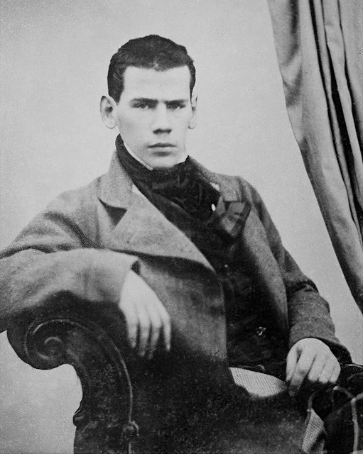
沒有拿到學位就離開大學，分家時繼承了雅斯納雅·波利亞納。他開始寫日記、訂定嚴格的自我改進規則，並想改善農奴的生活，但農民並不信任這位年輕的地主。接下來幾年他在莫斯科與聖彼得堡的社交圈中酗酒、賭博，欠下大筆賭債，又一再在日記中痛責自己。

## 1851-05 | 前往高加索從軍
跟隨在軍中任職的大哥尼古拉前往高加索，隔年正式加入砲兵部隊。壯麗的山岳、哥薩克人的生活與山地民族的戰鬥，讓他遠離上流社會，也開始認真寫作。這段經歷後來寫成中篇小說《哥薩克》與晚年的《哈吉·穆拉特》。

## 1852-09 | 《童年》發表
在高加索寫成的自傳體小說《童年》，以縮寫署名「L.N.」投稿到詩人涅克拉索夫主編的《現代人》雜誌，一刊出就受到讚賞，屠格涅夫等人紛紛打聽作者是誰。他以孩子的眼光細膩描寫心理變化，日後續寫成《少年》與《青年》三部曲。

## 1854-11 | 塞瓦斯托波爾圍城戰
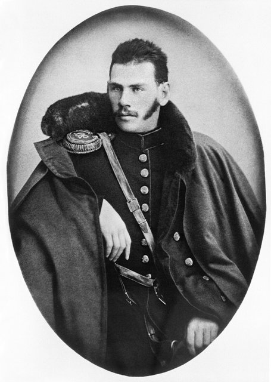
克里米亞戰爭期間，他自願調往被英法聯軍圍攻的塞瓦斯托波爾，擔任砲兵軍官。他根據親身經歷寫成《塞瓦斯托波爾故事》，不歌頌英雄主義，而是如實描寫戰場上普通士兵的恐懼、勇氣與苦難；據說連沙皇亞歷山大二世讀了都深受感動。

## 1855-11 | 聖彼得堡的文學圈
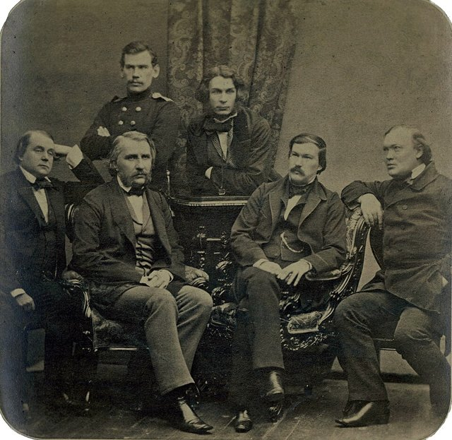
帶著戰地作家的聲名來到聖彼得堡，住在屠格涅夫家，受到文學界熱烈歡迎。但他性格倔強、喜歡唱反調，與文人們格格不入，跟屠格涅夫的友誼也時好時壞。隔年他正式退伍。

## 1857-04 | 第一次遊歷西歐
第一次出國，遊歷法國、瑞士、義大利與德意志。在巴黎他目睹了一場公開的斷頭台行刑，深受衝擊，在日記中寫下他再也不會為任何政府服務，這成為他日後反對國家暴力與死刑的起點。在瑞士他寫下短篇〈琉森〉，批判歐洲文明的冷漠。

## 1859 | 創辦農民學校
在莊園為農民的孩子開辦學校，親自教學。學校不設處罰、不點名，學生想來就來、想走就走，他相信教育應該順應孩子的天性。他後來還編寫了《識字課本》，其中許多寓言與短篇故事至今仍是俄國兒童的讀物。

## 1860 | 兄長之死與第二次西歐之行
為了考察各國的教育，第二次出國。9月，他最敬愛的大哥尼古拉在法國南部因肺結核病逝，死在他的懷裡。這次死別讓他陷入深深的虛無感，日後在《安娜·卡列尼娜》中寫列文的哥哥之死時，用的就是這段經驗。

## 1861-05 | 農奴解放與屠格涅夫決裂
沙皇亞歷山大二世頒布農奴解放令，他擔任地方的「和平調解人」，處理地主與農民的土地糾紛，常站在農民一邊而得罪地主。同年他與屠格涅夫在朋友家中發生激烈爭吵，差點以決鬥收場，兩人絕交了十七年才和好。

## 1862-10 | 與索菲婭結婚
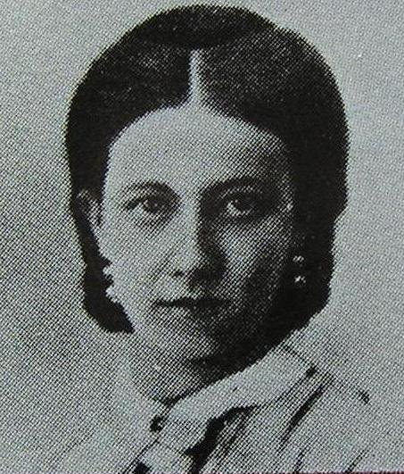
34歲時與宮廷醫生之女、18歲的索菲婭·別爾斯結婚。婚前他把自己的日記交給她看，裡面坦白記錄了他過去的放蕩生活，讓年輕的她大受打擊。婚後初期兩人十分幸福，索菲婭為他持家、管理財務，還一遍又一遍地謄寫他字跡潦草的手稿。兩人共生了13個孩子，其中5個早夭。

## 1863 | 動筆寫《戰爭與和平》
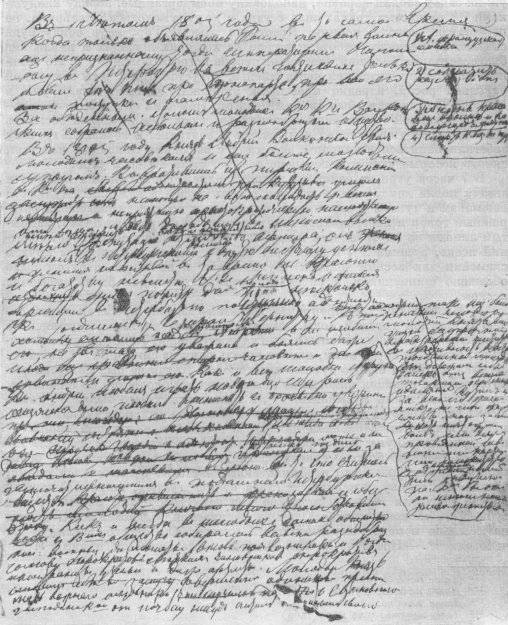
出版中篇小說《哥薩克》，並開始構思一部以十二月黨人為題材的小說，結果越寫越往前追溯，最後變成以拿破崙戰爭為背景的《戰爭與和平》。1865年起在雜誌上連載。

## 1869 | 《戰爭與和平》完成
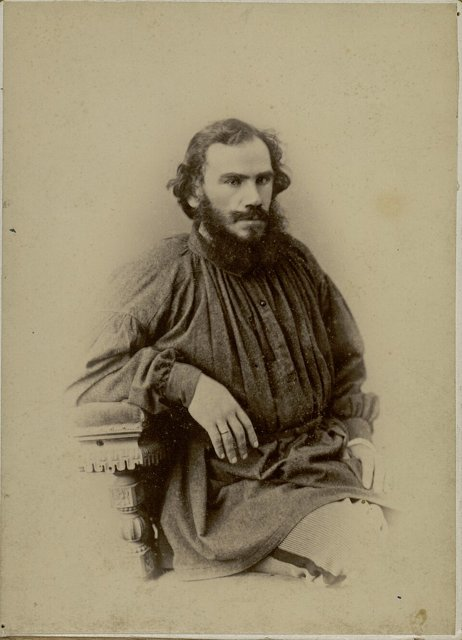
《戰爭與和平》全書出齊。小說以1805至1812年的拿破崙戰爭為背景，透過皮埃爾、安德烈公爵與娜塔莎等五百多個人物，描寫俄國貴族家庭的悲歡與民族的命運。他認為歷史不是由拿破崙這樣的「偉人」決定，而是由無數普通人的意志與偶然交織而成。據說索菲婭把整部手稿謄寫了七遍。同年秋天，他在出差途中於阿爾札馬斯的旅店深夜突然感到強烈的死亡恐懼，這是日後精神危機的前兆。

## 1873-03 | 《安娜·卡列尼娜》 {label=1873～1878年}
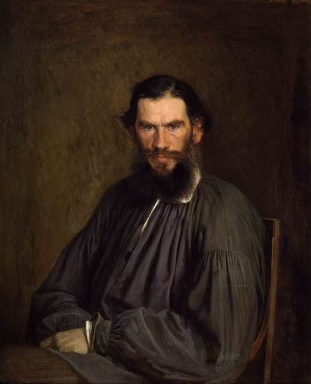
動筆寫《安娜·卡列尼娜》，1875年起連載，1878年出版單行本。開頭第一句「幸福的家庭都是相似的，不幸的家庭各有各的不幸」成為文學史上最著名的開場白之一。小說交織兩條主線：已婚的安娜為愛情拋棄一切，最終被上流社會排斥而走向絕路；地主列文則在農村生活與家庭中追尋人生的意義，許多地方是托爾斯泰自己的寫照。杜斯妥也夫斯基稱讚這是一部「完美無瑕的藝術品」。1876年，柴可夫斯基特地為他演奏弦樂四重奏，他聽到〈如歌的行板〉時感動落淚。

## 1879 | 精神危機與《懺悔錄》 {label=約1879～1882年}
功成名就、家庭美滿的他，卻陷入「人為什麼活著」的危機，甚至把繩子藏起來、不帶獵槍出門，以免自己一時衝動。他在農民身上看見樸素的信仰，重新研讀福音書，最後拋棄了東正教的教條與儀式，只保留耶穌在登山寶訓中的教導：愛人、不以暴力抵抗惡、不起誓、不審判人。他把這段心路歷程寫成《懺悔錄》，在俄國被禁止出版。

## 1881-03 | 為刺殺沙皇的人求情
沙皇亞歷山大二世遇刺身亡，他寫信給新即位的亞歷山大三世，懇求沙皇依照基督的教導寬恕兇手、不要處死他們。信件被轉呈，但沙皇沒有接受。這年秋天，為了孩子的教育，全家搬到莫斯科過冬，城市的貧困讓他大受震撼。

## 1884 | 《我的信仰》
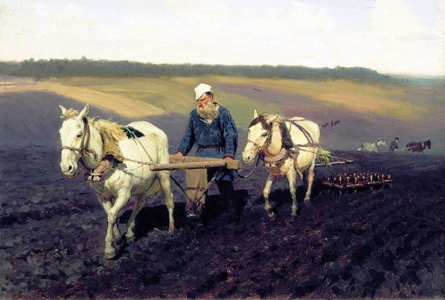
寫成《我的信仰》，系統闡述他以「不以暴力抵抗惡」為核心的基督教思想，也在俄國遭禁。他開始實踐簡樸生活：戒菸、戒酒、吃素，穿農民的粗布衫，親手耕田、砍柴、縫靴子。他的追隨者被稱為「托爾斯泰主義者」，但他與堅持維持家庭生活的妻子之間，裂痕越來越深。

## 1886 | 《伊凡·伊里奇之死》
出版中篇小說《伊凡·伊里奇之死》，描寫一位一生追求體面、循規蹈矩的法官，在罹患重病、面對死亡時才發現自己的一生都是虛假的，只有僕人蓋拉辛真誠的照顧給了他安慰。這部作品被視為世界文學中描寫死亡最深刻的作品之一。

## 1889 | 《克魯采奏鳴曲》
寫成中篇小說《克魯采奏鳴曲》，以一名丈夫在火車上的自述，探討婚姻、嫉妒與性慾，主張即使在婚姻中也應節制。小說被俄國當局查禁，索菲婭親自去晉見沙皇亞歷山大三世，才讓它得以收入全集出版。同年他開始動筆寫《復活》。

## 1891 | 放棄版權，饑荒救濟
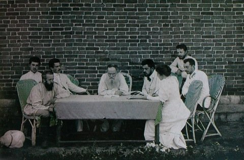
公開宣布放棄1881年以後所有作品的版權，讓任何人都能自由出版，與想為子女保留財產的妻子爭執不休。同年俄國中部爆發大饑荒，他帶著兒女在梁贊省設立兩百多處施粥站，募款救濟災民，並撰文揭露政府的無能。

## 1894 | 《天國在你們心中》
在國外出版《天國在你們心中》，主張真正的基督徒應該拒絕服兵役、拒絕效忠以暴力為基礎的國家。當時在南非當律師的年輕甘地讀了這本書，深受震撼，日後稱托爾斯泰是影響他最深的人之一。

## 1899 | 《復活》
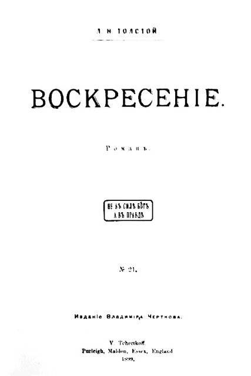
出版長篇小說《復活》。貴族聶赫留朵夫擔任陪審員時，發現被告瑪絲洛娃正是他年輕時誘騙後拋棄的女僕，他悔恨交加，決心贖罪，跟隨她一路走向西伯利亞的流放地。小說猛烈批判法院、監獄、教會與貴族特權。他把稿費全數捐出，資助因拒絕服兵役而受迫害的杜霍波爾教派信徒移民加拿大。

## 1901-02 | 被東正教會開除教籍
俄羅斯東正教會的最高宗教會議發布公告，宣布他已脫離教會，等於開除教籍，原因是《復活》等作品嘲諷教會的儀式。公告反而讓支持他的民眾湧上街頭，他收到大量聲援的信件與電報。同年他在克里米亞養病，契訶夫與高爾基常來探望。

## 1902 | 諾貝爾獎的遺珠
1902至1906年間，他每年都獲得諾貝爾文學獎提名，也多次被提名和平獎，卻始終沒有得獎；1906年他還主動寫信請求不要把獎頒給他，因為他不想處理那筆獎金。他未曾獲獎，被視為諾貝爾獎史上最大的遺憾之一。

## 1908-09-09 | 八十大壽與〈我不能沉默〉
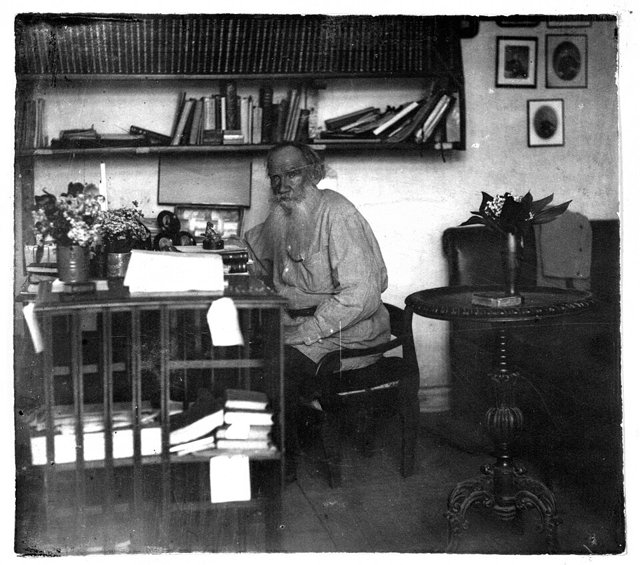
80歲生日時，世界各地寄來數千封賀電，俄國政府與教會卻刻意冷淡。這一年他發表〈我不能沉默〉，抗議政府在鎮壓革命後大規模處決農民；也寫了〈致一個印度人的信〉，主張印度人應以不合作、不使用暴力的方式擺脫英國統治。

## 1909-10 | 與甘地通信
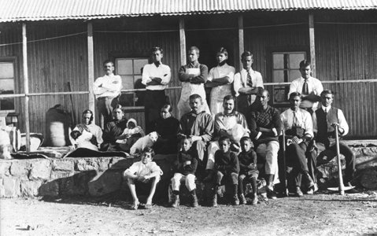
收到甘地從倫敦寄來的信，信中請求允許翻譯〈致一個印度人的信〉並在南非傳播。兩人此後通信直到他去世前，甘地還把自己在南非建立的農莊命名為「托爾斯泰農場」。

## 1910-11-10 | 離家出走
長年為了遺囑、版權與生活方式而與妻子爭執，他在一個深夜悄悄起身，留下一封告別信，只帶著醫生，搭上三等車廂離開雅斯納雅·波利亞納，想到一個沒有人認識他的地方度過餘生。小女兒亞歷山德拉隨後趕來同行。

## 1910-11-20 | 逝世@阿斯塔波沃車站
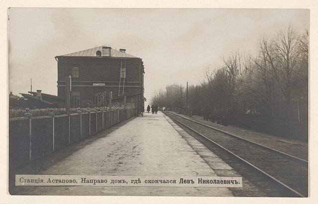
在火車上感染肺炎，被迫在梁贊–烏拉爾鐵路上的小站阿斯塔波沃下車，在站長的屋子裡臥床一週後去世，享年82歲。全世界的記者聚集在這座小車站，索菲婭趕到時，家人一度不讓她進屋，直到他陷入昏迷才得見最後一面。他被安葬在雅斯納雅·波利亞納森林中，傳說埋著「綠色小棒」的地方，墳上沒有十字架、也沒有墓碑，只有一座長滿青草的土丘。

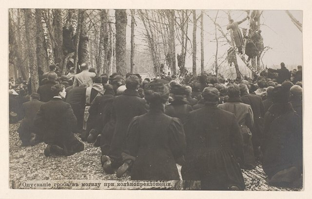
