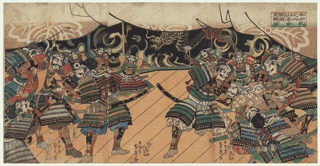
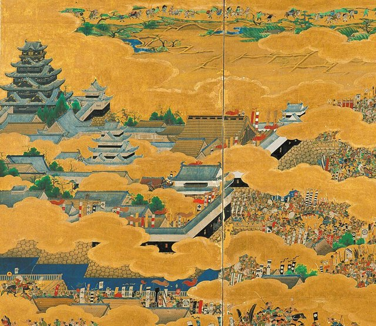
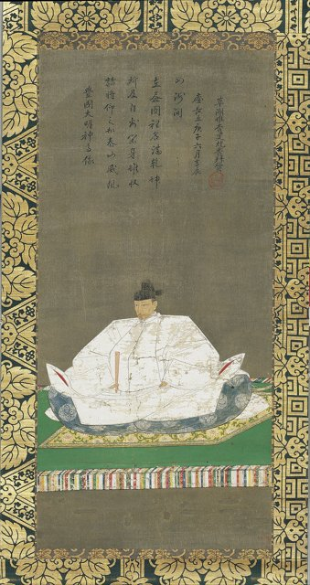
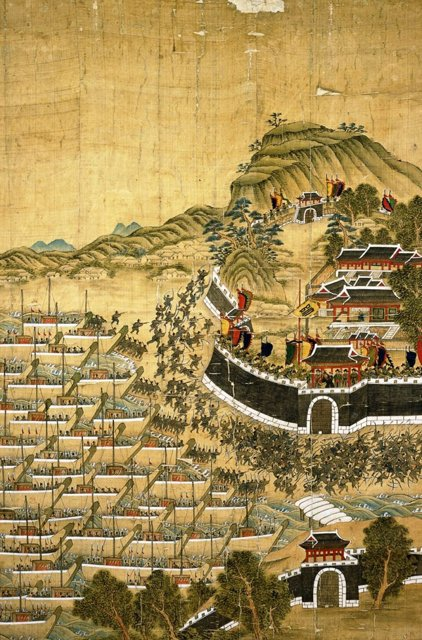

<!--
內容整理自 D:\Books\html\1-3-1.日本歷史人物\豐臣秀吉(約1537~1598).html（沒有對應的 md 筆記），並整合中文維基百科〈豐臣秀吉〉條目，以自己的話改寫。
時期依頁面的六個階段：早年與投身武士、信長的家臣、中國地方攻略、取得織田政權主導權、統一日本與制度改革、侵朝戰爭與晚年。
兩份資料出入與處理方式：
- 出生：頁面寫約1537年（另有1536年之說）；維基百科作天文六年二月六日（1537年3月17日），born 採此日，年份本身仍有異說。去世：慶長三年八月十八日（1598年9月18日）於伏見城，實歲61歲（虛歲62）。
- 仕奉信長：頁面寫1558年前後，維基百科作1554年以小者身分仕奉，兩說並存，寫在1554年並註明。1561年娶寧寧、改名木下秀吉，取自維基百科。墨俣一夜城的故事兩份都沒有可靠年份，不收。
- 1573年：頁面寫成為近江長濱城主；維基百科補充同時改姓「羽柴」。
- 山崎之戰：頁面寫1582年6月13日，那是和曆天正十年六月十三日；西曆為1582年7月2日，採西曆（與織田信長時間軸的本能寺之變同樣用西曆）。
- 賤岳之戰：維基百科作天正十一年四月二十至二十四日，柴田勝家4月24日自盡，日期是和曆，事件只寫1583年。
- 關白、太政大臣：維基百科作1585年7月11日任關白（和曆）、1586年9月賜姓豐臣、12月任太政大臣，照年份寫。
- 伴天連追放令：維基百科作1587年6月18至19日（和曆），寫在1587年九州征伐之後。
- 千利休切腹：頁面寫1591年，維基百科摘要作1592年；一般記為天正十九年二月（1591年），照頁面。
- 1596年明朝冊封使來日、冊封問題引發衝突，以及1597年聖費利佩號事件後的二十六聖人殉教，頁面有部分記載，取兩份合併。
- 頁面的「重要人物關係」「歷史成就與局限」「戰國三英傑」「結語」寫進時期說明與相關事件，不另立事件。
- 人名與其他時間軸一致：織田信長、明智光秀、柴田勝家、德川家康、織田信雄、長宗我部元親、島津氏、北條氏政、千利休、豐臣秀次、豐臣秀賴、前田利家；城名「大坂城」用當時寫法（頁面作大阪城）。
圖片來源（皆為 Wikimedia Commons 公有領域／CC0 作品；註明「共用」者沿用其他時間軸已有的圖片）：
- hy-cover.jpg：Toyotomi Hideyoshi (Kodaiji).jpg（豐臣秀吉像，高台寺藏）
- hy-yamazaki.jpg：War Council Before the Battle of Yamazaki.jpg（浮世繪：山崎之戰前的軍議）
- hy-osaka.jpg：Osaka Castle Keep tower of 「A figure of camp screen of the Osaka summer」.jpg（〈大坂夏之陣圖屏風〉中的大坂城天守）
- hy-portrait.jpg：Portrait of Toyotomi Hideyoshi - Google Art Project.jpg（豐臣秀吉像（Google Art Project））
- hy-busan.jpg：Siege-of-Busanjin-1592.jpg（〈釜山鎮殉節圖〉，1592年釜山鎮之戰）
-->

# Periods
- 1537-03-17 ~ 1554 | 早年 | #868e96
  出身尾張國中村的低階武士或農民家庭，幼名日吉丸（見於後世傳記），年輕時離鄉尋找進入武士社會的機會。
- 1554 ~ 1577 | 信長的家臣 | #e8590c
  從基層小者做起，以完成任務、經營人脈與軍事才能取得信長信任；金崎撤退時殿後，攻滅淺井氏後成為長濱城主，改姓羽柴。
- 1577 ~ 1582-06-21 | 中國地方攻略 | #2f9e44
  受命攻打毛利氏，以姬路城為據點，三木城、鳥取城的斷糧圍城與備中高松城的水攻，展現圍城、交涉與後勤的長才。
- 1582-06-21 ~ 1587 | 取得天下 | #c92a2a
  本能寺之變後中國大返還，山崎之戰擊敗明智光秀，賤岳之戰擊敗柴田勝家，興建大坂城；與家康在小牧長久手交戰後議和，任關白、太政大臣，賜姓豐臣。
- 1587 ~ 1592 | 統一日本與制度改革 | #7048e8
  征服九州，發布伴天連追放令、刀狩令，推行太閤檢地；小田原征伐後統一日本，把關白讓給秀次，自稱太閤。
- 1592 ~ 1598-09-18 | 侵朝戰爭與晚年 | #495057
  發動文祿、慶長之役，秀賴出生後逼死秀次，加強鎮壓基督教；臨終安排五大老、五奉行輔佐幼子，死後政權迅速衰落。

# Events

## 1537-03-17 | 出生於尾張中村
豐臣秀吉生於尾張國愛知郡中村（今名古屋市中村區），出生年份一般記為1537年，也有1536年之說。幼名日吉丸主要見於後世傳記，早年用木下藤吉郎等名字。一般認為他出身低階武士或農民家庭，但父親的身分仍不確定。年輕時他離開家鄉，傳說曾賣針，也曾在其他武士家服務。

## 1554 | 仕奉織田信長
秀吉以小者（雜役）身分進入織田信長的家臣團（頁面作1558年前後），從基層做起，靠完成任務、建立人脈與展現軍事能力取得信任。1560年桶狹間之戰時他已在織田家，但具體角色史料不足。

## 1561 | 娶寧寧
秀吉與寧寧結婚，改名木下秀吉。1560年代他在織田家的軍事與行政體系中逐漸晉升，善於與其他武士合作，也重視後勤、情報與地方政治安排。

## 1570 | 金崎撤退
信長進攻越前朝倉氏時，盟友淺井長政倒戈，信長被迫撤退，後世傳記把木下秀吉描述為殿後的重要將領。同年他參加織田、德川聯軍對淺井、朝倉的姊川之戰。

## 1573 | 長濱城主，改姓羽柴
信長攻滅淺井氏後，秀吉獲封北近江的領地，以長濱城為據點直接治理，並改姓「羽柴」。他不再只是一般家臣，而成為擁有財政、軍事與行政資源的地方領主。

## 1577 | 中國地方攻略
信長派秀吉向西攻打中國地方的毛利氏。他進入播磨國，以姬路城為據點，整合當地武士。他的作戰特色是圍城、切斷補給，加上政治交涉爭取地方武士，減少必須直接攻打的據點，並重視糧食、道路與軍隊調度。

## 1580 | 三木城之戰結束
秀吉長期圍攻播磨的三木城，城內嚴重斷糧，守軍最終投降，城主別所長治自盡，史稱「三木乾殺」。

## 1581 | 鳥取城之戰
秀吉進攻因幡國的鳥取城，事先收購周邊糧食，再嚴密封鎖，守軍因糧盡而投降，史稱「鳥取渴殺」。

## 1582 | 備中高松城水攻
秀吉進攻備中國的高松城，利用低窪地勢築堤引水，把城郭周邊變成湖泊；毛利氏派援軍趕到，雙方一邊對峙一邊交涉。

## 1582-07-02 | 中國大返還與山崎之戰

6月21日（和曆六月二日）本能寺之變，織田信長與長子信忠身亡。秀吉在高松城得知死訊後，迅速與毛利議和，率軍急行東返，史稱「中國大返還」，搶在其他織田家臣掌握局勢前回到京都附近。
天正十年六月十三日（西曆7月2日），他在山崎擊敗明智光秀，光秀在逃亡途中死亡。為信長報仇讓秀吉取得聲望與軍事主動權，成為最有可能繼承信長遺產的人。

## 1582-07 | 清洲會議
織田家重臣在清洲城討論繼承與領地分配，秀吉支持信忠年幼的兒子三法師（後來的織田秀信），與代表另一股勢力的柴田勝家對立，進一步擴大他對織田家政治安排的影響力。

## 1583 | 賤岳之戰，興建大坂城

秀吉與柴田勝家的矛盾升高，雙方在近江賤岳交戰，秀吉迅速調兵取得主動，勝家戰敗後在北之庄城自盡。
同年，秀吉在石山本願寺舊址興建大坂城。大坂位於水陸交通網的交會處，大坂城不只是軍事據點，也是行政、財政、商業與政治的中心。

## 1584 | 小牧長久手之戰
德川家康與信長的次子織田信雄結盟反對秀吉，雙方在尾張一帶交戰，德川軍在長久手取得局部勝利；但秀吉以更大的政治資源與動員能力向信雄施壓，信雄與秀吉議和，家康也隨之停戰，後來臣服於秀吉。

## 1585 | 征服四國，就任關白
秀吉派軍進攻四國的長宗我部元親，以軍事壓力與談判讓他接受安排。同年他就任關白，取得不同於一般武士大名的朝廷正當性，以朝廷官位與儀式建立全國統治者的地位。

## 1586 | 賜姓豐臣，任太政大臣

朝廷賜秀吉「豐臣」姓氏，12月他升任太政大臣，從此以「豐臣秀吉」之名聞名後世。

## 1587 | 九州征伐與伴天連追放令
秀吉集結大軍從多個方向進攻九州南部的島津氏，島津氏投降，接受秀吉的安排。6月，他發布驅逐傳教士的「伴天連追放令」，擔心宗教勢力影響地方政治，也對傳教活動與歐洲勢力擴張抱持疑慮。9月，他遷入京都新建的聚樂第。

## 1588 | 刀狩令與太閤檢地
秀吉下令收繳農民的刀劍等武器，降低農民武裝反抗的能力，強化武士對軍事力量的掌握；同年發布海賊停止令。1588到1591年前後，他推行太閤檢地，調查土地面積、品質與產量，換算成標準化的「石高」，據此估算稅收並調整大名的領地與軍役，配合刀狩令推動兵農分離。

## 1590 | 小田原征伐，統一日本
控制關東的北條氏不肯臣服，秀吉集結全國大名的軍隊包圍小田原城，7月北條氏政、氏直開城投降，關東納入全國統治體系；德川家康被移封關東，以江戶為據點。秀吉隨後處理東北大名的服從問題，基本完成日本主要地區的統一。

## 1591 | 讓位秀次，千利休切腹
12月，秀吉把關白之位交給姪子豐臣秀次，自己以「太閤」之名繼續掌權；弟弟豐臣秀長同年去世。茶道宗師千利休是秀吉的茶頭，兩人在政治與個人關係上發生衝突，利休被命令切腹（維基百科摘要作1592年）。

## 1592 | 文祿之役

秀吉發動侵略朝鮮的戰爭，日軍初期迅速攻占漢城等重要城市，但朝鮮軍隊持續抵抗，李舜臣率領的朝鮮水軍威脅日本的海上補給，明朝也派兵援朝，戰事陷入僵持而轉入談判。朝鮮半島遭到嚴重破壞，日本與明朝也付出沉重的軍事與財政代價。同年伏見城完工。

## 1593 | 秀賴出生
秀吉的兒子豐臣秀賴出生，原本作為繼承人的關白秀次與秀吉的關係逐漸惡化。

## 1595 | 秀次切腹
秀吉以謀反等理由，將秀次流放高野山後命其切腹，秀次的多名妻妾子女也遭處死。這場清洗削弱了豐臣家族本身的支撐。

## 1596 | 冊封使事件
明朝使節來日，冊封秀吉為日本國王，冊封內容與秀吉的期待不符，和談破裂，他驅逐使節。同年聖費利佩號事件後，秀吉加強鎮壓基督教，1597年二十六名傳教士與日本信徒在長崎被處死。

## 1597 | 慶長之役
和談失敗後，秀吉再度出兵朝鮮，日軍投入大量兵力，仍面對朝鮮與明朝聯軍的抵抗，戰爭延續到他去世後才結束。

## 1598-09-18 | 病逝於伏見城
秀吉病重，秀賴年僅五歲，他安排德川家康、前田利家等五大老與五奉行輔佐。慶長三年八月十八日，他在伏見城去世，享年61歲（虛歲62）。
秀吉完成主要地區的統一，以太閤檢地、刀狩令建立財政與身分秩序，大坂城與桃山文化盛極一時；但他未能建立穩定的世襲政權，晚年的清洗與侵朝戰爭加劇內部不穩。1600年關原之戰後家康掌握實權，1615年大坂夏之陣豐臣氏滅亡。
