<!--
內容整理自本機筆記《商業貿易史》（D:\Books\md\歷史\世界史\商業貿易史，網頁版在知識圖譜的「1-6-7.商業貿易史」）。
- 45個年份檔各成一則事件，說明採用該檔的「案件摘要」，數學式轉成文字；結尾以「→ 對外連結」連到知識圖譜上的完整案件卷宗（在新分頁開啟），摘要中提到同卷其他案件的連結也改連到知識圖譜。
- 時期依 README「案件卷宗」的七段。README 標示的年代範圍有重疊（例如第三段寫到1602、第四段從1602起，第五段寫到1945、第六段從1956起），這裡以下一段第一個事件的年代為界首尾相接；1947年的關稅暨貿易總協定（GATT）在 README 列於「第一次全球化」，依年代也落在這一段。
- 前600呂底亞鑄幣、1494托爾德西里亞斯條約、1498達伽馬、1602特許公司、1930斯姆特–霍利關稅等案件，也出現在金融經濟史、大航海時代、世界發展史等時間軸，各自保留。
圖片來源（皆為 Wikimedia Commons 公有領域／CC0 作品；註明「共用」者沿用其他時間軸已有的圖片）：
- cs-caravan.jpg：Catalan Atlas caravan drawing.jpg（1375年《加泰隆尼亞地圖集》中沿絲路前進的商隊）
- cs-kanesh.jpg：Cuneiform tablet case impressed with four cylinder seals in Anatolian and Old Assyrian style, for cuneiform tablet 66.245.16a- quittance for a loan in silver MET DP162273.jpg（卡尼什出土的古亞述泥板信封，內容是一筆白銀借貸的清償證明）
- cs-phoenicia.jpg：Elulay escape.jpg（尼尼微浮雕上的腓尼基船隻（萊亞德摹繪））
- cs-persia.jpg：Persepolis Delegation Siliciens.jpg（波斯波利斯阿帕達納宮浮雕上前來朝貢的各地使節）
- cs-zhangqian.jpg：Zhang Qian.jpg（敦煌莫高窟壁畫中的張騫出使西域圖）
- cs-muziris.jpg：Muziris Papyrus P.Vindob. G 40822 verso Austrian National Library.jpg（記錄印度穆濟里斯港貨運借貸的「穆濟里斯紙草」，2世紀）
- cs-glass.jpg：Western Han Roman Blue Glass Bowl (9832520543).jpg（廣州西漢墓出土的羅馬藍色玻璃碗）
- cs-baghdad.jpg：Round City in the Time of Mansur (Le Strange).png（曼蘇爾時代巴格達「圓城」的平面圖）
- cs-viking.jpg：Viking - Neck Ring - Walters 571599.jpg（維京人的銀頸環，白銀既是首飾也是貨幣）
- cs-venice.jpg：(Venice) View of Venice by Jacopo de' Barbari - Museo Correr.jpg（巴爾巴里1500年的〈威尼斯鳥瞰圖〉）
- aod-giraffe.jpg（〈瑞應麒麟圖〉：鄭和船隊帶回明朝的長頸鹿（與大航海時代時間軸共用））
- aod-constantinople.jpg（勒塔維尼耶繪〈君士坦丁堡之圍〉（與大航海時代時間軸共用））
- cs-dias.jpg：Diaz on his voyage to the cape.jpg（19世紀版畫中駛向好望角的迪亞士船隊）
- aod-cantino.jpg（1502年坎提諾世界地圖，畫有托爾德西里亞斯分界線（與大航海時代時間軸共用））
- aod-gama.jpg（格雷戈里奧·洛佩斯〈達伽馬像〉（與大航海時代時間軸共用））
- aod-macau.jpg（德布里版畫中的澳門，約1598（與大航海時代時間軸共用））
- aod-galleon.jpg（查莫洛人迎接馬尼拉大帆船，約1590（與大航海時代時間軸共用））
- aod-voc.jpg（弗魯姆〈第二次東印度遠征船隊返抵阿姆斯特丹〉（與大航海時代時間軸共用））
- aod-brookes.jpg（布魯克斯號奴隸船的裝載圖，1787（與大航海時代時間軸共用））
- cs-canton.jpg：View of Canton factories 2.jpg（廣州十三行的外國商館）
- cs-empress.jpg：The Ship EMPRESS of CHINA advertiser.jpg（1785年紐約報紙上「中國皇后號」自廣州返航後拍賣的廣告）
- cs-nemesis.jpg：Destroying Chinese war junks, by E. Duncan (1843) (cropped).jpg（鄧肯〈復仇女神號摧毀中國戰船〉，1843）
- cs-cornlaw.jpg：1846 - Anti-Corn Law League Meeting.jpg（1846年反穀物法同盟的集會）
- ro-suez.jpg（1869年蘇伊士運河在塞得港通航（與羅斯柴爾德家族時間軸共用））
- fe-sovereign.jpg（英國金幣「索維林」（與金融經濟史時間軸共用））
- cs-uboat.jpg：German submarine uses grenades to sink an merchant ship.png（一戰中德國潛艇擊沉商船）
- fe-smoot.jpg（斯姆特參議員與霍利眾議員，1929（與金融經濟史時間軸共用））
- cs-hull.jpg：Hull-Cordell-LOC.jpg（推動互惠貿易協定法的國務卿赫爾）
- fe-oil.jpg（1973年石油危機期間加油站以旗號標示供油狀況（與金融經濟史時間軸共用））
- cs-deng.jpg：Madame Zhuo Lin, Rosalynn Carter, Deng Xiaoping and Jimmy Carter at the arrival ceremony for the Vice Premier of China. - NARA - 183155.jpg（1979年1月鄧小平訪美，卡特總統在白宮舉行歡迎儀式）
- cs-yangshan.jpg：Port of Shanghai, Yangshan Deep-water Harbour Zone, 02.jpg（上海洋山深水港的貨櫃碼頭）
- cs-trumpxi.jpg：President Donald J. Trump and President Xi Jinping at G20, July 8, 2017.jpg（2017年 G20 峰會上川普與習近平會談）
-->

# Periods
- -1900 ~ 166 | 商路的誕生：青銅時代與古典世界 | #b08900
  亞述商人在卡尼什建立最早有文字紀錄的私營長程貿易網，腓尼基人把紫染布、殖民地與字母帶遍地中海；呂底亞鑄幣降低交易成本，波斯御道是第一條國家維護的貿易幹道，張騫鑿空讓絲路成為外交工程，季風航路則讓羅馬船直航印度。
- 166 ~ 1368 | 中間商的帝國 | #e67700
  羅馬與漢朝始終隔著中間商：巴格達成為印度洋、中亞與地中海的轉運樞紐，維京人開出北方的河道商路，威尼斯以金印詔書取得拜占庭的貿易特權；蒙古治世把歐亞連成史上最大的自由貿易區，馬可波羅看清了絲路兩端的價差，馬木路克則封鎖紅海、壟斷香料。
- 1368 ~ 1651 | 海路的革命：繞道與直航 | #1971c2
  明朝海禁與鄭和下西洋的終止讓中國退出海洋，君士坦丁堡陷落逼得歐洲另找新路：迪亞士繞過好望角、托爾德西里亞斯條約瓜分地球、達伽馬直航印度，澳門與馬尼拉大帆船把美洲白銀與中國絲綢連成一個圈，特許公司則把貿易風險組織化。
- 1651 ~ 1869 | 重商主義與帝國貿易 | #c92a2a
  英國以航海法案立法壟斷海運，三角貿易把糖、奴隸與製成品綁在一起；清朝從開海、四口通商收縮到廣州一口通商，貿易失衡最後以鴉片戰爭的炮艦「再平衡」，英國則在1846年廢除穀物法，率先單邊走向自由貿易。
- 1869 ~ 1956 | 第一次全球化 | #862e9c
  蘇伊士運河重畫了海運的幾何，金本位讓貨幣成本趨近於零；一戰切斷了史上最深的貿易網，斯姆特–霍利關稅引發報復連鎖，之後美國學會以互惠協定談判降稅，戰後的關稅暨貿易總協定把規則寫進多邊條約。
- 1956 ~ 2018 | 第二次全球化 | #0c8599
  貨櫃讓運輸成本斷崖式下降，亞洲四小龍以出口導向致富；石油危機把貿易條件武器化，改革開放讓十億人接入世界市場，世界貿易組織把爭端送進法庭，中國入世成為世界工廠，2008年金融危機則帶來最深的一次貿易崩跌。
- 2018 ~ 2026 | 去全球化與重構 | #495057
  美中貿易戰讓供應鏈政治化，疫情讓「效率」讓位給「韌性」，貿易的邏輯出現世紀性的翻轉。

# Events

## -1900 | 卡尼什亞述商網
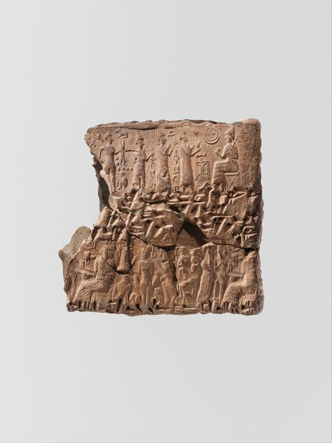
約前 1900 年，亞述商人在安納托利亞中部的 **卡尼什（Kültepe）** 建立**商人殖民網（karum）**：
亞述（阿舒爾） —驢隊、家族分號、契約→ 安納托利亞礦區（錫、銅、織品換銀）
超過 2 萬件出土泥板，記錄了**人類最早的私營跨國貿易組織**：
代理、合夥、信用、關稅、甚至「商業訴訟」——全部有文書為證。

[→ 對外連結：前1900 - 卡尼什亞述商網（文字記錄最早的私營長程貿易組織）](https://chad-liu.github.io/books/html/1-6-7.商業貿易史/-1900-卡尼什亞述商網.html)

## -1000 | 腓尼基地中海貿易網
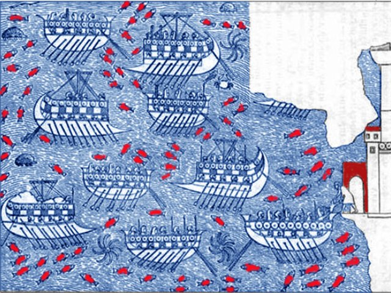
約前 1000 年起，黎凡特海岸的**泰爾、西頓**等城邦把整個地中海變成一張貿易網：
金屬、紫染織品、雪松木材、玻璃沿著一連串**殖民節點**（迦太基、加的斯）流動。
黎凡特製造 ↔ 賽普勒斯 ↔ 西西里／撒丁 ↔ 伊比利亞銀礦
同時擴散的還有一件更重要的商品：**字母文字**——貿易網也是資訊網。

[→ 對外連結：前1000 - 腓尼基地中海貿易網（商人是沒有國家的民族，於是貿易就是國家）](https://chad-liu.github.io/books/html/1-6-7.商業貿易史/-1000-腓尼基地中海貿易網.html)

## -600 | 呂底亞鑄幣
約前 600 年，小亞細亞的**呂底亞王國**（首都薩第斯）鑄造了**第一批標準硬幣**：
電金（金銀天然合金）打上**王印與重量標記**。
稱重 + 驗純 + 砍半試金 ⇒ 看一眼王印即可支付
這是貿易史上**交易成本的第一次斷崖式下降**——貨幣從「每次交易都要檢驗的金屬」
變成「國家信用背書的籌碼」。

[→ 對外連結：前600 - 呂底亞鑄幣（第一批硬幣：把「驗純」的成本外包給國家）](https://chad-liu.github.io/books/html/1-6-7.商業貿易史/-0600-呂底亞鑄幣.html)

## -520 | 波斯御道
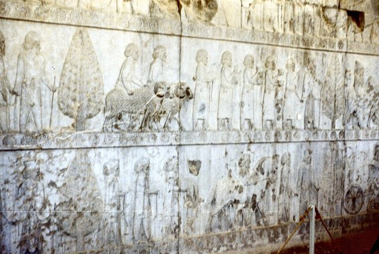
約前 520 年，波斯王**大流士一世**把帝國境內的舊商路整併為**御道（Royal Road）**：
從薩第斯（今土耳其）到蘇薩（今伊朗），約 2,700 公里，
111 個驛站，信使七日可達——**皇帝的信先跑，商隊的貨跟著跑**。
驛站網 → 安全的幹道 → 過境商人 → 過境稅收 → 更多驛站維護
這是史上第一次，**一個國家把「道路」當作貿易基礎設施來投資**。

[→ 對外連結：前520 - 波斯御道（第一條由國家維護的國際貿易幹道）](https://chad-liu.github.io/books/html/1-6-7.商業貿易史/-0520-波斯御道.html)

## -130 | 張騫與絲路
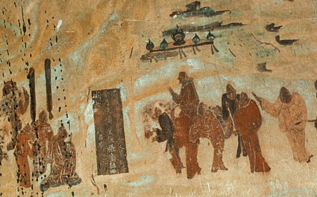
前 138–前 126 年，漢武帝派**張騫**出使西域尋找盟友共擊匈奴；
外交失敗，卻帶回一份**商路偵察報告**。前 121 年霍去病奪河西走廊，
前 111 年設嶺南九郡，漢帝國以軍事開路、以屯田養路、以都護護路——
軍事打通 + 驛站屯田 + 都護監管 ⇒ 絲路常態化
「絲綢之路」這個名字是 1877 年李希霍芬取的，但這條路在
**前 130 年就被一個帝國工程師團隊建成了**。

[→ 對外連結：前130 - 張騫與絲路（帝國親自下場當「路政署長」）](https://chad-liu.github.io/books/html/1-6-7.商業貿易史/-0130-張騫與絲路.html)

## -100 | 季風與羅馬印度航線
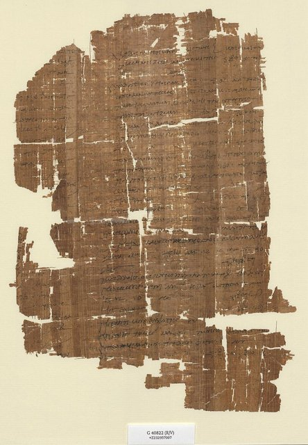
約前 2 世紀末，希臘領航員 **Eudoxus of Cyzicus** 在印度洋學會
**季風航法**：夏乘西南季風去印度，冬乘東北季風回——
靠岸跳島航行（慢、被截租） ⇒ 直渡洋面（快、直航）
到奧古斯都時代，羅馬商船每年上百艘直航印度西海岸——
紅海到印度，**90 天往返，不再需要阿拉伯與波斯的中間商**。

[→ 對外連結：前100 - 季風與羅馬印度航線（跳過所有中間商的第一次嘗試）](https://chad-liu.github.io/books/html/1-6-7.商業貿易史/-0100-季風與羅馬印度航線.html)

## 166 | 大秦使團
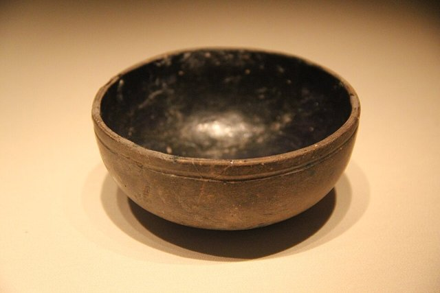
166 年，自稱「大秦王安敦（Marcus Aurelius Antoninus）使者」的一批商人
從日南（今越南中部）抵達漢廷獻象牙、犀角、玳瑁——
羅馬 ↔ 漢: 地球上兩大經濟體第一次官方接觸
但《後漢書》的史官立刻看穿疑點：「其表無絲毫珍異」——
**這是一支冒充使節的商隊**。而它選擇海路而非陸路，本身就是最重要的線索。

[→ 對外連結：166 - 大秦使團（羅馬與漢：只差一步的世界體系）](https://chad-liu.github.io/books/html/1-6-7.商業貿易史/0166-大秦使團.html)

## 762 | 巴格達貿易黃金時代

762 年，阿拔斯王朝哈里發**曼蘇爾**在底格里斯河西岸圈地建**巴格達**——
圓形城市，幾何設計，四門對準四方商路：
印度洋季風航線 + 中亞絲路 + 亞美尼亞—拜占庭商路 + 波斯灣深水港 ⇒ 世界轉運樞紐
9 世紀的巴格達人口近 50 萬，是當時地球上最大的市場：
**辛巴達的傳說，是這座城市貿易暴利的民間備忘錄**。

[→ 對外連結：762 - 巴格達貿易黃金時代（一座為貿易而設計的首都）](https://chad-liu.github.io/books/html/1-6-7.商業貿易史/0762-巴格達貿易黃金時代.html)

## 860 | 維京商路
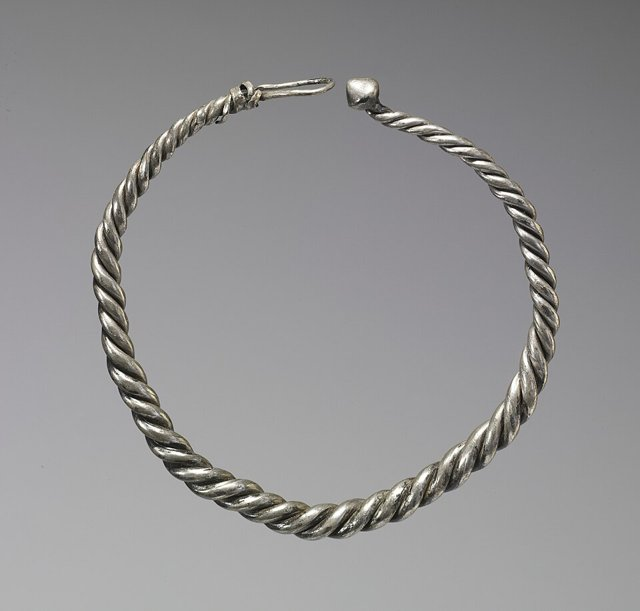
9 世紀，斯堪的納維亞人沿俄羅斯河網南下：
**涅瓦河—沃爾霍夫—第聶伯河→黑海（拜占庭）**，
**伏爾加河→裏海（巴格達）**——
波羅的海毛皮蜜蠟 ↔ 伊斯蘭白銀 ⇒ 羅斯諸城（諾夫哥羅德、基輔）的誕生
維京人既是劫掠者又是商人，出土的 10 萬枚伊斯蘭 dirham 銀幣
證明：**北方森林與巴格達市場之間，存在一條完整的貿易走廊**。

[→ 對外連結：860 - 維京商路（北方絲路：用船把巴格達和波羅的海接起來）](https://chad-liu.github.io/books/html/1-6-7.商業貿易史/0860-維京商路.html)

## 1082 | 威尼斯金印詔書
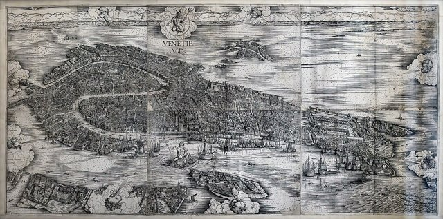
1082 年，拜占庭皇帝**阿萊克修斯一世**為感謝威尼斯海軍擋住諾曼人，
頒發**金印詔書（Golden Bull）**：威尼斯人在全帝國
**免關稅、免入港稅，可進駐君士坦丁堡黃金角**——
軍事保護 ↔ 貿易特權 ⇒ 威尼斯的千帝國
一道節省軍費的詔書，把東地中海的商業動脈永久租給了一個城邦——
**中間商帝國的建國文件**。

[→ 對外連結：1082 - 威尼斯金印詔書（用貿易特權買來的帝國）](https://chad-liu.github.io/books/html/1-6-7.商業貿易史/1082-威尼斯金印詔書.html)

## 1206 | 蒙古治世商路
1206 年成吉思汗統一草原，其後半個世紀蒙古帝國橫貫歐亞——
並把**商路安全**作為帝國的基本工程：
驛站（öörtöö，站赤）、商隊護照（牌符）、統一路況與法律——
Pax Mongolica: 歐亞大陸首次由一個政權提供全程治安
陸上絲路進入**流量最高峰**——也進入了它最後的高峰。

[→ 對外連結：1206 - 蒙古治世商路（用暴力統一的「自由貿易區」）](https://chad-liu.github.io/books/html/1-6-7.商業貿易史/1206-蒙古治世商路.html)

## 1271 | 馬可波羅東行
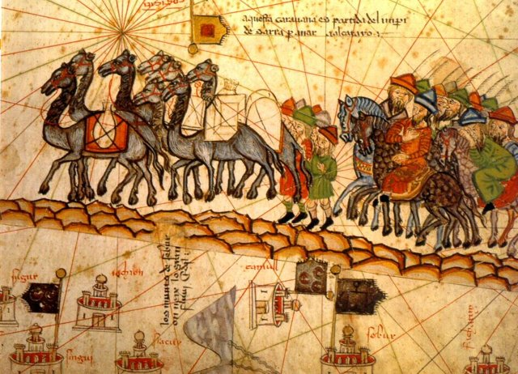
1271 年，威尼斯商人**波羅兄弟**攜少年馬可，沿絲路東行至元大都，
在忽必烈朝廷供職 17 年，1298 年獄中口述成書——
《馬可波羅遊記》: 歐洲第一份關於東方市場的系統性情報
它告訴歐洲三件事：中國的市場大得驚人、路是通的、
**價差是天文數字**——此後兩百年，歐洲的航海野心都在為這份報告打工。

[→ 對外連結：1271 - 馬可波羅東行（一份讓歐洲失眠的市場調研報告）](https://chad-liu.github.io/books/html/1-6-7.商業貿易史/1271-馬可波羅東行.html)

## 1291 | 馬木路克香料壟斷
1291 年，馬木路克蘇丹**阿什拉夫·哈利勒**攻陷**阿卡（Acre）**——
十字軍國家在黎凡特的最後據點滅亡：
紅海—亞歷山大航線 ⇒ 埃及蘇丹的皇家壟斷
胡椒、薑、肉桂從此只能走**馬木路克的亞歷山大港**，經蘇丹轉賣威尼斯——
歐洲的香料價格成為**蘇丹財政的提款機**——
這條壟斷鏈運轉兩百年，直到葡萄牙人繞過整個鏈條。

[→ 對外連結：1291 - 馬木路克香料壟斷（把地中海的香料水龍頭擰小）](https://chad-liu.github.io/books/html/1-6-7.商業貿易史/1291-馬木路克香料壟斷.html)

## 1368 | 明初海禁
1368 年朱元璋建明，隨即頒布**海禁**：片板不許下海，
民間海外貿易非法，對外交往限於官方朝貢——
14 世紀世界最大製造業國 —自願→ 貿易地下化
結果可預測：**走私帝國崛起**——從漳州月港到日本倭寇，
整個 15–16 世紀的東亞海洋史，是這道禁令的影子市場史。

[→ 對外連結：1368 - 明初海禁（世界最大市場主動退出海洋）](https://chad-liu.github.io/books/html/1-6-7.商業貿易史/1368-明初海禁.html)

## 1405 | 鄭和下西洋
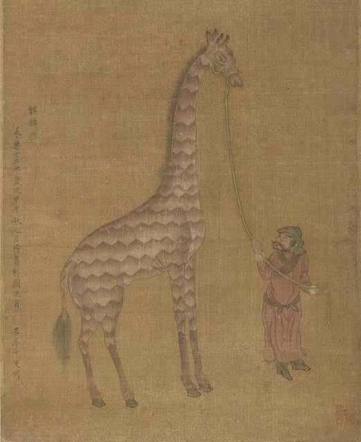
1405 年，三寶太監**鄭和**率 200 餘艘船、2.7 萬人首下西洋；
至 1433 年七下西洋，寶船長逾百米，遠達東非——
技術與規模：明代 > 同期葡萄牙 + 威尼斯總和
但這支艦隊**幾乎不賺錢**——它買貴賣賤、賞賜遠超收入——
史上最強的遠洋能力，配上一套反商業的會計制度。

[→ 對外連結：1405 - 鄭和下西洋（史上最大艦隊的貿易悖論）](https://chad-liu.github.io/books/html/1-6-7.商業貿易史/1405-鄭和下西洋.html)

## 1433 | 下西洋終止
1433 年鄭和病逝於古里（印度西海岸），第七次下西洋落幕；
隨後新帝與官僚系統**永久終止**遠航：
檔案封存（相傳兵部尚書劉大夏焚毀海圖）、造船場停工、
海船建造被明令禁止——
世界最強海軍 —一道行政決定→ 歸零
沒有戰敗、沒有外敵——**這是史上最徹底的單方面裁軍**。

[→ 對外連結：1433 - 下西洋終止（一場官僚財政對藍水海軍的勝利）](https://chad-liu.github.io/books/html/1-6-7.商業貿易史/1433-下西洋終止.html)

## 1453 | 君士坦丁堡陷落

1453 年 5 月，鄂圖曼穆罕默德二世攻陷君士坦丁堡——
博斯普魯斯海峽 → 鄂圖曼關卡: 歐亞貿易的咽喉被插入一把鎖
傳統敘事說「陸路斷絕逼出大航海」——本案偵查將修正這一傳說：
**陸路從未完全斷絕，但租金持續上漲**——
而正是這份「溫水式的漲租」，把葡萄牙逼向了海洋。

[→ 對外連結：1453 - 君士坦丁堡陷落與香料危機（中間商收租的最後通牒）](https://chad-liu.github.io/books/html/1-6-7.商業貿易史/1453-君士坦丁堡陷落.html)

## 1488 | 迪亞士好望角
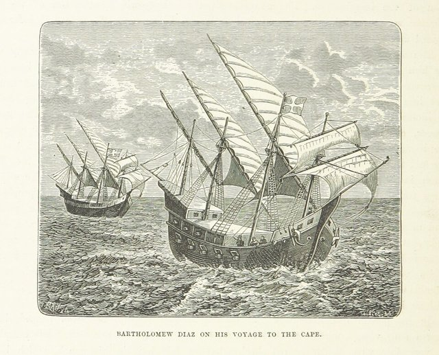
1488 年，葡萄牙船長**巴爾托洛梅烏·迪亞士**在風暴中被吹向南，
繞過非洲南端（他命名「風暴角」，國王改名**好望角**）——
大西洋 ⇔ 印度洋: 通往印度的海路被證明存在
十年後（1497）達伽馬沿同一航線直抵印度——
**1488 年的意義不是到達，而是「路徑的存在性證明」**。

[→ 對外連結：1488 - 迪亞士好望角（風的知識成為最貴的商品）](https://chad-liu.github.io/books/html/1-6-7.商業貿易史/1488-迪亞士好望角.html)

## 1494 | 托爾德西里亞斯條約
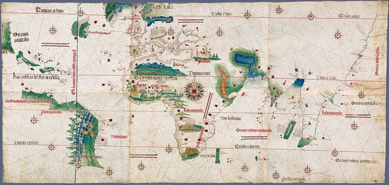
1494 年 6 月 7 日，西班牙與葡萄牙在**托爾德西里亞斯**簽約：
教宗亞歷山大六世調停: 佛得角以西 370 里格劃線
線以東（非洲、印度）歸葡，以西（美洲大部）歸西——
**人類史上第一次，兩個國家宣稱擁有半個地球的貿易權**——
其他國家（法、英、荷）被直接排除在「合法性」之外。

[→ 對外連結：1494 - 托爾德西里亞斯條約（兩個帝國用一條經線分割地球）](https://chad-liu.github.io/books/html/1-6-7.商業貿易史/1494-托爾德西里亞斯條約.html)

## 1498 | 達伽馬直航印度

1498 年 5 月，**瓦斯科·達伽馬**在馬林迪領航員（Ibn Majid 傳說）引導下
穿越印度洋，抵達卡利卡特（Calicut）——
里斯本 → 好望角 → 印度: 歐洲第一次直連香料原產地
第一次航行的帳本：投資 24 萬 reais，回收 100 萬+——**毛利近 3 倍**——
之後的航次利潤率更高。繞過馬木路克、鄂圖曼、威尼斯、
中亞全部中間層——**一條航線，斬斷了三層帝國的財政**。

[→ 對外連結：1498 - 達伽馬直航印度（中間商千年利潤的斬首行動）](https://chad-liu.github.io/books/html/1-6-7.商業貿易史/1498-達伽馬直航印度.html)

## 1557 | 澳門開埠
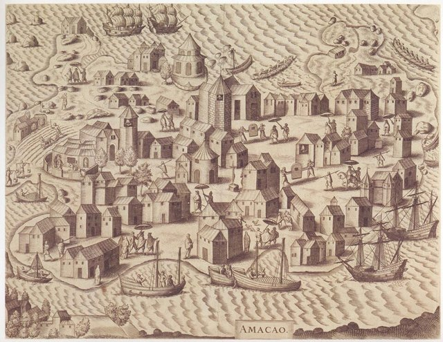
1557 年，明帝國默許**葡萄牙人定居澳門**——以繳租、聽政為條件：
海禁祖制 + 白銀需求 + 地方治理成本 ⇒ 一個特許飛地
澳門迅速成為**廣州的外港**：中國絲綢 × 日本白銀 × 東南亞香料的
三角套利樞紐——一口側門，打通了東亞與全球白銀循環。

[→ 對外連結：1557 - 澳門開埠（帝國開的一扇側門，與一個絲銀貿易圈）](https://chad-liu.github.io/books/html/1-6-7.商業貿易史/1557-澳門開埠.html)

## 1565 | 馬尼拉大帆船
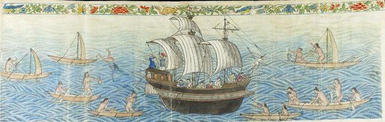
1565 年，西班牙修士 Urdaneta 找到回程航路，**馬尼拉大帆船（Galeón de Manila）**
開始每年往返阿卡普爾科—馬尼拉，達 250 年：
波托西白銀 → 阿卡普爾科 → 馬尼拉 → 中國絲綢 → 美洲/歐洲
史上第一次，**美洲、歐洲、亞洲被一條固定的商業動脈連成一體**——
白銀成為全球通用語，中國成為白銀的終極黑洞。

[→ 對外連結：1565 - 馬尼拉大帆船（白銀全球化：第一次真正的世界市場）](https://chad-liu.github.io/books/html/1-6-7.商業貿易史/1565-馬尼拉大帆船.html)

## 1602 | 特許公司時代
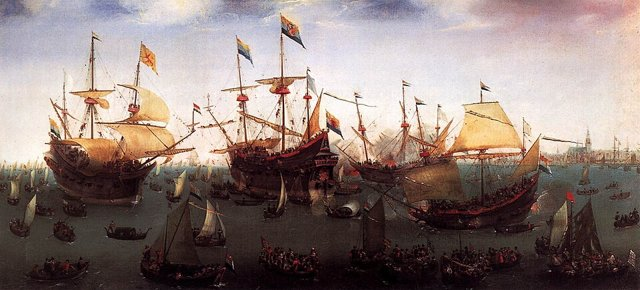
1600 年英國特許**東印度公司（EIC）**，1602 年荷蘭議會特許
**荷蘭東印度公司（VOC）**——
國家壟斷特許 + 永久資本 + 可轉讓股份 + 武裝與外交權 ⇒ 公司帝國
貿易從「一趟一清的合夥」變成**永續的法人**——
遠洋貿易的風險結構被重新發明，歐亞貿易的遊戲規則自此由公司書寫。

[→ 對外連結：1602 - 特許公司時代（把遠洋貿易裝進法人組織）](https://chad-liu.github.io/books/html/1-6-7.商業貿易史/1602-特許公司時代.html)

## 1651 | 航海法案
1651 年，英格蘭共和國通過**航海法案（Navigation Acts）**：
亞洲、非洲、美洲的貨物**必須由英國船**（英國籍、多數英國船員）運抵英國——
貿易權 ⇒ 綁定在國籍上: 航運業的國家壟斷
直接目標是**荷蘭**（當時的「歐洲馬車夫」，承運歐洲大半貿易）——
第一次英荷戰爭（1652–54）隨即爆發——
**這是一部用來打仗的貿易法**。

[→ 對外連結：1651 - 英國航海法案（貿易必須用我的船：重商主義的立法標本）](https://chad-liu.github.io/books/html/1-6-7.商業貿易史/1651-航海法案.html)

## 1663 | 三角貿易

17 世紀中葉起，大西洋貿易定型為**三角系統**：
歐洲製成品 → 非洲（換奴隸） → 美洲種植園（糖、菸草、棉花） → 歐洲
1501–1866 年間約 **1,250 萬**非洲人被裝船運往美洲——
史上最大規模的**強制勞動力貿易**——
貿易史上最黑暗的一頁：**市場效率與人道災難的完全重合**。

[→ 對外連結：1663 - 三角貿易（大西洋奴隸經濟：被設計的強制分工）](https://chad-liu.github.io/books/html/1-6-7.商業貿易史/1663-三角貿易.html)

## 1684 | 清朝開海
1684 年（康熙二十三年），平定台灣鄭氏後，清廷頒布**開海令**：
廢遷界、復市舶，設**粵、閩、浙、江四海關**——
遷界 20 年（1661–1683） —開海→ 四口通商的新秩序
這是中國自明初海禁以來，**第一次用海關（而非朝貢）制度**管理海洋——
中國正式接入白銀全球化的主動脈。

[→ 對外連結：1684 - 清朝開海（帝國與海洋的第二次和解）](https://chad-liu.github.io/books/html/1-6-7.商業貿易史/1684-清朝開海.html)

## 1757 | 廣州一口通商
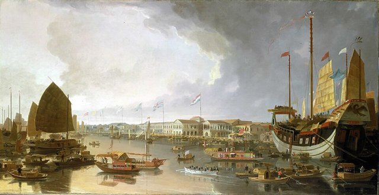
1757 年，乾隆帝諭令：西洋商船**只准在廣州**停泊貿易——
四口通商（1684–1757） ⇒ 一口通商: 廣州體系的封頂
配合**公行（Cohong）**行商制度：歐商不得直通中國官府，
一切經行商中介、擔保、代繳稅餉——
**貿易被裝進一個港口、一層中介、一套稅則**——
運行 84 年，直到炮艦拆門。

[→ 對外連結：1757 - 廣州一口通商（壟斷口岸的誕生與它的宿命）](https://chad-liu.github.io/books/html/1-6-7.商業貿易史/1757-廣州一口通商.html)

## 1784 | 中国皇后号
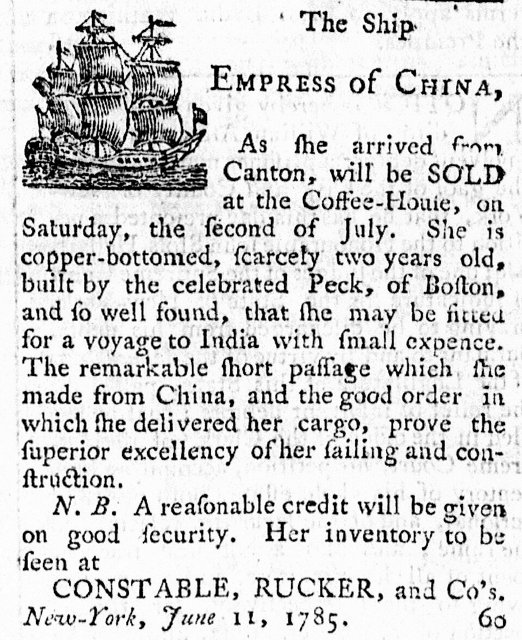
1784 年 2 月，美國商船**中国皇后号（Empress of China）**駛離紐約，
8 月抵廣州——
獨立後 8 個月的美國 → 直接接入中國貿易: 人參換茶葉
單航次毛利約 3 萬美元（投資 12 萬）——**25% 回報，一年周期**——
紐約—波士頓商人聞風而動，19 世紀初美國對華貿易
躍居對外貿易前列——**一艘船開啟了美國的亞洲貿易傳統**。

[→ 對外連結：1784 - 中国皇后号（新生國家的第一張全球貿易入場券）](https://chad-liu.github.io/books/html/1-6-7.商業貿易史/1784-中国皇后号.html)

## 1839 | 鴉片戰爭
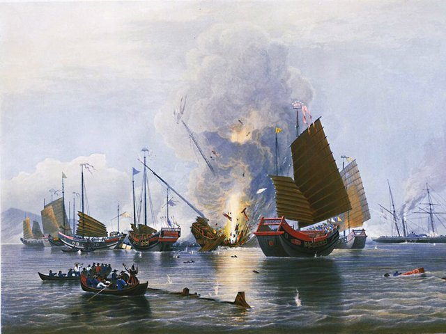
1839 年林則徐虎門銷煙，1840 年英國艦隊東來，1842《南京條約》——
貿易逆差 + 走私毒品 + 主權封閉 —炮艦→ 條約體系
五口通商、協定關稅、香港割讓、領事裁判權——
**東亞貿易規則由武力重寫**——
這是貿易史上最刺眼的案件：**一場為毒品走私開路的「貿易戰爭」**。

[→ 對外連結：1839 - 鴉片戰爭與條約貿易體系（用炮艦「再平衡」的貿易逆差）](https://chad-liu.github.io/books/html/1-6-7.商業貿易史/1839-鴉片戰爭.html)

## 1846 | 廢除穀物法
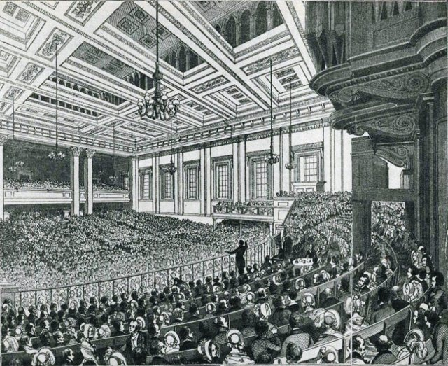
1846 年 6 月，英國議會**廢除穀物法（Corn Laws）**——
取消對進口穀物的保護關稅——
世界工廠 —單邊自由貿易→ 第一次全球開放實驗
當時的世界霸主，主動放棄最大宗商品的進口壁壘——
**自由貿易從經濟學論文變成國家政策，自 1846 年始**——
（同年愛爾蘭大饑荒爆發，成為壓垮保護主義的最後稻草，也是最大的道德諷刺。）

[→ 對外連結：1846 - 廢除穀物法（理論戰勝利益集團的第一次單邊自由貿易）](https://chad-liu.github.io/books/html/1-6-7.商業貿易史/1846-廢除穀物法.html)

## 1869 | 蘇伊士運河
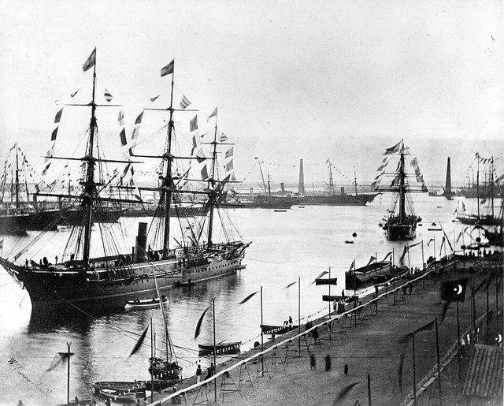
1869 年 11 月 17 日，**蘇伊士運河**通航：
倫敦—孟買: 19,700 km（繞好望角） ⇒ 11,600 km
東西航程縮短 40%+，倫敦到香港的郵船時間從 3 個月壓到 6 週——
**地球的海運拓撲被一根 164 公里的溝渠重寫**——
好望角航線 400 年的壟斷地位瞬間貶值，
埃及成為全球貿易的咽喉——**也成為帝國掠奪的靶心**。

[→ 對外連結：1869 - 蘇伊士運河（海運幾何的重畫與帝國神經中樞的誕生）](https://chad-liu.github.io/books/html/1-6-7.商業貿易史/1869-蘇伊士運河.html)

## 1879 | 金本位與第一次全球化
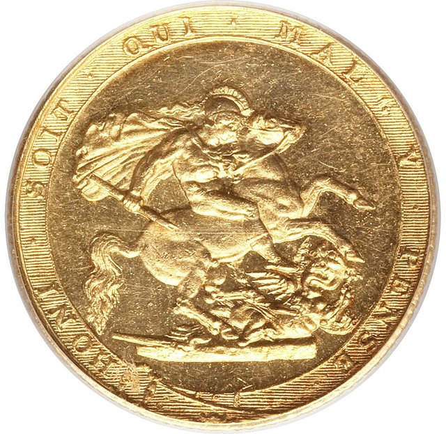
1870s 起，各主要經濟體相繼採用**金本位**（德國 1871、
美國 1873/1879、日本 1897、印度 1898）——
倫敦 ⇔ 巴黎 ⇔ 柏林 ⇔ 東京: 一盎司黃金的匯率錨
到 1900 年，全球 80%+ 貿易以金本位國家計價——
**匯率風險趨近於零、資本自由流動、倫敦作為清算中心**——
第一次全球化（1870–1914）的**制度底座**完成。

[→ 對外連結：1879 - 金本位與第一次全球化（貨幣統一：貿易成本的最後一塊拼圖）](https://chad-liu.github.io/books/html/1-6-7.商業貿易史/1879-金本位與第一次全球化.html)

## 1914 | 全球化中斷
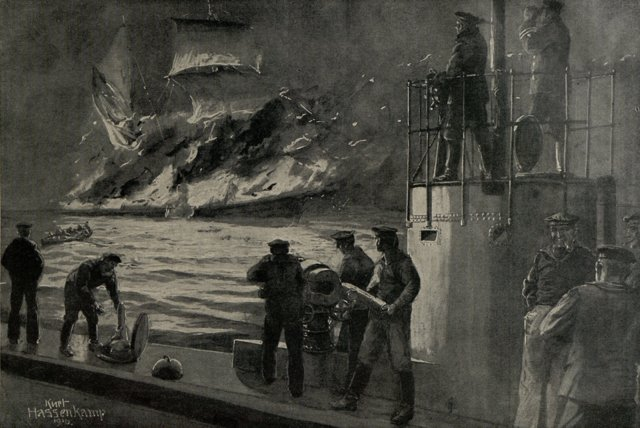
1914 年 8 月，歐洲大戰爆發：
全球貿易 —封鎖+潛艇+關稅+貨幣混亂→ -1/3 以上
1913 年的貿易佔 GDP 比重，**要到 1970 年代才恢復**——
一場戰爭把 60 年的全球化存款一筆勾銷——
**證明：貿易網的連通性可以在數週內被政治決定歸零**。

[→ 對外連結：1914 - 一戰與全球化中斷（史上最深的貿易網被人為切斷）](https://chad-liu.github.io/books/html/1-6-7.商業貿易史/1914-全球化中斷.html)

## 1930 | 斯姆特霍利關稅
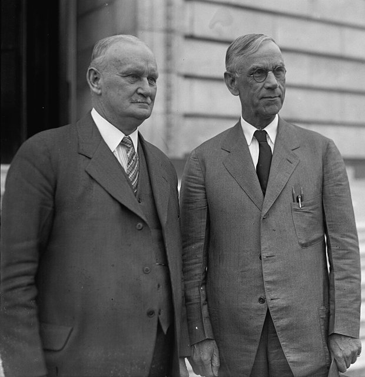
1930 年 6 月，美國《斯姆特–霍利關稅法》把兩萬多種商品的
進口關稅推到歷史峰值（平均 ~45%）——
加拿大 → 德 → 法 → 意 → ·s : 報復連鎖
美國進口 1929–33 暴跌 **66%**、出口暴跌 **61%**——
世界貿易萎縮約 **2/3**——
**史上最著名的「想保護自己，結果保護了蕭條」的立法**。

[→ 對外連結：1930 - 斯姆特–霍利關稅（貿易報復的連鎖反應實錄）](https://chad-liu.github.io/books/html/1-6-7.商業貿易史/1930-斯姆特霍利關稅.html)

## 1934 | 互惠貿易協定法
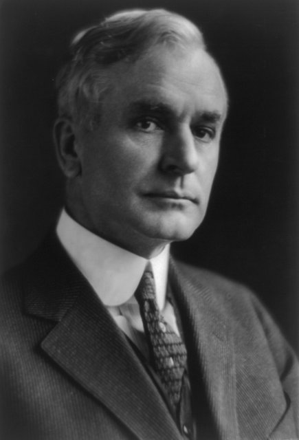
1934 年 6 月，羅斯福簽署《**互惠貿易協定法（RTAA）**》：
總統獲得授權，可與外國**談判互相降稅**（無須逐案國會批准）——
立法關稅（遊說加碼） ⇒ 行政談判關稅（互惠打包）
1934–39 年簽署 21 個協定，美國平均關稅從 ~46% 降至 ~33%——
**這是一個程序設計的勝利：同一個國家、同一批議員，
換了一種流程，政策方向 180 度轉向**。

[→ 對外連結：1934 - 互惠貿易協定法（把關稅從國會搬進談判室）](https://chad-liu.github.io/books/html/1-6-7.商業貿易史/1934-互惠貿易協定法.html)

## 1947 | GATT
1947 年 10 月，23 國在日內瓦簽署《**關稅與貿易總協定（GATT）**》——
原本是**國際貿易組織（ITO）的臨時替代品**（ITO 1950 流產）——
最惠國 + 國民待遇 + 約束關稅 + 爭端程序 = 貿易的多邊憲章
這份「臨時協定」運行了 47 年、八輪談判，
最終演化為 WTO——**戰後全球化的憲法基礎**。

[→ 對外連結：1947 - GATT 與戰後貿易秩序（把貿易規則寫進多邊條約）](https://chad-liu.github.io/books/html/1-6-7.商業貿易史/1947-GATT.html)

## 1956 | 集裝箱革命
1956 年 4 月 26 日，**Ideal-X** 號拖著 58 個改裝卡車集裝箱
從紐瓦克駛向休士頓——麥克萊恩（Malcom McLean）的實驗——
散裝雜貨裝卸 —集裝箱→ 整箱直轉: 裝卸成本 -90\%+
碼頭費從 5.86/噸 降到 0.16/噸；1960s 交接時間從 2 週壓到 1 天——
**世界貿易的地理與分工被一個 20 呎鋼盒重新定義**。

[→ 對外連結：1956 - 集裝箱革命（一個鋼盒如何重寫全球分工）](https://chad-liu.github.io/books/html/1-6-7.商業貿易史/1956-集裝箱革命.html)

## 1965 | 出口導向工業化
1960s 中葉起，韓國、台灣、新加坡、香港（後有日本先行）放棄
**進口替代**路線，轉向**出口導向工業化（EOI）**：
出口加工區 + 外資引進 + 匯率貶值 + 紀律性干預 ⇒ 製造業起飛
韓國人均 GDP：1960 年 158 → 1990 年 6,600+——
**兩代人的時間，從戰後廢墟到已開發行列**——
這是發展經濟學的分水嶺案件：**貿易作為成長引擎的實錘**。

[→ 對外連結：1965 - 出口導向工業化（亞洲四小龍：靠貿易致富的第三條路）](https://chad-liu.github.io/books/html/1-6-7.商業貿易史/1965-出口導向工業化.html)

## 1973 | 石油危機與石油美元
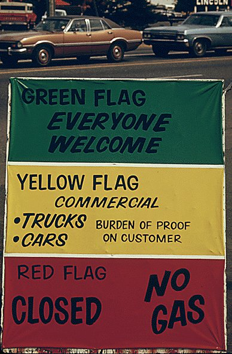
1973 年 10 月，贖罪日戰爭後 OPEC **石油禁運**：
油價 4 個月內從 3 → 12（4 倍）——
貿易條款 —武器化→ 地緣政治籌碼
但案件的第二幕更關鍵：1974 美國與沙烏地阿拉伯秘密協議——
石油以**美元計價**、油款回流美國國債（petrodollar recycling）——
**一次供給衝擊，意外完成了美元霸權的重建**。

[→ 對外連結：1973 - 石油危機與石油美元（貿易條款的武器化與美元的再中心化）](https://chad-liu.github.io/books/html/1-6-7.商業貿易史/1973-石油危機與石油美元.html)

## 1978 | 改革開放
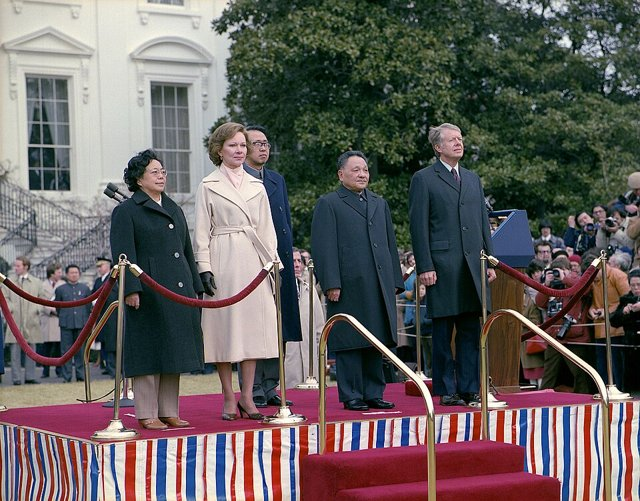
1978 年 12 月，十一屆三中全會：鄧小平定調**改革開放**——
特區試驗 + 外資工廠 + 加工貿易 ⇒ 世界工廠的裝配線啟動
1978 年中國貨物貿易占世界比重 0.8% → 2013 年起穩居世界第一——
**史上最大規模的貿易接入事件**——
全球勞動力供給一夜之間（經濟學意義上）翻倍。

[→ 對外連結：1978 - 改革開放（十億人接入世界市場）](https://chad-liu.github.io/books/html/1-6-7.商業貿易史/1978-改革開放.html)

## 1995 | WTO成立
1995 年 1 月 1 日，**世界貿易組織（WTO）**取代 GATT——
烏拉圭回合（1986–94）的產物：
GATT（臨時協定、無強制） ⇒ WTO（永久組織、爭端裁決有牙齒）
爭端解決機制（DSU）：**敗訴不改 → 授權報復**——
貿易規則第一次有了**準司法的強制力**——
同時，管轄範圍擴張到**服務、知識產權、農業**——
一體化的深化與反彈同時啟動。

[→ 對外連結：1995 - WTO 成立（貿易從條約變成法庭）](https://chad-liu.github.io/books/html/1-6-7.商業貿易史/1995-WTO成立.html)

## 2001 | 中國入世
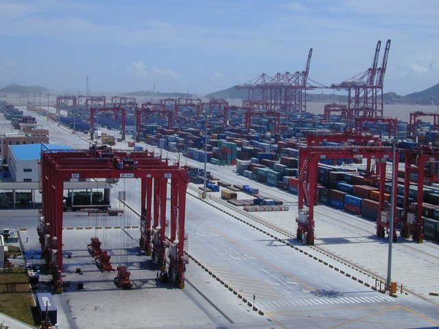
2001 年 12 月 11 日，中國正式加入**WTO**——
最惠國永久化 + 關稅減讓 + 服務開放承諾 ⇒ 出口機器全速運轉
2001–2013：中國出口 266B → 2.2 萬億，**成為第一出口大國**；
美國製造業就業失去 ~300 萬（其中相當部分歸因於「中國衝擊」）——
**史上最大的貿易整合事件，也是史上最大的貿易政治引爆點**。

[→ 對外連結：2001 - 中國入世（世界工廠的十年）](https://chad-liu.github.io/books/html/1-6-7.商業貿易史/2001-中國入世.html)

## 2008 | 貿易大衰退
2008–09 年，雷曼倒閉引發的金融海嘯傳導至實體貿易：
世界貿易量: 2008Q4 ～ 2009Q2 -15\% ～ -18\% (年率)
**跌幅遠超 GDP**（GDP 只跌 ~5%）——
「**貿易的超跌之謎（trade collapse puzzle）**」——
一場金融危機殺死了兩倍於經濟產出的貿易——
**全球化第一次顯示出它的「槓桿性」：繁榮放大、崩潰也放大**。

[→ 對外連結：2008 - 全球金融危機與貿易大衰退（世界貿易史上最深的單年崩跌）](https://chad-liu.github.io/books/html/1-6-7.商業貿易史/2008-貿易大衰退.html)

## 2018 | 美中貿易戰
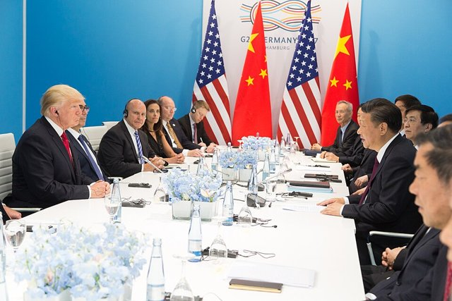
2018 年 3 月起，美國依 §301 對華加徵關稅（最終覆蓋 ~$3,700 億進口），
中國反制（~$1,100 億）——
關稅 → 實體清單 → 投資限制 → 技術管制 → 供應鏈陣營化
升級路徑清晰：**貿易戰 → 技術戰 → 制度戰**——
戰後 80 年來，兩個最大經濟體第一次**系統性拆解貿易整合**——
「效率優先」的全球化邏輯正式讓位於「安全優先」。

[→ 對外連結：2018 - 美中貿易戰（供應鏈的政治化開端）](https://chad-liu.github.io/books/html/1-6-7.商業貿易史/2018-美中貿易戰.html)

## 2020 | 疫情與供應鏈重構
2020 年 3 月，新冠疫情同時凍結供給與需求：
封城 + 停工 + 斷航 ⇒ 貨櫃運價 × 10、缺晶片、缺嬰兒粉
2021 蘇伊士運河「長賜輪」擱淺 6 天（堵住 12% 全球貿易）——
接著烏克蘭戰爭（能源、糧食）、台海焦慮（晶片）——
**三年內，全球供應鏈的每一個單點故障被逐一點名**——
「**供應鏈韌性**」從後勤術語升級為國家安全議題。

[→ 對外連結：2020 - 疫情與供應鏈重構（效率 vs 韌性：貿易邏輯的世紀翻轉）](https://chad-liu.github.io/books/html/1-6-7.商業貿易史/2020-疫情與供應鏈重構.html)
