<!--
內容整理自 D:\Books\html\1-1.西方歷史\特洛伊戰爭大事記.html（沒有對應的 md 筆記），並整合中文維基百科〈特洛伊戰爭〉〈特洛伊〉條目，以自己的話改寫。
這是神話與史詩的時間軸，不是有可靠年代的歷史：頁面明確說明「依常見故事版本的先後排列，並非有可靠年代記錄的歷史年表」，也提醒木馬計、十年戰爭等情節無法由現有證據證實。為了讓事件能在時間軸上排列，這裡借用古代學者埃拉托斯特尼（約前275年生）推算的傳統年代，把戰爭放在前1194–前1184年（維基百科：特洛伊在前1184年陷落，對應特洛伊VIIa遭到破壞）；希羅多德推測在前1250年左右，也有人把破城時間放在前1370年或前1334年，維基百科說傳統上認為戰爭發生在前13或12世紀，特洛伊VIIa約為前1300–前1190年。所有事件的年份只是為了排序，每則事件的日期標籤都寫成「神話：戰前」「神話：戰爭第N年」「神話：戰後」，讀者不可當成史實。
兩份資料出入與處理方式：
- 頁面按故事順序整理成33則，並在最後附「完整時間軸」29項；這裡把它們合併成約二十八則事件，頁面的「主要人物關係表」「神祇陣營」「與考古學、《伊利亞德》、《奧德賽》、羅馬建國神話的關係」「三場戰爭的比較」寫進時期說明與相關事件。
- 同一年內事件的先後次序依故事情節排列：《伊利亞德》只寫戰爭第十年的幾個星期，所以決裂、決鬥、帕特羅克洛斯之死、赫克托耳之死等事件都放在「戰爭第10年」，同一年的事件依檔案順序排。
- 《伊利亞德》沒有寫的情節：頁面反覆提醒阿基里斯浸冥河、腳跟的弱點、被帕里斯射死、木馬計與特洛伊陷落都不在《伊利亞德》裡，而是來自其他史詩、悲劇與後世傳說；這裡在這些事件的內文註明出處，不當成荷馬的情節。阿基里斯隱居斯基羅斯島、伊菲革涅亞的獻祭也不是《伊利亞德》的主要情節，且有不同版本（獻祭或被救走），兩種都寫。
- 海倫：頁面說不同版本對海倫是自願離去還是被誘拐、戰後的命運並不一致，照此。
- 考古：頁面說希薩利克（今土耳其西北部）的遺址確實存在，多個不同時期的城市遺層疊在一起；維基百科補充1868年德國考古學家施利曼會見英國業餘考古學家卡爾佛特，卡爾佛特指出特洛伊在希薩利克並說服施利曼，施利曼在1871年開始發掘（〈特洛伊〉寫1871年發現遺址）；「特洛伊I–IX」九層遺址的年代，特洛伊VIIa（約前1300–前1190年）被認為最接近史詩中的特洛伊，這裡寫成1871年一則事件。
- 譯名：維基百科作「施利曼」「卡爾佛特」，頁面作帕里斯、赫克托耳、墨涅拉俄斯、阿伽門農、普里阿摩斯等，這裡照頁面；人名分隔號用·。
圖片來源（皆為 Wikimedia Commons 公有領域／CC0 作品；繪畫與雕塑的年代多為後世作品，不代表事件當時的樣貌）：
- tw-cover.jpg：The Procession of the Trojan Horse in Troy by Giovanni Domenico Tiepolo (cropped).jpg（提耶波羅〈特洛伊木馬遊行〉（部分））
- tw-paris.jpg：Rubens - Judgement of Paris.jpg（魯本斯〈帕里斯的裁判〉）
- tw-helen.jpg：The Love of Paris and Helen by Jacques-Louis David.jpg（大衛〈帕里斯與海倫的愛情〉，1788）
- tw-skyros.jpg：Anthonis van Dyck werkstatt - Achilles among the daughters of Lycomedes 6002295.jpg（范戴克工作室〈阿基里斯在呂科墨得斯的女兒們之中〉）
- tw-iphigenia.jpg：MANNapoli 9112 Sacrifice Iphigenia painting.jpg（龐貝壁畫〈伊菲革涅亞的獻祭〉）
- tw-iliad.jpg：AmbrosianIliadPict47Achilles.jpg（《安布羅修斯伊利亞德》抄本中的插畫（約5–6世紀））
- tw-patroclus.jpg：Gavin Hamilton - Achilles Lamenting the Death of Patroclus - NG 2339 - National Galleries of Scotland.jpg（漢密爾頓〈阿基里斯哀悼帕特羅克洛斯之死〉）
- tw-hector.jpg：Jacques-Louis David - Andromache Mourning Hector - WGA6050.jpg（大衛〈安德洛瑪刻哀悼赫克托耳〉，1783）
- tw-priam.jpg：Gavin Hamilton (1723-1798) - Priam Pleading with Achilles for the Body of Hector - T00864 - Tate.jpg（漢密爾頓〈普里阿摩斯向阿基里斯請求兒子的遺體〉）
- tw-achillesdeath.jpg：Peter Paul Rubens 179.jpg（魯本斯〈阿基里斯之死〉）
- tw-ajax.jpg：Ajax suicide BM F480.jpg（大埃阿斯自殺（古希臘紅繪陶瓶，大英博物館藏））
- tw-philoctetes.jpg：The Wounded Philoctetes (1854-55).jpg（〈受傷的菲洛克忒忒斯〉雕像（1854–55））
- tw-laocoon.jpg：Laocoön and his sons group.jpg（〈拉奧孔與他的兒子們〉群像（梵蒂岡，羅馬時代））
- tw-agamemnon.jpg：Gold death-mask known as ‘Mask of Agamemnon,’ Mycenae, Grave Circle A, Grave V, 16th cent. BC. (28423089016).jpg（邁錫尼的「阿伽門農面具」（約前16世紀，與傳說中的阿伽門農無關））
- tw-odysseus.jpg：Arnold Böcklin - Odysseus and Polyphemus.jpg（勃克林〈奧德修斯與波呂斐摩斯〉）
- tw-aeneas.jpg：Batoni, Pompeo — Aeneas fleeing from Troy — 1750.jpg（巴托尼〈埃涅阿斯逃離特洛伊〉，1750）
- tw-schliemann.jpg：Heinrich Schliemann Kohn BNF Gallica.jpg（海因里希·施利曼）
-->

# Periods
- -1203 ~ -1195 | 戰爭的起因與集結 | #868e96
  金蘋果之爭、帕里斯的裁判與帶走海倫，使希臘諸王照著當年求婚者的誓言組成聯軍，在奧利斯遇到逆風，傳說阿伽門農為此獻祭女兒伊菲革涅亞。
- -1194 ~ -1186 | 圍城的前九年 | #1971c2
  希臘聯軍抵達特洛伊，堅固的城牆讓戰爭變成長期的圍城與周邊地區的衝突；《伊利亞德》沒有寫這九年的細節。
- -1186 ~ -1184 | 戰爭的第十年（《伊利亞德》） | #c92a2a
  阿伽門農與阿基里斯為了戰利品決裂，阿基里斯退出戰場，赫克托耳反攻；帕特羅克洛斯之死使阿基里斯重返戰場並殺死赫克托耳，史詩以赫克托耳的葬禮結束。
- -1184 ~ -1174 | 特洛伊陷落與返鄉 | #495057
  阿基里斯死去，希臘人用木馬計攻陷特洛伊；英雄們各有不同的歸途，阿伽門農被殺，奧德修斯歷險十年才回到伊薩卡，埃涅阿斯成為羅馬傳說的祖先。

# Events

## -1203 | 帕琉斯與忒提斯的婚禮 {label="神話：戰前"}
英雄帕琉斯與海洋女神忒提斯舉行婚禮，諸神大多受邀，唯獨紛爭女神厄里斯沒有。她為了報復，把一顆寫著「獻給最美麗的女神」的金蘋果投進宴席，天后赫拉、智慧與戰爭女神雅典娜、愛與美之神阿芙蘿黛蒂都認為自己最有資格得到它，「金蘋果之爭」埋下了特洛伊戰爭的伏筆。
特洛伊戰爭是古希臘神話中最著名的戰爭，主要見於荷馬史詩《伊利亞德》與《奧德賽》。特洛伊遺址確實存在，但希臘聯軍是否真的曾發動這樣的戰爭、戰爭是否持續十年，都無法由現有證據證實，傳統上常把戰爭設定在前12世紀前後，這並不是確立的歷史紀年。

## -1202 | 帕里斯的裁判 {label="神話：戰前"}
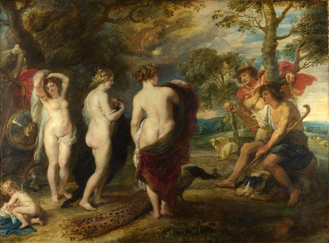
三位女神無法自己決定，於是請特洛伊王子帕里斯裁判。赫拉承諾給他權力與王國，雅典娜承諾給他智慧與戰場上的勝利，阿芙蘿黛蒂承諾讓他得到世界上最美麗的女子；帕里斯選擇了阿芙蘿黛蒂。赫拉與雅典娜從此對帕里斯與特洛伊人懷恨在心，諸神在日後的戰爭中也分成不同陣營：赫拉與雅典娜支持希臘人，阿芙蘿黛蒂支持特洛伊人。

## -1196 | 帕里斯帶走海倫 {label="神話：戰前"}
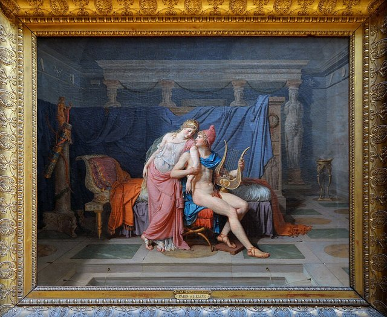
斯巴達王后海倫是宙斯與勒達的女兒，以美貌聞名，嫁給斯巴達國王墨涅拉俄斯。帕里斯前往斯巴達受到款待，在阿芙蘿黛蒂的安排下與海倫相戀，帶著她回到特洛伊。不同版本對這段事件的描述並不一致：有的說海倫自願離去，有的強調她受到誘惑或被帶走。

## -1195 | 希臘諸王組成聯軍 {label="神話：戰前"}
墨涅拉俄斯向哥哥邁錫尼國王阿伽門農求助，阿伽門農成為聯軍的最高統帥。傳說海倫的求婚者曾立誓，將來有人侵犯她的婚姻，其他人都有義務協助她的丈夫，墨涅拉俄斯便以此號召希臘各地的國王與英雄：阿基里斯、奧德修斯、大埃阿斯、狄俄墨得斯、涅斯托耳、帕特羅克洛斯與菲洛克忒忒斯等人相繼響應。
希臘聯軍並不是統一國家的常備軍，而是由不同王國、部族與英雄組成的聯盟，各英雄各有聲望、利益與性格，成為戰爭期間內部衝突的原因。

## -1195 | 阿基里斯隱居的傳說 {label="神話：戰前"}
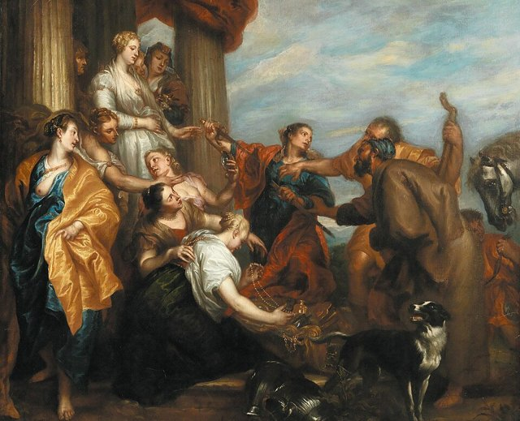
有些版本說，阿基里斯的母親忒提斯預見兒子將死於特洛伊，把他打扮成女孩藏在斯基羅斯島的宮廷中，奧德修斯識破了偽裝，讓他加入遠征。這個故事流傳於後世的文學，並不是《伊利亞德》的主要情節。阿基里斯的父親是凡人帕琉斯、母親是女神；後世說忒提斯把他浸入冥河而使他幾乎刀槍不入，這也不是《伊利亞德》本身所敘述的內容。

## -1195 | 伊菲革涅亞的獻祭 {label="神話：戰前"}
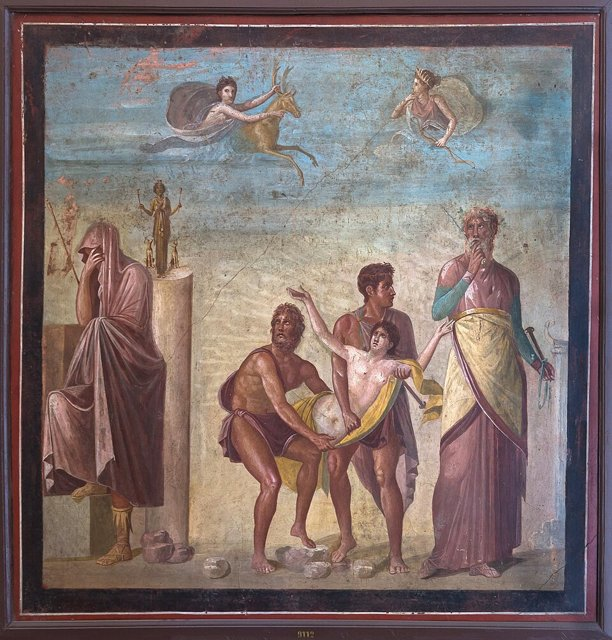
希臘艦隊集結出發時卻因風向不利而無法航行，傳說阿伽門農觸怒了女神阿耳忒彌斯，祭司卡爾卡斯指出必須獻祭阿伽門農的女兒伊菲革涅亞才能平息女神的憤怒。不同版本對結局有不同的描述：悲劇版本說她被獻祭、艦隊得以出航；救援版本說阿耳忒彌斯在最後一刻救走了她，以一頭鹿取代。這段故事突顯了人類與神祇的衝突，也為阿伽門農返鄉後的悲劇埋下伏筆。

## -1194 | 聯軍抵達特洛伊 {label="神話：戰爭第1年"}
希臘聯軍乘船橫渡愛琴海，抵達特洛伊附近。特洛伊由國王普里阿摩斯統治，城牆堅固，軍隊由王子赫克托耳等人領導；希臘人要求交還海倫，雙方未能達成協議，戰爭正式展開。特洛伊位於小亞細亞西北部、靠近達達尼爾海峽，連接愛琴海與黑海的交通，把戰爭解釋成爭奪海峽的控制權是後世歷史性的推測，並非史詩明確證實的原因。

## -1194 | 長期圍城 {label="神話：戰爭第1–9年"}
希臘聯軍原本希望迅速攻下特洛伊，卻發現城池堅固難以突破，戰爭演變成長期的圍城與周邊地區的衝突，雙方都付出重大的代價。傳統故事說戰爭持續了十年，但《伊利亞德》並沒有完整敘述這十年，而是聚焦在戰爭最後階段的一小段時間。

## -1185 | 阿基里斯與阿伽門農決裂 {label="神話：戰爭第10年"}
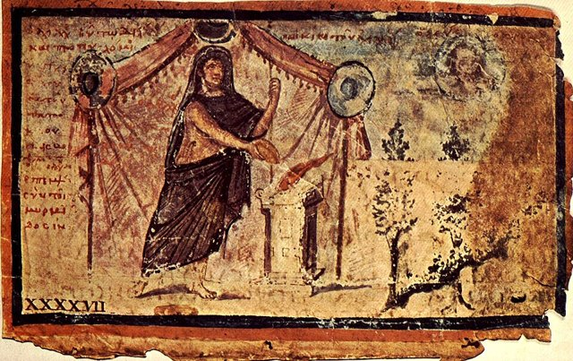
《伊利亞德》從阿基里斯的憤怒開始。阿伽門農拒絕歸還阿波羅祭司的女兒克律塞伊斯，阿波羅降下瘟疫；阿伽門農被迫交還後，卻要求拿走阿基里斯的女俘布里塞伊斯作為補償。阿基里斯認為這是對自己榮譽的侮辱，憤而拒絕再作戰。
這場衝突反映了古希臘英雄文化的重要價值：榮譽、權力、個人尊嚴，以及個人利益與集體利益的衝突。

## -1185 | 阿基里斯退出，赫克托耳反攻 {label="神話：戰爭第10年"}
阿基里斯請母親忒提斯向宙斯求助，希望宙斯讓特洛伊人占上風，以證明希臘人不能輕視他；宙斯答應了。希臘聯軍失去最強大的戰士，戰局逐漸惡化，特洛伊軍隊在赫克托耳的領導下反攻。
赫克托耳是普里阿摩斯與赫卡柏的兒子，也是特洛伊最重要的守城英雄，他是安德洛瑪刻的丈夫、阿斯堤阿那克斯的父親，在家人、國家責任與個人恐懼之間掙扎，是史詩中最有人性與悲劇深度的英雄之一。

## -1185 | 帕里斯與墨涅拉俄斯決鬥 {label="神話：戰爭第10年"}
為了減少傷亡，雙方安排帕里斯與墨涅拉俄斯單挑。墨涅拉俄斯占了上風，阿芙蘿黛蒂卻把帕里斯帶離危險，決鬥沒有真正結束戰爭，雙方再度交戰。在雅典娜的幫助下，狄俄墨得斯在戰場上大顯身手，甚至傷到阿芙蘿黛蒂與戰神阿瑞斯，這些情節是用來表現神與人的關係與戰士的勇氣，並不是一般意義上的歷史紀錄。

## -1185 | 帕特羅克洛斯穿上阿基里斯的盔甲 {label="神話：戰爭第10年"}
赫克托耳率領特洛伊人進攻希臘軍營，希臘人的船隻甚至面臨被焚毀的危險；船隊一旦被毀，遠征軍就失去撤退與返鄉的能力。阿基里斯最親密的戰友帕特羅克洛斯請求穿上他的盔甲出戰，阿基里斯同意了，但告誡他救下船隊後就要撤回。特洛伊人誤以為阿基里斯重返戰場而一度驚慌。

## -1185 | 帕特羅克洛斯戰死 {label="神話：戰爭第10年"}
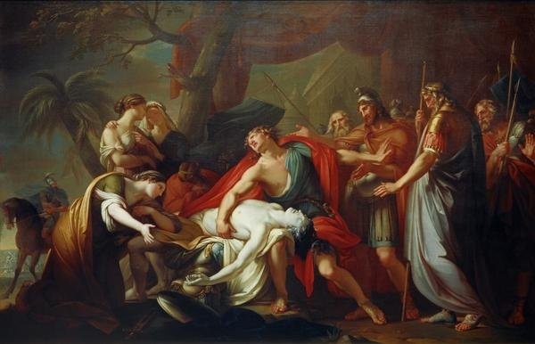
帕特羅克洛斯沒有遵守命令撤退，一路追擊，最後在阿波羅的干預下被赫克托耳殺死。這是整場戰爭最重要的轉折點：阿基里斯的憤怒轉向赫克托耳，他決定放下與阿伽門農的爭執重返戰場，衝突集中在阿基里斯與赫克托耳的對決上。《伊利亞德》探討的不只是英雄如何獲勝，也包括失去親密之人的悲痛、憤怒與復仇。

## -1185 | 阿基里斯重新披甲 {label="神話：戰爭第10年"}
原先的盔甲落入赫克托耳手中，忒提斯請火神赫淮斯托斯為兒子打造新的盔甲與盾牌。盾牌上刻有城市、農耕、收穫、宴飲、舞蹈與宇宙的景象，不只是武器，也呈現古希臘人對人類生活與世界秩序的想像。阿基里斯重返戰場後大開殺戒，把特洛伊人趕進河裡，河水被屍體阻塞，河神斯卡曼德羅斯憤怒而試圖淹沒他，在神祇介入下才平息。

## -1185 | 阿基里斯殺死赫克托耳 {label="神話：戰爭第10年"}
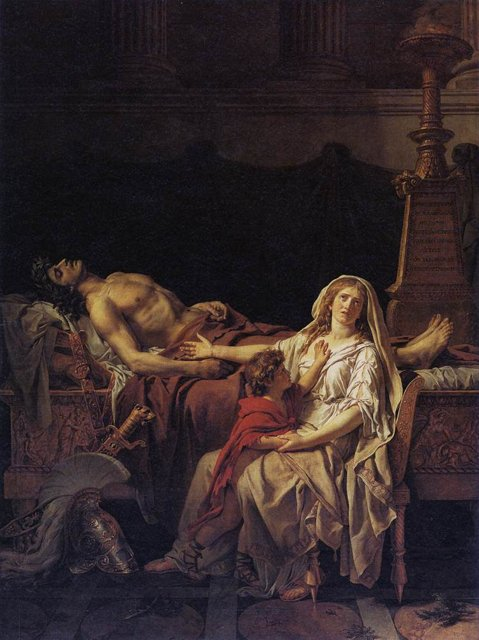
這是《伊利亞德》最著名的場面之一。赫克托耳在城外迎戰，面對阿基里斯卻因恐懼而逃跑，兩人繞著城奔跑數圈，雅典娜欺騙他說得到兄弟的援助，赫克托耳停下與阿基里斯正面交戰，被殺死。他臨死前請求交還遺體，阿基里斯卻拒絕，把屍體綁在戰車後拖行，表達對帕特羅克洛斯之死的悲痛與憤怒。

## -1185 | 普里阿摩斯求取兒子的遺體 {label="神話：戰爭第10年"}
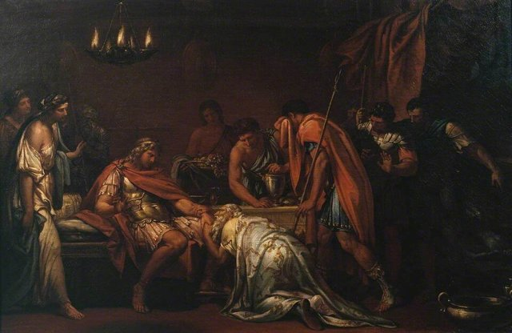
特洛伊國王普里阿摩斯冒險前往希臘軍營，向阿基里斯請求歸還兒子的遺體，請他想起自己年邁的父親帕琉斯。阿基里斯終於被打動，兩人暫時放下敵對，赫克托耳得到安葬。
《伊利亞德》並不是以木馬計或特洛伊陷落作結，而是以赫克托耳的葬禮結束：史詩把焦點從戰場上的勝負，轉向敵人之間共同承受的悲傷與人性。

## -1184 | 阿基里斯之死 {label="神話：戰爭第10年之後"}
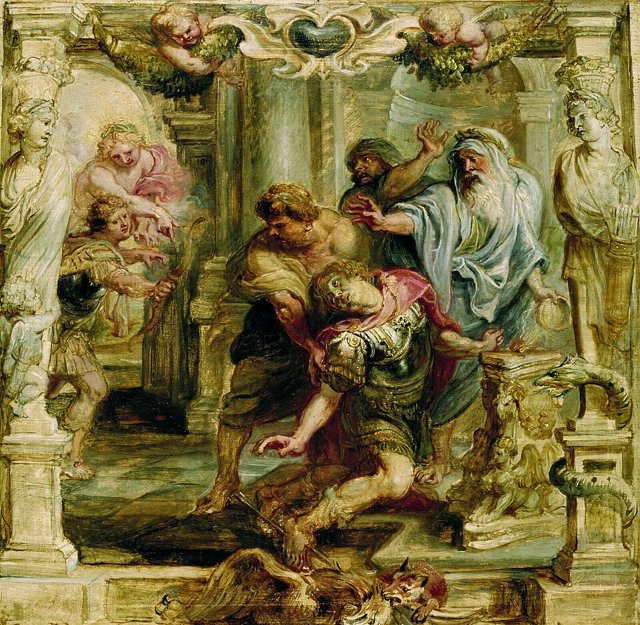
《伊利亞德》結束時特洛伊仍未陷落，後續故事來自其他古希臘史詩、悲劇與傳說。傳統神話中，亞馬遜女王彭忒西勒亞與衣索比亞英雄門農先後加入特洛伊一方，都被阿基里斯殺死；但阿基里斯最終被帕里斯射箭殺死，阿波羅幫助箭矢命中，後世流傳的版本把他的弱點說成腳跟，因此有了「阿基里斯之腱」一詞。《伊利亞德》沒有描寫他的死亡，也沒有記載腳跟的情節。

## -1184 | 盔甲之爭與大埃阿斯之死 {label="神話：戰爭第10年之後"}
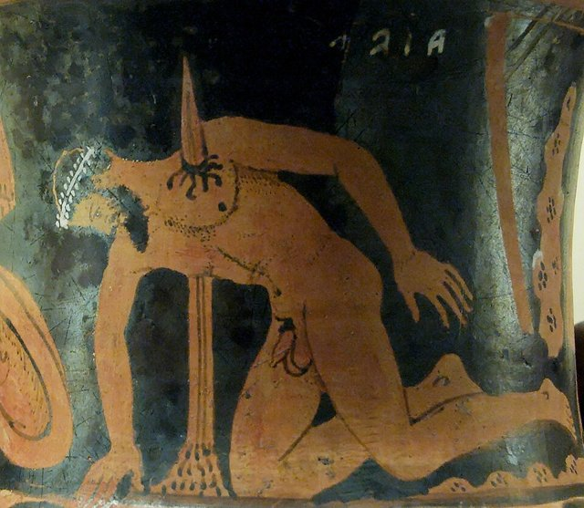
阿基里斯死後，他的盔甲成為希臘英雄爭奪的對象，奧德修斯與大埃阿斯都認為自己最有資格繼承，聯軍最後把盔甲判給奧德修斯。大埃阿斯認為自己受到羞辱，部分版本說雅典娜使他陷入瘋狂，誤把牲畜當成希臘將領屠殺，清醒後因羞恥與絕望而自殺。這段故事呈現古希臘英雄文化的陰暗面：當榮譽成為衡量個人價值的標準，失去榮譽可能被視為無法承受的災難。

## -1184 | 菲洛克忒忒斯重返戰場 {label="神話：戰爭第10年之後"}
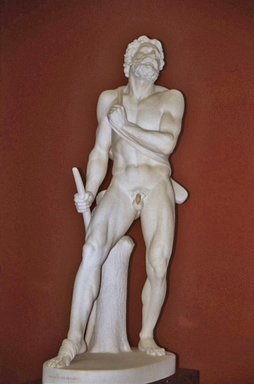
擁有赫拉克勒斯神弓的菲洛克忒忒斯在遠征途中因傷口惡化，被同伴遺棄在利姆諾斯島。希臘人後來得知預言：要攻陷特洛伊必須得到他與他的弓箭，奧德修斯等人於是去找他，他返回戰場並用神弓射殺了帕里斯。這說明在傳說中，希臘人並非只憑武力攻陷特洛伊，神諭、特殊武器與英雄的命運也扮演重要的角色。

## -1184 | 木馬計 {label="神話：戰爭第10年之後"}
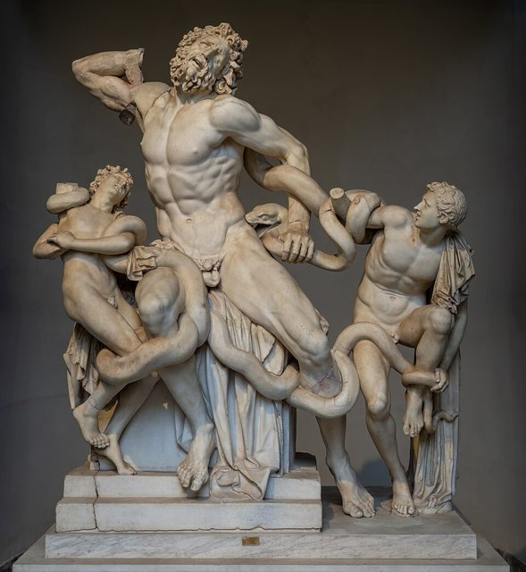
希臘聯軍多年無法以正面攻擊突破城牆，奧德修斯提出木馬計：希臘人造了一匹巨大的木馬，部分戰士藏在裡面，軍隊假裝放棄圍城、撤離海岸，把木馬留下當成獻給神的禮物。祭司拉奧孔警告特洛伊人不可輕信希臘人的禮物，卻被海蛇與他的兒子一起殺死，特洛伊人把這件事解讀成神祇不滿拉奧孔的警告，把木馬運進城裡。預言者卡珊德拉也曾警告，卻因為阿波羅的詛咒而無人相信。
木馬計象徵以欺敵與策略取代正面強攻，但它的細節在不同的古代作品中有差異，不能視為已有歷史證據證實的事件。

## -1184 | 特洛伊陷落 {label="神話：戰爭第10年之後"}
特洛伊人拖著木馬進城，舉行慶祝，相信戰爭終於結束。夜深後，藏在木馬裡的希臘戰士出來打開城門，讓已經回到附近的希臘軍隊進城。特洛伊人措手不及，王宮與城市被破壞焚毀，普里阿摩斯被殺，主要的男性戰士大多戰死，倖存者被俘或逃亡。對特洛伊人而言，這不只是軍事上的失敗，而是家園、王國與社會秩序的崩潰。
古代學者埃拉托斯特尼把特洛伊陷落放在前1184年，對應考古上特洛伊VIIa的遭毀；希羅多德則推測在前1250年左右。

## -1184 | 特洛伊王室的悲劇 {label="神話：戰爭第10年之後"}
特洛伊陷落後，王室成員各有不同的命運：赫卡柏成為俘虜；安德洛瑪刻成為希臘人的俘虜，後來被交給涅俄普托勒摩斯；赫克托耳之子阿斯堤阿那克斯在後世傳說中被殺，以免他長大後重建特洛伊；卡珊德拉被阿伽門農帶走，後來與他一同遇害。

## -1184 | 阿伽門農在邁錫尼遇害 {label="神話：戰後"}
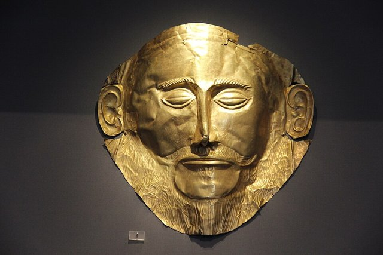
阿伽門農帶著戰利品與俘虜（包括卡珊德拉）返回邁錫尼，在埃斯庫羅斯的悲劇《阿伽門農》中，被妻子克呂泰涅斯特拉與她的同謀埃吉斯托斯殺害。不同作品對殺害過程的細節有差異，但這個故事通常與多年前伊菲革涅亞的獻祭，以及阿伽門農家族長期的血仇有關：戰場上的勝利，未必帶來家庭與政治生活的安定。

## -1184 ~ -1177 | 墨涅拉俄斯與海倫返回斯巴達 {label="神話：戰後"}
傳統神話中墨涅拉俄斯最終與海倫重聚，返回斯巴達。古代作品對海倫在戰爭中的責任、是否自願跟隨帕里斯，以及她戰後的命運，並沒有一致的看法：有些版本說她是戰爭的導火線，有些強調她受到神祇操控，甚至懷疑她是否真的曾在特洛伊城內生活。

## -1184 ~ -1174 | 奧德修斯的返鄉之旅 {label="神話：戰後（約十年）"}
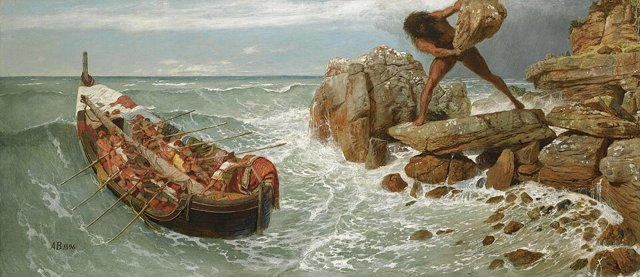
奧德修斯是特洛伊戰爭中最著名的智謀型英雄，戰後試圖返回故鄉伊薩卡，卻遭遇一連串危險的冒險：與獨眼巨人波呂斐摩斯的衝突、女巫喀耳刻、前往冥界尋求指引、塞壬的海域、斯庫拉與卡律布狄斯的威脅，以及在卡呂普索島上的停留，最後回到伊薩卡與妻子佩涅洛佩重聚。
《奧德賽》不只是冒險故事，也探討家庭、忠誠、身分、智慧與返鄉的意義：贏得戰爭是一回事，重新找回家園與生活則是另一場考驗。

## -1184 | 埃涅阿斯逃離特洛伊 {label="神話：戰後"}
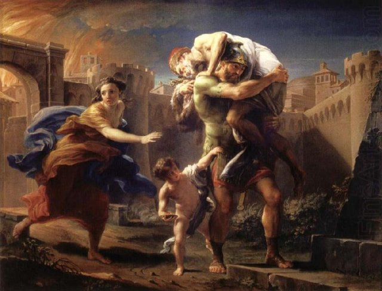
特洛伊英雄埃涅阿斯是羅馬建國傳說的重要人物。在維吉爾的史詩《埃涅阿斯紀》中，特洛伊陷落後他帶領部分倖存者，攜帶家族與神祇的象徵物逃離城市，踏上尋找新家園的旅程，最後抵達義大利，成為羅馬人祖先傳說的一部分。這主要屬於羅馬人的建國神話與文學傳統，而不是已被證實的歷史族譜。

## 1871 | 施利曼發掘特洛伊遺址
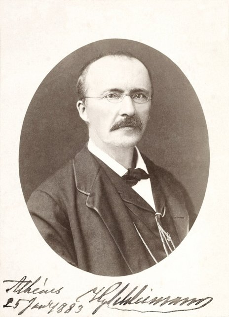
19世紀中葉以前，特洛伊與戰爭通常被認為是虛構的。1868年，德國考古學家施利曼會見英國業餘考古學家卡爾佛特，卡爾佛特指出特洛伊是一座真實的城市，位於今土耳其西北部的希薩利克，並說服了施利曼；施利曼從1871年開始在這裡發掘，發現多座不同時期的城市遺層，後來被考古學家編為特洛伊I至IX，其中特洛伊VIIa（約前1300–前1190年）被認為最接近史詩中的特洛伊。
遺址存在不等於荷馬史詩中的所有事件都是歷史：目前無法確定是否有一場與傳說完全相同、由希臘聯軍圍攻十年的戰爭。
