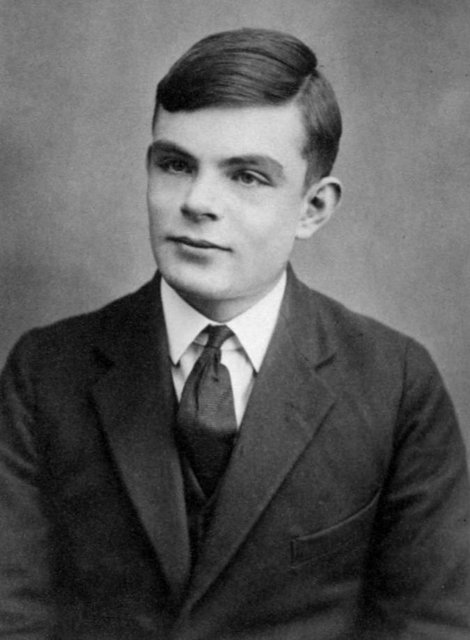
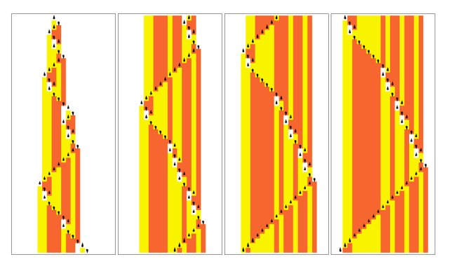
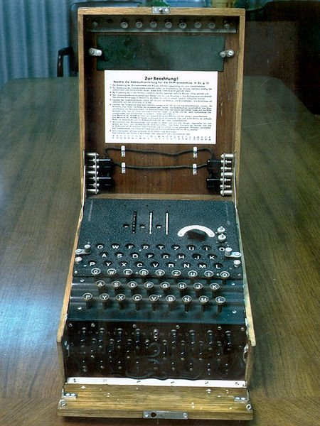
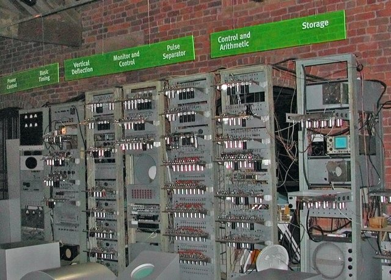

<!--
內容整理自 D:\Books\md\歷史\人物\科學家\圖靈（Alan Turing）生平大事記.md（網頁版為 D:\Books\html\8-2.科學家\圖靈生平大事記.html，另有知識圖譜頁〈圖靈〉），並整合中文維基百科〈艾倫·圖靈〉條目，以自己的話改寫。
時期依筆記的章節歸納：出生與早年、求學、普林斯頓、二戰與恩尼格瑪、戰後計算機與人工智慧、形態發生學與悲劇、身後平反。筆記的「主要科學貢獻」（圖靈機、通用圖靈機、可計算性與停機問題、密碼分析、圖靈測試、反應擴散）「重要著作」「重要關係人物」「歷史地位」寫進時期說明與相關事件，不另立事件。「圖靈機」「圖靈測試」「圖靈獎」放入 notNames，避免人名索引把這些名詞算成提到圖靈本人。
兩份資料出入與處理方式：
- 譯名：books與筆記作「圖靈」，維基百科頁名作「艾倫·圖靈」，標題採「圖靈生平」（與books頁面一致）。
- 生卒：筆記與維基百科一致：1912年6月23日生於倫敦帕丁頓，1954年6月7日在威姆斯洛逝世，享年41歲。筆記註明劍橋大學圖靈數位檔案記載為6月8日，多數傳記採6月7日，這裡採6月7日。死因：兩者皆為氰化物中毒；筆記寫「官方裁定為自殺」，維基百科補充死因調查認定為自殺，但相關證據同樣與意外中毒相符，他的母親堅持是意外（傳說他吃了浸過氰化物溶液的蘋果），照此併寫，不下定論。
- 童年：筆記寫父親曾任職於英屬印度行政體系，圖靈童年有一段時間由英國寄宿家庭照顧；維基百科補充母親懷孕時在印度，為了讓孩子在英國出生而回到倫敦，父親的任期使他常來往於英國與印度，六歲時進入聖邁克爾日校，照此。
- 謝伯恩公學：筆記寫1926年進入、大罷工時獨自騎自行車赴校；維基百科補充是從南安普頓騎六十英里、途中在旅社住了一晚，且他1928年（十六歲）已開始閱讀愛因斯坦的著作，並看出愛因斯坦對牛頓定律有所質疑，照此。
- 莫科姆：筆記寫1928年相識、1930年逝世（結核病相關疾病，18歲），影響他對心智與物質的思考；照此。
- 劍橋：筆記與維基百科同寫1931年進入國王學院、1934年畢業、1935年當選國王學院研究員；維基百科補充他以證明中心極限定理的論文當選（該定理其實已由林德伯格在1922年證明，但委員會仍認為值得），照此。
- 圖靈機論文：筆記寫1936年發表〈論可計算數及其在判定問題上的應用〉；維基百科補充這篇論文重新論述了哥德爾1931年的結果，以簡單的抽象裝置取代哥德爾以算術為基礎的形式語言，並證明判定問題無解，照此。
- 普林斯頓：筆記寫1936年赴普林斯頓、師從邱奇、1938年取得博士學位；維基百科補充他在1936年9月至1938年7月間大部分時間在普林斯頓，博士論文《基於序數的邏輯系統》，馮·諾依曼有意聘他做博士後助理，他婉謝回英國，照此。邱奇的λ演算與圖靈機後來證明在計算能力上等價（筆記）。
- 密碼：筆記寫1938–1939年開始接觸政府密碼機構、1939年加入布萊切利園、設計炸彈機；維基百科寫從1938年9月起圖靈在政府密碼與密碼學校兼職，與諾克斯一起專注於分析恩尼格瑪，1939年7月波蘭密碼局向英法提供恩尼格瑪的詳細信息，圖靈與諾克斯此後提出更通用的方案，為炸彈機製作功能規範（波蘭炸彈的改進），照此。筆記強調破解恩尼格瑪不是圖靈一人的成果，而是波蘭、英國與盟軍密碼分析者長期合作的結果。
- 德國海軍密碼：筆記寫1941年起；維基百科補充圖靈領導第8號小組，負責德國海軍密碼的破譯；他以統計技術優化破譯，寫下兩篇數學論文，直到2012年4月才公開給英國國家檔案館，照此。1942年赴美國與盟軍密碼分析人員交流（筆記）。
- 勳章：筆記寫1945年獲大英帝國官佐勳章（OBE）；維基百科寫1946年，兩者差一年，這裡寫為1945–1946年。他在1951年當選皇家學會院士（兩者一致）。
- 戰後：筆記寫1945年加入國家物理實驗室、1946年提出ACE設計報告、1948年加入曼徹斯特大學（Manchester Baby 1948年成功運行）並撰寫《智慧機械》、1949年任計算實驗室副主任、1950年發表〈計算機器與智能〉；維基百科同寫1945–1948年在國家物理實驗室負責ACE、1949年任曼徹斯特大學計算機實驗室副主任，並補充他1952年寫了西洋棋程式，因沒有電腦能運行，他親自模擬，每步半小時，照此。
- 形態發生學：筆記與維基百科同寫1952年發表〈形態發生的化學基礎〉；維基百科補充他的主要興趣是斐波那契葉序，他後期未發表的論文到1992年《艾倫·圖靈選集》出版才問世。
- 定罪：筆記寫1952年因與一名男性發生關係遭調查，被控「重大猥褻罪」，在監禁與荷爾蒙治療間選擇雌激素治療；維基百科寫他的同性伴侶與一名同謀闖入他家行竊，警方調查後他被控「明顯猥褻」，並補充雌激素注射持續一年，副作用包括乳房發育，使熱愛運動的圖靈身心受到傷害，兩者併寫。
- 身後：筆記寫1966年設立圖靈獎、2009年英國政府道歉、2013年女王特赦、2017年艾倫·圖靈法、2021年50英鎊紙鈔；維基百科補充2009年9月10日布朗在《每日電訊報》撰文道歉（超過三萬人請願），2012年兩萬多人請願要求死後赦免，被當場拒絕，2013年12月24日司法部宣布女王特赦，2015年超過50萬人請願要求赦免約49,000人，2017年1月31日法案生效，約49,000人獲赦免，2019年BBC觀眾票選他為20世紀最偉大的科學家，照此。
- 人名與其他時間軸一致：愛因斯坦（沒有直接關聯，不放 see:）；邱奇、希爾伯特、韋爾奇曼、克拉克、紐曼、莫科姆沒有獨立時間軸。
圖片來源（皆為 Wikimedia Commons 公有領域／CC0 作品；照片與器物不一定與事件同時，僅供對照）：
- tu-cover.jpg：Alan Turing (1951).jpg（圖靈的照片（1951年前後））
- tu-16.jpg：Alan Turing Aged 16.jpg（十六歲的圖靈（謝伯恩公學時期））
- tu-machine.jpg：2-state 3-symbol Turing Machine.png（圖靈機運行過程的示意圖）
- tu-enigma.jpg：Enigma Machine at NSA.jpg（恩尼格瑪密碼機）
- tu-baby.jpg：SSEM Replica.jpg（曼徹斯特小型實驗機（Manchester Baby）的復原品）
-->

# Periods
- 1912-06-23 ~ 1925 | 出生與早年 | #868e96
  生於倫敦，父親任職於英屬印度，童年由寄宿家庭與學校照顧，對數學與科學展現濃厚興趣，喜歡自行鑽研。
- 1926 ~ 1935 | 謝伯恩與劍橋求學 | #2f9e44
  在謝伯恩公學受到好友莫科姆的啟發，進入劍橋國王學院，以優異成績畢業並成為研究員。
- 1936 ~ 1938 | 圖靈機與普林斯頓 | #1971c2
  發表可計算數的論文，提出圖靈機，赴普林斯頓師從邱奇，取得博士學位。
- 1939 ~ 1945 | 二戰與恩尼格瑪 | #c92a2a
  在布萊切利園破解德國密碼，設計炸彈機，領導德國海軍密碼的破譯。
- 1945 ~ 1950 | 計算機與人工智慧 | #e8590c
  設計ACE儲存程式計算機，在曼徹斯特研究早期電腦，發表圖靈測試的論文。
- 1951 ~ 1954-06-07 | 形態發生學與悲劇 | #7048e8
  當選皇家學會院士，研究反應擴散模型，因同性戀被定罪、接受荷爾蒙治療，1954年去世。
- 1954-06-07 ~ 2021 | 身後的紀念與平反 | #495057
  圖靈獎設立，英國政府道歉、女王特赦，他的肖像出現在英國50英鎊紙鈔。

# Events

## 1912-06-23 | 出生於倫敦
艾倫·麥席森·圖靈生於英國倫敦的帕丁頓，父親朱利葉斯·馬西森·圖靈曾在英屬印度的行政體系任職，母親艾塞爾·莎拉（原姓斯托尼）；母親懷孕時在印度，為了讓孩子在英國出生而回到倫敦。他有一位哥哥約翰。因為父親的任期，圖靈小時候常來往於英國與印度，由於擔心印度氣候不利於孩子，父母把他留在英國，由朋友的寄宿家庭照顧。六歲時他進入聖邁克爾日校，女校長很快注意到他的天賦。

## 1926 | 進入謝伯恩公學

十三歲的圖靈進入多塞特郡的謝伯恩公學（Sherborne School），開學第一天正逢英國大罷工，他堅持不錯過第一天的課，獨自從南安普頓騎自行車約六十英里去學校，途中在旅社住了一晚。學校偏重古典學科，對他喜愛的科學並不友善，但他仍展現出驚人的能力，還沒學過基礎微積分就能解出相當高深的難題；1928年起，十六歲的他開始閱讀愛因斯坦的著作，還看出愛因斯坦對牛頓運動定律存有質疑，雖然著作中並沒有明說。

## 1928 | 莫科姆
圖靈認識同學克里斯多福·莫科姆，兩人同樣熱愛數學與科學，建立深厚的友誼，莫科姆鼓勵他投入科學研究。1930年莫科姆因結核病相關的疾病去世，年僅18歲，圖靈深受打擊，開始思考心智、生命、物質與意識之間的關係，此後他對機器思考與心智本質的興趣逐漸形成。

## 1931 | 進入劍橋大學國王學院
圖靈考入劍橋大學國王學院，主修數學，受到數理邏輯、數學基礎與機率論的啟發，獲得數學一等榮譽；1934年以優異成績畢業，取得數學學士學位。

## 1935 | 國王學院研究員
二十二歲的圖靈因證明中心極限定理的論文，當選國王學院研究員；他不知道這個定理在1922年已由林德伯格證明，但委員會仍認為這項研究值得考慮，之後他開始深入研究數學邏輯與數學基礎的問題。

## 1936 | 圖靈機

圖靈發表劃時代的論文〈論可計算數及其在判定問題上的應用〉（On Computable Numbers, with an Application to the Entscheidungsproblem），回應希爾伯特提出的判定問題：他以一種抽象的計算裝置，後來稱為圖靈機（無限長的紙帶、讀寫頭、狀態控制器與轉移規則），以數學方式定義機械化的計算程序；並提出通用圖靈機的概念，說明一部通用機器可以依照輸入的描述，模擬其他的計算機器，這種「程式與資料皆可儲存、讀取與處理」的思想，成為現代通用計算機的理論基礎。他也證明並非所有問題都能由一套固定的算法解決，最著名的例子是停機問題：不存在能對所有程式與輸入都正確判斷「會停止還是永遠運行」的通用算法，確立了計算能力的理論界限。他以簡單的抽象裝置重新論述了哥德爾1931年的結果。

## 1936-09 | 赴普林斯頓
圖靈前往美國普林斯頓大學，師從數學家阿隆佐·邱奇（1936年9月至1938年7月），邱奇提出的λ演算與圖靈機，是描述可計算性的兩種重要理論模型，後來證明兩者在計算能力上等價；第二年他獲選為客座研究員。除了純數學，他還研究密碼學，並建造了機電二進制乘法器四個階段中的三個。

## 1938 | 取得博士學位
1938年6月，圖靈完成博士論文《基於序數的邏輯系統》（Systems of Logic Based on Ordinals），取得普林斯頓大學的博士學位，論文引入序數邏輯與相對計算（預言機）的概念；馮·諾依曼有意聘他做博士後助理，他婉謝後返回英國。從1938年9月起，他在英國政府密碼與密碼學校兼職，與諾克斯一起專注於德國恩尼格瑪密碼機的分析；1939年回到劍橋，聽了維根斯坦關於數學基礎的講座，兩人激烈爭論。

## 1939-09 | 加入布萊切利園

1939年9月德國入侵波蘭，第二次世界大戰全面爆發，圖靈前往布萊切利園（Bletchley Park）工作，任務是破解德國軍方使用的恩尼格瑪密碼機。恩尼格瑪利用轉子、插線板與每日變更的設定，產生大量可能的加密組合。同年7月波蘭密碼局已向英法提供恩尼格瑪的詳細資料與破譯方法，圖靈與同事的工作建立在雷耶夫斯基、羅佐基與佐加爾斯基等波蘭密碼學家的成果之上；波蘭的方法依賴德國人不嚴謹的程序，圖靈的方法更通用。

## 1940 | 炸彈機
圖靈設計了英國版炸彈機（Bombe）的重要架構，這是一種專門搜尋恩尼格瑪設定的機電裝置，透過高速測試大量可能的轉子設定，縮小密碼分析人員需要人工檢查的範圍；同年韋爾奇曼提出重要的改良，進一步提高效率。炸彈機並不是直接讀取所有密文的萬能解碼器，而是利用已知的線索排除不可能的設定。他也以統計技術優化破譯的過程，寫下兩篇論文，價值極大，直到2012年4月才公開給英國國家檔案館。

## 1941 | 德國海軍密碼
圖靈領導第8號小組，負責破譯德國海軍的恩尼格瑪密碼；海軍密碼尤其困難，因為德國潛艇部隊使用較嚴密的密碼程序，圖靈與同事利用數學推理、已知明文的線索與機械化搜尋，持續改善解密的方法。1942年他赴美國與盟軍的密碼分析人員交流，協助推進英美的合作；1943至1944年盟軍持續破解德國海軍通信，掌握潛艇的部署與海上行動，對大西洋護航戰具有重要的價值。破解恩尼格瑪並非圖靈一人的成果，而是波蘭、英國與其他盟軍密碼分析人員長期合作的結果。

## 1945 | 國家物理實驗室與ACE
戰時的工作仍屬高度機密，大眾不知道他在布萊切利園的具體貢獻；1945年（一說1946年）他因戰時服務獲頒大英帝國官佐勳章（OBE）。戰後他進入英國國家物理實驗室，開始設計電子數位計算機，提出「自動計算引擎」（ACE）的構想，以儲存程式為核心，指令與資料都存放在記憶體中；1946年他提交ACE的設計報告，內容包括中央控制、記憶體配置、指令系統、數值運算與程式執行方式，對早期計算機架構影響重大，但完整機器的建造因工程與組織因素未能立即完成。

## 1948 | 曼徹斯特與《智慧機械》

圖靈加入曼徹斯特大學馬克斯·紐曼的計算機實驗室，參與早期電子計算機的研究；曼徹斯特的「小型實驗機」（Manchester Baby）在1948年成功運行，是世界上最早成功執行儲存程式的電子計算機之一。同年他撰寫《智慧機械》（Intelligent Machinery）報告，探討機器能否學習、思考，提出「無組織機器」的概念，研究如何透過訓練使簡單的機器形成複雜的行為，可視為早期人工神經網絡與機器學習的先驅；1949年他任曼徹斯特大學計算機實驗室的副主任，負責曼徹斯特一號的軟體。

## 1950 | 圖靈測試
圖靈在哲學期刊《Mind》發表〈計算機器與智能〉（Computing Machinery and Intelligence），開頭就問：「機器能思考嗎？」他認為直接定義「思考」會陷入哲學爭論，因此提出一種可操作的方法，稱為「模仿遊戲」，後來稱為圖靈測試：人類的評判者透過文字與對方交談，嘗試判斷對方是人還是機器，如果機器能在一定條件下使評判者難以區分，便可視為展現了某種人類式的智能表現。這篇論文是人工智慧哲學與研究史的重要里程碑，對後世的自然語言處理、機器學習與智能研究影響深遠。

## 1951 | 當選皇家學會院士
圖靈因在數學與計算機科學方面的貢獻，當選英國皇家學會院士，研究興趣逐漸轉向生物學與數學之間的關係。

## 1952 | 形態發生學與定罪
圖靈發表〈形態發生的化學基礎〉（The Chemical Basis of Morphogenesis），提出反應擴散模型：兩種或多種化學物質在反應與擴散的過程中，可以形成穩定的空間分布與圖樣，可能解釋動物的斑紋、條紋與其他生物形態的形成，後來被廣泛用於發育生物學；他的主要興趣是植物的斐波那契葉序，並寫了一個西洋棋程式，因為沒有電腦能運行，他親自模擬，每走一步半小時。
同年，他的同性伴侶與一名同謀闖入他家行竊，警方調查後，圖靈被控「重大猥褻罪」，當時英國法律將男性之間的同性性行為視為犯罪；他沒有申辯，被判有罪，並得到兩個選擇：坐牢，或接受雌激素注射（俗稱化學閹割）。他選擇後者，持續一年，副作用使熱愛運動的他身心受到嚴重傷害，也失去部分工作與安全許可。

## 1954-06-07 | 逝世
圖靈被發現死於英國威姆斯洛的住處，死因是氰化物中毒，享年41歲，死因調查認定為自殺（傳說他吃了浸過氰化物溶液的蘋果），但相關證據也與意外中毒相符，他的母親堅持這是意外。（劍橋的檔案記載他逝世於6月8日，多數傳記採6月7日。）他的逝世被視為二十世紀科學史上令人惋惜的事件。

## 1966 | 設立圖靈獎
美國計算機協會（ACM）設立圖靈獎（A.M. Turing Award），表彰對計算機領域有重大技術貢獻的人，被譽為「計算機科學界的諾貝爾獎」。1990年代至2000年代，他在理論計算機科學、密碼分析與人工智慧的貢獻受到更廣泛的重視，布萊切利園也逐漸成為英國重要的密碼學與二戰歷史紀念地。

## 2009-09-10 | 英國政府道歉
在超過三萬人請願後，英國首相戈登·布朗在《每日電訊報》撰文，代表政府為圖靈所遭受的「駭人對待」公開道歉，承認當時法律與社會制度對他極不公正。2012年有兩萬多人簽名請願，要求死後赦免，當時被拒絕，理由是他是依當時的法律被定罪。

## 2013-12-24 | 王室特赦
英國司法部宣布，女王伊莉莎白二世赦免1952年因同性戀行為被定罪的圖靈；有抗議者指出，應該把赦免範圍擴大到所有與他同時代、受到同樣待遇的同性戀者。2015年2月，圖靈的家人遞交了超過50萬人簽名的請願書，要求赦免約49,000人。

## 2017-01-31 | 艾倫·圖靈法
英國《警務與犯罪法》（Policing and Crime Act 2017）中的相關條文生效，俗稱「艾倫·圖靈法」，追溯性地赦免依過去禁止同性戀行為的法律被警告或定罪的男性，約49,000人因此獲得赦免。2019年，BBC的觀眾投票把圖靈評選為20世紀最偉大的科學家。

## 2021 | 50英鎊紙鈔
英格蘭銀行推出背面印有圖靈肖像的50英鎊塑膠鈔，象徵他對科學、數學與計算機發展的重大貢獻，圖靈成為英國科學史的重要代表人物之一。
