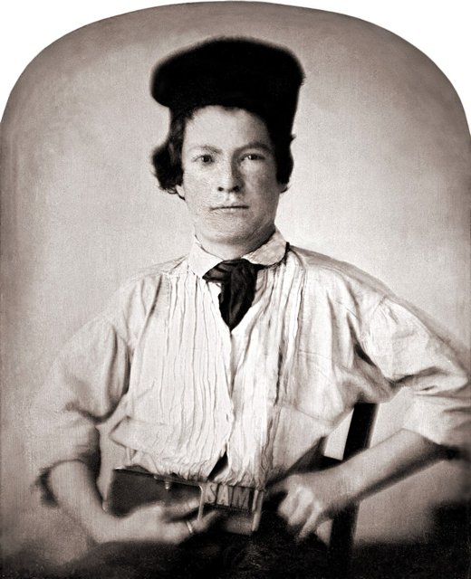
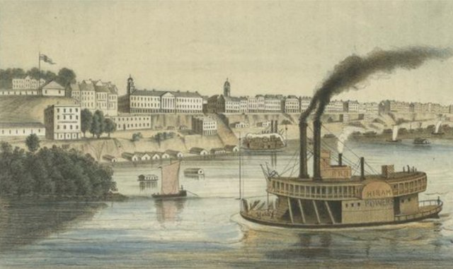
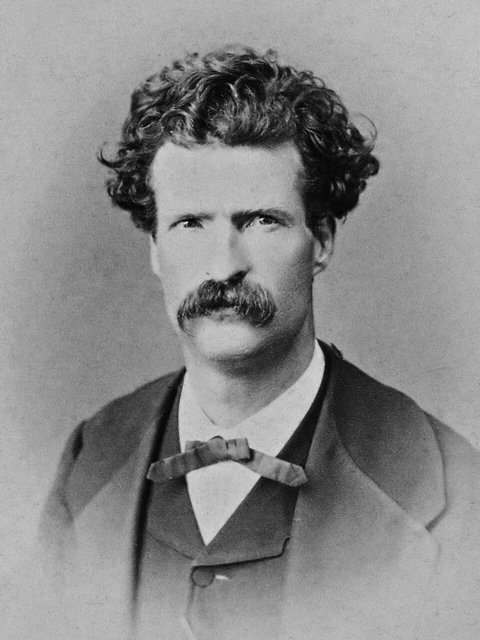
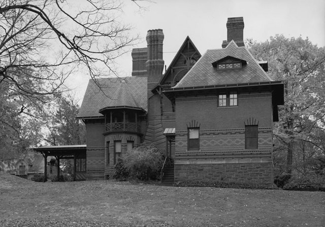
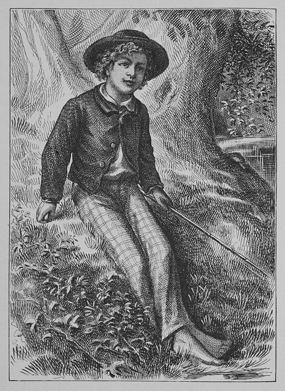
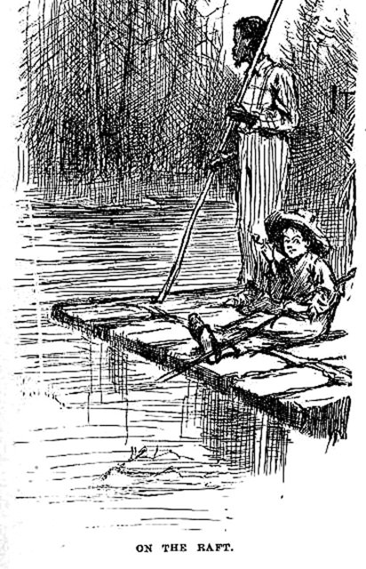
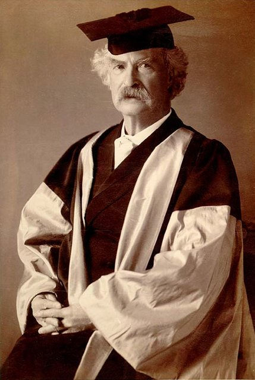
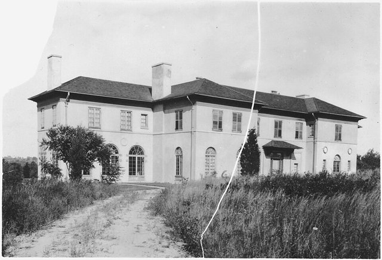
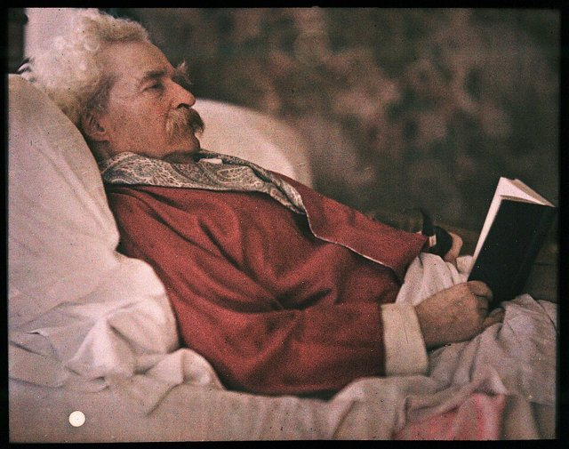

<!--
內容整理自本機筆記〈馬克吐溫生平大事記〉（圖表\馬克吐溫生平大事記.md）與中文維基百科「馬克·吐溫」條目（CC BY-SA 4.0），以台灣用語改寫摘要。
https://zh.wikipedia.org/zh-tw/马克·吐温
史料與日期說明：
- 父親去世：筆記寫他12歲，維基百科寫1847年3月、他11歲；他生於11月，當時確實是11歲，此處依此。
- 遷居哈特福：筆記寫1874年，維基百科寫1871年；他1871年搬到哈特福租屋，1874年住進自己興建的大宅，此處分寫。
- 子女：維基百科只提到三個女兒；筆記正確指出還有一個兒子朗登，出生不久即夭折，此處依筆記。
- 返美：筆記寫1899年返回美國；他實際上是1900年10月才結束旅居歐洲返國，與維基百科一致，此處採1900年。
- 書名：依筆記與台灣常見譯名作《傻子出國記》《艱苦歲月》《頑童歷險記》（維基百科作《傻子旅行》《苦行記》《頑童流浪記》）。
- 筆名來源：一般認為來自河上測深的術語「兩噚」（約3.7公尺，可安全航行的水深）；維基百科另提到酒館記帳的說法，無從查證，此處只在文中附帶一提。
- 1858年弟弟亨利死於汽船爆炸、1861年加入邦聯民兵兩週即離開、1885年出版格蘭特回憶錄、同年康科德圖書館禁售《頑童歷險記》、1893年結識羅傑斯、1897年「我的死訊被過度誇大了」、1898年還清債務、1901年擔任反帝國主義聯盟副會長、1906年口述自傳、1909年么女珍去世、哈雷彗星的預言等細節，係依維基百科與一般公認的史實補充。
圖片來源（皆為 Wikimedia Commons 公有領域／CC0 作品）：
- twa-cover.jpg：Mark Twain by AF Bradley (cropped 2).jpg
- twa-printer.jpg：Mark Twain by GH Jones, 1850 - retouched.jpg
- twa-memphis.jpg：Memphis Tennessee 1850s.jpg
- twa-1867.jpg：Mark Twain by Abdullah Frères, 1867.jpg
- twa-house.jpg：Twain House North Elevation HABS CONN,2-HARF,16-18.jpg
- twa-tom.jpg：Tom Sawyer 1876 frontispiece.jpg
- twa-huck.jpg：Huck and jim on raft.jpg
- twa-oxford.jpg：Mark Twain DLitt.jpg
- twa-stormfield.jpg：Mark Twain's house, front view. - NARA - 516527.jpg
- twa-autochrome.jpg：Autochrome of Mark Twain.jpg
-->

# Periods
- 1835 ~ 1853 | 密西西比河畔的童年 | #f08c00
  生於密蘇里州的小村莊，在河畔小鎮漢尼拔長大；父親早逝後輟學，當印刷學徒，在哥哥的報社排字、寫稿。
- 1853 ~ 1861 | 印刷工與汽船領航員 | #1c7ed6
  離家到各大城市當印刷工，後來拜師學習駕駛汽船，成為密西西比河上的領航員，直到南北戰爭爆發。
- 1861 ~ 1870 | 西部記者與幽默作家 | #c92a2a
  隨哥哥到內華達挖礦失敗，轉當報社記者，以「馬克·吐溫」為筆名，靠〈跳蛙〉與旅行報導成名。
- 1870 ~ 1891 | 哈特福的黃金歲月 | #2f9e44
  結婚成家、定居康乃狄克州哈特福，寫出《湯姆歷險記》《頑童歷險記》等代表作，同時投資出版與發明。
- 1891 ~ 1900 | 破產與環球演講 | #495057
  投資排字機失敗、出版社倒閉，靠著環球演講還清債務，卻失去了心愛的長女。
- 1900 ~ 1910 | 白西裝的晚年 | #f59f00
  返回美國，成為公眾人物與尖銳的社會批評者，痛批帝國主義；妻女相繼去世後，在哈雷彗星回歸時辭世。

# Events

## 1835-11-30 | 出生@佛羅里達
生於密蘇里州只有百餘人的小村莊佛羅里達，本名山繆·朗霍恩·克萊門斯，是七個孩子中的老六，早產而體弱。那一年哈雷彗星正好接近地球。父親約翰是一位懷著發財夢、卻屢屢投資失敗的律師與商人；母親珍則開朗風趣，是他幽默感的來源。

## 1839 | 搬到漢尼拔
全家搬到密西西比河畔的小鎮漢尼拔。河上來往的汽船、鎮外的山洞與森林、黑奴的歌謠與故事，構成了他童年的世界，也就是日後湯姆·索亞與哈克·芬恩的家鄉「聖彼得堡鎮」的原型。密蘇里當時是蓄奴州，他從小就目睹奴隸制度，叔叔農莊裡的黑奴「丹尼爾叔叔」是吉姆這個角色的原型之一。

## 1847-03 | 父親去世
11歲時父親死於肺炎，家境陷入困頓。隔年他離開學校，到報社當印刷學徒，只換得食宿和衣服。

## 1851 | 哥哥的報社

進入哥哥奧利安創辦的《漢尼拔雜誌》當排字工人，也開始寫一些幽默短文與小品。排版工作讓他大量閱讀，被稱為「窮人的大學」。

## 1853-06 | 離家闖蕩
17歲離開漢尼拔，先後在聖路易、紐約、費城、辛辛那提等地當印刷工，晚上就到公共圖書館自學，並為家鄉的報紙寫旅行見聞。

## 1857-04 | 學習汽船領航

搭汽船沿河南下時，說服著名領航員比克斯比收他當學徒。他花了兩年熟記密西西比河上兩千多公里航道的每一處沙洲、暗礁與水位變化，日後在《密西西比河上的生活》中生動描述了這段學習過程。

## 1858-06-21 | 弟弟亨利之死
他介紹弟弟亨利到汽船「賓夕法尼亞號」上工作，自己因與領航員起衝突而改搭另一艘船。賓夕法尼亞號在曼菲斯附近鍋爐爆炸，亨利重傷不治，年僅19歲。他一生都為此自責，認為是自己害死了弟弟。

## 1859-04 | 取得領航員執照
取得汽船領航員執照，收入優渥，他後來說這是他一生最愛的工作。

## 1861-07 | 南北戰爭，前往內華達
南北戰爭爆發，河上的商業航運中斷，他的領航生涯就此結束。他曾加入一支親南方的地方民兵，約兩週後就離開；後來他在短篇〈一場失敗戰役的私史〉中自嘲這段經歷。7月，他跟隨被任命為內華達領地秘書的哥哥，搭驛馬車橫越大平原與洛磯山脈前往西部。

## 1862-09 | 挖礦失敗，成為記者
在內華達挖銀礦、炒礦股都失敗後，進入維吉尼亞城的《領地企業報》當記者，寫地方新聞與幽默的惡作劇報導。西部的礦工、投機客與吹牛大王，成為他取之不盡的寫作素材。

## 1863-02-03 | 第一次使用筆名「馬克·吐溫」
在報導中第一次署名「馬克·吐溫」。這個詞是密西西比河上測量水深時的吆喝聲，意思是「兩噚」（約3.7公尺），代表船可以安全通過的水深；另有一說是他在酒館要酒保「記兩筆」帳。這個筆名後來比他的本名更為人所知。

## 1865-11-18 | 〈卡拉維拉斯縣著名的跳蛙〉
在舊金山期間，把在礦區酒館聽來的故事寫成幽默短篇〈卡拉維拉斯縣著名的跳蛙〉，刊登在紐約的《週六報》，全國報紙紛紛轉載，使他一夕成名。故事以一本正經的口吻講述荒誕的吹牛情節，正是美國西部「誇大故事」的傳統。

## 1866-03 | 夏威夷之旅與首場演講
受《沙加緬度聯合報》委託到當時稱為桑威奇群島的夏威夷採訪，寫了一系列通訊報導。回到舊金山後，他舉辦了第一場關於夏威夷的幽默演講，大獲成功，從此展開長達四十年的演講生涯。

## 1867-06 | 搭乘「貴格城號」遊歷歐洲與聖地

擔任報社的旅行通訊員，搭乘遊輪「貴格城號」遊歷歐洲、地中海與聖地。在船上，同行的年輕人查爾斯·朗登給他看了姊姊奧莉維亞的小照片，他一見鍾情。

## 1869-07 | 《傻子出國記》
把旅途通訊整理成《傻子出國記》，以幽默嘲諷美國觀光客的天真與自大，也挖苦歐洲人對古蹟和宗教聖物的迷信崇拜。這本書成為他生前最暢銷的作品，他從此成為全國知名的作家。

## 1870-02-02 | 與奧莉維亞·朗登結婚
與紐約州富商之女奧莉維亞·朗登結婚。她的父親起初對這位粗獷的西部記者頗有疑慮，在他鍥而不捨的追求下終於點頭。奧莉維亞成為他作品的第一位讀者與編輯，常刪改他過於粗俗的字句。兩人生了一子三女，兒子朗登不到兩歲就夭折，女兒則是蘇西、克拉拉與珍。

## 1871 | 遷居哈特福
舉家遷居康乃狄克州的哈特福，結識作家豪威爾斯等文人。隔年出版描寫西部歲月的《艱苦歲月》；1873年又與鄰居華納合寫諷刺小說《鍍金時代》，嘲諷南北戰爭後的投機風氣與政治腐敗，「鍍金時代」後來成了那個時代的代稱。

## 1874 | 哈特福的大宅

住進自己興建的維多利亞式大宅，屋頂與陽台的造型據說像一艘密西西比河的汽船。此後十七年是他一生最幸福的時光，每年夏天在妻子娘家位於紐約州艾爾麥拉的農莊寫作，代表作大多完成於那裡的八角形書房。

## 1876-06 | 《湯姆歷險記》

出版《湯姆歷險記》，以童年的漢尼拔為藍本，描寫聰明頑皮的湯姆·索亞在小鎮上的冒險：哄朋友付錢幫他粉刷圍籬、和哈克在墓地目睹凶案、在山洞中迷路又找到寶藏。他在序言中說，書中大部分的冒險都真的發生過。這部作品成為美國兒童文學的經典。

## 1881 | 《王子與乞丐》
出版歷史小說《王子與乞丐》，描寫十六世紀英國的王子愛德華與長相相同的貧窮男孩湯姆互換身分，各自體會到另一個階級的生活與不公。前一年他也出版了遊歷德國與阿爾卑斯山的遊記《浪跡海外》。1883年，他重返密西西比河，寫成《密西西比河上的生活》。

## 1884-05 | 創辦出版公司與排字機
成立以外甥女婿命名的「韋伯斯特出版公司」，想自己出版自己的書。1885年公司出版南北戰爭名將、前總統格蘭特的回憶錄，大獲成功。但他同時把大筆財產投入一台號稱能自動排字的「佩奇排字機」，機器始終無法穩定運作，十年間耗掉他約三十萬美元。

## 1885-02 | 《頑童歷險記》

《頑童歷險記》在美國出版（前一年底先在英國與加拿大出版）。逃離酗酒父親的哈克，與逃亡的黑奴吉姆乘著木筏沿密西西比河而下。哈克一度想寫信告發吉姆，最後卻決定：「好吧，那我就下地獄吧！」選擇了良知而不是社會的規矩。全書以哈克的方言口吻寫成，出版當年就被麻州康科德的圖書館以「粗俗」為由下架。海明威說：「所有的美國現代文學都源自馬克·吐溫的一本書：《頑童歷險記》。」

## 1889 | 《亞瑟王宮廷中的康乃狄克美國佬》
出版《亞瑟王宮廷中的康乃狄克美國佬》，一位十九世紀的美國工廠技師穿越到亞瑟王的時代，用科技知識改造中世紀社會，最後卻演變成一場殘酷的災難，諷刺對科技進步與現代文明的盲目信心，被視為穿越小說的先驅。

## 1891-06 | 移居歐洲
排字機與出版社持續虧損，為了節省開支，他關閉哈特福的大宅，舉家移居歐洲，住在德國、瑞士、義大利與法國等地，從此再也沒有搬回那棟房子。

## 1894-04 | 出版公司破產
韋伯斯特出版公司在經濟恐慌中倒閉，同年排字機計畫也宣告失敗，58歲的他背負巨額債務。他的新朋友、標準石油公司高層羅傑斯為他整理財務，把作品版權轉到妻子名下以免被債權人拿走。他雖然依法可以不必全數還債，仍堅持要一分一毫地還清。

## 1895-07 | 環球演講之旅
帶著妻子與女兒克拉拉展開為期一年的環球演講，從北美出發，經過斐濟、澳洲、紐西蘭、錫蘭、印度到南非，場場爆滿。他把旅途見聞寫成《赤道漫遊記》，書中對殖民統治的觀察愈來愈尖銳。1898年初，他終於還清了所有債務。

## 1896-08-18 | 長女蘇西去世
留在美國的長女蘇西因腦膜炎在哈特福的老家去世，年僅24歲。他在英國接到電報時，妻子與女兒還在橫渡大西洋的船上趕路。這是他一生中最沉重的打擊，晚年作品越來越悲觀黑暗。

## 1897-06 | 「我的死訊被過度誇大了」
旅居倫敦時，有報紙誤傳他已重病垂危甚至去世，記者上門求證，他回答說關於他死訊的報導「被誇大了」，後來被流傳成名言「我的死訊被過度誇大了」。

## 1900-10 | 返回美國
結束將近十年的旅居生活回到紐約，受到英雄般的歡迎。他公開反對美國在菲律賓的戰爭與列強在中國的作為，擔任反帝國主義聯盟的副會長，寫下〈致坐在黑暗中的人〉等尖銳的政治諷刺文章。

## 1904-06-05 | 妻子奧莉維亞去世
為了妻子的健康移居義大利佛羅倫斯，奧莉維亞仍在當地去世，兩人結縭34年。妻子死後，他終於能出版一些她生前不喜歡的作品，並開始寫作《神秘的陌生人》等充滿懷疑與悲觀的作品。

## 1906-01 | 口述自傳
在紐約的家中每天躺在床上，向速記員口述自傳，想到什麼就說什麼，不按時間順序。他要求部分內容在他死後一百年才能出版；完整的《馬克·吐溫自傳》直到2010年才問世。同年冬天他穿著白色西裝到國會為著作權法作證，從此一年四季以招牌的白西裝亮相。他也與發明家特斯拉、盲聾作家海倫·凱勒等人結為好友。

## 1907-06 | 牛津大學榮譽博士

前往英國接受牛津大學頒授的榮譽文學博士學位，穿上紅色的學位袍出席典禮，這是他最引以為傲的榮譽之一——這位只讀到小學的印刷學徒，得到了世界頂尖學府的肯定。

## 1908-06 | 遷居斯托姆菲爾德

搬進康乃狄克州雷丁的新居「斯托姆菲爾德」，在這裡度過最後的歲月。他常邀請一群他稱為「天使魚」的小女孩來家裡作客、打撞球，排遣晚年的寂寞。

## 1909-12-24 | 么女珍去世
長年患有癲癇的么女珍在聖誕夜於家中驟逝。他寫下〈珍之死〉悼念女兒，表示自己再也不想寫作了。四個孩子中，此時只剩次女克拉拉在世。

## 1910-04-21 | 逝世@雷丁

因心臟病在斯托姆菲爾德去世，享年74歲。他曾在前一年說：「我隨著哈雷彗星而來，明年它又要來了，我也要跟著它走。」結果哈雷彗星在他去世前一天通過近日點，預言成真。福克納稱他是「第一位真正的美國作家」。
