<!--
內容整合自兩份筆記，以自己的話改寫：
- 「美國憲法大事記」（D:\Books\md\歷史\西方歷史\美國憲法大事記.md）：1607年到2026年的全貌，以修正案與最高法院判例為主軸。
- 「美國憲法制定大事記（1776－1791）」（D:\Books\md\歷史\西方歷史\美國憲法制定大事記（1776－1791）.md）：《邦聯條例》、費城制憲會議、各州批准與《權利法案》的逐日經過。
html 版都在 D:\Books\html\1-1.西方歷史。另參考中文維基百科「美國憲法」「美國憲法修正案」「制憲會議 (美國)」核對日期。
時期依「美國憲法大事記」的五個階段；第四階段（1861－1971）跨度太長，依該筆記的章節在1877年重建結束處再分一段。
處理方式：
- 1215年《大憲章》、1620年《五月花號公約》、1639年《康乃狄克基本法》、1689年英國《權利法案》與1765年印花稅風波寫進第一則事件的內文，不另立事件，避免橫向檢視前面空出五百年。
- 獨立戰爭本身（列星頓、獨立宣言、巴黎和約）已在「美國獨立」時間軸，這裡只保留與憲政制度直接相關的事件；謝司起義、制憲與華盛頓就任兩邊都有，這裡著重制度面。
- 維吉尼亞方案，「美國憲法大事記」作1787年6月，「制定大事記」作5月29日，依後者與維基百科（愛德蒙·倫道夫於5月29日提出）。
- 第十一修正案，「美國憲法大事記」把1795年批准與1798年生效列成兩則；1795年2月7日已達批准門檻，1798年只是亞當斯總統正式宣告，這裡合為一則。
- 第十八修正案1919年1月16日批准，依條文一年後（1920年1月17日）才開始禁酒，寫進內文。
- 「美國憲法大事記」1969年列有「蒂克斯伯里學區訴新罕布夏州案」，查無此案，可能是廷克案（1969）的誤植，這裡不列；廷克案依筆記的判例表收錄。
- 2020年選舉爭議、2025年總統就職與「2026年憲法持續運作」不是單一憲政事件，不另立事件，1月6日國會遭闖入一則保留。
- 漢密爾頓的譯名依其他時間軸（筆記作漢彌爾頓）；人名用·分隔（筆記作・）。
圖片來源（皆為 Wikimedia Commons 公有領域／CC0 作品，縮成最長邊 640px）：
- usc-convention.jpg：George Washington at the Philadelphia Convention.jpg（〈華盛頓主持費城制憲會議〉）
- usc-articles.jpg：Articles page1.jpg（《邦聯條例》第一頁，1777）
- usc-wethepeople.jpg：Constitution We the People.jpg（美國憲法原件第一頁的序言「We the People」，1787）
- ami-constitution.jpg：Scene at the Signing of the Constitution of the United States.jpg（克里斯蒂〈美國憲法簽署現場〉，1940（美國國會大廈）（與美國獨立時間軸共用））
- acw-dredscott.jpg：Oil on Canvas Portrait of Dred Scott (cropped).jpg（德雷德·史考特油畫像，1888（密蘇里歷史學會）（與美國南北戰爭時間軸共用））
- lh-brown.jpg：Brown vs Board of Education - rubrum.jpg（布朗訴教育局案判決書首頁，1954年5月17日（與法律與制度史時間軸共用））
- usc-federalist.jpg：The Federalist (1st ed, 1788, vol I, title page) - 02.jpg（《聯邦黨人文集》初版第一卷書名頁，1788）
- usc-billofrights.jpg：The Bill of Rights LCCN2012645734.jpg（國會提出的12條修正案原件（照片複製，美國國會圖書館））
- usc-marshall.jpg：John Marshall, by John Wesley Jarvis.jpg（傑維斯所繪首席大法官約翰·馬歇爾像）
- usc-13th.jpg：13th Amendment signed by Abraham Lincoln.jpg（林肯與國會議員簽署的第十三條修正案文本）
- usc-shays.jpg：Shays forces flee Continental troops, Springfield.jpg（謝司起事者進攻春田兵工廠失敗後潰逃，約1902年的插圖）
- usc-inaug.jpg：Ramon Elorriaga - Inauguration of George Washington.jpg（埃洛里亞加〈華盛頓就職典禮〉，約1899）
- usc-suffrage.jpg：Official Program Woman Suffrage Procession - March 3, 1913.jpg（1913年3月3日華盛頓婦女參政大遊行的節目單封面）
-->

# Periods
- 1776 ~ 1787 | 獨立建國與邦聯 | #868e96
  獨立後的十三州先以《邦聯條例》結合：中央只有一個國會，不能直接徵稅、沒有行政首長與聯邦法院，修改條例還要各州一致同意。戰債、貿易摩擦與謝司起義讓政治人物相信，國家需要一個更有能力的政府。
- 1787 ~ 1791 | 制憲、批准與權利法案 | #1864ab
  費城會議以一連串妥協寫出新憲法：兩院制國會、民選總統、聯邦法院，彼此分權制衡。九州批准後憲法生效，聯邦政府於1789年開始運作；為回應反聯邦派的疑慮，前十條修正案在1791年生效，成為《權利法案》。
- 1791 ~ 1860 | 司法審查與聯邦權力 | #2f9e44
  馬歇爾主持的最高法院確立司法審查，並以一連串判決擴大聯邦政府的權力；但奴隸制這個建國時被妥協掉的問題，最後在德雷德·史考特案爆發。
- 1861 ~ 1877 | 南北戰爭與重建修正案 | #c92a2a
  戰爭與重建帶來第十三、十四、十五條修正案：廢除奴隸制、確立出生公民權與平等保護、禁止以種族剝奪投票權。它們改變了公民身分的定義，也讓聯邦得以約束各州。
- 1877 ~ 1971 | 民主擴張與民權 | #e67700
  隔離但平等的判決讓種族隔離合法化半個多世紀；同時，所得稅、參議員直選、女性投票權等修正案擴大了民主。新政與二戰擴張了政府權力，華倫法院則以布朗案等判決推動民權與刑事程序保障。
- 1972 ~ 2024 | 現代憲政爭議 | #5f3dc4
  平等權利修正案功虧一簣，水門案確立總統也受法律約束；第二十七條修正案之後再無新修正案，憲法的變化主要透過最高法院對墮胎、槍枝、選舉與總統權力的判決。

# Events

## 1776-06-12 | 大陸會議著手規劃邦聯
美國的憲政思想有很長的來歷：1215年英國《大憲章》確立國王也受法律約束；1620年五月花號上的移民立約自治；1639年康乃狄克的《基本法》常被視為北美最早的成文政府文件；1689年英國《權利法案》限制王權、強化議會。殖民地長期自設議會、陪審團與地方自治，1765年印花稅引發「無代表，不納稅」的抗爭，再加上洛克的自然權利與社會契約思想，成為獨立與制憲的思想基礎。1776年6月，大陸會議在討論獨立的同時，指派委員會規劃獨立後的國家制度；7月12日，由約翰·迪金森主持起草的邦聯條例草案提出。

## 1777-11-15 | 大陸會議通過《邦聯條例》
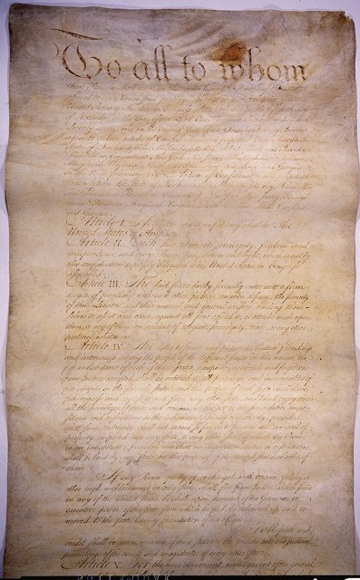
條例把十三州結合成一個「永久聯盟」，各州保有主權，中央只有一院制的邦聯國會，每州一票。國會不能直接向人民徵稅、不能管理州際貿易，沒有獨立的行政首長與聯邦法院；條例要修改，必須所有州一致同意。1778年7月起各州陸續簽署。

## 1781-03-01 | 《邦聯條例》生效
馬里蘭州堅持各州先放棄西部土地的主張，拖到1781年2月2日才批准，條例在3月1日生效，美國第一套全國性的政府制度正式運作。

## 1786-09 | 安納波利斯會議
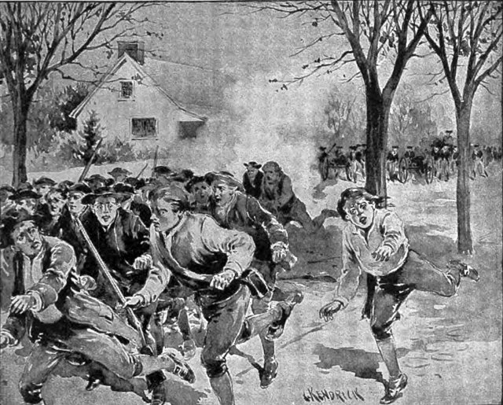
五個州的代表在安納波利斯討論州際貿易，因為出席太少無法議決，便建議隔年在費城召開更大規模的會議，檢討邦聯制度。同一時間，麻薩諸塞的謝司起義（1786－1787）讓各地政治人物擔心邦聯政府連秩序都維持不了，召開制憲會議的聲音隨之增強。1787年7月，邦聯國會另外通過《西北法令》，規定西北領地的治理方式與日後以平等地位建州加入聯邦的程序。

## 1787-05-25 | 費城制憲會議開幕
會議原定5月14日開始，因代表未到齊延到25日。地點是費城的獨立廳，羅德島沒有派代表，先後共有55位代表出席，華盛頓被推為主席。會議的任務原本只是修改《邦聯條例》，但代表們很快決定另寫一部新憲法，並約定討論內容保密；麥迪遜詳細記下了每天的辯論，是後人了解制憲經過最重要的資料。

## 1787-05-29 | 維吉尼亞方案
維吉尼亞州長愛德蒙·倫道夫提出以麥迪遜構想為基礎的方案：建立有實權的全國政府，分立法、行政、司法三部門，國會兩院都依人口比例分配席次。這對人口多的大州有利，小州則擔心被大州主宰。6月19日，會議決定以這個方案作為討論基礎。

## 1787-06-15 | 紐澤西方案
威廉·派特森代表小州提出對案：保留一院制國會與每州一票，只擴大邦聯國會徵稅、管理貿易的權力。6月18日，漢密爾頓另外發表長篇演說，主張建立接近英國體制的強大中央政府。大州與小州為國會席次僵持了一個多月。

## 1787-07-16 | 康乃狄克妥協
又稱「大妥協」：國會分兩院，眾議院依人口分配席次，參議院每州兩席。大州取得人口比例的代表權，小州保住平等的發言權，制憲會議最大的危機因此化解。同月，代表們還就奴隸人口達成三分之五妥協：計算眾議院席次與直接稅時，奴隸人口按五分之三計入。被奴役者沒有自由也沒有投票權，卻讓南方蓄奴州多得了席次，反映建國理想與奴隸制之間的深刻矛盾。另外兩項妥協是國會在1808年以前不得禁止奴隸輸入，以及逃奴必須遣返的條款。

## 1787-08-06 | 細節委員會提出草案
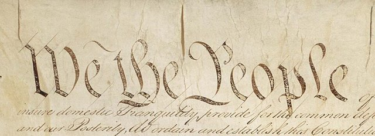
7月下旬，會議把已通過的決議交給細節委員會整理成條文，8月6日提出完整草案，代表們隨即逐條審議國會權力、總統選舉、司法與州際關係。8月31日，懸而未決的問題（例如總統由誰選出）交給未決事項委員會，選舉人團制度在這個階段成形；9月8日，風格委員會負責潤飾全文，「我們合眾國人民」這句開場白在這時寫定。

## 1787-09-17 | 美國憲法簽署
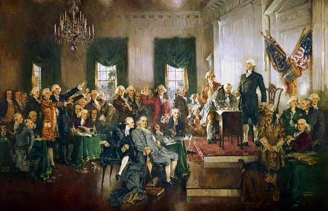
39位代表在獨立廳簽署憲法，會議結束。並非人人支持：有代表拒簽，也有人提前離去；富蘭克林說自己對憲法仍有疑慮，但懷疑還能有更好的版本，因此願意接受。憲法由序言與七條構成：第一條國會、第二條總統、第三條聯邦法院，第四條規定州與州的關係，第五條是修憲程序，第六條確立聯邦法律的最高性，第七條規定須經九州批准才生效。簽署並不等於生效，接下來還要各州批准。

## 1787-10-27 | 《聯邦黨人文集》開始發表
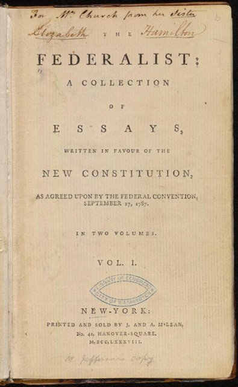
支持新憲法的聯邦黨與反對的反聯邦黨展開論戰。漢密爾頓、麥迪遜與約翰·傑伊以「普布利烏斯」為筆名，在紐約報紙陸續發表85篇文章，解釋分權制衡、聯邦制與大型共和國的好處，到1788年5月結束。反聯邦黨則擔心強大的中央政府會壓過各州，尤其不滿憲法沒有一份人民權利清單。

## 1787-12-07 | 德拉瓦州率先批准
德拉瓦成為第一個批准憲法的州，賓夕法尼亞（12月12日）、紐澤西（12月18日）、喬治亞（1788年1月2日）、康乃狄克（1月9日）隨後跟進。1788年2月6日，麻薩諸塞以建議日後增訂修正案為條件，勉強通過；馬里蘭、南卡羅來納接著批准。

## 1788-06-21 | 新罕布夏批准，憲法生效
新罕布夏是第九個批准的州，憲法達到第七條規定的生效門檻。不過，人口眾多的維吉尼亞（6月25日）與商業中心紐約（7月26日）隨後批准，新政府的政治基礎才真正穩固。9月13日，邦聯國會排定總統選舉與新國會開議的日期。北卡羅來納到1789年11月21日才批准，羅德島最晚，在1790年5月29日。

## 1789-03-04 | 聯邦政府開始運作
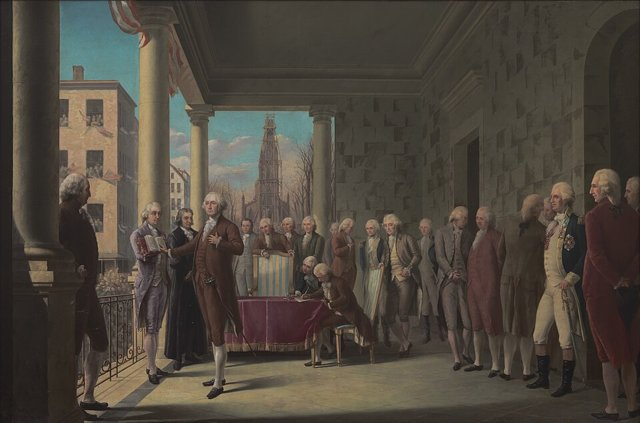
新憲法下的第一屆國會在紐約開議，但當天出席人數不足，直到4月6日才完成選舉人票的計算：華盛頓獲得全部69張選舉人票當選總統，約翰·亞當斯當選副總統。4月30日華盛頓在紐約聯邦廳宣誓就職，傑佛遜任國務卿、漢密爾頓任財政部長、亨利·諾克斯任戰爭部長、愛德蒙·倫道夫任司法部長，美國從鬆散的邦聯轉變為真正運作的聯邦政府。

## 1789-06-08 | 麥迪遜提出權利修正案
原本認為不必列權利清單的麥迪遜，為兌現批准時的承諾，在眾議院提出一系列修正案。眾議院在8月通過17條，與參議院協商後，國會在9月25日提出12條送交各州批准；同一天，國會也通過了建立聯邦法院體系的《1789年司法法》（9月24日由華盛頓簽署）。

## 1791-12-15 | 《權利法案》生效
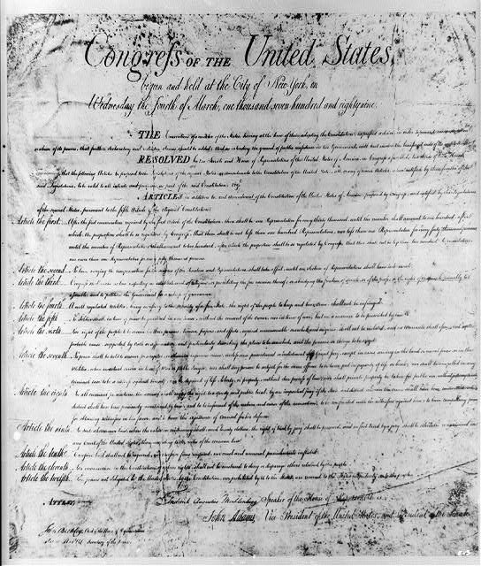
12條提案中的第3至12條獲得四分之三的州批准，成為前十條修正案，合稱《權利法案》：保障宗教、言論、出版、集會與請願自由（第一條），持有武器的權利（第二條），不受不合理搜索扣押（第四條），正當法律程序與不得強迫自證己罪（第五條），迅速公開的審判與陪審（第六、七條），禁止過高的保釋金與殘酷刑罰（第八條）；第九條說明未列舉的權利仍屬人民，第十條把未授予聯邦的權力保留給各州或人民。沒有通過的兩條，一條關於眾議員配額，至今仍未批准，另一條關於國會議員加薪，兩百年後才成為第二十七條修正案。

## 1795-02-07 | 第十一條修正案
1793年最高法院受理一位南卡羅來納公民控告喬治亞州的案件，引起各州強烈反彈。第十一條修正案規定，他州公民或外國人不得在聯邦法院控告一個州，確立了州的主權豁免。它在1795年就已達到批准門檻，因為統計延誤，到1798年才由亞當斯總統正式宣告。

## 1803-02-24 | 馬伯利訴麥迪遜案
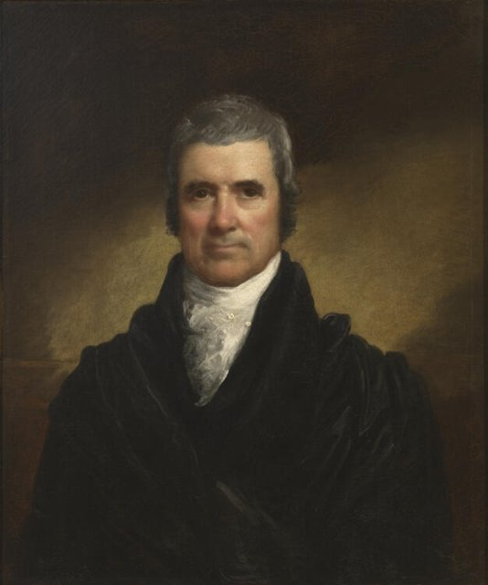
首席大法官約翰·馬歇爾在判決中指出，國會制定的法律若與憲法牴觸，法院可以拒絕適用。憲法本身沒有明寫這項權力，這個判決讓最高法院取得審查法律是否違憲的權力，成為三權制衡中與國會、總統並立的一方。

## 1804-06-15 | 第十二條修正案
原本的制度下，選舉人每人投兩票，得票最高者當總統、次高者當副總統；1796年因此出現總統與副總統分屬敵對政黨，1800年傑佛遜與同黨的伯爾又同票，眾議院投了36輪才分出勝負。第十二條修正案改為總統與副總統分開投票。

## 1819-03-06 | 麥卡洛克訴馬里蘭州案
馬里蘭州向聯邦設立的國家銀行分行課稅。馬歇爾法院判決：憲法雖然沒有明列設立銀行的權力，但國會為了行使明列的權力，可以採取「必要且適當」的手段；州不能對聯邦機構課稅，因為「課稅的權力就是毀滅的權力」。這確立了聯邦的默示權力與聯邦法律優先。1824年的吉本斯訴奧格登案，又確立聯邦對州際商業（包括航運）的管理權。

## 1833 | 巴倫訴巴爾的摩案
最高法院判決《權利法案》只約束聯邦政府，不約束各州。換句話說，州政府侵害言論自由或財產權，人民不能以前十條修正案主張保護。這個局面要到第十四條修正案之後，經由20世紀的一連串判決才逐步改變。

## 1857-03-06 | 德雷德·史考特訴桑福德案
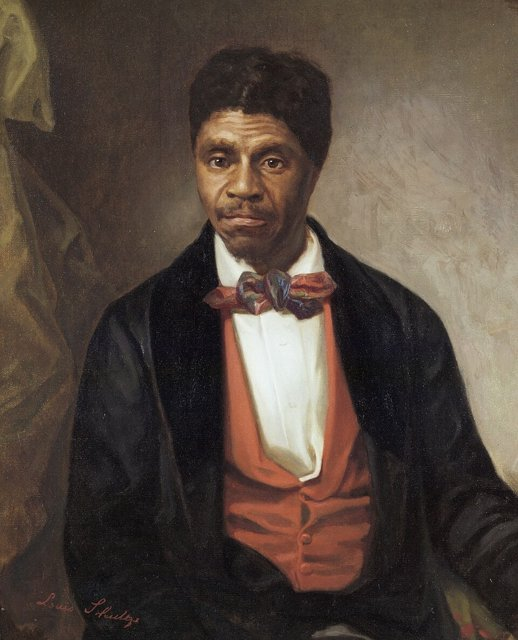
首席大法官坦尼判決：非裔美國人不論是否為奴，都不是美國公民，無權在聯邦法院起訴；國會也無權在聯邦領土禁止奴隸制，等於宣告密蘇里妥協違憲。這是最高法院史上最受批評的判決之一，非但沒有平息奴隸制爭議，反而加速了南北分裂。

## 1863-01-01 | 《解放奴隸宣言》生效
南北戰爭在1861年爆發，奴隸制、州權與聯邦權力的衝突全面攤牌。林肯以戰時總司令的身分宣布叛亂地區的奴隸獲得自由，但這不是憲法修正，也不適用於仍留在聯邦內的蓄奴州；要在全國廢除奴隸制，還需要修憲。

## 1865-12-06 | 第十三條修正案
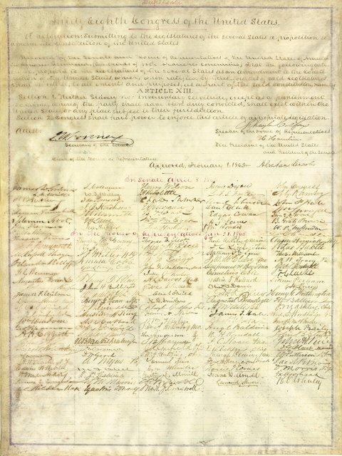
國會在1865年1月31日通過、12月6日獲各州批准，在美國全境廢除奴隸制與強迫勞役，但保留「作為犯罪懲罰」的例外。其間，南軍主力在4月9日投降，林肯在4月14日遇刺。

## 1868-07-09 | 第十四條修正案
國會在1866年6月提出，1868年7月批准：凡在美國出生或歸化者都是美國公民，推翻了德雷德·史考特案；各州不得未經正當法律程序剝奪人民的生命、自由與財產，也不得拒絕給予平等的法律保護。這是憲法史上影響最深遠的修正案之一，日後的布朗案、多數《權利法案》對各州的適用，以及同性婚姻判決，都建立在它之上。

## 1870-02-03 | 第十五條修正案
禁止聯邦與各州因種族、膚色或曾為奴隸而剝奪公民的投票權。第十三至十五條合稱「重建修正案」，改變了公民身分與聯邦、州之間的權力關係。但它只保障男性，而且1877年重建結束、聯邦撤出南方後，各州以人頭稅、識字測驗與暴力讓黑人無法投票，修正案的承諾要到一個世紀後才兌現。

## 1896-05-18 | 普萊西訴弗格森案
路易斯安那州的火車依種族隔離車廂，荷馬·普萊西刻意坐進白人車廂被捕。最高法院以7比1判決，只要設施「隔離但平等」，就不違反第十四條修正案；唯一反對的哈蘭大法官寫道「我們的憲法是色盲的」。這個判決讓南方的吉姆·克勞種族隔離法取得合憲地位，維持了將近六十年。1909年，全國有色人種協進會（NAACP）成立，開始以訴訟挑戰種族歧視。

## 1913-02-03 | 第十六條修正案
1895年最高法院判決聯邦所得稅違憲，第十六條修正案明文授權國會課徵所得稅，不必依各州人口分配。聯邦政府從此有了穩定且龐大的財源，為日後的新政與兩次世界大戰提供財政基礎。

## 1913-04-08 | 第十七條修正案
聯邦參議員原本由各州議會選出，常有賄選與議會僵持數年選不出人的情形。第十七條修正案改由各州選民直接選舉，參議員從此直接向人民負責，是進步時代的重要民主改革。

## 1919-01-16 | 第十八條修正案：禁酒
禁止在美國境內製造、販賣與運輸酒類，依條文在批准一年後、1920年1月17日開始實施。禁酒並未讓人不再喝酒，反而讓私釀、走私與黑幫坐大，是憲法唯一一次被用來規範個人消費行為。

## 1920-08-18 | 第十九條修正案：女性投票權
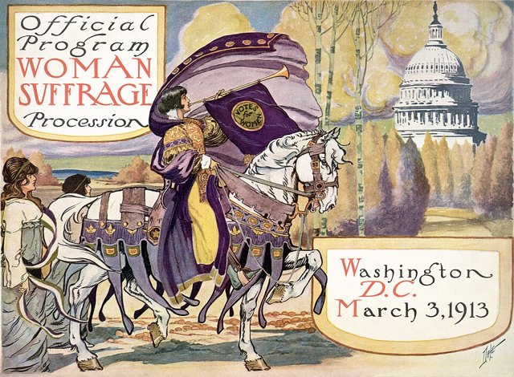
田納西州議會以一票之差批准，修正案達到門檻：公民的投票權不得因性別而被剝奪。從1848年塞內卡瀑布會議算起，女性爭取投票權運動歷經七十多年才在憲法層次獲得保障（部分西部州更早已給予女性投票權）。

## 1933-01-23 | 第二十條修正案
把總統就職日從3月4日提前到1月20日，國會改在1月3日開議，縮短選後舊人仍在位的「跛腳鴨」時期。大蕭條期間，胡佛落選後到羅斯福就職之間長達四個月的空窗，正是這項改革的背景。

## 1933-12-05 | 第二十一條修正案：廢除禁酒
廢除第十八條修正案，結束全國禁酒，是唯一一條廢除另一條修正案的修正案，也是唯一一條由各州特別會議（而非州議會）批准的修正案。

## 1937-03-29 | 西海岸旅館公司訴帕里什案
最高法院原本屢次以契約自由為由，判決最低工資與新政的經濟立法違憲；羅斯福在1937年2月提出增加大法官人數的「法院填塞」計畫。3月，法院以5比4維持華盛頓州的最低工資法，轉而接受政府對經濟的管制，填塞計畫也就失去必要。

## 1944-12-18 | 是松訴美國案
珍珠港事件後，羅斯福下令將西岸約12萬名日裔美國人（多數是公民）強制遷移到集中營。最高法院以戰時必要為由維持這項措施，成為司法未能保障公民權利的代表性案例；2018年最高法院在另一案中明言此判決是錯誤的。

## 1951-02-27 | 第二十二條修正案
華盛頓以來，總統做滿兩任即退休是不成文慣例，小羅斯福打破慣例連任四屆。第二十二條修正案規定任何人當選總統不得超過兩次，把慣例寫進憲法。

## 1954-05-17 | 布朗訴教育委員會案
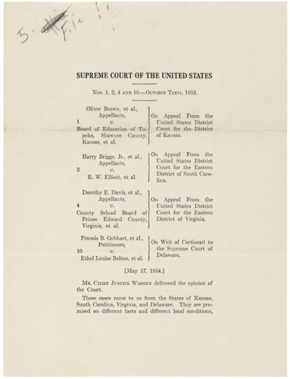
首席大法官華倫領導的最高法院一致判決，公立學校依種族隔離違反第十四條修正案的平等保護，推翻普萊西案在公立教育的適用；主打這場官司的是NAACP的律師瑟古德·馬歇爾。1958年的庫珀訴亞倫案中，最高法院進一步表明各州官員必須服從最高法院對憲法的解釋，回應阿肯色州對小石城學校整合的抵制。

## 1961-03-29 | 第二十三條修正案
首都華盛頓特區不屬於任何州，居民原本不能投票選總統。第二十三條修正案給予特區選舉人票，票數不得多於人口最少的州（目前為3票）；但特區在國會仍沒有具投票權的議員。

## 1963-03-18 | 吉迪恩訴溫賴特案
一位因竊盜被判刑的窮困男子在獄中手寫上訴，主張自己請不起律師卻沒有獲得指派律師。最高法院一致判決，州法院的重罪被告若無力聘請律師，政府必須提供，華倫法院擴大刑事被告權利的一系列判決由此展開。1966年的米蘭達訴亞利桑那州案又要求警方在偵訊前告知嫌犯有權保持沉默、有權請律師，即所謂「米蘭達警告」。

## 1964-01-23 | 第二十四條修正案
禁止在聯邦選舉中以繳納人頭稅作為投票條件。南方各州長期用人頭稅把貧窮的黑人與白人擋在投票所外；1966年最高法院又判決州選舉的人頭稅同樣違憲。同年3月的紐約時報訴沙利文案，則規定公眾人物控告媒體誹謗，必須證明對方明知不實或輕率不查，大幅強化了新聞自由。

## 1964-07-02 | 《1964年民權法》
詹森總統簽署法案，禁止公共場所與就業上基於種族、膚色、宗教、性別或原國籍的歧視。國會的立法依據之一，是憲法賦予的州際商業管理權。1965年的《投票權法》又進一步讓聯邦直接介入南方的選民登記。民權運動的經過見「美國民權運動」時間軸。

## 1967-02-10 | 第二十五條修正案
甘迺迪遇刺後，副總統出缺、總統失能時如何處理的問題浮上檯面。第二十五條修正案規定總統死亡、辭職或免職時由副總統繼任，副總統出缺時由總統提名、國會兩院同意補任，並建立總統暫時或被認定無法履行職務時的權力移轉程序。1973年至1974年，福特先依這條補任副總統，再繼任總統，成為唯一未經選舉就擔任正副總統的人。

## 1969-02-24 | 廷克訴得梅因學區案
愛荷華州幾名學生戴黑臂章抗議越戰而遭學校停學。最高法院判決學生「不會在校門口失去憲法上的言論自由」，只要不嚴重干擾教學，學校不得禁止。1971年的五角大廈文件案（紐約時報訴美國案）中，最高法院也拒絕讓政府事前禁止報紙刊登越戰機密報告。

## 1971-07-01 | 第二十六條修正案：18歲投票
越戰期間，「年紀夠大可以被徵召上戰場，卻不夠大可以投票」的質疑愈來愈強。第二十六條修正案把聯邦與各州選舉的投票年齡降為18歲，從國會通過到各州批准只花了約一百天，是批准最快的修正案。

## 1972-03-22 | 國會通過平等權利修正案
修正案只有一句核心條文：法律之下的權利平等，不得因性別而被聯邦或任何州否認或限縮。國會通過後交由各州批准，原定期限7年，1979年延長到1982年6月30日，到期時只有35州批准，差3州未達38州的門檻。此後仍有州補行批准，但修正案是否還能生效，至今仍有爭議。

## 1973-01-22 | 羅訴韋德案
最高法院以7比2判決，第十四條修正案的正當程序條款保障的隱私權，涵蓋女性在懷孕前期決定墮胎的權利。此後半個世紀，墮胎成為美國政治最激烈的對立議題之一，直到2022年被推翻。

## 1974-07-24 | 美國訴尼克森案
水門事件調查中，特別檢察官要求尼克森交出白宮談話錄音，尼克森以行政特權拒絕。最高法院一致判決，總統的行政特權不是絕對的，不能用來對抗刑事調查的具體證據需要。錄音證實尼克森參與掩蓋，眾議院彈劾在即，他在8月9日辭職，成為美國史上唯一辭職的總統，證明總統同樣受法律約束。

## 1992-05-07 | 第二十七條修正案
規定國會議員調整薪酬的法律，要等下一屆眾議院選舉後才能生效。這條是1789年麥迪遜提出的12條之一，當年未獲足夠的州批准，1980年代一位德州大學生在報告中重新發現它還沒有期限，發起各州補行批准，相隔202年才完成。它是至今最後一條修正案。

## 2000-12-12 | 布希訴高爾案
總統大選結果取決於佛羅里達州，兩人差距只有幾百票，州最高法院下令重新人工計票。聯邦最高法院以平等保護為由叫停重新計票，小布希因此勝選。這是最高法院直接左右總統選舉結果的罕見例子，判決的正當性至今仍有爭論。

## 2008-06-26 | 哥倫比亞特區訴海勒案
最高法院以5比4判決，第二修正案保障的是個人持有槍枝的權利，不以參加民兵為前提，華盛頓特區全面禁止在家中持有手槍的法律違憲。2010年，這項權利經由第十四條修正案也適用於各州。

## 2010-01-21 | 聯合公民訴聯邦選舉委員會案
最高法院以5比4判決，政府不得限制企業與工會為選舉進行的獨立政治支出，因為這屬於第一修正案保障的言論。判決為超級政治行動委員會鋪路，也引發金錢左右選舉的長期爭論。同年3月，《平價醫療法案》簽署，2012年最高法院在國家獨立企業聯合會訴西貝利厄斯案中大致維持其合憲性。

## 2015-06-26 | 奧貝格費爾訴霍奇斯案
最高法院以5比4判決，第十四條修正案的正當程序與平等保護條款保障同性伴侶的結婚權利，各州必須核發並承認同性婚姻。

## 2021-01-06 | 國會大廈遭闖入
國會兩院聯席會議依憲法與法律清點2020年總統選舉的選舉人票時，支持落選總統川普的群眾闖入國會大廈，會議一度中斷，當晚才完成認證。事件引發對選舉人票認證程序與和平移轉權力的討論，國會在2022年修訂《選舉人計票法》，明定副總統在計票時只負責程序。

## 2022-06-24 | 多布斯訴傑克森婦女健康組織案
最高法院以6比3維持密西西比州禁止懷孕15週後墮胎的法律，並以5比4推翻羅訴韋德案，認定聯邦憲法沒有保障墮胎權，相關規範交回各州與民選機關決定。各州的墮胎法律從此出現極大差異。

## 2024-07-01 | 川普訴美國案
最高法院以6比3判決，前總統對於憲法賦予的核心職權行為享有絕對的刑事豁免，對其他官方行為推定享有豁免，非官方行為則不受保護。判決劃出總統刑事責任的界線，也引發總統是否凌駕法律的激烈辯論。
