<!--
內容整理自本機筆記《梵谷生平大事記（1853—1890）》（D:\Books\md\藝術\梵谷生平大事記（1853—1890）.md，網頁版為 D:\Books\html\9-2.藝術家\梵谷(1853~1890，Vincent Willem van Gogh).html），並整合中文維基百科〈文森特·梵高〉條目，以自己的話改寫。
時期依筆記的七個階段歸納，並依年代拆細：家庭與職業（1853–1879）、荷蘭時期（1880–1885）、安特衛普與巴黎（1885–1888）、阿爾（1888–1889）、聖雷米（1889–1890）、奧維（1890）、身後聲譽。
兩份資料出入與處理方式：
- 筆記只有「年」，維基百科多有月或日：以維基百科補上月日（如1888-10-23高更抵達、1888-12-23耳朵事件、1889-05-08進入聖雷米、1890-05-21抵達奧維），筆記沒有的細節（與西恩同居、與表姐求婚遭拒、瑪戈特·貝格曼、梅毒與淋病治療、奧里埃評論、侄子出生）取自維基百科。
- 求婚遭拒與手放燈火的插曲，各傳記對月份說法不一，只寫「1881年」。耳朵：筆記只說「傷害了自己的耳部」，維基百科說割下左耳（全部或一部分，各來源不同），這裡寫「割下左耳的一部分或全部」。
- 筆記說梵谷在1888年12月與高更衝突後出事；維基百科補充西奧在12月24日向喬安娜·邦格求婚，當晚趕往阿爾。兩者併入同一則事件。
- 筆記把1888年2月抵達阿爾、5月租下黃屋、夏季畫向日葵、9月畫夜間咖啡座與隆河星夜分開寫；維基百科記載9月17日才搬進黃屋。這裡以「租下黃屋」（5月）與「搬進黃屋」（9月17日）分成兩則事件，避免相互矛盾。
- 逝世前的槍擊：筆記寫「根據一般傳記記載是自傷，部分細節仍有討論」；維基百科記為以左輪手槍自殺，子彈未傷及要害，無法取出，兩日後傷口感染去世。這裡採筆記的謹慎寫法並補上日期；《麥田群鴉》是不是最後一幅畫沒有可靠證據，照筆記不作斷言。
- 《夜間露天咖啡座》與《隆河上的星夜》筆記寫1888年9月，《向日葵》系列開始時間維基百科記為1888年8月，兩者分開寫。《星夜》維基百科記為1889年6月，筆記只寫1889年，採6月。《鳶尾花》筆記寫1889年，通常認為完成於聖雷米初期（約5月），這裡併入進入療養院的事件。
- 梵谷博物館開幕筆記寫1973年；梵谷的書信集1914年出版、侄子（文生·威廉）1890年1月31日出生、1901年巴黎回顧展、1905年阿姆斯特丹斯泰德利克博物館大型展、歐文·斯通的《渴望生活》（1934）與同名電影（1956）、1990年《加歇醫師肖像》以8,250萬美元成交的紀錄，這幾項筆記沒有或只提到一部分，由維基百科與常見史實補充。
- 筆記說1890年5月離開聖雷米後先去巴黎探望西奧，再到奧維；維基百科記為5月21日抵達奧維，兩者相容；離開聖雷米為16日前後。
- 筆記附的「作品創作時間表」「風格演變表」「關鍵人物」「十個關鍵年份」「如何理解梵谷的一生」寫進時期說明與相關事件，不另立事件；「延伸閱讀」四個博物館的連結沒有轉錄。
- 譯名：Vincent van Gogh 依筆記與台灣常見寫法作「梵谷」，高更、貝納、西涅克、西奧、加歇醫師、約·梵谷–邦格與其他時間軸一致，人名用·分隔（筆記作・）；「文生」另列為 aliases 以便人名索引比對。
圖片來源（皆為 Wikimedia Commons 公有領域／CC0 作品）：
- vg-cover.jpg：Vincent van Gogh - Self-Portrait - Google Art Project.jpg（梵谷〈自畫像〉，1889，奧賽美術館）
- vg-theo.jpg：Vincent van Gogh, Portrait of Theo van Gogh (1887).jpg（梵谷〈西奧肖像〉，1887）
- vg-goupil.jpg：Plaats 20, 'The Goupil Gallery'.jpg（海牙的古皮爾畫廊（古皮爾公司的廣告））
- vg-sorrow.jpg：Vincent van Gogh - Sorrow.jpg（梵谷〈悲傷〉，1882，模特兒是西恩）
- vg-nuenen.jpg：Weber in front of an open window with view the Tower of Nuenen - Vincent van Gogh.jpg（梵谷〈在開著的窗前織布的人，背景是努南的教堂塔樓〉，1884）
- vg-potato.jpg：The Potato Eaters - Vincent Van Gogh.jpg（梵谷〈吃馬鈴薯的人〉，1885）
- vg-antwerp.jpg：Van gogh city view antwerp vgm f1355 jh966.jpg（梵谷〈安特衛普市景〉，1885）
- vg-tanguy.jpg：Van Gogh - Portrait of Pere Tanguy 1887-8.JPG（梵谷〈唐吉老爹肖像〉，1887–1888）
- vg-yellowhouse.jpg：Vincent van Gogh - The yellow house ('The street').jpg（梵谷〈黃屋〉，1888）
- vg-sunflowers.jpg：Vincent van Gogh - Sunflowers (1888, National Gallery London).jpg（梵谷〈向日葵〉，1888，倫敦國家美術館）
- vg-rhone.jpg：Vincent van Gogh - Starry Night - Google Art Project.jpg（梵谷〈隆河上的星夜〉，1888）
- vg-gauguin.jpg：Paul Gauguin - Vincent van Gogh painting sunflowers - Google Art Project.jpg（高更〈梵谷畫向日葵〉，1888）
- vg-ear.jpg：Vincent van Gogh - Self-portrait with bandaged ear (1889, Courtauld Institute).jpg（梵谷〈包紮耳朵的自畫像〉，1889，科陶德美術館）
- vg-asylum.jpg：Monastère Saint-Paul-de-Mausole de Saint-Rémy-de-Provence - J-A Brutails - Université Bordeaux Montaigne - 1903.jpg（聖雷米的聖保羅療養院修道院，1903年的照片）
- vg-starry.jpg：Van Gogh - Starry Night - Google Art Project.jpg（梵谷〈星夜〉，1889，紐約現代藝術博物館）
- vg-almond.jpg：Vincent van Gogh - Almond blossom - Google Art Project.jpg（梵谷〈杏花〉，1890）
- vg-gachet.jpg：Vincent van Gogh - Dr Paul Gachet - Google Art Project.jpg（梵谷〈加歇醫師肖像〉，1890）
- vg-crows.jpg：Vincent van Gogh - Wheatfield with crows - Google Art Project.jpg（梵谷〈麥田群鴉〉，1890，梵谷博物館）
- vg-grave.jpg：Vincent et Théo van Gogh, tombes à Auvers-sur-Oise.jpg（梵谷與西奧在奧維公墓的並排墓碑）
-->

# Periods
- 1853-03-30 ~ 1879 | 家庭、職業與傳教 | #868e96
  生於荷蘭南部牧師家庭；十六歲進古皮爾藝術品公司，先後在海牙、倫敦、巴黎工作，之後當過教師、書店店員、準備神學考試，最後到比利時礦區傳教，失敗後才找到畫畫這條路。
- 1880 ~ 1885-11 | 荷蘭時期 | #8d6e63
  決定當畫家後，在埃滕、海牙、德倫特、努南苦練素描與人物，以褐色、灰色與土黃色畫農民、織工與勞動者，1885年完成《吃馬鈴薯的人》。
- 1885-11 ~ 1888-02 | 安特衛普與巴黎 | #339af0
  在安特衛普接觸魯本斯與日本版畫，到巴黎與西奧同住，吸收印象派與新印象派的色彩，畫了大量自畫像與花卉，色調從暗轉亮。
- 1888-02 ~ 1889-05 | 阿爾：成熟期 | #f59f00
  在南法的陽光下畫出向日葵、夜間咖啡座與《臥室》，邀請高更同住，卻在12月發生耳朵事件，藝術家共同體的夢想破碎。
- 1889-05 ~ 1890-05 | 聖雷米：療養與創作 | #1971c2
  住進聖保羅療養院，病情時好時壞，仍畫出《星夜》《鳶尾花》與柏樹、橄欖樹、麥田系列。
- 1890-05 ~ 1890-07-29 | 奧維：最後七十天 | #c92a2a
  在加歇醫師照護下一天畫一幅，留下《加歇醫師肖像》《奧維教堂》《麥田群鴉》，7月27日中槍，兩天後去世。
- 1890-07-29 ~ 1990 | 身後聲譽的建立 | #7048e8
  弟媳約·梵谷–邦格保存作品並出版書信，1901年巴黎、1905年阿姆斯特丹的展覽打開知名度，梵谷逐漸成為表現主義與現代藝術的核心人物，也成為拍賣市場的紀錄保持者。

# Events

## 1853-03-30 | 出生於荷蘭宗德爾特
梵谷出生在荷蘭南部北布拉邦省的宗德爾特（Zundert），父親西奧多魯斯是新教牧師，母親安娜·卡本圖斯出身書籍裝訂師家庭，他是長子，下面有兩個弟弟、三個妹妹。
家裡重視宗教、道德與家庭責任，年輕的梵谷相當虔誠，也一心想為困苦的人做點事，這個傾向後來把他帶到比利時的礦區。

## 1857-05-01 | 弟弟西奧出生
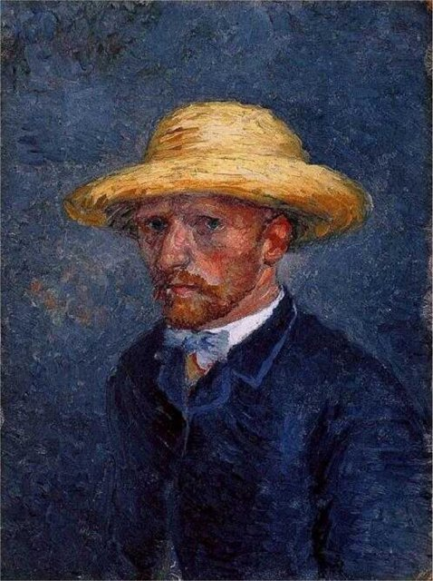
弟弟西奧·梵谷出生。西奧後來成為梵谷一生最重要的支持者：長期寄生活費、幫忙買畫材、向畫商介紹他的作品，也是他傾吐藝術與生活煩惱的對象。
兩人留下的七百多封書信，是後世理解梵谷最重要的史料。沒有西奧長年的支持，梵谷幾乎不可能這樣密集地創作。

## 1860 ~ 1868 | 求學與早期教育 {label="1861–1868年"}
1861年開始上學，學法文、德文與英文；1864年進澤芬貝亨的寄宿學校，因為被排擠而要求回家；1866年轉到蒂爾堡的威廉二世中學，同樣不喜歡，1868年3月中斷學業回家。
求學過程很不連貫，卻養成大量閱讀的習慣，文學、語言、宗教與繪畫日後都成為他自學的基礎。

## 1869-07 | 進入古皮爾藝術品公司
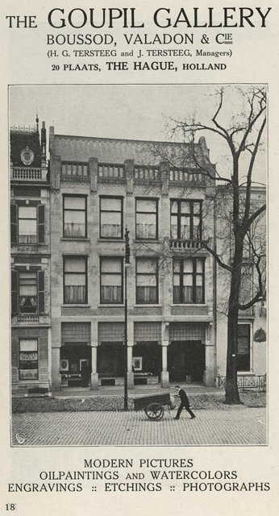
經伯父介紹，十六歲的梵谷到藝術品交易公司「古皮爾」（Goupil & Cie）的海牙分部見習。公司在歐洲有多處分部，他因此提早接觸繪畫、藝術市場與各家畫風。
但他逐漸對把藝術當商品的做法不滿，認為藝術不該只是買賣。

## 1873 | 調往倫敦
梵谷被調到古皮爾的倫敦分部，住在斯托克維爾，是他一生中較快樂的時期之一。他在英國持續接觸藝術與文學，也開始經歷感情上的挫折：1874至1875年間愛慕房東之女歐仁妮·洛耶，遭到拒絕，此後把心力轉向宗教。
傳記常把這件事當成他情緒的轉折，但後來的種種困境不能簡化為單一事件。

## 1875 | 調回巴黎
梵谷被調到古皮爾的巴黎分部。巴黎是歐洲藝術的中心，他得以接觸更廣的展覽與藝術文化，但對商業工作的不滿越來越深，信仰與精神生活反而占據更重要的位置。
翌年他被公司辭退。

## 1876 | 離開藝術品交易，嘗試教書與傳教
1876年4月，梵谷回到英格蘭，在拉姆斯蓋特一所寄宿學校代課，同年聖誕節回荷蘭，在多德雷赫特的書店工作約六個月。
1877年他到阿姆斯特丹叔叔家準備神學考試，沒有通過；1878年7月到布魯塞爾近郊拉肯的傳教士培訓學校受訓三個月，也沒有結果。年輕的梵谷始終想找一個有道德意義、能幫助弱勢者的職業，卻一再碰壁。

## 1879-01 | 比利時博里納日礦區傳教 {label="1878–1880年"}
1879年1月，梵谷到比利時博里納日（Borinage）煤礦區的小瓦姆傳教，與礦工同住，生活極其貧困。他近乎自我犧牲的生活方式沒有獲得教會認可，傳教工作無法延續。
1880年8月他又回到屈埃姆，與礦工相處兩個月。這段經歷影響深遠：他開始把普通勞動者當成值得描繪的主角，而不是只畫宗教人物或貴族。

## 1880 | 決定成為畫家
約二十七歲的梵谷決定以繪畫為志業，開始有系統地練習素描，研究人體比例與透視，臨摹米勒（Jean-François Millet）等人的作品；米勒以農民生活為題材，與梵谷對勞動者的關懷相合。
這年11月他在布魯塞爾皇家美術學院註冊。早期的梵谷還不是日後的鮮豔風格，他先努力掌握造型，想真實畫出身體、手、臉與工作環境。

## 1881 | 埃滕：向表姐求婚遭拒
梵谷回到埃滕的父母家，以鄰居為模特兒練習素描。夏秋之間，他向守寡的表姐科妮莉亞（Kee）求婚，遭到拒絕；傳說他曾把手放在燈火上，要家人讓他見她，後來被制止。
這年他和家人因為感情與生活問題屢起衝突，年底又前往海牙。

## 1881-12 | 移居海牙，莫夫指導
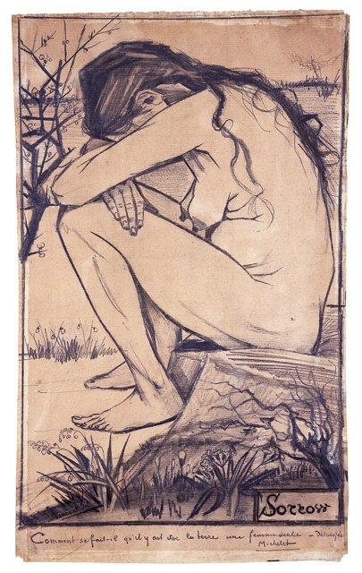
梵谷在1881年底到海牙，接受姻親、畫家安東·莫夫（Anton Mauve）的指導，學水彩與油畫，但很快因為教學方式與莫夫起了爭執，莫夫不再回信。
1882年1月底，他遇到懷孕且帶著五歲女兒的妓女西恩（Sien，本名克拉西娜·瑪麗亞·霍爾尼克），兩人同居，他畫了許多素描描繪貧困者、工人與底層人物，其中《悲傷》（Sorrow，1882）畫的就是西恩。
1882年6月他因淋病住院約三週，同月畫下生平第一幅油畫；7月2日西恩生下兒子威廉，他一度被認為是孩子的父親，但這並非事實。1883年底在父親的壓力下，他離開了西恩。

## 1883-09 | 德倫特：荒野與孤獨
梵谷到荷蘭東北部的德倫特，想從荒地、農舍與農民的勞動中找題材。孤獨、天候與金錢問題讓日子很不好過，他沒有找到穩定的創作環境，卻更深入觀察了鄉村與自然景觀。
同年12月，他回到家人在努南（Nuenen）的住處。

## 1884 | 努南：織工、農民與瑪戈特
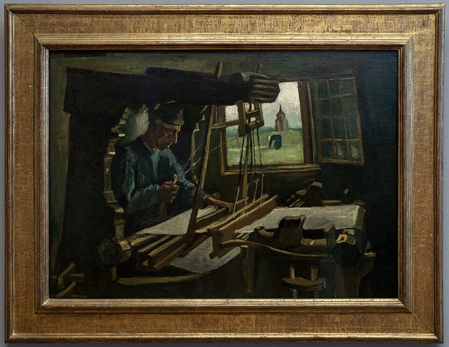
努南是梵谷早期藝術的重要地點。他持續畫農民、織工、農舍與鄉村景觀，用大量習作研究人在勞動時的姿態；色調以褐、灰、土黃與深綠為主，想傳達農村生活的沉重與真實。
1884年秋，鄰居之女瑪戈特·貝格曼愛上梵谷，雙方家人反對，她服下番木鱉鹼自殺未遂，梵谷把她送去就醫。

## 1885-03-26 | 父親去世
父親西奧多魯斯因心臟病突然逝世。家庭關係本來就緊張，喪父之痛使這段時期更為複雜。
同年9月，村中傳言梵谷讓模特兒懷孕，天主教神父禁止村民再替他當模特兒，他在努南待不下去了。

## 1885 | 《吃馬鈴薯的人》
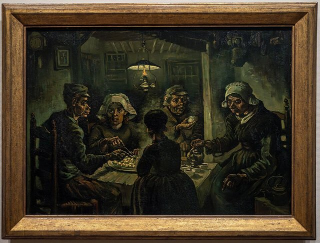
梵谷在努南完成荷蘭時期最重要的代表作《吃馬鈴薯的人》（The Potato Eaters）：一家農民在昏暗的室內圍桌吃飯，臉與手粗獷而有表現力，色調深沉，沒有刻意美化農民。
他想呈現的是勞動者靠雙手工作、也靠雙手得到食物的真實生活，這幅畫也代表他早期藝術的核心信念：藝術該表現真實的人生，而不只是漂亮的外表。8月他曾把作品放在海牙一家店的櫥窗展出，沒有賣出去。

## 1885-11 | 移居安特衛普
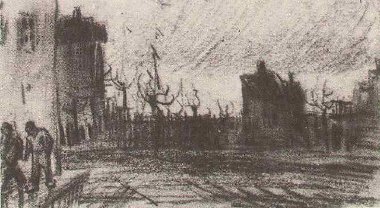
梵谷離開努南，到比利時安特衛普。他在這裡受到魯本斯作品的震撼，開始更注意色彩與畫材，也接觸日本版畫。
1886年1月他入讀安特衛普皇家美術學院，但和老師發生衝突，2、3月間又多次住院治療梅毒與牙痛。學院在3月底列出要重讀的17名學生，他在其中，並沒有被直接開除，但他已經準備離開。

## 1886-03 | 前往巴黎，與西奧同住
梵谷到巴黎，與西奧同住在蒙馬特的公寓，6月再搬到勒皮克路較大的住處。巴黎是歐洲藝術革新的中心，印象派與新興運動正在改寫繪畫觀念。
他在費爾南·柯爾蒙（Fernand Cormon）的畫室學習，結識貝納、羅素（John Peter Russell）、土魯斯–羅特列克等年輕畫家。巴黎帶給他三項影響：印象派的色彩觀念、新印象派（秀拉、西涅克）對互補色與點彩的實驗，以及日本浮世繪的平面構圖與大片色塊。

## 1887 | 唐吉老爹與色彩實驗
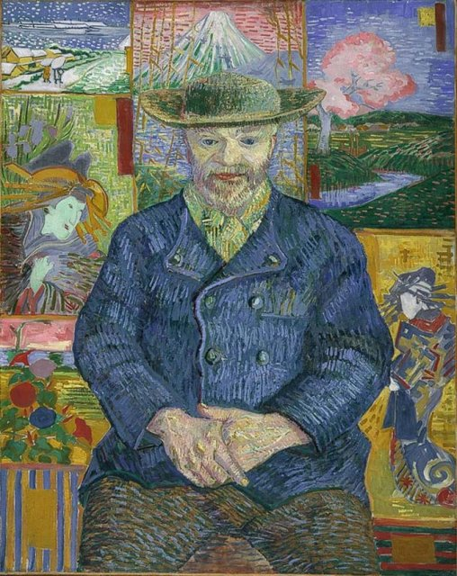
這一年梵谷畫了大量自畫像、花卉與街景，用自畫像練習色彩、光線與筆觸；他的調色盤從暗褐轉向明亮的藍、黃、橙與綠，筆觸也更有節奏。
他在畫材商唐吉老爹（Père Tanguy）的店裡看到點彩派與新印象派的作品，畫下《唐吉老爹肖像》，背景是他收藏的日本版畫。他也臨摹浮世繪，如溪齋英泉與歌川廣重。11月他與剛到巴黎的高更結識，兩人交換畫作；年底在蒙馬特一家餐廳與貝納等人舉辦聯展。
這時期他逐漸領悟：顏色不一定只是模仿物體原來的樣子，也可以用來傳達氣氛、感受與象徵。

## 1888-02 | 前往阿爾
巴黎的生活步調繁忙，梵谷身心疲憊，完成約兩百幅巴黎時期作品後，他離開巴黎，在出發前與西奧一起去拜訪了秀拉。
2月，他抵達法國南部普羅旺斯的阿爾（Arles），想找更明亮的陽光與寧靜的創作環境，也可能打算在這裡建立「藝術家殖民地」。他開始大量畫果園、花田、農舍與橋梁，1888年春的一系列開花果樹，標誌他從暗色調走向鮮明、有節奏的色彩。

## 1888-05 | 租下黃屋
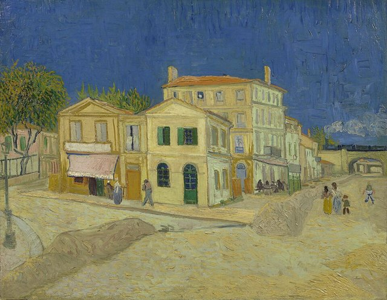
梵谷租下阿爾的「黃屋」（Yellow House），想把它變成藝術家共同生活、互相討論的空間，邀請其他畫家來同住。這反映了他對藝術共同體的期待：他不只想當獨自工作的畫家，也希望藝術家彼此支持。

## 1888-08 | 《向日葵》系列
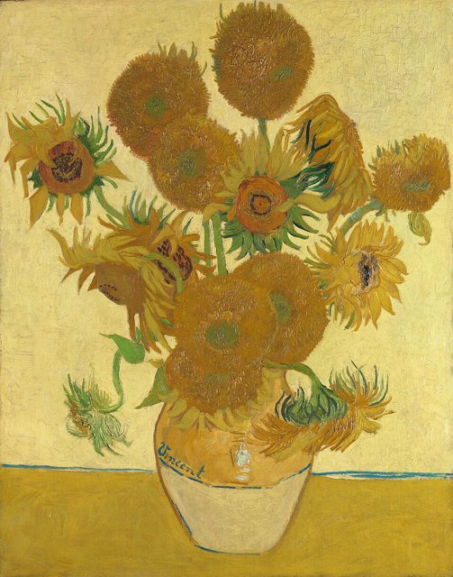
向日葵是梵谷最著名的題材之一。8月起，他在阿爾畫了多幅向日葵，其中幾幅用來裝飾黃屋，迎接高更到來。
這個系列用不同層次的黃色統一畫面，以方向各異、厚薄不一的筆觸表現植物的生命力，向日葵也成為友誼、生命力、希望與藝術理想的象徵。

## 1888-09 | 夜間咖啡座與隆河星夜
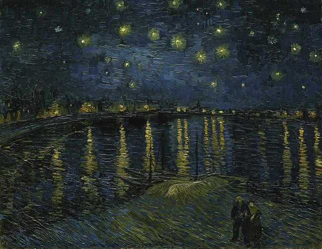
9月，梵谷畫了《夜間露天咖啡座》與《隆河上的星夜》。前者以明亮的黃色燈光對比深藍夜空，後者描繪夜晚的隆河，星光與岸邊燈火倒映在水面上。
他不把夜晚簡化為黑色，而是用藍、黃與其他顏色呈現夜間光源與色彩的豐富層次。《隆河上的星夜》和隔年的《星夜》不是同一件作品。
9月17日，他搬進黃屋，還買了兩張新床。同期的作品還有《臥室》《紅色葡萄園》與《播種者》。

## 1888-10-23 | 高更抵達阿爾
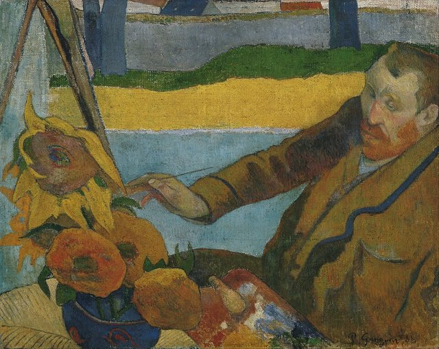
高更在10月23日抵達阿爾，11月搬進黃屋。梵谷期待兩人共同創作，建立理想中的藝術家團體，兩人也一起去阿利斯康遠足，12月到蒙彼利埃參觀法布爾博物館。
但兩人的個性與藝術觀不同：梵谷習慣直接面對自然作畫，重視觀察與情感；高更則強調記憶、想像、象徵與對形體的主觀組織。交流帶來刺激，也逐漸演變成衝突。

## 1888-12-23 | 耳朵事件
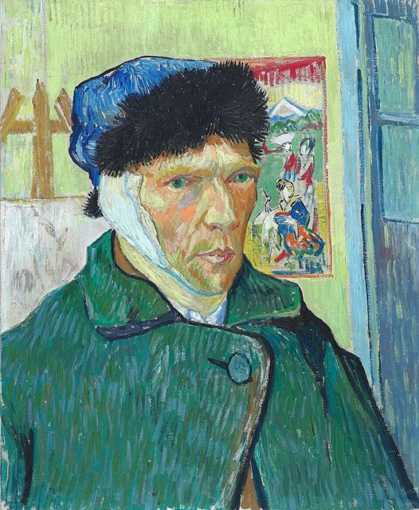
12月23日，兩人關係惡化，梵谷在精神危機中割下自己的左耳（一部分或全部，各來源說法不同），把它包起來送給當地一名妓女，隨後被送進醫院。
12月24日，西奧在這天向喬安娜·邦格（Johanna Bonger）求婚，當晚搭火車趕到阿爾，隔夜又回巴黎。高更在24日前後離開，兩人此後再沒見面。
這件事常被當成梵谷最有名的事件，但不應只用它來解釋他的藝術；他的精神狀況涉及多種可能因素，現代研究無法僅憑歷史資料斷定唯一的診斷。

## 1889-01-07 | 出院與再次入院
梵谷康復後在1889年1月7日回到黃屋，繼續畫畫，並畫了《自畫像：包紮過的耳朵和煙斗》。但健康問題持續，阿爾部分居民對他的行為感到不安，3月在三十位居民聯名下，警方把他安置回醫院，希涅克曾兩度探望。
4月他搬到費利克斯·雷醫生家中。阿爾時期是他藝術成熟的核心階段，他把自然觀察、色彩實驗、情感表現結合，建立了個人化的色彩系統、強烈筆觸與有張力的構圖。

## 1889-05-08 | 進入聖雷米聖保羅療養院
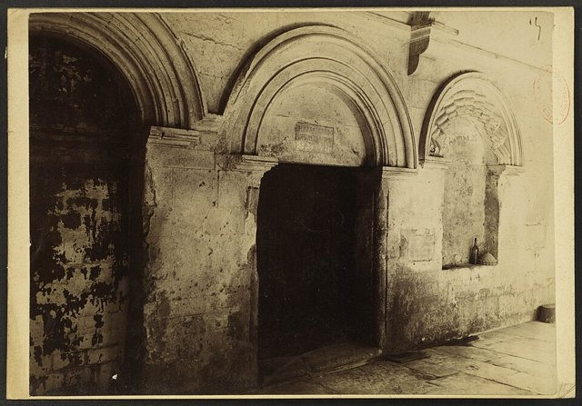
5月8日，梵谷在牧師弗雷德里克·薩勒（Frédéric Salles）陪同下，住進法國聖雷米的聖保羅療養院（Saint-Paul-de-Mausole）。生活受到一定限制，但他仍獲准畫畫。
他常描繪窗外的田野、山丘、樹木與天空，也畫花卉並臨摹其他藝術家。《鳶尾花》（Irises）就是這個時期的作品：不同方向的葉片、花莖與花朵形成有節奏的構圖，顯示他既能細緻觀察植物，又能把鮮明色彩與精準的形體安排結合起來。

## 1889-06 | 《星夜》
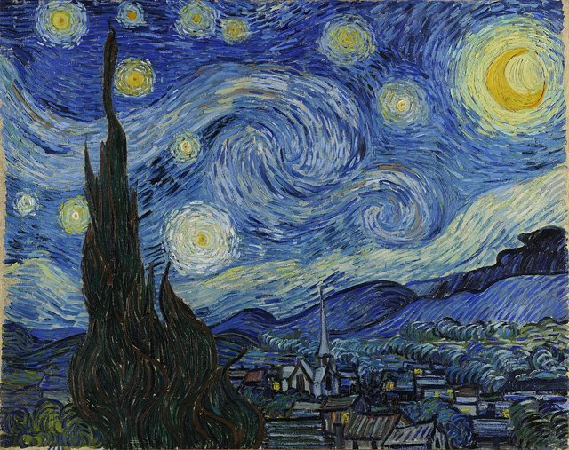
《星夜》（The Starry Night）是梵谷最有名的作品之一，現藏紐約現代藝術博物館。畫面有夜空、月亮與星辰、山丘、村落，以及前景的柏樹。
旋渦般的天空充滿動感，深藍與亮黃形成強烈對比，自然景物被主觀地重新組織，寧靜與張力並存。這幅畫常被解讀為梵谷對自然、生命與宇宙的情感回應；但如果把它完全歸結為某種心理狀態，就可能忽略作品本身的藝術構造。
同年他還畫了《橄欖樹》《絲柏樹》《麥田裡的絲柏樹》《午睡》《玫瑰》。他特別喜歡柏樹的垂直形態，認為有強烈的視覺力量。

## 1890-01 | 奧里埃的評論與侄子出生
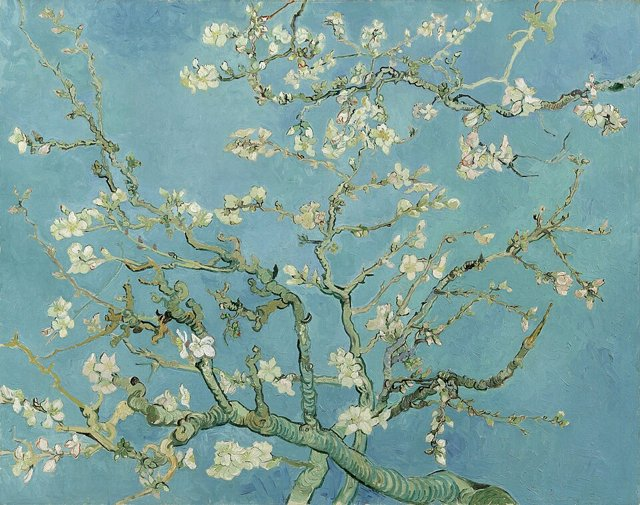
1890年1月，評論家阿爾貝·奧里埃（Albert Aurier）在《法蘭西信使》（Mercure de France）撰文讚揚梵谷的作品，這是他生前少數受到公開肯定的時刻。1月31日，西奧與喬安娜的兒子出生，取名文生·威廉（Vincent Willem），2月梵谷畫了《杏花》送給他。
2月，梵谷完成五幅《阿萊的基諾夫人》；同月布魯塞爾「二十人展」邀請他參展，但開幕晚宴上有畫家批評他的作品，羅特列克與西涅克表達不滿。2至4月，他病情加劇，一度無法寫信，也無法創作。
聖雷米時期的梵谷並非一直處於危機，也不是完全無法工作；他的健康時有起伏，但狀況好時仍持續創作、閱讀與寫信。

## 1890-05-21 | 抵達奧維
梵谷在5月16日前後離開聖雷米，先到巴黎探望西奧一家，5月21日抵達巴黎北方的瓦茲河畔奧維（Auvers-sur-Oise），住進拉武旅館（Auberge Ravoux），由醫師保羅·加歇（Paul Gachet）照護。
加歇本身對藝術有興趣，也和多位畫家往來。奧維的鄉村景觀、農田與房屋，成為梵谷最後的題材。

## 1890-06 | 《加歇醫師肖像》與《奧維教堂》
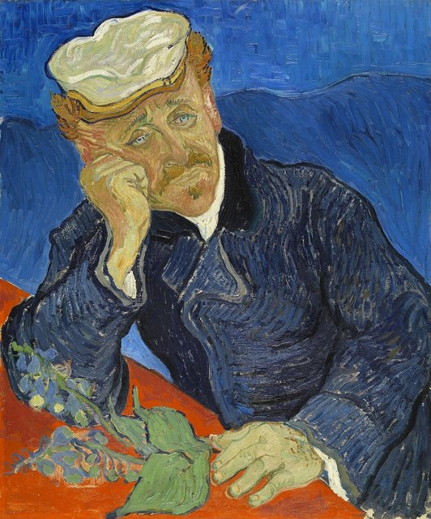
6月，梵谷畫了《加歇醫師肖像》（Portrait of Dr. Gachet），以人物姿態、面部表情與色彩安排呈現鮮明的個人風格；畫中的醫師常被解讀為帶有憂鬱氣質，但這類解釋不應被當成對人物心理狀態的確定診斷。
同月他畫《奧維教堂》，建築的輪廓、地面與天空的處理都有強烈的主觀表現，他不只是記錄教堂的外貌，而是用線條、色彩與形體創造自己的視覺經驗。

## 1890-07 | 《麥田群鴉》與《多比尼的花園》
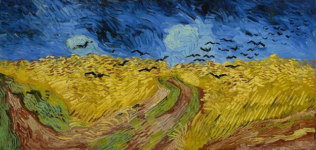
7月，梵谷完成兩幅《多比尼的花園》與《麥田群鴉》（Wheatfield with Crows）。《麥田群鴉》以金黃色麥田、深色天空、飛翔的群鴉與分岔的道路構成，有強烈的視覺張力。
它常被解讀為梵谷晚年心理狀態的象徵，但它是不是他的最後一幅畫，沒有足夠可靠的證據；比較審慎的看法，是把它當成晚期藝術表現的重要例子，而不是把每個元素直接對應到某種特定情緒。
奧維這七十天，他幾乎一天畫一幅，作品延續對自然景觀的熱愛，構圖更簡潔有力。

## 1890-07-27 | 槍傷
7月27日傍晚，梵谷在奧維附近以一把左輪手槍朝胸口開槍，現場沒有目擊者。一般傳記記載是自傷，但事件的部分細節仍有歷史討論。子彈沒有傷及重要器官，但因為當時沒有外科醫生在場，子彈無法取出。
他回到旅館，西奧得知後趕到他身旁陪伴。

## 1890-07-29 | 逝世
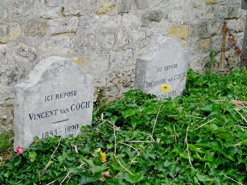
7月29日凌晨，梵谷因傷口感染去世，享年37歲。據西奧轉述，他的遺言是「痛苦永存」（La tristesse durera toujours）。
7月30日，他安葬在奧維公墓，出席者約二十人。梵谷去世時還沒有廣泛的國際聲譽，作品雖已受到部分藝術家與評論家注意，卻還不是藝術市場與大眾公認的名家。
他的專業繪畫生涯只有約十年，卻完成了從暗色調農民題材到鮮明、有表現力的現代繪畫語言的轉變。

## 1891-01-25 | 西奧去世
西奧在梵谷去世半年後，因健康惡化於1891年1月25日去世，葬在烏特勒支。
西奧的妻子約·梵谷–邦格（Jo van Gogh-Bonger）從此肩負起保管梵谷作品與書信的責任，她後來在作品的保存、展出與書信出版上扮演關鍵角色。1914年，她把西奧的遺體遷葬到奧維，與梵谷並排安息。

## 1892 | 米爾博的悼文與聲譽的開端
1892年，作家奧克塔夫·米爾博（Octave Mirbeau）撰文哀悼梵谷，說他的死「悄無聲息」。1890年代中期起，他的作品逐漸受到注意，影響了馬諦斯、德朗、弗拉芒克等畫家。
梵谷的身後聲譽不是一夕之間建立的：靠的是家人保存作品與書信、藝術家與評論家的介紹，以及後來的展覽與研究。

## 1901 | 巴黎展覽提高關注 {label="1901年"}
1901年，巴黎舉辦的梵谷回顧展，通常被視為他身後聲譽的重要節點。1905年阿姆斯特丹的斯泰德利克博物館舉辦大型展覽，使更多人認識他的作品。
1910年代，隨著表現主義等現代藝術流派興起，梵谷的色彩、筆觸與主觀表現受到更多藝術家關注，他不再只是某位荷蘭畫家，而成為理解現代藝術轉型的重要案例。1913年，他的作品在美國的軍械庫展覽（Armory Show）等重要展覽中展出。

## 1914 | 書信集出版
1914年，約·梵谷–邦格整理的《梵谷書信集》出版。梵谷與西奧之間的大量通信，讓研究者得以理解他的人生、思想與藝術發展：他的創作計畫、藝術觀念、經濟困境，以及他對其他藝術家的看法。
同年，約把西奧的遺體遷葬到奧維，與梵谷相鄰。

## 1934 | 《渴望生活》
歐文·斯通（Irving Stone）以梵谷的書信為基礎，寫成傳記小說《渴望生活》（Lust for Life），1956年又改編成同名電影，在大眾文化裡塑造了「生前窮困、死後成名的天才」的形象。
這個說法容易理解，但不足以呈現梵谷的全貌：他的藝術來自持續的學習與實驗，他的歷史地位既來自本人的創作，也來自家人、藝術家、收藏家、評論家與博物館的長期努力。

## 1973 | 梵谷博物館開幕
位於阿姆斯特丹的梵谷博物館正式開幕。館內保存大量梵谷的作品、書信與歷史資料，收藏油畫兩百餘件、素描約五百五十件與書信七百多封，是收藏梵谷作品最多的博物館，也是研究與欣賞他的重要機構。
其他重要收藏還有荷蘭奧特洛的克勒勒–米勒博物館、紐約現代藝術博物館（《星夜》）、倫敦國家美術館與慕尼黑新繪畫陳列館（《向日葵》）。

## 1990 | 《加歇醫師肖像》創下拍賣紀錄
1990年，梵谷的《加歇醫師肖像》以8,250萬美元成交，創下當時的藝術品拍賣紀錄。一位生前只賣出極少作品的畫家，作品如今成為市場上最昂貴的畫作之一。
